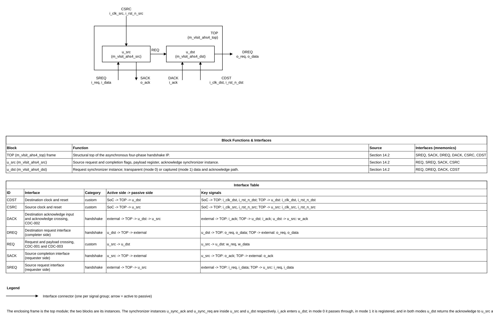
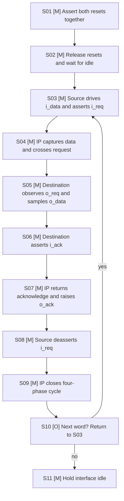

# Async 4-Phase Handshake Design Specification

> **Purpose:** Normative design contract for the asynchronous 4-phase handshake IP. It defines the transfer of one bundled payload word between two independent clock domains, the request/acknowledge protocol, the clock-domain-crossing structure, the reset contract, the RTL hierarchy, and the verification and timing requirements. Every mandatory requirement has a stable REQ identifier and a verification method.

## 1. Purpose, scope, and product context

### 1.1 Purpose and scope

The IP is a reusable point-to-point bridge that transfers one bundled payload word from a source clock domain to an independent destination clock domain with a four-phase (level) request/acknowledge handshake. It guarantees exactly one payload transfer for each accepted request, holds the payload stable across the asynchronous crossing, and backpressures the source until the destination acknowledges. The IP is intended for peripheral and control paths where a single word must cross between unrelated clocks without a FIFO.

**Included:** one source interface, one destination interface, two independent clock and reset pairs, a payload width of 1 to 256 bits, a selectable 1-, 2-, 3-, or 4-stage synchronizer, a selectable transparent or captured destination data path, and the bundled-data hold contract.

**Excluded:** FIFO buffering, multiple outstanding transactions, width conversion, byte enables, parity or ECC, error reporting, software-visible registers, APB or AXI protocol conversion, reset synchronization, clock generation, and power management. The SoC supplies pre-synchronized resets and owns the reset controller.

### 1.2 Deployment assumptions

| Item | Specification |
|---|---|
| Target SoC / product class | Peripheral subsystem of a battery-management SoC: a 1 GHz application processor configures a 40 MHz sensor controller through a 100 MHz peripheral bus. |
| Technology / library assumptions | Generic CMOS standard-cell library; the synchronizer wrapper maps to the library 2-FF, 3-FF, or 4-FF synchronizer cell. |
| Operating modes and workload | One transfer at a time; a 32-bit configuration word every 10 us in the application example; no low-power mode inside the IP. |
| Security / privilege context | None; the payload is opaque data and the IP has no privilege, security, or access-control state. |
| External dependencies | Pre-synchronized active-low resets from the SoC, the VLSIT common RTL library, the target synchronizer cells, and the timing constraints of section 17. |

### 1.3 Feature summary

| Feature ID | Feature | Required / optional | Configuration condition | Requirements |
|---|---|---|---|---|
| FEAT-001 | Asynchronous four-phase request/acknowledge transfer | Required | Always present | REQ-FUNC-001, REQ-FUNC-002 |
| FEAT-002 | Bundled payload capture and hold across the crossing | Required | Always present | REQ-FUNC-003, REQ-FUNC-004 |
| FEAT-003 | Two independent clock domains with a selectable synchronizer depth | Required | Always present | REQ-CLK-001, REQ-CLK-002, REQ-CLK-003 |
| FEAT-004 | Destination-controlled flow control and backpressure | Required | Always present | REQ-FUNC-005, REQ-FUNC-006, REQ-FUNC-007 |
| FEAT-005 | Paired reset contract for both domains | Required | Always present | REQ-RESET-001, REQ-RESET-002, REQ-RESET-003 |

### 1.4 Real-world applications of the features

| Feature ID | Real-world application (named system, example product) | What the application needs from the feature | Typical values | Consequence if missing or wrong | Requirements | Source |
|---|---|---|---|---|---|---|
| FEAT-001 | Peripheral subsystem of a battery-management SoC; the 1 GHz application processor configures a 40 MHz sensor controller through a 100 MHz peripheral bus. | Exactly one 32-bit configuration word per request, with no loss and no duplication. | 32-bit word every 10 us; 100 MHz source clock; 40 MHz destination clock. | A lost word leaves the sensor in its previous gain setting; a duplicated word advances the channel index twice and misaligns every later sample. | REQ-FUNC-001, REQ-FUNC-002 | User answer 2026-11-11 |
| FEAT-002 | Same battery-management SoC; the gain and filter word is sampled by the sensor controller while the application processor may update its own registers. | The payload must remain stable for the whole asynchronous crossing, independent of later source-side changes. | 32-bit payload stable for at least 4 destination cycles (25 ns each at 40 MHz, 2-stage synchronizer). | A payload change during the crossing loads a mixed gain/filter word and corrupts the sample stream until the next configuration. | REQ-FUNC-003, REQ-FUNC-004 | User answer 2026-11-11 |
| FEAT-003 | Same battery-management SoC; the peripheral bus and the sensor conversion clock come from different PLLs and have no fixed phase. | Correct operation with unrelated 100 MHz and 40 MHz clocks and a defined metastability margin. | 2-stage synchronizer; 10 ns source period; 25 ns destination period; clock ratio 2.5. | An unsynchronized request or acknowledge can be captured metastably, producing a lost request or a false completion. | REQ-CLK-001, REQ-CLK-002, REQ-CLK-003 | User answer 2026-11-11 |
| FEAT-004 | Same battery-management SoC; the sensor controller needs up to 2.5 us to finish a conversion before it can accept the next word. | The source must wait without overwriting the payload while the destination is busy. | Acknowledge delay from 1 to 100 destination cycles (40 ns to 4 us at 40 MHz). | Without flow control the source overwrites the payload before the destination samples it, and the sensor receives the wrong word. | REQ-FUNC-005, REQ-FUNC-006, REQ-FUNC-007 | User answer 2026-11-11 |
| FEAT-005 | Same battery-management SoC; a sensor-domain brown-out resets only the sensor controller while the peripheral bus keeps running. | A defined recovery so no transaction is left half-open after a reset event. | Both resets low for at least 2 cycles of each clock (20 ns source, 50 ns destination). | A destination-only reset aborts the acknowledge and leaves the source with `reg_req` high and `o_ack` low; completion is not guaranteed and the next configuration word may be lost. | REQ-RESET-001, REQ-RESET-002, REQ-RESET-003 | User answer 2026-11-11 |

## 2. Normative references and precedence

### 2.1 Normative references

| Ref ID | Document and revision | Applicable clauses | Authority / notes |
|---|---|---|---|
| REF-001 | VLSIT RTL Design Rules v2, `VLSIT_RTL_Design_Rule.md`, C:\Users\PC\.claude\skills\vlsit-asic-ip-microspec\reference\templates\VLSIT_RTL_Design_Rule.md | All rules of sections 2 to 12 | Mandatory RTL coding, naming, hierarchy, reset, and CDC baseline. |
| REF-002 | IEEE 1800-2017 SystemVerilog | Synthesizable subset | Language baseline, subject to REF-001 and the selected synthesis frontend. |
| REF-003 | VLSIT Common RTL library, `000_Common/rtl_lib/m_vlsit_afifo_cell_sync.sv` and `000_Common/rtl_cells`, repository C:\HQuan\102_MyGithub\VLSIT_DEEPSEEK\common_rtl | Synchronizer wrapper and cell models | Reusable implementation; the wrapper holds the technology cell and the metastability model. |
| REF-004 | VLSIT 005_AsyncAPBBridge, `rtl/m_vlsit_apbcdc_mst.sv` and `rtl/m_vlsit_apbcdc_slv.sv`, same repository | Four-phase request/acknowledge behavior | In-house behavioral reference; no source code is copied into this IP. |
| REF-005 | This specification, VLSIT-AHS4-SPEC v0.2 | All sections | Design contract for this IP. |

No external protocol standard applies to this IP. The four-phase handshake is a custom point-to-point contract defined by this specification; no protocol statement is taken from an external standard.

The naming rule is the default rule of `vlsit-rtl-generator` section 2, VLSIT RTL Design Rules v2, `VLSIT_RTL_Design_Rule.md`, path C:\Users\PC\.claude\skills\vlsit-asic-ip-microspec\reference\templates\VLSIT_RTL_Design_Rule.md, version v2 (rule R-054). Every module, port, signal, parameter, state, and instance name in this specification follows that rule.

### 2.2 Source-of-truth and conflict handling

1. This specification defines the IP contract and is the first source of truth.
2. REF-001 is the mandatory RTL coding, hierarchy, reset, and CDC baseline. A requirement that conflicts with REF-001 is revised, not waived locally.
3. The library behavior of REF-003 defines the synchronizer latency and the metastability model; the IP does not modify that behavior.
4. REF-004 is a behavioral reference only. Its APB-specific logic is not part of this IP.
5. A conflict between this specification and a reference is resolved by an explicit decision in section 20, not by an assumption in RTL.

### 2.3 Compliance declaration

| Standard | Revision / profile | Role implemented | Options | Deviations |
|---|---|---|---|---|
| Custom four-phase handshake | VLSIT-AHS4 v0.2 | Source bridge and destination bridge | `PARA_AHS4_DATA_W` 1 to 256; `PARA_AHS4_SYNC_TYPE` 1 to 4; `PARA_AHS4_DST_MODE` 0 or 1 | None |

## 3. Requirements and traceability

| ID | Requirement using shall/should/may | Source | Applies to | Verification method |
|---|---|---|---|---|
| REQ-FUNC-001 | The IP shall transfer exactly one payload word from the source port to the destination port for each accepted request, with no loss and no duplication when the interface contract of section 6.3 is met. | This specification | All configurations | Simulation and assertions |
| REQ-FUNC-002 | The IP shall implement a four-phase handshake: request assertion, acknowledge assertion, request deassertion, and acknowledge deassertion; a new request shall not be launched until the previous acknowledge has deasserted. | This specification | All configurations | Simulation and assertions |
| REQ-FUNC-003 | The source shall capture `i_data` at the launch edge and hold `o_data` stable from that edge until the four-phase cycle closes. | This specification | All configurations | Simulation and assertions |
| REQ-FUNC-004 | The destination shall present `o_data` valid while `o_req` is high; `o_data` may change only after `o_req` has returned low and a new request has been launched. | This specification | All configurations | Simulation and assertions |
| REQ-FUNC-005 | The source shall assert `o_ack` only after the destination acknowledge has crossed into the source domain; `o_ack` shall remain high until `i_req` is low. | This specification | All configurations | Simulation and assertions |
| REQ-FUNC-006 | The IP shall backpressure the source while a transaction is outstanding; a new `i_req` shall be ignored until `o_ack` has returned low. | This specification | All configurations | Simulation and assertions |
| REQ-FUNC-007 | The IP shall not impose a timeout; the destination may delay `i_ack` indefinitely and the payload shall remain stable. | This specification | All configurations | Simulation and inspection |
| REQ-FUNC-008 | The IP shall transfer all `PARA_AHS4_DATA_W` payload bits unchanged; it shall not interpret, align, mask, or truncate the payload. | This specification | All configurations | Simulation |
| REQ-FUNC-009 | The source control state shall be the two flags `reg_req` and `reg_ack`; the IP shall not use a finite-state machine. | This specification | All configurations | Inspection and simulation |
| REQ-IF-001 | The source interface shall consist of `i_req`, `i_data`, and `o_ack` in CLK-SRC; the destination interface shall consist of `o_req`, `o_data`, and `i_ack` in CLK-DST. | This specification | All configurations | Inspection |
| REQ-IF-002 | `i_req`, `o_ack`, `o_req`, and `i_ack` shall be active-high levels sampled on the rising edge of their domain clock. | This specification | All configurations | Simulation and assertions |
| REQ-IF-003 | `i_data` shall be stable while `i_req` is high and until `o_ack` is observed high; `i_ack` shall be stable while `o_req` is high and until `o_req` is observed low. | This specification | All configurations | Simulation and assertions |
| REQ-CLK-001 | The IP shall operate with two independent clocks, `i_clk_src` and `i_clk_dst`, with no assumed frequency, phase, or edge relationship. | This specification | All configurations | CDC analysis and simulation |
| REQ-CLK-002 | Every control crossing shall pass through a dedicated synchronizer wrapper; no combinational logic shall be placed before the first synchronizer stage or between stages. | REF-001 CLK-01, P28 | All configurations | Inspection and CDC analysis |
| REQ-CLK-003 | The synchronizer depth shall be selected by `PARA_AHS4_SYNC_TYPE` from 1 to 4 and shall map to the library options 1 to 4. | REF-003 | All configurations | Simulation and synthesis inspection |
| REQ-RESET-001 | Each domain shall have its own active-low reset input, `i_rst_n_src` and `i_rst_n_dst`, with asynchronous assertion and synchronous deassertion supplied by the SoC. | This specification | All configurations | Inspection and reset test |
| REQ-RESET-002 | Reset shall clear `reg_req`, `reg_ack`, `reg_data`, `o_ack`, `o_req`, and `o_data` to zero, including the capture-mode registers of the destination; no transaction shall complete across a reset. | This specification | All configurations | Reset test |
| REQ-RESET-003 | The integration shall assert `i_rst_n_src` and `i_rst_n_dst` together for every reset event; a destination-only reset is outside the contract. | This specification | All configurations | Inspection and reset test |
| REQ-PARAM-001 | `PARA_AHS4_DATA_W` shall be an integer from 1 to 256 with default 32. | This specification | All configurations | Elaboration and simulation |
| REQ-PARAM-002 | `PARA_AHS4_SYNC_TYPE` shall be 1, 2, 3, or 4 with default 2; the values 0 and above 4 are illegal. | This specification | All configurations | Elaboration and simulation |
| REQ-PARAM-003 | `PARA_AHS4_DST_MODE` shall be 0 or 1 with default 0; 0 selects the transparent destination path (option A) and 1 selects the captured destination path with a registered acknowledge (option B); every other value is illegal. | This specification | All configurations | Elaboration and simulation |
| REQ-ERR-001 | The IP shall have no error output and no error response; the protocol violations of section 12 shall be prevented by the integration contract. | This specification | All configurations | Inspection |
| REQ-PERF-001 | The IP shall support one outstanding transaction and shall meet the latency and initiation-interval contract of section 13. | This specification | All configurations | Simulation and analysis |
| REQ-RTL-001 | The RTL shall follow VLSIT RTL Design Rules v2, the hierarchy of section 14.2, and the naming rule of REF-001 section 2. | REF-001 | All configurations | Rule check and lint |
| REQ-VER-001 | The verification shall cover the tests of section 15, including both CDC simulation branches with at least three metastability seeds. | This specification | All configurations | Simulation and CDC analysis |
| REQ-DFT-001 | The IP shall be scan-ready with no latches, no internal tri-state, and no memory macros; the synchronizer cells shall be `dont_touch`. | REF-001 section 11 | All configurations | DFT inspection and lint |
| REQ-PD-001 | The timing contract shall define the two clock groups as asynchronous, constrain the bundled data path, and mark the synchronizer cells `dont_touch`. | REF-001 CLK-01 | All configurations | SDC review and STA |

## 4. Features and configurations

| Configuration ID | Enabled features | Disabled features | Interfaces / widths | Intended use | Verification target |
|---|---|---|---|---|---|
| CFG-BASE | FEAT-001 to FEAT-005 | None | 32-bit payload; 2-stage synchronizer; destination mode 0 | Default delivery and application example | Block simulation, CDC, lint, synthesis |
| CFG-NARROW | FEAT-001 to FEAT-005 | None | 8-bit payload; 2-stage synchronizer; destination mode 0 | Byte-wide sensor or control word | Simulation and lint |
| CFG-WIDE | FEAT-001 to FEAT-005 | None | 64-bit payload; 3-stage synchronizer; destination mode 0 | Wide configuration or sample word with extra metastability margin | Simulation and synthesis |
| CFG-CAPTURE | FEAT-001 to FEAT-005 | None | 32-bit payload; 2-stage synchronizer; destination mode 1 | Destination that captures the payload and returns a registered acknowledge | Simulation, lint, synthesis |

All features are always present. A configuration changes only the payload width, the synchronizer depth, and the destination mode; it does not add or remove ports.

An illegal configuration is `PARA_AHS4_DATA_W` below 1 or above 256, `PARA_AHS4_SYNC_TYPE` equal to 0 or above 4, or `PARA_AHS4_DST_MODE` other than 0 or 1. The IP does not define behavior for an illegal configuration; the integration shall not elaborate it. Values above 4 are additionally mapped to the 4-FF cell by the library, but that mapping is not a license to use them.

## 5. Architecture

### 5.1 Overview and block responsibilities

| Block | Responsibility | Inputs / outputs | Clock/reset domain | State or storage |
|---|---|---|---|---|
| `m_vlsit_ahs4_top` | Structural top: ports, interconnect, and named instances only. | All IP ports; internal req, data, and ack wires | Both domains | None |
| `m_vlsit_ahs4_src` | Source request and completion flags, payload register, and acknowledge synchronizer. | `i_req`, `i_data`, `i_ack`; `o_ack`, `o_req`, `o_data` | CLK-SRC | `reg_req`, `reg_ack`, `reg_data`, synchronizer flops; no FSM |
| `m_vlsit_ahs4_dst` | Request synchronizer; transparent data and acknowledge path in mode 0, registered capture and acknowledge path in mode 1. | `i_req`, `i_data`, `i_ack`; `o_req`, `o_data`, `o_ack` | CLK-DST | Mode 0: synchronizer flops only; mode 1: `reg_req`, `reg_ack`, `reg_data` |
| `m_vlsit_afifo_cell_sync` `u_sync_ack` | One-bit acknowledge synchronizer inside the source block. | `i_d` = `i_ack`; `o_q` = `w_ack_s` | CLK-SRC | 2 to 4 flops, selected by `PARA_AHS4_SYNC_TYPE` |
| `m_vlsit_afifo_cell_sync` `u_sync_req` | One-bit request synchronizer inside the destination block. | `i_d` = `i_req`; `o_q` = `w_req_s` | CLK-DST | 2 to 4 flops, selected by `PARA_AHS4_SYNC_TYPE` |

### 5.2 Block diagram



The editable draw.io source is [../figures/vlsit_ahs4_block_diagram.drawio](../figures/vlsit_ahs4_block_diagram.drawio). The diagram shows the structural top, the source and destination blocks, the request and payload crossing (CDC-001 and CDC-003), the acknowledge crossing into the source block (CDC-002), and the two clock domains. The synchronizer instances `u_sync_ack` and `u_sync_req` are inside `u_src` and `u_dst`; the interface table under the diagram lists every signal of each interface, including the internal acknowledge net `w_ack` that `u_dst` returns to `u_src`. The design intent of the two instances is identical; the split into two blocks keeps each clock domain's logic together. The source control is two flags, and the destination has no FSM in either mode.

### 5.3 Transaction and dataflow

A transfer begins when the source user presents `i_req` high with stable `i_data` while no transaction is outstanding: `reg_req` = 0, `reg_ack` = 0, and the synchronized acknowledge `w_ack_s` is low. The source captures the payload into `reg_data`, raises `reg_req`, and holds both until the acknowledge returns. The request crosses through `u_sync_req`. In mode 0 the destination presents `o_req` = `w_req_s` with the bundled payload on `o_data`, and returns `i_ack` through the destination block to `u_sync_ack`. In mode 1 the destination registers `w_req_s` and `i_data` into `reg_req` and `reg_data`, presents them on `o_req` and `o_data`, and returns a registered acknowledge that is gated by `reg_req` and `i_ack`. The acknowledge crosses through `u_sync_ack`. The source sets `reg_ack` (raising `o_ack`) and clears `reg_req`. The source user deasserts `i_req` after observing `o_ack` high. The destination sees `o_req` fall after the request crossing, deasserts `i_ack`, and the source clears `reg_ack`; the next launch is allowed once `w_ack_s` is low. The payload register is not cleared; it holds the last transferred word until the next launch.

### 5.4 Invariants

1. At most one transaction is outstanding.
2. `o_req` high implies `o_data` stable and equal to the payload captured at the source launch edge (mode 0) or to the destination capture of that payload (mode 1).
3. `o_ack` high implies a destination acknowledge was observed for the current request.
4. A new request is launched only when `reg_req`, `reg_ack`, and `w_ack_s` are all low.
5. `reg_req` and `reg_ack` are mutually exclusive; `reg_req` is set only at a launch edge.
6. No combinational logic exists between a crossing source register and the first synchronizer stage, or between synchronizer stages.
7. Both resets return the IP to the idle state and clear all control and payload registers.
8. The IP has no path that can complete a transaction without a destination acknowledge.

## 6. External interfaces and ports

### 6.1 Interface inventory

| Interface ID | Type and revision | Role | Direction at IP boundary | Clock domain | Required / optional | Configurations |
|---|---|---|---|---|---|---|
| IF-001 | Custom four-phase request/acknowledge, VLSIT-AHS4 v0.1 | Requester side | Inputs `i_req`, `i_data`; output `o_ack` | CLK-SRC | Required | All |
| IF-002 | Custom four-phase request/acknowledge, VLSIT-AHS4 v0.1 | Completer side | Outputs `o_req`, `o_data`; input `i_ack` | CLK-DST | Required | All |
| IF-003 | Clock and reset, active-low reset | Integration | `i_clk_src`, `i_rst_n_src`, `i_clk_dst`, `i_rst_n_dst` | Both | Required | All |

### 6.2 Complete port list

No external protocol standard defines this port list; it is the custom interface of section 6.3. All signals are synchronous to their domain clock except the resets, which are asynchronous-assert and synchronous-deassert inputs supplied by the SoC.

| Port | Direction | Width | Meaning (function) | Clock domain | Signal type | Reset / idle value | Timing / sampling | Configurations |
|---|---|---:|---|---|---|---|---|---|
| `i_clk_src` | Input | 1 | Source-domain clock | CLK-SRC | clock | N/A - clock has no reset value | Rising edge | All |
| `i_rst_n_src` | Input | 1 | Source-domain active-low reset | CLK-SRC | reset | 0 (reset asserted) | Asynchronous assertion, synchronous deassertion | All |
| `i_req` | Input | 1 | Source request level | CLK-SRC | level | 0 | Sampled on the rising edge of `i_clk_src` | All |
| `i_data` | Input | `PARA_AHS4_DATA_W` | Payload presented with the request | CLK-SRC | data (valid while `i_req` is high and until `o_ack` is high) | 0 | Setup before the launch edge; held by the source user | All |
| `o_ack` | Output | 1 | Source-side completion level | CLK-SRC | level | 0 | High after the acknowledge crossing; held until `i_req` is low | All |
| `i_clk_dst` | Input | 1 | Destination-domain clock | CLK-DST | clock | N/A - clock has no reset value | Rising edge | All |
| `i_rst_n_dst` | Input | 1 | Destination-domain active-low reset | CLK-DST | reset | 0 (reset asserted) | Asynchronous assertion, synchronous deassertion | All |
| `o_req` | Output | 1 | Destination request level | CLK-DST | level | 0 | Mode 0: follows the synchronized request. Mode 1: registered request, one destination cycle later. Sampled on the rising edge of `i_clk_dst` | All |
| `o_data` | Output | `PARA_AHS4_DATA_W` | Bundled payload for the destination | CLK-DST | data (valid while `o_req` is high) | 0 | Mode 0: bundled payload from the source capture. Mode 1: registered with `o_req` at the destination request edge. Stable while `o_req` is high | All |
| `i_ack` | Input | 1 | Destination acknowledge level | CLK-DST | level | 0 | Asserted in response to `o_req`; held until `o_req` is low | All |

### 6.3 Protocol behavior

The interface is a level handshake. A request is accepted at the rising edge of `i_clk_src` when `i_req` is high, `reg_req` is low, `reg_ack` is low, and `w_ack_s` is low. The destination samples `o_data` while `o_req` is high. Backpressure is expressed by delaying `i_ack`; there is no ready signal and no timeout.

| Case | Legal behavior | Illegal / unsupported case | IP response | Requirement IDs |
|---|---|---|---|---|
| Normal transfer | `i_req` high with stable `i_data`; `i_ack` high after `o_req`; both return low. | None | One payload transfer; `o_ack` high until `i_req` low. | REQ-FUNC-001, REQ-FUNC-002 |
| Destination backpressure | `i_ack` delayed by any number of destination cycles. | None; delay is unbounded. | Source holds `reg_req` high; payload held; no timeout. | REQ-FUNC-007 |
| Destination mode 0 (option A) | `o_req` follows the synchronized request; `o_data` is the bundled payload; `i_ack` passes through to the source synchronizer. | Any other `PARA_AHS4_DST_MODE` value. | No destination state; no added latency. | REQ-PARAM-003, REQ-FUNC-004 |
| Destination mode 1 (option B) | `o_req` and `o_data` are registered; `o_ack` is registered and gated by `reg_req` and `i_ack`. | Any other `PARA_AHS4_DST_MODE` value. | One destination cycle for the request and payload; one destination cycle for the acknowledge. | REQ-PARAM-003, REQ-FUNC-004 |
| Back-to-back transfer | `i_req` low after `o_ack`; next `i_req` after `o_ack` low. | Starting a new request before `o_ack` low. | The new request is ignored until the cycle closes. | REQ-FUNC-002, REQ-FUNC-006 |
| `i_req` held high after `o_ack` | Not a four-phase request. | Yes; `i_req` must fall after `o_ack`. | `reg_ack` remains high with `o_ack` high; no new transaction. | REQ-FUNC-005, REQ-FUNC-006 |
| `i_ack` high before `o_req` | Not a legal response. | Yes; `i_ack` must follow `o_req`. | Source blocks launch while `w_ack_s` is high; the mode-1 acknowledge logic also gates `i_ack` with `reg_req`; no false completion. | REQ-FUNC-005, REQ-ERR-001 |
| `i_data` changes during flight | The source may change `i_data` after the launch edge. | No, provided the captured payload is used. | The captured `reg_data` is unaffected; the new value is ignored until the next launch. | REQ-FUNC-003, REQ-FUNC-008 |
| Destination-only reset | Not supported. | Yes; the destination resets while the source does not. | Destination returns idle; the source remains with `reg_req` high and `o_ack` low unless the destination acknowledges the re-asserted request. The defined recovery is a source reset. | REQ-RESET-003, REQ-ERR-001 |
| Source-only reset during flight | Supported with recovery. | No, provided the destination drops `i_ack` when `o_req` falls. | Source clears `reg_req` and `reg_ack`; the crossing falls; destination returns idle. | REQ-RESET-002 |
| Simultaneous reset | Supported. | None. | Both domains return idle; no transaction completes. | REQ-RESET-002 |
| No acknowledge | Legal only as backpressure. | A permanent absence of `i_ack` is an integration fault. | Source waits indefinitely; no timeout and no error output. | REQ-FUNC-007, REQ-ERR-001 |

### 6.4 Interrupts and events

| Signal/event | Polarity | Assert condition | Clear/deassert condition | Mask/priority | Crossing | Reset state |
|---|---|---|---|---|---|---|
| No interrupt or event output | N/A - the IP has no interrupt or event port | N/A - no event source | N/A - no event source | N/A - no mask or priority | N/A - no event crossing | N/A - no event state |

## 7. Clock, reset, and power

### 7.1 Clock domains

| Domain | Clock port | Edge | Frequency range | Source | Relationship to other clocks | Gating policy |
|---|---|---|---|---|---|---|
| CLK-SRC | `i_clk_src` | Rising | Application example 100 MHz; no specified minimum or maximum, limited by the target library and STA | SoC peripheral PLL | Asynchronous to CLK-DST; no fixed phase or frequency ratio | No gating inside the IP |
| CLK-DST | `i_clk_dst` | Rising | Application example 40 MHz; no specified minimum or maximum, limited by the target library and STA | Sensor conversion clock | Asynchronous to CLK-SRC; no fixed phase or frequency ratio | No gating inside the IP |

### 7.2 CDC and RDC

| Crossing ID | From → to | Signals | Structure | Reset handling | Constraints / verification |
|---|---|---|---|---|---|
| CDC-001 | CLK-SRC → CLK-DST | `reg_req` → `w_req_s` → `o_req`, one-bit level | `m_vlsit_afifo_cell_sync` `u_sync_req`, 2 to 4 stages selected by `PARA_AHS4_SYNC_TYPE`; `o_req` is `w_req_s` in mode 0 and the registered `w_req_s` in mode 1 | Reset to 0 in the destination domain | Asynchronous clock groups; CDC analysis; nominal latency N-1 destination cycles plus 0 to 2 metastability cycles in the simulation model; mode 1 adds one destination cycle |
| CDC-002 | CLK-DST → CLK-SRC | `u_dst` acknowledge → `w_ack_s`, one-bit level | `m_vlsit_afifo_cell_sync` `u_sync_ack`, 2 to 4 stages selected by `PARA_AHS4_SYNC_TYPE`; the destination ack output is `i_ack` in mode 0 and the registered `reg_ack` in mode 1 | Reset to 0 in the source domain | Asynchronous clock groups; CDC analysis; nominal latency N-1 source cycles plus 0 to 2 metastability cycles in the simulation model; mode 1 adds one destination cycle before the crossing |
| CDC-003 | CLK-SRC → CLK-DST | `reg_data` → `o_data`, `PARA_AHS4_DATA_W`-bit bundled data | No synchronizer; the source register is held stable from launch until the cycle closes. Mode 0 passes the payload through; mode 1 captures it in `u_dst` `reg_data` | Payload register reset to 0 in the source domain; mode-1 capture register reset to 0 in the destination domain | Bundled-data constraint: `set_max_delay` no greater than (N-1) destination periods minus the capture setup; `set_min_delay` 0; verified by the data-hold assertion |

RDC-001: the two resets are pre-synchronized by the SoC. The IP contains no reset synchronizer and no reset crossing; the integration shall not release a reset asynchronously to its own clock.

### 7.3 Reset domains and sequencing

| Reset ID | Port | Polarity / assertion | Sync or async | Scope | Deassertion | Reset value |
|---|---|---|---|---|---|---|
| RST-SRC | `i_rst_n_src` | Active-low; asynchronous assertion | Asynchronous assertion, synchronous deassertion by the SoC reset controller | CLK-SRC logic | Synchronous to `i_clk_src` | `reg_req` 0; `reg_ack` 0; `reg_data` 0; `o_ack` 0 |
| RST-DST | `i_rst_n_dst` | Active-low; asynchronous assertion | Asynchronous assertion, synchronous deassertion by the SoC reset controller | CLK-DST logic | Synchronous to `i_clk_dst` | Mode 0: `o_req` 0 and `o_data` 0 through the synchronizer. Mode 1: `reg_req` 0; `reg_ack` 0; `reg_data` 0; `o_req` 0; `o_data` 0; `o_ack` 0 |

Both resets shall be asserted together for every reset event, for at least 2 cycles of each clock. They may be released in any order because each domain starts in idle and the source waits for `w_ack_s` low before launching. A reset aborts any in-flight transaction; no partial transfer is reported as complete. After a reset, the source user shall drop `i_req` and the destination user shall drop `i_ack`; the IP ignores both until the respective domain has left reset and the acknowledge crossing is low. A stopped clock holds the state of its domain; no transaction completes while either clock is stopped, and a reset is required after the clock restarts. There is no warm, partial, or retention reset.

### 7.4 Power intent (if applicable)

**Not required (confirmed by user, 2026-11-11):** the IP has no power domain, isolation, retention, power-good sequencing, clock stop/restart control, or UPF/CPF ownership. The SoC owns power intent; the IP is a always-on soft RTL block.

## 8. Parameters and elaboration configurations

| Parameter | Purpose | Default | Legal values / range | Dependencies / invalid combinations | Effect |
|---|---|---|---|---|---|
| `PARA_AHS4_DATA_W` | Width of the bundled payload and of `i_data` and `o_data` | 32 | 1 to 256 | None; any value in range is legal with either synchronizer depth | Sets the payload register width and both data port widths |
| `PARA_AHS4_SYNC_TYPE` | Synchronizer depth selection for both crossings | 2 | 1, 2, 3, or 4 | None; independent of the payload width | Selects the library option: 1 = two D flip-flop cells, 2 = 2-FF cell, 3 = 3-FF cell, 4 = 4-FF cell |
| `PARA_AHS4_DST_MODE` | Destination data-presentation mode: option A or option B | 0 | 0 or 1 | Independent of the payload width and the synchronizer depth; mode 1 adds `PARA_AHS4_DATA_W` destination flops and one destination cycle to the request and acknowledge paths | 0 = transparent destination (option A); 1 = captured destination with a registered acknowledge (option B) |

The RTL parameter declarations shall use exactly these three comment lines above each parameter:

```systemverilog
// Parameter Description: width of the bundled payload and of both data ports.
// Parameter values: 1 to 256; default is 32.
// Parameter unit: bit
parameter logic [31:0] PARA_AHS4_DATA_W = 32,
// Parameter Description: synchronizer depth for the request and acknowledge crossings.
// Parameter values: 1, 2, 3, or 4; default is 2.
// Parameter unit: none
parameter logic [31:0] PARA_AHS4_SYNC_TYPE = 2,
// Parameter Description: destination data-presentation mode; selects option A or option B.
// Parameter values: 0 = transparent (option A), 1 = captured (option B); default is 0.
// Parameter unit: none
parameter logic [31:0] PARA_AHS4_DST_MODE = 0
```

| Configuration | Parameter overrides | Features/interfaces | Expected hierarchy | Elaboration/lint/synthesis target |
|---|---|---|---|---|
| CFG-BASE | Defaults: `PARA_AHS4_DATA_W` = 32, `PARA_AHS4_SYNC_TYPE` = 2, `PARA_AHS4_DST_MODE` = 0 | FEAT-001 to FEAT-005; IF-001 to IF-003 | `m_vlsit_ahs4_top` with `u_src`, `u_dst`, `gen_dst_transparent`, `u_sync_ack`, `u_sync_req` | Generic elaboration, rule check, lint, synthesis |
| CFG-NARROW | `PARA_AHS4_DATA_W` = 8, `PARA_AHS4_SYNC_TYPE` = 2, `PARA_AHS4_DST_MODE` = 0 | Same features and interfaces, 8-bit payload | Same hierarchy | Generic elaboration, lint |
| CFG-WIDE | `PARA_AHS4_DATA_W` = 64, `PARA_AHS4_SYNC_TYPE` = 3, `PARA_AHS4_DST_MODE` = 0 | Same features and interfaces, 64-bit payload, 3-stage synchronizer | Same hierarchy | Generic elaboration, synthesis |
| CFG-CAPTURE | `PARA_AHS4_DATA_W` = 32, `PARA_AHS4_SYNC_TYPE` = 2, `PARA_AHS4_DST_MODE` = 1 | Same features and interfaces, captured destination path | Same hierarchy with `gen_dst_capture` | Generic elaboration, rule check, lint, synthesis |

An illegal configuration is `PARA_AHS4_DATA_W` below 1 or above 256, `PARA_AHS4_SYNC_TYPE` equal to 0 or above 4, or `PARA_AHS4_DST_MODE` other than 0 or 1. The IP does not define behavior for an illegal configuration; the integration shall not elaborate it. No port is added or removed by a parameter value.

## 9. Data representation and arithmetic

| Quantity | Width | Encoding / range | Extension / truncation | Overflow / invalid behavior |
|---|---:|---|---|---|
| Payload `i_data`, `o_data` | `PARA_AHS4_DATA_W` | Unsigned binary; bit 0 is the least-significant bit | None; all bits are transferred unchanged | No arithmetic and no overflow; an out-of-range parameter is an illegal configuration |
| Request and acknowledge levels | 1 | Active-high; 0 = idle, 1 = asserted | Not applicable | No encoding beyond the level |
| Reset | 1 | Active-low; 0 = reset asserted | Not applicable | Reset dominates the control state |

The payload has no byte lanes, endianness, alignment, sign, or numeric interpretation inside the IP. It is an opaque vector; the source and destination users define its meaning. No bit is reserved and no bit is a don't-care.

## 10. Detailed functional behavior

### 10.1 Modes and state transitions

| Mode/state | Entry condition | Behavior | Exit condition | Outputs / side effects |
|---|---|---|---|---|
| Phase (flag condition) | Entry condition | Behavior | Exit condition | Outputs / side effects |
|---|---|---|---|---|
| Idle (`reg_req` = 0, `reg_ack` = 0) | Reset deasserted, or acknowledge crossing low after completion | Wait for a request; hold `reg_req` and `o_ack` low | `i_req` high and `w_ack_s` low | Launch: `reg_req` becomes 1, `reg_data` captures `i_data` |
| Request (`reg_req` = 1, `reg_ack` = 0) | Launch edge | Hold the request and payload; wait for the acknowledge crossing | `w_ack_s` high | `reg_req` becomes 0 and `reg_ack` becomes 1 |
| Complete (`reg_req` = 0, `reg_ack` = 1) | `w_ack_s` high in Request | Report completion to the source user; hold `o_ack` high | `i_req` low | `reg_ack` becomes 0 |
| Close (`reg_req` = 0, `reg_ack` = 0, `w_ack_s` = 1) | `i_req` low in Complete | Wait for the acknowledge crossing to fall | `w_ack_s` low | Ready for the next request |

The IP has no FSM. The source control state is the two flags `reg_req` and `reg_ack`; the four phase names above describe the legal flag combinations and are not encoded states. `reg_req` and `reg_ack` are mutually exclusive. The destination has no FSM in either mode: mode 0 passes the synchronized request, the payload, and the acknowledge through; mode 1 adds one register stage for the request and payload and one register for the acknowledge.

### 10.2 Operations

| Operation ID | Inputs / preconditions | Processing semantics | Result / completion | Latency / ordering |
|---|---|---|---|---|
| OP-001 | Single transfer: resets released, `reg_req` and `reg_ack` low, `i_req` high with stable `i_data`, destination ready to acknowledge | Capture payload, cross request, present `o_req` and `o_data`, return acknowledge, assert `o_ack`, close the four-phase cycle | Exactly one payload word transferred; `o_ack` high until `i_req` low; both interfaces return idle | Nominal 6 source cycles from launch to `o_ack` in the mode-0 10.3 example; one outstanding transaction |
| OP-002 | Backpressured transfer: as OP-001, but the destination delays `i_ack` | Source holds `reg_req` high; payload and request held; no timeout | Transfer completes when `i_ack` arrives; one word transferred | Additional delay equals the destination acknowledge delay; no loss or duplication |
| OP-003 | Reset and recovery: both resets asserted together, then released | Clear both flags, request, payload, acknowledge, and destination outputs | Both domains idle; no transaction completes | Reset assertion asynchronous; release synchronous in each domain |
| OP-004 | Back-to-back transfer: OP-001 followed by a second request after `o_ack` low and the acknowledge crossing low | Close the first four-phase cycle fully, then launch the second request | Two payload words transferred in order | Minimum gap is one source cycle with `i_req` low after `w_ack_s` has fallen |
| OP-005 | Captured transfer (option B): as OP-001 with `PARA_AHS4_DST_MODE` = 1 | Register the request and payload at the destination, then return a registered acknowledge | Exactly one payload word transferred; `o_req` and `o_data` aligned one destination cycle after the synchronized request; `o_ack` one destination cycle after `reg_req && i_ack` | Nominal 8 source cycles from launch to `o_ack` in the mode-1 10.3 example; one outstanding transaction |

### 10.3 Cycle-level behavior

**Waveform plan (rule R-024).** The waveforms below were agreed with the user on 2026-11-11. Every operation of 10.2 has a waveform; the success case, the backpressure case, the reset case, the back-to-back case, and the illegal destination-only reset case are shown. Each figure has its WaveJSON source beside it.

| Waveform ID | Function / operation | Scenario (success / error / corner) | Signals shown | Figure | Confirmed by user |
|---|---|---|---|---|---|
| WF-001 | OP-001 single transfer, mode 0, N=2, 1:1 clocks, one destination wait cycle | Success | `i_clk_src`, `i_req`, `i_data`, `o_ack`, `reg_req`, `reg_ack`, `w_ack_s`, `i_clk_dst`, `o_req`, `o_data`, `i_ack` | `../figures/vlsit_ahs4_wf001_success.svg` | 2026-11-12 |
| WF-002 | OP-002 backpressured transfer, mode 0, `i_ack` delayed 4 destination cycles | Success with backpressure | Same signals as WF-001 | `../figures/vlsit_ahs4_wf002_backpressure.svg` | 2026-11-12 |
| WF-003 | OP-003 reset during a transaction, both resets asserted together | Corner / recovery | Same signals plus `i_rst_n_src`, `i_rst_n_dst` | `../figures/vlsit_ahs4_wf003_reset.svg` | 2026-11-12 |
| WF-004 | OP-004 back-to-back transfer with the minimum gap, mode 0 | Corner | Same signals as WF-001 | `../figures/vlsit_ahs4_wf004_backtoback.svg` | 2026-11-12 |
| WF-005 | Illegal destination-only reset while the source keeps running | Error | Same signals plus `i_rst_n_dst` | `../figures/vlsit_ahs4_wf005_dst_reset.svg` | 2026-11-12 |
| WF-006 | OP-005 captured transfer, mode 1, N=2, 1:1 clocks, one destination wait cycle | Success | `i_clk_src`, `i_req`, `i_data`, `o_ack`, `reg_req`, `reg_ack`, `w_ack_s`, `i_clk_dst`, `o_req`, `o_data`, `i_ack` | `../figures/vlsit_ahs4_wf006_capture.svg` | 2026-11-12 |

Cycle table for WF-001 with 10 ns clocks on both domains, aligned rising edges, N=2, mode 0, and one destination wait cycle. The launch edge is t0.

| Cycle / event | Input condition | State/action | Output condition |
|---|---|---|---|
| t0 | `i_req` = 1, `i_data` = D0 | No flag set; launch: capture D0; `reg_req` = 1 | `o_ack` = 0; `o_req` = 0 |
| t1 | Request crossing stage 1 | Destination synchronizer captures 1 | `o_req` = 0 |
| t2 | Request crossing stage 2 | Destination synchronizer output 1 | `o_req` = 1; `o_data` = D0 |
| t3 | Destination samples D0 | Destination user asserts `i_ack` = 1 | `o_req` = 1; `o_data` = D0 |
| t4 | Acknowledge crossing stage 1 | Source synchronizer captures 1 | `o_ack` = 0 |
| t5 | Acknowledge crossing stage 2 | Source synchronizer output 1 | `w_ack_s` = 1 |
| t6 | Request phase sees `w_ack_s` = 1 | `reg_req` = 0; `reg_ack` = 1; `o_ack` = 1 | `o_ack` = 1 |
| t7 | `i_req` = 0 | `reg_ack` = 0 | `o_ack` = 0 |
| t8 | Request crossing stage 1 | Destination synchronizer captures 0 | `o_req` = 1 |
| t9 | Request crossing stage 2 | Destination synchronizer output 0; destination user deasserts `i_ack` = 0 | `o_req` = 0; `i_ack` = 0 |
| t10 | Acknowledge crossing stage 1 | Source synchronizer captures 0 | `w_ack_s` = 1 |
| t11 | Acknowledge crossing stage 2 | Source synchronizer output 0 | `w_ack_s` = 0 |
| t12 | Close phase sees `w_ack_s` = 0 | Idle; next request may launch | Idle; ready for the next request |

With `PARA_AHS4_DST_MODE` = 1 (WF-006), the same transaction takes two additional source cycles in the 1:1 example: one destination cycle for the registered request and payload, and one destination cycle for the registered acknowledge. `o_req` and `o_data` are aligned one destination cycle after `w_req_s`; the destination acknowledge is one destination cycle after `reg_req && i_ack`. The source flag sequence and the four-phase order are unchanged. The nominal `o_ack` time is 8 source cycles after launch and the minimum initiation interval is 15 source cycles in the same aligned example.

The metastability model of REF-003 can add 0, 1, or 2 cycles to each crossing in simulation. The nominal table is the reference; the verification of section 15 repeats it with at least three seeds.

### 10.4 Arbitration, buffering, and throughput

There is no arbitration and no FIFO. The IP supports one outstanding transaction. The source is backpressured by its own two control flags: it cannot launch again until `reg_req` and `reg_ack` are low and the acknowledge crossing has fallen. The destination is backpressured by the source: `o_req` remains high until the source clears the request after seeing the acknowledge.

The nominal launch-to-`o_ack` latency is one launch edge plus (N-1) destination cycles for the request crossing, the destination response delay R (at least one destination cycle), (N-1) source cycles for the acknowledge crossing, and one source cycle for the completion flag. Mode 1 adds one destination cycle for the registered request and one destination cycle for the registered acknowledge. The exact value depends on the clock phase. In the 1:1 aligned example of 10.3, `o_ack` is high 6 source cycles after the launch edge in mode 0 and 8 source cycles in mode 1; the cycle closes 12 source cycles after the launch edge in mode 0 and 15 source cycles in mode 1. The minimum initiation interval is one full four-phase round trip; there is no pipelining and no sustained rate above one transaction per round trip.

### 10.5 Memories and storage

| Storage ID | Kind | Depth × width | Ports | Read latency | Write mask | Reset/init | ECC/parity | Implementation |
|---|---|---|---|---|---|---|---|---|
| No memory | N/A - the IP stores one payload word in a source register and, in mode 1, one copy in a destination register | Mode 0: 1 × `PARA_AHS4_DATA_W`; mode 1: 2 × `PARA_AHS4_DATA_W` | One write at launch; in mode 1 one write at the destination request edge | Same cycle | None | Reset to 0 | None | Inferred registers |

**Not required (confirmed by user, 2026-11-11):** the IP has no array, FIFO, SRAM, or memory macro; the only storage is the source payload register, the optional mode-1 destination capture register, the two source flags, the optional mode-1 destination flags, and the synchronizer flops. There are no collisions, read-during-write cases, or memory-compiler requirements.

## 11. Register and programming model

### 11.1 CSR specification source

**Not required (confirmed by user, 2026-11-11):** the IP has no software-visible registers, no APB port, and no CSR workbook. The register interface is absent by design, not omitted.

| Item | Specification |
|---|---|
| CSR workbook file | N/A - no registers are defined |
| Sheet used for this IP | N/A - no workbook sheet exists |
| Workbook revision / date | N/A - no workbook exists |
| CSR generator | N/A - no CSR RTL is generated |
| CSR module name | N/A - no CSR module exists |
| Register prefix | N/A - no register names exist |
| Asynchronous | N/A - no APB clock and no register clock |
| APB clock and register clock | N/A - the IP has only `i_clk_src` and `i_clk_dst` |
| Source of `i_protect_en` and `i_slverr_en` | N/A - no APB interface exists |

### 11.2 Software sequences

There is no software-visible register and no software sequence. The flowchart and table below define the hardware use sequence that an integrator or a hardware sequencer follows. The CSR column is N/A - the IP has no software-visible register; the Interface column names the actual req/ack pins.



| No. | Step | Option (M/O) | Interface | CSR | Description |
|---|---|---|---|---|---|
| S01 | Assert both resets together | M | Reset pins `i_rst_n_src`, `i_rst_n_dst`; drive both low | N/A - no software-visible register | Places both domains in a known idle state before any transfer. |
| S02 | Release resets and wait for idle | M | Reset pins; release synchronously in each domain | N/A - no software-visible register | Ensures the source flags, request, acknowledge, payload, and destination registers are cleared. |
| S03 | Source drives `i_data` and asserts `i_req` | M | Source req/ack: drive `i_data`, then `i_req` high | N/A - no software-visible register | Presents the payload and starts one four-phase transaction. |
| S04 | IP captures data and crosses request | M | Internal CDC-001 and CDC-003 | N/A - no software-visible register | Holds the payload and passes the request through the synchronizer; mode 1 also captures the payload at the destination. |
| S05 | Destination observes `o_req` and samples `o_data` | M | Destination req/ack: sample `o_data` while `o_req` is high | N/A - no software-visible register | Consumes the payload in the destination domain. |
| S06 | Destination asserts `i_ack` | M | Destination req/ack: drive `i_ack` high | N/A - no software-visible register | Signals that the payload has been accepted and starts the return phase; mode 1 returns the acknowledge through a destination register. |
| S07 | IP returns acknowledge and raises `o_ack` | M | Internal CDC-002; source `o_ack` | N/A - no software-visible register | Reports completion in the source domain. |
| S08 | Source deasserts `i_req` | M | Source req/ack: drive `i_req` low | N/A - no software-visible register | Completes the request phase of the four-phase cycle. |
| S09 | IP closes the four-phase cycle | M | Internal CDC-001 and CDC-002 | N/A - no software-visible register | Drives `o_req` and `o_ack` low and clears both source flags. |
| S10 | Next word? Return to S03 | O | Source req/ack: assert a new `i_req` only after `o_ack` is low and the acknowledge crossing has fallen | N/A - no software-visible register | Selects a back-to-back transfer when another word is ready; otherwise the interface stays idle. |
| S11 | Hold interface idle | M | Source and destination req/ack held low | N/A - no software-visible register | Keeps both domains idle when no transfer is required. |

### 11.3 CSR connection to the design

**Not required (confirmed by user, 2026-11-11):** no CSR module is instantiated and no register field connects to the design. The IP ports of section 6.2 are the complete interface.

### 11.4 APB access behavior of the CSR

**Not required (confirmed by user, 2026-11-11):** the IP has no APB interface, no CSR module, and no register access behavior. APB wait states, `PSLVERR`, unmapped addresses, and reserved bits do not apply.

## 12. Error handling and recovery

| Error ID | Detection condition | Observable response/status | Interrupt | Clear/recovery | Reset behavior |
|---|---|---|---|---|---|
| ERR-001 | `i_rst_n_dst` low while `i_rst_n_src` high and a transaction is outstanding | `o_req` and `o_data` return idle; the source remains with `reg_req` high and `o_ack` low | None | Assert `i_rst_n_src` low for at least 2 source cycles, then release both resets | Source clears both flags; destination returns idle |
| ERR-002 | `i_req` stays high after `o_ack` high | `reg_ack` remains high with `o_ack` high; no new transaction starts | None | Drop `i_req` low | Reset clears both flags |
| ERR-003 | `i_ack` high before `o_req` | Source blocks the launch while `w_ack_s` is high; the mode-1 acknowledge logic gates `i_ack` with `reg_req`; no false completion | None | Drop `i_ack` low | Reset clears both flags |
| ERR-004 | `i_data` changes between the launch edge and the end of the transaction | Captured `reg_data` is unaffected; the new value is ignored until the next launch | None | None; observe the payload hold contract | Reset clears `reg_data` |
| ERR-005 | `i_rst_n_src` low during a transaction while `i_rst_n_dst` stays high | Source aborts; `o_req` falls after the request crossing; destination must drop `i_ack` | None | Re-issue the request after both domains are idle | Source clears both flags; destination returns idle |

The IP has no error output, no error code, no interrupt, and no timeout. The conditions above are integration-contract violations; the IP response is limited to returning to a safe idle state where the structure allows it. A permanent absence of `i_ack` is indistinguishable from legal backpressure and therefore leaves the source waiting; the integration shall detect that condition outside the IP.

## 13. Performance, power, and area

| Metric ID | Metric | Target / limit | Conditions | Measurement method | Hard / goal |
|---|---|---|---|---|---|
| PPA-001 | Maximum frequency | Close at 100 MHz source and 40 MHz destination in the target library | Worst-case PVT corner, CFG-BASE | STA with the constraints of section 17 | Goal |
| PPA-002 | Area | Source payload register of `PARA_AHS4_DATA_W` flops, two source flags, the optional mode-1 destination registers (`PARA_AHS4_DATA_W` + 2 flops), and two synchronizer cells; no FSM and no gate-count target | Target library, CFG-BASE and CFG-CAPTURE | Synthesis cell-area report | Goal |
| PPA-003 | Dynamic and leakage power | No target; report the activity-based estimate | Application workload of 1.2, CFG-BASE | Synthesis power report with the stated activity | Goal |
| PERF-001 | Launch-to-`o_ack` latency | 6 source cycles in mode 0 and 8 source cycles in mode 1 in the 10.3 example (N=2, 1:1 clocks, one wait cycle); exact value depends on clock phase | CFG-BASE and CFG-CAPTURE, aligned clocks | Simulation and cycle count | Hard for the example; formula in 10.4 for other phases |
| PERF-002 | Sustained throughput | One transaction per four-phase round trip; no pipelining | CFG-BASE and CFG-CAPTURE | Simulation | Hard |
| PERF-003 | Minimum initiation interval | 12 source cycles in mode 0 and 15 source cycles in mode 1 in the 10.3 example; one full round trip otherwise | CFG-BASE and CFG-CAPTURE, aligned clocks | Simulation | Hard |

No timing closure is claimed from RTL synthesis alone. The application frequencies are integration targets; the final STA uses the SoC constraints and the target library.

## 14. RTL implementation contract

### 14.1 Required coding baseline

The mandatory RTL authority is REF-001, VLSIT RTL Design Rules v2, read in full before the first RTL line. The RTL shall use one synthesizable module per `.sv` file with the file name equal to the module name; an ANSI port list with `input wire` and `output logic`; `always_comb` or continuous assignments for combinational logic with a default on every path; `always_ff` for state with one clock per process and separate next-state logic; `logic` for internal signals; parameters declared with the `PARA_` prefix and the three PAR-02 comment lines; derived localparams declared with the `LPARA_` prefix; named port and parameter connections; and no latches, `casex`, plain `always`, `initial`, delays, macros in RTL, packages, interfaces, or internal tri-state. The top is a structural wrapper. SVA and testbench code stay outside the design file set. The IP has no FSM: the source control state is the two flags `reg_req` and `reg_ack`, each assigned in its own `always_ff`, and the destination mode is selected by an elaboration-time generate block named `gen_dst_transparent` or `gen_dst_capture`.

### 14.2 RTL hierarchy

| Module | Responsibility | Parent / instance | Clock/reset domains | Interface |
|---|---|---|---|---|
| `m_vlsit_ahs4_top` | Structural top; ports, interconnect, and instances only | None | CLK-SRC and CLK-DST | All IP ports of section 6.2 |
| `m_vlsit_ahs4_src` | Source request and completion flags, payload register, acknowledge synchronizer | `m_vlsit_ahs4_top` / `u_src` | CLK-SRC | `i_req`, `i_data`, `i_ack`; `o_ack`, `o_req`, `o_data` |
| `m_vlsit_ahs4_dst` | Request synchronizer; transparent or capture data and acknowledge path | `m_vlsit_ahs4_top` / `u_dst` | CLK-DST | `i_req`, `i_data`, `i_ack`; `o_req`, `o_data`, `o_ack` |
| `m_vlsit_afifo_cell_sync` | One-bit technology synchronizer wrapper with the metastability model | `m_vlsit_ahs4_src` / `u_sync_ack` | CLK-SRC | `i_clk_dst`, `i_rst_n_dst`, `i_d`, `o_q` |
| `m_vlsit_afifo_cell_sync` | One-bit technology synchronizer wrapper with the metastability model | `m_vlsit_ahs4_dst` / `u_sync_req` | CLK-DST | `i_clk_dst`, `i_rst_n_dst`, `i_d`, `o_q` |

The IP has no FSM. The source control state is two flags; the destination has no FSM in either mode. In mode 0 the destination is transparent so that the payload is presented as soon as the synchronized request arrives. In mode 1 the destination adds one register stage for the request and payload and one register for the acknowledge. The two synchronizer wrappers are the only technology-cell instances; they are reused from REF-003 and are not copied or edited.

### 14.3 Synthesis assumptions

| Item | Value / source |
|---|---|
| Top / source file list | `m_vlsit_ahs4_top`; `filelist.f` generated by `vlsit_lint_rtl.py filelist` |
| Frontend version and options | Any IEEE 1800-2017 synthesizer supported by the project; lint with Verilator or slang |
| Parameters/configuration | CFG-BASE by default; CFG-NARROW and CFG-WIDE for coverage |
| Libraries/corners | VLSIT cell models in `000_Common/rtl_cells` for generic elaboration; the target library supplies the synchronizer cells and the standard cells |
| Memory flow | N/A - no memory macro is instantiated |
| Lint rule configuration | `vlsit_rtl_check.py check` and `vlsit_lint_rtl.py lint`; no waiver for an inferred latch |

## 15. Verification specification

### 15.1 Scope and strategy

Verification covers block simulation of the source flags, the two crossings, the transparent and capture destination modes, the bundled-data hold, reset and recovery, and the parameter boundaries. It also covers CDC analysis, lint, and synthesis elaboration. The testbench is a separate source set; it is not part of the design file list. Simulation uses the library metastability model in the non-synthesis branch and the plain cell models in the `VLSIT_SYNTHESIS` branch. At least three seeds are used for the metastability model. Formal verification of the exactly-once and four-phase invariants is recommended but not mandatory for the first delivery.

### 15.2 Requirement-based test plan

| Test ID | Requirements | Scenario / stimulus | Expected result | Test type | Configuration |
|---|---|---|---|---|---|
| TEST-001 | REQ-RESET-001, REQ-RESET-002 | Assert and release both resets in idle; check every output | All outputs low; `reg_req` = 0, `reg_ack` = 0; no transaction | Directed | CFG-BASE |
| TEST-002 | REQ-FUNC-001, REQ-FUNC-002, REQ-FUNC-003, REQ-FUNC-004 | One request with stable D0; destination acknowledges after one cycle | Exactly one D0 at the destination; `o_ack` high until `i_req` low; both idle after the cycle | Directed | CFG-BASE |
| TEST-003 | REQ-FUNC-007 | Request with `i_ack` delayed from 1 to 100 destination cycles | Payload stable; no loss; completion after the delay | Directed and random | CFG-BASE |
| TEST-004 | REQ-FUNC-002, REQ-FUNC-006 | Two requests with the minimum `i_req` low gap and `o_ack` low | Two words in order; no overlap; no duplication | Directed | CFG-BASE |
| TEST-005 | REQ-FUNC-003, REQ-FUNC-008 | Change `i_data` after the launch edge | Current payload unchanged; new value used only by the next request | Directed | CFG-BASE |
| TEST-006 | REQ-RESET-002 | Assert only `i_rst_n_src` during a transaction, then release | Source clears both flags; destination returns idle after the request crossing falls | Directed | CFG-BASE |
| TEST-007 | REQ-RESET-003, REQ-ERR-001 | Assert only `i_rst_n_dst` during a transaction | Source remains waiting; the test records the contract violation and does not expect completion | Directed | CFG-BASE |
| TEST-008 | REQ-PARAM-001, REQ-PARAM-002 | `PARA_AHS4_DATA_W` = 1 and 256; `PARA_AHS4_SYNC_TYPE` = 1 and 4 | All transfers correct at every legal boundary | Directed | CFG-NARROW, CFG-WIDE |
| TEST-009 | REQ-VER-001, REQ-CLK-001, REQ-CLK-002 | Run the complete testbench in the `VLSIT_SYNTHESIS` branch and in the metastability branch with seeds 1, 2, and 3 | All assertions pass; no loss or duplication; every branch log has its required label | Regression | CFG-BASE |
| TEST-010 | REQ-RTL-001 | Run `vlsit_rtl_check.py check` and `vlsit_lint_rtl.py lint` on the delivered file set in modes 0 and 1 | RESULT: PASS with no errors | Static analysis | All |
| TEST-011 | REQ-PARAM-003, REQ-FUNC-004, REQ-FUNC-009 | `PARA_AHS4_DST_MODE` = 1; one request and one backpressured request; observe `reg_req`, `reg_ack`, `o_req`, `o_data`, and `o_ack` | `o_req` and `o_data` aligned one destination cycle after `w_req_s`; `o_ack` one destination cycle after `reg_req && i_ack`; exactly one word; no FSM state | Directed | CFG-CAPTURE |

### 15.3 Assertions and coverage

| Property / coverage ID | Intent | Requirements | Checker / source set | Acceptance criterion |
|---|---|---|---|---|
| SVA-001 | Exactly one `o_ack` high period per accepted `i_req` | REQ-FUNC-001 | Verification | No extra or missing completion |
| SVA-002 | `o_data` stable while `o_req` is high and until `o_req` falls | REQ-FUNC-004 | Verification | No data change in the window |
| SVA-003 | `o_ack` rises only after the request has crossed and the destination has acknowledged | REQ-FUNC-005 | Verification | No completion before `o_req` was high |
| SVA-004 | A new request is not launched until the previous acknowledge has fallen | REQ-FUNC-002 | Verification | No overlapping transactions |
| SVA-005 | Reset drives all outputs low and clears both source flags | REQ-RESET-002 | Verification | No X or high output in reset |
| SVA-006 | `i_ack` remains high until `o_req` is low | REQ-IF-003 | Verification | No early acknowledge drop |
| COV-001 | Source flag coverage: every legal `reg_req`/`reg_ack` combination and transition | REQ-FUNC-002, REQ-FUNC-009 | Verification | Idle, Request, Complete, and Close phases exercised |
| COV-002 | Synchronizer depth coverage | REQ-PARAM-002 | Verification | 1, 2, 3, and 4 exercised |
| COV-003 | Acknowledge-delay bins | REQ-FUNC-007 | Verification | 1, 2 to 5, 6 to 20, and above 20 cycles |
| COV-004 | Destination mode coverage | REQ-PARAM-003 | Verification | Modes 0 and 1 elaborated and exercised |

### 15.4 Formal, CDC, and RDC

| Analysis | Scope | Assumptions / constraints | Evaluation method |
|---|---|---|---|
| Formal | Exactly-once, four-phase ordering, and data hold on the source flags and the two crossings | Destination acknowledges only after `o_req`; both resets follow the paired contract | Optional formal property check |
| CDC / RDC | CDC-001, CDC-002, CDC-003 between CLK-SRC and CLK-DST; RDC-001 pre-synchronized resets | Asynchronous clock groups; synchronizer cells `dont_touch`; bundled data constrained per 17.1.3 | CDC tool and simulation with three seeds |

## 16. DFT and testability

| Topic | Requirement / decision |
|---|---|
| Scan architecture and scan eligibility | Scan-ready; every flop is scannable; no latch, no combinational loop, and no internal tri-state. |
| Scan/test clocks, controls, reset behavior | The IP has no DFT ports. The SoC wrapper controls scan clocks and reset override; both resets must be controllable in test mode. |
| Test-mode entry/exit and safe state | The SoC owns test-mode entry and exit; the IP has no test mode of its own. The safe state is the reset state of section 7.3. |
| MBIST, memory repair, LBIST | N/A - no memory macro or memory array exists in the IP. |
| Test access, wrappers, test points | N/A - no test access port or wrapper is instantiated in the IP. |
| Clock-gating test enable | N/A - the IP contains no clock gate; there is no gated clock to force on. |
| ATPG constraints and exclusions | The two `m_vlsit_afifo_cell_sync` instances are `dont_touch` and are excluded from scan insertion; the source flags, the payload registers, and the mode-1 destination registers are testable. |
| DFT insertion architecture and generated test artifacts | The SoC DFT flow inserts scan and generates the test artifacts; this IP delivers soft RTL only. |

## 17. Physical design and timing integration

### 17.1 Timing constraints and budgets

#### 17.1.1 Clock and analysis scenarios

| Clock ID | Port / source object | Primary/generated and master | Period, waveform, phase / ratio | Latency / uncertainty / transition | Clock group / mode | Constraint source |
|---|---|---|---|---|---|---|
| CLK-SRC | `i_clk_src` | Primary | 10 ns example (100 MHz), 50 percent duty; phase independent | SoC clock latency and uncertainty; transition per library | CLK_SRC / functional | SoC SDC; IP budget below |
| CLK-DST | `i_clk_dst` | Primary | 25 ns example (40 MHz), 50 percent duty; phase independent | SoC clock latency and uncertainty; transition per library | CLK_DST / functional | SoC SDC; IP budget below |

#### 17.1.2 Interface timing budgets

| Interface / port group | Direction | Reference clock | External min / max delay | Input transition / output load | IP timing budget | Mode / condition | Constraint source |
|---|---|---|---|---|---|---|---|
| Source request and payload | Input | CLK-SRC | `i_req` and `i_data` setup 2 ns, hold 0.5 ns before the launch edge | 0.1 ns input transition | 0.5 ns internal launch path | Functional | SoC SDC |
| Source completion | Output | CLK-SRC | `o_ack` valid within 2 ns after the rising edge | 10 pF output load | 2 ns | Functional | SoC SDC |
| Destination request and payload | Output | CLK-DST | `o_req` and `o_data` valid within 2 ns after the synchronizer output edge | 10 pF output load | 2 ns | Functional | SoC SDC |
| Destination acknowledge | Input | CLK-DST | `i_ack` setup 2 ns, hold 0.5 ns before the rising edge | 0.1 ns input transition | 0.5 ns internal capture path | Functional | SoC SDC |

The bundled data path from the source payload register to the destination capture flop is constrained in 17.1.3. In mode 1 the capture flop is `u_dst` `reg_data`; in mode 0 it is the destination user's capture flop. The data is stable for the whole handshake, so the destination may capture it at any edge while `o_req` is high.

#### 17.1.3 Timing exception inventory

| Exception ID | Type / SDC command | From | Through | To | Value and setup/hold/min/max meaning | Mode / condition | Technical rationale |
|---|---|---|---|---|---|---|---|
| EXC-001 | `set_clock_groups -asynchronous` | CLK_SRC group | none | CLK_DST group | No timing relationship between the two clocks | Functional | The clocks are independent; all control crossings are synchronized and analyzed by CDC. |
| EXC-002 | `set_max_delay` | `u_src` payload register `reg_data_reg*` | Bundled data wire | Destination capture flop: `u_dst` `reg_data_reg*` in mode 1, destination user flop in mode 0 | (N-1) destination periods minus the capture setup; N = `PARA_AHS4_SYNC_TYPE` | Functional | The data must settle before the synchronized request is captured; the value reserves the synchronizer latency. |
| EXC-003 | `set_min_delay` | Same as EXC-002 | Same as EXC-002 | Same as EXC-002 | 0 ns | Functional | Prevents a hold violation on the bundled data path. |
| EXC-004 | `set_dont_touch` | `u_src/u_sync_ack` and `u_dst/u_sync_req` | none | none | Preserve the synchronizer cells and their internal structure | Functional | The cells must not be optimized, retimed, or merged. |

Illustrative SDC, to be completed with the elaborated hierarchical names:

```tcl
create_clock -name CLK_SRC -period 10.000 [get_ports i_clk_src]
create_clock -name CLK_DST -period 25.000 [get_ports i_clk_dst]
set_clock_groups -asynchronous -group [get_clocks CLK_SRC] -group [get_clocks CLK_DST]
set_max_delay 25.000 -from [get_pins u_src/reg_data_reg*] -to [get_pins <destination_capture>]
set_min_delay 0.000 -from [get_pins u_src/reg_data_reg*] -to [get_pins <destination_capture>]
set_dont_touch [get_cells u_src/u_sync_ack]
set_dont_touch [get_cells u_dst/u_sync_req]
```

### 17.2 Physical assumptions

| Topic | Requirement / assumption |
|---|---|
| Hard/memory macros and views | None; the IP instantiates only the library synchronizer wrapper and standard cells. |
| Floorplan, placement region, pin placement | N/A - soft RTL; the SoC integrator places the IP. |
| Utilization/congestion target | N/A - soft RTL; no block-level utilization target. |
| Power intent, clock/reset trees | No power intent in the IP; the SoC builds the clock and reset trees for both domains. |
| High-fanout controls, physical-only cells | None in the IP; the resets are local to their domains. |
| ECO/spare cells | N/A - soft RTL; the SoC flow owns ECO and spare cells. |
| Extraction and timing-analysis corners | The SoC STA flow and target library define the corners; the IP reports the CFG-BASE result. |
| Delivery form: RTL/netlist/hardened layout | Soft synthesizable RTL with `filelist.f`; no netlist or hardened layout. |

## 18. Security, safety, and reliability

| Topic | Requirement / rationale | Verification method / expected behavior |
|---|---|---|
| Security boundary and threat assumptions | N/A - the IP has no security boundary, secret, or privilege state. | Inspection. |
| Access control / privilege | N/A - the IP has no register or software access path. | Inspection. |
| Secure clearing / zeroization | N/A - the payload is not secret; reset clears the payload register. | Reset test. |
| Information leakage / side channels | N/A - the IP has no cryptographic or secret-dependent logic. | Inspection. |
| ECC/parity and fault detection | N/A - no ECC or parity is implemented; data integrity is provided by the exactly-once handshake, not by fault detection. | Simulation and inspection. |
| Safety goal / integrity level | Required - the IP shall not lose or duplicate a word under the interface contract; this is a data-integrity requirement, not a safety certification. | TEST-002 to TEST-005 and SVA-001 to SVA-004. |
| Diagnostics, fail-safe state, recovery | N/A - no diagnostic register or error output; the fail-safe state is the reset state of both domains. | Reset test and inspection. |

## 19. Requirement-to-verification traceability

| Requirement ID | RTL module/location | Test/property | Verification method / analysis | Configuration |
|---|---|---|---|---|
| REQ-FUNC-001 | `m_vlsit_ahs4_src`, `m_vlsit_ahs4_dst` | TEST-002, SVA-001 | Simulation and assertion | CFG-BASE |
| REQ-FUNC-002 | `m_vlsit_ahs4_src` flags | TEST-004, SVA-004, COV-001 | Simulation and assertion | CFG-BASE |
| REQ-FUNC-003 | `m_vlsit_ahs4_src` payload register | TEST-005, SVA-002 | Simulation and assertion | CFG-BASE |
| REQ-FUNC-004 | `m_vlsit_ahs4_dst` output | TEST-002, TEST-011, SVA-002 | Simulation and assertion | CFG-BASE, CFG-CAPTURE |
| REQ-FUNC-005 | `m_vlsit_ahs4_src` `reg_ack` | TEST-002, SVA-003 | Simulation and assertion | CFG-BASE |
| REQ-FUNC-006 | `m_vlsit_ahs4_src` flags | TEST-004, SVA-004 | Simulation and assertion | CFG-BASE |
| REQ-FUNC-007 | `m_vlsit_ahs4_src` `reg_req` hold | TEST-003, COV-003 | Simulation | CFG-BASE |
| REQ-FUNC-008 | `m_vlsit_ahs4_src` payload register | TEST-005 | Simulation | CFG-BASE, CFG-CAPTURE |
| REQ-FUNC-009 | `m_vlsit_ahs4_src` flags | TEST-011, COV-001 | Inspection and simulation | All |
| REQ-IF-001 | Top port list | Inspection | Inspection | All |
| REQ-IF-002 | `m_vlsit_ahs4_src`, `m_vlsit_ahs4_dst` | TEST-002, SVA-006 | Simulation and assertion | CFG-BASE |
| REQ-IF-003 | `m_vlsit_ahs4_src`, `m_vlsit_ahs4_dst` | TEST-005, SVA-006 | Simulation and assertion | CFG-BASE |
| REQ-CLK-001 | `m_vlsit_ahs4_top` | TEST-009 | CDC analysis and simulation | CFG-BASE |
| REQ-CLK-002 | `u_sync_ack`, `u_sync_req` | Inspection | Inspection and CDC analysis | All |
| REQ-CLK-003 | `u_sync_ack`, `u_sync_req` | TEST-008, COV-002 | Simulation and synthesis inspection | CFG-BASE, CFG-WIDE |
| REQ-RESET-001 | Top reset ports | TEST-001 | Inspection and reset test | CFG-BASE |
| REQ-RESET-002 | `m_vlsit_ahs4_src`, `m_vlsit_ahs4_dst` | TEST-001, TEST-006, SVA-005 | Reset test and assertion | CFG-BASE |
| REQ-RESET-003 | Integration contract | TEST-007 | Inspection and directed test | CFG-BASE |
| REQ-PARAM-001 | Parameter list | TEST-008 | Elaboration and simulation | CFG-NARROW, CFG-WIDE |
| REQ-PARAM-002 | Parameter list | TEST-008, COV-002 | Elaboration and simulation | CFG-NARROW, CFG-WIDE |
| REQ-PARAM-003 | `m_vlsit_ahs4_dst` generate | TEST-011, COV-004 | Elaboration and simulation | CFG-BASE, CFG-CAPTURE |
| REQ-ERR-001 | Top port list | TEST-007 | Inspection | CFG-BASE |
| REQ-PERF-001 | `m_vlsit_ahs4_src` flags | TEST-002, TEST-011, PERF-001 | Simulation and analysis | CFG-BASE, CFG-CAPTURE |
| REQ-RTL-001 | All `.sv` files | TEST-010 | Rule check and lint | All |
| REQ-VER-001 | Testbench and logs | TEST-009 | Regression with three seeds | CFG-BASE |
| REQ-DFT-001 | All `.sv` files | DFT inspection | Inspection and lint | All |
| REQ-PD-001 | SDC | EXC-001 to EXC-004 | SDC review and STA | CFG-BASE |

## 20. Assumptions, dependencies, and decisions

| ID | Type | Assumption / dependency / unresolved decision | Technical impact / version / configuration | Resolution / status |
|---|---|---|---|---|
| DEC-001 | Decision | The interface is a bundled-data four-phase req/ack handshake with `i_req`, `i_data`, and `o_ack` on the source side and `o_req`, `o_data`, and `i_ack` on the destination side. | Fixes the port list and the transaction model. | Confirmed by the designer 2026-11-11. |
| DEC-002 | Decision | The resets are pre-synchronized by the SoC; the IP contains no reset synchronizer. | Each reset input must be synchronous to its domain clock on deassertion; the IP adds no reset logic. | Confirmed by the designer 2026-11-11. |
| DEC-003 | Decision | Both resets are asserted together for every reset event; a destination-only reset is outside the contract. | The source can wait indefinitely after a destination-only reset; the defined recovery is a source reset. | Confirmed by the designer 2026-11-11. |
| DEC-004 | Decision | `PARA_AHS4_DATA_W` is 32 by default with legal values 1 to 256; `PARA_AHS4_SYNC_TYPE` is 2 by default with legal values 1 to 4. | Sets the payload width and the synchronizer depth; the port list stays static. | Confirmed by the designer 2026-11-11. |
| DEC-005 | Decision | The IP has no busy status output; the source user infers a transaction from `i_req` and `o_ack`, and the destination from `o_req`. | Keeps the port list minimal; no extra feature to verify. | Confirmed by the designer 2026-11-11. |
| DEC-006 | Decision | The IP has no software-visible register, no APB port, and no CSR workbook. | Section 11 is not required; the use sequence in 11.2 is the hardware req/ack sequence. | Confirmed by the designer 2026-11-11. |
| DEC-007 | Decision | The application is the peripheral subsystem of a battery-management SoC with a 100 MHz source, a 40 MHz destination, and a 32-bit configuration word every 10 us. | Sizes the latency and throughput requirements and the example values. | Confirmed by the designer 2026-11-11. |
| DEC-008 | Decision | The two synchronizers reuse `m_vlsit_afifo_cell_sync` from REF-003 instead of a new synchronizer module. Options offered: this generic one-bit wrapper (chosen), the APB-specific one-bit wrapper, the vector wrapper with width 1, or a local synchronizer. | Keeps the technology cell and the metastability model in one reviewed wrapper and avoids a duplicate implementation. | Reuse confirmed by the designer 2026-11-11 after the R-049 scan; both crossings instantiate this wrapper. |
| DEC-009 | Decision | The source control uses the two flags `reg_req` and `reg_ack` instead of a four-state FSM. The four phase names of 10.1 describe the legal flag combinations and are not encoded states. | Removes the redundant state register; the flag sequence reproduces the same four-phase timing in mode 0 and keeps every output registered. | Confirmed by the designer 2026-11-12. |
| DEC-010 | Decision | `PARA_AHS4_DST_MODE` selects option A (0, transparent destination, no destination state) or option B (1, captured destination with a registered acknowledge). The default is 0. | Option A keeps the delivered latency; option B adds `PARA_AHS4_DATA_W` destination flops, one destination cycle for the request and payload, and one destination cycle for the acknowledge. The integration must also constrain the mode-1 capture path. | Confirmed by the designer 2026-11-12. |
| ASM-001 | Assumption | The public reference-IP search found no qualified public IP: GitHub returned 0 candidates and Gitee was unreachable with an SSL timeout. | No public IP is used or copied; REF-004 is an in-house behavioral reference. | Open for a future Gitee search; no impact on this design. |
| DEP-001 | Dependency | VLSIT common RTL library at C:\HQuan\102_MyGithub\VLSIT_DEEPSEEK\common_rtl, including `m_vlsit_afifo_cell_sync` and the cell models. | The IP does not compile without the library source in the file list. | Available in the repository. |
| DEP-002 | Dependency | Target standard-cell library with 2-FF, 3-FF, and 4-FF synchronizer cells. | The library wrapper must map to real cells for synthesis and CDC. | Supplied by the SoC implementation flow. |
| DEP-003 | Dependency | SoC reset controller that asserts both resets together and releases each synchronously. | The paired reset contract of DEC-003 depends on it. | Supplied by the SoC integration. |

## 21. Glossary

| Term / acronym | Definition |
|---|---|
| Four-phase handshake | A level handshake with four phases: request assertion, acknowledge assertion, request deassertion, and acknowledge deassertion. |
| Bundled data | A payload that crosses without a synchronizer and is held stable by the requester for the whole handshake, so the destination can sample it safely. |
| Source domain | The clock domain of `i_clk_src`, `i_req`, `i_data`, and `o_ack`. |
| Destination domain | The clock domain of `i_clk_dst`, `o_req`, `o_data`, and `i_ack`. |
| CDC | Clock-domain crossing. |
| Synchronizer stage | One flip-flop in the chain that samples an asynchronous input; the depth is the number of stages. |
| Metastability | An uncertain capture of a signal that changes near the sampling edge; modeled by REF-003 in simulation. |
| Backpressure | The destination delays the acknowledge, so the source waits and holds the payload. |
| Return-to-zero | The phase in which request and acknowledge return low before the next transaction. |
| Dont-touch | A synthesis attribute or constraint that preserves a cell or module from optimization, retiming, or merging. |
| Transparent mode | `PARA_AHS4_DST_MODE` = 0 (option A); the destination presents the synchronized request, the bundled payload, and the destination acknowledge without additional state. |
| Capture mode | `PARA_AHS4_DST_MODE` = 1 (option B); the destination registers the request and payload and returns a registered acknowledge. |
| Flag-based control | A control style that stores the four-phase state in the two flags `reg_req` and `reg_ack` instead of an FSM state register. |

## 22. References used to shape this template

1. Arm, *Introducing the Arm architecture*: distinguishes architecture specifications, product-specific Technical Reference Manuals, and Configuration/Integration Manuals. [https://developer.arm.com/-/media/Arm%20Developer%20Community/PDF/Learn%20the%20Architecture/Introducing%20the%20Arm%20architecture.pdf](https://developer.arm.com/-/media/Arm%20Developer%20Community/PDF/Learn%20the%20Architecture/Introducing%20the%20Arm%20architecture.pdf)
2. Arm, *CoreLink SIE-200 System IP for Embedded Technical Reference Manual*, DDI 0571: functional-description example with function, port list, bus properties, and read/write timing. [https://developer.arm.com/documentation/ddi0571/latest/functional-description/ahb5-to-internal-sram-interface-module](https://developer.arm.com/documentation/ddi0571/latest/functional-description/ahb5-to-internal-sram-interface-module)
3. Synopsys, *DesignWare DW_axi IP Directory*: lists Databook, Installation Guide, Release Notes, and User Guide as distinct documents. [https://www.synopsys.com/dw/ipdir.php?c=DW_axi](https://www.synopsys.com/dw/ipdir.php?c=DW_axi)
4. Synopsys, *Using DW_ahb_dmac in an AXI Subsystem*: configuration, interface propagation, clock assumptions, performance/area trade-offs, and integration. [https://www.synopsys.com/dw/dwtb/ahb_dmac/ahb_dmac.html](https://www.synopsys.com/dw/dwtb/ahb_dmac/ahb_dmac.html)
5. Synopsys, *What Is Static Timing Analysis?*: false-path and multicycle-path concepts. [https://www.synopsys.com/glossary/what-is-static-timing-analysis.html](https://www.synopsys.com/glossary/what-is-static-timing-analysis.html)
6. VLSIT RTL Generator AI Model repository: the RTL flow and the design rule set. [https://github.com/nguyenquanicd/VLSIT_RTL_Generator_AI_Model](https://github.com/nguyenquanicd/VLSIT_RTL_Generator_AI_Model)
