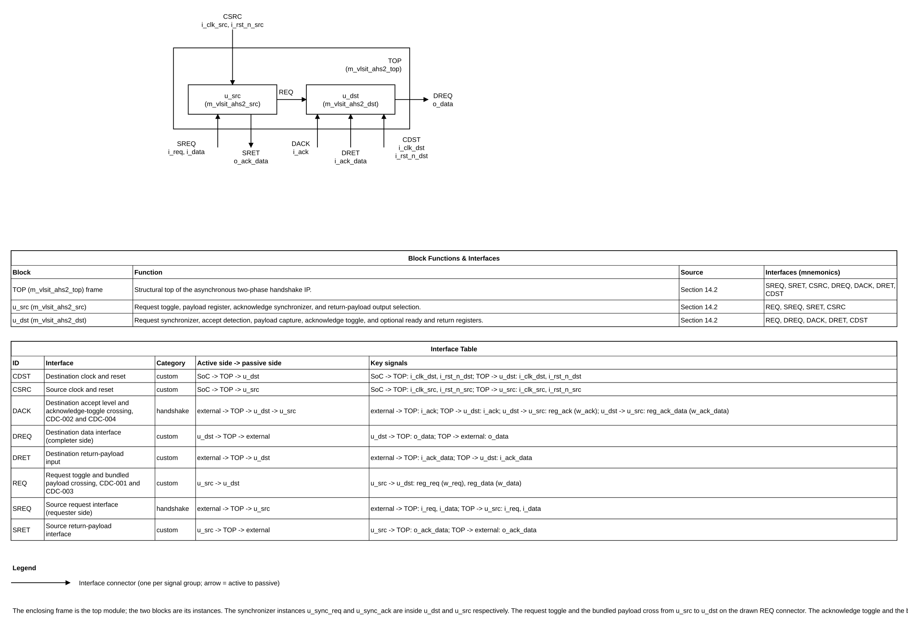
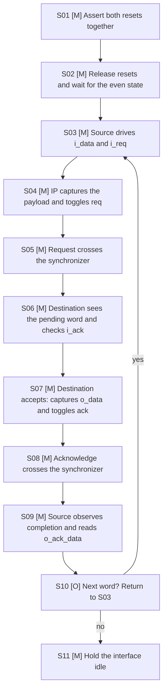

# Async 2-Phase Handshake Design Specification

> **Purpose:** Normative design contract for the asynchronous two-phase (toggle) handshake IP. It defines the transfer of one bundled payload word from a source clock domain to an independent destination clock domain, the optional acknowledge-direction return payload, the clock-domain-crossing structure, the reset contract, the RTL hierarchy, and the verification and timing requirements. Every mandatory requirement has a stable REQ identifier and a verification method.

> **Requirement terms:** **shall** = mandatory and testable; **should** = recommended; **may** = optional.

## Document map

1. [Purpose, scope, and product context](#1-purpose-scope-and-product-context)
2. [Normative references and precedence](#2-normative-references-and-precedence)
3. [Requirements and traceability](#3-requirements-and-traceability)
4. [Features and configurations](#4-features-and-configurations)
5. [Architecture](#5-architecture)
6. [External interfaces and ports](#6-external-interfaces-and-ports)
7. [Clock, reset, and power](#7-clock-reset-and-power)
8. [Parameters and elaboration configurations](#8-parameters-and-elaboration-configurations)
9. [Data representation and arithmetic](#9-data-representation-and-arithmetic)
10. [Detailed functional behavior](#10-detailed-functional-behavior)
11. [Register and programming model (CSR from workbook)](#11-register-and-programming-model)
12. [Error handling and recovery](#12-error-handling-and-recovery)
13. [Performance, power, and area](#13-performance-power-and-area)
14. [RTL implementation contract](#14-rtl-implementation-contract)
15. [Verification specification](#15-verification-specification)
16. [DFT and testability](#16-dft-and-testability)
17. [Physical design and timing integration](#17-physical-design-and-timing-integration)
18. [Security, safety, and reliability](#18-security-safety-and-reliability)
19. [Requirement-to-verification traceability](#19-requirement-to-verification-traceability)
20. [Assumptions, dependencies, and decisions](#20-assumptions-dependencies-and-decisions)
21. [Glossary](#21-glossary)
22. [References used to shape this template](#22-references-used-to-shape-this-template)

## 1. Purpose, scope, and product context

### 1.1 Purpose and scope

The IP is a reusable point-to-point bridge that transfers one bundled payload word between two independent clock domains with a two-phase (toggle) request/acknowledge handshake. Each transaction changes the request level once and the acknowledge level once, so the protocol has no return-to-zero phase and the next word may be launched at the same source edge at which the previous acknowledge is observed. The IP holds the payload stable across the asynchronous crossing, captures it in the destination domain, and refuses new work until the destination has accepted the current word.

The returned acknowledge-direction payload is defined as a held word: the destination captures the return value at its accept edge and holds it until the next accept edge, so the source observes the last accepted return value without a separate valid signal.

**Included:** one source interface, one destination interface, two independent clock and reset pairs, an independent request payload width and return payload width of 1 to 1024 bits, a selectable 1-, 2-, 3-, or 4-stage synchronizer, a selectable direct or registered destination ready path, a selectable disabled, transparent, or registered return payload, the bundled-data hold contract, and the exactly-once transfer guarantee.

**Excluded:** FIFO buffering, more than one outstanding transaction, arbitration between several sources, error detection or correction, parity, timeout, a completion output at the source, a valid output at the destination, software-visible registers, and power management. These functions belong to the integrating SoC.

### 1.2 Deployment assumptions

| Item | Specification |
|---|---|
| Target SoC / product class | Battery-management SoC; a 1 GHz application processor configures a 40 MHz sensor controller through a 100 MHz peripheral path (section 1.4). |
| Technology / library assumptions | Generic standard-cell RTL with the VLSIT library synchronizer wrapper REF-003 and the technology 2-, 3-, or 4-flop synchronizer cells; both clocks are asynchronous with no assumed ratio or phase. |
| Operating modes and workload | Single-word configuration transfers and short streaming bursts; 32-bit request payload and 32-bit return payload in the delivery configuration; at most one transaction per round trip. |
| Security / privilege context | None; the payload is an opaque vector and the IP has no privilege state or access control. |
| External dependencies | SoC clock and reset controller that asserts both resets together; destination ready logic that drives `i_ack`; source-side logic that knows when a return word is meaningful, because the IP has no completion output (ASM-001). |

### 1.3 Feature summary

| Feature ID | Feature | Required / optional | Configuration condition | Requirements |
|---|---|---|---|---|
| FEAT-001 | Two-phase toggle request/acknowledge transfer with exactly one payload word per accepted request | Required | Always present | REQ-FUNC-001, REQ-FUNC-002, REQ-FUNC-006 |
| FEAT-002 | Bundled payload hold in the source domain and capture in the destination domain | Required | Always present | REQ-FUNC-003, REQ-FUNC-004 |
| FEAT-003 | Source backpressure while a transaction is outstanding; destination backpressure through `i_ack` | Required | Always present | REQ-FUNC-005, REQ-FUNC-007 |
| FEAT-004 | Acknowledge-direction return payload with disabled, transparent, or registered behavior | Required; the port is always present | `PARA_AHS2_ACK_DATA_MODE` = 0, 1, or 2 | REQ-FUNC-008, REQ-PARAM-005 |
| FEAT-005 | Independent request and return payload widths from 1 to 1024 bits | Required | Always present | REQ-PARAM-001, REQ-PARAM-002 |
| FEAT-006 | Selectable 1-, 2-, 3-, or 4-stage synchronizer for both one-bit crossings | Required | Always present | REQ-CLK-003, REQ-PARAM-003 |
| FEAT-007 | Direct or registered destination ready path | Required | `PARA_AHS2_DST_MODE` = 0 or 1 | REQ-FUNC-009, REQ-PARAM-004 |

All seven features are always present in the RTL. A configuration changes only parameter values; it never adds or removes a port.

### 1.4 Real-world applications of the features

The application is the peripheral subsystem of a battery-management SoC: a 1 GHz application processor writes configuration words to a 40 MHz sensor controller through a 100 MHz peripheral path. The transfer must complete in under 150 ns, must never lose or duplicate a word, and must return a 16-bit conversion status with each accepted word.

| Feature ID | Real-world application (named system, example product) | What the application needs from the feature | Typical values | Consequence if missing or wrong | Requirements | Source |
|---|---|---|---|---|---|---|
| FEAT-001 | Battery-management SoC of an electric-vehicle battery pack; the 1 GHz application processor configures the 40 MHz sensor controller through a 100 MHz peripheral path | One request/acknowledge round trip per configuration word with no dead phase between words, so the shadow update fits the control period | 32-bit word, 100 MHz source, 40 MHz destination, under 150 ns per transfer | A four-phase return-to-zero cycle adds a second round trip, misses the 150 ns shadow-update window, and the new gain is applied one control period late | REQ-FUNC-001, REQ-FUNC-002, REQ-FUNC-006 | User answer 2026-11-13; REF-004 |
| FEAT-002 | Same SoC; the sensor controller writes a 32-bit gain and offset trim code into the measurement channel | The 32-bit trim code must arrive as one stable word even though the two clocks have no fixed phase | 32-bit bundled word, destination capture at the accept edge | A mixed-bit capture writes a wrong gain code, the current measurement saturates, and the pack protection threshold is misjudged | REQ-FUNC-003, REQ-FUNC-004 | User answer 2026-11-13; REF-004 |
| FEAT-003 | Same SoC; the processor issues a burst of four configuration writes while the 40 MHz sensor clock stalls for up to 3 cycles | The source must wait without overwriting or dropping the word, and the destination must be able to refuse a word | 1 outstanding transaction, ready low for 3 destination cycles | A lost or overwritten word leaves the sensor channel unconfigured and the measurement silently stops updating | REQ-FUNC-005, REQ-FUNC-007 | User answer 2026-11-13; REF-004 |
| FEAT-004 | Same SoC; the sensor returns a 16-bit conversion status with each accepted configuration word | The processor needs the returned status of the word it just sent, without a separate valid signal | 16-bit return word captured at the accept edge | Without the return word the processor cannot confirm that the new gain took effect, and the closed-loop calibration diverges | REQ-FUNC-008, REQ-PARAM-005 | User answer 2026-11-13; REF-004 |
| FEAT-005 | Same SoC; 8-bit command words for the sequencer and 32-bit trim tables for the measurement channel use the same bridge | One parameterized IP must cover the narrow command path and the wide trim path with the same ports | 8 bits and 32 bits, range 1 to 1024 bits | Two fixed-width IPs double the integration, verification, and physical-design effort and diverge over time | REQ-PARAM-001, REQ-PARAM-002 | User answer 2026-11-13; ASM-002 |
| FEAT-006 | Same SoC; the 40 MHz sensor domain is an always-on low-power island with slow input edges | The synchronizer depth must be selectable to buy metastability margin in the slow island | 2 stages for the 100 MHz path, 3 stages for the always-on island | A two-stage chain in the always-on island leaves too little metastability margin, so a rare metastable event can propagate a wrong toggle or a wrong captured bit | REQ-CLK-003, REQ-PARAM-003 | User answer 2026-11-13; ASM-002 |
| FEAT-007 | Same SoC; the sensor ready flag is produced by a clock-gated island and arrives late in the 25 ns period | The ready input must be removable from the acknowledge-toggle path when the destination ready is late | Registered ready, one extra destination cycle, 40 MHz | A combinational ready-to-accept path must close the accept decision in the same destination cycle as the late flag, which fails setup in the slow process corner | REQ-FUNC-009, REQ-PARAM-004 | User answer 2026-11-13; ASM-002 |

The per-feature quantities of FEAT-005, FEAT-006, and FEAT-007 are derived from the application and are recorded as assumption ASM-002 in section 20; the user confirmed the system, the two frequencies, the 32-bit word, the 150 ns transfer budget, and the three derived entries on 2026-11-13.

## 2. Normative references and precedence

### 2.1 Normative references

| Ref ID | Document and revision | Applicable clauses | Authority / notes |
|---|---|---|---|
| REF-001 | VLSIT RTL Design Rules v2, `VLSIT_RTL_Design_Rule.md`, C:\Users\PC\.claude\skills\vlsit-asic-ip-microspec\reference\templates\VLSIT_RTL_Design_Rule.md | All rules of sections 2 to 12 | Mandatory RTL coding, naming, hierarchy, reset, and CDC baseline. |
| REF-002 | IEEE 1800-2017 SystemVerilog | Synthesizable subset | Language baseline, subject to REF-001 and the selected synthesis frontend. |
| REF-003 | VLSIT Common RTL library, `000_Common/rtl_lib/m_vlsit_afifo_cell_sync.sv` and `000_Common/rtl_cells`, repository C:\HQuan\102_MyGithub\VLSIT_DEEPSEEK\common_rtl | Synchronizer wrapper and cell models | Reusable implementation; the wrapper holds the technology cell and the metastability model. |
| REF-004 | VLSIT 010_Async4PhaseHandshake specification and RTL, same repository | Option set, flag-based control style, and interface conventions | In-house behavioral reference only; no source code is copied into this IP. |
| REF-005 | User block diagram of the two-phase handshake, supplied as `image.png` on 2026-11-13, reproduced and re-drawn as the block diagram of section 5.2 | Toggle request/acknowledge structure, destination ready gating, destination payload capture | Protocol authority for the structure; every signal is renamed to REF-001. |
| REF-006 | This specification, VLSIT-AHS2 v0.1 | All sections | Design contract; wins over REF-004 and REF-005 where they differ. |
| REF-007 | VLSIT 005_AsyncAPBBridge, `rtl/m_vlsit_apbcdc_mst.sv` and `rtl/m_vlsit_apbcdc_slv.sv`, same repository | In-house four-phase request/acknowledge behavior | Methodological reference only; no source code is copied. |

### 2.2 Source-of-truth and conflict handling

1. No external protocol standard defines this interface. The user diagram REF-005 and the answers recorded in section 20 define the protocol; this specification is the normative text.
2. Approved product requirements and decisions define product-specific behavior.
3. This specification shall remain consistent with REF-001.
4. REF-001 is the mandatory RTL coding, hierarchy, reset, CDC, and naming baseline. If a proposed requirement conflicts with it, revise the requirement or choose a compliant implementation; do not create a local RTL exception.
5. The IP has no CSR and no workbook; section 11 is not required. Do not add registers to this specification.
6. Refine a protocol detail only through an explicit product decision recorded in section 20; do not guess or weaken a requirement.
7. Where REF-004 and REF-005 differ, REF-006 and the decisions of section 20 win: REF-004 describes a four-phase level handshake and REF-005 describes a two-phase toggle handshake.

**Naming rule:** the default naming rule of `vlsit-rtl-generator`, `VLSIT_RTL_Design_Rule.md` v2, section 2, path C:\Users\PC\.claude\skills\vlsit-asic-ip-microspec\reference\templates\VLSIT_RTL_Design_Rule.md, version v2 (rule R-026).

### 2.3 Compliance declaration

| Standard | Revision / profile | Role implemented | Options | Deviations |
|---|---|---|---|---|
| Custom two-phase (toggle) request/acknowledge handshake, VLSIT-AHS2 | v0.1, defined by REF-005 and this specification | Requester (source) and completer (destination) | Bundled data; 1 to 4 synchronizer stages; direct or registered destination ready; return payload disabled, transparent, or registered | None. The interface is not a published standard; the clauses of this specification are the authority. |
| IEEE 1800-2017 SystemVerilog | Synthesizable subset | Implementation language | None | None. |

## 3. Requirements and traceability

| ID | Requirement using shall/should/may | Source | Applies to | Verification method |
|---|---|---|---|---|
| REQ-FUNC-001 | The IP shall transfer exactly one request payload word for each accepted request; a transaction shall toggle `reg_req` once and `reg_ack` once and shall have no return-to-zero phase. | REF-005 | All configurations | Simulation and assertion |
| REQ-FUNC-002 | The source shall launch a transaction only at a rising edge of `i_clk_src` where `i_req` is high and `reg_req` equals the synchronized acknowledge `w_ack_s`; the launch edge shall capture `i_data` into `reg_data` and toggle `reg_req`. | REF-005, user answer 2026-11-13 | All configurations | Simulation and assertion |
| REQ-FUNC-003 | `i_data` shall be valid before every launch edge and stable across it. After a launch edge the source user may present the next word, which shall in turn be valid before its own launch edge; the IP samples `i_data` at the launch edge. | This specification | All configurations | Simulation and assertion |
| REQ-FUNC-004 | The destination shall capture the request payload into its `reg_data` at the accept edge and shall drive `o_data` from that register until the next accept edge. | REF-005 | All configurations | Simulation and assertion |
| REQ-FUNC-005 | The destination shall accept a request only at a rising edge of `i_clk_dst` where `i_ack` is high and `w_req_s` differs from `reg_ack`; the accept edge shall toggle `reg_ack` and update `o_data`. | REF-005, user answer 2026-11-13 | All configurations | Simulation and assertion |
| REQ-FUNC-006 | The source shall consider a transaction complete at the rising edge of `i_clk_src` where `w_ack_s` equals `reg_req`, and shall launch the next transaction at that same edge when `i_req` remains high. | This specification | All configurations | Simulation and assertion |
| REQ-FUNC-007 | While `i_ack` is low the destination shall not toggle `reg_ack`; the source shall hold the request and the payload indefinitely, with no timeout, no retry, no loss, and no duplication. | REF-005 | All configurations | Simulation and assertion |
| REQ-FUNC-008 | The return payload shall follow `PARA_AHS2_ACK_DATA_MODE`: 0 drives `o_ack_data` to zero, 1 presents `i_ack_data` transparently, and 2 captures `i_ack_data` at the accept edge into `reg_ack_data` and holds it until the next accept edge. | This specification | All configurations | Simulation and assertion |
| REQ-FUNC-009 | With `PARA_AHS2_DST_MODE` = 1 the destination shall register `i_ack` into `reg_ready` and shall use `reg_ready` in the accept condition; with 0 it shall use `i_ack` directly. | This specification | All configurations | Simulation and assertion |
| REQ-FUNC-010 | The IP shall contain no FSM; the source control state shall be the single toggle flop `reg_req` and the destination control state shall be the single toggle flop `reg_ack`. | This specification | All configurations | Inspection |
| REQ-IF-001 | The source interface shall consist of `i_req`, `i_data`, and `o_ack_data` in CLK-SRC; the destination interface shall consist of `o_data`, `i_ack`, and `i_ack_data` in CLK-DST. | REF-005 | All configurations | Inspection |
| REQ-IF-002 | `i_req` and `i_ack` shall be active-high levels sampled on the rising edge of their domain clock; neither is an edge-sensitive input and neither has to be pulsed. | This specification | All configurations | Simulation and assertion |
| REQ-IF-003 | `i_ack_data` shall be stable at the accept edge and, in `PARA_AHS2_ACK_DATA_MODE` = 1, until the corresponding transaction completes; in mode 2 the destination captures it at the accept edge. | This specification | `PARA_AHS2_ACK_DATA_MODE` = 1 or 2 | Simulation and assertion |
| REQ-IF-004 | The IP shall have no completion output at the source and no valid output at the destination; `o_data` and `o_ack_data` shall change only at the edges defined by REQ-FUNC-004 and REQ-FUNC-008, and the integration shall not rely on a dedicated valid. | REF-005, user answer 2026-11-13 | All configurations | Inspection and simulation |
| REQ-CLK-001 | The IP shall operate with two independent clocks, `i_clk_src` and `i_clk_dst`, with no assumed frequency, phase, or edge relationship. | This specification | All configurations | CDC analysis and simulation |
| REQ-CLK-002 | Every one-bit control crossing shall pass through a dedicated synchronizer wrapper; no combinational logic shall be placed before the first synchronizer stage or between stages. | REF-001 CLK-01 | All configurations | Inspection and CDC analysis |
| REQ-CLK-003 | The synchronizer depth shall be selected by `PARA_AHS2_SYNC_TYPE` from 1 to 4 and shall map to the library options 1 to 4. | REF-003 | All configurations | Simulation and synthesis inspection |
| REQ-RESET-001 | Each domain shall have its own active-low reset input, `i_rst_n_src` and `i_rst_n_dst`, with asynchronous assertion and synchronous deassertion supplied by the SoC. | This specification | All configurations | Inspection and reset test |
| REQ-RESET-002 | Reset shall clear `reg_req`, `reg_ack`, `reg_data`, `reg_ack_data`, `o_data`, and `o_ack_data` to zero; no transaction shall complete across a reset. | This specification | All configurations | Reset test |
| REQ-RESET-003 | The integration shall assert `i_rst_n_src` and `i_rst_n_dst` together for at least 2 cycles of each clock for every reset event; a destination-only reset is outside the contract. | This specification | All configurations | Inspection and reset test |
| REQ-PARAM-001 | `PARA_AHS2_DATA_W` shall be an integer from 1 to 1024 with default 32. | This specification | All configurations | Elaboration and simulation |
| REQ-PARAM-002 | `PARA_AHS2_ACK_DATA_W` shall be an integer from 1 to 1024 with default `PARA_AHS2_DATA_W`. | This specification | All configurations | Elaboration and simulation |
| REQ-PARAM-003 | `PARA_AHS2_SYNC_TYPE` shall be 1, 2, 3, or 4 with default 2; the values 0 and above 4 are illegal. | This specification | All configurations | Elaboration and simulation |
| REQ-PARAM-004 | `PARA_AHS2_DST_MODE` shall be 0 or 1 with default 0; 0 selects the direct ready path and 1 selects the registered ready path with one extra destination cycle. | This specification | All configurations | Elaboration and simulation |
| REQ-PARAM-005 | `PARA_AHS2_ACK_DATA_MODE` shall be 0, 1, or 2 with default 0; 0 disables the return payload, 1 presents it transparently, and 2 captures and holds it; every other value is illegal. | This specification | All configurations | Elaboration and simulation |
| REQ-ERR-001 | The IP shall have no error output and no error response; the protocol violations of section 12 shall be prevented by the integration contract. | This specification | All configurations | Inspection |
| REQ-PERF-001 | The IP shall support one outstanding transaction and shall meet the latency and initiation-interval contract of section 13. | This specification | All configurations | Simulation and analysis |
| REQ-PERF-002 | The IP shall sustain one transaction per completed round trip, with no additional gap between consecutive words when `i_req` stays high. | This specification | All configurations | Simulation |
| REQ-RTL-001 | The RTL shall follow VLSIT RTL Design Rules v2, the hierarchy of section 14.2, and the naming rule of REF-001 section 2. | REF-001 | All configurations | Rule check and lint |
| REQ-VER-001 | The verification shall cover the tests of section 15, including both CDC simulation branches with at least three metastability seeds. | This specification | All configurations | Simulation and CDC analysis |
| REQ-DFT-001 | The IP shall be scan-ready with no latches, no internal tri-state, and no memory macros; the synchronizer cells shall be `dont_touch`. | REF-001 section 11 | All configurations | DFT inspection and lint |
| REQ-PD-001 | The timing contract shall define the two clock groups as asynchronous, constrain both bundled data paths, and mark the synchronizer cells `dont_touch`. | REF-001 CLK-01 | All configurations | SDC review and STA |

## 4. Features and configurations

| Configuration ID | Enabled features | Disabled features | Interfaces / widths | Intended use | Verification target |
|---|---|---|---|---|---|
| CFG-BASE | FEAT-001 to FEAT-007 | None | 32-bit request and 32-bit return payload; 2-stage synchronizer; direct ready; return payload disabled | Default delivery and application example | Block simulation, CDC, lint, synthesis |
| CFG-NARROW | FEAT-001 to FEAT-007 | None | 8-bit request and 8-bit return payload; 2-stage synchronizer; direct ready; return payload disabled | Byte-wide sequencer command | Simulation and lint |
| CFG-WIDE | FEAT-001 to FEAT-007 | None | 64-bit request and 64-bit return payload; 3-stage synchronizer; direct ready; return payload disabled | Wide sample word with extra metastability margin | Simulation and synthesis |
| CFG-READY | FEAT-001 to FEAT-007 | None | 32-bit request and 32-bit return payload; 2-stage synchronizer; registered ready; return payload disabled | Destination whose ready flag is late in the clock period | Simulation, lint, synthesis |
| CFG-RESP | FEAT-001 to FEAT-007 | None | 32-bit request payload, 16-bit return payload; 2-stage synchronizer; direct ready; registered return payload | Configuration word that returns a 16-bit status | Simulation, lint, synthesis |
| CFG-MIXED | FEAT-001 to FEAT-007 | None | 512-bit request payload, 32-bit return payload; 3-stage synchronizer; registered ready; registered return payload | Maximum width with every option enabled | Simulation, lint, synthesis, CDC |

All features are always present. A configuration changes only the payload widths, the synchronizer depth, the destination ready mode, and the return-payload mode; it does not add or remove ports.

An illegal configuration is `PARA_AHS2_DATA_W` or `PARA_AHS2_ACK_DATA_W` below 1 or above 1024, `PARA_AHS2_SYNC_TYPE` equal to 0 or above 4, `PARA_AHS2_DST_MODE` other than 0 or 1, or `PARA_AHS2_ACK_DATA_MODE` other than 0, 1, or 2. The IP does not define behavior for an illegal configuration; the integration shall not elaborate it.

## 5. Architecture

### 5.1 Overview and block responsibilities

| Block | Responsibility | Inputs / outputs | Clock/reset domain | State or storage |
|---|---|---|---|---|
| `m_vlsit_ahs2_top` | Structural top: ports, interconnect, and named instances only. | All IP ports; internal request, payload, acknowledge, and return wires | Both domains | None |
| `m_vlsit_ahs2_src` | Request toggle, payload register, acknowledge synchronizer, and the return-payload output selection. | `i_req`, `i_data`, `i_ack_data`; `o_req` (internal), `o_data` (internal), `o_ack_data` | CLK-SRC | `reg_req`, `reg_data`, synchronizer flops; no FSM |
| `m_vlsit_ahs2_dst` | Request synchronizer; accept detection; payload capture; acknowledge toggle; optional return-payload capture and ready register. | `i_req` (internal), `i_data` (internal), `i_ack`, `i_ack_data`; `o_data`, `o_ack` (internal), `o_ack_data` (internal) | CLK-DST | `reg_ack`, `reg_data`, `reg_ready`, `reg_ack_data`, synchronizer flops; no FSM |
| `m_vlsit_afifo_cell_sync` `u_sync_ack` | One-bit acknowledge synchronizer inside the source block. | `i_d` = destination acknowledge; `o_q` = `w_ack_s` | CLK-SRC | 1 to 4 flops, selected by `PARA_AHS2_SYNC_TYPE` |
| `m_vlsit_afifo_cell_sync` `u_sync_req` | One-bit request synchronizer inside the destination block. | `i_d` = `reg_req`; `o_q` = `w_req_s` | CLK-DST | 1 to 4 flops, selected by `PARA_AHS2_SYNC_TYPE` |

### 5.2 Block diagram



The editable draw.io source is [../figures/vlsit_ahs2_block_diagram.drawio](../figures/vlsit_ahs2_block_diagram.drawio). The diagram shows the structural top, the two clock domains, the source toggle and payload registers, the destination request synchronizer, the destination capture register, the acknowledge toggle, the source acknowledge synchronizer, and the return-payload path. The interface labels of REF-005 map to this specification as follows: `data_valid` becomes `i_req`, `async_in` becomes `i_data`, `rec_ready` becomes `i_ack`, `rec_data` becomes `o_data`, and the internal `sync_ack` becomes `w_ack_s`.

### 5.3 Transaction and dataflow

A transfer begins when the source user presents `i_req` high with stable `i_data` while no transaction is outstanding. No transaction is outstanding when `reg_req` equals the synchronized acknowledge `w_ack_s`. At that source edge the IP captures `i_data` into `reg_data` and toggles `reg_req`. The request level crosses through `u_sync_req` into the destination domain, where the comparison `w_req_s != reg_ack` marks a pending word.

The destination accepts the word at a destination edge where `i_ack` is high and the comparison is true. At that accept edge the IP captures the payload into the destination `reg_data`, drives `o_data`, toggles `reg_ack`, and, when `PARA_AHS2_ACK_DATA_MODE` = 2, captures `i_ack_data` into `reg_ack_data`. The acknowledge toggle crosses through `u_sync_ack` into the source domain. When `w_ack_s` equals `reg_req`, the source knows that the destination accepted the word; if `i_req` is still high the IP launches the next word at that same edge, otherwise it stays idle and holds `reg_data`.

`o_ack_data` follows `PARA_AHS2_ACK_DATA_MODE`: mode 2 drives the held destination register `reg_ack_data`, mode 1 drives `i_ack_data` through the transparent path, and mode 0 drives zero. The source payload register is not cleared; it holds the last launched word until the next launch. The destination capture register is not cleared either; it holds the last accepted word until the next accept.

The return path is a held-word channel: in mode 2 the value on `o_ack_data` changes only at an accept edge, and it stays valid until the next accept edge, which cannot occur before the source has launched the next word. The source samples `o_ack_data` after the transaction of interest has completed and before it launches the next word. Because the interface has no completion output, the integration establishes that window as recorded in ASM-001.

### 5.4 Invariants

1. At most one transaction is outstanding.
2. `reg_req == w_ack_s` means idle; `reg_req != w_ack_s` means a transaction is in flight.
3. `reg_req` and the destination `reg_ack` are toggle flags, not levels that encode a transaction phase; each accepted word inverts both.
4. The destination `reg_ack` changes only at an accept edge, and `o_data` changes only at an accept edge.
5. In mode 2, `o_ack_data` changes only at an accept edge; in mode 1 the destination user holds `i_ack_data` stable as required by REQ-IF-003.
6. No combinational logic exists between a crossing source register and the first synchronizer stage, or between synchronizer stages.
7. Both resets return the IP to the even state, where both toggle flags are zero and all payload registers are zero.
8. The IP has no path that can complete a transaction without a destination accept.

## 6. External interfaces and ports

### 6.1 Interface inventory

| Interface ID | Type and revision | Role | Direction at IP boundary | Clock domain | Required / optional | Configurations |
|---|---|---|---|---|---|---|
| IF-001 | Custom two-phase (toggle) request/acknowledge, VLSIT-AHS2 v0.1 | Requester side | Inputs `i_req`, `i_data`; output `o_ack_data` | CLK-SRC | Required | All |
| IF-002 | Custom two-phase (toggle) request/acknowledge, VLSIT-AHS2 v0.1 | Completer side | Output `o_data`; inputs `i_ack`, `i_ack_data` | CLK-DST | Required | All |
| IF-003 | Clock and reset, active-low reset | Integration | `i_clk_src`, `i_rst_n_src`, `i_clk_dst`, `i_rst_n_dst` | Both | Required | All |

A single interface may be declared for simulation convenience, but the IP boundary is the ten signals above grouped as IF-001, IF-002, and IF-003.

### 6.2 Complete port list

No external protocol standard defines this port list; it is the custom interface of section 6.3. All signals are synchronous to their domain clock except the resets, which are asynchronous-assert and synchronous-deassert inputs supplied by the SoC.

| Port | Direction | Width | Meaning (function) | Clock domain | Signal type | Reset / idle value | Timing / sampling | Configurations |
|---|---|---|---:|---|---|---|---|---|
| `i_clk_src` | Input | 1 | Source-domain clock | CLK-SRC | clock | N/A - a clock has no reset value | Rising edge | All |
| `i_rst_n_src` | Input | 1 | Source-domain active-low reset | CLK-SRC | reset | 0 (reset asserted) | Asynchronous assertion, synchronous deassertion | All |
| `i_req` | Input | 1 | Source request level; a word is launched at a rising edge where `i_req` is high and no transaction is outstanding | CLK-SRC | level | 0 | Sampled on the rising edge of `i_clk_src`; the payload is captured at the launch edge | All |
| `i_data` | Input | `PARA_AHS2_DATA_W` | Request payload presented by the source user | CLK-SRC | data (valid before the launch edge that captures it) | 0 | Sampled at the launch edge; the source user presents the next word before its own launch edge | All |
| `o_ack_data` | Output | `PARA_AHS2_ACK_DATA_W` | Return payload of the last accepted transaction | CLK-SRC | data (held word; mode 0 is constant zero) | 0 | Mode 2: changes only at an accept edge and holds until the next accept. Mode 1: follows `i_ack_data` | All |
| `i_clk_dst` | Input | 1 | Destination-domain clock | CLK-DST | clock | N/A - a clock has no reset value | Rising edge | All |
| `i_rst_n_dst` | Input | 1 | Destination-domain active-low reset | CLK-DST | reset | 0 (reset asserted) | Asynchronous assertion, synchronous deassertion | All |
| `o_data` | Output | `PARA_AHS2_DATA_W` | Accepted request payload, captured in the destination domain | CLK-DST | data (valid from the accept edge until the next accept edge) | 0 | Captured at the accept edge; stable until the next accept edge | All |
| `i_ack` | Input | 1 | Destination accept level (the `rec_ready` of REF-005); the destination accepts a pending word only while it is high | CLK-DST | level | 0 | Sampled on the rising edge of `i_clk_dst`; mode 1 samples it into `reg_ready` first | All |
| `i_ack_data` | Input | `PARA_AHS2_ACK_DATA_W` | Return payload presented by the destination user | CLK-DST | data (mode 1: held at and after the accept edge; mode 2: sampled at the accept edge) | 0 | Mode 2: sampled at the accept edge into `reg_ack_data`. Mode 1: passed through, held by the destination user | `PARA_AHS2_ACK_DATA_MODE` = 1 or 2 |

The interface deliberately has no source completion output and no destination valid output (REQ-IF-004). The source payload is qualified by `i_req` and by the launch rule; the accepted payload is qualified by the destination accept edge, which the destination user owns through `i_ack`.

### 6.3 Protocol behavior

The interface is a toggle handshake. A word is launched at a rising edge of `i_clk_src` where `i_req` is high and `reg_req` equals `w_ack_s`. The destination accepts at a rising edge of `i_clk_dst` where `i_ack` is high and `w_req_s` differs from `reg_ack`. Backpressure is expressed by holding `i_ack` low; there is no ready-valid pair, no timeout, and no error response.

| Case | Legal behavior | Illegal / unsupported case | IP response | Requirement IDs |
|---|---|---|---|---|
| Normal transfer | `i_req` high with stable `i_data`; `i_ack` high when the synchronized request arrives | None | One payload word captured at the destination; the return word updated in mode 2 | REQ-FUNC-001, REQ-FUNC-002, REQ-FUNC-005 |
| Streaming with `i_req` held high | `i_req` remains high across the round trip | None | A new launch at the edge where the previous acknowledge is observed; no idle cycle is inserted | REQ-FUNC-006, REQ-PERF-002 |
| One word per assertion | `i_req` falls after one launch and rises again later | None | The transaction completes normally and the IP waits in the even state | REQ-FUNC-002, REQ-FUNC-006 |
| Destination backpressure | `i_ack` low for any number of destination cycles | None; the delay is unbounded | The destination holds the pending word; the source holds `reg_req` and the payload; no timeout | REQ-FUNC-007 |
| `i_ack` high while no request is pending | Legal; the destination is ready | None | No accept occurs because `w_req_s` equals `reg_ack`; no spurious acknowledge toggle | REQ-FUNC-005 |
| `i_data` changes during flight | The source may change `i_data` after the launch edge that captured it, provided the next word is valid before its own launch edge | Presenting a word after its launch edge | The captured `reg_data` is unaffected; the new value is used only at the next launch | REQ-FUNC-003 |
| `i_ack_data` changes | Mode 2: the value at the accept edge is captured; mode 1: the destination user holds the value | Mode 1 with a value that changes before the transaction completes | Mode 2 captures a stable word; mode 1 propagates the change and breaks REQ-IF-003 | REQ-FUNC-008, REQ-IF-003 |
| Destination-only reset | Not supported | `i_rst_n_dst` low while `i_rst_n_src` stays high | The destination clears `reg_ack` and its synchronizer while the source keeps `reg_req`; after release the still-asserted request is synchronized again and accepted a second time, so a word that was already delivered is delivered twice. The source cannot detect this; the defined recovery is a paired reset and a re-issue from the even state | REQ-RESET-003, REQ-ERR-001 |
| Source-only reset during flight | Not supported | `i_rst_n_src` low while `i_rst_n_dst` stays high | The source clears `reg_req` and `reg_data`; the cleared toggle crosses as a new request, so the destination may accept a spurious word with the zeroed payload, or no accept occurs, depending on the reset instant relative to the crossing. The defined recovery is a paired reset and a re-issue from the even state | REQ-RESET-002, REQ-RESET-003 |
| Simultaneous reset | Supported | None | Both domains return to the even state; no word is delivered and none is reported | REQ-RESET-002 |
| No accept ever | Legal only as backpressure | A permanent `i_ack` low is an integration fault | The source waits indefinitely; no timeout and no error output | REQ-FUNC-007, REQ-ERR-001 |

### 6.4 Interrupts and events

| Signal/event | Polarity | Assert condition | Clear/deassert condition | Mask/priority | Crossing | Reset state |
|---|---|---|---|---|---|---|
| No interrupt or event output | N/A - the IP has no interrupt or event port | N/A - no event source | N/A - no event source | N/A - no mask or priority | N/A - no event crossing | N/A - no event state |

## 7. Clock, reset, and power

### 7.1 Clock domains

| Domain | Clock port | Edge | Frequency range | Source | Relationship to other clocks | Gating policy |
|---|---|---|---|---|---|---|
| CLK-SRC | `i_clk_src` | Rising | Application example 100 MHz; no specified minimum or maximum, limited by the target library and STA | SoC peripheral PLL | Asynchronous to CLK-DST; no fixed phase or frequency ratio | No gating inside the IP |
| CLK-DST | `i_clk_dst` | Rising | Application example 40 MHz; no specified minimum or maximum, limited by the target library and STA | Sensor conversion clock | Asynchronous to CLK-SRC; no fixed phase or frequency ratio | No gating inside the IP |

### 7.2 CDC and RDC

| Crossing ID | From → to | Signals | Structure | Reset handling | Constraints / verification |
|---|---|---|---|---|---|
| CDC-001 | CLK-SRC → CLK-DST | `reg_req` → `w_req_s`, one-bit toggle | `m_vlsit_afifo_cell_sync` `u_sync_req`, 1 to 4 stages selected by `PARA_AHS2_SYNC_TYPE`; the destination compares `w_req_s` with `reg_ack` | Reset to 0 in the destination domain | Asynchronous clock groups; CDC analysis; nominal latency N destination cycles plus 0 to 2 metastability cycles in the simulation model |
| CDC-002 | CLK-DST → CLK-SRC | `reg_ack` → `w_ack_s`, one-bit toggle | `m_vlsit_afifo_cell_sync` `u_sync_ack`, 1 to 4 stages selected by `PARA_AHS2_SYNC_TYPE` | Reset to 0 in the source domain | Asynchronous clock groups; CDC analysis; nominal latency N source cycles plus 0 to 2 metastability cycles in the simulation model |
| CDC-003 | CLK-SRC → CLK-DST | `reg_data` → destination capture register, `PARA_AHS2_DATA_W`-bit bundled data | No synchronizer; the source register is held from the launch edge until the next launch edge and the destination captures it at the accept edge | Payload register reset to 0 in the source domain; capture register reset to 0 in the destination domain | Bundled-data constraint: `set_max_delay` no greater than (N-1) destination periods minus the capture setup; `set_min_delay` 0; data-hold assertion |
| CDC-004 | CLK-DST → CLK-SRC | `reg_ack_data` or `i_ack_data` → `o_ack_data`, `PARA_AHS2_ACK_DATA_W`-bit bundled data | No synchronizer; mode 2 uses the held destination register `reg_ack_data`, mode 1 uses the destination user hold contract | `reg_ack_data` reset to 0 in the destination domain; mode 1 has no register | Bundled-data constraint: `set_max_delay` no greater than (N-1) source periods minus the source sampling setup; `set_min_delay` 0 |

RDC-001: the two resets are pre-synchronized by the SoC. The IP contains no reset synchronizer and no reset crossing; the integration shall not release a reset asynchronously to its own clock.

### 7.3 Reset domains and sequencing

| Reset ID | Port | Polarity / assertion | Sync or async | Scope | Deassertion | Reset value |
|---|---|---|---|---|---|---|
| RST-SRC | `i_rst_n_src` | Active-low; asynchronous assertion | Asynchronous assertion, synchronous deassertion by the SoC reset controller | CLK-SRC logic | Synchronous to `i_clk_src` | `reg_req` 0; `reg_data` 0; `o_ack_data` 0 |
| RST-DST | `i_rst_n_dst` | Active-low; asynchronous assertion | Asynchronous assertion, synchronous deassertion by the SoC reset controller | CLK-DST logic | Synchronous to `i_clk_dst` | `reg_ack` 0; `reg_data` 0; `reg_ready` 0; `reg_ack_data` 0; `o_data` 0 |

Both resets shall be asserted together for every reset event, for at least 2 cycles of each clock. They may be released in any order because each domain starts in the even state and the source launches only when `w_ack_s` equals `reg_req`. A paired reset returns both domains to the even state: a word that the destination had already accepted may have been observed by the destination user before the reset, a word still in flight is never accepted, and the source shall not assume delivery of a word whose transaction a reset interrupted. A reset of one domain alone is outside the contract: the cleared toggle of that domain crosses to the other domain as a new request, so the destination can accept a word twice or accept a spurious zero word. After a reset the source user shall present `i_req` low and the destination user shall present `i_ack` low; the IP ignores both until the respective domain has left reset. A stopped clock holds the state of its domain; no transaction completes while either clock is stopped, and the paired reset is required after the clock restarts. There is no warm, partial, or retention reset.

### 7.4 Power intent (if applicable)

**Not required (confirmed by user, 2026-11-13):** the IP has no power domain, isolation, retention, power-good sequencing, clock stop/restart control, or UPF/CPF ownership. The SoC owns power intent; the IP is an always-on soft RTL block.

## 8. Parameters and elaboration configurations

### 8.1 Parameter definition

| Parameter | Purpose | Default | Legal values / range | Dependencies / invalid combinations | Effect |
|---|---|---|---|---|---|
| `PARA_AHS2_DATA_W` | Width of the request payload and of `i_data` and `o_data` | 32 | 1 to 1024 | None; independent of the other parameters | Sets the source payload register, the destination capture register, and both request data port widths |
| `PARA_AHS2_ACK_DATA_W` | Width of the return payload and of `i_ack_data` and `o_ack_data` | `PARA_AHS2_DATA_W` | 1 to 1024 | Independent of `PARA_AHS2_DATA_W`; mode 2 adds this many destination flops | Sets the return-payload register width and both return data port widths |
| `PARA_AHS2_SYNC_TYPE` | Synchronizer depth selection for both one-bit crossings | 2 | 1, 2, 3, or 4 | None; independent of the payload widths | Selects the library option: 1 = two D flip-flop cells, 2 = 2-FF cell, 3 = 3-FF cell, 4 = 4-FF cell |
| `PARA_AHS2_DST_MODE` | Destination ready path | 0 | 0 or 1 | Independent of the payload widths and the synchronizer depth; mode 1 adds one destination flop and one destination cycle | 0 = `i_ack` used directly in the accept condition; 1 = `i_ack` registered into `reg_ready` first |
| `PARA_AHS2_ACK_DATA_MODE` | Acknowledge-direction payload behavior | 0 | 0, 1, or 2 | Independent of the other parameters; mode 2 adds `PARA_AHS2_ACK_DATA_W` destination flops | 0 = disabled, `o_ack_data` is zero; 1 = transparent; 2 = captured and held |

### 8.2 RTL parameter declarations

The RTL parameter declarations shall use exactly these three comment lines above each parameter. The description of both width parameters carries the physical-design note required for this IP.

```systemverilog
// Parameter Description: width of the request payload and of i_data and o_data; widths above 256 bits are harder for physical design, and a real design can split the channel into several 2-phase handshake clusters with payloads below 256 bits.
// Parameter values: 1 to 1024; default is 32.
// Parameter unit: bit
parameter logic [31:0] PARA_AHS2_DATA_W = 32,
// Parameter Description: width of the return payload and of i_ack_data and o_ack_data; widths above 256 bits are harder for physical design, and a real design can split the return channel into several 2-phase handshake clusters with payloads below 256 bits.
// Parameter values: 1 to 1024; default is PARA_AHS2_DATA_W.
// Parameter unit: bit
parameter logic [31:0] PARA_AHS2_ACK_DATA_W = PARA_AHS2_DATA_W,
// Parameter Description: synchronizer depth for the request and acknowledge crossings.
// Parameter values: 1, 2, 3, or 4; default is 2.
// Parameter unit: none
parameter logic [31:0] PARA_AHS2_SYNC_TYPE = 2,
// Parameter Description: destination ready path; selects a direct or a registered accept condition.
// Parameter values: 0 = direct, 1 = registered; default is 0.
// Parameter unit: none
parameter logic [31:0] PARA_AHS2_DST_MODE = 0,
// Parameter Description: acknowledge-direction payload mode.
// Parameter values: 0 = disabled, 1 = transparent, 2 = registered; default is 0.
// Parameter unit: none
parameter logic [31:0] PARA_AHS2_ACK_DATA_MODE = 0
```

### 8.3 Elaboration configurations

| Configuration | Parameter overrides | Features/interfaces | Expected hierarchy | Elaboration/lint/synthesis target |
|---|---|---|---|---|
| CFG-BASE | Defaults: `PARA_AHS2_DATA_W` = 32, `PARA_AHS2_ACK_DATA_W` = 32, `PARA_AHS2_SYNC_TYPE` = 2, `PARA_AHS2_DST_MODE` = 0, `PARA_AHS2_ACK_DATA_MODE` = 0 | FEAT-001 to FEAT-007; IF-001 to IF-003 | `m_vlsit_ahs2_top` with `u_src`, `u_dst`, `gen_ack_data_zero`, `gen_ready_direct`, `u_sync_ack`, `u_sync_req` | Generic elaboration, rule check, lint, synthesis |
| CFG-NARROW | `PARA_AHS2_DATA_W` = 8, `PARA_AHS2_ACK_DATA_W` = 8, other values at default | Same features and interfaces, 8-bit payloads | Same hierarchy | Generic elaboration, lint |
| CFG-WIDE | `PARA_AHS2_DATA_W` = 64, `PARA_AHS2_ACK_DATA_W` = 64, `PARA_AHS2_SYNC_TYPE` = 3, other values at default | Same features and interfaces, 64-bit payloads, 3-stage synchronizer | Same hierarchy | Generic elaboration, synthesis |
| CFG-READY | `PARA_AHS2_DST_MODE` = 1, other values at default | Same features and interfaces, registered ready path | Same hierarchy with `gen_ready_reg` | Generic elaboration, lint, synthesis |
| CFG-RESP | `PARA_AHS2_ACK_DATA_W` = 16, `PARA_AHS2_ACK_DATA_MODE` = 2, other values at default | Same features and interfaces, 16-bit registered return payload | Same hierarchy with `gen_ack_data_held` and `gen_ret_capture` | Generic elaboration, lint, synthesis |
| CFG-MIXED | `PARA_AHS2_DATA_W` = 512, `PARA_AHS2_ACK_DATA_W` = 32, `PARA_AHS2_SYNC_TYPE` = 3, `PARA_AHS2_DST_MODE` = 1, `PARA_AHS2_ACK_DATA_MODE` = 2 | Same features and interfaces, every option enabled | Same hierarchy with all generate branches | Generic elaboration, lint, synthesis, CDC |

An illegal configuration is `PARA_AHS2_DATA_W` or `PARA_AHS2_ACK_DATA_W` below 1 or above 1024, `PARA_AHS2_SYNC_TYPE` equal to 0 or above 4, `PARA_AHS2_DST_MODE` other than 0 or 1, or `PARA_AHS2_ACK_DATA_MODE` other than 0, 1, or 2. The IP does not define behavior for an illegal configuration; the integration shall not elaborate it. No port is added or removed by a parameter value.

## 9. Data representation and arithmetic

| Quantity | Width | Encoding / range | Extension / truncation | Overflow / invalid behavior |
|---|---:|---|---|---|
| Request payload `i_data`, `o_data` | `PARA_AHS2_DATA_W` | Unsigned binary; bit 0 is the least-significant bit | None; all bits are transferred unchanged | No arithmetic and no overflow; an out-of-range parameter is an illegal configuration |
| Return payload `i_ack_data`, `o_ack_data` | `PARA_AHS2_ACK_DATA_W` | Unsigned binary; bit 0 is the least-significant bit | None; all bits are transferred unchanged | No arithmetic and no overflow; an out-of-range parameter is an illegal configuration |
| Request and accept levels | 1 | Active-high; 0 = idle, 1 = asserted | Not applicable | No encoding beyond the level |
| Toggle flags `reg_req`, `reg_ack`, `w_req_s`, `w_ack_s` | 1 each | Binary toggle; the value itself carries no meaning, only the equality or difference of the two ends | Not applicable | Reset sets both ends to 0 |
| Reset | 1 | Active-low; 0 = reset asserted | Not applicable | Reset dominates the control state |

Both payloads have no byte lanes, endianness, alignment, sign, or numeric interpretation inside the IP. They are opaque vectors; the source and destination users define their meaning. No bit is reserved and no bit is a don't-care. The two widths are independent: a 512-bit request payload may carry a 32-bit return payload.

## 10. Detailed functional behavior

### 10.1 Modes and state transitions

| Mode/state | Entry condition | Behavior | Exit condition | Outputs / side effects |
|---|---|---|---|---|
| Even (idle) | Reset released, or a transaction completed at the source | Wait for `i_req`; hold `reg_data` and the return word | `i_req` high at a rising edge of `i_clk_src` | Launch at that edge |
| Odd (in flight) | Launch edge | Hold `reg_req`, `reg_data`, and the pending return word; wait for the acknowledge toggle to return | `w_ack_s` equals `reg_req` | The source may launch again at the same edge; the destination is still completing its capture |
| Destination pending | `w_req_s` differs from `reg_ack` | Present the pending word; wait for the destination ready | `i_ack` high at a rising edge of `i_clk_dst` (mode 1: `reg_ready` high) | Capture the payload, toggle `reg_ack`, capture the return word in mode 2 |
| Destination backpressured | `w_req_s` differs from `reg_ack` and `i_ack` low | Hold `reg_ack`, `o_data`, and `reg_ack_data`; no accept | `i_ack` high | No output change; the source keeps waiting |
| Even after reset | Both resets asserted | All state cleared | Both resets released | Both toggle flags 0; payloads 0 |

The IP has no FSM. The source control state is the single toggle flop `reg_req`; the destination control state is the single toggle flop `reg_ack`. The five names above describe legal flag conditions and are not encoded states. The destination is not a slave that waits for an external acknowledge; it generates the acknowledge toggle from its own accept decision.

### 10.2 Operations

| Operation ID | Inputs / preconditions | Processing semantics | Result / completion | Latency / ordering |
|---|---|---|---|---|
| OP-001 | Single transfer: both resets released, both toggle flags equal, `i_req` high with stable `i_data`, `i_ack` high when the synchronized request arrives | Capture the payload, toggle the request, cross it, accept it, toggle the acknowledge, cross it back | Exactly one payload word captured at the destination; the source returns to the even state; the return word is updated in mode 2 | Nominal 6 source cycles from the launch edge to the completion edge in the aligned 10.3 example; one outstanding transaction |
| OP-002 | Backpressured transfer: as OP-001, but `i_ack` stays low for several destination cycles | The destination holds the pending word; the source holds `reg_req` and the payload; no timeout | The word is accepted after `i_ack` rises; exactly one word transferred | Additional delay equals the time `i_ack` is low; no loss or duplication |
| OP-003 | Reset and recovery: both resets asserted together for at least 2 cycles of each clock, then released | Clear both toggle flags, both payload registers, the return register, and the outputs | Both domains start in the even state; no word is delivered or reported | Reset assertion asynchronous; release synchronous in each domain |
| OP-004 | Streaming: `i_req` held high across several words | Each completion edge launches the next word; no idle cycle is inserted | A continuous sequence of words, in order, one per round trip | Minimum initiation interval equals the round-trip latency of OP-001 |
| OP-005 | Captured return payload: `PARA_AHS2_ACK_DATA_MODE` = 2 with stable `i_ack_data` at the accept edge | Capture `i_ack_data` into `reg_ack_data` at the same accept edge as the request payload | `o_ack_data` holds the return word of the last accepted transaction until the next accept | One destination flop stage; no added handshake cycle |
| OP-006 | Registered ready: `PARA_AHS2_DST_MODE` = 1 with a late `i_ack` | Register `i_ack` into `reg_ready`; use `reg_ready` in the accept condition | The accept condition is evaluated one destination cycle later; the word is accepted exactly once | One additional destination cycle compared with the direct ready path |

### 10.3 Cycle-level behavior

**Waveform plan (rule R-024).** The list below was agreed with the user on 2026-11-13. It covers every operation of 10.2, the success and error case of each interface, and the special cases of this IP; each figure has its WaveJSON source beside it.

| Waveform ID | Function / operation | Scenario (success / error / corner) | Signals shown | Figure | Confirmed by user |
|---|---|---|---|---|---|
| WF-001 | OP-001 single transfer, mode 0, direct ready, N=2, 1:1 clocks, accept in the first destination cycle | Success | `i_clk_src`, `i_req`, `i_data`, `reg_req`, `w_ack_s`, `o_ack_data`, `reg_data`, `i_clk_dst`, `w_req_s`, `i_ack`, `reg_ack`, `o_data` | `../figures/vlsit_ahs2_wf001_success.svg` | 2026-11-13 |
| WF-002 | OP-002 backpressured transfer, `i_ack` low for 4 destination cycles | Success with backpressure | Same signals as WF-001 | `../figures/vlsit_ahs2_wf002_backpressure.svg` | 2026-11-13 |
| WF-003 | OP-004 streaming transfer of three words with `i_req` held high and the minimum initiation interval | Success, corner | Same signals as WF-001 | `../figures/vlsit_ahs2_wf003_streaming.svg` | 2026-11-13 |
| WF-004 | OP-003 paired reset during an in-flight transaction, both resets asserted together | Corner, recovery | Same signals plus `i_rst_n_src`, `i_rst_n_dst` | `../figures/vlsit_ahs2_wf004_reset.svg` | 2026-11-13 |
| WF-005 | OP-005 captured return payload with `PARA_AHS2_ACK_DATA_MODE` = 2, 32-bit request and 16-bit return payload | Success | WF-001 signals plus `i_ack_data`, `reg_ack_data` | `../figures/vlsit_ahs2_wf005_return_payload.svg` | 2026-11-13 |
| WF-006 | OP-006 registered ready with `PARA_AHS2_DST_MODE` = 1 and a late `i_ack` | Success, corner | WF-001 signals plus `reg_ready` | `../figures/vlsit_ahs2_wf006_registered_ready.svg` | 2026-11-13 |
| WF-007 | Illegal destination-only reset while the source keeps running; the destination accepts the same word twice (ERR-001) | Error | WF-001 signals plus `i_rst_n_dst` | `../figures/vlsit_ahs2_wf007_dst_reset.svg` | 2026-11-13 |
| WF-008 | Spurious `i_ack` high before any request, and `i_data` changed during flight | Error, corner | WF-001 signals | `../figures/vlsit_ahs2_wf008_spurious_ack.svg` | 2026-11-13 |

Cycle table for WF-001 with 10 ns clocks on both domains, aligned rising edges, N=2, direct ready, return payload disabled, and `i_ack` already high. The launch edge is t0. In every waveform of this section a register that changes at edge tN is drawn from cell tN, a value drawn in cell tN is sampled by a flop at the next edge, and an input that is already high at the left edge was asserted before the window; the clock edges are aligned only to make the examples readable.

| Cycle / event | Input condition | State/action | Output condition |
|---|---|---|---|
| t0 | `i_req` = 1, `i_data` = D0, `reg_req` = `w_ack_s` = 0 | Launch: `reg_data` = D0; `reg_req` becomes 1 | `o_data` = 0; `o_ack_data` = 0 |
| t1 | Request crossing stage 1 | Destination synchronizer captures 1 | `o_data` = 0 |
| t2 | Request crossing stage 2 | `w_req_s` becomes 1; `w_req_s` differs from `reg_ack` = 0 | `o_data` = 0 |
| t3 | `i_ack` = 1 and the comparison is true | Accept: `reg_data` = D0; `reg_ack` becomes 1 | `o_data` = D0 |
| t4 | Acknowledge crossing stage 1 | Source synchronizer captures 1 | `o_ack_data` = 0 |
| t5 | Acknowledge crossing stage 2 | `w_ack_s` becomes 1; equals `reg_req` | `o_data` = D0 |
| t6 | Completion edge; `i_req` = 0 | No launch; the source stays in the even state | `o_data` = D0; `o_ack_data` holds |

With `i_req` held high (WF-003), the next launch occurs at t6, so the initiation interval is 6 source cycles in this aligned example. With `PARA_AHS2_DST_MODE` = 1 (WF-006) a ready level applied at t3 is registered into `reg_ready` at t4 and accepted at t5, one destination cycle after the direct path would have accepted the same level; the completion moves from t7 to t8. With `PARA_AHS2_ACK_DATA_MODE` = 2 (WF-005), `reg_ack_data` changes at the accept edge and `o_ack_data` changes with it; no handshake cycle is added.

The metastability model of REF-003 can add 0, 1, or 2 cycles to each crossing in simulation. The nominal table is the reference; the verification of section 15 repeats it with at least three seeds.

### 10.4 Arbitration, buffering, and throughput

There is no arbitration and no FIFO. The IP supports one outstanding transaction. The source is backpressured by its own toggle flag: it cannot launch again until the synchronized acknowledge equals `reg_req`. The destination is backpressured by the source: the pending request remains visible until the destination accepts it.

The nominal launch-to-completion latency is N destination cycles for the request crossing, one destination cycle for the accept, N source cycles for the acknowledge crossing, and one source cycle for the completion decision; the launch itself consumes no extra cycle because it occurs at t0:

$$T_{rt} = (N+1)\,T_{src} + (N+1)\,T_{dst}$$

At $T_{src} = 10$ ns (100 MHz), $T_{dst} = 25$ ns (40 MHz), and $N = 2$ this gives 105 ns, or about 9.5 Mword/s. The ideal phase-aligned lower bound is $N\,T_{src} + N\,T_{dst} = 70$ ns, which the aligned equal-clock example approaches as 6 cycles of 10 ns.

The exact value depends on the clock phase and on the metastability model. There is no pipelining: the sustained rate is one word per round trip, and no additional gap is inserted when `i_req` stays high. This is the two-phase advantage over a four-phase link, which needs a full return-to-zero phase before the next word.

### 10.5 Memories and storage

| Storage ID | Kind | Depth × width | Ports | Read latency | Write mask | Reset/init | ECC/parity | Implementation |
|---|---|---|---|---|---|---|---|---|
| No memory | N/A - the IP stores payload words in registers | 1 × `PARA_AHS2_DATA_W` in the source, 1 × `PARA_AHS2_DATA_W` in the destination, and 1 × `PARA_AHS2_ACK_DATA_W` in the destination in mode 2 | One write per launch and one write per accept | Same cycle | None | Reset to 0 | None | Inferred registers |

**Not required (confirmed by user, 2026-11-13):** the IP has no array, FIFO, SRAM, or memory macro; the only storage is the source payload register, the destination capture register, the optional return-payload register, the one or two ready registers, both toggle flags, and the synchronizer flops. There are no collisions, read-during-write cases, or memory-compiler requirements.

## 11. Register and programming model

### 11.1 CSR specification source

**Not required (confirmed by user, 2026-11-13):** the IP has no software-visible registers, no APB port, and no CSR workbook. The register interface is absent by design, not omitted.

| Item | Specification |
|---|---|
| CSR workbook file | N/A - no registers are defined |
| Sheet used for this IP | N/A - no workbook sheet exists |
| Workbook revision / date | N/A - no workbook exists |
| CSR generator | N/A - no CSR RTL is generated |
| CSR module name | N/A - no CSR module exists |
| Register prefix | N/A - no register names exist |
| Asynchronous | N/A - no APB clock and no register clock |
| APB clock and register clock | N/A - the IP has only `i_clk_src` and `i_clk_dst` |
| Source of `i_protect_en` and `i_slverr_en` | N/A - no APB interface exists |

### 11.2 Software sequences

There is no software-visible register and no software sequence. The flowchart and table below define the hardware use sequence that an integrator or a hardware sequencer follows. The CSR column is N/A - the IP has no software-visible register; the Interface column names the actual two-phase pins.



| No. | Step | Option (M/O) | Interface | CSR | Description |
|---|---|---|---|---|---|
| S01 | Assert both resets together | M | Reset pins `i_rst_n_src`, `i_rst_n_dst`; drive both low | N/A - no software-visible register | Places both domains in the even state before any transfer. |
| S02 | Release resets and wait for the even state | M | Reset pins; release synchronously in each domain | N/A - no software-visible register | Ensures both toggle flags, both payload registers, the return register, and the outputs are cleared. |
| S03 | Source drives `i_data` and `i_req` | M | Source request pins: drive `i_data`, then `i_req` high | N/A - no software-visible register | Presents the payload and starts one two-phase transaction. Keeping `i_req` high streams the next word. |
| S04 | IP captures the payload and toggles `req` | M | Internal request toggle | N/A - no software-visible register | Captures the payload at the launch edge and crosses the request level. |
| S05 | Request crosses the synchronizer | M | Internal CDC-001 | N/A - no software-visible register | Brings the request into the destination domain with N stages and metastability margin. |
| S06 | Destination sees the pending word and checks `i_ack` | M | Destination request pins: `w_req_s`, `i_ack` | N/A - no software-visible register | Compares the synchronized request with `reg_ack`; a difference marks a pending word. |
| S07 | Destination accepts: captures `o_data` and toggles `ack` | M | Destination request pins: `o_data`, `i_ack_data`; internal acknowledge toggle | N/A - no software-visible register | Captures the payload, returns the acknowledge, and in mode 2 captures the return word. |
| S08 | Acknowledge crosses the synchronizer | M | Internal CDC-002 | N/A - no software-visible register | Brings the acknowledge into the source domain with N stages. |
| S09 | Source observes completion and reads `o_ack_data` | M | Source request pins: `o_ack_data`; internal `w_ack_s` | N/A - no software-visible register | Equality of `w_ack_s` and `reg_req` marks completion; the return word of the last accepted transaction is available. |
| S10 | Next word? Return to S03 | O | Source request pins: keep `i_req` high for streaming, or raise it again after completion | N/A - no software-visible register | Selects a back-to-back transfer when another word is ready; otherwise the interface stays idle. |
| S11 | Hold the interface idle | M | Source and destination pins held low | N/A - no software-visible register | Keeps both domains in the even state when no transfer is required. |

### 11.3 CSR connection to the design

**Not required (confirmed by user, 2026-11-13):** no CSR module is instantiated and no register field connects to the design. The IP ports of section 6.2 are the complete interface.

### 11.4 APB access behavior of the CSR

**Not required (confirmed by user, 2026-11-13):** the IP has no APB interface, no CSR module, and no register access behavior. APB wait states, `PSLVERR`, unmapped addresses, and reserved bits do not apply.

## 12. Error handling and recovery

| Error ID | Detection condition | Observable response/status | Interrupt | Clear/recovery | Reset behavior |
|---|---|---|---|---|---|
| ERR-001 | `i_rst_n_dst` low while `i_rst_n_src` is high | The destination clears `reg_ack`, `reg_data`, `reg_ready`, and its synchronizer while the source keeps `reg_req` and the payload. After release the destination synchronizes the still-asserted request and accepts the same word again, so a word already delivered is delivered twice; the source cannot detect the duplicate | None | Assert `i_rst_n_src` low for at least 2 source cycles, release both resets, then re-issue the word from the even state | Both domains clear their state; no transaction is pending after the paired reset |
| ERR-002 | `i_data` is not valid before the launch edge that captures it, or the next word is not valid before its own launch edge | The source capture register may take a mixed or late word, and the destination then receives that mixed word; changing `i_data` after a launch edge is legal and does not affect the captured word. The IP cannot detect the violation | None | Honour the payload-validity contract of REQ-FUNC-003 | Reset clears `reg_data` |
| ERR-003 | `i_ack_data` changes in `PARA_AHS2_ACK_DATA_MODE` = 1 before the corresponding transaction completes | The transparent path propagates the change and the source may sample a mixed word | None | Hold `i_ack_data` or select mode 2 | Reset clears the return path |
| ERR-004 | `i_ack` high while no request is pending | No accept occurs because `w_req_s` equals `reg_ack`; no acknowledge toggle and no false completion | None | None; the destination is simply ready | Reset clears `reg_ack` |
| ERR-005 | `i_rst_n_src` low during a transaction while `i_rst_n_dst` stays high | The source clears `reg_req` and `reg_data`; the cleared toggle crosses as a new request, so the destination may accept a spurious word with the zeroed payload, or no accept occurs, depending on the reset instant relative to the crossing | None | Assert both resets together for at least 2 cycles, release them, and re-issue the word from the even state | The source clears its toggle and payload; the destination clears its capture registers with the paired reset |
| ERR-006 | `i_ack` low permanently while a word is pending | The source waits indefinitely; the condition is indistinguishable from legal backpressure | None | The integration detects the stalled destination and resets both domains | Both domains return to the even state |

The IP has no error output, no error code, no interrupt, and no timeout. The conditions above are integration-contract violations; the IP response is limited to returning to a safe state where the structure allows it. The integration shall not treat the absence of an accept as an error inside the IP.

## 13. Performance, power, and area

| Metric ID | Metric | Target / limit | Conditions | Measurement method | Hard / goal |
|---|---|---|---|---|---|
| PPA-001 | Maximum frequency | Close at 100 MHz source and 40 MHz destination in the target library | Worst-case PVT corner, CFG-BASE | STA with the constraints of section 17 | Goal |
| PPA-002 | Area | One request payload register of `PARA_AHS2_DATA_W` flops, one destination capture register of `PARA_AHS2_DATA_W` flops, the optional `PARA_AHS2_ACK_DATA_W` return register, two toggle flops, the optional `reg_ready`, and two synchronizer cells; no FSM and no gate-count target | Target library, CFG-BASE and CFG-MIXED | Synthesis cell-area report | Goal |
| PPA-003 | Dynamic and leakage power | No target; report the activity-based estimate | Application workload of section 1.4, CFG-BASE | Synthesis power report with the stated activity | Goal |
| PERF-001 | Launch-to-completion latency | 6 source cycles in the aligned 1:1 example when `i_ack` is already high; with `PARA_AHS2_DST_MODE` = 1 and a late `i_ack` the accept and the completion move one destination cycle later (WF-006); 105 ns nominal bound at 100 MHz source and 40 MHz destination with N=2; the exact value depends on clock phase | CFG-BASE, CFG-READY, aligned clocks | Simulation and cycle count | Hard for the example; formula in 10.4 for other phases |
| PERF-002 | Sustained throughput | One transaction per round trip; about 9.5 Mword/s at 100 MHz source and 40 MHz destination with N=2 and no backpressure | CFG-BASE | Simulation | Hard |
| PERF-003 | Minimum initiation interval | 6 source cycles in the aligned 1:1 example when the destination is ready; the registered ready path adds one destination cycle for a late ready level; otherwise $(N+1)T_{src} + (N+1)T_{dst}$ | CFG-BASE, CFG-READY, aligned clocks | Simulation | Hard |

No timing closure is claimed from RTL synthesis alone. The application frequencies are integration targets; the final STA uses the SoC constraints and the target library.

## 14. RTL implementation contract

### 14.1 Required coding baseline

The mandatory RTL authority is REF-001, VLSIT RTL Design Rules v2, read in full before the first RTL line. The RTL shall use one synthesizable module per `.sv` file with the file name equal to the module name; an ANSI port list with `input wire` and `output logic`; `always_comb` or continuous assignments for combinational logic with a default on every path; `always_ff` for state with one clock per process and separate next-state logic; `logic` for internal signals; parameters declared with the `PARA_` prefix and the three PAR-02 comment lines; derived localparams declared with the `LPARA_` prefix; named port and parameter connections; and no latches, `casex`, plain `always`, `initial`, delays, macros in RTL, packages, interfaces, or internal tri-state. The top is a structural wrapper. SVA and testbench code stay outside the design file set.

The IP has no FSM. The source control state is the single toggle flop `reg_req`, assigned in one `always_ff`; the destination control state is the single toggle flop `reg_ack`, assigned in one `always_ff`. The parameter branches are elaboration-time generate blocks: `gen_ack_data_zero`, `gen_ack_data_direct`, and `gen_ack_data_held` in the source block, and `gen_ready_direct`, `gen_ready_reg`, and `gen_ret_capture` in the destination block. The toggle flops shall be reset to zero so that both ends start in the even state, and no logic shall derive the toggle from a combinational path that includes an asynchronous input.

### 14.2 RTL hierarchy

| Module | Responsibility | Parent / instance | Clock/reset domains | Interface |
|---|---|---|---|---|
| `m_vlsit_ahs2_top` | Structural top; ports, interconnect, and instances only | None | CLK-SRC and CLK-DST | All IP ports of section 6.2 |
| `m_vlsit_ahs2_src` | Request toggle, payload register, acknowledge synchronizer, return-payload output selection | `m_vlsit_ahs2_top` / `u_src` | CLK-SRC | `i_req`, `i_data`, `i_ack_data`; `o_req`, `o_data`, `o_ack_data` |
| `m_vlsit_ahs2_dst` | Request synchronizer, accept detection, payload capture, acknowledge toggle, optional ready register and return capture | `m_vlsit_ahs2_top` / `u_dst` | CLK-DST | `i_req`, `i_data`, `i_ack`, `i_ack_data`; `o_data`, `o_ack`, `o_ack_data` |
| `m_vlsit_afifo_cell_sync` | One-bit technology synchronizer wrapper with the metastability model | `m_vlsit_ahs2_src` / `u_sync_ack` | CLK-SRC | `i_d`, `o_q`; the formal `i_clk_dst` and `i_rst_n_dst` connect to `i_clk_src` and `i_rst_n_src` |
| `m_vlsit_afifo_cell_sync` | One-bit technology synchronizer wrapper with the metastability model | `m_vlsit_ahs2_dst` / `u_sync_req` | CLK-DST | `i_d`, `o_q`; the formal `i_clk_dst` and `i_rst_n_dst` connect to `i_clk_dst` and `i_rst_n_dst` |

The IP has no FSM in either domain. The two toggle flags are the complete control state, and the two synchronizer wrappers are the only technology-cell instances; they are reused from REF-003 and are not copied or edited. The source drives the request toggle and the bundled payload into the destination; the destination drives the acknowledge toggle and the bundled return payload back into the source. Both instances set `PARA_AFIFO_CELL_TYPE = PARA_AHS2_SYNC_TYPE` and `PARA_AFIFO_CELL_RST_VAL = 0`, so both toggles leave reset in the even state; the wrapper port names keep the library form, and the clock and reset of each instance come from the domain that samples it.

### 14.3 Synthesis assumptions

| Item | Value / source |
|---|---|
| Top / source file list | `m_vlsit_ahs2_top`; `filelist.f` generated by `vlsit_lint_rtl.py filelist` |
| Frontend version and options | Any IEEE 1800-2017 synthesizer supported by the project; lint with Verilator or slang |
| Parameters/configuration | CFG-BASE by default; CFG-MIXED for every option |
| Libraries/corners | VLSIT cell models in `000_Common/rtl_cells` for generic elaboration; the target library supplies the synchronizer cells and the standard cells |
| Memory flow | N/A - no memory macro is instantiated |
| Lint rule configuration | `vlsit_rtl_check.py check` and `vlsit_lint_rtl.py lint`; no waiver for an inferred latch |

## 15. Verification specification

### 15.1 Scope and strategy

Verification covers block simulation of the two toggle flags, the two one-bit crossings, the destination capture, the return-payload modes, the direct and registered ready paths, the bundled-data hold contract, reset and recovery, the parameter boundaries, and the streaming behavior. It also covers CDC analysis, lint, and synthesis elaboration. The testbench is a separate source set; it is not part of the design file list. Simulation uses the library metastability model in the non-synthesis branch and the plain cell models in the `VLSIT_SYNTHESIS` branch. At least three seeds are used for the metastability model. Formal verification of the exactly-once and toggle-order invariants is recommended but not mandatory for the first delivery.

### 15.2 Requirement-based test plan

| Test ID | Requirements | Scenario / stimulus | Expected result | Test type | Configuration |
|---|---|---|---|---|---|
| TEST-001 | REQ-RESET-001, REQ-RESET-002 | Assert and release both resets in the idle state; check every output | All outputs low; both toggle flags 0; no transaction | Directed | CFG-BASE |
| TEST-002 | REQ-FUNC-001, REQ-FUNC-002, REQ-FUNC-004, REQ-FUNC-005 | One request with stable D0; `i_ack` high when the synchronized request arrives | Exactly one D0 at `o_data`; both toggle flags invert once; the source returns to the even state | Directed | CFG-BASE |
| TEST-003 | REQ-FUNC-007 | `i_ack` delayed from 1 to 100 destination cycles | Payload and request held; no loss; the word is accepted after the delay | Directed and random | CFG-BASE |
| TEST-004 | REQ-FUNC-006, REQ-PERF-002 | Hold `i_req` high for 100 words | One word per round trip, in order, no duplication, no extra idle cycle | Directed and random | CFG-BASE |
| TEST-005 | REQ-FUNC-003, REQ-IF-003 | Change `i_data` during flight and again after completion | The current word is unaffected; the new value is used only by the next launch | Directed | CFG-BASE |
| TEST-006 | REQ-RESET-002, REQ-RESET-003 | Assert only `i_rst_n_src` during a transaction, then release | The source clears `reg_req` and `reg_data`; the cleared toggle may cause one spurious accept with the zero payload. The test records this contract violation; the defined recovery is a paired reset and a re-issue | Directed | CFG-BASE |
| TEST-007 | REQ-RESET-003, REQ-ERR-001 | Assert only `i_rst_n_dst` during and after a transaction | The destination re-accepts the pending word after its own reset, so the same payload appears twice at `o_data`. The test records the duplicate and the violation; the defined recovery is a paired reset | Directed | CFG-BASE |
| TEST-008 | REQ-PARAM-001, REQ-PARAM-002, REQ-PARAM-003 | `PARA_AHS2_DATA_W` = 1 and 1024; `PARA_AHS2_ACK_DATA_W` = 1 and 1024; `PARA_AHS2_SYNC_TYPE` = 1 and 4 | All transfers correct at every legal boundary | Directed | CFG-NARROW, CFG-MIXED |
| TEST-009 | REQ-VER-001, REQ-CLK-001, REQ-CLK-002 | Run the complete testbench in the `VLSIT_SYNTHESIS` branch and in the metastability branch with seeds 1, 2, and 3 | All assertions pass; no loss or duplication; every branch log has its required label | Regression | CFG-BASE |
| TEST-010 | REQ-RTL-001 | Run `vlsit_rtl_check.py check` and `vlsit_lint_rtl.py lint` on the delivered file set in every configuration | RESULT: PASS with no errors | Static analysis | All |
| TEST-011 | REQ-PARAM-004, REQ-FUNC-009 | `PARA_AHS2_DST_MODE` = 1 with `i_ack` arriving late in the destination period; one word and one backpressured word | `reg_ready` is used in the accept condition; the accept is one destination cycle later; exactly one word | Directed | CFG-READY |
| TEST-012 | REQ-FUNC-008, REQ-PARAM-005 | `PARA_AHS2_ACK_DATA_MODE` = 1 and 2; change `i_ack_data` between accepts | Mode 1 follows `i_ack_data`; mode 2 captures at the accept edge and holds until the next accept | Directed | CFG-RESP |
| TEST-013 | REQ-FUNC-005, REQ-ERR-001 | Drive `i_ack` high before any request and keep it high | No accept, no acknowledge toggle, no false completion | Directed | CFG-BASE |

### 15.3 Assertions and coverage

| Property / coverage ID | Intent | Requirements | Checker / source set | Acceptance criterion |
|---|---|---|---|---|
| SVA-001 | Exactly one accept per launched word, and exactly one launch per accepted word | REQ-FUNC-001 | Verification | No extra or missing accept |
| SVA-002 | `o_data` stable from an accept edge until the next accept edge | REQ-FUNC-004 | Verification | No data change in the window |
| SVA-003 | An accept occurs only when the ready level is high and `w_req_s` differs from `reg_ack` | REQ-FUNC-005 | Verification | No accept without both conditions |
| SVA-004 | No launch while `reg_req` differs from `w_ack_s` | REQ-FUNC-002, REQ-FUNC-006 | Verification | No overlapping transactions |
| SVA-005 | `i_ack_data` stable from the accept edge until completion in mode 1 | REQ-IF-003 | Verification | No change in the window |
| SVA-006 | Reset drives all outputs low and clears both toggle flags and every payload register | REQ-RESET-002 | Verification | No X or high output in reset |
| SVA-007 | In mode 2, `o_ack_data` changes only at an accept edge | REQ-FUNC-008 | Verification | No change outside an accept edge |
| COV-001 | Toggle coverage: every legal combination of `reg_req` and `w_ack_s`, and of `w_req_s` and `reg_ack` | REQ-FUNC-002, REQ-FUNC-006 | Verification | Even, odd, pending, and backpressured conditions exercised |
| COV-002 | Synchronizer depth coverage | REQ-PARAM-003 | Verification | 1, 2, 3, and 4 exercised |
| COV-003 | Ready-low duration bins | REQ-FUNC-007 | Verification | 1, 2 to 5, 6 to 20, and above 20 cycles |
| COV-004 | Return-payload mode coverage | REQ-PARAM-005 | Verification | Modes 0, 1, and 2 elaborated and exercised |
| COV-005 | Destination ready mode coverage | REQ-PARAM-004 | Verification | Modes 0 and 1 elaborated and exercised |

### 15.4 Formal, CDC, and RDC

| Analysis | Scope | Assumptions / constraints | Evaluation method |
|---|---|---|---|
| Formal | Exactly-once delivery, toggle ordering, and payload hold on both toggle flags and both crossings | `i_ack` asserted only by the destination user; both resets follow the paired contract | Optional formal property check |
| CDC / RDC | CDC-001 to CDC-004 between CLK-SRC and CLK-DST; RDC-001 pre-synchronized resets | Asynchronous clock groups; synchronizer cells `dont_touch`; both bundled data paths constrained per 17.1.3 | CDC tool and simulation with three seeds |

## 16. DFT and testability

| Topic | Requirement / decision |
|---|---|
| Scan architecture and scan eligibility | Scan-ready; every flop is scannable; no latch, no combinational loop, and no internal tri-state. |
| Scan/test clocks, controls, reset behavior | The IP has no DFT ports. The SoC wrapper controls scan clocks and reset override; both resets must be controllable in test mode. |
| Test-mode entry/exit and safe state | The SoC owns test-mode entry and exit; the IP has no test mode of its own. The safe state is the reset state of section 7.3. |
| MBIST, memory repair, LBIST | N/A - no memory macro or memory array exists in the IP. |
| Test access, wrappers, test points | N/A - no test access port or wrapper is instantiated in the IP. |
| Clock-gating test enable | N/A - the IP contains no clock gate; there is no gated clock to force on. |
| ATPG constraints and exclusions | The two `m_vlsit_afifo_cell_sync` instances are `dont_touch` and are excluded from scan insertion; both toggle flags, both payload registers, the optional return register, and the optional ready register are testable. |
| DFT insertion architecture and generated test artifacts | The SoC DFT flow inserts scan and generates the test artifacts; this IP delivers soft RTL only. |

## 17. Physical design and timing integration

### 17.1 Timing constraints and budgets

#### 17.1.1 Clock and analysis scenarios

| Clock ID | Port / source object | Primary/generated and master | Period, waveform, phase / ratio | Latency / uncertainty / transition | Clock group / mode | Constraint source |
|---|---|---|---|---|---|---|
| CLK-SRC | `i_clk_src` | Primary | 10 ns example (100 MHz), 50 percent duty; phase independent | SoC clock latency and uncertainty; transition per library | CLK_SRC / functional | SoC SDC; IP budget below |
| CLK-DST | `i_clk_dst` | Primary | 25 ns example (40 MHz), 50 percent duty; phase independent | SoC clock latency and uncertainty; transition per library | CLK_DST / functional | SoC SDC; IP budget below |

#### 17.1.2 Interface timing budgets

| Interface / port group | Direction | Reference clock | External min / max delay | Input transition / output load | IP timing budget | Mode / condition | Constraint source |
|---|---|---|---|---|---|---|---|
| Source request and payload | Input | CLK-SRC | `i_req` and `i_data` setup 2 ns, hold 0.5 ns before the launch edge | 0.1 ns input transition | 0.5 ns internal launch path | Functional | SoC SDC |
| Source return payload | Output | CLK-SRC | `o_ack_data` valid within 2 ns after the accept edge crossing the domain | 10 pF output load | 2 ns, covered by EXC-004 | Functional, mode 1 or 2 | SoC SDC |
| Destination request payload | Output | CLK-DST | `o_data` valid within 2 ns after the accept edge | 10 pF output load | 2 ns | Functional | SoC SDC |
| Destination accept level | Input | CLK-DST | `i_ack` setup 2 ns, hold 0.5 ns before the accept edge | 0.1 ns input transition | 0.5 ns internal accept path, or one registered cycle in mode 1 | Functional | SoC SDC |
| Destination return payload | Input | CLK-DST | `i_ack_data` setup 2 ns, hold 0.5 ns before the accept edge | 0.1 ns input transition | 0.5 ns capture path in mode 2; the mode-1 path is covered by EXC-004 | Functional, mode 1 or 2 | SoC SDC |

The forward bundled data path from the source payload register to the destination capture register is constrained in 17.1.3. The return bundled data path from the destination capture register to the source sampling point is constrained in the same list. The captured forward payload `reg_data` and the held return word are stable for a complete handshake, so the receiving side may capture them at any edge inside the window.

#### 17.1.3 Timing exception inventory

| Exception ID | Type / SDC command | From | Through | To | Value and setup/hold/min/max meaning | Mode / condition | Technical rationale |
|---|---|---|---|---|---|---|---|
| EXC-001 | `set_clock_groups -asynchronous` | CLK_SRC group | none | CLK_DST group | No timing relationship between the two clocks | Functional | The clocks are independent; every control crossing is synchronized and analyzed by CDC. |
| EXC-002 | `set_max_delay` | `u_src` payload register `reg_data_reg*` | Forward bundled data wire | `u_dst` `reg_data_reg*` | (N-1) destination periods minus the capture setup; N = `PARA_AHS2_SYNC_TYPE` | Functional | The payload must settle before the synchronized request is captured; the value reserves the synchronizer latency. |
| EXC-003 | `set_min_delay` | Same as EXC-002 | Same as EXC-002 | Same as EXC-002 | 0 ns | Functional | Prevents a hold violation on the forward bundled data path. |
| EXC-004 | `set_max_delay` | `u_dst` `reg_ack_data_reg*` in mode 2, `i_ack_data` port in mode 1 | Return bundled data wire | `o_ack_data` and the source sampling flop | (N-1) source periods minus the sampling setup; N = `PARA_AHS2_SYNC_TYPE` | Functional, `PARA_AHS2_ACK_DATA_MODE` = 1 or 2 | The return word must settle before the acknowledge toggle is observed at the source. |
| EXC-005 | `set_min_delay` | Same as EXC-004 | Same as EXC-004 | Same as EXC-004 | 0 ns | Functional, `PARA_AHS2_ACK_DATA_MODE` = 1 or 2 | Prevents a hold violation on the return bundled data path. |
| EXC-006 | `set_dont_touch` | `u_src/u_sync_ack` and `u_dst/u_sync_req` | none | none | Preserve the synchronizer cells and their internal structure | Functional | The cells must not be optimized, retimed, or merged. |

Illustrative SDC, to be completed with the elaborated hierarchical names:

```tcl
create_clock -name CLK_SRC -period 10.000 [get_ports i_clk_src]
create_clock -name CLK_DST -period 25.000 [get_ports i_clk_dst]
set_clock_groups -asynchronous -group [get_clocks CLK_SRC] -group [get_clocks CLK_DST]
# N = 2: one destination period (25.000) minus the 0.5 ns capture setup
set_max_delay 24.500 -from [get_pins u_src/reg_data_reg*] -to [get_pins u_dst/reg_data_reg*]
set_min_delay 0.000 -from [get_pins u_src/reg_data_reg*] -to [get_pins u_dst/reg_data_reg*]
# N = 2: one source period (10.000) minus the 0.5 ns sampling setup
set_max_delay 9.500 -from [get_pins u_dst/reg_ack_data_reg*] -to [get_ports o_ack_data]
set_min_delay 0.000 -from [get_pins u_dst/reg_ack_data_reg*] -to [get_ports o_ack_data]
set_dont_touch [get_cells u_src/u_sync_ack]
set_dont_touch [get_cells u_dst/u_sync_req]
```

### 17.2 Physical assumptions

| Topic | Requirement / assumption |
|---|---|
| Hard/memory macros and views | None; the IP instantiates only the library synchronizer wrapper and standard cells. |
| Floorplan, placement region, pin placement | N/A - soft RTL; the SoC integrator places the IP. Wide payloads above 256 bits need a split into several handshake clusters, as the parameter note of section 8.2 states. |
| Utilization/congestion target | N/A - soft RTL; no block-level utilization target. |
| Power intent, clock/reset trees | No power intent in the IP; the SoC builds the clock and reset trees for both domains. |
| High-fanout controls, physical-only cells | None in the IP; the resets are local to their domains. |
| ECO/spare cells | N/A - soft RTL; the SoC flow owns ECO and spare cells. |
| Extraction and timing-analysis corners | The SoC STA flow and target library define the corners; the IP reports the CFG-BASE result. |
| Delivery form: RTL/netlist/hardened layout | Soft synthesizable RTL with `filelist.f`; no netlist or hardened layout. |

## 18. Security, safety, and reliability

| Topic | Requirement / rationale | Verification method / expected behavior |
|---|---|---|
| Security boundary and threat assumptions | N/A - the IP has no security boundary, secret, or privilege state. | Inspection. |
| Access control / privilege | N/A - the IP has no register or software access path. | Inspection. |
| Secure clearing / zeroization | N/A - the payload is not secret; reset clears both payload registers. | Reset test. |
| Information leakage / side channels | N/A - the IP has no cryptographic or secret-dependent logic. | Inspection. |
| ECC/parity and fault detection | N/A - no ECC or parity is implemented; data integrity is provided by the exactly-once toggle handshake, not by fault detection. | Simulation and inspection. |
| Safety goal / integrity level | Required - the IP shall not lose or duplicate a word under the interface contract; this is a data-integrity requirement, not a safety certification. | TEST-002 to TEST-005 and SVA-001 to SVA-004. |
| Diagnostics, fail-safe state, recovery | N/A - no diagnostic register or error output; the fail-safe state is the even reset state of both domains. | Reset test and inspection. |

## 19. Requirement-to-verification traceability

| Requirement ID | RTL module/location | Test/property | Verification method / analysis | Configuration |
|---|---|---|---|---|
| REQ-FUNC-001 | `m_vlsit_ahs2_src`, `m_vlsit_ahs2_dst` | TEST-002, SVA-001 | Simulation and assertion | CFG-BASE |
| REQ-FUNC-002 | `m_vlsit_ahs2_src` `reg_req` | TEST-002, TEST-004, SVA-004 | Simulation and assertion | CFG-BASE |
| REQ-FUNC-003 | `m_vlsit_ahs2_src` payload register | TEST-005, SVA-002 | Simulation and assertion | CFG-BASE |
| REQ-FUNC-004 | `m_vlsit_ahs2_dst` `reg_data` | TEST-002, SVA-002 | Simulation and assertion | CFG-BASE, CFG-READY |
| REQ-FUNC-005 | `m_vlsit_ahs2_dst` `reg_ack` | TEST-002, TEST-013, SVA-003 | Simulation and assertion | CFG-BASE |
| REQ-FUNC-006 | `m_vlsit_ahs2_src` toggle compare | TEST-004, TEST-009, SVA-004 | Simulation and assertion | CFG-BASE |
| REQ-FUNC-007 | `m_vlsit_ahs2_dst` accept gate | TEST-003, COV-003 | Simulation | CFG-BASE |
| REQ-FUNC-008 | `m_vlsit_ahs2_src` return path, `m_vlsit_ahs2_dst` `reg_ack_data` | TEST-012, SVA-007 | Simulation and assertion | CFG-RESP |
| REQ-FUNC-009 | `m_vlsit_ahs2_dst` `reg_ready` | TEST-011, COV-005 | Simulation and synthesis inspection | CFG-READY |
| REQ-FUNC-010 | Both RTL modules | Inspection, TEST-010 | Inspection | All |
| REQ-IF-001 | Top port list | Inspection | Inspection | All |
| REQ-IF-002 | `m_vlsit_ahs2_src`, `m_vlsit_ahs2_dst` | TEST-002, SVA-003 | Simulation and assertion | CFG-BASE |
| REQ-IF-003 | `m_vlsit_ahs2_dst` return capture | TEST-012, SVA-005 | Simulation and assertion | CFG-RESP |
| REQ-IF-004 | Top port list | Inspection, TEST-002 | Inspection and simulation | All |
| REQ-CLK-001 | `m_vlsit_ahs2_top` | TEST-009 | CDC analysis and simulation | CFG-BASE |
| REQ-CLK-002 | `u_sync_ack`, `u_sync_req` | Inspection | Inspection and CDC analysis | All |
| REQ-CLK-003 | `u_sync_ack`, `u_sync_req` | TEST-008, COV-002 | Simulation and synthesis inspection | CFG-BASE, CFG-MIXED |
| REQ-RESET-001 | Top reset ports | TEST-001 | Inspection and reset test | CFG-BASE |
| REQ-RESET-002 | `m_vlsit_ahs2_src`, `m_vlsit_ahs2_dst` | TEST-001, TEST-006, SVA-006 | Reset test and assertion | CFG-BASE |
| REQ-RESET-003 | Integration contract | TEST-007 | Inspection and directed test | CFG-BASE |
| REQ-PARAM-001 | Parameter list | TEST-008 | Elaboration and simulation | CFG-NARROW, CFG-MIXED |
| REQ-PARAM-002 | Parameter list | TEST-008 | Elaboration and simulation | CFG-NARROW, CFG-MIXED |
| REQ-PARAM-003 | Parameter list | TEST-008, COV-002 | Elaboration and simulation | CFG-NARROW, CFG-MIXED |
| REQ-PARAM-004 | `m_vlsit_ahs2_dst` generate | TEST-011, COV-005 | Elaboration and simulation | CFG-BASE, CFG-READY |
| REQ-PARAM-005 | Source and destination generate blocks | TEST-012, COV-004 | Elaboration and simulation | CFG-BASE, CFG-RESP |
| REQ-ERR-001 | Top port list | TEST-007, TEST-013 | Inspection and directed test | CFG-BASE |
| REQ-PERF-001 | `m_vlsit_ahs2_src` toggle compare | TEST-002, TEST-011, PERF-001 | Simulation and analysis | CFG-BASE, CFG-READY |
| REQ-PERF-002 | `m_vlsit_ahs2_src` toggle compare | TEST-004, PERF-002 | Simulation | CFG-BASE |
| REQ-RTL-001 | All `.sv` files | TEST-010 | Rule check and lint | All |
| REQ-VER-001 | Testbench and logs | TEST-009 | Regression with three seeds | CFG-BASE |
| REQ-DFT-001 | All `.sv` files | DFT inspection | Inspection and lint | All |
| REQ-PD-001 | SDC | EXC-001 to EXC-006 | SDC review and STA | CFG-BASE, CFG-MIXED |

## 20. Assumptions, dependencies, and decisions

| ID | Type | Assumption / dependency / unresolved decision | Technical impact / version / configuration | Resolution / status |
|---|---|---|---|---|
| DEC-001 | Decision | The interface is a bundled-data two-phase (toggle) request/acknowledge handshake with `i_req` and `i_data` at the source, `o_data` and `i_ack` at the destination, and the return payload on `o_ack_data` and `i_ack_data`. | Fixes the ten-port list and the toggle transaction model. | Confirmed by the designer 2026-11-13. |
| DEC-002 | Decision | The two resets are pre-synchronized by the SoC; the IP contains no reset synchronizer. | Each reset input must be synchronous to its domain clock on deassertion; the IP adds no reset logic. | Confirmed by the designer 2026-11-13. |
| DEC-003 | Decision | Both resets are asserted together for at least 2 cycles of each clock; a destination-only reset is outside the contract. | A single-domain reset makes the cleared toggle of that domain cross as a new request, so the destination can accept the same word twice or accept a spurious zero word; the defined recovery is a paired reset and a re-issue from the even state. | Confirmed by the designer 2026-11-13. |
| DEC-004 | Decision | `i_req` is a level and not a pulse: a word is launched at every source edge where `i_req` is high and `reg_req` equals `w_ack_s`, so a held `i_req` streams back-to-back words at one word per round trip. | Decides the streaming rate and the meaning of `i_req`; the alternative was one word per low-high assertion. The payload is captured at the launch edge in all cases. | Confirmed by the designer 2026-11-13 after the question on the meaning of `i_req` between words. |
| DEC-005 | Decision | The request payload is captured at the edge of the request toggle and the return payload at the edge of the acknowledge toggle; the return word is a held word. | Fixes the capture registers and the `o_ack_data` contract of section 6.2. | Confirmed by the designer 2026-11-13. |
| DEC-006 | Decision | The IP has no source completion output and no destination valid output, exactly as drawn in REF-005. | The source user must establish the completion window from its own launch history or from an integration timer; the alternative "as drawn plus status" was declined. | Confirmed by the designer 2026-11-13; consequence recorded in ASM-001. |
| DEC-007 | Decision | `PARA_AHS2_DATA_W` and `PARA_AHS2_ACK_DATA_W` are independent, 1 to 1024 bits, defaults 32 and `PARA_AHS2_DATA_W`; `PARA_AHS2_SYNC_TYPE` is 2 by default with legal values 1 to 4. | Sets both payload widths and the synchronizer depth; the port list stays static. | Confirmed by the designer 2026-11-13 (option set of the 4-phase plan v2). |
| DEC-008 | Decision | `PARA_AHS2_DST_MODE` selects the destination ready path: 0 = `i_ack` used directly in the accept condition, 1 = `i_ack` registered into `reg_ready` with one extra destination cycle. The default is 0. | Mode 1 removes the ready input from the accept combinational path at the cost of one destination cycle; the 4-phase `DST_MODE` selected the data presentation instead, because the two-phase protocol always captures the payload at the accept edge. | Confirmed by the designer 2026-11-13. |
| DEC-009 | Decision | `PARA_AHS2_ACK_DATA_MODE` selects the return payload: 0 = disabled and zero, 1 = transparent, 2 = captured at the accept edge and held. The default is 0. | Mode 2 adds `PARA_AHS2_ACK_DATA_W` destination flops and gives a source-stable word; mode 1 relies on the destination hold contract. | Confirmed by the designer 2026-11-13; derived from the 4-phase option set. |
| DEC-010 | Decision | Both one-bit crossings reuse `m_vlsit_afifo_cell_sync` from REF-003 instead of a new synchronizer module. | Keeps the technology cell and the metastability model in one reviewed wrapper and avoids a duplicate implementation. | Confirmed by the designer 2026-11-13 after the R-049 scan. |
| DEC-011 | Decision | The control state is two toggle flops, `reg_req` and `reg_ack`, instead of an FSM; the five condition names of 10.1 are descriptive, not encoded states. | Removes the redundant state register and keeps every output registered. | Confirmed by the designer 2026-11-13. |
| DEC-012 | Decision | The application is the peripheral subsystem of a battery-management SoC with a 100 MHz source, a 40 MHz destination, a 32-bit request word, a 16-bit return word, and a 150 ns transfer budget. | Sizes the latency and throughput requirements and the example values of sections 1.4 and 13. | Confirmed by the designer 2026-11-13. |
| ASM-001 | Assumption | With no completion output, the source cannot observe the completion edge directly; the integration establishes the sampling window of the return word, for example with a timer of one round trip or with its own launch counter. | Affects the source-side integration only; the IP behaviour is unchanged. A source that reads `o_ack_data` outside the window may read the previous word. | Open; documented consequence of DEC-006. |
| ASM-002 | Assumption | The per-feature quantities of FEAT-005, FEAT-006, and FEAT-007 in section 1.4 are derived from the application and the 4-phase delivery, not measured on silicon. | Affects the application table only; no requirement depends on the exact numbers. | Confirmed by the designer 2026-11-13; the values remain derived estimates, not silicon measurements. |
| ASM-003 | Assumption | The public reference-IP search found no qualified public IP: GitHub returned no qualified candidate and was partly rate-limited with HTTP 403, and Gitee returned 0 candidates. | No public IP is used or copied; REF-004 and REF-007 are in-house behavioral references. | Open for a future search; no impact on this design. |
| DEP-001 | Dependency | VLSIT common RTL library at C:\HQuan\102_MyGithub\VLSIT_DEEPSEEK\common_rtl, including `m_vlsit_afifo_cell_sync` and the cell models. | The IP does not compile without the library source in the file list. | Available in the repository. |
| DEP-002 | Dependency | Target standard-cell library with 2-, 3-, and 4-flop synchronizer cells. | The library wrapper must map to real cells for synthesis and CDC. | Supplied by the SoC implementation flow. |
| DEP-003 | Dependency | SoC reset controller that asserts both resets together and releases each synchronously. | The paired reset contract of DEC-003 depends on it. | Supplied by the SoC integration. |
| DEP-004 | Dependency | SoC SDC owner that applies EXC-001 to EXC-006 with the elaborated hierarchical names. | Without the two bundled-data constraints the CDC paths are unconstrained and the handshake is not timing-safe. | Supplied by the SoC integration. |

## 21. Glossary

| Term / acronym | Definition |
|---|---|
| Two-phase handshake | A request/acknowledge handshake in which each transaction toggles the request once and the acknowledge once, with no return-to-zero phase. |
| Toggle flag | A one-bit register whose value carries no meaning by itself; a transaction is detected by comparing the flag with its synchronized copy at the other end. |
| Even state | The condition where `reg_req` equals `w_ack_s`; no transaction is outstanding. On reset both ends are zero. |
| Odd state | The condition where `reg_req` differs from `w_ack_s`; one transaction is in flight. |
| Launch edge | The rising edge of `i_clk_src` where `i_req` is high and `reg_req` equals `w_ack_s`; the payload is captured and the request toggle changes. |
| Accept edge | The rising edge of `i_clk_dst` where `i_ack` is high and `w_req_s` differs from `reg_ack`; the payload is captured and the acknowledge toggle changes. |
| Completion edge | The rising edge of `i_clk_src` where `w_ack_s` equals `reg_req`; the source may launch the next word. |
| Bundled data | A payload that crosses without a synchronizer and is held stable by the sending side for the whole handshake, so the receiving side can sample it safely. |
| Source domain | The clock domain of `i_clk_src`, `i_req`, `i_data`, and `o_ack_data`. |
| Destination domain | The clock domain of `i_clk_dst`, `o_data`, `i_ack`, and `i_ack_data`. |
| Return payload | The acknowledge-direction bundled payload on `i_ack_data` and `o_ack_data`, which carries the last accepted return word. |
| Held word | A return payload that changes only at an accept edge and stays valid until the next accept edge. |
| Direct ready | `PARA_AHS2_DST_MODE` = 0; `i_ack` is used directly in the accept condition. |
| Registered ready | `PARA_AHS2_DST_MODE` = 1; `i_ack` is captured into `reg_ready` and the accept condition is evaluated one destination cycle later. |
| CDC | Clock-domain crossing. |
| Synchronizer stage | One flip-flop in the chain that samples an asynchronous input; the depth is the number of stages. |
| Metastability | An uncertain capture of a signal that changes near the sampling edge; modeled by REF-003 in simulation. |
| Backpressure | The destination holds `i_ack` low, so the source waits and holds the payload. |
| Round trip | One launch, the request crossing, the accept, the acknowledge crossing, and the completion decision. |
| Dont-touch | A synthesis attribute or constraint that preserves a cell or module from optimization, retiming, or merging. |

## 22. References used to shape this template

1. Arm, *Introducing the Arm architecture*: distinguishes architecture specifications, product-specific Technical Reference Manuals, and Configuration/Integration Manuals. [https://developer.arm.com/-/media/Arm%20Developer%20Community/PDF/Learn%20the%20Architecture/Introducing%20the%20Arm%20architecture.pdf](https://developer.arm.com/-/media/Arm%20Developer%20Community/PDF/Learn%20the%20Architecture/Introducing%20the%20Arm%20architecture.pdf)
2. Arm, *CoreLink SIE-200 System IP for Embedded Technical Reference Manual*, DDI 0571: functional-description example with function, port list, bus properties, and read/write timing. [https://developer.arm.com/documentation/ddi0571/latest/functional-description/ahb5-to-internal-sram-interface-module](https://developer.arm.com/documentation/ddi0571/latest/functional-description/ahb5-to-internal-sram-interface-module)
3. Synopsys, *DesignWare DW_axi IP Directory*: lists Databook, Installation Guide, Release Notes, and User Guide as distinct documents. [https://www.synopsys.com/dw/ipdir.php?c=DW_axi](https://www.synopsys.com/dw/ipdir.php?c=DW_axi)
4. Synopsys, *Using DW_ahb_dmac in an AXI Subsystem*: configuration, interface propagation, clock assumptions, performance/area trade-offs, and integration. [https://www.synopsys.com/dw/dwtb/ahb_dmac/ahb_dmac.html](https://www.synopsys.com/dw/dwtb/ahb_dmac/ahb_dmac.html)
5. Synopsys, *What Is Static Timing Analysis?*: false-path and multicycle-path concepts. [https://www.synopsys.com/glossary/what-is-static-timing-analysis.html](https://www.synopsys.com/glossary/what-is-static-timing-analysis.html)
6. VLSIT RTL Generator AI Model repository: the RTL flow and the design rule set. [https://github.com/nguyenquanicd/VLSIT_RTL_Generator_AI_Model](https://github.com/nguyenquanicd/VLSIT_RTL_Generator_AI_Model)

