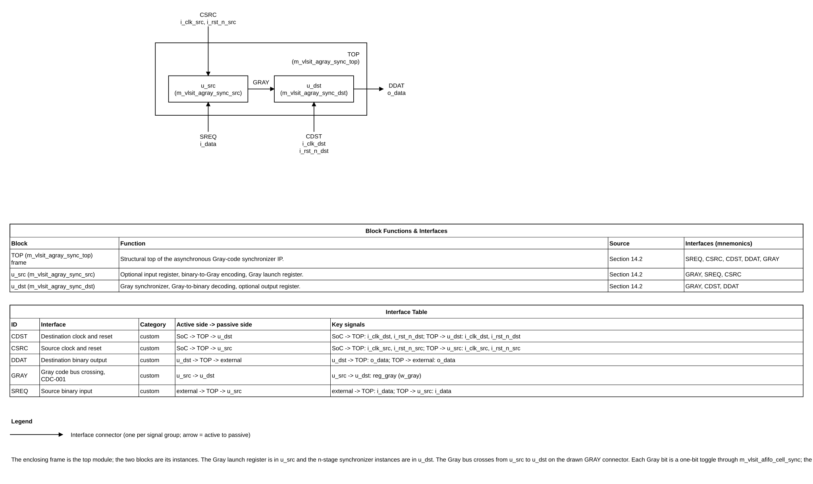
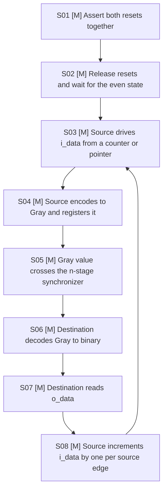

# Async Gray Synchronizer Design Specification

> **Purpose:** Normative design contract for the asynchronous Gray-code synchronizer IP. It transfers a multi-bit binary value from a source clock domain to an independent destination clock domain by encoding it to reflected binary Gray code at the source, registering the Gray value, crossing it through an n-stage synchronizer, and decoding it back to binary at the destination. Every mandatory requirement has a stable REQ identifier and a verification method.

> **Requirement terms:** **shall** = mandatory and testable; **should** = recommended; **may** = optional.

## Document map

1. [Purpose, scope, and product context](#1-purpose-scope-and-product-context)
2. [Normative references and precedence](#2-normative-references-and-precedence)
3. [Requirements and traceability](#3-requirements-and-traceability)
4. [Features and configurations](#4-features-and-configurations)
5. [Architecture](#5-architecture)
6. [External interfaces and ports](#6-external-interfaces-and-ports)
7. [Clock, reset, and power](#7-clock-reset-and-power)
8. [Parameters and elaboration configurations](#8-parameters-and-elaboration-configurations)
9. [Data representation and arithmetic](#9-data-representation-and-arithmetic)
10. [Detailed functional behavior](#10-detailed-functional-behavior)
11. [Register and programming model (CSR from workbook)](#11-register-and-programming-model)
12. [Error handling and recovery](#12-error-handling-and-recovery)
13. [Performance, power, and area](#13-performance-power-and-area)
14. [RTL implementation contract](#14-rtl-implementation-contract)
15. [Verification specification](#15-verification-specification)
16. [DFT and testability](#16-dft-and-testability)
17. [Physical design and timing integration](#17-physical-design-and-timing-integration)
18. [Security, safety, and reliability](#18-security-safety-and-reliability)
19. [Requirement-to-verification traceability](#19-requirement-to-verification-traceability)
20. [Assumptions, dependencies, and decisions](#20-assumptions-dependencies-and-decisions)
21. [Glossary](#21-glossary)
22. [References used to shape this template](#22-references-used-to-shape-this-template)

## 1. Purpose, scope, and product context

### 1.1 Purpose and scope

This IP transfers a `PARA_AGRAY_DATA_W`-bit binary value from a source clock domain (CLK-SRC) to an independent destination clock domain (CLK-DST). It encodes the value to reflected binary Gray code, registers the Gray value in the source domain, crosses it through an n-stage one-bit synchronizer per Gray bit, and decodes it back to binary in the destination domain. The Gray-code property (at most one bit changes between consecutive values) makes a multi-bit crossing safe without a bundled-data `set_max_delay` constraint: a metastable bit settles to either the old or the new value, both of which are valid adjacent values.

The IP has no handshake and no valid signal: the destination output always holds the most recently synchronized value.

### 1.2 Deployment assumptions

The IP is a soft RTL block delivered as a reusable common design. It sits between two independent clock domains whose frequency and phase relationship is unknown. The two resets are pre-synchronized by the SoC and asserted together. The input value is produced by a counter or pointer that increments by at most one between consecutive source edges, which is the contract that keeps the Gray code single-bit-changing.

### 1.3 Feature summary

**Included:** two independent clock and reset pairs; binary-to-Gray encoding with a source register; an n-stage Gray synchronizer (n selected by parameter); Gray-to-binary decoding; an optional register at the source input and an optional register at the destination output; a parameterized value width.

**Excluded:** no valid/ready handshake, no FIFO, no arbitration, no interrupt, no software-visible register.

### 1.4 Real-world applications of the features

The IP is a reusable common design. Its primary silicon-proven application is the read/write pointer crossing of an asynchronous FIFO.

| Feature ID | Real-world application | What the application needs | Typical values | Consequence if missing or wrong | Requirements | Source |
|---|---|---|---|---|---|---|
| FEAT-001 | Async FIFO pointer crossing: the write pointer of an asynchronous FIFO is Gray-encoded and sent to the read domain to compute emptiness | The Gray value must change by at most one bit per step so the synchronizer never captures a mixed multi-bit value | 32-bit pointer, 2-stage synchronizer | A multi-bit pointer sampled with one bit metastable and the rest settled can read a wrong pointer and corrupt the FIFO status flags | REQ-FUNC-001, REQ-FUNC-002 | User answer 2026-11-14; REF-001 |
| FEAT-002 | The same FIFO uses a 2-stage synchronizer; a slow, always-on domain can select 3 or 4 stages for more metastability margin | The synchronizer depth must be selectable | 2 stages for the fast path, 3 stages for the slow island | A 2-stage chain in a slow domain leaves too little metastability margin and a rare metastable event can propagate a wrong pointer | REQ-CLK-003, REQ-PARAM-002 | User answer 2026-11-14; REF-001 |
| FEAT-003 | Counter and timestamp crossing: a free-running counter is sampled by a monitor domain | The destination needs the latest value, not a valid-qualified transfer | 32-bit counter | Without Gray encoding a multi-bit counter crossing can read a torn value and a wrong timestamp | REQ-FUNC-001, REQ-FUNC-003 | User answer 2026-11-14; REF-003 |
| FEAT-004 | The source user drives the binary value through combinational logic | An input register removes the source user's combinational path from the Gray launch register | SRC_REG = 1 | Without the register the Gray encode XOR tree adds to the source user's critical path | REQ-FUNC-004, REQ-PARAM-003 | User answer 2026-11-14 |
| FEAT-005 | The destination user consumes the binary value through combinational logic | An output register removes the Gray decode XOR tree from the destination user's critical path | DST_REG = 1 | Without the register the decode tree adds to the destination user's critical path | REQ-FUNC-004, REQ-PARAM-004 | User answer 2026-11-14 |

## 2. Normative references and precedence

### 2.1 Normative references

| REF ID | Document | Version / revision | Used for |
|---|---|---|---|
| REF-001 | VLSIT_RTL_Design_Rule.md (v2) | v2 | Naming, RTL structure, CDC rules |
| REF-002 | m_vlsit_afifo_sync (common_rtl/001_AsyncGrayFIFO/rtl) | in-repo | Reused vector synchronizer for the n-stage Gray crossing |
| REF-003 | m_vlsit_afifo_cell_sync (common_rtl/000_Common/rtl_lib) | in-repo | One-bit technology synchronizer wrapper and metastability model |
| REF-004 | 001_AsyncGrayFIFO (common_rtl/001_AsyncGrayFIFO) | in-repo | Proven Gray pointer encoding/decoding (binary-to-Gray and Gray-to-binary) |
| REF-005 | Reflected binary Gray code | Frank Gray, 1947 (public domain) | Gray encoding and decoding formula |

### 2.2 Source-of-truth and conflict handling

This Markdown file is the authoritative specification. When it conflicts with a reference, this file wins; when a reference conflicts with the naming rule, the naming rule (REF-001) wins for names.

### 2.3 Compliance declaration

The IP follows `VLSIT_RTL_Design_Rule.md` v2. No external protocol standard applies; the interface is the custom Gray-code crossing of section 6.3.

## 3. Requirements and traceability

| Requirement ID | Requirement statement | Verification source | Configuration | Verification method |
|---|---|---|---|---|
| REQ-PARAM-001 | `PARA_AGRAY_DATA_W` shall be an integer from 2 to 512 with default 32. | This specification | All configurations | Elaboration and simulation |
| REQ-PARAM-002 | `PARA_AGRAY_SYNC_TYPE` shall be 1, 2, 3, or 4 with default 2; the number of synchronizer stages is 2, 2, 3, and 4 respectively. | This specification | All configurations | Elaboration and simulation |
| REQ-PARAM-003 | `PARA_AGRAY_SRC_REG` shall be 0 or 1 with default 0; 1 adds a register at the source input. | This specification | All configurations | Elaboration and simulation |
| REQ-PARAM-004 | `PARA_AGRAY_DST_REG` shall be 0 or 1 with default 0; 1 adds a register at the destination output. | This specification | All configurations | Elaboration and simulation |
| REQ-FUNC-001 | The source shall encode the binary input to reflected binary Gray code `G = B ^ (B >> 1)` and register it before the crossing. | This specification | All configurations | Simulation and assertion |
| REQ-FUNC-002 | The destination shall decode the synchronized Gray value to binary `B[i] = XOR(G[j] for j = i..W-1)` and present it on `o_data`. | This specification | All configurations | Simulation and assertion |
| REQ-FUNC-003 | The destination shall synchronize every Gray bit with an n-stage one-bit synchronizer selected by `PARA_AGRAY_SYNC_TYPE`. | This specification | All configurations | Simulation and CDC analysis |
| REQ-FUNC-004 | `PARA_AGRAY_SRC_REG` and `PARA_AGRAY_DST_REG` shall insert the optional input and output registers at the documented pipeline positions. | This specification | CFG-SRC-REG, CFG-DST-REG | Simulation |
| REQ-CLK-001 | The IP shall have two independent clock domains with no fixed phase or frequency relationship. | This specification | All configurations | CDC analysis |
| REQ-CLK-002 | No combinational logic shall exist between the source Gray register and the first synchronizer stage, or between synchronizer stages. | This specification | All configurations | Inspection and lint |
| REQ-CLK-003 | `PARA_AGRAY_SYNC_TYPE` shall map to the library cell option: 1 = two D flip-flop cells, 2 = one 2-FF cell, 3 = one 3-FF cell, 4 = one 4-FF cell. | This specification | All configurations | Elaboration |
| REQ-RESET-001 | `i_rst_n_src` and `i_rst_n_dst` shall be asserted together for at least 2 cycles of each clock; both are active-low with asynchronous assertion and synchronous deassertion. | This specification | All configurations | Reset test |
| REQ-RESET-002 | After reset, `o_data` shall be 0 and every register shall be 0. | This specification | All configurations | Reset test |
| REQ-ERR-001 | The source user shall change the input by at most one (so the Gray value changes by at most one bit) per synchronization window; the IP does not detect a violation. | This specification | All configurations | Inspection |
| REQ-IF-001 | The IP boundary shall be the six signals of section 6.2; there shall be no valid, ready, or error output. | This specification | All configurations | Inspection |
| REQ-PERF-001 | The input-to-output latency shall be `SRC_REG*T_src + N*T_dst + DST_REG*T_dst`, where `N` is the number of synchronizer stages. | This specification | All configurations | Simulation and cycle count |
| REQ-DFT-001 | Every register shall be scannable in test mode; no internal latch, combinational loop, or tristate shall be present. | This specification | All configurations | DFT scan insertion and lint |

## 4. Features and configurations

| Feature ID | Feature | Required / optional | Always present | Requirements |
|---|---|---|---|---|
| FEAT-001 | Binary-to-Gray encoding with a source register | Required | Always present | REQ-FUNC-001 |
| FEAT-002 | n-stage Gray synchronizer | Required | Always present | REQ-FUNC-003, REQ-CLK-003 |
| FEAT-003 | Gray-to-binary decoding | Required | Always present | REQ-FUNC-002 |
| FEAT-004 | Optional source input register | Optional | Only when `PARA_AGRAY_SRC_REG` = 1 | REQ-FUNC-004, REQ-PARAM-003 |
| FEAT-005 | Optional destination output register | Optional | Only when `PARA_AGRAY_DST_REG` = 1 | REQ-FUNC-004, REQ-PARAM-004 |
| FEAT-006 | Parameterized value width | Required | Always present | REQ-PARAM-001 |

## 5. Architecture

### 5.1 Overview and block responsibilities

| Block | Responsibility | Inputs / outputs | Clock/reset domain | State or storage |
|---|---|---|---|---|
| `m_vlsit_agray_sync_top` | Structural top: ports, interconnect, and named instances only. | All IP ports; internal Gray bus | Both domains | None |
| `m_vlsit_agray_sync_src` | Optional input register, binary-to-Gray encoding, and the Gray launch register. | `i_data`; `o_gray` | CLK-SRC | `reg_src` (optional), `reg_gray` |
| `m_vlsit_agray_sync_dst` | n-stage Gray synchronizer, Gray-to-binary decoding, and the optional output register. | `i_gray`; `o_data` | CLK-DST | synchronizer flops, `reg_dst` (optional) |
| `m_vlsit_afifo_sync` | Reused vector synchronizer: one `m_vlsit_afifo_cell_sync` per Gray bit. | `i_data` = Gray, `o_data` = synchronized Gray | CLK-DST | n flops per bit |

### 5.2 Block diagram



The editable draw.io source is [figures/vlsit_agray_block_diagram.drawio](figures/vlsit_agray_block_diagram.drawio). The source block encodes `i_data` to Gray and registers it; the Gray bus crosses to the destination block, where the n-stage synchronizer and the Gray-to-binary decoder produce `o_data`. The synchronizer instances are inside the destination block.

### 5.3 Transaction and dataflow

The IP is a free-running sampler. At every source clock edge the source block computes the Gray code of its input, optionally after an input register, and captures it in `reg_gray`. `reg_gray` is the launch register of the crossing; its value is the Gray code `G = B ^ (B >> 1)`.

The Gray bus crosses into the destination domain through `m_vlsit_afifo_sync`, which synchronizes every bit independently. The destination block decodes the synchronized Gray value to binary `B[i] = XOR(G[j] for j = i..W-1)`, optionally registers it, and drives `o_data`. Because the Gray code changes by at most one bit per step, a metastable synchronizer bit settles to a valid adjacent value, so `o_data` is always either the previous or the new value, never a torn value.

### 5.4 Invariants

1. The Gray value changes by at most one bit between consecutive source launches (the source contract).
2. No combinational logic exists between `reg_gray` and the first synchronizer stage, or between synchronizer stages.
3. `o_data` equals the synchronized and decoded value; it never holds a torn multi-bit value.
4. Both resets return the IP to 0: every register is 0, and `o_data` is 0.
5. There is exactly one crossing direction (source to destination); the IP has no return path.

## 6. External interfaces and ports

### 6.1 Interface inventory

| Interface ID | Type and revision | Role | Direction at IP boundary | Clock domain | Required / optional | Configurations |
|---|---|---|---|---|---|---|
| IF-001 | Custom Gray-code crossing, VLSIT-AGRAY v0.1 | Source (binary) side | Inputs `i_data` | CLK-SRC | Required | All |
| IF-002 | Custom Gray-code crossing, VLSIT-AGRAY v0.1 | Destination (binary) side | Output `o_data` | CLK-DST | Required | All |
| IF-003 | Clock and reset, active-low reset | Integration | `i_clk_src`, `i_rst_n_src`, `i_clk_dst`, `i_rst_n_dst` | Both | Required | All |

### 6.2 Complete port list

No external protocol standard defines this port list; it is the custom interface of section 6.3.

| Port | Direction | Width | Meaning (function) | Clock domain | Signal type | Reset / idle value | Timing / sampling | Configurations |
|---|---|---|---|---:|---|---|---|---|
| `i_clk_src` | Input | 1 | Source-domain clock | CLK-SRC | clock | N/A - a clock has no reset value | Rising edge | All |
| `i_rst_n_src` | Input | 1 | Source-domain active-low reset | CLK-SRC | reset | 0 (reset asserted) | Asynchronous assertion, synchronous deassertion | All |
| `i_data` | Input | `PARA_AGRAY_DATA_W` | Binary value produced by the source user (a counter or pointer) | CLK-SRC | data (valid at every source edge; the value changes by at most one per synchronization window) | 0 | Sampled on the rising edge of `i_clk_src` | All |
| `i_clk_dst` | Input | 1 | Destination-domain clock | CLK-DST | clock | N/A - a clock has no reset value | Rising edge | All |
| `i_rst_n_dst` | Input | 1 | Destination-domain active-low reset | CLK-DST | reset | 0 (reset asserted) | Asynchronous assertion, synchronous deassertion | All |
| `o_data` | Output | `PARA_AGRAY_DATA_W` | Synchronized binary value; the most recent value that has crossed the synchronizer | CLK-DST | data (valid every destination cycle; the previous or the new value, never a torn value) | 0 | Registered or combinational per `PARA_AGRAY_DST_REG` | All |

### 6.3 Protocol behavior

The interface is a free-running sampler with no handshake. The source user presents a new value on `i_data` at most once per synchronization window; the destination user reads `o_data` at any destination edge and observes either the previous or the new value. The Gray-code property guarantees that `o_data` is never a torn multi-bit value.

| Case | Legal behavior | Illegal / unsupported case | IP response | Requirement IDs |
|---|---|---|---|---|
| Increment by one | `i_data` changes by +1 or -1 between consecutive source edges | None | The Gray value changes by one bit; `o_data` tracks the new value after the pipeline latency | REQ-FUNC-001, REQ-ERR-001 |
| Held value | `i_data` is stable for several cycles | None | `o_data` converges to the value after the pipeline latency and holds it | REQ-FUNC-002 |
| Change by more than one | Not supported | `i_data` jumps by more than one, so several Gray bits change at once | The synchronizer may capture a mixed value and `o_data` may be wrong for one window; the IP does not detect this | REQ-ERR-001 |
| Reset | Both resets asserted together | A single-domain reset | `o_data` becomes 0; the Gray registers and synchronizer clear to 0 | REQ-RESET-001, REQ-RESET-002 |

### 6.4 Interrupts and events

**Not required (confirmed by user, 2026-11-14):** the IP has no interrupt, no event, no error output, and no status signal. The interface of section 6.2 is the complete boundary.

## 7. Clock, reset, and power

### 7.1 Clock domains

| Domain | Clock port | Edge | Frequency range | Source | Relationship to other clocks | Gating policy |
|---|---|---|---|---|---|---|
| CLK-SRC | `i_clk_src` | Rising | No specified minimum or maximum, limited by the target library and STA | Source user | Asynchronous to CLK-DST; no fixed phase or ratio | No gating inside the IP |
| CLK-DST | `i_clk_dst` | Rising | No specified minimum or maximum, limited by the target library and STA | Destination user | Asynchronous to CLK-SRC; no fixed phase or ratio | No gating inside the IP |

### 7.2 CDC and RDC

| Crossing ID | From → to | Signals | Structure | Reset handling | Constraints / verification |
|---|---|---|---|---|---|
| CDC-001 | CLK-SRC → CLK-DST | `reg_gray` → synchronized Gray, `PARA_AGRAY_DATA_W` bits | `m_vlsit_afifo_sync` (one `m_vlsit_afifo_cell_sync` per bit), n stages selected by `PARA_AGRAY_SYNC_TYPE` | Reset to 0 in the destination domain | Asynchronous clock groups; CDC analysis; the Gray single-bit-change property makes multi-bit sampling safe without a bundled-data constraint |

RDC-001: the two resets are pre-synchronized by the SoC. The IP contains no reset synchronizer and no reset crossing; the integration shall not release a reset asynchronously to its own clock.

### 7.3 Reset domains and sequencing

| Reset ID | Port | Polarity / assertion | Sync or async | Scope | Deassertion | Reset value |
|---|---|---|---|---|---|---|
| RST-SRC | `i_rst_n_src` | Active-low; asynchronous assertion | Asynchronous assertion, synchronous deassertion by the SoC | CLK-SRC logic | Synchronous to `i_clk_src` | `reg_src` 0; `reg_gray` 0 |
| RST-DST | `i_rst_n_dst` | Active-low; asynchronous assertion | Asynchronous assertion, synchronous deassertion by the SoC | CLK-DST logic | Synchronous to `i_clk_dst` | synchronizer flops 0; `reg_dst` 0; `o_data` 0 |

Both resets shall be asserted together for every reset event, for at least 2 cycles of each clock. After a paired reset both domains return to 0: `reg_gray` is 0, the synchronizer is 0, and `o_data` is 0. A single-domain reset is outside the contract and can produce a value that differs between the two domains until the next paired reset. After a reset the source user shall drive `i_data` to 0. There is no warm, partial, or retention reset.

### 7.4 Power intent (if applicable)

**Not required (confirmed by user, 2026-11-14):** the IP has no power domain, isolation, retention, power-good sequencing, clock stop/restart control, or UPF/CPF ownership. The SoC owns power intent; the IP is an always-on soft RTL block.

## 8. Parameters and elaboration configurations

### 8.1 Parameter definition

| Parameter | Purpose | Default | Legal values / range | Dependencies / invalid combinations | Effect |
|---|---|---|---|---|---|
| `PARA_AGRAY_DATA_W` | Width of the synchronized value and of `i_data` and `o_data` | 32 | 2 to 512 | None; independent of the other parameters | Sets the Gray encode/decode width, the Gray bus, and the number of synchronizer instances |
| `PARA_AGRAY_SYNC_TYPE` | Synchronizer depth selection | 2 | 1, 2, 3, or 4 | None; independent of the value width | Selects the library cell option: 1 = two D flip-flop cells, 2 = one 2-FF cell, 3 = one 3-FF cell, 4 = one 4-FF cell |
| `PARA_AGRAY_SRC_REG` | Source input register | 0 | 0 or 1 | None | 0 = `i_data` feeds the Gray encoder directly; 1 = `i_data` is registered first, adding one source cycle |
| `PARA_AGRAY_DST_REG` | Destination output register | 0 | 0 or 1 | None | 0 = `o_data` is the combinational Gray decode; 1 = the decode is registered, adding one destination cycle |

### 8.2 RTL parameter declarations

The RTL parameter declarations shall use exactly these three comment lines above each parameter.

```systemverilog
// Parameter Description: width of the synchronized value and of i_data and o_data; wider values increase the Gray decode XOR-tree depth (log2 of the width), which affects timing.
// Parameter values: 2 to 512; default is 32.
// Parameter unit: bit
parameter logic [31:0] PARA_AGRAY_DATA_W = 32,
// Parameter Description: synchronizer depth for the Gray crossing.
// Parameter values: 1, 2, 3, or 4; default is 2.
// Parameter unit: none
parameter logic [31:0] PARA_AGRAY_SYNC_TYPE = 2,
// Parameter Description: source input register; adds one source cycle before the Gray encoder.
// Parameter values: 0 = disabled, 1 = registered; default is 0.
// Parameter unit: none
parameter logic [31:0] PARA_AGRAY_SRC_REG = 0,
// Parameter Description: destination output register; adds one destination cycle after the Gray decoder.
// Parameter values: 0 = disabled, 1 = registered; default is 0.
// Parameter unit: none
parameter logic [31:0] PARA_AGRAY_DST_REG = 0
```

### 8.3 Elaboration configurations

| Configuration | Parameter overrides | Features/interfaces | Expected hierarchy | Elaboration/lint/synthesis target |
|---|---|---|---|---|
| CFG-BASE | Defaults: `PARA_AGRAY_DATA_W` = 32, `PARA_AGRAY_SYNC_TYPE` = 2, `PARA_AGRAY_SRC_REG` = 0, `PARA_AGRAY_DST_REG` = 0 | FEAT-001 to FEAT-006; IF-001 to IF-003 | `m_vlsit_agray_sync_top` with `u_src`, `u_dst`, `u_sync_gray` | Generic elaboration, rule check, lint, synthesis |
| CFG-SRC-REG | `PARA_AGRAY_SRC_REG` = 1, other values at default | Same features, registered source input | Same hierarchy with `reg_src` | Generic elaboration, lint, synthesis |
| CFG-DST-REG | `PARA_AGRAY_DST_REG` = 1, other values at default | Same features, registered destination output | Same hierarchy with `reg_dst` | Generic elaboration, lint, synthesis |
| CFG-NARROW | `PARA_AGRAY_DATA_W` = 8, other values at default | Same features, 8-bit value | Same hierarchy | Generic elaboration, lint |
| CFG-WIDE | `PARA_AGRAY_DATA_W` = 64, `PARA_AGRAY_SYNC_TYPE` = 3, other values at default | Same features, 64-bit value, 3-stage synchronizer | Same hierarchy | Generic elaboration, synthesis |
| CFG-MIXED | `PARA_AGRAY_DATA_W` = 512, `PARA_AGRAY_SYNC_TYPE` = 3, `PARA_AGRAY_SRC_REG` = 1, `PARA_AGRAY_DST_REG` = 1 | Same features, every option enabled | Same hierarchy with all registers | Generic elaboration, lint, synthesis, CDC |

## 9. Data representation and arithmetic

The value is an unsigned binary vector `B[W-1:0]`. The reflected binary Gray code `G[W-1:0]` is:

$$G = B \oplus (B \gg 1)$$

where the most significant Gray bit is `G[W-1] = B[W-1]`. The inverse (Gray to binary) reconstructs each binary bit as the parity of the Gray bits from that position upward:

$$B[i] = \bigoplus_{j=i}^{W-1} G[j]$$

**Numbered example.** With `W = 4`, the binary value `B = 5` (`4'b0101`) encodes to `G = 0101 ^ 0010 = 0111` (`4'b0111`). Decoding `G = 0111`: `B[0] = G[0]^G[1]^G[2]^G[3] = 1^1^1^0 = 1`, `B[1] = G[1]^G[2]^G[3] = 1^1^0 = 0`, `B[2] = G[2]^G[3] = 1^0 = 1`, `B[3] = G[3] = 0`, so `B = 0101 = 5`.

Consecutive binary values that differ by exactly one produce Gray values that differ in exactly one bit, which is the property the synchronizer relies on. The Gray decode is a parity tree of depth `ceil(log2 W)`.

## 10. Detailed functional behavior

### 10.1 Modes and state transitions

The IP has no finite-state machine. The state is the source Gray register `reg_gray`, the optional `reg_src` and `reg_dst`, and the synchronizer flops.

| Mode/state | Entry condition | Behavior | Output |
|---|---|---|---|
| Source sampling | Reset released | Encode `i_data` (or `reg_src`) to Gray and capture it in `reg_gray` every source edge | `reg_gray` is the launch Gray value |
| Source registered (SRC_REG = 1) | `PARA_AGRAY_SRC_REG` = 1 | `reg_src` captures `i_data`; `reg_gray` captures `reg_src ^ (reg_src >> 1)` | One source cycle added |
| Crossing | Always | Each Gray bit passes through its n-stage synchronizer | Synchronized Gray value |
| Destination decode | Always | Decode the synchronized Gray value to binary | `o_data` is the decoded value |
| Destination registered (DST_REG = 1) | `PARA_AGRAY_DST_REG` = 1 | `reg_dst` captures the decoded value; `o_data = reg_dst` | One destination cycle added |
| Reset | Both resets asserted | All registers and synchronizer flops clear to 0 | `o_data` = 0 |

### 10.2 Operations

| Operation ID | Inputs / preconditions | Processing semantics | Result / completion | Latency |
|---|---|---|---|---|
| OP-001 | Single value: `i_data` stable, both resets released | Encode, cross, decode | `o_data` equals `i_data` after the pipeline latency | `SRC_REG*T_src + N*T_dst + DST_REG*T_dst` |
| OP-002 | Increment streaming: `i_data` increments by one each source edge | Each increment changes one Gray bit; the destination tracks every value in order | `o_data` is a delayed copy of the input sequence | One pipeline latency per value |
| OP-003 | Reset and recovery: both resets asserted together, then released | Clear every register and the synchronizer | `o_data` = 0; the destination starts from the even value 0 | Reset assertion asynchronous; release synchronous |
| OP-004 | Registered input: `PARA_AGRAY_SRC_REG` = 1 | Register `i_data` before encoding | The Gray launch register sees the registered value | One extra source cycle |
| OP-005 | Registered output: `PARA_AGRAY_DST_REG` = 1 | Register the decoded value | `o_data` is registered | One extra destination cycle |

### 10.3 Cycle-level behavior

**Waveform plan (rule R-024).** The list below was agreed with the user on 2026-11-14.

| Waveform ID | Function / operation | Scenario (success / error / corner) | Signals shown | Figure | Confirmed by user |
|---|---|---|---|---|---|
| WF-001 | OP-001 single value, mode 0, N=2 | Success | `i_clk_src`, `i_data`, `reg_gray`, `i_clk_dst`, `o_data` | `figures/vlsit_agray_wf001_single.svg` | 2026-11-14 |
| WF-002 | OP-002 increment streaming, mode 0 | Success, corner | Same signals as WF-001 | `figures/vlsit_agray_wf002_stream.svg` | 2026-11-14 |
| WF-003 | OP-004 registered input, `PARA_AGRAY_SRC_REG` = 1 | Corner | WF-001 signals plus `reg_src` | `figures/vlsit_agray_wf003_src_reg.svg` | 2026-11-14 |
| WF-004 | OP-005 registered output, `PARA_AGRAY_DST_REG` = 1 | Corner | WF-001 signals plus `reg_dst` | `figures/vlsit_agray_wf004_dst_reg.svg` | 2026-11-14 |
| WF-005 | OP-003 paired reset | Corner, recovery | WF-001 signals plus `i_rst_n_src`, `i_rst_n_dst` | `figures/vlsit_agray_wf005_reset.svg` | 2026-11-14 |
| WF-006 | Gray-code violation: `i_data` jumps by more than one | Error | WF-001 signals | `figures/vlsit_agray_wf006_jump.svg` | 2026-11-14 |

### 10.4 Arbitration, buffering, and throughput

There is no arbitration, no FIFO, and no buffering. The IP is a free-running sampler: it accepts a new value every source cycle and produces a new value every destination cycle after the pipeline latency. The source must not change the value faster than the synchronizer resolves (REQ-ERR-001); within that contract the throughput is one value per destination cycle.

### 10.5 Memories and storage

No memory macro or array is instantiated. The only storage is the source Gray register, the optional input and output registers, and the n synchronizer flops per Gray bit.

## 11. Register and programming model

### 11.1 CSR specification source

**Not required (confirmed by user, 2026-11-14):** the IP has no software-visible registers, no APB port, and no CSR workbook.

### 11.2 Software sequences

There is no software-visible register and no software sequence. The flowchart and table below define the hardware integration sequence.



| No. | Step | Option (M/O) | Interface | CSR | Description |
|---|---|---|---|---|---|
| S01 | Assert both resets together | M | Reset pins `i_rst_n_src`, `i_rst_n_dst`; drive both low | N/A - no software-visible register | Places both domains in the even state before any transfer. |
| S02 | Release resets and wait for the even state | M | Reset pins; release synchronously in each domain | N/A - no software-visible register | Clears the Gray register, the synchronizer, and `o_data` to 0. |
| S03 | Source drives `i_data` | M | Source pin `i_data`: drive a counter or pointer | N/A - no software-visible register | Presents the binary value to encode. |
| S04 | Source encodes to Gray and registers it | M | Internal Gray register | N/A - no software-visible register | Encodes `B ^ (B >> 1)` and launches the Gray value. |
| S05 | Gray value crosses the synchronizer | M | Internal CDC-001 | N/A - no software-visible register | Each Gray bit passes through n stages with metastability margin. |
| S06 | Destination decodes Gray to binary | M | Destination pin `o_data`; internal decoder | N/A - no software-visible register | Reconstructs `B[i] = XOR(G[j] for j = i..W-1)`. |
| S07 | Destination reads `o_data` | M | Destination pin `o_data` | N/A - no software-visible register | Reads the most recent synchronized value. |
| S08 | Source increments `i_data` by one | M | Source pin `i_data`: increment | N/A - no software-visible register | Keeps the Gray code single-bit-changing (REQ-ERR-001). |

### 11.3 CSR connection to the design

**Not required (confirmed by user, 2026-11-14):** no CSR module is instantiated and no register field connects to the design.

### 11.4 APB access behavior of the CSR

**Not required (confirmed by user, 2026-11-14):** the IP has no APB interface, no CSR module, and no register access behavior.

## 12. Error handling and recovery

| Error ID | Detection condition | Observable response/status | Interrupt | Clear/recovery | Reset behavior |
|---|---|---|---|---|---|
| ERR-001 | `i_data` changes by more than one between consecutive source edges (several Gray bits change at once) | The synchronizer may capture a mixed Gray value and `o_data` may be wrong for one window | None | Honour the single-step contract (REQ-ERR-001); the value recovers on the next legal increment | Reset returns `o_data` to 0 |
| ERR-002 | A single-domain reset while the other domain keeps running | The two domains return to different states; `o_data` may not match the source value until the next paired reset | None | Assert both resets together and re-drive `i_data` from 0 | Both domains clear to 0 |

The IP has no error output, no error code, no interrupt, and no timeout. The conditions above are integration-contract violations; the IP response is limited to returning to a safe state where the structure allows it.

## 13. Performance, power, and area

| Metric ID | Metric | Target / limit | Conditions | Measurement method | Hard / goal |
|---|---|---|---|---|---|
| PERF-001 | Input-to-output latency | `SRC_REG*T_src + N*T_dst + DST_REG*T_dst`; with N=2 and no optional registers this is `2*T_dst` | All configurations | Simulation and cycle count | Hard for the example; formula for other phases |
| PERF-002 | Throughput | One value per destination cycle (no stalls) | CFG-BASE | Simulation | Hard |
| PPA-001 | Maximum frequency | Limited by the Gray encode/decode XOR-tree depth (`ceil(log2 W)` levels) and the library cells | Worst-case PVT corner, CFG-BASE | STA with the constraints of section 17 | Goal |
| PPA-002 | Area | `PARA_AGRAY_DATA_W` Gray flops + `N*PARA_AGRAY_DATA_W` synchronizer flops + the optional `PARA_AGRAY_DATA_W` input/output registers + the XOR trees | Target library, CFG-BASE and CFG-MIXED | Synthesis cell-area report | Goal |
| PPA-003 | Dynamic and leakage power | No target; report the activity-based estimate | Application workload of section 1.4, CFG-BASE | Synthesis power report | Goal |

No timing closure is claimed from RTL synthesis alone.

## 14. RTL implementation contract

### 14.1 Required coding baseline

The RTL follows `VLSIT_RTL_Design_Rule.md` v2 (REF-001). The naming rule is the default of section 2 of that document; the module and parameter names of section 14.2 follow it.

### 14.2 RTL hierarchy

| Module | Responsibility | Parent / instance | Clock/reset domains | Interface |
|---|---|---|---|---|
| `m_vlsit_agray_sync_top` | Structural top; ports, interconnect, and instances only | None | CLK-SRC and CLK-DST | All IP ports of section 6.2 |
| `m_vlsit_agray_sync_src` | Optional input register, binary-to-Gray encoding, Gray launch register | `m_vlsit_agray_sync_top` / `u_src` | CLK-SRC | `i_data`; `o_gray` |
| `m_vlsit_agray_sync_dst` | Gray synchronizer, Gray-to-binary decoding, optional output register | `m_vlsit_agray_sync_top` / `u_dst` | CLK-DST | `i_gray`; `o_data` |
| `m_vlsit_afifo_sync` | Reused vector synchronizer: one `m_vlsit_afifo_cell_sync` per Gray bit | `m_vlsit_agray_sync_dst` / `u_sync_gray` | CLK-DST | `i_data` = Gray; `o_data` = synchronized Gray |

Both one-bit crossings reuse `m_vlsit_afifo_sync` (REF-002), which instantiates `m_vlsit_afifo_cell_sync` (REF-003) per bit. The instance sets `PARA_AFIFO_SYNC_W = PARA_AGRAY_DATA_W` and `PARA_AFIFO_CELL_TYPE = PARA_AGRAY_SYNC_TYPE`; the reset value is 0. The library source is listed in `filelist.f` and is never copied or edited.

### 14.3 Synthesis assumptions

| Item | Value / source |
|---|---|
| Top / source file list | `m_vlsit_agray_sync_top`; `filelist.f` generated by the RTL skill |
| Frontend version and options | Any IEEE 1800-2017 synthesizer supported by the project; lint with Verilator or slang |
| Parameters/configuration | CFG-BASE by default; CFG-MIXED for every option |
| Libraries/corners | VLSIT cell models in `000_Common/rtl_cells` for generic elaboration; the target library supplies the synchronizer cells and the standard cells |
| Memory flow | N/A - no memory macro is instantiated |
| Lint rule configuration | `vlsit_rtl_check.py check` and `vlsit_lint_rtl.py lint`; no waiver for an inferred latch |

## 15. Verification specification

### 15.1 Scope and strategy

Verification covers block simulation of the Gray encode/decode, the n-stage crossing, the optional registers, reset and recovery, the parameter boundaries, and the increment-streaming behavior. It also covers CDC analysis, lint, and synthesis elaboration. The testbench is a separate source set. Simulation uses the library metastability model in the non-synthesis branch and the plain cell models in the `VLSIT_SYNTHESIS` branch; at least three seeds are used for the metastability model. Formal verification of the Gray single-bit-change property is recommended but not mandatory for the first delivery.

### 15.2 Requirement-based test plan

| Test ID | Requirements | Scenario | Expected result | Type | Configuration |
|---|---|---|---|---|---|
| TEST-001 | REQ-FUNC-001, REQ-FUNC-002, REQ-PERF-001 | A single value crosses with no optional registers | `o_data` equals `i_data` after `T_src + N*T_dst` | Directed | CFG-BASE |
| TEST-002 | REQ-FUNC-001, REQ-FUNC-002 | An incrementing sequence crosses back-to-back | `o_data` tracks the sequence in order, each value delayed by the pipeline latency | Directed | CFG-BASE |
| TEST-003 | REQ-RESET-001, REQ-RESET-002 | Both resets asserted during a stream, then released | `o_data` is 0 during reset and recovers from 0 after release | Directed | CFG-BASE |
| TEST-004 | REQ-FUNC-004, REQ-PARAM-003 | `PARA_AGRAY_SRC_REG` = 1 | One source cycle added; the Gray value reflects the registered input | Directed | CFG-SRC-REG |
| TEST-005 | REQ-FUNC-004, REQ-PARAM-004 | `PARA_AGRAY_DST_REG` = 1 | One destination cycle added; `o_data` is registered | Directed | CFG-DST-REG |
| TEST-006 | REQ-PARAM-001, REQ-PARAM-002 | `PARA_AGRAY_DATA_W` = 2 and 512; `PARA_AGRAY_SYNC_TYPE` = 1 and 4 | Every legal boundary crosses correctly | Directed | CFG-NARROW, CFG-MIXED |
| TEST-007 | REQ-ERR-001 | `i_data` jumps by more than one | The test records the mixed value as the documented contract violation | Directed | CFG-BASE |
| TEST-008 | REQ-CLK-003 | `PARA_AGRAY_SYNC_TYPE` = 1, 2, 3, 4 | The synchronizer has 2, 2, 3, 4 stages respectively | Directed | CFG-BASE, CFG-WIDE |
| TEST-009 | REQ-CLK-002 | No combinational logic between `reg_gray` and the first synchronizer stage | Inspection and lint report no finding | Inspection | All |
| TEST-010 | REQ-DFT-001 | Scan insertion with both clocks controllable | Every register is scannable; no latch, loop, or tristate | DFT scan insertion | All |

### 15.3 Assertions and coverage

Assertions cover: `o_data` is never a torn value (it equals the previous or the new value), the Gray value changes by at most one bit per step, `o_data` recovers from reset to 0, and the pipeline latency matches the formula. Coverage is collected per requirement in section 19.

### 15.4 Formal, CDC, and RDC

CDC analysis verifies CDC-001 (asynchronous clock groups, single-bit-change Gray property). RDC analysis verifies RDC-001 (no reset crossing inside the IP). Formal verification of the Gray single-bit-change and no-torn-value properties is optional.

## 16. DFT and testability

| Item | Value |
|---|---|
| Scan insertion | Every register is scannable; the synchronizer flops are scannable in test mode (a test clock replaces the destination clock) |
| Clock control in test | The two functional clocks are controllable in scan mode; no internal clock divider or gating |
| Reset control in test | The resets are controllable; no reset override inside the IP |
| Latches / loops / tristates | None (no latch, no combinational loop, no internal tristate) |
| Memory BIST | N/A - no memory macro |

The DFT requirement is REQ-DFT-001.

## 17. Physical design and timing integration

### 17.1 Timing constraints and budgets

| Clock ID | Port / source object | Primary/generated | Period | Constraint source |
|---|---|---|---|---|
| CLK-SRC | `i_clk_src` | Primary | Set by the SoC | SoC SDC |
| CLK-DST | `i_clk_dst` | Primary | Set by the SoC | SoC SDC |

| Exception ID | Type / SDC command | From | To | Rationale |
|---|---|---|---|---|
| EXC-001 | `set_clock_groups -asynchronous` | CLK_SRC group | CLK_DST group | The clocks are independent; the Gray crossing is synchronized and analyzed by CDC |
| EXC-002 | `set_dont_touch` | `u_dst/u_sync_gray` | none | Preserve the synchronizer cells and their structure |
| EXC-003 | `set_false_path` | `u_src` Gray register | `u_dst` synchronizer output | The crossing is a CDC path; correctness comes from the Gray property, not timing |

No bundled-data `set_max_delay` is required because the Gray single-bit-change property makes a multi-bit sample safe: a metastable bit settles to a valid adjacent value.

Illustrative SDC, to be completed with the elaborated hierarchical names:

```tcl
create_clock -name CLK_SRC -period 10.000 [get_ports i_clk_src]
create_clock -name CLK_DST -period 25.000 [get_ports i_clk_dst]
set_clock_groups -asynchronous -group [get_clocks CLK_SRC] -group [get_clocks CLK_DST]
set_false_path -from [get_pins u_src/reg_gray_reg*] -to [get_pins u_dst/u_sync_gray/*]
set_dont_touch [get_cells u_dst/u_sync_gray]
```

### 17.2 Physical assumptions

| Topic | Requirement / assumption |
|---|---|
| Floorplan | N/A - soft RTL; the SoC integrator places the IP |
| Placement | The synchronizer cells should be placed close together to minimize clock skew |
| Wide values | Wider values deepen the Gray decode XOR tree; the SoC should budget the decode path |

## 18. Security, safety, and reliability

**Not required (confirmed by user, 2026-11-14):** the IP has no security, safety, or reliability feature beyond the CDC correctness of section 7.2. It does not handle protected data, keys, or fault injection; there is no functional-safety mechanism and no ECC or parity.

## 19. Requirement-to-verification traceability

| Requirement ID | Verification method | Test / check | Status |
|---|---|---|---|
| REQ-PARAM-001 | Elaboration and simulation | TEST-006 | Planned |
| REQ-PARAM-002 | Elaboration and simulation | TEST-006, TEST-008 | Planned |
| REQ-PARAM-003 | Elaboration and simulation | TEST-004 | Planned |
| REQ-PARAM-004 | Elaboration and simulation | TEST-005 | Planned |
| REQ-FUNC-001 | Simulation and assertion | TEST-001, TEST-002 | Planned |
| REQ-FUNC-002 | Simulation and assertion | TEST-001, TEST-002 | Planned |
| REQ-FUNC-003 | Simulation and CDC analysis | TEST-008 | Planned |
| REQ-FUNC-004 | Simulation | TEST-004, TEST-005 | Planned |
| REQ-CLK-001 | CDC analysis | CDC analysis | Planned |
| REQ-CLK-002 | Inspection and lint | TEST-009 | Planned |
| REQ-CLK-003 | Elaboration | TEST-008 | Planned |
| REQ-RESET-001 | Reset test | TEST-003 | Planned |
| REQ-RESET-002 | Reset test | TEST-003 | Planned |
| REQ-ERR-001 | Inspection | TEST-007 | Planned |
| REQ-IF-001 | Inspection | Inspection | Planned |
| REQ-PERF-001 | Simulation and cycle count | TEST-001 | Planned |
| REQ-DFT-001 | DFT scan insertion and lint | TEST-010 | Planned |

## 20. Assumptions, dependencies, and decisions

| ID | Type | Assumption / dependency / unresolved decision | Technical impact / version / configuration | Resolution / status |
|---|---|---|---|---|
| DEC-001 | Decision | The interface is a free-running Gray-code sampler: `i_data` binary in, `o_data` binary out, no valid/ready. | Fixes the six-port list and the no-handshake behavior. | Confirmed by the designer 2026-11-14. |
| DEC-002 | Decision | The two resets are pre-synchronized active-low resets asserted together for at least 2 cycles of each clock. | Each reset input must be synchronous on deassertion; the IP adds no reset logic. | Confirmed by the designer 2026-11-14. |
| DEC-003 | Decision | The Gray code is the reflected binary Gray code `G = B ^ (B >> 1)`, decoded by `B[i] = XOR(G[j] for j = i..W-1)`. | Fixes the encode/decode formula and matches REF-004. | Confirmed by the designer 2026-11-14. |
| DEC-004 | Decision | `PARA_AGRAY_DATA_W` = 2 to 512 (default 32); `PARA_AGRAY_SYNC_TYPE` = 1, 2, 3, 4 (default 2); `PARA_AGRAY_SRC_REG` and `PARA_AGRAY_DST_REG` = 0 or 1 (default 0). | Sets the width, the synchronizer depth, and the two optional registers. | Confirmed by the designer 2026-11-14. |
| DEC-005 | Decision | The crossing reuses `m_vlsit_afifo_sync` (REF-002), which instantiates `m_vlsit_afifo_cell_sync` (REF-003) per bit. | Keeps the technology cells and the metastability model in one reviewed wrapper; avoids a duplicate synchronizer. | Confirmed by the designer 2026-11-14. |
| DEC-006 | Decision | The source user shall change `i_data` by at most one per synchronization window, so the Gray value changes by at most one bit; the IP does not detect a violation. | Fixes the correctness contract and the error case of section 12. | Confirmed by the designer 2026-11-14. |
| DEC-007 | Decision | The application is the read/write pointer crossing of an asynchronous FIFO, with counter/timestamp crossing as a secondary use. | Grounds the features of section 1.4 in a silicon-proven use. | Confirmed by the designer 2026-11-14. |
| ASM-001 | Assumption | The public reference-IP search returned qualified asynchronous-FIFO CDC repositories (for example FLASHICON/asynchronous-fifo-cdc-subsystem, MIT) but no standalone Gray synchronizer with tapeout evidence; Gitee was unreachable (SSL timeout). | No public IP is used or copied; the in-house REF-002 and REF-004 are the behavioral references. | Open for a future search; no impact on this design. |
| DEP-001 | Dependency | VLSIT common RTL library, including `m_vlsit_afifo_sync` and `m_vlsit_afifo_cell_sync`. | The IP does not compile without the library source in the file list. | Available in the repository. |
| DEP-002 | Dependency | Target standard-cell library with 2-, 3-, and 4-flop synchronizer cells. | The library wrapper must map to real cells for synthesis and CDC. | Supplied by the SoC implementation flow. |

## 21. Glossary

| Term / acronym | Definition |
|---|---|
| Gray code | Reflected binary code where consecutive values differ in exactly one bit |
| CDC | Clock-domain crossing |
| RDC | Reset-domain crossing |
| Launch register | The source register that drives a crossing signal (CLK-01) |
| Synchronizer | An n-stage chain of flip-flops that resolves a crossing signal's metastability |
| Torn value | A multi-bit value sampled while some bits are settled and others are metastable |
| FF | Flip-flop |

## 22. References used to shape this template

| Reference | Purpose |
|---|---|
| VLSIT_ASIC_IP_Design_Specification_Template.md | Section structure |
| VLSIT_RTL_Design_Rule.md (v2) | Naming and RTL rules |
| common_rtl/001_AsyncGrayFIFO | Proven Gray pointer encoding/decoding (REF-004) |
| common_rtl/000_Common/rtl_lib/m_vlsit_afifo_cell_sync | One-bit synchronizer wrapper (REF-003) |
| common_rtl/001_AsyncGrayFIFO/rtl/m_vlsit_afifo_sync | Vector synchronizer (REF-002) |
| FLASHICON/asynchronous-fifo-cdc-subsystem (GitHub, MIT) | External qualified reference for the Gray CDC structure |
