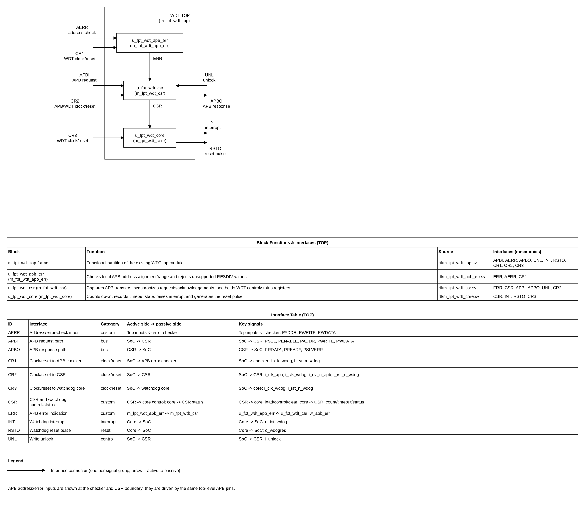
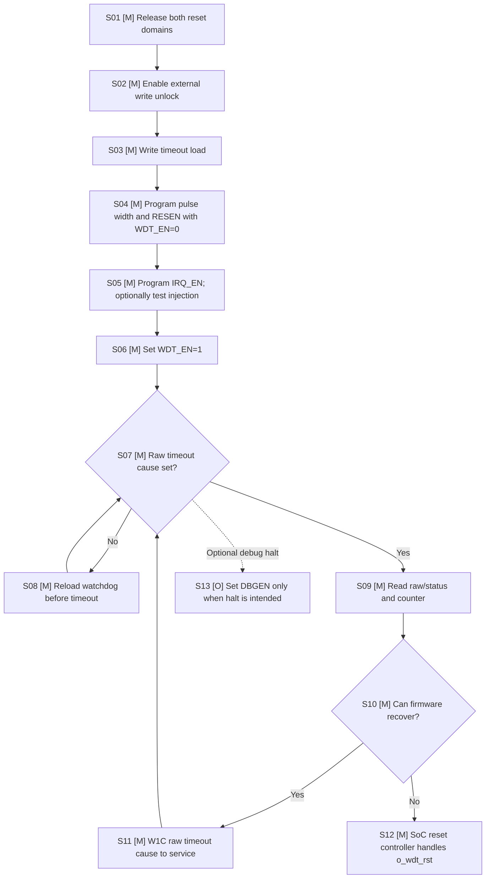

# WDT Hardware Design Specification

> This revision defines the approved target WDT behavior. The supplied `rtl/` directory remains unchanged and is the as-built baseline only. The new enable, IRQ-register, injection, and exact pulse-width requirements below are not implemented in that RTL snapshot. Waveforms are explanatory target examples, not simulation traces. The older v1.2 HDS is retained only as a reference.

## Document map

1. [Purpose, scope, and product context](#1-purpose-scope-and-product-context)
2. [Normative references and precedence](#2-normative-references-and-precedence)
3. [Requirements and traceability](#3-requirements-and-traceability)
4. [Features and configurations](#4-features-and-configurations)
5. [Architecture](#5-architecture)
6. [External interfaces and ports](#6-external-interfaces-and-ports)
7. [Clock, reset, and power](#7-clock-reset-and-power)
8. [Parameters and elaboration configurations](#8-parameters-and-elaboration-configurations)
9. [Data representation and arithmetic](#9-data-representation-and-arithmetic)
10. [Detailed functional behavior](#10-detailed-functional-behavior)
11. [Register and programming model](#11-register-and-programming-model)
12. [Error handling and recovery](#12-error-handling-and-recovery)
13. [Performance, power, and area](#13-performance-power-and-area)
14. [RTL implementation contract](#14-rtl-implementation-contract)
15. [Verification specification](#15-verification-specification)
16. [DFT and testability](#16-dft-and-testability)
17. [Physical design and timing integration](#17-physical-design-and-timing-integration)
18. [Security, safety, and reliability](#18-security-safety-and-reliability)
19. [Requirement-to-verification traceability](#19-requirement-to-verification-traceability)
20. [Assumptions, dependencies, and decisions](#20-assumptions-dependencies-and-decisions)
21. [Glossary](#21-glossary)
22. [References used to shape this template](#22-references-used-to-shape-this-template)

## 1. Purpose, scope, and product context

### 1.1 Purpose and scope

The WDT monitors a programmable 32-bit down-counter. A real first timeout sets a sticky raw cause and, when enabled, asserts the interrupt. If the real timeout is not serviced before the next expiration, the WDT can issue an active-high reset pulse. Software independently controls the watchdog engine and its interrupt output, injects an interrupt cause for test, and programs the reset-pulse width as an exact count of WDT clock cycles.

**Included:** APB programming/readback, APB-to-WDT CDC, watchdog enable, timeout service, standardized interrupt enable/raw/status/injection registers, programmable reset-pulse width, external write lock, and software-controlled halt.

**Excluded:** SoC reset distribution, firmware scheduling, APB base decode, live processor-debug indication, clock generation, and recovery after resetting only one domain.

The target changes are specified here for a later RTL update. No current RTL source is changed in this task.

### 1.2 Deployment assumptions

| Item | Specification |
|---|---|
| Target SoC / product class | Assumed embedded controller with APB control plane and low-frequency WDT clock; exact product not supplied |
| Technology / library | ASIC standard cells; signoff DFF binding uses FPT_SIGNOFF and SC7P5T_DFFRQX4_CSC20L |
| Workload | Software configures, enables, services, reads status and clears first-timeout state |
| Security | No external PPROT; i_wdt_other_unlock gates writes after synchronization |
| Dependencies | APB requester, independent APB/WDT clocks, coordinated reset control, WDT clock source and signoff DFF library |

### 1.3 Feature summary

| Feature ID | Feature | Required / optional | Target behavior | Requirements |
|---|---|---|---|---|
| FEAT-001 | 32-bit down-counter and software reload | Required | Controlled by independent `WDT_EN` | REQ-FUNC-001/002 |
| FEAT-002 | Standard interrupt control and status | Required | Separate enable, raw, masked status, and injection registers | REQ-IRQ-001/002 |
| FEAT-003 | Two-stage timeout response | Required | First real timeout sets IRQ cause; an unserviced later timeout may request reset | REQ-FUNC-003/004 |
| FEAT-004 | Exact programmable reset-pulse width | Required | 1–256 WDT cycles using an 8-bit `N−1` encoding | REQ-FUNC-005 |
| FEAT-005 | APB access with CDC handshake | Required | APB/WDT clocks may be asynchronous | REQ-IF-001, REQ-CDC-001 |
| FEAT-006 | Software-controlled halt | Optional use | `DBGEN` directly halts the counter | REQ-FUNC-006 |
| FEAT-007 | External write lock | Optional use | Low unlock blocks writes without APB error | REQ-CSR-001 |

### 1.4 Real-world applications of the features

This is an engineering assumption, not a confirmed deployment. The CMS32F030x vendor manual documents a 32-bit WDT down-counter and 40 kHz WDT clock. That gives a concrete embedded-controller scale for calculations, but does not mean this RTL targets that product.

| Feature ID | Named application / example | Need | Typical value | Failure if wrong | Requirements | Source |
|---|---|---|---|---|---|---|
| FEAT-001 | Embedded control unit using a CMS32F030x-class MCU as a reference product | Detect a stalled firmware service loop | Assumed 40 kHz, 32-bit count, candidate 1 s service period | A stalled loop may remain undetected or false-trigger | REQ-FUNC-001 | ASM-001; CMS32F030x User Manual V1.53 §3.2 |
| FEAT-002 | Same reference embedded control unit | Notify firmware on first missed service interval | 1 s candidate interrupt interval | Firmware loses its recovery window if notification is absent | REQ-FUNC-003 | ASM-001; REF-006 §3.2 |
| FEAT-003 | Same reference embedded control unit | Recover through SoC reset after a second missed service interval | 2 s candidate interval at a 1 s load | A hung system may remain stuck without reset | REQ-FUNC-004 | ASM-001; REF-006 §3.2 |
| FEAT-004 | Same reference embedded control unit | Select reset-pulse width for the external reset controller | Exact 1–256 WDT cycles; `N−1` encoding; 25 us to 6.4 ms at 40 kHz | Reset controller may miss or over-hold the pulse | REQ-FUNC-005 | ASM-001 |
| FEAT-005 | APB-controlled WDT in the same controller | Allow low-rate watchdog and APB clocks to run independently | 2 clock domains; APB rate TBD | Unsynchronized crossings can corrupt requests or status | REQ-IF-001, REQ-CDC-001 | RTL; REF-001 |
| FEAT-006 | Debug-capable embedded controller | Optionally stop watchdog counting during debug | DBGEN=0/1; no live debug pin | Watchdog may pause when processor is not in debug | REQ-FUNC-006 | RTL; ASM-006 |
| FEAT-007 | Embedded controller with SoC-managed register lock | Prevent writes while external unlock is low | Unlock level 0/1, synchronized once | Unauthorized or accidental writes can change timeout behavior | REQ-CSR-001 | RTL |

## 2. Normative references and precedence

### 2.1 Normative references

| Ref ID | Document / revision | Clauses | Notes |
|---|---|---|---|
| REF-001 | Arm AMBA APB Protocol Specification IHI 0024 Issue D; APB4 feature set is Issue C | §§3.1–3.4; Appendix A | Protocol authority; APB5-only additions excluded. Local copy: C:/Users/PC/.codex/skills/vlsit-asic-ip-microspec/reference/md_doc/vlsit_apb_amba_apb_ihi0024d.md |
| REF-002 | Supplied FTEL_CDC_WDT_Hardware_Design_Specification_v1.2.docx.pdf | §§2, 4–9 | Legacy intent; superseded by RTL on conflicts; confidential source not reproduced |
| REF-003 | WDT_RTL_Naming_Rule.md v1.0, this directory | Entire file | User-selected rule derived from this RTL |
| REF-004 | IEEE 1800-2017 SystemVerilog | Synthesizable subset | Language reference |
| REF-005 | WDT_CSR.xlsx, this directory | Configuration/register sheets | Normalized map; not a replacement for custom legacy CSR RTL |
| REF-006 | CMS32F030x User Manual V1.53, vendor Chinese manual | §3.2 | Reference clock/application scale, not normative: https://www.mcu.com.cn/uploads/img1/tupian/%E6%89%8B%E5%86%8C%E4%B8%8B%E8%BD%BD/CMS32F030x%E7%94%A8%E6%88%B7%E6%89%8B%E5%86%8C_V1.53.pdf |
| REF-007 | OpenTitan AON Timer Technical Specification 2.1.0 and programmer guide | Watchdog overview and programming | Architecture comparison only: https://opentitan.org/book/hw/ip/aon_timer/ |

### 2.2 Source-of-truth and conflict handling

**Naming rule:** `WDT_RTL_Naming_Rule.md`, version 1.0, derived from the supplied WDT RTL. It remains the naming authority for future RTL.

1. Arm IHI 0024 defines APB protocol behavior; this IP uses the documented APB4 profile with full-word writes.
2. This HDS v2.0 defines the target behavior for a future implementation. Its explicit target decisions take precedence over the supplied RTL snapshot.
3. The files under `rtl/` are the as-built reference. They currently use `CNT_EN`, `INTEN`, `RESDIV`, `wd_raw_stat`, `wd_int_mask_stat`, and `wd_int_clr`; those do not implement the new target CSR model.
4. The legacy v1.2 HDS is not authoritative where it conflicts with the supplied RTL or this target HDS.
5. `WDT_CSR.json` and `WDT_CSR.xlsx` describe the target register model. They are not a statement that the current RTL already implements it.
6. `REF-003`, not the default microspec naming rule, governs future names.

## 3. Requirements and traceability

These requirements define the target implementation. They are not satisfied by the supplied snapshot until RTL is updated.

| Requirement ID | Requirement | Source | Config | Verification |
|---|---|---|---|---|
| REQ-FUNC-001 | The WDT shall use a 32-bit unsigned down-counter. A successful `wd_cnt_ld` write shall reload the live counter from the newly committed LOAD value on the following WDT clock edge; this write shall not clear raw cause or escalation-pending state. | Target HDS | CFG-WDT-TGT-2P0 | Directed simulation |
| REQ-FUNC-002 | `WDT_EN=0` shall stop timeout counting, reload/hold the counter at `WD_CNT_LD`, clear internal escalation-pending state, and preserve raw IRQ causes. Enabling shall start a fresh timeout interval from the load value. | Approved behavior | CFG-WDT-TGT-2P0 | Disable/re-enable test |
| REQ-FUNC-003 | A first real timeout shall set the sticky raw timeout cause and internal escalation-pending state, then reload the counter. | Target HDS | CFG-WDT-TGT-2P0 | Timeout test |
| REQ-FUNC-004 | If a real timeout remains unserviced until the next expiration, `RESEN=1` and `DBGEN=0` shall request reset and stop further counting. IRQ enable shall not gate timeout escalation. | Target HDS | CFG-WDT-TGT-2P0 | Second-timeout test |
| REQ-FUNC-005 | The reset output shall remain high for exactly `pulse_m1 + 1` WDT clock periods (1–256 cycles). The width shall be sampled when the pulse starts; an active pulse shall complete if `WDT_EN` is later cleared. | Approved behavior | CFG-WDT-TGT-2P0 | Exact pulse-width test |
| REQ-FUNC-006 | `DBGEN=1` shall hold the counter and suppress timeout processing; no live debug input is defined. | Target HDS | CFG-WDT-TGT-2P0 | Halt/resume test |
| REQ-IRQ-001 | The IRQ register group shall provide matching `timeout` fields for enable (`rw`), raw (`w1c`), masked status (`ro`), and injection (`rw`); status and `o_wdt_int` shall equal raw AND enable. | Approved standard IRQ format | CFG-WDT-TGT-2P0 | Register and IRQ tests |
| REQ-IRQ-002 | A rising edge on the injection field shall set the raw cause only. It shall not change the counter or timeout-escalation state. Write 0 before a later injection edge. | Approved behavior | CFG-WDT-TGT-2P0 | Injection test |
| REQ-CSR-001 | Writes shall update state only when synchronized external unlock is high; locked writes shall complete without update or PSLVERR. | Supplied behavior retained | CFG-WDT-TGT-2P0 | Directed simulation |
| REQ-CSR-002 | W1C of a real-timeout raw cause shall clear the cause and escalation-pending state and reload the counter. Clearing an injection-only cause shall not service/reload the WDT. A simultaneous new hardware event wins over software clear. | Approved behavior | CFG-WDT-TGT-2P0 | Clear/service and collision tests |
| REQ-IF-001 | APB access shall wait for the CDC-backed CSR operation; PSLVERR shall identify rejected accesses. | RTL; REF-001 §§3.1, 3.4 | CFG-WDT-TGT-2P0 | APB checker |
| REQ-IF-002 | PADDR shall be a 16-bit local byte address; the SoC shall supply base decode externally. | Supplied interface retained | CFG-WDT-TGT-2P0 | Integration |
| REQ-CDC-001 | Requests/acks shall cross domains through two-stage synchronizers; captured data shall remain stable while outstanding. | Supplied architecture retained | CFG-WDT-TGT-2P0 | CDC / simulation |
| REQ-RESET-001 | The SoC shall assert both reset inputs together and release each synchronously to its clock. | User decision | CFG-WDT-TGT-2P0 | RDC / reset test |
| REQ-ERR-001 | Misaligned and out-of-range addresses shall return PSLVERR without updating state. All pulse-width encodings shall be legal. | Target HDS | CFG-WDT-TGT-2P0 | APB error / boundary test |
| REQ-OBS-001 | `WD_CNT_VAL` shall expose the count; raw causes shall be independent of IRQ enable; masked status shall equal raw AND enable. | Target HDS | CFG-WDT-TGT-2P0 | Directed simulation |
| REQ-RULE-001 | Names in HDS/diagrams shall follow `WDT_RTL_Naming_Rule.md`. | User decision | All | Manual review |

## 4. Features and configurations

| Configuration ID | State | Enabled | Interfaces / widths | Notes |
|---|---|---|---|---|
| CFG-RTL-1P3 | Supplied baseline | Existing APB waits/CDC, counter, legacy timeout IRQ/reset, lock | APB 16-bit address/32-bit data; separate clocks | As-built only; not the target configuration |
| CFG-WDT-TGT-2P0 | Approved target | Independent WDT/IRQ enables, standardized IRQ register group, exact reset-pulse width, injection | Same APB and top-level ports; separate clocks | RTL update required before implementation claims |

Target control behavior:

- `WDT_EN` controls counting and timeout escalation. `IRQ_EN` only masks the interrupt output/status.
- A raw cause remains pending when `IRQ_EN=0`; enabling the IRQ later exposes it. If WDT is disabled while raw is set and `IRQ_EN=1`, `o_wdt_int` remains high until software clears the raw cause.
- A real timeout cause and internal escalation-pending state are distinct. Disabling WDT clears escalation state but preserves the raw cause for software diagnosis.
- W1C on a real raw cause services the watchdog; injection alone never changes WDT counting.
- The old `INTEN`, `CNT_EN`, `RESDIV`, and `WD_INT_CLR` programming model is retired in the target map.
- `PSTRB` remains tied high; sparse writes remain unsupported.

## 5. Architecture

The supplied hierarchy shown in the diagrams is the as-built RTL baseline. For the target, retain the same external APB, interrupt and reset-pulse interface while replacing legacy control and CSR behavior with the requirements in Sections 3 and 11. The target decoder shall no longer validate RESDIV codes; every exact-width encoding is legal.

### 5.1 Functional paths

1. APB setup captures address and write data in the APB domain.
2. Read/write requests cross into WDT domain through two-flop synchronizers.
3. CSR updates controls or samples status in WDT domain; acknowledgements return through synchronizers.
4. PREADY asserts after acknowledgement; read data is held in APB domain.
5. Counter, timeout, interrupt and reset pulse logic use i_wdt_clk.
6. o_wdt_rst is intended for the SoC reset controller.

### 5.2 Block diagram

*Figure 5-1. Functional hierarchy of m_fpt_wdt_top, showing each supplied RTL module. Source: `../figures/wdt_top_function_diagram.drawio` (draw.io, VLSIT library, drawn by `vlsit_spec_diagram.py`). The frame is the top module, the blocks are its instances, each connector is one interface with its mnemonic, and the two tables under the diagram in the source file describe the blocks and the interfaces.*

### 5.3 Diagram notes

All three diagrams describe the supplied RTL snapshot, not the target CSR or pulse-width implementation. Their hierarchy remains useful as a baseline; update them together with any future RTL hierarchy change.

- [Wrapper boundary diagram](../figures/wdt_top_diagram.svg) ([draw.io source](../figures/wdt_top_diagram.drawio), [diagram data](../figures/wdt_top_diagram_spec.json)).
- [Watchdog-core module diagram](../figures/wdt_core_diagram.svg) ([draw.io source](../figures/wdt_core_diagram.drawio), [diagram data](../figures/wdt_core_diagram_spec.json)).

## 6. External interfaces and ports

### 6.1 Interface summary

| ID | Type/revision | Role | Direction | Clock | Required | Config |
|---|---|---|---|---|---|---|
| IF-APB | AMBA APB4 profile, IHI 0024 Issue D document / Issue C features | Completer | Request/response | i_wdt_pclk | Yes | CFG-RTL-1P3 |
| IF-WDOG | Custom watchdog control/status | SoC control in; IRQ/reset out | Both | i_wdt_clk; unlock async at pin | Yes | CFG-RTL-1P3 |

### 6.2 Top-level port table

| Port | Direction | Width | Meaning | Clock domain | Signal type | Reset/idle | Sampling |
|---|---|---:|---|---|---|---|---|
| i_wdt_pclk | Input | 1 | APB clock | APB | Clock | No reset value | Rising edge |
| i_wdt_preset_n | Input | 1 | Active-low APB reset | APB | Reset | 0 | Async assert; SoC sync release |
| i_wdt_clk | Input | 1 | WDT clock | WDT | Clock | No reset value | Rising edge |
| i_wdt_rst_n | Input | 1 | Active-low WDT reset | WDT | Reset | 0 | Async assert; SoC sync release |
| i_wdt_other_unlock | In | 1 | External CSR write unlock | Async to WDT | Level | 0 blocks writes | 2-stage sync |
| i_wdt_apb_paddr | Input | 16 | Local APB byte address | APB | data (address) | No fixed idle value | Stable through completion |
| i_wdt_apb_psel | Input | 1 | APB select | APB | level (control) | 0 idle | APB setup/access |
| i_wdt_apb_penable | Input | 1 | APB access phase | APB | level (control) | 0 outside access | Setup then access |
| i_wdt_apb_pwrite | Input | 1 | APB direction | APB | level (control) | No fixed idle value | Stable through completion |
| i_wdt_apb_pwdata | Input | 32 | APB write data | APB | data | No fixed idle value | Stable through completion |
| o_wdt_apb_prdata | Output | 32 | APB read data | APB | data | 0 on reset | Valid with completion |
| o_wdt_apb_pready | Output | 1 | APB completion / wait control | APB | level (ready) | 0 on reset | Low while CDC pending |
| o_wdt_apb_pslverr | Output | 1 | APB error response | APB | level (error) | 0 on reset | Valid with PREADY |
| o_wdt_int | Out | 1 | Sticky raw IRQ cause masked by `IRQ_EN` | WDT | Level | 0 on reset | Registered |
| o_wdt_rst | Out | 1 | Active-high reset pulse | WDT | Pulse | 0 on reset | Exact programmed 1–256 WDT cycles |

PSTRB and PPROT are not wrapper ports. PSTRB is tied high; partial writes are unsupported. Internal PPROT routes local errors; no external privilege attribute is received.

### 6.3 APB timing

See §10.3. Requester holds PADDR, PWRITE and PWDATA while PREADY=0 per REF-001 §3.1. No external PSTRB exists.

## 7. Clock, reset, and power

| Domain | Clock | Frequency | Reset | Behavior |
|---|---|---|---|---|
| APB | i_wdt_pclk | SoC-defined | i_wdt_preset_n | Active-low async assertion |
| WDT | i_wdt_clk | 40 kHz candidate for examples; actual TBD | i_wdt_rst_n | Active-low async assertion |

Clocks are treated asynchronous. RTL uses request/ack CDC with two-stage synchronizers. External logic coordinates both resets: assert together and release synchronously in each domain. If a request is outstanding, the SoC must reset/recover its APB requester consistently. Independent partial-reset recovery is not guaranteed.

There is no power-good, clock-ready, retention or clock-failure detector.

## 8. Parameters and elaboration configurations

The supplied wrapper is fixed at `PARA_APB_ADDR_WIDTH=16`, `PARA_APB_DATA_WIDTH=32`, and `PARA_WD_DATA_WIDTH=32`. Its legacy `PARA_RESDIV_WIDTH` and `PARA_RESDIV_MAX` support only the as-built power-of-two pulse encoding and are removed from the target behavior. The target uses a fixed 8-bit CSR field for exact `N−1` pulse width; there is no new elaboration parameter for pulse width.

Leaf parameters do not make the complete hierarchy safely width-generic.

## 9. Data representation and arithmetic

Counter, CSR controls, and pulse-width field are unsigned. `pulse_m1` stores `N−1`; therefore `N = pulse_m1 + 1`, covering 1 through 256 WDT clock periods without reserved encodings.

For load `L` and WDT frequency `f`, the timeout interval is `(L+1)/f`. At the illustrative 40 kHz assumption, `L=39,999` gives 1 s; `L=0` gives 25 us; `L=0xFFFFFFFF` gives 107,374.1824 s (about 29 h 49 min 34 s). These are calculations, not measured SoC limits.

For pulse field `P`, pulse width is `(P+1)/f`. At 40 kHz, values span 25 us to 6.4 ms. The pulse-width value is captured at the reset request; later CSR writes affect only a future pulse.

## 10. Detailed functional behavior

### 10.1 Modes

- **Disabled:** `WDT_EN=0`; the counter is held/reloaded at `WD_CNT_LD`, escalation-pending state is cleared, and raw IRQ causes are preserved.
- **Counting:** `WDT_EN=1` and `DBGEN=0`; count decrements and reloads at timeout.
- **Halted:** `DBGEN=1`; count holds regardless of processor debug state.
- **Real timeout pending:** first real timeout sets a sticky raw cause and internal escalation-pending state; IRQ output depends only on `IRQ_EN`.
- **Injection-only cause:** software injection sets raw IRQ cause but does not set escalation-pending state or affect the counter.
- **Reset pulse:** later real expiration while escalation is pending and `RESEN=1` starts the exact programmed pulse. Once active, it completes even if `WDT_EN` is cleared.

### 10.2 Operations

| ID | Operation | Trigger | Target result | Requirement |
|---|---|---|---|---|
| OP-001 | Reset | Both reset inputs asserted | State reset; outputs low | REQ-RESET-001 |
| OP-002 | Program/enable | Unlocked APB writes | Load/control update in WDT domain; enable last | REQ-CSR-001 |
| OP-003 | Read counter/status | APB read | Current count and CSR status returned after CDC wait | REQ-OBS-001 |
| OP-004 | First real timeout | Enabled count expires, no pending real timeout | Raw cause and escalation pending set; counter reloads | REQ-FUNC-003 |
| OP-005 | Service real timeout | W1C raw timeout cause | Raw and escalation pending clear; counter reloads | REQ-CSR-002 |
| OP-006 | Disable watchdog | `WDT_EN` clears | Counter reloads; escalation clears; raw causes persist | REQ-FUNC-002 |
| OP-007 | Second timeout | Real timeout remains unserviced through next expiration | `RESEN` requests reset; count stops | REQ-FUNC-004 |
| OP-008 | Reset pulse | Reset request | `o_wdt_rst` high for `P+1` WDT periods | REQ-FUNC-005 |
| OP-009 | Interrupt injection | Injection field rises | Raw cause sets; counter/escalation unchanged | REQ-IRQ-002 |
| OP-010 | APB error / locked write | Bad address or unlock low | Error for bad address; locked write ignored without error | REQ-ERR-001 / REQ-CSR-001 |

### 10.3 Confirmed waveform plan

The user approved the updated set on 2026-11-14. WF-005 through WF-010 illustrate target behavior; all figures are explanatory and are not simulation traces.

| Waveform ID | Function / operation | Scenario | Signals | Figure/source | Confirmed by user |
|---|---|---|---|---|---|
| WF-001 | OP-001 reset and CDC | Reset/success | Both clocks/resets, request/ack, PREADY | [SVG](../figures/wf001_reset_cdc.svg), [JSON](../figures/wf001_reset_cdc.json) | 2026-11-14 |
| WF-002 | OP-002/OP-003 APB read wait | Success/wait | APB read, PREADY/PRDATA, read request/ack | [SVG](../figures/wf002_apb_read_wait.svg), [JSON](../figures/wf002_apb_read_wait.json) | 2026-11-14 |
| WF-003 | OP-002 APB write wait | Success/wait | APB write, PREADY, write request/ack | [SVG](../figures/wf003_apb_write_wait.svg), [JSON](../figures/wf003_apb_write_wait.json) | 2026-11-14 |
| WF-004 | OP-003 counter readback | Success | Load, count, APB read data | [SVG](../figures/wf004_counter_readback.svg), [JSON](../figures/wf004_counter_readback.json) | 2026-11-14 |
| WF-005 | OP-004/OP-006 timeout, disable and IRQ independence | First timeout; disable retains raw; IRQ enable reveals cause | Count, `WDT_EN`, raw, `IRQ_EN`, status, IRQ | [SVG](../figures/wf005_first_timeout_irq.svg), [JSON](../figures/wf005_first_timeout_irq.json) | 2026-11-14 |
| WF-006 | OP-005 W1C service | Real timeout recovery | APB W1C, raw, escalation pending, count, IRQ | [SVG](../figures/wf006_clear_interrupt.svg), [JSON](../figures/wf006_clear_interrupt.json) | 2026-11-14 |
| WF-007 | OP-007/OP-008 second timeout and exact pulse width | Unserviced timeout; programmed `N−1` example | Reset request, width field, reset output, WDT clock | [SVG](../figures/wf007_second_timeout_reset.svg), [JSON](../figures/wf007_second_timeout_reset.json) | 2026-11-14 |
| WF-008 | REQ-FUNC-006 debug halt/resume | Optional | DBGEN, count, timeout | [SVG](../figures/wf008_debug_halt.svg), [JSON](../figures/wf008_debug_halt.json) | 2026-11-14 |
| WF-009 | OP-010 lock/address error | Locked and invalid-address accesses | Unlock, APB address/control, PREADY, PSLVERR | [SVG](../figures/wf009_lock_and_errors.svg), [JSON](../figures/wf009_lock_and_errors.json) | 2026-11-14 |
| WF-010 | OP-009 interrupt injection | Rising edge injection | Injection, raw, enable, status/IRQ, count, escalation | [SVG](../figures/wf010_irq_injection.svg), [JSON](../figures/wf010_irq_injection.json) | 2026-11-14 |

## 11. Register and programming model

### 11.1 CSR workbook

| Item | Specification |
|---|---|
| Workbook | `WDT_CSR.xlsx` |
| JSON source | `WDT_CSR.json` |
| Sheet | `ASYNC_CSR` |
| Clock model | Asynchronous CSR: APB `i_wdt_pclk`; register/core `i_wdt_clk` |
| Profile | APB, 32-bit data, 16-bit local address, full-word writes |
| Workbook module | `m_fpt_wdt_csr` (custom WDT naming rule) |
| CSR RTL generator | APB-CSR-Generator v3.5 in the current local repository; recheck at RTL generation |
| `PARA_ASYNCHRONOUS` | 1 in the WDT wrapper; APB `i_wdt_pclk`, register/core `i_wdt_clk` |
| Register prefix | `wd` |
| IRQ register group | `wd_irq_en`, `wd_irq_raw`, `wd_irq_sts` (masked status), `wd_irq_inj`; matching `timeout` field at bit 0 |

The workbook and JSON define the **target** register model, not the existing CSR RTL. The module name follows the custom WDT `m_fpt_` naming rule; the microspec workbook utility’s default module-prefix check is checked manually for this project. The conventional register suffix `_sts` names the masked status register. `wd_irq_raw.timeout` is `w1c`; the three corresponding fields use `rw`, `ro`, and `rw` access respectively. Software clears a real timeout cause by W1C, which also services the watchdog. The separate `WD_INT_CLR` register is removed from the target map.

### 11.2 Software programming and use flow

The SoC releases both reset domains after the clocks are stable and holds external write unlock high through configuration. Select the timeout using the actual WDT frequency; 40 kHz is illustrative only.

| No. | Step | Option (M/O) | Interface | CSR | Description |
|---|---|---|---|---|---|
| S01 | Release both reset domains | M | SoC reset | None | Release synchronously after both clocks are stable. |
| S02 | Enable write unlock | M | SoC to `i_wdt_other_unlock` | None | Keep high through writes; WDT synchronizes it. |
| S03 | Write timeout load | M | APB write | `wd_cnt_ld.load` | Choose `L` so `(L+1)/f` matches the required interval. |
| S04 | Program watchdog disabled | M | APB write | `wd_cnt_ctrl.resen`, `wd_cnt_ctrl.pulse_m1` | Keep `WDT_EN=0`; select reset response and exact pulse width. |
| S05 | Program IRQ | M | APB write | `wd_irq_en.timeout`; optionally `wd_irq_inj.timeout` | Set IRQ enable independently. For injection test, write 0→1, observe, write 0, then W1C the raw cause. |
| S06 | Enable watchdog | M | APB write | `wd_cnt_ctrl.wdt_en` | Enable after load/control programming. |
| S07 | Observe interrupt/status | M | IRQ / APB read | `wd_irq_raw.timeout`, `wd_irq_sts.timeout` | Raw cause is retained even when IRQ enable is zero. |
| S08 | Reload before timeout | M | APB write | `wd_cnt_ld.load` | A write reloads the live count; it does not acknowledge an already pending raw cause. |
| S09 | Read diagnostics | M | APB read | `wd_cnt_val.cnt_val`, IRQ fields | Read current count and cause/masked status. |
| S10 | Decide recovery | M | Firmware policy | None | Decide whether service can complete before the next timeout. |
| S11 | Clear/service real timeout | M | APB W1C write | `wd_irq_raw.timeout` | W1C clears raw and escalation pending, then reloads the counter. Injection-only raw clear does not reload it. |
| S12 | Handle reset | M | `o_wdt_rst` to SoC reset | None | Reset controller handles both WDT domains consistently. |
| S13 | Halt for debug | O | APB write | `wd_cnt_ctrl.dbgen` | DBGEN halts unconditionally; no debug input qualifies it. |

### 11.3 Hardware/software interaction

The target CSR instance uses the asynchronous sheet and operates on `i_wdt_clk`. The following generated ports connect the register bank to the WDT logic:

| CSR port | Connection | Domain / purpose |
|---|---|---|
| `o_wd_cnt_ld_load` | Watchdog reload-value input | Register-domain control; updates LOAD |
| `o_wd_cnt_ctrl_wdt_en` | Watchdog engine enable | Register-domain control |
| `o_wd_cnt_ctrl_resen` | Second-timeout reset enable | Register-domain control |
| `o_wd_cnt_ctrl_dbgen` | Counter halt control | Register-domain control |
| `o_wd_cnt_ctrl_pulse_m1` | Reset-pulse width input | Register-domain control; sampled when pulse starts |
| `o_wd_irq_en_timeout` | IRQ mask input | Register-domain control |
| `o_wd_irq_inj_timeout` | Injection edge detector | Register-domain control; rising edge generates one raw event |
| `o_wd_irq_raw_timeout` | Raw cause readback/escalation status | Register-domain state |
| `i_hw_wdata_wd_irq_raw_timeout` | Constant `1'b1` on a real timeout or injection rising edge | Hardware event value for the raw W1C field |
| `i_hw_we_wd_irq_raw_timeout` | One-cycle event pulse for a real timeout or injection rising edge | Hardware set enable; hardware set wins over simultaneous software W1C |
| `i_wd_cnt_val_cnt_val` | Live down-counter value | Register-domain read-only status |
| `i_wd_irq_sts_timeout` | `o_wd_irq_raw_timeout & o_wd_irq_en_timeout` | Masked status; also drives `o_wdt_int` |
| `i_wd_dbg_stat_dbg_stat` | `o_wd_cnt_ctrl_dbgen` | Debug-control readback |
| `i_wd_version_major`, `i_wd_version_minor` | Constant values `16'h0001`, `16'h0000` | Fixed version readback |
| `o_reg_wr_en`, `o_reg_wr_addr` | Detect a successful unlocked write to `wd_cnt_ld` | Delay the reload event until the following WDT edge so the committed LOAD value is used, even when the written value is unchanged |
| `o_reg_rd_en`, `o_reg_rd_addr` | Unused by WDT functional logic | Generic CSR access-event sideband |

The top ties `i_protect_en=0` because no PPROT input is exposed, and ties `i_slverr_en=1` so the CSR checks enabled by the generator remain active. PSTRB is tied to `4'b1111`; the top-level APB interface does not expose partial writes. The local address-error block rejects misaligned and unmapped WDT addresses before they can be treated as a successful CSR operation.

Behavioral priorities are explicit: a hardware event load wins over software W1C for `wd_irq_raw.timeout`; a LOAD-register write reloads the counter from the committed value on the following WDT edge but does not clear raw cause or escalation-pending state; W1C of a real pending timeout clears both and reloads. Injection alone never sets escalation-pending state. `wd_irq_sts.timeout = wd_irq_raw.timeout AND wd_irq_en.timeout`; the top-level `o_wdt_int` follows the same equation.

### 11.4 APB behavior

| Condition | Generated CSR behavior | WDT top-level behavior |
|---|---|---|
| Valid register access | APB completion waits for register-domain acknowledgement; PRDATA is held through completion | PREADY follows CSR completion |
| Asynchronous clocking | Request/ack crosses through two-stage synchronizers; wait duration depends on the clock ratio | `PARA_ASYNCHRONOUS=1` is fixed in the WDT wrapper |
| Partial write | With `i_slverr_en=1`, any PSTRB bit low returns PSLVERR and changes no register; the WDT ties all strobes high | Partial writes cannot be requested at the top-level interface |
| Misaligned address | Generator returns PSLVERR when enabled | Local address error is also surfaced as PSLVERR |
| Aligned unmapped address | Generated CSR alone returns zero on read and ignores write | WDT local decoder rejects an unmapped address with PSLVERR |
| Non-secure PPROT access | PSLVERR only when `i_protect_en=1` | `i_protect_en=0`; no PPROT port exists |
| Reserved fields | Read as zero; writes ignored | Same |
| Write to read-only field | Ignored without a dedicated error | Same |
| Locked write | Not a CSR-generator feature | External unlock low blocks the state update; APB completes without PSLVERR |
| Pulse-width field write | All 256 values are legal | No pulse-width-code error |
| Reset | Asynchronous assertion clears CSR state in each clock domain | SoC asserts both resets together and synchronizes release per domain |

## 12. Error handling and recovery

| Error ID | Condition | Target response | Recovery |
|---|---|---|---|
| ERR-001 | Misaligned PADDR | PSLVERR | Correct address |
| ERR-002 | Address not in the target local map | PSLVERR | Use local address; SoC supplies base |
| ERR-003 | Unlock low | Write ignored; APB completes | Enable unlock and retry |
| ERR-004 | WDT clock stops | Counter/timeout stop | No internal clock-failure detection |
| ERR-005 | One reset asserted during pending handshake | Recovery not guaranteed | External control coordinates resets |

All exact pulse-width values are legal; there is no RESDIV range error in the target. REF-001 §3.4 defines APB error completion. Partial writes are unavailable because PSTRB is tied high.

## 13. Performance, power, and area

| Metric | Target / result | Conditions | Method |
|---|---|---|---|
| WDT clock | Assumed 40 kHz; actual TBD | Example only | Confirm SoC clock |
| Maximum timeout | 107,374.1824 s (~29 h 49 min 34.18 s) | 32-bit max load at 40 kHz | RTL arithmetic |
| APB latency | Clock-ratio dependent; no fixed target | Asynchronous domains | Measure in integration |
| Maximum frequency | Not measured | Library/corners absent | STA |
| Area | Not measured | Synthesis setup absent | Synthesis report |
| Power | Not measured | Activity/corners absent | Power analysis |

No simulation, synthesis, timing-closure or power result is claimed.

## 14. RTL implementation contract

### 14.1 Naming and source preservation

WDT_RTL_Naming_Rule.md v1.0 is the naming authority. It records supplied conventions; identifiers are preserved and RTL edits are outside scope.

### 14.2 Module hierarchy

| Module | Parent instance | Function | Source |
|---|---|---|---|
| m_fpt_wdt_wrap | Design top | External wrapper and fixed configuration | rtl/m_fpt_wdt_wrap.sv |
| m_fpt_wdt_top | u_fpt_wdt_top | APB error, CSR and core integration | rtl/m_fpt_wdt_top.sv |
| m_fpt_wdt_apb_err | u_fpt_wdt_apb_err | Alignment/address/RESDIV errors | rtl/m_fpt_wdt_apb_err.sv |
| m_fpt_wdt_csr | u_fpt_wdt_csr | APB CSR and req/ack CDC | rtl/m_fpt_wdt_csr.sv |
| m_fpt_wdt_core | u_fpt_wdt_core | Counter and timeout/reset integration | rtl/m_fpt_wdt_core.sv |
| m_fpt_wdt_counter | core/u_fpt_wdt_counter | Down-counter | rtl/m_fpt_wdt_counter.sv |
| m_fpt_wdt_int_rst | core/u_fpt_wdt_int_rst | Timeout, interrupt and reset request | rtl/m_fpt_wdt_int_rst.sv |
| m_fpt_wdt_rst_pulse | core/u_fpt_wdt_rst_pulse | Programmable reset pulse | rtl/m_fpt_wdt_rst_pulse.sv |
| m_fpt_lib_sync_rising_edge_async_reset_n | Five instances in CSR; two stages each | Synchronizes unlock, requests, acknowledgements | rtl/m_fpt_lib_sync_rising_edge_async_reset_n.sv |
| m_fpt_lib_dff_rising_edge_async_reset_n | u_sync_0/u_sync_1 per synchronizer | Behavioral or signoff DFF wrapper | rtl/m_fpt_lib_dff_rising_edge_async_reset_n.sv |

### 14.3 Synthesis observations

FPT_SIGNOFF selects a technology DFF; otherwise a behavioral DFF is used. Widths/address constants are fixed by wrapper and decoder. CDC and reset constraints require library-aware CDC/RDC review. No SDC, library release or scan replacement data was supplied.

### 14.4 RTL changes required for the target

| Area | Required change | Existing RTL impact |
|---|---|---|
| WDT control | Expose `wdt_en` in place of legacy `cnt_en`; move interrupt masking from `inten` to `wd_irq_en.timeout` | CSR/core control decode |
| IRQ CSR | Replace `wd_raw_stat`, `wd_int_mask_stat`, and `wd_int_clr` with the standardized raw W1C, enable, masked-status, and injection group | CSR, top-level decode, IRQ logic |
| Timeout state | Keep real-timeout escalation pending separate from sticky raw IRQ; disable clears escalation and reloads while preserving raw; injection cannot escalate | Timeout/reset control |
| Pulse width | Replace power-of-two `resdiv` with exact `pulse_m1`; capture width on pulse start and remove illegal-width errors | Pulse generator and APB error decoder |
| Address map | Place the IRQ group contiguously, move debug readback after it, and extend local decode through the last target register | CSR decoder and APB error block |
| Interface boundary | Keep the supplied top-level APB, IRQ, clock, and reset ports | No new top-level pins are specified |

These are required target changes, not edits made by this specification update. Preserve the supplied `rtl/` snapshot until a separate RTL implementation plan is approved.

## 15. Verification specification

Waveforms in Section 10.3 are explanatory, not simulation evidence. This update does not add or run a testbench. The following target tests should be implemented after RTL is updated.

| Test ID | Requirements | Scenario | Expected result | Type | Config |
|---|---|---|---|---|---|
| TEST-001 | REQ-RESET-001 | Assert both resets, stabilize clocks, release | Reset state; no false timeout | Directed/RDC | CFG-WDT-TGT-2P0 |
| TEST-002 | REQ-IF-001, REQ-CDC-001 | APB read at asynchronous phases | Waits; PRDATA stable at PREADY | APB checker | CFG-WDT-TGT-2P0 |
| TEST-003 | REQ-IF-001, REQ-CSR-001 | Unlocked APB write | One state update; completion after ack | Directed | CFG-WDT-TGT-2P0 |
| TEST-004 | REQ-FUNC-001/002 | Load 2; enable then disable/re-enable | Exact decrement; disable reloads and clears escalation but preserves raw | Directed | CFG-WDT-TGT-2P0 |
| TEST-005 | REQ-FUNC-003, REQ-IRQ-001 | Real first timeout with IRQ_EN 0 then 1 | Raw sets in both cases; IRQ/status only when enabled | Directed | CFG-WDT-TGT-2P0 |
| TEST-006 | REQ-FUNC-004/005 | Unserviced timeout; pulse field minimum and maximum | Reset pulse exactly 1 and 256 WDT periods; active pulse completes after disable | Directed/assertion | CFG-WDT-TGT-2P0 |
| TEST-007 | REQ-CSR-002 | W1C real raw timeout | Raw/escalation clear and counter reloads | Directed | CFG-WDT-TGT-2P0 |
| TEST-008 | REQ-FUNC-006 | Toggle DBGEN during count | Count holds then resumes | Directed | CFG-WDT-TGT-2P0 |
| TEST-009 | REQ-ERR-001 | Bad address and misalignment; write all pulse-width values | Invalid addresses PSLVERR; pulse widths all accepted | Directed/APB | CFG-WDT-TGT-2P0 |
| TEST-010 | REQ-CSR-001 | Write while locked | Completes; no state change | Directed | CFG-WDT-TGT-2P0 |
| TEST-011 | REQ-CDC-001, REQ-RESET-001 | Reset one domain mid-request | Characterize failure; no recovery guarantee | Integration negative | CFG-WDT-TGT-2P0 |
| TEST-012 | REQ-IRQ-001 | Read/write the IRQ enable/raw/status/injection group | Matching field positions; status equals raw AND enable | CSR/assertion | CFG-WDT-TGT-2P0 |
| TEST-013 | REQ-IRQ-002 | Injection rising edge with WDT enabled and disabled | Raw/status/IRQ respond to enable; count and escalation unchanged | Directed/assertion | CFG-WDT-TGT-2P0 |
| TEST-014 | REQ-CSR-002 | W1C injection-only raw cause | Raw clears; counter/escalation unchanged | Directed | CFG-WDT-TGT-2P0 |
| TEST-015 | REQ-CSR-002 | Hardware event coincident with W1C | New hardware event wins and remains pending | Directed/assertion | CFG-WDT-TGT-2P0 |

Coverage should include both enables independently, all 256 pulse-width encodings (at least boundary and representative values in directed simulation), injected and real causes, W1C/service, RESEN, DBGEN, lock, APB errors/waits, and clock phase. CDC/RDC analysis is required for signoff.

## 16. DFT and testability

| Topic | Status | Notes |
|---|---|---|
| Scan eligibility | TBD | Signoff DFF named; scan support not supplied |
| Test clocks/reset | Integration review | Separate clocks; async active-low resets |
| Test mode | TBD | No test-mode port |
| MBIST/LBIST | Not applicable | No memory macro |
| Clock-gating test enable | Not applicable | No gate instantiated |
| ATPG constraints | TBD | Requires library and DFT flow |

## 17. Physical design and timing integration

SoC owns clock definitions and inter-clock constraints. No executable SDC is supplied.

| Clock/path | Constraint requirement | Owner |
|---|---|---|
| i_wdt_pclk | Define frequency, uncertainty and source latency | SoC |
| i_wdt_clk | Define actual frequency; 40 kHz is assumption only | SoC |
| APB-to-WDT CDC | Preserve bundled data stability; use project CDC constraints; no blanket false paths without review | IP + SoC |
| Reset release | Synchronize deassertion per receiving clock | SoC |

o_wdt_rst is synchronous to i_wdt_clk. SoC reset logic defines capture/distribution. At the illustrative 40 kHz, target pulse widths range from 25 us to 6.4 ms; actual time depends on the WDT clock. The target width field is sampled when a pulse starts.

## 18. Security, safety, and reliability

| Topic | Status | Note |
|---|---|---|
| Security boundary | Limited | PPROT absent; external unlock is only write gate |
| Access control | Integration required | SoC policy drives unlock |
| Secure clearing | Not applicable | No secret state |
| Information leakage | Limited | Counter/status readable by software |
| ECC/parity | Not applicable | None in supplied RTL |
| Safety goal | TBD | No integrity target supplied |
| Diagnostics/fail-safe | Limited | First timeout visible; second requests reset; clock/reset failures undetected |

## 19. Requirement-to-verification traceability

| Requirement | RTL location | Test | Verification | Config |
|---|---|---|---|---|
| REQ-FUNC-001 | WDT counter | TEST-004 | Simulation/code review | CFG-WDT-TGT-2P0 |
| REQ-FUNC-002 | WDT control/counter | TEST-004 | Simulation/assertion | CFG-WDT-TGT-2P0 |
| REQ-FUNC-003 | Timeout/event logic | TEST-005, TEST-013 | Simulation/assertion | CFG-WDT-TGT-2P0 |
| REQ-FUNC-004 | Timeout/reset request | TEST-006 | Simulation/assertion | CFG-WDT-TGT-2P0 |
| REQ-FUNC-005 | Reset-pulse generator | TEST-006 | Exact cycle-count assertion | CFG-WDT-TGT-2P0 |
| REQ-FUNC-006 | WDT counter/core | TEST-008 | Simulation/inspection | CFG-WDT-TGT-2P0 |
| REQ-IRQ-001 | CSR IRQ registers and top-level IRQ | TEST-005, TEST-012 | CSR/assertion | CFG-WDT-TGT-2P0 |
| REQ-IRQ-002 | Injection edge/event logic | TEST-013 | Simulation/assertion | CFG-WDT-TGT-2P0 |
| REQ-CSR-001 | CSR write control | TEST-003/010 | Simulation | CFG-WDT-TGT-2P0 |
| REQ-CSR-002 | Raw IRQ clear/service logic | TEST-007, TEST-014/015 | Simulation/assertion | CFG-WDT-TGT-2P0 |
| REQ-IF-001 | APB wrapper/CSR | TEST-002/003 | APB checker | CFG-WDT-TGT-2P0 |
| REQ-IF-002 | APB decoder/CSR | TEST-009 | Integration/APB | CFG-WDT-TGT-2P0 |
| REQ-CDC-001 | CSR/synchronizer | TEST-002/003/011 | CDC/async simulation | CFG-WDT-TGT-2P0 |
| REQ-RESET-001 | SoC reset controller | TEST-001/011 | RDC/integration | CFG-WDT-TGT-2P0 |
| REQ-ERR-001 | APB error/decode logic | TEST-009 | Directed APB simulation | CFG-WDT-TGT-2P0 |
| REQ-OBS-001 | Counter/IRQ CSR/output | TEST-005/012 | Simulation/assertion | CFG-WDT-TGT-2P0 |
| REQ-RULE-001 | All names/diagrams | Review | Manual rule check | All |

## 20. Assumptions, dependencies, and decisions

| ID | Type | Assumption / dependency / decision | Impact | Status |
|---|---|---|---|---|
| ASM-001 | Assumption | 40 kHz illustrative WDT frequency from comparable vendor manual, not SoC commitment | 25 us tick, 1 s load 39,999, maximum ~29 h 49 min 34.18 s | Confirm actual clock before firmware signoff |
| ASM-002 | Decision | This HDS defines target behavior; supplied RTL is the as-built baseline | Independent enables, standardized IRQ group, exact pulse width require RTL changes | Approved target; RTL unchanged |
| ASM-003 | Decision | External logic coordinates reset assertion; release synchronized per domain | Avoid stale CDC handshake state | User confirmed 2026-11-14 |
| ASM-004 | Decision | Keep local version address at 0x0000 and the existing CSR base region; move debug status after the contiguous IRQ group and expand decoder through its new final address | Target map is in `WDT_CSR.xlsx`; SoC still supplies base | User confirmed contiguous IRQ block 2026-11-14 |
| ASM-005 | Decision | Replace legacy `WD_INT_CLR` write pulse with W1C on raw IRQ cause | Real timeout W1C also services/reloads; injection-only clear does not reload | User approved 2026-11-14 |
| ASM-006 | Decision | `WDT_EN` and `IRQ_EN` are independent | WDT may count with IRQ masked; raw cause persists | User approved 2026-11-14 |
| ASM-007 | Decision | Exact pulse width uses 8-bit `N−1` encoding | Values 0..255 mean 1..256 WDT periods; sample at pulse start | User approved 2026-11-14 |
| ASM-008 | Decision | Injection sets raw IRQ cause only and does not alter timeout escalation | Requires a distinct real-timeout pending state | User approved 2026-11-14 |
| ASM-009 | Limitation | Existing diagrams and `rtl/` describe the supplied baseline | They do not prove target behavior | Retain as baseline until RTL update |
| ASM-010 | Dependency | APB frequency and clock ratio belong to SoC | Wait-state/latency has no fixed cycle target | Integration data needed |
| ASM-011 | Dependency | Signoff DFF mapping/scan depend on project library | Behavioral branch does not prove mapped/scan behavior | Library setup needed |
| ASM-012 | Proposed mapping | Place the 8-bit `wd_cnt_ctrl.pulse_m1` field in previously reserved bits [15:8]; retain `WDT_EN` at legacy `CNT_EN` bit 2 and keep existing low control bits | Preserves the control-register offset and low-bit meanings | Confirm before RTL implementation |
| ASM-013 | Proposed behavior | A `wd_cnt_ld` write reloads the live counter but does not clear an already pending raw cause or escalation state | Only raw W1C services a real pending timeout | Confirm before RTL implementation |
| DEP-001 | Dependency | APB requester follows IHI 0024 APB4-profile timing | Stable inputs during waits | SoC |
| DEP-002 | Dependency | Both clocks run during an in-flight request | Stopped destination may hold PREADY low | SoC clock controller |

Open TBD items: actual `i_wdt_clk` frequency, APB clock frequency/ratio, scan support, and the safety integrity target. They affect firmware timing, physical signoff, and qualification. This task updates only the target specification, target CSR files, and approved explanatory waveforms; it does not implement or simulate RTL.

## 21. Glossary

| Term | Meaning |
|---|---|
| APB | AMBA Advanced Peripheral Bus |
| CDC | Clock-domain crossing |
| DBGEN | Software-controlled halt control |
| IRQ_EN | Interrupt output enable; does not gate WDT counting |
| IRQ_RAW | Sticky unmasked interrupt cause |
| IRQ_STS | Raw cause AND interrupt enable |
| IRQ_INJ | Software injection field; rising edge sets raw cause only |
| WDT_EN | Watchdog engine enable |
| WDT | Watchdog timer |
| WD_CNT_LD | Counter reload value |
| `pulse_m1` | Exact reset pulse width in WDT cycles minus one |
| `timeout_pending` | Internal real-timeout escalation state; separate from raw IRQ cause |
| CNT_EN | Legacy as-built counter-enable field, replaced by WDT_EN in target |
| INTEN | Legacy as-built IRQ-enable field, replaced by IRQ_EN register in target |
| RESDIV | Legacy as-built log2 pulse width field, replaced by exact cycle count in target |
| WD_INT_CLR | Legacy as-built write action, removed in target |

## 22. References used to shape this template

The section structure follows the VLSIT ASIC IP Microarchitecture Specification template.

1. Arm, AMBA APB Protocol Specification IHI 0024 Issue D; APB4 is Issue C feature set. See REF-001.
2. FPT Telecom, supplied confidential WDT HDS v1.2; used only for comparison with RTL.
3. CMS32F030x User Manual V1.53 §3.2. Chinese vendor source reviewed for a concrete 40 kHz, 32-bit WDT comparator. Confidence is high for that device only. See REF-006.
4. OpenTitan AON Timer Technical Specification 2.1.0 and programmer guide. Comparison includes 32-bit WDOG, bark/bite thresholds, write lock and firmware sequence; clocks/register architecture differ. Confidence is high for documented OpenTitan behavior. See REF-007.
