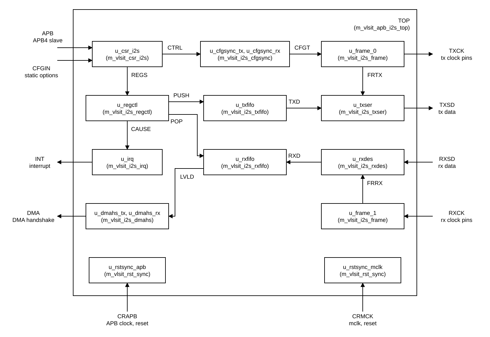
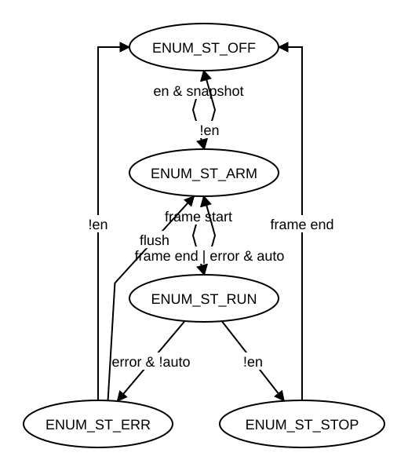
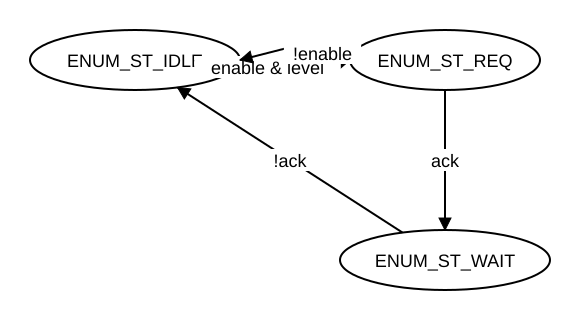
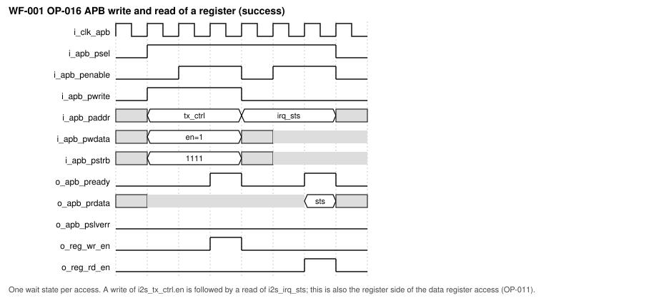
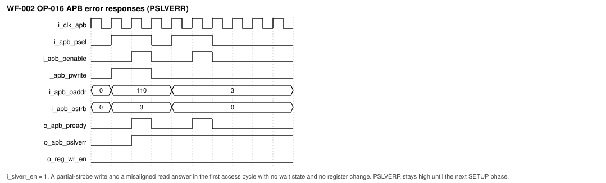
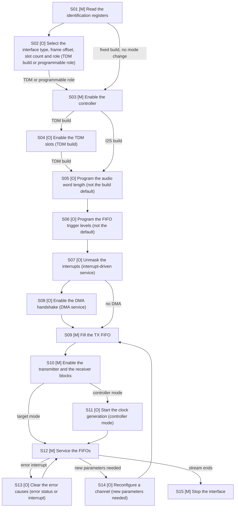

# APB I2S Controller Design Specification

> **Purpose:** Normative design contract for architecture, RTL, verification, DFT, and physical integration of this IP.
>
> Requirement terms: **shall** = mandatory and testable; **should** = recommended; **may** = optional. Every mandatory requirement has a stable identifier of the form REQ-AREA-NNN and a verification method. Unresolved items are listed in section 20 with their technical impact and the decision needed.
>
> Source: technical content derived from a vendor databook (REF-001) and rewritten in the VLSIT template; the databook text, figures and notices are not reproduced.

## Document map

1. [Purpose, scope, and product context](#1-purpose-scope-and-product-context)
2. [Normative references and precedence](#2-normative-references-and-precedence)
3. [Requirements and traceability](#3-requirements-and-traceability)
4. [Features and configurations](#4-features-and-configurations)
5. [Architecture](#5-architecture)
6. [External interfaces and ports](#6-external-interfaces-and-ports)
7. [Clock, reset, and power](#7-clock-reset-and-power)
8. [Parameters and elaboration configurations](#8-parameters-and-elaboration-configurations)
9. [Data representation and arithmetic](#9-data-representation-and-arithmetic)
10. [Detailed functional behavior](#10-detailed-functional-behavior)
11. [Register and programming model (CSR from workbook)](#11-register-and-programming-model)
12. [Error handling and recovery](#12-error-handling-and-recovery)
13. [Performance, power, and area](#13-performance-power-and-area)
14. [RTL implementation contract](#14-rtl-implementation-contract)
15. [Verification specification](#15-verification-specification)
16. [DFT and testability](#16-dft-and-testability)
17. [Physical design and timing integration](#17-physical-design-and-timing-integration)
18. [Security, safety, and reliability](#18-security-safety-and-reliability)
19. [Requirement-to-verification traceability](#19-requirement-to-verification-traceability)
20. [Assumptions, dependencies, and decisions](#20-assumptions-dependencies-and-decisions)
21. [Glossary](#21-glossary)
22. [References used to shape this template](#22-references-used-to-shape-this-template)

## 1. Purpose, scope, and product context

### 1.1 Purpose and scope

The APB I2S Controller is a configurable, synthesizable serial audio interface IP. It moves digital audio between the memory-mapped world of an SoC (a processor or a DMA controller reaching the IP through an APB completer port) and external audio devices (ADC, DAC, codec, amplifier, digital microphone) over the Inter-IC Sound (I2S) three-wire serial bus, and over a Time Division Multiplexed (TDM) variant of the same wires. The bus carries audio samples only; control of the external device uses another bus (for example I2C).

The IP contains a transmitter block and a receiver block that work independently (full duplex). Each block serves up to four stereo channels in standard I2S mode, or one multi-slot serial line (up to 16 slots) in TDM mode. It can generate the word-select and clock-gating signals itself (controller mode) or follow external ones (target mode), and it can switch between the two roles under software control.

This specification was derived from the technical content of a vendor databook of an equivalent component (REF-001). It describes the behavior in the terms of the VLSIT template, with VLSIT names, and it does not reproduce the text, figures or notices of that document. Where the databook is ambiguous or inconsistent, the decision is recorded in section 20.

**Included:**

- APB completer interface and the software-visible register block (workbook, section 11).
- I2S transmitter and receiver blocks, up to four stereo channels each, audio word length 12, 16, 20, 24 or 32 bits.
- TDM transmitter and receiver, up to 16 slots of 32 sclk cycles, two frame formats.
- Controller-mode clock generation: word select (`o_ws_out`), clock enable (`o_sclk_en`), clock gate (`o_sclk_gate`).
- Target mode: external word select (`i_ws_slv`) and serial clock.
- Per-channel (or per-slot) transmit and receive FIFOs with programmable trigger levels.
- Interrupt generation with per-channel or combined outputs.
- Optional DMA handshake interface (dedicated per channel, or combined per block) and the cyclic DMA data registers.
- Optional serial output enable for tri-state sharing of the TDM line.
- Clock domain crossing between the APB clock and the serial clock, reset handling, component identification registers.

**Excluded:**

- The external audio device, its control bus, and the analog clock source (sclk) and its inversion (sclk_n); they belong to the integrator.
- The DMA controller, the AHB/AXI-to-APB bridge, and the interrupt controller.
- Other audio formats (left-justified, right-justified, PCM short or long frame, DSD), sample-rate conversion, mixing, volume and any signal processing.
- APB data buses of 8 or 16 bits and APB2 timing without wait states (decision DEC-001).
- Pad cells, scan insertion and power management (section 16, section 7.4).

### 1.2 Deployment assumptions

| Item | Specification |
|---|---|
| Target SoC / product class | Audio subsystem of an application SoC: a smart speaker or voice terminal with a stereo codec and an eight-microphone array (ASM-001). |
| Technology / library assumptions | Standard-cell ASIC flow, single power domain; the vendor data in section 13 refers to a 7 nm library and is informational only. |
| Operating modes and workload | Controller or target, standard I2S or TDM; sample rates 8 kHz to 192 kHz; sclk is derived from an audio PLL and is asynchronous to the APB clock (ASM-002). |
| Security / privilege context | Single security domain; the APB protection bit can be enforced when `i_protect_en` is 1. |
| External dependencies | Audio codec or microphone devices; clock controller that supplies `i_clk_sclk` and its inverse `i_clk_sclk_n`; optional DMA controller; interrupt controller. |

### 1.3 Feature summary

| Feature ID | Feature | Required / optional | Configuration condition | Requirements |
|---|---|---|---|---|
| FEAT-001 | APB completer register interface (APB4, 32-bit) | Required | Always present | REQ-IF-001 to REQ-IF-007, REQ-REG-001 to REQ-REG-006 |
| FEAT-002 | I2S transmitter, up to 4 stereo channels | Optional | PARA_I2S_TRANSMITTER_BLOCK = 1, standard I2S | REQ-FUNC-008 to REQ-FUNC-016 |
| FEAT-003 | I2S receiver, up to 4 stereo channels | Optional | PARA_I2S_RECEIVER_BLOCK = 1, standard I2S | REQ-FUNC-017 to REQ-FUNC-023 |
| FEAT-004 | Controller mode clock generation | Optional | PARA_I2S_MODE_EN = 1 or 2 | REQ-FUNC-024 to REQ-FUNC-027 |
| FEAT-005 | Target mode | Optional | PARA_I2S_MODE_EN = 0 or 2 | REQ-FUNC-028, REQ-FUNC-029 |
| FEAT-006 | Programmable controller/target role | Optional | PARA_I2S_MODE_EN = 2 | REQ-FUNC-030 |
| FEAT-007 | Programmable audio resolution (12, 16, 20, 24, 32 bit) | Required | Always present | REQ-FUNC-005, REQ-FUNC-006 |
| FEAT-008 | Configurable FIFO depth and programmable trigger levels | Required | Always present | REQ-FUNC-010, REQ-FUNC-014, REQ-FUNC-019 |
| FEAT-009 | Interrupts (RX data available, RX overrun, TX empty, TX overrun, TX underrun) | Required | Always present | REQ-FUNC-012 to REQ-FUNC-015, REQ-FUNC-020 to REQ-FUNC-022, REQ-IF-010 |
| FEAT-010 | Serial clock gating in controller mode | Optional | PARA_I2S_MODE_EN = 1 or 2 | REQ-FUNC-026 |
| FEAT-011 | DMA handshake interface and cyclic DMA registers | Optional | PARA_I2S_HAS_DMA_INTERFACE = 1 | REQ-FUNC-040 to REQ-FUNC-045 |
| FEAT-012 | TDM interface, up to 16 slots | Optional | PARA_I2S_HAS_TDM = 1 | REQ-FUNC-031 to REQ-FUNC-037 |
| FEAT-013 | Serial output enable (tri-state control) | Optional | PARA_I2S_HAS_SOE = 1 (needs TDM and transmitter) | REQ-FUNC-038 |
| FEAT-014 | Independent APB and serial clock domains with clock domain crossing | Required | Always present | REQ-CLK-001 to REQ-CLK-004, REQ-CDC-001 to REQ-CDC-004 |
| FEAT-015 | Component identification and parameter registers | Required | Always present | REQ-REG-005, REQ-FUNC-046 |
| FEAT-016 | Full-duplex operation (independent TX and RX) | Required | Both blocks present | REQ-FUNC-047 |

### 1.4 Real-world applications of the features

Every row uses the product class chosen by the user on 2026-11-20 (audio SoC with a stereo I2S codec and a TDM microphone array). The numbers are derived from that class and from the audio sample rates in ASM-002, not given by the user; they are recorded as assumptions in section 20 until the user confirms them.

| Feature ID | Real-world application (named system, example product) | What the application needs from the feature | Typical values | Consequence if missing or wrong | Requirements | Source |
|---|---|---|---|---|---|---|
| FEAT-001 | Host processor firmware of a smart speaker configuring the audio subsystem | One 32-bit register block reachable from the SoC APB peripheral bus | APB clock 50 to 200 MHz, accesses of 32 bits | The driver cannot configure or read the interface | REQ-IF-001 to REQ-IF-007, REQ-REG-001 | User answer 2026-11-20 (product class), ASM-001 |
| FEAT-002 | Smart speaker playing stereo music through a stereo DAC plus two more stereo amplifier lines | Up to 4 stereo channels (8 audio channels) shifted out with correct left/right pairing | 48 kHz, 32 bit, 4 channels, sclk 3.072 MHz | Swapped or missing channels, audible clicks | REQ-FUNC-008 to REQ-FUNC-016 | User answer 2026-11-20, ASM-002 |
| FEAT-003 | Voice terminal recording a codec ADC (line-in) | Stereo capture with LSB-aligned samples that software can read in order | 48 kHz, 24 bit, 1 channel | Corrupted samples or lost left/right pairing | REQ-FUNC-017 to REQ-FUNC-023 | User answer 2026-11-20, ASM-002 |
| FEAT-004 | SoC that supplies the bit clock and word select to an external codec | `o_ws_out` and `o_sclk_en` generated with a programmed word length | sclk = 3.072 MHz = 64 x 48 kHz, word select length 32 clocks | The codec has no frame reference and stays silent | REQ-FUNC-024 to REQ-FUNC-027 | User answer 2026-11-20, ASM-002 |
| FEAT-005 | SoC following a codec that owns the audio master clock | Reception and transmission aligned to an external `i_ws_slv` | ws frequency 48 kHz, sclk 3.072 MHz | Sample slips against the codec clock | REQ-FUNC-028, REQ-FUNC-029 | User answer 2026-11-20, ASM-002 |
| FEAT-006 | One board design built with a master or slave codec depending on the variant | Role selection by software without a new chip | 2 roles, 1 mode bit written once before enable | A second silicon spin per board variant | REQ-FUNC-030 | User answer 2026-11-20 |
| FEAT-007 | Voice path at 16 bit and music path at 24 or 32 bit on the same IP | Word length programmed per channel from 12 to 32 bit | 12, 16, 20, 24, 32 bit | Noise from wrong word length, wasted bandwidth | REQ-FUNC-005, REQ-FUNC-006 | User answer 2026-11-20 |
| FEAT-008 | DMA-served audio buffering for a smart speaker | FIFO that rides out service latency; programmable trigger | Depth 8 frames x 20.8 us = 167 us at 48 kHz; trigger level 4 | Underrun or overrun audio dropouts | REQ-FUNC-010, REQ-FUNC-014, REQ-FUNC-019 | ASM-003 |
| FEAT-009 | Driver of the audio subsystem servicing fill-level and error events | Level and error interrupts with masking and read-to-clear | One data interrupt every 4 frames = 83 us at 48 kHz | Missed refills; no diagnostics of dropped samples | REQ-FUNC-012 to REQ-FUNC-015, REQ-FUNC-020 to REQ-FUNC-022 | ASM-003 |
| FEAT-010 | Controller driving a 24-bit codec with a 32-clock word select | Clock off for the unused 8 clocks of each half frame | Gate after 24 of 32 sclk cycles = 25 percent fewer clock edges | Needless toggling power in the codec | REQ-FUNC-026 | ASM-002 |
| FEAT-011 | CPU-offloaded playback of 4 channels at 48 kHz | Hardware request and acknowledge towards the DMA controller | 4 channels x 2 words x 48 kHz = 384 k words per second | The CPU services 384 k accesses per second | REQ-FUNC-040 to REQ-FUNC-045 | User answer 2026-11-20, ASM-002 |
| FEAT-012 | Eight-microphone array of the smart speaker (beamforming) on a single data line | One TDM frame of 8 slots of 32 bits, one word per microphone | 48 kHz frame, 8 x 32 = 256 sclk per frame, sclk 12.288 MHz | Wrong slot order breaks the beamforming | REQ-FUNC-031 to REQ-FUNC-037 | User answer 2026-11-20, ASM-002 |
| FEAT-013 | Several digital microphones sharing one TDM data line | Output driven only in its enabled slots | One of 8 slots driven per microphone | Bus contention between devices | REQ-FUNC-038 | User answer 2026-11-20 |
| FEAT-014 | Audio PLL clock of 12.288 MHz asynchronous to a 100 MHz APB bus | Data and status moved safely between the two clocks | clock ratio about 8:1, no fixed phase | Intermittent corrupted samples | REQ-CLK-001 to REQ-CLK-004, REQ-CDC-001 to REQ-CDC-004 | ASM-002 |
| FEAT-015 | Generic audio driver probing the hardware at boot | Version, channel count, FIFO depth and word size readable | 12 readable parameter fields | Driver mis-sizes buffers | REQ-REG-005, REQ-FUNC-046 | User answer 2026-11-20 |
| FEAT-016 | Speakerphone playing and recording simultaneously for echo cancellation | Receiver and transmitter run without sharing state | Same 48 kHz frame in both directions | Echo canceller loses time alignment | REQ-FUNC-047 | User answer 2026-11-20 |

## 2. Normative references and precedence

### 2.1 Normative references

| Ref ID | Document and revision | Applicable clauses | Authority / notes |
|---|---|---|---|
| REF-001 | Vendor databook of an APB I2S component, version 1.14a, February 2025 (user-supplied file `DW_apb_i2s_databook.pdf`; technical content only) | Chapters 1 to 8 | Source of the I2S and TDM behavior, parameters and signals. Not a VLSIT standard; ambiguities are resolved in section 20. |
| REF-002 | AMBA APB Protocol Specification, Arm IHI 0024 Issue D, file `vlsit_apb_amba_apb_ihi0024d.md` | Section 3.1 write transfers, 3.2 write strobes, 3.3 read transfers, 3.4 error response, 3.5 protection | Protocol authority for the APB4 completer profile. |
| REF-003 | VLSIT RTL Design Rules v2, VLSIT_RTL_Design_Rule.md (folder `vlsit-rtl-generator/reference/templates`) | All applicable rules | Mandatory RTL coding, hierarchy, reset, CDC, and naming baseline |
| REF-004 | IEEE 1800-2017 SystemVerilog | Synthesizable subset | Subject to REF-003 and selected frontend support |
| REF-005 | VLSIT CSR workbook `I2S_CSR.xlsx` and its JSON `I2S_CSR.json` (this folder) | Sheet `CSR` | Sole authority for the register interface, register map, fields, access types, and reset values (Section 11) |
| REF-006 | I2S bus specification (Philips, now NXP, UM11732 Rev. 3.0) | Not available in `reference/md_doc` | Protocol authority for the serial format. Not read: the direct download returned HTTP 404 on 2026-11-20. I2S statements in this document come from REF-001 and are listed in DEP-001. |

### 2.2 Source-of-truth and conflict handling

1. The selected external protocol revision defines protocol behavior for the declared interface profile.
2. Approved product requirements and decisions define product-specific behavior.
3. This specification defines the IP contract and shall remain consistent with the selected protocol and the VLSIT RTL Design Rules v2.
4. REF-003 is the mandatory RTL coding, hierarchy, reset, CDC, and naming baseline. If a proposed requirement conflicts with it, revise the specification requirement or choose a compliant implementation; do not create a local RTL exception.
5. REF-005 is the only place where CSRs are specified. Do not declare registers, fields, offsets, access types, or reset values in this specification.
6. Record the exact protocol revision, role, and optional-signal configuration. Do not include protocol signals absent from the selected revision/profile.
7. Resolve conflicts through an explicit product decision; do not guess or weaken a requirement.
8. Where REF-001 conflicts with items 3 to 5, the specification follows items 3 to 5 and records the deviation in section 20 (for example DEC-001, DEC-002, DEC-003).

**Naming rule:** the default naming rule of `vlsit-rtl-generator`, VLSIT_RTL_Design_Rule.md v2, section 2, path `C:\Users\PC\.claude\skills\vlsit-asic-ip-microspec\reference\templates\VLSIT_RTL_Design_Rule.md`, version v2 (rule R-026, chosen by the user on 2026-11-20). Original databook names are kept only in the name map of section 6.2 (the last column of the port tables).

### 2.3 Compliance declaration

| Standard | Revision / profile | Role implemented | Options | Deviations |
|---|---|---|---|---|
| AMBA APB | Issue D, APB4 profile with PSLVERR, PSTRB and PPROT[1] (REF-002) | Completer (subordinate) | 32-bit data, 16-bit address, no PWAKEUP, no user signals, no parity check signals | REF-001 describes AMBA 2 APB without wait states and 8/16/32-bit buses; DEC-001 |
| I2S serial format (REF-006) | I2S bus specification; statements taken from REF-001 | Transmitter and receiver, controller or target | Standard I2S frame, TDM frame (not part of REF-006) | DEP-001 |
| Component interface (REF-001) | Register behavior of the databook, shifted map | n/a | Registers re-numbered under DEC-002 and DEC-003 | DEC-002, DEC-003 |

## 3. Requirements and traceability

State of each requirement: trigger, observable result, clock, configuration, source and verification method. Sources cite REF-001 sections by their databook numbers. Times in sclk cycles refer to the serial clock `i_clk_sclk`.

| ID | Requirement using shall/should/may | Source | Applies to | Verification method |
|---|---|---|---|---|
| REQ-FUNC-001 | After reset every enable shall be inactive: the global enable, the receiver block enable, the transmitter block enable and the clock generation enable shall read 0, and no serial output shall toggle. | REF-001 §2.3, §2.4.1, §2.5.1, §2.6.1 | All | Reset test |
| REQ-FUNC-002 | When the global enable is cleared the TX and RX FIFOs shall be emptied with their pointers reset, data in flight shall be dropped, all block, channel and slot enables shall be overridden, and `o_sclk_en`, `o_ws_out` and `o_sclk_gate` shall be held low. | REF-001 §2.3 | All | Simulation |
| REQ-FUNC-003 | When the global enable is set in controller mode the controller shall start in the left cycle (`o_ws_out` low) and shall move to the right cycle one sclk cycle later, so that a target does not see a 1-to-0 transition at start. | REF-001 §2.3, §2.6.1 | CFG-I2S-4CH, CFG-TDM | Simulation |
| REQ-FUNC-004 | The serial frame shall use two's complement samples, most significant bit first; the first bit of a word shall appear one sclk cycle after a word-select change; word select low shall carry the left sample and word select high the right sample. | REF-001 §1.2.4, §2.7 | I2S mode | Simulation, waveform check |
| REQ-FUNC-005 | A transmitter shall shift out the programmed word length and then zeros up to the end of the half frame; a receiver shall ignore bits beyond the programmed word length (the least significant bits are truncated), and shall pad with zeros at the least significant end if the incoming word is shorter. | REF-001 §1.2.4, §2.5.3, §2.6.3, §2.7 | I2S, TDM | Simulation |
| REQ-FUNC-006 | The supported audio resolutions shall be 12, 16, 20, 24 and 32 bits; a programmed resolution that is not supported, or larger than the build maximum of the channel, shall restore the build maximum. | REF-001 §2.4.3, §2.5.3 | All | Directed test |
| REQ-FUNC-007 | Changes of resolution, FIFO trigger level and FIFO flush shall be accepted only while the affected channel or block is disabled; behavior of a change made while enabled is not specified and shall be avoided by software. | REF-001 §2.4.3, §2.4.4, §2.5.3, §2.5.4 | All | Inspection, software sequence |
| REQ-FUNC-008 | With the transmitter block disabled, outgoing data shall be lost and the channel outputs held low, the TX FIFO content and the channel programming shall be preserved, and the FIFO shall remain writable. | REF-001 §2.4.1 | Transmitter | Simulation |
| REQ-FUNC-009 | When the transmitter block or a channel is enabled and its FIFO holds data, transmission shall resume at the next left cycle (word select falling to low). | REF-001 §2.4.1, §2.4.2 | Transmitter | Simulation |
| REQ-FUNC-010 | Each transmit channel shall have a left and a right FIFO bank whose depth is PARA_I2S_FIFO_DEPTH_GLOBAL entries and whose width is the maximum resolution of the channel. | REF-001 §2.4.4 | Transmitter | Inspection, elaboration |
| REQ-FUNC-011 | A stereo pair shall be written left first and right second; a write that finds the FIFO full shall be lost, the FIFO content preserved, and the overrun cause set. | REF-001 §2.4.6 | Transmitter | Simulation |
| REQ-FUNC-012 | The TX FIFO empty cause shall be set while the FIFO fill level is at or below the programmed empty trigger level and clear above it. | REF-001 §2.4.4, §2.4.5 | Transmitter | Simulation |
| REQ-FUNC-013 | When a frame starts (word select falling) while the left or right TX FIFO is empty, the channel shall send zeros for the whole frame and set the underrun cause; the underrun interrupt shall appear between the second and third rising sclk edge after the word-select transition, including synchronization to the APB clock. | REF-001 §2.4.5 | Transmitter | Simulation, waveform check |
| REQ-FUNC-014 | The transmitter shall start a frame only with data present in the FIFO before the transition to the left cycle; otherwise the channel shall output zeros until the next frame. | REF-001 §2.4.6 | Transmitter | Simulation |
| REQ-FUNC-015 | The TX overrun and underrun causes shall be cleared by a read of the transmit interrupt clear register of the channel. | REF-001 §2.4.5 | Transmitter | Simulation |
| REQ-FUNC-016 | A write to the left transmit register shall be followed by a write to the right register of the same channel; the IP shall treat the two writes as one stereo pair. | REF-001 §2.4.6 | Transmitter | Simulation, software sequence |
| REQ-FUNC-017 | With the receiver block disabled, incoming data shall be lost, the RX FIFO content and channel programming preserved and the FIFO readable; enabling resumes reception at the next left cycle. | REF-001 §2.5.1, §2.5.2 | Receiver | Simulation |
| REQ-FUNC-018 | Each receive channel shall have a left and a right FIFO bank of PARA_I2S_FIFO_DEPTH_GLOBAL entries; the sample shall be stored LSB aligned. | REF-001 §2.5.3, §2.5.4 | Receiver | Inspection, simulation |
| REQ-FUNC-019 | The RX data-available cause shall be set while the FIFO fill level is at or above the programmed trigger level (value plus one) and clear below it. | REF-001 §2.5.4, §2.5.5 | Receiver | Simulation |
| REQ-FUNC-020 | A received sample that finds the FIFO full shall be dropped, the FIFO content preserved and the RX overrun cause set; a read of the receive overrun register of the channel shall clear it. | REF-001 §2.5.5 | Receiver | Simulation |
| REQ-FUNC-021 | A stereo pair shall be read left first and right second. | REF-001 §2.5.6 | Receiver | Simulation, software sequence |
| REQ-FUNC-022 | The interrupt status register shall show the current cause state whether or not it is masked; a set mask bit shall block only the interrupt output. All mask bits shall be set after reset. | REF-001 §2.4.5, §2.5.5 | All | Directed test |
| REQ-FUNC-023 | In target mode a receiver shall sample `i_sdi_x` on the rising edge of `i_clk_sclk` and shall push a stereo pair when the word select returns to low. | REF-001 §1.2.4, §2.7 | Receiver | Simulation |
| REQ-FUNC-024 | With the clock generation enabled the controller shall toggle `o_ws_out` every programmed word select size (16, 24, 32, 64, 128 or 256 sclk cycles) and shall hold `o_ws_out` low when it is disabled. | REF-001 §2.6.1, §2.6.2 | Controller | Simulation |
| REQ-FUNC-025 | `o_sclk_en` shall be high while clock generation is enabled and low when it is disabled, so that an external AND with the clock stops the clock of an idle controller. | REF-001 §2.6.1 | Controller | Simulation |
| REQ-FUNC-026 | With a gating value programmed, `o_sclk_gate` shall be asserted after the programmed number of sclk cycles of each left and right half frame and held to its end; with no gating it shall stay low. | REF-001 §2.6.3 | Controller | Simulation, waveform check |
| REQ-FUNC-027 | The word select size and the gating value shall be changed only while the clock generation is disabled. | REF-001 §2.6.2, §2.6.3 | Controller | Inspection, software sequence |
| REQ-FUNC-028 | In target mode the IP shall follow `i_ws_slv`: a rising edge shall be the start condition and the next falling edge shall start a new frame; the transmitter shall send zeros after the valid audio bits and the receiver shall ignore bits after them when the word select period is longer than the word. | REF-001 §2.6.3, §2.7 | Target | Simulation |
| REQ-FUNC-029 | In target mode the serial outputs shall change on the falling edge of `i_clk_sclk` (the rising edge of `i_clk_sclk_n`). | REF-001 §1.2.4, §4 | Target | Simulation, waveform check |
| REQ-FUNC-030 | The operating mode shall be changed only while the global enable is 0; `o_i2s_op_mode` shall report the active role in the serial clock domain. | REF-001 §2.6, §4.9 | PARA_I2S_MODE_EN = 2 | Directed test |
| REQ-FUNC-031 | In TDM mode the frame shall consist of 1 to PARA_I2S_TDM_SLOTS slots of exactly 32 sclk cycles, most significant bit first, and the word select shall be a pulse of one sclk cycle once per frame. | REF-001 §2.8.1.7, §2.8.2.7 | TDM | Simulation |
| REQ-FUNC-032 | The frame offset field shall choose whether slot data aligns with the word-select pulse or starts one sclk cycle after it. | REF-001 §2.8.1.7, §2.8.2.7 | TDM | Simulation, waveform check |
| REQ-FUNC-033 | In TDM mode the number of serial lines shall be one for each direction, and the audio resolution shall be common to all slots. | REF-001 §2.8 | TDM | Inspection |
| REQ-FUNC-034 | A TDM receiver shall push a slot into its FIFO only if the slot is enabled, including slots that carry only zeros; a disabled slot shall not be pushed. | REF-001 §2.8.1.2 | TDM | Simulation |
| REQ-FUNC-035 | A TDM transmitter shall pop a slot FIFO only if the slot is enabled; for a disabled slot nothing shall be popped. | REF-001 §2.8.2.2 | TDM | Simulation |
| REQ-FUNC-036 | In TDM mode the data-available, empty and error causes shall be combined over all enabled slot FIFOs: the data-available and empty causes are set when all enabled slots reach the trigger level; overrun is set when any enabled slot overruns; underrun is set when any enabled slot FIFO is empty at the frame start. | REF-001 §2.8.1.5, §2.8.2.5 | TDM | Simulation |
| REQ-FUNC-037 | In controller TDM mode the first word-select pulse shall be produced one TDM frame time after the clock generation is enabled, with `o_ws_out` low before it. | REF-001 §2.8.5.1 | TDM controller | Simulation |
| REQ-FUNC-038 | `o_sdo_oe_n` shall be low during the 32 sclk cycles of every enabled transmit slot and high during disabled slots. | REF-001 §2.8.4 | PARA_I2S_HAS_SOE = 1 | Simulation, waveform check |
| REQ-FUNC-039 | The word select, sdo, and clock-gate outputs of the serial interface shall be registered on the falling edge of `i_clk_sclk` (the rising edge of `i_clk_sclk_n`), `o_sclk_en` on `i_clk_sclk`. | REF-001 §4.3, §4.6 | All | Inspection, timing analysis |
| REQ-FUNC-040 | With dedicated DMA handshake each enabled channel shall raise `o_dma_tx_req_x` while its TX FIFO fill level is at or below the programmed empty trigger level, and `o_dma_rx_req_x` while its RX FIFO fill level is at or above the programmed trigger level (value plus one). | REF-001 §2.11.1.1 | PARA_I2S_DMA_HS_TYPE = 0 | Simulation |
| REQ-FUNC-041 | With combined DMA handshake one request per direction shall be raised when any enabled channel meets its trigger condition. | REF-001 §2.11.1.2 | PARA_I2S_DMA_HS_TYPE = 1 | Simulation |
| REQ-FUNC-042 | A DMA request shall stay high until the acknowledge arrives even if the FIFO level changes; the request shall drop when the acknowledge is asserted, and it shall be re-raised after the acknowledge is released only if the level condition still holds. | REF-001 §2.11.1.10.1 | DMA | Simulation |
| REQ-FUNC-043 | The single signals shall be high while the TX FIFO has at least one free entry or the RX FIFO has at least one valid entry, shall clear while the acknowledge is active, and shall return when the acknowledge is released if the condition still holds. | REF-001 §2.11.1.10.2 | DMA | Simulation |
| REQ-FUNC-044 | The cyclic DMA data registers shall serve the enabled channels or slots in ascending order, two accesses per channel in I2S mode (left then right) and one per slot in TDM mode; a pointer reset shall move the pointer to the lowest enabled channel or slot and shall have no effect between the two accesses of a stereo pair. | REF-001 §2.4.6, §2.5.6, §2.8.3, registers RXDMA to RTXDMA | DMA | Simulation |
| REQ-FUNC-045 | The IP shall generate DMA requests only when all enabled slot FIFOs (TDM) reach their trigger level. | REF-001 §2.8.4 | TDM with DMA | Simulation |
| REQ-FUNC-046 | The component parameter and type registers shall report the build configuration of the IP. | REF-001 registers COMP_PARAM_1, COMP_PARAM_2, COMP_VERSION, COMP_TYPE | All | Reset/read test |
| REQ-FUNC-047 | The transmitter block and the receiver block shall operate independently of each other; disabling one shall not change the state of the other. | REF-001 §1.2.1 | Both blocks | Simulation |
| REQ-IF-001 | The APB port shall follow REF-002 (APB4): setup phase with PSEL, access phase with PENABLE, completion when PREADY is high. | REF-002 §3.1, §3.3 | All | Protocol checker |
| REQ-IF-002 | A normal register access shall complete with one wait state when the CSR runs on the APB clock. | Generator behavior (section 11.4) | All | Simulation |
| REQ-IF-003 | A write with any PSTRB bit low, an address with bits [1:0] not zero, or a non-secure access when `i_protect_en` is 1 shall complete with PSLVERR high and no register change when `i_slverr_en` is 1. | REF-002 §3.2, §3.4, §3.5 | All | Protocol checker |
| REQ-IF-004 | A read or write of an aligned address that is not a register shall complete with OKAY; the read returns 0 and the write is ignored. | REF-001 §8.1.1, section 11.4 | All | Simulation |
| REQ-IF-005 | A register that is narrower than 32 bits shall return 0 in its unused upper bits and shall ignore writes to them. | REF-001 §8.1 | All | Simulation |
| REQ-IF-006 | The software-visible registers shall be little endian and word aligned. | REF-001 §2.10.1, §8.1 | All | Inspection |
| REQ-IF-007 | A successful read of a data register shall pop its FIFO and a successful write of a data register shall push its FIFO, using the register event outputs of the CSR. | Section 11.3 (ASM-005) | All | Simulation |
| REQ-IF-008 | `i_sdi_x` shall be sampled on the rising edge of `i_clk_sclk`; `i_ws_slv` shall be sampled on `i_clk_sclk`. | REF-001 §4.4, §4.5 | All | Simulation |
| REQ-IF-009 | The serial data outputs shall be held low while the transmitter block or channel is disabled or idle. | REF-001 §2.4.1, §2.4.2 | Transmitter | Simulation |
| REQ-IF-010 | The interrupt outputs shall be registered in the APB clock domain; with PARA_I2S_INTERRUPT_SIGNALS = 0 one global interrupt shall be the OR of all unmasked causes. | REF-001 §2.4.5, §4.8 | All | Simulation |
| REQ-IF-011 | The DMA request and single outputs and the acknowledge inputs shall be synchronous to the APB clock. | REF-001 §4.7 | DMA | Inspection |
| REQ-CLK-001 | The APB clock and the serial clock shall be treated as asynchronous to each other. | REF-001 §1.2.1, §4 | All | CDC analysis |
| REQ-CLK-002 | `i_clk_sclk_n` shall be the logical inverse of `i_clk_sclk`, supplied by the integrator; the IP shall not derive it. | REF-001 §2.1 | All | Integration check |
| REQ-CLK-003 | The DMA handshake shall assume that the DMA controller clock is phase aligned with the APB clock and an integer multiple of its frequency. | REF-001 §2.11.1.10.1 | DMA | Integration check |
| REQ-CLK-004 | The controller shall expose `o_sclk_en` and `o_sclk_gate` for external clock gating; the IP shall not gate its own serial clock input. | REF-001 §2.6.1, §2.6.3 | Controller | Inspection |
| REQ-RESET-001 | `i_rst_n_apb` shall reset the APB-domain logic and all registers; `i_rst_n_sclk` shall reset the serial-domain logic. Both shall assert asynchronously and release synchronously to their clocks inside the IP. | REF-001 §2.2; DEC-005 | All | Reset test |
| REQ-RESET-002 | After reset the serial outputs shall be low and the FIFOs empty. | REF-001 §2.3 | All | Reset test |
| REQ-CDC-001 | The TX FIFO data and the RX FIFO data shall cross between the APB and serial domains through a Gray-pointer asynchronous FIFO or equivalent approved structure. | REF-001 Appendix A; DEC-004 | All | CDC analysis |
| REQ-CDC-002 | The configuration and enable bits shall cross from the APB to the serial domain through a handshake-qualified bus synchronizer. | REF-001 Appendix A; DEC-004 | All | CDC analysis |
| REQ-CDC-003 | The events of the serial domain (underrun, overrun, frame start, FIFO flags) shall cross to the APB domain through pulse or level synchronizers of PARA_I2S_SYNC_DEPTH stages. | REF-001 §2.4.5, parameter I2S_SYNC_DEPTH | All | CDC analysis |
| REQ-CDC-004 | No combinational logic shall be placed between a source flop and the first synchronizer stage. | REF-003 CLK-01 | All | Lint, CDC analysis |
| REQ-PARAM-001 | Illegal parameter combinations (section 8) shall be rejected at elaboration. | REF-001 chapter 3 | All | Elaboration |
| REQ-REG-001 | Every software-visible register, field, offset, type and reset value shall be defined only in REF-005. | R-016 | All | Inspection |
| REQ-REG-002 | Register map and fields shall follow the shifted databook map of DEC-002, with the version register at the first offset. | DEC-002 | All | Workbook check |
| REQ-REG-003 | Registers of channels, slots or features that are absent shall be unmapped: a read returns 0 and a write is ignored. | REF-001 §8.1.1; DEC-006 | All | Simulation |
| REQ-REG-004 | The self-clearing flush and pointer-reset bits shall return to 0 after the action completes and read as 0. | REF-001 registers RXFFR, TXFFR, RFFx, TFFx, RRXDMA, RTXDMA | All | Simulation |
| REQ-REG-005 | The register reset values shall be the values of the delivered default configuration (DEC-007). | DEC-007 | CFG-I2S-DEF | Reset test |
| REQ-REG-006 | A read of the receive overrun register or of the transmit interrupt clear register shall return the pending flag and clear it. | REF-001 registers ROR, TICR | All | Simulation |
| REQ-ERR-001 | The IP shall record RX overrun, TX overrun and TX underrun as sticky causes until read, and shall never stop the stream because of them. | REF-001 §2.4.5, §2.5.5 | All | Simulation |
| REQ-PERF-001 | The FIFO shall sustain continuous transfer at the configured sclk with no loss when the trigger level and service latency satisfy section 13. | REF-001 §2.11.1.4 | All | Simulation, analysis |
| REQ-RTL-001 | The RTL shall follow REF-003 without local exceptions. | REF-003 | All | Lint, rule check |
| REQ-VER-001 | Verification shall cover every requirement of this section in all configurations of section 4. | Section 15 | All | Review |
| REQ-DFT-001 | The IP shall allow the integrator to add scan and reset control through the wrapper without changes to functional leaves. | REF-003 RST-04 | All | DFT review |
| REQ-SEC-001 | The IP shall enforce the APB protection bit when `i_protect_en` is 1. | REF-002 §3.5 | All | Directed test |

## 4. Features and configurations

| Configuration ID | Enabled features | Disabled features | Interfaces / widths | Intended use | Verification target |
|---|---|---|---|---|---|
| CFG-I2S-DEF | Standard I2S, 1 TX and 1 RX channel, target mode, FIFO depth 8, 16-bit words, single interrupt, 2-stage synchronizers | TDM, DMA, controller mode, serial output enable | APB4 32-bit; sdi and sdo one line each | Minimum audio port, delivered default (ASM-004) | Reset values, REQ-FUNC-001 to REQ-FUNC-023 |
| CFG-I2S-4CH | Standard I2S, 4 TX and 4 RX channels, programmable controller/target, 32-bit words, dedicated DMA, per-channel interrupts, word select up to 256, sclk gating | TDM | APB4 32-bit; sdi and sdo four lines each; 16 DMA handshake signals | Multi-channel audio playback and capture | All FUNC and IF requirements, DMA, gating |
| CFG-TDM | TDM and standard I2S (selectable), 8 slots, programmable controller/target, combined DMA, serial output enable | Multiple channels | APB4 32-bit; one sdi, one sdo, `o_sdo_oe_n` | Microphone array on one data line | TDM requirements, REQ-FUNC-031 to REQ-FUNC-038 |
| CFG-TDM-ONLY | TDM only, 16 slots, target mode | Standard I2S | APB4 32-bit; one sdi, one sdo | Pure TDM link | TDM frame formats, slot enables |

For each optional feature the configuration states whether it is absent, tied off, or present but disabled at run time. A feature that is absent (for example the receiver block when PARA_I2S_RECEIVER_BLOCK is 0) removes its ports from the structural wrapper of the profile and leaves its registers unmapped (REQ-REG-003). A feature that is present but disabled at run time (for example the transmitter before `i2s_iter.txen` is set) keeps its registers and its outputs idle. Illegal combinations are listed in section 8 and are rejected at elaboration (REQ-PARAM-001).

## 5. Architecture

### 5.1 Overview and block responsibilities

The IP is split into an APB-clock domain and a serial-clock domain. The APB side holds the generated register block, the glue that turns register accesses into FIFO operations, the DMA handshake and the interrupt logic. The serial side holds the frame sequencers, the shift registers and, in controller mode, the generator of word select and clock gating. The audio FIFOs sit on the boundary and are the only data path between the domains; configuration and events cross through dedicated synchronizers (section 7.2). The transmitter and the receiver blocks share the clock generation and the frame sequencer but have independent FIFOs and shift registers (REQ-FUNC-047).

Fixed architectural choices (details in section 20): the CSR is the generated APB4 block with register events (DEC-001); the FIFOs are dual-clock Gray-pointer FIFOs (DEC-004); the reset release is synchronized inside the IP (DEC-005); the serial outputs are registered on the falling edge of the serial clock (REQ-FUNC-039).

| Block | Responsibility | Inputs / outputs | Clock/reset domain | State or storage |
|---|---|---|---|---|
| m_vlsit_apb_i2s_top (top) | Structural wrapper: interfaces, parameters, interconnect and instances only | All ports of section 6 | APB and serial | None |
| u_rstsync_apb, u_rstsync_sclk (m_vlsit_i2s_rstsync) | Asynchronous assertion and synchronous release of each domain reset | `i_rst_n_apb`, `i_rst_n_sclk` to local resets | One per domain | Synchronizer flops |
| u_csr_i2s (m_vlsit_csr_i2s) | Generated APB4 register block; address decode, PREADY, PSLVERR, register events | APB bus, field controls and statuses, register read/write events | APB | Register flops |
| u_regctl (m_vlsit_i2s_regctl) | Decodes register events into FIFO push, pop, flush and DMA-pointer actions; builds status fields and the read-to-clear causes | CSR events and field ports; FIFO status; cause flags | APB | Cyclic pointers, cause flags |
| u_txfifo (m_vlsit_i2s_txfifo) | Left and right TX FIFO banks per channel (per slot in TDM); fill levels and flags | Push data and strobes (APB); pop strobes and data (serial) | Write side APB, read side serial | Memory MEM-001 |
| u_rxfifo (m_vlsit_i2s_rxfifo) | Left and right RX FIFO banks per channel (per slot in TDM) | Push data (serial); pop strobes and data (APB) | Write side serial, read side APB | Memory MEM-002 |
| u_cfgsync (m_vlsit_i2s_cfgsync) | Crosses enables, mode and configuration to the serial domain and events and flags back to the APB domain | CSR field outputs; serial events | Both | Synchronizer flops, handshake state |
| u_clkgen (m_vlsit_i2s_clkgen) | Controller mode: generates word select, clock gate and clock enable; I2S and TDM frame timing | Mode, word select size, gating value, TDM slot count | Serial | FSM, counters |
| u_frame (m_vlsit_i2s_frame) | Follows the word select (internal or external) and drives the I2S frame sequencer and the TDM slot sequencer: bit counters, pair boundaries, slot boundaries, push and pop events | `i_ws_slv` or internal word select; enables | Serial | FSMs, bit and slot counters |
| u_txser (m_vlsit_i2s_txser) | Loads the FIFO pair at the frame start, shifts out the word MSB first, pads with zeros, drives `o_sdo_x` and `o_sdo_oe_n` | Frame events, FIFO data, word length | Serial (outputs on the inverted clock) | Shift registers |
| u_rxdes (m_vlsit_i2s_rxdes) | Samples `i_sdi_x` on the rising clock edge, assembles the word, aligns it LSB first at the least significant end and pushes it | Frame events, serial input, word length | Serial | Shift registers |
| u_dmahs (m_vlsit_i2s_dmahs) | DMA request, single and acknowledge handshake per channel or per block | FIFO levels, thresholds, acknowledge | APB | FSM |
| u_intr (m_vlsit_i2s_intr) | Raises the status causes, applies the mask, produces per-channel or combined interrupts | Cause flags, mask | APB | None (registered outputs) |

### 5.2 Block diagram



```json
{
  "page_name": "BLOCK_DIAGRAM",
  "out_name": "m_vlsit_apb_i2s_top_block_diagram.drawio",
  "table_suffix": "",
  "layout": {
    "gap_h": 100,
    "gap_v": 90,
    "margin": 40,
    "block_h": 80
  },
  "top": {
    "frame_label": [
      "TOP",
      "(m_vlsit_apb_i2s_top)"
    ],
    "block_label": [
      "TOP",
      "(m_vlsit_apb_i2s_top)"
    ],
    "block_row": [
      "TOP (m_vlsit_apb_i2s_top)",
      "Structural top of the APB I2S controller.",
      "Section 14.2"
    ]
  },
  "frame_row": [
    "TOP (m_vlsit_apb_i2s_top) frame",
    "Structural top of the APB I2S controller. It holds no logic: it instantiates the register block, the FIFOs, the serial engines and the support blocks. The APB domain is on the left, the serial domain on the right.",
    "Section 14.2"
  ],
  "frame_interfaces": [
    "APB",
    "CFGIN",
    "INT",
    "DMA",
    "CRAPB",
    "MODE",
    "CLKO",
    "WSIN",
    "SDO",
    "SDI",
    "CRSCK"
  ],
  "blocks": [
    {
      "key": "csr",
      "label": [
        "u_csr_i2s",
        "(m_vlsit_csr_i2s)"
      ],
      "width": 220,
      "row": 0,
      "col": 0,
      "row_name": "u_csr_i2s (m_vlsit_csr_i2s)",
      "function": "Generated register block of the APB completer. It decodes addresses, answers the bus with one wait state, holds every software-visible field and reports register read and write events.",
      "source": "Section 14.2, 5.1"
    },
    {
      "key": "regctl",
      "label": [
        "u_regctl",
        "(m_vlsit_i2s_regctl)"
      ],
      "width": 260,
      "row": 1,
      "col": 0,
      "row_name": "u_regctl (m_vlsit_i2s_regctl)",
      "function": "Register control. It turns register read and write events into FIFO push, pop and flush actions, keeps the cyclic DMA pointers, and holds the sticky overrun and underrun causes that a read clears.",
      "source": "Section 14.2, 5.1"
    },
    {
      "key": "intr",
      "label": [
        "u_intr",
        "(m_vlsit_i2s_intr)"
      ],
      "width": 240,
      "row": 2,
      "col": 0,
      "row_name": "u_intr (m_vlsit_i2s_intr)",
      "function": "Interrupt generator. It combines the cause flags and the FIFO levels with the mask bits and drives the per-channel or combined interrupt outputs.",
      "source": "Section 14.2, 5.1"
    },
    {
      "key": "dmahs",
      "label": [
        "u_dmahs",
        "(m_vlsit_i2s_dmahs)"
      ],
      "width": 260,
      "row": 3,
      "col": 0,
      "row_name": "u_dmahs (m_vlsit_i2s_dmahs)",
      "function": "DMA handshake. For each channel or block it raises the request from the FIFO fill level, holds it until the acknowledge, and drives the single transfer indication.",
      "source": "Section 14.2, 5.1"
    },
    {
      "key": "rsta",
      "label": [
        "u_rstsync_apb",
        "(m_vlsit_i2s_rstsync)"
      ],
      "width": 280,
      "row": 4,
      "col": 0,
      "row_name": "u_rstsync_apb (m_vlsit_i2s_rstsync)",
      "function": "Reset synchronizer of the APB domain. It asserts the local reset asynchronously and releases it synchronously to the APB clock.",
      "source": "Section 14.2, 5.1"
    },
    {
      "key": "cfg",
      "label": [
        "u_cfgsync",
        "(m_vlsit_i2s_cfgsync)"
      ],
      "width": 280,
      "row": 0,
      "col": 1,
      "row_name": "u_cfgsync (m_vlsit_i2s_cfgsync)",
      "function": "Configuration and event crossing. It carries enables, mode, word length and clock-generation settings from the APB domain to the serial domain, and flags and flush acknowledgements back.",
      "source": "Section 14.2, 5.1"
    },
    {
      "key": "txf",
      "label": [
        "u_txfifo",
        "(m_vlsit_i2s_txfifo)"
      ],
      "width": 260,
      "row": 2,
      "col": 1,
      "row_name": "u_txfifo (m_vlsit_i2s_txfifo)",
      "function": "Transmit FIFO. One left and one right bank per channel (one bank per slot in TDM), written from the APB side and read from the serial side across the clock boundary.",
      "source": "Section 14.2, 5.1"
    },
    {
      "key": "rxf",
      "label": [
        "u_rxfifo",
        "(m_vlsit_i2s_rxfifo)"
      ],
      "width": 260,
      "row": 3,
      "col": 1,
      "row_name": "u_rxfifo (m_vlsit_i2s_rxfifo)",
      "function": "Receive FIFO. One left and one right bank per channel (one bank per slot in TDM), written from the serial side and read from the APB side across the clock boundary.",
      "source": "Section 14.2, 5.1"
    },
    {
      "key": "clk",
      "label": [
        "u_clkgen",
        "(m_vlsit_i2s_clkgen)"
      ],
      "width": 260,
      "row": 0,
      "col": 2,
      "row_name": "u_clkgen (m_vlsit_i2s_clkgen)",
      "function": "Controller-mode clock generation. It produces the word select, the clock enable and the clock gating from counters, for the standard frame and for the TDM frame.",
      "source": "Section 14.2, 5.1"
    },
    {
      "key": "frm",
      "label": [
        "u_frame",
        "(m_vlsit_i2s_frame)"
      ],
      "width": 260,
      "row": 1,
      "col": 2,
      "row_name": "u_frame (m_vlsit_i2s_frame)",
      "function": "Frame sequencer. It follows the internal or external word select, tracks left and right halves or TDM slots, and issues the pop, push and underrun events of the frame.",
      "source": "Section 14.2, 5.1"
    },
    {
      "key": "txs",
      "label": [
        "u_txser",
        "(m_vlsit_i2s_txser)"
      ],
      "width": 260,
      "row": 2,
      "col": 2,
      "row_name": "u_txser (m_vlsit_i2s_txser)",
      "function": "Transmit serializer. It loads the stereo pair or slot word at the frame start, shifts it out most significant bit first, fills the rest of the half frame with zeros and drives the output enable.",
      "source": "Section 14.2, 5.1"
    },
    {
      "key": "rxd",
      "label": [
        "u_rxdes",
        "(m_vlsit_i2s_rxdes)"
      ],
      "width": 260,
      "row": 3,
      "col": 2,
      "row_name": "u_rxdes (m_vlsit_i2s_rxdes)",
      "function": "Receive deserializer. It samples the serial input, assembles the word, aligns it at the least significant end and pushes it at the end of the half frame or slot.",
      "source": "Section 14.2, 5.1"
    },
    {
      "key": "rsts",
      "label": [
        "u_rstsync_sclk",
        "(m_vlsit_i2s_rstsync)"
      ],
      "width": 280,
      "row": 4,
      "col": 2,
      "row_name": "u_rstsync_sclk (m_vlsit_i2s_rstsync)",
      "function": "Reset synchronizer of the serial domain. It asserts the local reset asynchronously and releases it synchronously to the serial clock.",
      "source": "Section 14.2, 5.1"
    }
  ],
  "connectors": [
    {
      "id": "REGS",
      "src": "csr",
      "src_side": "B",
      "dst": "regctl",
      "dst_side": "T"
    },
    {
      "id": "CTRL",
      "src": "csr",
      "src_side": "R",
      "dst": "cfg",
      "dst_side": "L"
    },
    {
      "id": "CFGS",
      "src": "cfg",
      "src_side": "R",
      "dst": "clk",
      "dst_side": "L"
    },
    {
      "id": "WORD",
      "src": "clk",
      "src_side": "B",
      "dst": "frm",
      "dst_side": "T"
    },
    {
      "id": "PUSH",
      "src": "regctl",
      "src_side": "R",
      "dst": "txf",
      "dst_side": "L"
    },
    {
      "id": "POP",
      "src": "regctl",
      "src_side": "R",
      "dst": "rxf",
      "dst_side": "L"
    },
    {
      "id": "TXD",
      "src": "txf",
      "src_side": "R",
      "dst": "txs",
      "dst_side": "L"
    },
    {
      "id": "RXD",
      "src": "rxd",
      "src_side": "L",
      "dst": "rxf",
      "dst_side": "R"
    },
    {
      "id": "FRTX",
      "src": "frm",
      "src_side": "B",
      "dst": "txs",
      "dst_side": "T"
    },
    {
      "id": "LVLT",
      "src": "txf",
      "src_side": "L",
      "dst": "intr",
      "dst_side": "R"
    },
    {
      "id": "LVLR",
      "src": "rxf",
      "src_side": "L",
      "dst": "dmahs",
      "dst_side": "R"
    }
  ],
  "externals": [
    {
      "id": "APB",
      "block": "csr",
      "side": "L",
      "dir": "in",
      "pos": -20,
      "text": [
        "APB",
        "APB4 slave"
      ]
    },
    {
      "id": "CFGIN",
      "block": "csr",
      "side": "L",
      "dir": "in",
      "pos": 20,
      "text": [
        "CFGIN",
        "static options"
      ]
    },
    {
      "id": "INT",
      "block": "intr",
      "side": "L",
      "dir": "out",
      "pos": 0,
      "text": [
        "INT",
        "interrupts"
      ]
    },
    {
      "id": "DMA",
      "block": "dmahs",
      "side": "L",
      "dir": "out",
      "pos": 0,
      "text": [
        "DMA",
        "DMA handshake"
      ]
    },
    {
      "id": "CRAPB",
      "block": "rsta",
      "side": "B",
      "dir": "in",
      "pos": 0,
      "text": [
        "CRAPB",
        "APB clock, reset"
      ]
    },
    {
      "id": "MODE",
      "block": "cfg",
      "side": "T",
      "dir": "out",
      "pos": 0,
      "text": [
        "MODE",
        "mode status"
      ]
    },
    {
      "id": "CLKO",
      "block": "clk",
      "side": "R",
      "dir": "out",
      "pos": 0,
      "text": [
        "CLKO",
        "controller clocks"
      ]
    },
    {
      "id": "WSIN",
      "block": "frm",
      "side": "R",
      "dir": "in",
      "pos": 0,
      "text": [
        "WSIN",
        "word select in"
      ]
    },
    {
      "id": "SDO",
      "block": "txs",
      "side": "R",
      "dir": "out",
      "pos": -10,
      "text": [
        "SDO",
        "serial out"
      ]
    },
    {
      "id": "SDI",
      "block": "rxd",
      "side": "R",
      "dir": "in",
      "pos": 0,
      "text": [
        "SDI",
        "serial in"
      ]
    },
    {
      "id": "CRSCK",
      "block": "rsts",
      "side": "B",
      "dir": "in",
      "pos": 0,
      "text": [
        "CRSCK",
        "sclk clocks, reset"
      ]
    }
  ],
  "nets": [],
  "interfaces": [
    {
      "id": "APB",
      "name": "APB4 completer interface (CLK-APB)",
      "category": "standard protocol (AMBA APB4)",
      "active": "external requester -> IP",
      "signals": "external requester -> IP: i_apb_psel, i_apb_penable, i_apb_pwrite, i_apb_paddr, i_apb_pwdata, i_apb_pstrb, i_apb_pprot; IP -> external requester: o_apb_pready, o_apb_pslverr, o_apb_prdata"
    },
    {
      "id": "CFGIN",
      "name": "Static CSR option inputs (CLK-APB)",
      "category": "custom",
      "active": "SoC -> IP",
      "signals": "SoC -> IP: i_protect_en, i_slverr_en"
    },
    {
      "id": "INT",
      "name": "Interrupt outputs (CLK-APB)",
      "category": "custom",
      "active": "IP -> interrupt controller",
      "signals": "IP -> interrupt controller: o_int_rx_da_0 to o_int_rx_da_3, o_int_rx_or_0 to o_int_rx_or_3, o_int_tx_emp_0 to o_int_tx_emp_3, o_int_tx_or_0 to o_int_tx_or_3, o_int_tx_ur_0 to o_int_tx_ur_3, o_int_i2s"
    },
    {
      "id": "DMA",
      "name": "DMA handshake (CLK-APB)",
      "category": "custom (request, single, acknowledge)",
      "active": "IP -> DMA controller (request, single); DMA controller -> IP (acknowledge)",
      "signals": "IP -> DMA controller: o_dma_tx_req, o_dma_tx_single, o_dma_rx_req, o_dma_rx_single, o_dma_tx_req_0 to o_dma_tx_req_3, o_dma_tx_single_0 to o_dma_tx_single_3, o_dma_rx_req_0 to o_dma_rx_req_3, o_dma_rx_single_0 to o_dma_rx_single_3; DMA controller -> IP: i_dma_tx_ack, i_dma_rx_ack, i_dma_tx_ack_0 to i_dma_tx_ack_3, i_dma_rx_ack_0 to i_dma_rx_ack_3"
    },
    {
      "id": "CRAPB",
      "name": "Clock and reset of the APB domain",
      "category": "custom",
      "active": "SoC clock and reset controller -> IP",
      "signals": "i_clk_apb, i_rst_n_apb (reset: level, active-low)"
    },
    {
      "id": "MODE",
      "name": "Mode status outputs (CLK-SCLK)",
      "category": "custom",
      "active": "IP -> SoC",
      "signals": "IP -> SoC: o_audio_intf_type, o_i2s_op_mode"
    },
    {
      "id": "CLKO",
      "name": "Controller-mode clock outputs",
      "category": "custom (I2S word select, clock enable, clock gate)",
      "active": "IP -> external audio device or clock gate",
      "signals": "IP -> external: o_ws_out, o_sclk_en, o_sclk_gate"
    },
    {
      "id": "WSIN",
      "name": "Word select input in target mode (CLK-SCLK)",
      "category": "custom (I2S word select)",
      "active": "external controller -> IP",
      "signals": "external controller -> IP: i_ws_slv"
    },
    {
      "id": "SDO",
      "name": "Serial data outputs (CLK-SCLKN)",
      "category": "custom (I2S serial data)",
      "active": "IP -> external audio device",
      "signals": "IP -> external: o_sdo_0 to o_sdo_3, o_sdo_oe_n"
    },
    {
      "id": "SDI",
      "name": "Serial data inputs (CLK-SCLK)",
      "category": "custom (I2S serial data)",
      "active": "external audio device -> IP",
      "signals": "external -> IP: i_sdi_0 to i_sdi_3"
    },
    {
      "id": "CRSCK",
      "name": "Clock and reset of the serial domain",
      "category": "custom",
      "active": "SoC clock and reset controller -> IP",
      "signals": "i_clk_sclk, i_clk_sclk_n, i_rst_n_sclk (reset: level, active-low)"
    },
    {
      "id": "REGS",
      "name": "Register fields, status and events between the CSR and the control block",
      "category": "custom",
      "active": "u_csr_i2s <-> u_regctl",
      "signals": "Field ports of the generated block; o_reg_rd_en, o_reg_rd_addr, o_reg_wr_en, o_reg_wr_addr"
    },
    {
      "id": "CTRL",
      "name": "Control fields to the configuration crossing",
      "category": "custom",
      "active": "u_csr_i2s -> u_cfgsync",
      "signals": "Enables, mode, word length, word select size, gating value, slot count"
    },
    {
      "id": "CFGS",
      "name": "Synchronized configuration and flags",
      "category": "custom",
      "active": "u_cfgsync <-> u_clkgen, u_frame, u_txser, u_rxdes",
      "signals": "Synchronized enables and settings; underrun and frame events back"
    },
    {
      "id": "WORD",
      "name": "Internal word select and frame timing",
      "category": "custom",
      "active": "u_clkgen -> u_frame",
      "signals": "Internal word select, slot start, frame start"
    },
    {
      "id": "PUSH",
      "name": "Transmit FIFO push",
      "category": "custom",
      "active": "u_regctl -> u_txfifo",
      "signals": "Push strobe, left or right bank select, push data, flush"
    },
    {
      "id": "POP",
      "name": "Receive FIFO pop",
      "category": "custom",
      "active": "u_regctl -> u_rxfifo",
      "signals": "Pop strobe, left or right bank select, flush; head data back"
    },
    {
      "id": "TXD",
      "name": "Transmit FIFO read",
      "category": "custom",
      "active": "u_txser -> u_txfifo",
      "signals": "Pop strobe, bank data"
    },
    {
      "id": "RXD",
      "name": "Receive FIFO write",
      "category": "custom",
      "active": "u_rxdes -> u_rxfifo",
      "signals": "Push strobe, word data"
    },
    {
      "id": "FRTX",
      "name": "Frame events to the serializer",
      "category": "custom",
      "active": "u_frame -> u_txser",
      "signals": "Pair load, slot load, half-frame boundary"
    },
    {
      "id": "LVLT",
      "name": "Transmit FIFO levels to the interrupt block",
      "category": "custom",
      "active": "u_txfifo -> u_intr",
      "signals": "Empty flag, fill level"
    },
    {
      "id": "LVLR",
      "name": "Receive FIFO levels to the DMA block",
      "category": "custom",
      "active": "u_rxfifo -> u_dmahs",
      "signals": "Data-available flag, fill level"
    }
  ],
  "legend_note": "The enclosing frame is the top module; blocks inside are its instances. The left column is the APB clock domain, the right column is the serial clock domain, the middle column crosses the boundary.",
  "library_sha256": "15DFB183E267D2A94F8CAB316E01EB3D2E9D2F9C006DC816790A394F4123506C"
}
```

*Figure 5-1. Block diagram of the top module. Source: `../../spec/figures/m_vlsit_apb_i2s_top_block_diagram.drawio` (draw.io, VLSIT library, drawn by `vlsit_spec_diagram.py`).*

### 5.3 Transaction and dataflow

**Transmit path (standard I2S).** Software writes the left sample to the left transmit register and the right sample to the right transmit register of a channel (or one word to the TX DMA register, or to a slot register in TDM). The register event of the CSR pushes the sample into the left or right bank of the TX FIFO in the APB domain. The pointer and the level cross to the serial domain. At each frame start (word select falling) the frame sequencer pops one pair for every enabled channel; if a bank is empty the channel sends zeros for the whole frame and sets the underrun cause. The shift register sends the word MSB first, one sclk cycle after the word-select change, and then zeros up to the end of the half frame. After the push the fill level falls; when it is at or below the empty trigger level the empty cause and the DMA request are raised.

**Receive path (standard I2S).** The receive shift register samples the data line on the rising clock edge from one sclk cycle after the word-select change. At the next word-select falling edge the left and right words of the pair are pushed into the RX FIFO of the channel. The write pointer crosses to the APB domain; when the fill level reaches the trigger level the data-available cause and the DMA request are raised. Software reads the left register and then the right register; each read pops its bank.

**TDM path.** The frame sequencer counts slots of 32 sclk cycles after each word-select pulse. For each enabled slot the transmitter pops one word from the slot FIFO at the slot start and shifts it out; the receiver pushes the assembled word at the end of the slot. A disabled slot is skipped.

**Controller mode.** The clock generator derives word select and clock gating from the serial clock counters and feeds the same frame sequencer, so that transmit and receive timing is identical in controller and target mode.

**Completion and resource release.** A stereo pair is complete when both banks have been popped (TX) or pushed (RX). Overrun and underrun data are dropped and flagged without stopping the stream.

### 5.4 Invariants

- INV-001: A left sample is always followed by its right sample in the same channel; the two banks of a channel always hold the same number of complete pairs when no overrun has occurred.
- INV-002: A FIFO bank is never written when full and never read when empty; a write to a full bank is dropped and flagged.
- INV-003: The read and write pointers of an asynchronous FIFO are crossed only in Gray code through synchronizers of PARA_I2S_SYNC_DEPTH stages.
- INV-004: The serial data outputs are low while the block, channel or slot is disabled.
- INV-005: `o_ws_out`, `o_sclk_gate`, `o_sdo_x` and `o_sdo_oe_n` change only on the rising edge of `i_clk_sclk_n`.
- INV-006: At most one of the DMA request and the single signal of a handshake line is changing in a cycle in which the acknowledge changes (the request is released when the acknowledge rises).
- INV-007: In TDM mode the number of slots programmed never exceeds PARA_I2S_TDM_SLOTS.

## 6. External interfaces and ports

### 6.1 Interface inventory

| Interface ID | Type and revision | Role | Direction at IP boundary | Clock domain | Required / optional | Configurations |
|---|---|---|---|---|---|---|
| IF-001 | AMBA APB4 (REF-002) | Completer | Input to the IP for requests, output for responses | CLK-APB | Required | All |
| IF-002 | I2S serial lines: `i_sdi_x`, `o_sdo_x` (data) | Receiver and transmitter | Input and output | CLK-SCLK and CLK-SCLKN | Optional (per block) | All |
| IF-003 | I2S word select input `i_ws_slv` | Target | Input | CLK-SCLK | Required when target mode is built | PARA_I2S_MODE_EN = 0 or 2 |
| IF-004 | Controller outputs `o_ws_out`, `o_sclk_en`, `o_sclk_gate` | Controller | Output | CLK-SCLKN (word select, gate) and CLK-SCLK (enable) | Optional | PARA_I2S_MODE_EN = 1 or 2 |
| IF-005 | DMA handshake: request, single, acknowledge | Peripheral side of a DMA handshake | Output and input | CLK-APB | Optional | PARA_I2S_HAS_DMA_INTERFACE = 1 |
| IF-006 | Interrupt outputs `o_int_x` | Interrupt source | Output | CLK-APB | Required | All |
| IF-007 | Serial output enable `o_sdo_oe_n` | Tri-state control | Output | CLK-SCLKN | Optional | PARA_I2S_HAS_SOE = 1 |
| IF-008 | Status outputs `o_audio_intf_type`, `o_i2s_op_mode` | Static mode report | Output | CLK-SCLK | Optional | TDM and I2S both built, or programmable mode |
| IF-009 | Static configuration inputs `i_protect_en`, `i_slverr_en` | CSR option inputs | Input | CLK-APB | Required | All |
| IF-010 | Clocks and resets | Clock and reset inputs | Input | n/a | Required | All |

### 6.2 Complete port list

The table lists every port of the IP family. A structural wrapper (profile) contains only the subset of its configuration: the per-channel ports of channels beyond PARA_I2S_TX_CHANNELS or PARA_I2S_RX_CHANNELS are not present, the dedicated or the combined DMA ports are present depending on PARA_I2S_DMA_HS_TYPE, and the per-channel or the global interrupt ports depend on PARA_I2S_INTERRUPT_SIGNALS (REF-003 PRT-03). The polarity profile of this specification is active high for interrupts and DMA; an active-low profile uses the same names with the suffix `_n` and the same behavior and is delivered as a separate wrapper. The last words of the Meaning column give the name used in REF-001. Pins of an APB4 completer follow REF-003 PRT-01. The Reset / idle column is the value of an output while the reset is asserted or the function is disabled.

| Port | Direction | Width | Meaning (function) | Clock domain | Signal type | Reset / idle value | Timing / sampling | Configurations |
|---|---|---:|---|---|---|---|---|---|
| i_clk_apb | Input | 1 | APB clock (REF-001: pclk). Clocks the register block, the APB side of the FIFOs, the DMA handshake and the interrupt logic. | CLK-APB | clock | n/a | Rising edge | All |
| `i_rst_n_apb` | Input | 1 | APB-domain reset, active low (REF-001: presetn). | Asynchronous | reset, active low | n/a | Asserted asynchronously; released synchronously inside the IP | All |
| `i_clk_sclk` | Input | 1 | Serial interface clock (REF-001: sclk). Samples `i_sdi_x` and `i_ws_slv` and times the serial engines. | CLK-SCLK | clock | n/a | Rising edge | All |
| `i_clk_sclk_n` | Input | 1 | Inverted serial clock (REF-001: sclk_n), supplied by the integrator. Its rising edge is the falling edge of `i_clk_sclk` and launches the serial outputs. | CLK-SCLKN | clock | n/a | Rising edge | All |
| `i_rst_n_sclk` | Input | 1 | Serial-domain reset, active low (REF-001: sresetn). | Asynchronous | reset, active low | n/a | Asserted asynchronously; released synchronously inside the IP | All |
| `i_apb_psel` | Input | 1 | APB select (psel). Marks the IP as the target of a transfer. | CLK-APB | level | n/a | Sampled on the rising edge of `i_clk_apb`; high from the setup phase to the end of the transfer | All |
| `i_apb_penable` | Input | 1 | APB enable (penable). Marks the access phase. | CLK-APB | level | n/a | Sampled on the rising edge of `i_clk_apb` | All |
| `i_apb_pwrite` | Input | 1 | APB write (pwrite). High for a write, low for a read. | CLK-APB | level | n/a | Stable from setup to completion | All |
| `i_apb_paddr` | Input | 16 | APB byte address (paddr). Bits [1:0] shall be zero; the register map uses the low 10 bits. | CLK-APB | data (valid while `i_apb_psel` is high) | n/a | Stable from setup to completion | All |
| `i_apb_pwdata` | Input | 32 | APB write data (pwdata). | CLK-APB | data (valid while `i_apb_psel`, `i_apb_penable` and `i_apb_pwrite` are high) | n/a | Stable until completion | All |
| `i_apb_pstrb` | Input | 4 | APB write strobes (pstrb). All four bits shall be high for a write. | CLK-APB | data (valid while `i_apb_psel` and `i_apb_pwrite` are high) | n/a | Stable until completion | All |
| `i_apb_pprot` | Input | 3 | APB protection (pprot). Only bit 1 (non-secure) is used. | CLK-APB | data (valid while `i_apb_psel` is high) | n/a | Stable until completion | All |
| `o_apb_pready` | Output | 1 | APB ready (pready). Completes the transfer. | CLK-APB | level | 0 | Registered; one wait state in the normal case | All |
| `o_apb_pslverr` | Output | 1 | APB error (pslverr). High with pready for a rejected access. | CLK-APB | level | 0 | Valid when `o_apb_pready` is high | All |
| `o_apb_prdata` | Output | 32 | APB read data (prdata). | CLK-APB | data (valid when `o_apb_pready` is high in a read) | 0 | Registered | All |
| `i_protect_en` | Input | 1 | Enables the non-secure access check of the CSR. | CLK-APB | static | n/a | Constant after reset | All |
| `i_slverr_en` | Input | 1 | Enables the error response of the CSR (strobe, alignment, protection). | CLK-APB | static | n/a | Constant after reset | All |
| `i_ws_slv` | Input | 1 | Word select in target mode (REF-001: ws_slv). Low = left, high = right in I2S; frame pulse in TDM. | CLK-SCLK | level | n/a | Sampled on the rising edge of `i_clk_sclk` | PARA_I2S_MODE_EN = 0 or 2 |
| `o_ws_out` | Output | 1 | Word select in controller mode (REF-001: ws_out). | CLK-SCLKN | level | 0 | Changes on the rising edge of `i_clk_sclk_n` | PARA_I2S_MODE_EN = 1 or 2 |
| `o_sclk_en` | Output | 1 | Clock enable (REF-001: sclk_en). External AND with the serial clock stops the clock when the controller is disabled. | CLK-SCLK | level | 0 | Registered on `i_clk_sclk` | PARA_I2S_MODE_EN = 1 or 2 |
| `o_sclk_gate` | Output | 1 | Clock gate (REF-001: sclk_gate). High during the cycles that shall be gated off; the gating is done outside the IP with the inverse of this signal. | CLK-SCLKN | level | 0 | Changes on the rising edge of `i_clk_sclk_n` | PARA_I2S_MODE_EN = 1 or 2 |
| `i_sdi_0` | Input | 1 | Serial data input of receive channel 0 (REF-001: sdi0); in TDM only index 0 exists. | CLK-SCLK | data (valid at the rising edge of `i_clk_sclk` after the first word-select edge) | n/a | Sampled on the rising edge of `i_clk_sclk` | PARA_I2S_RECEIVER_BLOCK = 1, receive channel 0 present |
| `i_sdi_1` | Input | 1 | Serial data input of receive channel 1 (REF-001: sdi1); in TDM only index 0 exists. | CLK-SCLK | data (valid at the rising edge of `i_clk_sclk` after the first word-select edge) | n/a | Sampled on the rising edge of `i_clk_sclk` | PARA_I2S_RECEIVER_BLOCK = 1, receive channel 1 present |
| `i_sdi_2` | Input | 1 | Serial data input of receive channel 2 (REF-001: sdi2); in TDM only index 0 exists. | CLK-SCLK | data (valid at the rising edge of `i_clk_sclk` after the first word-select edge) | n/a | Sampled on the rising edge of `i_clk_sclk` | PARA_I2S_RECEIVER_BLOCK = 1, receive channel 2 present |
| `i_sdi_3` | Input | 1 | Serial data input of receive channel 3 (REF-001: sdi3); in TDM only index 0 exists. | CLK-SCLK | data (valid at the rising edge of `i_clk_sclk` after the first word-select edge) | n/a | Sampled on the rising edge of `i_clk_sclk` | PARA_I2S_RECEIVER_BLOCK = 1, receive channel 3 present |
| `o_sdo_0` | Output | 1 | Serial data output of transmit channel 0 (REF-001: sdo0); in TDM only index 0 exists. | CLK-SCLKN | data (valid from the rising edge of `i_clk_sclk_n`) | 0 | Changes on the rising edge of `i_clk_sclk_n`; low while disabled | PARA_I2S_TRANSMITTER_BLOCK = 1, transmit channel 0 present |
| `o_sdo_1` | Output | 1 | Serial data output of transmit channel 1 (REF-001: sdo1); in TDM only index 0 exists. | CLK-SCLKN | data (valid from the rising edge of `i_clk_sclk_n`) | 0 | Changes on the rising edge of `i_clk_sclk_n`; low while disabled | PARA_I2S_TRANSMITTER_BLOCK = 1, transmit channel 1 present |
| `o_sdo_2` | Output | 1 | Serial data output of transmit channel 2 (REF-001: sdo2); in TDM only index 0 exists. | CLK-SCLKN | data (valid from the rising edge of `i_clk_sclk_n`) | 0 | Changes on the rising edge of `i_clk_sclk_n`; low while disabled | PARA_I2S_TRANSMITTER_BLOCK = 1, transmit channel 2 present |
| `o_sdo_3` | Output | 1 | Serial data output of transmit channel 3 (REF-001: sdo3); in TDM only index 0 exists. | CLK-SCLKN | data (valid from the rising edge of `i_clk_sclk_n`) | 0 | Changes on the rising edge of `i_clk_sclk_n`; low while disabled | PARA_I2S_TRANSMITTER_BLOCK = 1, transmit channel 3 present |
| `o_sdo_oe_n` | Output | 1 | Serial output enable, active low (REF-001: sdo0_oe_n). Low while an enabled TDM slot is sent. | CLK-SCLKN | level | 1 | Changes on the rising edge of `i_clk_sclk_n` | PARA_I2S_HAS_SOE = 1 |
| `o_dma_tx_req_0` | Output | 1 | DMA transmit request of channel 0 (REF-001: dma_tx_req_0). High while the TX FIFO is at or below the empty trigger level; held until the acknowledge. | CLK-APB | level | 0 | Registered; handshake of REQ-FUNC-042 | PARA_I2S_HAS_DMA_INTERFACE = 1, PARA_I2S_DMA_HS_TYPE = 0, transmit channel 0 present |
| `i_dma_tx_ack_0` | Input | 1 | DMA transmit acknowledge of channel 0 (REF-001: dma_tx_ack_0). | CLK-APB | level | n/a | Sampled on the rising edge of `i_clk_apb` | As o_dma_tx_req_0 |
| `o_dma_tx_single_0` | Output | 1 | DMA transmit single indication of channel 0 (REF-001: dma_tx_single_0). High while at least one TX FIFO entry is free. | CLK-APB | level | 0 | Cleared while the acknowledge is high | As o_dma_tx_req_0 |
| `o_dma_tx_req_1` | Output | 1 | DMA transmit request of channel 1 (REF-001: dma_tx_req_1). High while the TX FIFO is at or below the empty trigger level; held until the acknowledge. | CLK-APB | level | 0 | Registered; handshake of REQ-FUNC-042 | PARA_I2S_HAS_DMA_INTERFACE = 1, PARA_I2S_DMA_HS_TYPE = 0, transmit channel 1 present |
| `i_dma_tx_ack_1` | Input | 1 | DMA transmit acknowledge of channel 1 (REF-001: dma_tx_ack_1). | CLK-APB | level | n/a | Sampled on the rising edge of `i_clk_apb` | As o_dma_tx_req_1 |
| `o_dma_tx_single_1` | Output | 1 | DMA transmit single indication of channel 1 (REF-001: dma_tx_single_1). High while at least one TX FIFO entry is free. | CLK-APB | level | 0 | Cleared while the acknowledge is high | As o_dma_tx_req_1 |
| `o_dma_tx_req_2` | Output | 1 | DMA transmit request of channel 2 (REF-001: dma_tx_req_2). High while the TX FIFO is at or below the empty trigger level; held until the acknowledge. | CLK-APB | level | 0 | Registered; handshake of REQ-FUNC-042 | PARA_I2S_HAS_DMA_INTERFACE = 1, PARA_I2S_DMA_HS_TYPE = 0, transmit channel 2 present |
| `i_dma_tx_ack_2` | Input | 1 | DMA transmit acknowledge of channel 2 (REF-001: dma_tx_ack_2). | CLK-APB | level | n/a | Sampled on the rising edge of `i_clk_apb` | As o_dma_tx_req_2 |
| `o_dma_tx_single_2` | Output | 1 | DMA transmit single indication of channel 2 (REF-001: dma_tx_single_2). High while at least one TX FIFO entry is free. | CLK-APB | level | 0 | Cleared while the acknowledge is high | As o_dma_tx_req_2 |
| `o_dma_tx_req_3` | Output | 1 | DMA transmit request of channel 3 (REF-001: dma_tx_req_3). High while the TX FIFO is at or below the empty trigger level; held until the acknowledge. | CLK-APB | level | 0 | Registered; handshake of REQ-FUNC-042 | PARA_I2S_HAS_DMA_INTERFACE = 1, PARA_I2S_DMA_HS_TYPE = 0, transmit channel 3 present |
| `i_dma_tx_ack_3` | Input | 1 | DMA transmit acknowledge of channel 3 (REF-001: dma_tx_ack_3). | CLK-APB | level | n/a | Sampled on the rising edge of `i_clk_apb` | As o_dma_tx_req_3 |
| `o_dma_tx_single_3` | Output | 1 | DMA transmit single indication of channel 3 (REF-001: dma_tx_single_3). High while at least one TX FIFO entry is free. | CLK-APB | level | 0 | Cleared while the acknowledge is high | As o_dma_tx_req_3 |
| `o_dma_rx_req_0` | Output | 1 | DMA receive request of channel 0 (REF-001: dma_rx_req_0). High while the RX FIFO is at or above the trigger level; held until the acknowledge. | CLK-APB | level | 0 | Registered; handshake of REQ-FUNC-042 | PARA_I2S_HAS_DMA_INTERFACE = 1, PARA_I2S_DMA_HS_TYPE = 0, receive channel 0 present |
| `i_dma_rx_ack_0` | Input | 1 | DMA receive acknowledge of channel 0 (REF-001: dma_rx_ack_0). | CLK-APB | level | n/a | Sampled on the rising edge of `i_clk_apb` | As o_dma_rx_req_0 |
| `o_dma_rx_single_0` | Output | 1 | DMA receive single indication of channel 0 (REF-001: dma_rx_single_0). High while at least one RX FIFO entry is valid. | CLK-APB | level | 0 | Cleared while the acknowledge is high | As o_dma_rx_req_0 |
| `o_dma_rx_req_1` | Output | 1 | DMA receive request of channel 1 (REF-001: dma_rx_req_1). High while the RX FIFO is at or above the trigger level; held until the acknowledge. | CLK-APB | level | 0 | Registered; handshake of REQ-FUNC-042 | PARA_I2S_HAS_DMA_INTERFACE = 1, PARA_I2S_DMA_HS_TYPE = 0, receive channel 1 present |
| `i_dma_rx_ack_1` | Input | 1 | DMA receive acknowledge of channel 1 (REF-001: dma_rx_ack_1). | CLK-APB | level | n/a | Sampled on the rising edge of `i_clk_apb` | As o_dma_rx_req_1 |
| `o_dma_rx_single_1` | Output | 1 | DMA receive single indication of channel 1 (REF-001: dma_rx_single_1). High while at least one RX FIFO entry is valid. | CLK-APB | level | 0 | Cleared while the acknowledge is high | As o_dma_rx_req_1 |
| `o_dma_rx_req_2` | Output | 1 | DMA receive request of channel 2 (REF-001: dma_rx_req_2). High while the RX FIFO is at or above the trigger level; held until the acknowledge. | CLK-APB | level | 0 | Registered; handshake of REQ-FUNC-042 | PARA_I2S_HAS_DMA_INTERFACE = 1, PARA_I2S_DMA_HS_TYPE = 0, receive channel 2 present |
| `i_dma_rx_ack_2` | Input | 1 | DMA receive acknowledge of channel 2 (REF-001: dma_rx_ack_2). | CLK-APB | level | n/a | Sampled on the rising edge of `i_clk_apb` | As o_dma_rx_req_2 |
| `o_dma_rx_single_2` | Output | 1 | DMA receive single indication of channel 2 (REF-001: dma_rx_single_2). High while at least one RX FIFO entry is valid. | CLK-APB | level | 0 | Cleared while the acknowledge is high | As o_dma_rx_req_2 |
| `o_dma_rx_req_3` | Output | 1 | DMA receive request of channel 3 (REF-001: dma_rx_req_3). High while the RX FIFO is at or above the trigger level; held until the acknowledge. | CLK-APB | level | 0 | Registered; handshake of REQ-FUNC-042 | PARA_I2S_HAS_DMA_INTERFACE = 1, PARA_I2S_DMA_HS_TYPE = 0, receive channel 3 present |
| `i_dma_rx_ack_3` | Input | 1 | DMA receive acknowledge of channel 3 (REF-001: dma_rx_ack_3). | CLK-APB | level | n/a | Sampled on the rising edge of `i_clk_apb` | As o_dma_rx_req_3 |
| `o_dma_rx_single_3` | Output | 1 | DMA receive single indication of channel 3 (REF-001: dma_rx_single_3). High while at least one RX FIFO entry is valid. | CLK-APB | level | 0 | Cleared while the acknowledge is high | As o_dma_rx_req_3 |
| `o_dma_tx_req` | Output | 1 | Combined DMA transmit request (REF-001: dma_tx_req). High when any enabled TX FIFO is at or below its empty trigger level. | CLK-APB | level | 0 | Registered | PARA_I2S_HAS_DMA_INTERFACE = 1, PARA_I2S_DMA_HS_TYPE = 1 |
| `i_dma_tx_ack` | Input | 1 | Combined DMA transmit acknowledge (REF-001: dma_tx_ack). | CLK-APB | level | n/a | Sampled on the rising edge of `i_clk_apb` | As o_dma_tx_req |
| `o_dma_tx_single` | Output | 1 | Combined DMA transmit single indication (REF-001: dma_tx_single). | CLK-APB | level | 0 | Cleared while the acknowledge is high | As o_dma_tx_req |
| `o_dma_rx_req` | Output | 1 | Combined DMA receive request (REF-001: dma_rx_req). High when any enabled RX FIFO is at or above its trigger level. | CLK-APB | level | 0 | Registered | PARA_I2S_HAS_DMA_INTERFACE = 1, PARA_I2S_DMA_HS_TYPE = 1 |
| `i_dma_rx_ack` | Input | 1 | Combined DMA receive acknowledge (REF-001: dma_rx_ack). | CLK-APB | level | n/a | Sampled on the rising edge of `i_clk_apb` | As o_dma_rx_req |
| `o_dma_rx_single` | Output | 1 | Combined DMA receive single indication (REF-001: dma_rx_single). | CLK-APB | level | 0 | Cleared while the acknowledge is high | As o_dma_rx_req |
| `o_int_rx_da_0` | Output | 1 | RX data available of receive channel 0: FIFO level at or above the trigger level (REF-001: rx_da_0_intr). Active high. | CLK-APB | level | 0 | Registered; masked by the matching mask bit | PARA_I2S_RECEIVER_BLOCK = 1, receive channel 0 present, PARA_I2S_INTERRUPT_SIGNALS = 1 |
| `o_int_rx_or_0` | Output | 1 | RX overrun of receive channel 0: a sample was dropped (REF-001: rx_or_0_intr). Active high. | CLK-APB | level | 0 | Registered; masked by the matching mask bit | PARA_I2S_RECEIVER_BLOCK = 1, receive channel 0 present, PARA_I2S_INTERRUPT_SIGNALS = 1 |
| `o_int_tx_emp_0` | Output | 1 | TX FIFO empty of transmit channel 0: level at or below the empty trigger level (REF-001: tx_emp_0_intr). Active high. | CLK-APB | level | 0 | Registered; masked by the matching mask bit | PARA_I2S_TRANSMITTER_BLOCK = 1, transmit channel 0 present, PARA_I2S_INTERRUPT_SIGNALS = 1 |
| `o_int_tx_or_0` | Output | 1 | TX overrun of transmit channel 0: a write was dropped (REF-001: tx_or_0_intr). Active high. | CLK-APB | level | 0 | Registered; masked by the matching mask bit | PARA_I2S_TRANSMITTER_BLOCK = 1, transmit channel 0 present, PARA_I2S_INTERRUPT_SIGNALS = 1 |
| `o_int_tx_ur_0` | Output | 1 | TX underrun of transmit channel 0: a frame started with an empty FIFO (REF-001: tx_ur_0_intr). Active high. | CLK-APB | level | 0 | Registered; masked by the matching mask bit | PARA_I2S_TRANSMITTER_BLOCK = 1, transmit channel 0 present, PARA_I2S_INTERRUPT_SIGNALS = 1 |
| `o_int_rx_da_1` | Output | 1 | RX data available of receive channel 1: FIFO level at or above the trigger level (REF-001: rx_da_1_intr). Active high. | CLK-APB | level | 0 | Registered; masked by the matching mask bit | PARA_I2S_RECEIVER_BLOCK = 1, receive channel 1 present, PARA_I2S_INTERRUPT_SIGNALS = 1 |
| `o_int_rx_or_1` | Output | 1 | RX overrun of receive channel 1: a sample was dropped (REF-001: rx_or_1_intr). Active high. | CLK-APB | level | 0 | Registered; masked by the matching mask bit | PARA_I2S_RECEIVER_BLOCK = 1, receive channel 1 present, PARA_I2S_INTERRUPT_SIGNALS = 1 |
| `o_int_tx_emp_1` | Output | 1 | TX FIFO empty of transmit channel 1: level at or below the empty trigger level (REF-001: tx_emp_1_intr). Active high. | CLK-APB | level | 0 | Registered; masked by the matching mask bit | PARA_I2S_TRANSMITTER_BLOCK = 1, transmit channel 1 present, PARA_I2S_INTERRUPT_SIGNALS = 1 |
| `o_int_tx_or_1` | Output | 1 | TX overrun of transmit channel 1: a write was dropped (REF-001: tx_or_1_intr). Active high. | CLK-APB | level | 0 | Registered; masked by the matching mask bit | PARA_I2S_TRANSMITTER_BLOCK = 1, transmit channel 1 present, PARA_I2S_INTERRUPT_SIGNALS = 1 |
| `o_int_tx_ur_1` | Output | 1 | TX underrun of transmit channel 1: a frame started with an empty FIFO (REF-001: tx_ur_1_intr). Active high. | CLK-APB | level | 0 | Registered; masked by the matching mask bit | PARA_I2S_TRANSMITTER_BLOCK = 1, transmit channel 1 present, PARA_I2S_INTERRUPT_SIGNALS = 1 |
| `o_int_rx_da_2` | Output | 1 | RX data available of receive channel 2: FIFO level at or above the trigger level (REF-001: rx_da_2_intr). Active high. | CLK-APB | level | 0 | Registered; masked by the matching mask bit | PARA_I2S_RECEIVER_BLOCK = 1, receive channel 2 present, PARA_I2S_INTERRUPT_SIGNALS = 1 |
| `o_int_rx_or_2` | Output | 1 | RX overrun of receive channel 2: a sample was dropped (REF-001: rx_or_2_intr). Active high. | CLK-APB | level | 0 | Registered; masked by the matching mask bit | PARA_I2S_RECEIVER_BLOCK = 1, receive channel 2 present, PARA_I2S_INTERRUPT_SIGNALS = 1 |
| `o_int_tx_emp_2` | Output | 1 | TX FIFO empty of transmit channel 2: level at or below the empty trigger level (REF-001: tx_emp_2_intr). Active high. | CLK-APB | level | 0 | Registered; masked by the matching mask bit | PARA_I2S_TRANSMITTER_BLOCK = 1, transmit channel 2 present, PARA_I2S_INTERRUPT_SIGNALS = 1 |
| `o_int_tx_or_2` | Output | 1 | TX overrun of transmit channel 2: a write was dropped (REF-001: tx_or_2_intr). Active high. | CLK-APB | level | 0 | Registered; masked by the matching mask bit | PARA_I2S_TRANSMITTER_BLOCK = 1, transmit channel 2 present, PARA_I2S_INTERRUPT_SIGNALS = 1 |
| `o_int_tx_ur_2` | Output | 1 | TX underrun of transmit channel 2: a frame started with an empty FIFO (REF-001: tx_ur_2_intr). Active high. | CLK-APB | level | 0 | Registered; masked by the matching mask bit | PARA_I2S_TRANSMITTER_BLOCK = 1, transmit channel 2 present, PARA_I2S_INTERRUPT_SIGNALS = 1 |
| `o_int_rx_da_3` | Output | 1 | RX data available of receive channel 3: FIFO level at or above the trigger level (REF-001: rx_da_3_intr). Active high. | CLK-APB | level | 0 | Registered; masked by the matching mask bit | PARA_I2S_RECEIVER_BLOCK = 1, receive channel 3 present, PARA_I2S_INTERRUPT_SIGNALS = 1 |
| `o_int_rx_or_3` | Output | 1 | RX overrun of receive channel 3: a sample was dropped (REF-001: rx_or_3_intr). Active high. | CLK-APB | level | 0 | Registered; masked by the matching mask bit | PARA_I2S_RECEIVER_BLOCK = 1, receive channel 3 present, PARA_I2S_INTERRUPT_SIGNALS = 1 |
| `o_int_tx_emp_3` | Output | 1 | TX FIFO empty of transmit channel 3: level at or below the empty trigger level (REF-001: tx_emp_3_intr). Active high. | CLK-APB | level | 0 | Registered; masked by the matching mask bit | PARA_I2S_TRANSMITTER_BLOCK = 1, transmit channel 3 present, PARA_I2S_INTERRUPT_SIGNALS = 1 |
| `o_int_tx_or_3` | Output | 1 | TX overrun of transmit channel 3: a write was dropped (REF-001: tx_or_3_intr). Active high. | CLK-APB | level | 0 | Registered; masked by the matching mask bit | PARA_I2S_TRANSMITTER_BLOCK = 1, transmit channel 3 present, PARA_I2S_INTERRUPT_SIGNALS = 1 |
| `o_int_tx_ur_3` | Output | 1 | TX underrun of transmit channel 3: a frame started with an empty FIFO (REF-001: tx_ur_3_intr). Active high. | CLK-APB | level | 0 | Registered; masked by the matching mask bit | PARA_I2S_TRANSMITTER_BLOCK = 1, transmit channel 3 present, PARA_I2S_INTERRUPT_SIGNALS = 1 |
| `o_int_i2s` | Output | 1 | Global interrupt (REF-001: intr). OR of all unmasked causes. Active high. | CLK-APB | level | 0 | Registered | PARA_I2S_INTERRUPT_SIGNALS = 0 |
| `o_audio_intf_type` | Output | 1 | Active audio interface type (REF-001: audio_intf_type). High = TDM, low = standard I2S; synchronized to the serial clock. | CLK-SCLK | level | 0 | Registered on `i_clk_sclk` | PARA_I2S_AUDIO_INTF_TYPE = 1 with TDM |
| `o_i2s_op_mode` | Output | 1 | Active role (REF-001: i2s_op_mode). High = controller, low = target; synchronized to the serial clock. | CLK-SCLK | level | 0 | Registered on `i_clk_sclk` | PARA_I2S_MODE_EN = 2 |

### 6.3 Protocol behavior

**APB4 completer (IF-001, REF-002).** Revision Issue D, completer role, optional signals PSTRB and PPROT[1] only. The CSR block gives the APB timing of section 11.4.

| Case | Legal behavior | Illegal / unsupported case | IP response | Requirement IDs |
|---|---|---|---|---|
| Single read or write of a register at an aligned address | PSEL then PENABLE, PREADY high after one wait state | None | Data returned or stored | REQ-IF-001, REQ-IF-002 |
| Write with a partial strobe | PSTRB all ones | PSTRB with a low bit | PSLVERR high, no change when `i_slverr_en` is 1 | REQ-IF-003 |
| Address with bits [1:0] not zero | Word-aligned address | Misaligned address | PSLVERR high when `i_slverr_en` is 1 | REQ-IF-003 |
| Address that is not a register | Any aligned address | Reserved or absent register | OKAY, read returns 0, write ignored | REQ-IF-004 |
| Non-secure access | PPROT[1] low | PPROT[1] high when `i_protect_en` is 1 | PSLVERR high when `i_slverr_en` is 1 | REQ-IF-003, REQ-SEC-001 |
| 8-bit or 16-bit bus | Not supported | Any other data width | Not supported (DEC-001) | REQ-IF-001 |

**I2S serial interface (IF-002, IF-003, IF-004).**

| Case | Legal behavior | Illegal / unsupported case | IP response | Requirement IDs |
|---|---|---|---|---|
| Standard frame | Word select low = left, high = right; data MSB first, first bit one sclk cycle after the word-select change; outputs change on the falling edge of sclk, inputs sampled on the rising edge | Other formats (left-justified, right-justified) | Not supported | REQ-FUNC-004 |
| Word select longer than the word | Valid bits then zeros (transmit) or ignored bits (receive) | Word select shorter than the word | Least significant bits truncated | REQ-FUNC-005, REQ-FUNC-028 |
| Target start | Word select rising edge is the start condition; the next falling edge begins a frame | Word select held low at enable | Nothing is received until the first rising edge | REQ-FUNC-028 |
| TDM frame | One word-select pulse of one sclk cycle per frame, slots of 32 sclk cycles | Pulse wider than one sclk cycle or shorter slots | Not supported | REQ-FUNC-031 |

**DMA handshake (IF-005).** Request, single and acknowledge follow the four-phase handshake of REQ-FUNC-042 and REQ-FUNC-043. The IP samples the acknowledge on the APB clock; the DMA controller clock must be phase aligned and an integer multiple of it (REQ-CLK-003).

| Case | Legal behavior | Illegal / unsupported case | IP response | Requirement IDs |
|---|---|---|---|---|
| Burst transaction | Request high until acknowledge, then low until acknowledge falls | Acknowledge without request | Ignored | REQ-FUNC-042 |
| Single transaction | Single high with at least one free (TX) or valid (RX) entry | Block size not a multiple of the burst length without single support | Single signals complete the transfer | REQ-FUNC-043 |
| Burst size larger than the free space | Burst length not larger than FIFO depth minus the empty trigger level (TX) | Larger burst | TX overrun (data dropped) | REQ-FUNC-011 |

### 6.4 Interrupts and events

| Signal/event | Polarity | Assert condition | Clear/deassert condition | Mask/priority | Crossing | Reset state |
|---|---|---|---|---|---|---|
| `o_int_rx_da_x` | High | RX FIFO level at or above trigger level | Read RX FIFO below trigger level | Mask bit `i2s_imr.rxdam`; no priority | Serial to APB through FIFO pointer synchronizer | Low (masked) |
| `o_int_rx_or_x` | High | Received sample dropped, FIFO full | Read of `i2s_ror` | Mask bit `i2s_imr.rxfom` | Serial to APB | Low (masked) |
| `o_int_tx_emp_x` | High | TX FIFO level at or below empty trigger level | Write data above the trigger level | Mask bit `i2s_imr.txfem` | Serial to APB through FIFO pointer synchronizer | Low (masked) |
| `o_int_tx_or_x` | High | Write to a full TX FIFO | Read of `i2s_ticr` | Mask bit `i2s_imr.txfom` | APB only | Low (masked) |
| `o_int_tx_ur_x` | High | Frame start with an empty TX FIFO | Read of `i2s_ticr` | Mask bit `i2s_imr.txfum` | Serial to APB (2 to 3 sclk edges plus synchronization) | Low (masked) |
| `o_int_i2s` | High | OR of all unmasked causes of all channels | All causes cleared or masked | As above | As above | Low |

TDM mode produces the same signal names with index 0 only, and the causes combine over all enabled slots (REQ-FUNC-036).

## 7. Clock, reset, and power

### 7.1 Clock domains

| Domain | Clock port | Edge | Frequency range | Source | Relationship to other clocks | Gating policy |
|---|---|---|---|---|---|---|
| CLK-APB | `i_clk_apb` | Rising | 10 to 200 MHz (ASM-006) | SoC peripheral clock | Asynchronous to CLK-SCLK | No gating inside the IP |
| CLK-SCLK | `i_clk_sclk` | Rising | 0.256 MHz to 50 MHz (ASM-006); 3.072 MHz for 48 kHz stereo 32-bit, 12.288 MHz for 8-slot TDM at 48 kHz | Audio PLL or external codec | Asynchronous to CLK-APB | External gating by `o_sclk_en` and `o_sclk_gate`; none inside |
| CLK-SCLKN | `i_clk_sclk_n` | Rising (the falling edge of sclk) | Same as CLK-SCLK | Inverter of the sclk source, supplied by the integrator (REQ-CLK-002) | Exact inverse of CLK-SCLK | None |

### 7.2 CDC and RDC

All crossings use dedicated modules (REF-003 CLK-01, CLK-02) with PARA_I2S_SYNC_DEPTH synchronizer stages (2 or 3). A crossing source is a flop in its own domain.

| Crossing ID | From → to | Signals | Structure | Reset handling | Constraints / verification |
|---|---|---|---|---|---|
| CDC-001 | APB → SCLK | TX FIFO write data and write pointer | Gray-pointer asynchronous FIFO, data held stable until the pointer is seen | FIFO reset by both domain resets; FIFO flush also resets pointers | Max-delay on pointer crossing; CDC tool |
| CDC-002 | SCLK → APB | RX FIFO write data and write pointer | Gray-pointer asynchronous FIFO | As CDC-001 | As CDC-001 |
| CDC-003 | SCLK → APB | TX FIFO read pointer (for the TX fill level) and RX FIFO read pointer (APB side owns it) | Gray pointer synchronizer | As CDC-001 | As CDC-001 |
| CDC-004 | APB → SCLK | Global, block, channel and slot enables, mode, interface type, frame offset, slot count, word lengths, word select size, gating value | Handshake-qualified multi-bit bus synchronizer (change-request toggle) | Reset in each domain; value applies after the handshake | Quasi-static; disable before change (software rule) |
| CDC-005 | SCLK → APB | Underrun cause, frame start flag, frame boundary events | Toggle (pulse) synchronizer | Reset in the SCLK domain | CDC tool |
| CDC-006 | APB → SCLK | Flush request pulses (FIFO reset) | Toggle synchronizer with acknowledge back | Reset in each domain | Flush allowed only while disabled |
| CDC-007 | SCLK → SCLK_N | Word select, gate, sdo, sdo_oe_n launch flops | Half-cycle path, same clock source | None | Half-cycle STA; no CDC tool item |
| CDC-008 | APB → SCLK | Source of `o_audio_intf_type` and `o_i2s_op_mode` (the synchronized interface-type and role bits, which are also used inside the serial domain) | Level synchronizer | Reset in the SCLK domain | Static after enable |

RDC: the two resets are independent. A reset of one domain without the other leaves the FIFO pointers inconsistent; the integrator shall assert both resets together, or software shall flush after a one-domain reset (DEC-005).

### 7.3 Reset domains and sequencing

| Reset ID | Port | Polarity / assertion | Sync or async | Scope | Deassertion | Reset value |
|---|---|---|---|---|---|---|
| RST-APB | `i_rst_n_apb` | Active-low | Async assertion, synchronous release inside the IP (`u_rstsync_apb`) | Register block and all APB-domain logic | Synchronous to `i_clk_apb` | Registers take the workbook reset values; FIFO empty |
| RST-SCLK | `i_rst_n_sclk` | Active-low | Async assertion, synchronous release inside the IP (`u_rstsync_sclk`) | Serial-domain logic | Synchronous to `i_clk_sclk` | Outputs low; sequencers idle |

There is no software or global soft reset; the global enable plays the role of a soft stop (REQ-FUNC-002). During reset the outputs `o_sdo_x`, `o_ws_out`, `o_sclk_en`, `o_sclk_gate` and the DMA requests are low (high for `o_sdo_oe_n`) and the interrupt outputs are inactive. With a stopped clock the asynchronous assertion still resets the flops; no resetless payload exists, because FIFO payload is guarded by the pointers. Warm reset and retention reset are not supported.

### 7.4 Power intent (if applicable)

N/A: the IP is a single power domain with no retention, isolation or low-power entry. The clock enable outputs `o_sclk_en` and `o_sclk_gate` allow the SoC to stop the serial clock externally.

## 8. Parameters and elaboration configurations

Parameters follow REF-003 PAR-01 and PAR-02 (three comment lines above each in the RTL). Defaults are those of the delivered default configuration CFG-I2S-DEF. The names map from REF-001 by the prefix PARA_ (for example PARA_I2S_FIFO_DEPTH_GLOBAL). Parameter values never create or remove a port of a selected wrapper; the wrapper of the profile does.

| Parameter | Purpose | Default | Legal values / range | Dependencies / invalid combinations | Effect |
|---|---|---|---|---|---|
| PARA_I2S_HAS_TDM | TDM interface support | 0 | 0, 1 | Forces PARA_I2S_RX_CHANNELS and PARA_I2S_TX_CHANNELS to 1 | Adds TDM sequencer, slot FIFOs, TDM registers |
| PARA_I2S_AUDIO_INTF_TYPE | Interface support when TDM is built | 0 (TDM only) | 0 = TDM only, 1 = TDM and standard I2S | Used only with PARA_I2S_HAS_TDM = 1 | `i2s_ier.intf_type` writable when 1 |
| PARA_I2S_RECEIVER_BLOCK | Receiver block present | 1 | 0, 1 | At least one of the two blocks is 1 | Adds receive path and registers |
| PARA_I2S_TRANSMITTER_BLOCK | Transmitter block present | 1 | 0, 1 | See above | Adds transmit path and registers |
| PARA_I2S_RX_CHANNELS | Number of receive channels | 1 | 1 to 4 | Only when the receiver block is 1 and TDM is 0 | Per-channel register bank count, FIFOs, ports |
| PARA_I2S_TX_CHANNELS | Number of transmit channels | 1 | 1 to 4 | Only when the transmitter block is 1 and TDM is 0 | As above |
| PARA_I2S_MODE_EN | Role of the IP | 0 (target) | 0 target, 1 controller, 2 programmable | Needed for clock generation registers | Adds clock generation block when not 0 |
| PARA_I2S_FIFO_DEPTH_GLOBAL | Depth of all FIFO banks | 8 | 2, 4, 8, 16, 32, 64, 128, 256 entries | Trigger parameters below this depth | Storage (section 10.5), width of trigger fields |
| PARA_I2S_WS_LENGTH | Default word select size | 16 | 16, 24, 32, 64, 128, 256 sclk cycles | Needs PARA_I2S_MODE_EN not 0 and not TDM-only | Reset value of the word select field |
| PARA_I2S_SCLK_GATE | Default serial clock gating | 0 (none) | 0 none, 12, 16, 20, 24, 32 sclk cycles | Needs PARA_I2S_MODE_EN not 0 | Reset value of the gating field |
| PARA_I2S_INTERRUPT_SIGNALS | Individual or global interrupts | 0 | 0 = one global interrupt, 1 = one per cause and channel | None | Interrupt ports of the wrapper |
| PARA_I2S_SYNC_DEPTH | Synchronizer stages | 2 | 2, 3 | None | Latency of every crossing |
| PARA_I2S_HAS_DMA_INTERFACE | DMA handshake present | 0 | 0, 1 | The APB data width (32) must be at least the largest word size | Adds the DMA handshake block and the DMA control registers |
| PARA_I2S_DMA_HS_TYPE | DMA handshake type | 0 | 0 dedicated per channel, 1 combined per block | Only when the handshake exists; TDM forces 1 | DMA ports and registers |
| PARA_I2S_RX_DMA | Receiver block DMA register | 0 | 0, 1 | Free choice only without handshake; 1 when handshake type 1 | Adds the cyclic RX register |
| PARA_I2S_TX_DMA | Transmitter block DMA register | 0 | 0, 1 | Same as above | Adds the cyclic TX register |
| PARA_I2S_RX_WORDSIZE_0 to _3 | Maximum audio word size per receive channel | 16 | 12, 16, 20, 24, 32 bit | Channel x only when it exists; TDM uses channel 0 for all slots | FIFO width, truncation |
| PARA_I2S_TX_WORDSIZE_0 to _3 | Maximum audio word size per transmit channel | 16 | 12, 16, 20, 24, 32 bit | As above | FIFO width |
| PARA_I2S_RX_FIFO_THRE_0 to _3 | Default RX trigger level encoding per channel | 3 | 0 to FIFO depth minus 1 | Smaller than the FIFO depth | Reset value of the trigger field |
| PARA_I2S_TX_FIFO_THRE_0 to _3 | Default TX empty trigger level per channel | 3 | 0 to FIFO depth minus 1 | Smaller than the FIFO depth | Reset value of the trigger field |
| PARA_I2S_TDM_SLOTS | Maximum slots of a TDM frame | 4 | 1 to 16 | Needs PARA_I2S_HAS_TDM = 1 | Slot FIFOs, slot registers |
| PARA_I2S_HAS_SOE | Serial output enable present | 0 | 0, 1 | Needs TDM and the transmitter block | Adds `o_sdo_oe_n` |

Parameters fixed in this specification (local parameters): the APB data width is 32 bits (DEC-001); interrupt and DMA polarity are active high (the active-low variants are separate wrappers).

| Configuration | Parameter overrides | Features/interfaces | Expected hierarchy | Elaboration/lint/synthesis target |
|---|---|---|---|---|
| CFG-I2S-DEF | Defaults | See section 4 | Top with all children, one channel | Elaborate, lint, synthesize (ASM-004) |
| CFG-I2S-4CH | PARA_I2S_MODE_EN = 2, TX and RX channels 4, word sizes 32, FIFO 8, DMA interface 1 with type 0, interrupt signals 1, SCLK gate 4 | Section 4 | As default with four channel instances | Elaborate, lint |
| CFG-TDM | PARA_I2S_HAS_TDM = 1, AUDIO_INTF_TYPE 1, TDM_SLOTS 8, MODE_EN 2, DMA 1 type 1, HAS_SOE 1, word size 32 | Section 4 | TDM sequencer instead of channel replication | Elaborate, lint |
| CFG-TDM-ONLY | PARA_I2S_HAS_TDM = 1, AUDIO_INTF_TYPE 0, TDM_SLOTS 16 | Section 4 | As CFG-TDM without standard I2S frame | Elaborate, lint |

Illegal configurations are rejected at elaboration, not clamped: the combinations in the Dependencies column that are violated (for example TDM with 2 channels, FIFO depth not a power of two from 2 to 256, a trigger value not below the depth, DMA interface with a word size above the APB width, serial output enable without TDM).

## 9. Data representation and arithmetic

Bit numbering: bit 0 is the least significant bit. Serial data is sent and received most significant bit first. Audio samples are two's complement numbers handled as unsigned vectors; no arithmetic is performed on them, so there is no overflow, rounding or saturation (REF-003 TYP-01).

| Quantity | Width | Encoding / range | Extension / truncation | Overflow / invalid behavior |
|---|---:|---|---|---|
| Audio sample in a FIFO | 12, 16, 20, 24 or 32 (maximum word size of the channel) | Two's complement, LSB aligned | Receive: truncated (least significant bits dropped) or zero padded at the LSB end to the programmed length; transmit: zeros after the valid bits | None |
| Sample at the APB data bus | 32 | Sample in the low bits, upper bits read 0, writes to upper bits ignored | Upper bits zero | None |
| Programmed word length | see workbook | Codes for 12, 16, 20, 24, 32 bit and one code that selects the build maximum | Invalid code restores the build maximum | No flag (ERR-005) |
| Word select size | see workbook | 16, 24, 32, 64, 128, 256 sclk cycles | Invalid code not defined | Reserved codes shall not be written |
| Gating value | see workbook | None, 12, 16, 20, 24, 32 sclk cycles | Invalid code not defined | Reserved codes shall not be written |
| FIFO trigger level | see workbook | RX level equals value plus one, TX level equals value | Saturates to depth minus 1 | Saturation, no flag (ERR-006) |
| TDM slot count | see workbook | Value plus one slots, up to PARA_I2S_TDM_SLOTS | Replaced by the build maximum | No flag (ERR-007) |
| FIFO depth and pointers | 1 to 9 bits | Gray code across the clock boundary | n/a | Wrap by construction |
| Slot length | n/a | Fixed 32 sclk cycles in TDM | n/a | n/a |
| Status and cause flags | 1 | Level or sticky, see section 12 | n/a | n/a |

Reserved, absent and unused register bits read 0 and ignore writes (REQ-IF-005, REQ-REG-003). A "don't care" value is not used.


## 10. Detailed functional behavior

### 10.1 Modes and state transitions

The IP has five finite-state machines. Two generate the controller-mode word select (`clkgen` for the standard I2S frame, `tdmgen` for the TDM frame), two follow the word select and sequence the frame (`frame` for I2S, `tdmfrm` for TDM) and one runs the DMA handshake (`dmahs`). All states are enum members named `ENUM_ST_` followed by the state name in capitals; an unused encoding recovers to `ENUM_ST_IDLE`. Each machine returns to `ENUM_ST_IDLE` when its enable condition (global enable and block or role enable, synchronized to the serial clock) is false. The diagrams are generated from the JSON specifications in `../../spec/figures/`.

#### FSM `clkgen` (controller word select, I2S frame, module m_vlsit_i2s_clkgen)

<!-- FSM-DIAGRAM:clkgen -->


```json
{
  "page_name": "FSM_CLKGEN",
  "out_name": "clkgen_fsm.drawio",
  "function": "clkgen",
  "initial": "ENUM_ST_IDLE",
  "state_pattern": "^ENUM_ST_[A-Z0-9_]+$",
  "states": [
    {
      "name": "ENUM_ST_IDLE"
    },
    {
      "name": "ENUM_ST_FIRST"
    },
    {
      "name": "ENUM_ST_RIGHT"
    },
    {
      "name": "ENUM_ST_LEFT"
    }
  ],
  "transitions": [
    {
      "src": "ENUM_ST_IDLE",
      "dst": "ENUM_ST_FIRST",
      "label": "enable & I2S"
    },
    {
      "src": "ENUM_ST_FIRST",
      "dst": "ENUM_ST_RIGHT",
      "label": "1 sclk"
    },
    {
      "src": "ENUM_ST_RIGHT",
      "dst": "ENUM_ST_LEFT",
      "label": "cnt = size-1"
    },
    {
      "src": "ENUM_ST_LEFT",
      "dst": "ENUM_ST_RIGHT",
      "label": "cnt = size-1"
    },
    {
      "src": "ENUM_ST_FIRST",
      "dst": "ENUM_ST_IDLE",
      "label": "!enable"
    },
    {
      "src": "ENUM_ST_RIGHT",
      "dst": "ENUM_ST_IDLE",
      "label": "!enable"
    },
    {
      "src": "ENUM_ST_LEFT",
      "dst": "ENUM_ST_IDLE",
      "label": "!enable"
    }
  ],
  "layout": {
    "margin": 40
  }
}
```

*Figure 10-1. FSM state diagram of clkgen. Source: `../../spec/figures/clkgen_fsm.drawio` (draw.io, VLSIT library, generated by `vlsit_fsm_diagram.py`).*
<!-- /FSM-DIAGRAM:clkgen -->

| Mode/state | Entry condition | Behavior | Exit condition | Outputs / side effects |
|---|---|---|---|---|
| ENUM_ST_IDLE | Reset, or the enable condition is false | Word select low, clock gate low, clock enable low, counters cleared | Controller enabled and I2S interface | `o_ws_out` low, `o_sclk_gate` low, `o_sclk_en` low |
| ENUM_ST_FIRST | Controller enabled | Left cycle of one sclk cycle (so that no 1-to-0 edge is seen by a target at start); clock enable high | After one sclk cycle | `o_ws_out` low, `o_sclk_en` high |
| ENUM_ST_RIGHT | After FIRST or after LEFT | Right half frame; the counter counts the word select size; clock gate follows the gating value | Counter reaches the word select size minus one | `o_ws_out` high |
| ENUM_ST_LEFT | After RIGHT | Left half frame; same counting and gating | Counter reaches the word select size minus one | `o_ws_out` low; falling edge marks the frame start |

#### FSM `tdmgen` (controller word select, TDM frame, module m_vlsit_i2s_clkgen)

<!-- FSM-DIAGRAM:tdmgen -->


```json
{
  "page_name": "FSM_TDMGEN",
  "out_name": "tdmgen_fsm.drawio",
  "function": "tdmgen",
  "initial": "ENUM_ST_IDLE",
  "state_pattern": "^ENUM_ST_[A-Z0-9_]+$",
  "states": [
    {
      "name": "ENUM_ST_IDLE"
    },
    {
      "name": "ENUM_ST_WAIT"
    },
    {
      "name": "ENUM_ST_PULSE"
    },
    {
      "name": "ENUM_ST_FRAME"
    }
  ],
  "transitions": [
    {
      "src": "ENUM_ST_IDLE",
      "dst": "ENUM_ST_WAIT",
      "label": "enable & TDM"
    },
    {
      "src": "ENUM_ST_WAIT",
      "dst": "ENUM_ST_PULSE",
      "label": "frame time"
    },
    {
      "src": "ENUM_ST_PULSE",
      "dst": "ENUM_ST_FRAME",
      "label": "1 sclk"
    },
    {
      "src": "ENUM_ST_FRAME",
      "dst": "ENUM_ST_PULSE",
      "label": "frame time"
    },
    {
      "src": "ENUM_ST_WAIT",
      "dst": "ENUM_ST_IDLE",
      "label": "!enable"
    },
    {
      "src": "ENUM_ST_PULSE",
      "dst": "ENUM_ST_IDLE",
      "label": "!enable"
    },
    {
      "src": "ENUM_ST_FRAME",
      "dst": "ENUM_ST_IDLE",
      "label": "!enable"
    }
  ],
  "layout": {
    "margin": 40
  }
}
```

*Figure 10-2. FSM state diagram of tdmgen. Source: `../../spec/figures/tdmgen_fsm.drawio` (draw.io, VLSIT library, generated by `vlsit_fsm_diagram.py`).*
<!-- /FSM-DIAGRAM:tdmgen -->

| Mode/state | Entry condition | Behavior | Exit condition | Outputs / side effects |
|---|---|---|---|---|
| ENUM_ST_IDLE | Reset, or the enable condition is false | Word select low, counters cleared | Controller enabled and TDM interface | `o_ws_out` low, `o_sclk_en` low |
| ENUM_ST_WAIT | Controller enabled | Word select low for one full TDM frame time (programmed slots x 32 sclk cycles), giving software time to fill the FIFOs | Frame time elapsed | `o_ws_out` low, `o_sclk_en` high |
| ENUM_ST_PULSE | End of the wait or of a frame | Word-select pulse of one sclk cycle that starts the frame | After one sclk cycle | `o_ws_out` high |
| ENUM_ST_FRAME | After the pulse | Counts the rest of the frame; slot boundaries every 32 sclk cycles; gating inside slots | Frame time elapsed | `o_ws_out` low |

#### FSM `frame` (I2S frame sequencer, module m_vlsit_i2s_frame)

<!-- FSM-DIAGRAM:frame -->


```json
{
  "page_name": "FSM_FRAME",
  "out_name": "frame_fsm.drawio",
  "function": "frame",
  "initial": "ENUM_ST_IDLE",
  "state_pattern": "^ENUM_ST_[A-Z0-9_]+$",
  "states": [
    {
      "name": "ENUM_ST_IDLE"
    },
    {
      "name": "ENUM_ST_START"
    },
    {
      "name": "ENUM_ST_LEFT"
    },
    {
      "name": "ENUM_ST_RIGHT"
    }
  ],
  "transitions": [
    {
      "src": "ENUM_ST_IDLE",
      "dst": "ENUM_ST_START",
      "label": "enable & ws high"
    },
    {
      "src": "ENUM_ST_START",
      "dst": "ENUM_ST_LEFT",
      "label": "ws falls"
    },
    {
      "src": "ENUM_ST_LEFT",
      "dst": "ENUM_ST_RIGHT",
      "label": "ws rises"
    },
    {
      "src": "ENUM_ST_RIGHT",
      "dst": "ENUM_ST_LEFT",
      "label": "ws falls: pair done"
    },
    {
      "src": "ENUM_ST_START",
      "dst": "ENUM_ST_IDLE",
      "label": "!enable"
    },
    {
      "src": "ENUM_ST_LEFT",
      "dst": "ENUM_ST_IDLE",
      "label": "!enable"
    },
    {
      "src": "ENUM_ST_RIGHT",
      "dst": "ENUM_ST_IDLE",
      "label": "!enable"
    }
  ],
  "layout": {
    "margin": 40
  }
}
```

*Figure 10-3. FSM state diagram of frame. Source: `../../spec/figures/frame_fsm.drawio` (draw.io, VLSIT library, generated by `vlsit_fsm_diagram.py`).*
<!-- /FSM-DIAGRAM:frame -->

| Mode/state | Entry condition | Behavior | Exit condition | Outputs / side effects |
|---|---|---|---|---|
| ENUM_ST_IDLE | Reset or disabled | Word select ignored, FIFOs not accessed | Enabled and word select high | None |
| ENUM_ST_START | Word select seen high | Start condition: the next falling edge starts the first frame; no data is transferred | Word select falls | None |
| ENUM_ST_LEFT | Word select falls | Left word: transmitter loads the pair and the underrun check is made at entry; receiver shifts in the left word | Word select rises | Pop event (TX) at entry; underrun cause if a bank is empty |
| ENUM_ST_RIGHT | Word select rises | Right word shifted in or out | Word select falls (pair complete) | Push event (RX) of the complete pair at the falling edge |

#### FSM `tdmfrm` (TDM slot sequencer, module m_vlsit_i2s_frame)

<!-- FSM-DIAGRAM:tdmfrm -->


```json
{
  "page_name": "FSM_TDMFRM",
  "out_name": "tdmfrm_fsm.drawio",
  "function": "tdmfrm",
  "initial": "ENUM_ST_IDLE",
  "state_pattern": "^ENUM_ST_[A-Z0-9_]+$",
  "states": [
    {
      "name": "ENUM_ST_IDLE"
    },
    {
      "name": "ENUM_ST_OFFS"
    },
    {
      "name": "ENUM_ST_SLOT"
    }
  ],
  "transitions": [
    {
      "src": "ENUM_ST_IDLE",
      "dst": "ENUM_ST_OFFS",
      "label": "pulse & offset"
    },
    {
      "src": "ENUM_ST_IDLE",
      "dst": "ENUM_ST_SLOT",
      "label": "pulse & !offset"
    },
    {
      "src": "ENUM_ST_OFFS",
      "dst": "ENUM_ST_SLOT",
      "label": "1 sclk"
    },
    {
      "src": "ENUM_ST_SLOT",
      "dst": "ENUM_ST_SLOT",
      "label": "slot end & more slots"
    },
    {
      "src": "ENUM_ST_SLOT",
      "dst": "ENUM_ST_OFFS",
      "label": "last slot & pulse & offset"
    },
    {
      "src": "ENUM_ST_SLOT",
      "dst": "ENUM_ST_IDLE",
      "label": "last slot & no pulse"
    }
  ],
  "layout": {
    "margin": 40
  }
}
```

*Figure 10-4. FSM state diagram of tdmfrm. Source: `../../spec/figures/tdmfrm_fsm.drawio` (draw.io, VLSIT library, generated by `vlsit_fsm_diagram.py`).*
<!-- /FSM-DIAGRAM:tdmfrm -->

| Mode/state | Entry condition | Behavior | Exit condition | Outputs / side effects |
|---|---|---|---|---|
| ENUM_ST_IDLE | Reset, disabled, or frame finished without a new pulse | Waits for the word-select pulse | Pulse detected | None |
| ENUM_ST_OFFS | Pulse detected and the frame offset is one sclk cycle | One idle sclk cycle | After one sclk cycle | None |
| ENUM_ST_SLOT | Slot start | Shifts one 32-cycle slot; enabled slots only are popped or pushed | Last cycle of the slot | Pop event at slot start (TX), push event at slot end (RX); underrun cause when an enabled slot FIFO is empty at the frame start |

#### FSM `dmahs` (DMA handshake per line, module m_vlsit_i2s_dmahs)

<!-- FSM-DIAGRAM:dmahs -->


```json
{
  "page_name": "FSM_DMAHS",
  "out_name": "dmahs_fsm.drawio",
  "function": "dmahs",
  "initial": "ENUM_ST_IDLE",
  "state_pattern": "^ENUM_ST_[A-Z0-9_]+$",
  "states": [
    {
      "name": "ENUM_ST_IDLE"
    },
    {
      "name": "ENUM_ST_REQ"
    },
    {
      "name": "ENUM_ST_WAIT"
    }
  ],
  "transitions": [
    {
      "src": "ENUM_ST_IDLE",
      "dst": "ENUM_ST_REQ",
      "label": "enable & level"
    },
    {
      "src": "ENUM_ST_REQ",
      "dst": "ENUM_ST_WAIT",
      "label": "ack"
    },
    {
      "src": "ENUM_ST_WAIT",
      "dst": "ENUM_ST_IDLE",
      "label": "!ack"
    },
    {
      "src": "ENUM_ST_REQ",
      "dst": "ENUM_ST_IDLE",
      "label": "!enable"
    }
  ],
  "layout": {
    "margin": 40
  }
}
```

*Figure 10-5. FSM state diagram of dmahs. Source: `../../spec/figures/dmahs_fsm.drawio` (draw.io, VLSIT library, generated by `vlsit_fsm_diagram.py`).*
<!-- /FSM-DIAGRAM:dmahs -->

| Mode/state | Entry condition | Behavior | Exit condition | Outputs / side effects |
|---|---|---|---|---|
| ENUM_ST_IDLE | Reset or handshake complete | Request low; samples the FIFO level | DMA enabled and the level condition holds | Request low |
| ENUM_ST_REQ | Level condition met | Request held high until the acknowledge, even if the level changes | Acknowledge high | Request high |
| ENUM_ST_WAIT | Acknowledge seen | Request low; waits for the acknowledge to fall | Acknowledge low | Request low; single signal cleared while the acknowledge is high |

### 10.2 Operations

| Operation ID | Inputs / preconditions | Processing semantics | Result / completion | Latency / ordering |
|---|---|---|---|---|
| OP-001 | Global enable written 1 after configuration | The enable crosses to the serial domain; sequencers leave IDLE; FIFOs become active | Controller enabled; on clearing, everything in REQ-FUNC-002 | Enable visible in the serial domain after the synchronizer latency |
| OP-002 | Channel enabled; left then right sample written | Each write pushes its bank; a write to a full bank is dropped and sets the overrun cause | Pair stored | One push per register write |
| OP-003 | Transmitter enabled; pair present at the frame start | Pair popped at the falling word select; word sent MSB first one sclk cycle after the edge; zeros after the valid bits; empty bank sends zeros and sets the underrun cause | Frame sent | Output delay of one sclk cycle |
| OP-004 | Receiver enabled | Bits sampled on the rising edge; at the next word-select fall the pair is pushed; full bank drops the sample and sets the overrun cause | Pair available to software | Pair visible after the synchronizer latency |
| OP-005 | RX FIFO holds a pair | Left read then right read pop the two banks | Samples returned LSB aligned | One pop per register read |
| OP-006 | Controller role, clock generation written 1 | `clkgen` or `tdmgen` starts: word select low, then right after one sclk cycle (I2S) or the pulse after one frame time (TDM) | Word select, clock enable and gate generated | Start within one sclk cycle of the synchronized enable |
| OP-007 | Gating value programmed, clock generation disabled before | Gate asserted after the gating count of every half frame (I2S) or slot (TDM) | `o_sclk_gate` high for the rest of the half frame or slot | Within one sclk cycle |
| OP-008 | Block or channel disabled; flush written | Pointers and fill levels reset; pending data discarded | FIFO empty | Flush pulse crosses to the serial domain |
| OP-009 | TDM receiver enabled | After the pulse, 32-cycle slots; enabled slots pushed at slot end; a disabled slot is skipped | Slots available to software | Slot visible after the synchronizer latency |
| OP-010 | TDM transmitter enabled | Enabled slots popped at slot start and sent MSB first; empty enabled slot sends zeros and sets the underrun cause | Frame sent | Output delay of one sclk cycle (offset 0 or 1) |
| OP-011 | DMA enabled, level condition | Request up, wait for acknowledge, request down, wait for acknowledge low, re-assert if the level still holds | Burst transferred by the DMA controller | One handshake of at least four APB clock cycles |
| OP-012 | Free (TX) or valid (RX) entry | Single signal high; cleared while acknowledge is high; re-raised when released if the condition holds | Single transfer by the DMA controller | As OP-011 |
| OP-013 | Cyclic DMA register accessed | Pointer selects the lowest enabled channel or slot, two accesses per channel in I2S (left, right); a pointer reset moves it to the lowest enabled channel except mid-pair | Samples exchanged in order | One FIFO operation per access |
| OP-014 | Cause occurs | Status bit set (level or sticky); interrupt output driven when unmasked | Interrupt visible to the SoC | Registered in the APB domain |
| OP-015 | TDM transmitter with serial output enable | `o_sdo_oe_n` low during enabled slots, high otherwise | Line driven only in the enabled slots | Aligned with the slot data |
| OP-016 | Reset asserted | Registers and flops reset; FIFOs empty | Idle state | Reset release synchronized (RST-APB, RST-SCLK) |
| OP-017 | APB transfer | Setup, access, completion with one wait state; errors per section 11.4 | Register read or written, or error response | One wait state in the normal case |

### 10.3 Cycle-level behavior

**Waveform plan (rule R-024).** The plan below was agreed with the user on 2026-11-20 (option C: the proposed list plus three corner cases). Each waveform is a WaveJSON source in `../../spec/figures/` with its SVG; the image is linked in the Figure column and followed by a fenced block with the same signals.

| Waveform ID | Function / operation | Scenario (success / error / corner) | Signals shown | Figure | Confirmed by user |
|---|---|---|---|---|---|
| WF-001 | OP-017 APB write and read of a register (register side of OP-002 and OP-005) | Success | APB request and response, register events | [SVG](../../spec/figures/wf_001_apb_rw.svg), [JSON](../../spec/figures/wf_001_apb_rw.json) | 2026-11-20 |
| WF-002 | OP-017 APB error responses | Error (partial strobe, misaligned address) | APB request and response, `o_apb_pslverr` | [SVG](../../spec/figures/wf_002_apb_error.svg), [JSON](../../spec/figures/wf_002_apb_error.json) | 2026-11-20 |
| WF-003 | OP-003 I2S transmit frame, target mode | Success | `i_clk_sclk`, `i_ws_slv`, `o_sdo_0` | [SVG](../../spec/figures/wf_003_i2s_tx_frame.svg), [JSON](../../spec/figures/wf_003_i2s_tx_frame.json) | 2026-11-20 |
| WF-004 | OP-004 I2S receive frame, target mode | Success | `i_clk_sclk`, `i_ws_slv`, `i_sdi_0` | [SVG](../../spec/figures/wf_004_i2s_rx_frame.svg), [JSON](../../spec/figures/wf_004_i2s_rx_frame.json) | 2026-11-20 |
| WF-005 | OP-006 Controller start-up | Success | `o_ws_out`, `o_sclk_en`, `clkgen` state | [SVG](../../spec/figures/wf_005_ctrl_startup.svg), [JSON](../../spec/figures/wf_005_ctrl_startup.json) | 2026-11-20 |
| WF-006 | OP-003 and OP-014 TX FIFO underrun and its interrupt | Error | `i_ws_slv`, `o_sdo_0`, `o_int_tx_ur_0` | [SVG](../../spec/figures/wf_006_tx_underrun.svg), [JSON](../../spec/figures/wf_006_tx_underrun.json) | 2026-11-20 |
| WF-007 | OP-004 and OP-014 RX FIFO overrun, interrupt and clearing | Error | `o_int_rx_or_0`, read of `i2s_ror` | [SVG](../../spec/figures/wf_007_rx_overrun.svg), [JSON](../../spec/figures/wf_007_rx_overrun.json) | 2026-11-20 |
| WF-008 | OP-009 TDM receive, offset 0 | Success | `i_ws_slv`, `i_sdi_0`, slot push | [SVG](../../spec/figures/wf_008_tdm_rx_off0.svg), [JSON](../../spec/figures/wf_008_tdm_rx_off0.json) | 2026-11-20 |
| WF-009 | OP-010 TDM transmit, offset 1 | Success | `o_ws_out`, `o_sdo_0`, slot pop | [SVG](../../spec/figures/wf_009_tdm_tx_off1.svg), [JSON](../../spec/figures/wf_009_tdm_tx_off1.json) | 2026-11-20 |
| WF-010 | OP-011 DMA burst handshake | Success | `o_dma_tx_req_0`, `i_dma_tx_ack_0`, `o_dma_tx_single_0` | [SVG](../../spec/figures/wf_010_dma_burst.svg), [JSON](../../spec/figures/wf_010_dma_burst.json) | 2026-11-20 |
| WF-011 | OP-012 DMA single transactions | Success | `o_dma_rx_single_0`, `i_dma_rx_ack_0` | [SVG](../../spec/figures/wf_011_dma_single.svg), [JSON](../../spec/figures/wf_011_dma_single.json) | 2026-11-20 |
| WF-012 | OP-007 Serial clock gating | Success | `o_ws_out`, `o_sclk_gate` | [SVG](../../spec/figures/wf_012_sclk_gate.svg), [JSON](../../spec/figures/wf_012_sclk_gate.json) | 2026-11-20 |
| WF-013 | OP-015 Serial output enable with disabled slots | Corner | `o_sdo_oe_n`, `o_sdo_0` | [SVG](../../spec/figures/wf_013_sdo_oe.svg), [JSON](../../spec/figures/wf_013_sdo_oe.json) | 2026-11-20 |
| WF-014 | OP-016 Reset assertion and release | Corner (reset) | Both resets and clocks, synchronized resets | [SVG](../../spec/figures/wf_014_reset.svg), [JSON](../../spec/figures/wf_014_reset.json) | 2026-11-20 |
| WF-015 | OP-002 and OP-003 TX data written after the frame start | Corner | `i_ws_slv`, FIFO empty, `o_sdo_0` | [SVG](../../spec/figures/wf_015_tx_late_data.svg), [JSON](../../spec/figures/wf_015_tx_late_data.json) | 2026-11-20 |
| WF-016 | OP-001 and OP-008 Disable, flush and resume | Corner | Block enable, flush, FIFO empty, `o_sdo_0` | [SVG](../../spec/figures/wf_016_flush_resume.svg), [JSON](../../spec/figures/wf_016_flush_resume.json) | 2026-11-20 |
| WF-017 | OP-013 Cyclic DMA read pointer and pointer reset | Corner | Register events, pointer | [SVG](../../spec/figures/wf_017_dma_ptr_reset.svg), [JSON](../../spec/figures/wf_017_dma_ptr_reset.json) | 2026-11-20 |

Edge convention for the following tables: `F(n)` is the nth falling edge of `i_clk_sclk` (rising edge of `i_clk_sclk_n`) after the word-select change at `F(0)`; `R(n)` is the rising edge half a cycle after `F(n)`.

| Cycle / event | Input condition | State/action | Output condition |
|---|---|---|---|
| F(0) | Word select falls (controller drives it, or the external controller does) | None yet | `o_ws_out` low (controller) |
| R(0) | Target samples word select low | `frame` goes to ENUM_ST_LEFT; transmitter pops the pair; empty bank raises the underrun cause | None |
| F(1) | One sclk cycle after the word-select change | Transmitter loads bit W-1 of the left word | `o_sdo_x` = MSB of the left word |
| R(1) | Receiver samples the line | Receiver shifts in the MSB | None |
| F(2) to F(W) | Subsequent edges | Next bits | `o_sdo_x` carries bit W-2 down to bit 0 |
| F(W+1) to F(N) | Valid bits done, word select period not finished (N = word select size) | Zero fill (transmit); ignore (receive) | `o_sdo_x` low |
| F(N) | Word select rises | `frame` goes to ENUM_ST_RIGHT | Right word starts one cycle later, same pattern |
| F(2N) | Word select falls | Pair complete; receiver pushes the pair; transmitter pops the next pair | Next frame begins |

TDM frame (frame offset 0): the word-select pulse is sampled at R(0); slot 0 starts at the same sclk cycle and every slot is 32 cycles; with frame offset 1 the first bit appears one sclk cycle after the pulse.

#### Waveform figures

**WF-001 OP-017 APB write and read of the CSR (success)**



```wavedrom
{"signal": [
  {"name": "i_clk_apb", "wave": "p......."},
  {"name": "i_apb_psel", "wave": "01.....0"},
  {"name": "i_apb_penable", "wave": "001.01.0"},
  {"name": "i_apb_pwrite", "wave": "01..0..."},
  {"name": "i_apb_paddr", "wave": "x=..=..x", "data": ["IER", "ISR"]},
  {"name": "i_apb_pwdata", "wave": "x=..x...", "data": ["ien=1"]},
  {"name": "i_apb_pstrb", "wave": "x=..x...", "data": ["1111"]},
  {"name": "o_apb_pready", "wave": "00010010"},
  {"name": "o_apb_prdata", "wave": "x.....=x", "data": ["ISR"]},
  {"name": "o_apb_pslverr", "wave": "0......."},
  {"name": "o_reg_wr_en", "wave": "00010000"},
  {"name": "o_reg_rd_en", "wave": "00000010"}
 ],
 "head": {"text": "WF-001 OP-017 APB write and read of the CSR (success)"},
 "foot": {"text": "One wait state per access. A write of i2s_ier.ien is followed by a read of i2s_isr. Register events are one-cycle pulses."},
 "config": {"hscale": 2}}
```

*Figure 10-6. OP-017 APB write and read of a register (register side of OP-002 and OP-005). Source: `../../spec/figures/wf_001_apb_rw.json` (WaveJSON).*

**WF-002 OP-017 APB error responses (PSLVERR)**



```wavedrom
{"signal": [
  {"name": "i_clk_apb", "wave": "p......."},
  {"name": "i_apb_psel", "wave": "01101100"},
  {"name": "i_apb_penable", "wave": "00100100"},
  {"name": "i_apb_pwrite", "wave": "01100000"},
  {"name": "i_apb_paddr", "wave": "x=.x=.xx", "data": ["IER", "0x5"]},
  {"name": "i_apb_pstrb", "wave": "x=.x=.xx", "data": ["0011", "0000"]},
  {"name": "o_apb_pready", "wave": "00100100"},
  {"name": "o_apb_pslverr", "wave": "00100100"},
  {"name": "o_reg_wr_en", "wave": "00000000"}
 ],
 "head": {"text": "WF-002 OP-017 APB error responses (PSLVERR)"},
 "foot": {"text": "i_slverr_en = 1. A partial-strobe write and a misaligned read answer in the first access cycle with no wait state and no register change."},
 "config": {"hscale": 2}}
```

*Figure 10-7. OP-017 APB error responses. Source: `../../spec/figures/wf_002_apb_error.json` (WaveJSON).*

**WF-003 OP-003 I2S transmit frame, target mode (success)**


```wavedrom
{"signal": [
  {"name": "i_clk_sclk", "wave": "p..............."},
  {"name": "i_ws_slv", "wave": "11000000111111000", "phase": 0.5},
  {"name": "w_tx_pop_pair", "wave": "0001000000000000"},
  {"name": "o_sdo_0", "wave": "000====00====000", "data": ["L3", "L2", "L1", "L0", "R3", "R2", "R1", "R0"], "phase": 0.5}
 ],
 "head": {"text": "WF-003 OP-003 I2S transmit frame, target mode (success)"},
 "foot": {"text": "Reduced scale: 4-bit words, 6-cycle half frame. The pair is popped at R(0); the MSB appears one sclk cycle after the word-select edge; zeros fill the rest of the half frame."},
 "config": {"hscale": 1}}
```

*Figure 10-8. OP-003 I2S transmit frame, target mode. Source: `../../spec/figures/wf_003_i2s_tx_frame.json` (WaveJSON).*

**WF-004 OP-004 I2S receive frame, target mode (success)**


```wavedrom
{"signal": [
  {"name": "i_clk_sclk", "wave": "p................."},
  {"name": "i_ws_slv", "wave": "110000001111110000", "phase": 0.5},
  {"name": "i_sdi_0", "wave": "000====00====00000", "data": ["L3", "L2", "L1", "L0", "R3", "R2", "R1", "R0"], "phase": 0.5},
  {"name": "w_rx_push_pair", "wave": "000000000000000100"}
 ],
 "head": {"text": "WF-004 OP-004 I2S receive frame, target mode (success)"},
 "foot": {"text": "Reduced scale: 4-bit words, 6-cycle half frame. The line is sampled on the rising edge; the pair is pushed at the word-select fall that ends the frame."},
 "config": {"hscale": 1}}
```

*Figure 10-9. OP-004 I2S receive frame, target mode. Source: `../../spec/figures/wf_004_i2s_rx_frame.json` (WaveJSON).*

**WF-005 OP-006 Controller start-up of the word select (N = 4)**


```wavedrom
{"signal": [
  {"name": "i_clk_sclk", "wave": "p.............."},
  {"name": "w_clken_s", "wave": "001............"},
  {"name": "w_fsm_clkgen_state", "wave": "=.==...=...=...", "data": ["IDLE", "FIRST", "RIGHT", "LEFT", "RIGHT"]},
  {"name": "o_sclk_en", "wave": "001............"},
  {"name": "o_ws_out", "wave": "000111100001111", "phase": 0.5}
 ],
 "head": {"text": "WF-005 OP-006 Controller start-up of the word select (N = 4)"},
 "foot": {"text": "The first left cycle lasts one sclk cycle, then the word select goes high (0-to-1), so a target does not see a 1-to-0 edge at start."},
 "config": {"hscale": 2}}
```

*Figure 10-10. OP-006 Controller start-up. Source: `../../spec/figures/wf_005_ctrl_startup.json` (WaveJSON).*

**WF-006 OP-003 TX FIFO underrun (error)**


```wavedrom
{"signal": [
  {"name": "i_clk_sclk", "wave": "p............."},
  {"name": "i_ws_slv", "wave": "11000000111111", "phase": 0.5},
  {"name": "w_tx_fifo_empty", "wave": "11111111111111"},
  {"name": "w_underrun_s", "wave": "00010000000000"},
  {"name": "o_sdo_0", "wave": "00000000000000", "phase": 0.5},
  {"name": "o_int_tx_ur_0", "wave": "00001..........", "phase": 0.5}
 ],
 "head": {"text": "WF-006 OP-003 TX FIFO underrun (error)"},
 "foot": {"text": "The FIFO is empty when the word select falls: zeros are sent for the whole frame, the cause is set at R(0) and the interrupt follows after synchronization."},
 "config": {"hscale": 1}}
```

*Figure 10-11. OP-003 and OP-014 TX FIFO underrun and its interrupt. Source: `../../spec/figures/wf_006_tx_underrun.json` (WaveJSON).*

**WF-007 OP-004 RX FIFO overrun and its clearing (error)**


```wavedrom
{"signal": [
  {"name": "i_clk_apb", "wave": "p..........."},
  {"name": "w_rx_fifo_full", "wave": "011111111111"},
  {"name": "w_rx_pair_done", "wave": "000100000000"},
  {"name": "w_rx_overrun", "wave": "000011110000"},
  {"name": "o_int_rx_or_0", "wave": "000001111000"},
  {"name": "i_apb_psel", "wave": "000001110000"},
  {"name": "i_apb_penable", "wave": "000000110000"},
  {"name": "o_apb_prdata", "wave": "x......=x...", "data": ["1"]},
  {"name": "o_reg_rd_en", "wave": "000000010000"}
 ],
 "head": {"text": "WF-007 OP-004 RX FIFO overrun and its clearing (error)"},
 "foot": {"text": "APB clock domain. A pair arrives while the RX FIFO is full: it is dropped, the cause sets, the interrupt rises; a read of i2s_ror returns rxcho = 1 and clears it."},
 "config": {"hscale": 1}}
```

*Figure 10-12. OP-004 and OP-014 RX FIFO overrun, interrupt and clearing. Source: `../../spec/figures/wf_007_rx_overrun.json` (WaveJSON).*

**WF-008 OP-009 TDM receive, frame offset 0 (success)**


```wavedrom
{"signal": [
  {"name": "i_clk_sclk", "wave": "p..................."},
  {"name": "i_ws_slv", "wave": "001000000000000000", "phase": 0.5},
  {"name": "i_sdi_0", "wave": "00======00======0000", "data": ["a5", "a4", "a3", "a2", "a1", "a0", "b5", "b4", "b3", "b2", "b1", "b0"], "phase": 0.5},
  {"name": "w_slot_push", "wave": "00000000000100000001"}
 ],
 "head": {"text": "WF-008 OP-009 TDM receive, frame offset 0 (success)"},
 "foot": {"text": "Reduced scale: 6-bit words, 8-cycle slots, 2 slots. Data is aligned with the word-select pulse; each slot is pushed at its end."},
 "config": {"hscale": 1}}
```

*Figure 10-13. OP-009 TDM receive, offset 0. Source: `../../spec/figures/wf_008_tdm_rx_off0.json` (WaveJSON).*

**WF-009 OP-010 TDM transmit, frame offset 1 (success)**


```wavedrom
{"signal": [
  {"name": "i_clk_sclk", "wave": "p..................."},
  {"name": "o_ws_out", "wave": "00100000000000000000", "phase": 0.5},
  {"name": "w_slot_pop", "wave": "00010000000100000000"},
  {"name": "o_sdo_0", "wave": "000======00======000", "data": ["a5", "a4", "a3", "a2", "a1", "a0", "b5", "b4", "b3", "b2", "b1", "b0"], "phase": 0.5}
 ],
 "head": {"text": "WF-009 OP-010 TDM transmit, frame offset 1 (success)"},
 "foot": {"text": "Reduced scale: 6-bit words, 8-cycle slots. The first bit appears one sclk cycle after the word-select pulse; the slot is popped at its start."},
 "config": {"hscale": 1}}
```

*Figure 10-14. OP-010 TDM transmit, offset 1. Source: `../../spec/figures/wf_009_tdm_tx_off1.json` (WaveJSON).*

**WF-010 OP-011 DMA burst handshake (success)**


```wavedrom
{"signal": [
  {"name": "i_clk_apb", "wave": "p............."},
  {"name": "w_level_cond", "wave": "01111111111111"},
  {"name": "o_dma_tx_req_0", "wave": "00111100001111"},
  {"name": "i_dma_tx_ack_0", "wave": "00000111100000"},
  {"name": "o_dma_tx_single_0", "wave": "01111000011111"}
 ],
 "head": {"text": "WF-010 OP-011 DMA burst handshake (success)"},
 "foot": {"text": "Four-phase handshake on the APB clock: request, acknowledge, request low, acknowledge low, request again while the level condition still holds."},
 "config": {"hscale": 1}}
```

*Figure 10-15. OP-011 DMA burst handshake. Source: `../../spec/figures/wf_010_dma_burst.json` (WaveJSON).*

**WF-011 OP-012 DMA single transactions (success)**


```wavedrom
{"signal": [
  {"name": "i_clk_apb", "wave": "p................."},
  {"name": "w_rx_count", "wave": "=....=.....=.....=", "data": ["3", "2", "1", "0"]},
  {"name": "o_dma_rx_req_0", "wave": "000000000000000000"},
  {"name": "o_dma_rx_single_0", "wave": "110001110001110000"},
  {"name": "i_dma_rx_ack_0", "wave": "001110001110001110"}
 ],
 "head": {"text": "WF-011 OP-012 DMA single transactions (success)"},
 "foot": {"text": "Block size not a multiple of the burst length: three single transfers. The single signal clears while the acknowledge is high and returns while entries remain."},
 "config": {"hscale": 1}}
```

*Figure 10-16. OP-012 DMA single transactions. Source: `../../spec/figures/wf_011_dma_single.json` (WaveJSON).*

**WF-012 OP-007 Serial clock gating (success)**


```wavedrom
{"signal": [
  {"name": "i_clk_sclk", "wave": "p................."},
  {"name": "o_ws_out", "wave": "000000001111111100", "phase": 0.5},
  {"name": "o_sclk_gate", "wave": "000001110000011100", "phase": 0.5},
  {"name": "gated_sclk", "wave": "0ppppp000ppppp000p"}
 ],
 "head": {"text": "WF-012 OP-007 Serial clock gating (success)"},
 "foot": {"text": "Word select size 8, gating after 5 clock cycles. gated_sclk is shown only for illustration: it equals sclk AND NOT o_sclk_gate and is made outside the IP."},
 "config": {"hscale": 1}}
```

*Figure 10-17. OP-007 Serial clock gating. Source: `../../spec/figures/wf_012_sclk_gate.json` (WaveJSON).*

**WF-013 OP-015 Serial output enable with disabled slots (corner)**


```wavedrom
{"signal": [
  {"name": "i_clk_sclk", "wave": "p......................."},
  {"name": "o_ws_out", "wave": "100000000000000000000000", "phase": 0.5},
  {"name": "o_sdo_oe_n", "wave": "000000111111111111000000", "phase": 0.5},
  {"name": "o_sdo_0", "wave": "====00zzzzzzzzzzzz====00", "data": ["a3", "a2", "a1", "a0", "d3", "d2", "d1", "d0"], "phase": 0.5}
 ],
 "head": {"text": "WF-013 OP-015 Serial output enable with disabled slots (corner)"},
 "foot": {"text": "Reduced scale: 6-cycle slots, 4 slots; slots 1 and 2 are disabled, the data line is released (high impedance) and o_sdo_oe_n is high."},
 "config": {"hscale": 1}}
```

*Figure 10-18. OP-015 Serial output enable with disabled slots. Source: `../../spec/figures/wf_013_sdo_oe.json` (WaveJSON).*

**WF-014 OP-016 Reset assertion and release on both domains (corner)**


```wavedrom
{"signal": [
  {"name": "i_clk_apb", "wave": "p............."},
  {"name": "i_rst_n_apb", "wave": "00011111101111"},
  {"name": "w_rst_apb_sync", "wave": "00000111100011"},
  {"name": "i_clk_sclk", "wave": "p......", "period": 2},
  {"name": "i_rst_n_sclk", "wave": "00011111101111"},
  {"name": "w_rst_sclk_sync", "wave": "00000001100000"},
  {"name": "o_ws_out", "wave": "00000000000000"},
  {"name": "o_sdo_0", "wave": "00000000000000"}
 ],
 "head": {"text": "WF-014 OP-016 Reset assertion and release on both domains (corner)"},
 "foot": {"text": "Assertion is asynchronous; the internal reset releases on the second clock edge of its domain. Outputs are low while the reset is active."},
 "config": {"hscale": 1}}
```

*Figure 10-19. OP-016 Reset assertion and release. Source: `../../spec/figures/wf_014_reset.json` (WaveJSON).*

**WF-015 OP-003 TX data written after the frame start (corner)**


```wavedrom
{"signal": [
  {"name": "i_clk_sclk", "wave": "p....................."},
  {"name": "i_ws_slv", "wave": "1100000011111100000011", "phase": 0.5},
  {"name": "w_apb_wr_pair", "wave": "0000010000000000000000"},
  {"name": "w_tx_fifo_empty", "wave": "1111111000000001111111"},
  {"name": "w_underrun_s", "wave": "0001000000000000000000"},
  {"name": "o_sdo_0", "wave": "000000000000000====000", "data": ["L3", "L2", "L1", "L0"], "phase": 0.5}
 ],
 "head": {"text": "WF-015 OP-003 TX data written after the frame start (corner)"},
 "foot": {"text": "The pair is written after the left cycle began: the current frame is zeros and an underrun cause, the pair goes out in the next frame."},
 "config": {"hscale": 1}}
```

*Figure 10-20. OP-002 and OP-003 TX data written after the frame start. Source: `../../spec/figures/wf_015_tx_late_data.json` (WaveJSON).*

**WF-016 OP-008 Disable, flush and resume (corner)**


```wavedrom
{"signal": [
  {"name": "i_clk_sclk", "wave": "p....................."},
  {"name": "i_ws_slv", "wave": "1100000011111100000011", "phase": 0.5},
  {"name": "w_txen_s", "wave": "1111000000111111111111"},
  {"name": "w_flush_s", "wave": "0000001000000000000000"},
  {"name": "w_tx_fifo_empty", "wave": "0000000110000001111111"},
  {"name": "o_sdo_0", "wave": "000=00000000000====000", "data": ["L3", "N3", "N2", "N1", "N0"], "phase": 0.5}
 ],
 "head": {"text": "WF-016 OP-008 Disable, flush and resume (corner)"},
 "foot": {"text": "The block is disabled mid-frame (output held low), the FIFO is flushed and refilled, and transmission resumes at the next left cycle."},
 "config": {"hscale": 1}}
```

*Figure 10-21. OP-001 and OP-008 Disable, flush and resume. Source: `../../spec/figures/wf_016_flush_resume.json` (WaveJSON).*

**WF-017 OP-013 Cyclic DMA read pointer, disabled channel and pointer reset (corner)**


```wavedrom
{"signal": [
  {"name": "i_clk_apb", "wave": "p................."},
  {"name": "o_reg_rd_en", "wave": "010010010001000100"},
  {"name": "o_reg_wr_en", "wave": "000000000100010000"},
  {"name": "w_rxdma_ptr", "wave": "=.=..=..=...=.=.=.", "data": ["0L", "0R", "2L", "2R", "3L", "0L", "0R"]}
 ],
 "head": {"text": "WF-017 OP-013 Cyclic DMA read pointer, disabled channel and pointer reset (corner)"},
 "foot": {"text": "Channels 0, 2 and 3 enabled, channel 1 disabled. A pointer reset in the middle of a pair has no effect; at a pair boundary it returns to channel 0."},
 "config": {"hscale": 1}}
```

*Figure 10-22. OP-013 Cyclic DMA read pointer and pointer reset. Source: `../../spec/figures/wf_017_dma_ptr_reset.json` (WaveJSON).*


### 10.4 Arbitration, buffering, and throughput

- **Channel independence.** Channels do not arbitrate with each other; each has its own pair of FIFO banks and shift register. Only the cyclic DMA registers serve channels in ascending order of the channel number (REQ-FUNC-044).
- **FIFO behavior.** Push and pop of one bank in the same cycle are allowed on the two sides of an asynchronous FIFO. A full bank drops the new sample (overrun), an empty bank returns zeros to the serial shifter (underrun); no backpressure is applied to the serial side.
- **Combined DMA.** The combined request is the OR over the enabled channels of the level condition, the combined single is the AND of "at least one free entry" over the enabled channels (TX) and the OR of "at least one valid entry" (RX) (ASM-008).
- **Latency.** A pair received at the word-select fall becomes visible to software after PARA_I2S_SYNC_DEPTH + 1 APB clock cycles. A register write that fills the FIFO is visible to the serial side after PARA_I2S_SYNC_DEPTH + 1 serial clock cycles.
- **Throughput.** The serial rate is the sclk frequency (one bit per cycle per line). Sustained transfer without loss needs the service rate of section 13 (REQ-PERF-001).

### 10.5 Memories and storage

| Storage ID | Kind | Depth × width | Ports | Read latency | Write mask | Reset/init | ECC/parity | Implementation |
|---|---|---|---|---|---|---|---|---|
| MEM-001 | TX FIFO, left and right banks per channel | PARA_I2S_FIFO_DEPTH_GLOBAL × word size of the channel, two banks, up to four channels | Write port in CLK-APB, read port in CLK-SCLK | 1 serial clock cycle | None (whole word) | Pointers reset; contents not initialized, guarded by the pointers | None (DEC-008) | Inferred register array; a memory macro behind a wrapper is allowed from the depth set in TBD-006 |
| MEM-002 | RX FIFO, left and right banks per channel | Same | Write port in CLK-SCLK, read port in CLK-APB | 1 APB clock cycle | None | As MEM-001 | None | As MEM-001 |
| MEM-003 | TDM slot FIFOs | PARA_I2S_TDM_SLOTS banks of depth × word size of the channel 0, one set for transmit and one for receive | As above | As above | None | As MEM-001 | None | As MEM-001 |

Read-during-write of the same entry cannot occur because the fill level guards the pointers. A read of an empty RX bank returns 0 and has no other effect. A flush resets the pointers without erasing the contents.

## 11. Register and programming model

### 11.1 CSR specification source

The CSR specification of this IP is defined only in the VLSIT CSR workbook (REF-005). This document does not declare or restate the register interface, register map, register fields, offsets, access types, or reset values. The workbook is the single source of truth. The delivered default configuration is CFG-I2S-DEF (DEC-007).

| Item | Specification |
|---|---|
| CSR workbook file | `I2S_CSR.xlsx` in this folder, with its JSON description `I2S_CSR.json` |
| Sheet used for this IP | `CSR` |
| Workbook revision / date | 2026-11-20 |
| CSR generator | APB-CSR-Generator, canonical repository `https://github.com/nguyenquanicd/APB-CSR-Generator` version 3.3 or later (event sideband needs 3.0 or later; the commit is recorded when the RTL is generated, ASM-007) |
| CSR module name | `m_vlsit_csr_i2s` |
| Register prefix | `i2s` |
| IP version | 1.0, workbook register `i2s_version` (rule R-067) |
| Asynchronous | 0 (one clock) |
| APB clock and register clock | `i_clk_apb` drives both; `i_clk_reg` and `i_rst_n_reg` of the CSR module are tied to `i_clk_apb` and `i_rst_n_apb` |
| Source of `i_protect_en` and `i_slverr_en` | IP input ports, constant after reset |
| Register event sideband | On (`o_reg_rd_en`, `o_reg_rd_addr`, `o_reg_wr_en`, `o_reg_wr_addr`) |
| Repeated registers | Per-channel registers and slot registers are `PARAMETERIZED` banks with one count parameter per register named `PARA_I2S_` followed by the register name in capitals and `_COUNT` (for example `PARA_I2S_LRBR_COUNT`); all are tied to PARA_I2S_RX_CHANNELS, PARA_I2S_TX_CHANNELS or PARA_I2S_TDM_SLOTS in the wrapper (DEC-006) |

The register map follows the databook map shifted for the version register (DEC-002); the transmit data registers of the channels and slots have their own offsets because the generator does not allow two registers at one offset (DEC-003). The workbook contains the superset of all configurations; absent channels and slots are removed by the count parameters, other absent registers read 0 through tie-offs (DEC-006).

### 11.2 Software sequences

Register names are exactly as in the workbook. The flow shows the common path for a stream in standard I2S with FIFO service by polling or interrupts; the optional steps are selected by the build and by the use case. Registers with a channel index are accessed with the index of the channel (for example `i2s_lthr` of channel 0).



| No. | Step | Option (M/O) | Interface | CSR | Description |
|---|---|---|---|---|---|
| S01 | Read the identification registers | M | APB4 read (REF-002 §3.3) | Read `i2s_version.major`, `i2s_version.minor`, `i2s_comp_type.comp_type`, and `i2s_cparam1` and `i2s_cparam2` fields | Confirms the register model and the build configuration (channel count, FIFO depth, word sizes) so that the driver sizes loops and buffers correctly. |
| S02 | Select the interface type, frame offset, slot count and role | O (TDM build or programmable role) | APB4 write (REF-002 §3.1), only while the controller is disabled | Write `i2s_ier.intf_type`, `i2s_ier.frame_off`, `i2s_ier.tdm_slots`, `i2s_ier.i2s_op_mode` with `i2s_ier.ien` still 0, together with step S03 if desired | These fields fix the serial frame and the role; they may change only while the controller is disabled, so they are written before or together with the enable. |
| S03 | Enable the controller | M | APB4 write | Write `i2s_ier.ien` = 1 | Activates the controller and its FIFOs; every block, channel and slot enable has no effect while it is 0. |
| S04 | Enable the TDM slots | O (TDM build) | APB4 write | Write `i2s_rer.rxslot0_en` to `rxslot15_en` and `i2s_ter.txslot0_en` to `txslot15_en` with the blocks disabled | Selects which slots carry data; a disabled slot is skipped, and the slot enables must be fixed before the block enable. |
| S05 | Program the audio word length | O (word length differs from the build default) | APB4 write | Write `i2s_tcr.wlen` and `i2s_rcr.wlen` with the channel disabled (clear `i2s_ter.txchen` or `i2s_rer.rxchen`, or the block enable in TDM) | Chooses the number of valid bits per word; a larger value than the build maximum restores the maximum. |
| S06 | Program the FIFO trigger levels | O | APB4 write | Write `i2s_tfcr.txchet` and `i2s_rfcr.rxchdt` with the channel disabled | Sets when the empty and data-available interrupts and the DMA requests fire; fixes the service latency tolerated (section 13). |
| S07 | Unmask the interrupts | O (interrupt-driven service) | APB4 write | Write `i2s_imr.rxdam`, `i2s_imr.rxfom`, `i2s_imr.txfem`, `i2s_imr.txfom`, `i2s_imr.txfum` = 0 for the wanted causes | Enables the interrupt outputs; all causes are masked after reset. |
| S08 | Enable the DMA handshake | O (DMA service) | APB4 write | Write `i2s_dmacr.dmaen_txch_0` to `dmaen_txch_3` and `dmaen_rxch_0` to `dmaen_rxch_3` (dedicated type) or `dmaen_txblock` and `dmaen_rxblock` (combined type) = 1 | Connects the FIFO levels to the DMA request outputs so that the DMA controller refills or drains the FIFOs without the processor. |
| S09 | Fill the TX FIFO | M (transmit stream) | APB4 write (or DMA through the handshake) | Write `i2s_lthr.data` then `i2s_rthr.data` for each stereo pair; with DMA or TDM write `i2s_txdma.data`, `i2s_txdma_ch.data` or `i2s_tslot.data` | Provides data before the transmit start so that the first frame is not an underrun; the left sample must precede the right sample. |
| S10 | Enable the transmitter and the receiver blocks | M | APB4 write | Write `i2s_iter.txen` = 1 and/or `i2s_irer.rxen` = 1 (individual `i2s_ter.txchen` and `i2s_rer.rxchen` reset to 1) | Starts transmission and reception at the next left cycle. |
| S11 | Start the clock generation in controller mode | O (controller mode) | APB4 write | Write `i2s_ccr.wss`, `i2s_ccr.sclkg` while `i2s_cer.clken` is 0, then `i2s_cer.clken` = 1 | Starts word select and clock gating after the data path is ready, so that targets do not miss the first frame. |
| S12 | Service the FIFOs | M | APB4 read and write, or interrupt and DMA | Read `i2s_isr.rxda` and `i2s_isr.txfe`, then `i2s_lrbr.data` and `i2s_rrbr.data` (or `i2s_rxdma.data`, `i2s_rxdma_ch.data`, `i2s_rslot.data`); refill with the writes of S09 | Keeps the receive FIFO drained and the transmit FIFO filled so that no sample is lost; the left register is always read or written before the right register. |
| S13 | Clear the error causes | O (error interrupt or status) | APB4 read | Read `i2s_isr.rxfo`, `i2s_isr.txfo`, `i2s_isr.txfu`; read `i2s_ror.rxcho` and `i2s_ticr.txchou` | Identifies and clears an overrun or underrun, which are sticky until read. |
| S14 | Reconfigure a channel | O | APB4 write | Clear `i2s_ter.txchen` or `i2s_rer.rxchen` (or the block enable), write `i2s_tff.txchfr` or `i2s_rff.rxchfr` = 1, program `i2s_tcr.wlen`, `i2s_tfcr.txchet`, `i2s_rcr.wlen`, `i2s_rfcr.rxchdt`, then set the enable again | Safe change of the word length or trigger level while other channels keep running; the flush removes stale samples. |
| S15 | Stop the interface | M | APB4 read and write | Read `i2s_sr.tfe` until 1 and wait one word-select length or one slot; write `i2s_iter.txen` = 0, `i2s_irer.rxen` = 0, `i2s_cer.clken` = 0, `i2s_txffr.txffr` = 1, `i2s_rxffr.rxffr` = 1, `i2s_ier.ien` = 0 | Lets the last frame finish, then stops the blocks and clears the FIFOs; the global disable also flushes everything. |

**Rules for software** (not enforced by hardware): change `i2s_ier.intf_type`, `i2s_ier.frame_off`, `i2s_ier.tdm_slots` and `i2s_ier.i2s_op_mode` only while `i2s_ier.ien` is 0; change `i2s_ccr.wss` and `i2s_ccr.sclkg` only while `i2s_cer.clken` is 0; change `i2s_tcr.wlen`, `i2s_rcr.wlen`, `i2s_tfcr.txchet` and `i2s_rfcr.rxchdt` only with the channel (or in TDM mode the block) disabled; flush FIFOs only while disabled; do not disable a channel between the left and the right access of a stereo pair, and if the pair gets out of step flush the FIFO.

### 11.3 CSR connection to the design

Name each register and field only as written in the workbook; offsets, widths, types and reset values are not repeated here. All CSR ports are in CLK-APB. A signal from CLK-SCLK is synchronized by the IP (section 7.2), not by the CSR.

| Workbook register.field | Direction at the CSR | Design signal | Clock domain of the signal | Behavior notes |
|---|---|---|---|---|
| `i2s_version.*`, `i2s_comp_ver.comp_ver`, `i2s_comp_type.comp_type` | status in | Constants tied in the wrapper | CLK-APB | Constant after reset |
| `i2s_cparam1.*`, `i2s_cparam2.*` | status in | Constants derived from the PARA_ parameters | CLK-APB | Constant after reset |
| `i2s_ier.ien` | control out | Global enable to `u_cfgsync` | CLK-APB to CLK-SCLK (CDC-004) | Falling edge empties the FIFOs |
| `i2s_ier.intf_type`, `frame_off`, `tdm_slots`, `i2s_op_mode` | control out | Interface type, frame offset, slot count, role to `u_cfgsync` | CLK-APB to CLK-SCLK (CDC-004) | Quasi-static; synchronous outputs `o_audio_intf_type`, `o_i2s_op_mode` |
| `i2s_irer.rxen`, `i2s_iter.txen`, `i2s_cer.clken` | control out | Block and clock generation enables | CLK-APB to CLK-SCLK (CDC-004) | Enable resumes at the next left cycle |
| `i2s_ccr.wss`, `i2s_ccr.sclkg` | control out | Word select size, gating value to `u_clkgen` | CLK-APB to CLK-SCLK (CDC-004) | Quasi-static |
| `i2s_rxffr.rxffr`, `i2s_txffr.txffr`, `i2s_rff.rxchfr`, `i2s_tff.txchfr` | control out (`wo`) and hardware clear | Flush request; cleared when the flush completes | CLK-APB (via CDC-006) | `i_hw_clr_` pulse clears the bit when the pointers are reset |
| `i2s_rrxdma.rrxdma`, `i2s_rtxdma.rtxdma` | control out (`wo`) and hardware clear | Pointer reset of the cyclic DMA registers | CLK-APB | Cleared by hardware after one cycle; no effect mid-pair |
| `i2s_sr.tfe` | status in | All enabled TX FIFOs empty | CLK-APB (from CDC-003) | Live |
| `i2s_lrbr.data`, `i2s_rrbr.data`, `i2s_rxdma.data`, `i2s_rxdma_ch.data`, `i2s_rslot.data` | status in | FIFO head word, zero extended | CLK-APB | A read event pops the bank (ASM-005) |
| `i2s_lthr.data`, `i2s_rthr.data`, `i2s_txdma.data`, `i2s_txdma_ch.data`, `i2s_tslot.data` | control out (`wo`) | Word to push | CLK-APB | A write event pushes the bank; the bit is cleared by hardware after the push (ASM-005) |
| `i2s_rer.*slot*_en`, `i2s_rer.rxchen`, `i2s_ter.*slot*_en`, `i2s_ter.txchen` | control out | Slot and channel enables | CLK-APB to CLK-SCLK (CDC-004) | Overridden by a global or block disable |
| `i2s_rcr.wlen`, `i2s_tcr.wlen` | control out | Word length codes | CLK-APB to CLK-SCLK (CDC-004) | Invalid code restores the build maximum |
| `i2s_rfcr.rxchdt`, `i2s_tfcr.txchet` | control out | Trigger levels to FIFO flags and DMA | CLK-APB | Saturate above the depth |
| `i2s_isr.rxda`, `rxfo`, `txfe`, `txfo`, `txfu` | status in | Live cause state from `u_intr` and FIFO flags | CLK-APB | Independent of the mask |
| `i2s_imr.*` | control out | Interrupt masks to `u_intr` | CLK-APB | Reset masks all |
| `i2s_ror.rxcho`, `i2s_ticr.txchou` | hardware load, read clear | Overrun and underrun events loaded by hardware; a read returns and clears them | CLK-APB | A hardware load in the cycle of a read wins; the event is never lost |
| `i2s_dmacr.*` | control out | DMA handshake enables | CLK-APB | Per channel or per block |

For the `r2c` fields the hardware load wins over a simultaneous read clear (generator rule), so a new event is never lost; the TX overrun and underrun causes of `i2s_isr` are kept in `u_regctl` and cleared by the read event of `i2s_ticr`.

### 11.4 APB access behavior of the CSR

The CSR block is generated by APB-CSR-Generator with `Asynchronous` = 0 and the behavior below (reference/vlsit_csr_generator.md of the specification skill). The `wo` fields read as zero.

| Case | Behavior |
|---|---|
| Normal read or write | PREADY after 1 wait state (access phase takes two APB clock cycles); a read returns the value sampled in the second cycle; a write stores. |
| Write with PSTRB not all ones | PSLVERR and no change when `i_slverr_en` = 1 (0 wait states); whole-word write when `i_slverr_en` = 0. |
| Address not word aligned | PSLVERR when `i_slverr_en` = 1; with 0 no register matches. |
| Aligned address that is not a register | OKAY, 1 wait state; read returns 0; write is ignored. |
| Non-secure access (PPROT[1] = 1) | PSLVERR when `i_protect_en` = 1 and `i_slverr_en` = 1. |
| Reserved bits | Read as 0; write ignored. |
| Reset | Registers take the workbook reset value; asynchronous assertion, release synchronous to `i_clk_apb` through `u_rstsync_apb`. |
| `rwi`, `w1c`, `r2c`, `wo` priorities | `r2c`: hardware load wins over the read clear; `wo`: hardware clear wins over a simultaneous software write. |
| Register events | `o_reg_rd_en` and `o_reg_wr_en` are one-cycle pulses in `i_clk_apb` with their address; a read of an aligned unmapped address also produces a read event. |

Software must write full 32-bit words and wait for PREADY; the IP does not support 8-bit or 16-bit register access (DEC-001). The coherency issue of the databook for wide registers on narrow buses does not arise.

## 12. Error handling and recovery

| Error ID | Detection condition | Observable response/status | Interrupt | Clear/recovery | Reset behavior |
|---|---|---|---|---|---|
| ERR-001 | A received sample arrives and the RX FIFO bank is full | Sample dropped, FIFO content preserved; `i2s_isr.rxfo` and `i2s_ror.rxcho` set | `o_int_rx_or_x` (if unmasked) | Read `i2s_ror` | Cleared by reset |
| ERR-002 | A write to a full TX FIFO bank | Write dropped; `i2s_isr.txfo` and `i2s_ticr.txchou` set | `o_int_tx_or_x` | Read `i2s_ticr` | Cleared by reset |
| ERR-003 | A frame starts and a TX bank is empty (any enabled slot in TDM) | Zeros sent for the whole frame; `i2s_isr.txfu` and `i2s_ticr.txchou` set | `o_int_tx_ur_x` | Read `i2s_ticr` | Cleared by reset |
| ERR-004 | APB write with a partial strobe, misaligned address, or non-secure access with protection on | PSLVERR, no register change | None (bus error) | Retry with a full-word aligned secure access | None |
| ERR-005 | Word length programmed to a value above the build maximum or not supported | The channel uses the build maximum; no flag | None | Write a valid value | Reset value of the default configuration |
| ERR-006 | Trigger level programmed above the legal range | Saturates to depth minus one; no flag | None | Write a valid value | Reset value of the default configuration |
| ERR-007 | TDM slot count above the build maximum | Replaced by the build maximum; no flag | None | Write a valid value | Reset value |
| ERR-008 | Word select period shorter than the word | Least significant bits truncated; no flag | None | Increase the word select size | None |
| ERR-009 | FIFO flush, resolution change or trigger change while the block or channel is enabled | Behavior not specified (not supported) | None | Disable first | None |
| ERR-010 | Right register accessed before the left register of the pair | Left/right pair out of step; status and interrupts may be invalid | None | Flush the FIFO of the channel | None |

Simultaneous errors are independent sticky causes; there is no priority and no precedence. Overrun and underrun never abort the stream.

## 13. Performance, power, and area

Hard requirements are those of REQ-PERF-001. All numeric implementation targets are goals until the synthesis run is made (TBD-002). The vendor data in the table is informational only: it was reported for an equivalent component at 100 MHz in a 7 nm library, without stating corner, voltage or activity.

| Metric ID | Metric | Target / limit | Conditions | Measurement method | Hard / goal |
|---|---|---|---|---|---|
| PPA-001 | Maximum frequency | Serial clock at least 50 MHz, APB clock at least 200 MHz (ASM-006); exact targets TBD-002 | Typical corner of the project library | STA with the constraints of section 17 | Goal |
| PPA-002 | Area, default configuration | About 7,500 gates (vendor reference) | CFG-I2S-DEF, 7 nm library | Cell area | Goal (informational) |
| PPA-003 | Area, two-channel DMA configuration | About 27,000 gates (vendor reference) | 2 TX and 2 RX channels, depth 8, DMA, programmable role | Cell area | Goal (informational) |
| PPA-004 | Area, TDM configuration | About 60,000 gates (vendor reference) | TDM and I2S, 8 slots, depth 8, DMA combined, SOE | Cell area | Goal (informational) |
| PPA-005 | Dynamic power at 100 MHz | 0.094 mW default; 0.338 mW two-channel; 0.752 mW TDM (vendor reference) | Same configurations | Power analysis | Goal (informational) |
| PPA-006 | DFT coverage | Stuck-at 100 percent, transition about 95 percent (vendor reference) | Scan ATPG | Tool report | Goal (informational) |
| PERF-001 | Sustained service rate | No loss when service latency is less than the time to underrun or overrun below | Section 10.4 | Simulation, analysis | Hard |
| PERF-002 | Time before a TX FIFO underruns after the empty trigger is reached | `T` frames x frame period; frame period = 2 x word select size / sclk frequency (I2S) or slots x 32 / sclk frequency (TDM) | `T` = empty trigger level | Analysis | Hard |
| PERF-003 | Time before an RX FIFO overruns after the data-available trigger is reached | (depth - (trigger value + 1)) frames x frame period | As above | Analysis | Hard |
| PERF-004 | APB cost of one stereo pair | 2 register accesses, 3 APB clock cycles each (one setup and two access cycles with one wait state) | CSR block of section 11.4 | Simulation | Hard |

Example (ASM-003): at 48 kHz with word select size 32, a frame lasts 20.8 microseconds; with depth 8 and an empty trigger level of 4 the TX FIFO tolerates a refill latency of 4 frames, 83 microseconds; the DMA burst length shall not exceed depth minus the trigger level (4 entries here).

Do not claim timing closure from RTL synthesis alone. The SDC and analysis flow are in section 17.

## 14. RTL implementation contract

### 14.1 Required coding baseline

The VLSIT RTL Design Rules v2 (REF-003) are the mandatory RTL coding authority; the RTL shall comply with them without project-local exceptions (REQ-RTL-001). In particular for this IP:

- One synthesizable module per `.sv` file with the module name equal to the file name; the top is a structural wrapper with ANSI ports (`input wire`, `output logic`), named connections and no logic.
- Parameters are declared as `parameter logic [31:0]` with names starting `PARA_` and the three comment lines of PAR-02; derived constants start `LPARA_` and sit in the parameter port list.
- Every FSM of section 10.1 has an enum type, a current-state register named `reg_fsm_` plus the function plus `_current_state` in its own `always_ff`, a next-state signal `w_fsm_` plus the function plus `_nxt_state`, enum members `ENUM_ST_` plus the state name, and a safe recovery to `ENUM_ST_IDLE`.
- Clock domain crossings and reset synchronizers are in dedicated modules; no logic between a source flop and the first synchronizer stage; technology cells only in wrapper modules with instance names starting `u_dont_touch_`.
- The negative-edge launch of the serial outputs uses the supplied `i_clk_sclk_n` as a positive-edge clock of those flops; no negative-edge flops and no clock inversion in RTL.
- Active-low non-reset signals end in `_n`; names do not exceed 30 characters; abbreviations follow NAM-08; unsigned four-state `logic` vectors, no signed types, no packages, interfaces, macros, `casex` or latches; SVA and testbenches stay outside the synthesis set.
- The generated CSR (`m_vlsit_csr_i2s`) is produced by APB-CSR-Generator from the workbook and is not edited by hand.

Reuse candidates from the library `common_rtl` (to be confirmed at RTL generation, not decided here): Gray-pointer asynchronous FIFO (`001_AsyncGrayFIFO`), Gray code synchronizer (`013_AsyncGrayCodeSync`), 2-phase and 4-phase handshake (`011_Async2PhaseHandshake`, `010_Async4PhaseHandshake`).

### 14.2 RTL hierarchy

| Module | Responsibility | Parent / instance | Clock/reset domains | Interface |
|---|---|---|---|---|
| m_vlsit_apb_i2s_top | Structural top of profile I2S: interface, parameters, interconnect, instances | SoC / `u_apb_i2s` | APB and serial | Section 6.2 |
| m_vlsit_i2s_rstsync | Reset synchronizer of one domain | top / `u_rstsync_apb`, `u_rstsync_sclk` | One each | Asynchronous reset in, synchronized reset out |
| m_vlsit_csr_i2s | Generated APB4 register block | top / `u_csr_i2s` | APB | APB, field ports, register events |
| m_vlsit_i2s_regctl | Register-event decode, flush and DMA pointer control, cause flags | top / `u_regctl` | APB | CSR ports, FIFO strobes and flags |
| m_vlsit_i2s_txfifo | TX FIFO banks | top / `u_txfifo` | APB and serial | Push/pop, levels, flags |
| m_vlsit_i2s_rxfifo | RX FIFO banks | top / `u_rxfifo` | Serial and APB | Push/pop, levels, flags |
| m_vlsit_i2s_cfgsync | Configuration and event crossings | top / `u_cfgsync` | APB and serial | Enables, mode, events |
| m_vlsit_i2s_clkgen | Controller word select, gating, clock enable; FSMs `clkgen` and `tdmgen` | top / `u_clkgen` | Serial (outputs on the inverted clock) | Mode, size, gating; word select, gate, enable |
| m_vlsit_i2s_frame | Frame and slot sequencer; FSMs `frame` and `tdmfrm` | top / `u_frame` | Serial | Word select in, frame and slot events |
| m_vlsit_i2s_txser | TX shift registers and serial outputs | top / `u_txser` | Serial (outputs on the inverted clock) | Frame events, FIFO data, `o_sdo_x`, `o_sdo_oe_n` |
| m_vlsit_i2s_rxdes | RX shift registers | top / `u_rxdes` | Serial | Frame events, `i_sdi_x`, push data |
| m_vlsit_i2s_dmahs | DMA handshake; FSM `dmahs` | top / `u_dmahs` | APB | FIFO flags, request, single, acknowledge |
| m_vlsit_i2s_intr | Cause flags, masking, interrupt outputs | top / `u_intr` | APB | Causes, masks, `o_int_x` |

The structural top holds no logic; the state owners are the FSMs in `u_clkgen`, `u_frame` and `u_dmahs`, the FIFO pointers in the FIFO modules and the register flops in the CSR. The APB protocol adapter is the generated CSR; decoding of register events is in `u_regctl`.

### 14.3 Synthesis assumptions

| Item | Value / source |
|---|---|
| Top / source file list | `m_vlsit_apb_i2s_top` and the files of 14.2; `filelist.f` is produced by the RTL generation step |
| Frontend version and options | Recorded with every synthesis result (REF-003 SCP-02) |
| Parameters/configuration | One of CFG-I2S-DEF, CFG-I2S-4CH, CFG-TDM, CFG-TDM-ONLY of section 8 |
| Libraries/corners | Project library; vendor figures in section 13 are informational only |
| Memory flow | Inferred arrays; macro wrapper per TBD-006 |
| Lint rule configuration | The VLSIT RTL rule check and the project lint tool, zero errors |

## 15. Verification specification

### 15.1 Scope and strategy

Levels: block simulation of each module and of the top with a serial BFM and an APB master; protocol compliance of APB4 with a protocol checker (REF-002) and of the serial interface with a bus functional model and assertions derived from section 6.3; integration with a DMA controller model; CDC and RDC analysis with a static tool; lint and the VLSIT RTL rule check; synthesis checks. Configurations: all four of section 4, plus the minimum and maximum values of every parameter of section 8. Seeds: every random test logs its seed and is repeatable. Reference models: the serial format and the FIFO counting are predicted by an independent model written from this specification, not from the RTL. Emulation and post-silicon bring-up use the sequence of section 11.2.

### 15.2 Requirement-based test plan

| Test ID | Requirements | Scenario / stimulus | Expected result | Test type | Configuration |
|---|---|---|---|---|---|
| TEST-001 | REQ-FUNC-001, REQ-FUNC-046, REQ-REG-001, REQ-REG-002, REQ-REG-005, REQ-RESET-001, REQ-RESET-002 | Read every register after reset; compare with the workbook; check outputs low | Every register has its workbook reset value; outputs idle | Directed | CFG-I2S-DEF |
| TEST-002 | REQ-FUNC-002 | Run traffic, clear the global enable, then re-enable | FIFOs empty, enables overridden, outputs low, `o_ws_out` low | Directed | All |
| TEST-003 | REQ-FUNC-004, REQ-FUNC-005, REQ-FUNC-008, REQ-FUNC-009, REQ-FUNC-029, REQ-FUNC-039, REQ-IF-009 | Fill the TX FIFO, drive `i_ws_slv`, capture `o_sdo_x` with the serial BFM, vary word length and word select size | Bits MSB first, one cycle after the edge, zeros after the word, changes only on the sclk falling edge | Directed and random | CFG-I2S-DEF, CFG-I2S-4CH |
| TEST-004 | REQ-FUNC-004, REQ-FUNC-017, REQ-FUNC-018, REQ-FUNC-023, REQ-IF-008 | Drive `i_sdi_x` and `i_ws_slv` with random words and lengths | FIFO holds the pairs, LSB aligned, truncation and zero padding as specified | Directed and random | CFG-I2S-DEF, CFG-I2S-4CH |
| TEST-005 | REQ-FUNC-005, REQ-FUNC-006, REQ-FUNC-007 | Program each valid and invalid word length with the channel disabled | Valid values taken, invalid or too large restore the maximum | Directed | All |
| TEST-006 | REQ-FUNC-010, REQ-FUNC-011, REQ-FUNC-012, REQ-FUNC-016 | Fill to full, write once more, drain below the trigger | Empty cause per trigger level, dropped write, overrun cause set | Directed | All |
| TEST-007 | REQ-FUNC-013, REQ-FUNC-014, REQ-FUNC-015, REQ-ERR-001 | Frame start with an empty bank; data written after the frame start | Zeros for the frame, underrun cause, interrupt timing, data sent in the next frame | Directed | All |
| TEST-008 | REQ-FUNC-019, REQ-FUNC-020, REQ-FUNC-021, REQ-REG-006, REQ-ERR-001 | Receive to the trigger, to full and one more | Data-available cause per trigger, dropped sample, overrun cleared by the read of `i2s_ror` | Directed | All |
| TEST-009 | REQ-FUNC-022, REQ-IF-010 | Raise every cause with every mask value; global and per-channel outputs | Status independent of the mask; outputs equal the unmasked OR | Directed | All |
| TEST-010 | REQ-FUNC-003, REQ-FUNC-024, REQ-FUNC-025 | Enable clock generation for every word select size | Left cycle of one sclk first, then right; period as programmed; outputs low when disabled | Directed | CFG-I2S-4CH, CFG-TDM |
| TEST-011 | REQ-FUNC-026, REQ-FUNC-027 | Program every gating value | `o_sclk_gate` asserted after the programmed cycles of each half frame | Directed | CFG-I2S-4CH |
| TEST-012 | REQ-FUNC-028, REQ-FUNC-030 | Switch the role while disabled; follow an external word select with short and long periods | Start condition and frame start as specified; mode output follows | Directed | CFG-I2S-4CH, CFG-TDM |
| TEST-013 | REQ-FUNC-031, REQ-FUNC-032, REQ-FUNC-033, REQ-FUNC-034, REQ-FUNC-036 | Every slot count, both offsets, random slot enables | Enabled slots pushed (including zeros), disabled slots skipped, combined causes | Directed and random | CFG-TDM, CFG-TDM-ONLY |
| TEST-014 | REQ-FUNC-035, REQ-FUNC-036, REQ-FUNC-037, REQ-FUNC-038 | Every slot count, both offsets, random slot enables, controller and target | Slot popped only when enabled, first pulse one frame after enable, `o_sdo_oe_n` per slot | Directed and random | CFG-TDM |
| TEST-015 | REQ-FUNC-040, REQ-FUNC-042, REQ-FUNC-043, REQ-IF-011 | Burst and single transfers with a DMA BFM, all thresholds | Handshake order, request held until acknowledge, single behavior | Directed and random | CFG-I2S-4CH |
| TEST-016 | REQ-FUNC-041, REQ-FUNC-044, REQ-FUNC-045 | Enable subsets of channels and slots; pointer reset mid-pair and at a boundary | Ascending order, skipped disabled channels, reset effect only at a boundary | Directed | CFG-TDM, CFG-I2S-4CH |
| TEST-017 | REQ-FUNC-007, REQ-REG-004 | Flush each FIFO through every flush register while disabled | FIFO empty, bit returns to 0, other channels unaffected | Directed | All |
| TEST-018 | REQ-IF-001, REQ-IF-002, REQ-IF-003, REQ-IF-004, REQ-IF-005, REQ-IF-006, REQ-SEC-001 | Back-to-back transfers, partial strobe, misaligned address, non-secure access, unmapped address | Timing and responses of section 11.4; no register change on an error | Protocol checker and directed | All |
| TEST-019 | REQ-IF-007 | Write and read every data register | One push per write and one pop per read, with the correct bank | Directed | All |
| TEST-020 | REQ-CLK-001, REQ-CLK-002, REQ-CLK-003, REQ-CLK-004, REQ-RESET-001, REQ-CDC-001, REQ-CDC-002, REQ-CDC-003, REQ-CDC-004 | Random clock ratios and phases, reset in one or both domains, CDC and RDC tool run | No loss across the boundary; zero unwaived CDC findings | Simulation and CDC analysis | All |
| TEST-021 | REQ-FUNC-047 | Run transmit and receive at once, then stop one | The other direction is unchanged | Directed | CFG-I2S-4CH |
| TEST-022 | REQ-PARAM-001, REQ-REG-003 | Elaborate every legal and illegal combination of section 8; access absent registers | Illegal combinations rejected; absent registers read 0 | Elaboration and directed | All |
| TEST-023 | REQ-PERF-001 | Service latency sweep around PERF-002 and PERF-003 | No loss when latency is inside the margin; overrun or underrun outside it | Simulation, analysis | All |
| TEST-024 | REQ-RTL-001, REQ-VER-001, REQ-DFT-001 | Run the rule check, lint and DFT review | No error; review recorded | Inspection, lint | All |

Cover reset and release, minimum and maximum parameters, back-to-back frames, simultaneous push and pop, errors, invalid programming values and boundary FIFO levels in every test that applies.

### 15.3 Assertions and coverage

SVA and verification-only code stay outside the synthesis set. X policy: no X shall propagate from a register or a FIFO word that was written; FIFO payload that was not written is never read because the fill level guards the pointer.

| Property / coverage ID | Intent | Requirements | Checker / source set | Acceptance criterion |
|---|---|---|---|---|
| SVA-001 | APB4 protocol: PENABLE follows PSEL by one cycle, signals stable during wait states, PREADY handshake | REQ-IF-001 | APB protocol checker | No violation |
| SVA-002 | `o_ws_out`, `o_sdo_x`, `o_sclk_gate`, `o_sdo_oe_n` change only on the rising edge of `i_clk_sclk_n` | REQ-FUNC-039, INV-005 | Serial BFM | No violation |
| SVA-003 | First bit of a word is one sclk cycle after the word-select change | REQ-FUNC-004 | Serial BFM | No violation |
| SVA-004 | No write to a full FIFO bank is stored; no read of an empty bank returns stale data | INV-002 | FIFO checker | No violation |
| SVA-005 | Gray pointers change at most one bit per cycle across the boundary | REQ-CDC-001, INV-003 | CDC checker | No violation |
| SVA-006 | DMA handshake order: request, acknowledge, request low, acknowledge low | REQ-FUNC-042 | DMA BFM | No violation |
| SVA-007 | Request stays high until the acknowledge | REQ-FUNC-042 | DMA BFM | No violation |
| SVA-008 | Serial data outputs are low while disabled | INV-004, REQ-IF-009 | Serial BFM | No violation |
| SVA-009 | Left sample always precedes right sample in a pair | INV-001 | Scoreboard | No violation |
| SVA-010 | Interrupt output equals the OR of unmasked causes and is registered | REQ-IF-010 | Interrupt checker | No violation |
| COV-001 | Every word length by every word select size, in target and controller mode | REQ-FUNC-005, REQ-FUNC-024 | Coverage group | 100 percent |
| COV-002 | Every FIFO fill level crossing the trigger level upward and downward | REQ-FUNC-012, REQ-FUNC-019 | Coverage group | 100 percent |
| COV-003 | Overrun, underrun and their combination with a mask | REQ-FUNC-013, REQ-FUNC-020 | Coverage group | 100 percent |
| COV-004 | Every TDM slot enabled and disabled, offsets 0 and 1, slot counts 1 to maximum | REQ-FUNC-031 to REQ-FUNC-036 | Coverage group | 100 percent |
| COV-005 | DMA burst, single, and back-to-back re-assertion | REQ-FUNC-042, REQ-FUNC-043 | Coverage group | 100 percent |
| COV-006 | Every APB error case and every register access type | REQ-IF-003, REQ-IF-004 | Coverage group | 100 percent |

### 15.4 Formal, CDC, and RDC

| Analysis | Scope | Assumptions / constraints | Evaluation method |
|---|---|---|---|
| Formal | FIFO pointer and flag logic, DMA handshake FSM, frame sequencer safe recovery | Clock and reset behavior as in section 7 | Property proof of INV-002, INV-006 and absence of deadlock |
| CDC / RDC | CDC-001 to CDC-008 and the two resets | Clocks asynchronous; sclk and sclk_n are inverses | Structural CDC tool run with zero unwaived violations; waivers only for the structures of section 7.2 |

## 16. DFT and testability

The databook defines no test ports and no scan architecture. The decisions are open (TBD-005); until they are made the following defaults apply.

| Topic | Requirement / decision |
|---|---|
| Scan architecture and scan eligibility | All flops are scan-eligible; the structural wrapper may add scan ports and test-mode reset override (REF-003 RST-04); TBD-005 |
| Scan/test clocks, controls, reset behavior | The serial clocks and the APB clock are controlled in test mode by the SoC; reset override sits in the wrapper |
| Test-mode entry/exit and safe state | Defined by the SoC DFT methodology |
| MBIST, memory repair, LBIST | N/A: the FIFOs are inferred register arrays; if a macro is chosen (TBD-006) its BIST wrapper follows HIE-06 |
| Test access, wrappers, test points | None in the IP |
| Clock-gating test enable | N/A: no clock gating inside the IP |
| ATPG constraints and exclusions | Quasi-static configuration nets are not false paths for ATPG; no exclusion |
| DFT insertion architecture and generated test artifacts | Done by the integrator; the vendor reference reports 100 percent stuck-at coverage (informational) |

## 17. Physical design and timing integration

### 17.1 Timing constraints and budgets

The IP owns the constraints of its clocks as seen at its ports and its internal crossings; the SoC integrator supplies the clock periods, the latencies and the external serial timing. A constraint file is delivered with the RTL (to be produced by the RTL generation step, `sdc/` folder).

#### 17.1.1 Clock and analysis scenarios

| Clock ID | Port / source object | Primary/generated and master | Period, waveform, phase / ratio | Latency / uncertainty / transition | Clock group / mode | Constraint source |
|---|---|---|---|---|---|---|
| CLK-APB | `i_clk_apb` | Primary | SoC value (TBD-004) | SoC value | Group A | `sdc/i2s_clocks.sdc` |
| CLK-SCLK | `i_clk_sclk` | Primary | SoC value (TBD-004), 50 percent duty cycle | SoC value | Group B | `sdc/i2s_clocks.sdc` |
| CLK-SCLKN | `i_clk_sclk_n` | Primary with the waveform of CLK-SCLK shifted by half a period | Same period as CLK-SCLK | SoC value; skew to CLK-SCLK part of the half-cycle budget | Group B | `sdc/i2s_clocks.sdc` |

Corners: setup at the slow corner and hold at the fast corner of the project library; one functional mode, no case analysis.

#### 17.1.2 Interface timing budgets

| Interface / port group | Direction | Reference clock | External min / max delay | Input transition / output load | IP timing budget | Mode / condition | Constraint source |
|---|---|---|---|---|---|---|---|
| APB4 request ports | Input | CLK-APB | SoC value (TBD-003) | SoC | The IP takes at most half a period from the input to the first flop | All | `sdc/i2s_io.sdc` |
| APB4 response ports | Output | CLK-APB | SoC value | SoC | Registered outputs; `o_apb_prdata`, `o_apb_pready`, `o_apb_pslverr` driven from flops | All | `sdc/i2s_io.sdc` |
| `i_sdi_x`, `i_ws_slv` | Input | CLK-SCLK | External device value (TBD-003) | Device | Sampled on the rising edge | All | `sdc/i2s_io.sdc` |
| `o_sdo_x`, `o_ws_out`, `o_sclk_gate`, `o_sdo_oe_n` | Output | CLK-SCLKN | External device setup and hold | Device | Registered on the inverted clock; budget set by the device (TBD-003) | All | `sdc/i2s_io.sdc` |
| `o_sclk_en` | Output | CLK-SCLK | SoC clock gate value | SoC | Registered on `i_clk_sclk` | Controller | `sdc/i2s_io.sdc` |
| DMA and interrupt ports | In/Out | CLK-APB | SoC value | SoC | Registered outputs | DMA, interrupt | `sdc/i2s_io.sdc` |
| `i_protect_en`, `i_slverr_en` | Input | none (static) | none | none | Static after reset | All | `sdc/i2s_io.sdc` |

Asynchronous resets are synchronized inside the IP; the reset ports have recovery and removal checks against the first synchronizer flop.

#### 17.1.3 Timing exception inventory

| Exception ID | Type / SDC command | From | Through | To | Value and setup/hold/min/max meaning | Mode / condition | Technical rationale |
|---|---|---|---|---|---|---|---|
| EXC-001 | `set_clock_groups -asynchronous` | CLK-APB | none | CLK-SCLK and CLK-SCLKN | No relationship between the domains | All | REQ-CLK-001; crossings are proved by the CDC flow |
| EXC-002 | `set_max_delay -datapath_only` | The Gray pointer flops of the asynchronous FIFOs | none | The first synchronizer flops | One source period of the faster clock | All | Bounds the skew of a bundled pointer (CDC-001 to CDC-003) |
| EXC-003 | `set_max_delay -datapath_only` | The flops of the configuration bus (CDC-004) | none | The destination capture flops | One period of the destination clock | All | Data is stable before the handshake is seen |
| EXC-004 | `set_false_path` | `i_protect_en`, `i_slverr_en` | none | CSR flops | Not timed | All | Static after reset |

No multicycle path is used. The half-cycle paths between CLK-SCLK and CLK-SCLKN flops are ordinary single-cycle checks of half a period and are not exceptions.

Illustrative SDC forms (replace the values, confirm syntax for the selected tool):

~~~tcl
create_clock -name CLK_APB -period $PERIOD_APB [get_ports i_clk_apb]
create_clock -name CLK_SCLK -period $PERIOD_SCLK [get_ports i_clk_sclk]
create_clock -name CLK_SCLKN -period $PERIOD_SCLK \
  -waveform [list [expr $PERIOD_SCLK / 2] $PERIOD_SCLK] [get_ports i_clk_sclk_n]
set_clock_groups -asynchronous -group [get_clocks CLK_APB] \
  -group [get_clocks {CLK_SCLK CLK_SCLKN}]
set_false_path -from [get_ports {i_protect_en i_slverr_en}]
~~~

### 17.2 Physical assumptions

| Topic | Requirement / assumption |
|---|---|
| Hard/memory macros and views | None for depths up to the TBD-006 threshold |
| Floorplan, placement region, pin placement | Serial pins grouped; placement region per SoC |
| Utilization/congestion target | Standard SoC value |
| Power intent, clock/reset trees | Single power domain; `i_clk_sclk` and `i_clk_sclk_n` trees balanced against each other |
| High-fanout controls, physical-only cells | Enables fan out to channel logic; no special cells |
| ECO/spare cells | Per SoC methodology |
| Extraction and timing-analysis corners | Per project library |
| Delivery form: RTL/netlist/hardened layout | Soft RTL |

For soft RTL, the SoC requirements are the clock relationships above; everything else is implementation guidance.

## 18. Security, safety, and reliability

| Topic | Requirement / rationale | Verification method / expected behavior |
|---|---|---|
| Security boundary and threat assumptions | N/A: audio data path without secrets; the IP does not hold keys | None |
| Access control / privilege | Required: PPROT[1] check on every APB access when `i_protect_en` is 1 (REQ-SEC-001) | Directed test TEST-018 |
| Secure clearing / zeroization | N/A: no secret storage; FIFOs are flushed by software | None |
| Information leakage / side channels | N/A: audio data is not classified in this specification | None |
| ECC/parity and fault detection | N/A: no ECC or parity on FIFOs (DEC-008); audio defect tolerance is by the application | None |
| Safety goal / integrity level | N/A: no ASIL or SIL target is given | None |
| Diagnostics, fail-safe state, recovery | Overrun and underrun causes are the diagnostics; the output falls back to zeros (REQ-ERR-001) | TEST-007, TEST-008 |

## 19. Requirement-to-verification traceability

| Requirement ID | RTL module/location | Test/property | Verification method / analysis | Configuration |
|---|---|---|---|---|
| REQ-FUNC-001 | u_csr_i2s, u_cfgsync, u_clkgen, u_txser | TEST-001 | Reset test | All |
| REQ-FUNC-002 | u_cfgsync, u_txfifo, u_rxfifo, u_clkgen | TEST-002 | Simulation | All |
| REQ-FUNC-003 | u_clkgen | TEST-010 | Simulation | CFG-I2S-4CH, CFG-TDM |
| REQ-FUNC-004 | u_frame, u_txser, u_rxdes | TEST-003, TEST-004 | Simulation, waveform check | I2S mode |
| REQ-FUNC-005 | u_txser, u_rxdes, u_cfgsync | TEST-003, TEST-005 | Simulation | I2S, TDM |
| REQ-FUNC-006 | u_txser, u_rxdes, u_cfgsync | TEST-005 | Directed test | All |
| REQ-FUNC-007 | Software sequence (section 11.2), u_csr_i2s | TEST-005, TEST-017 | Inspection, software sequence | All |
| REQ-FUNC-008 | u_txser, u_txfifo | TEST-003 | Simulation | Transmitter |
| REQ-FUNC-009 | u_txser, u_txfifo | TEST-003 | Simulation | Transmitter |
| REQ-FUNC-010 | u_txfifo, u_regctl, u_intr | TEST-006 | Inspection, elaboration | Transmitter |
| REQ-FUNC-011 | u_txfifo, u_regctl, u_intr | TEST-006 | Simulation | Transmitter |
| REQ-FUNC-012 | u_txfifo, u_regctl, u_intr | TEST-006 | Simulation | Transmitter |
| REQ-FUNC-013 | u_frame, u_txser, u_cfgsync | TEST-007 | Simulation, waveform check | Transmitter |
| REQ-FUNC-014 | u_frame, u_txser, u_cfgsync | TEST-007 | Simulation | Transmitter |
| REQ-FUNC-015 | u_regctl | TEST-007 | Simulation | Transmitter |
| REQ-FUNC-016 | u_regctl | TEST-006 | Simulation, software sequence | Transmitter |
| REQ-FUNC-017 | u_rxdes, u_rxfifo | TEST-004 | Simulation | Receiver |
| REQ-FUNC-018 | u_rxdes, u_rxfifo | TEST-004 | Inspection, simulation | Receiver |
| REQ-FUNC-019 | u_rxfifo, u_intr, u_regctl | TEST-008 | Simulation | Receiver |
| REQ-FUNC-020 | u_rxfifo, u_intr, u_regctl | TEST-008 | Simulation | Receiver |
| REQ-FUNC-021 | u_regctl | TEST-008 | Simulation, software sequence | Receiver |
| REQ-FUNC-022 | u_intr | TEST-009 | Directed test | All |
| REQ-FUNC-023 | u_rxdes | TEST-004 | Simulation | Receiver |
| REQ-FUNC-024 | u_clkgen | TEST-010 | Simulation | Controller |
| REQ-FUNC-025 | u_clkgen | TEST-010 | Simulation | Controller |
| REQ-FUNC-026 | u_clkgen | TEST-011 | Simulation, waveform check | Controller |
| REQ-FUNC-027 | u_clkgen | TEST-011 | Inspection, software sequence | Controller |
| REQ-FUNC-028 | u_frame, u_txser, u_rxdes | TEST-012 | Simulation | Target |
| REQ-FUNC-029 | u_frame, u_txser, u_rxdes | TEST-003 | Simulation, waveform check | Target |
| REQ-FUNC-030 | u_csr_i2s, u_cfgsync | TEST-012 | Directed test | PARA_I2S_MODE_EN = 2 |
| REQ-FUNC-031 | u_frame, u_clkgen | TEST-013 | Simulation | TDM |
| REQ-FUNC-032 | u_frame, u_clkgen | TEST-013 | Simulation, waveform check | TDM |
| REQ-FUNC-033 | u_frame, u_clkgen | TEST-013 | Inspection | TDM |
| REQ-FUNC-034 | u_rxdes, u_rxfifo | TEST-013 | Simulation | TDM |
| REQ-FUNC-035 | u_txser, u_txfifo | TEST-014 | Simulation | TDM |
| REQ-FUNC-036 | u_intr, u_frame | TEST-013, TEST-014 | Simulation | TDM |
| REQ-FUNC-037 | u_clkgen | TEST-014 | Simulation | TDM controller |
| REQ-FUNC-038 | u_txser | TEST-014 | Simulation, waveform check | PARA_I2S_HAS_SOE = 1 |
| REQ-FUNC-039 | u_txser, u_clkgen | TEST-003 | Inspection, timing analysis | All |
| REQ-FUNC-040 | u_dmahs | TEST-015 | Simulation | PARA_I2S_DMA_HS_TYPE = 0 |
| REQ-FUNC-041 | u_dmahs | TEST-016 | Simulation | PARA_I2S_DMA_HS_TYPE = 1 |
| REQ-FUNC-042 | u_dmahs | TEST-015 | Simulation | DMA |
| REQ-FUNC-043 | u_dmahs | TEST-015 | Simulation | DMA |
| REQ-FUNC-044 | u_regctl | TEST-016 | Simulation | DMA |
| REQ-FUNC-045 | u_dmahs | TEST-016 | Simulation | TDM with DMA |
| REQ-FUNC-046 | m_vlsit_apb_i2s_top, u_csr_i2s | TEST-001 | Reset/read test | All |
| REQ-FUNC-047 | All modules | TEST-021 | Simulation | Both blocks |
| REQ-IF-001 | u_csr_i2s | TEST-018 | Protocol checker | All |
| REQ-IF-002 | u_csr_i2s | TEST-018 | Simulation | All |
| REQ-IF-003 | u_csr_i2s | TEST-018 | Protocol checker | All |
| REQ-IF-004 | u_csr_i2s | TEST-018 | Simulation | All |
| REQ-IF-005 | u_csr_i2s | TEST-018 | Simulation | All |
| REQ-IF-006 | u_csr_i2s | TEST-018 | Inspection | All |
| REQ-IF-007 | u_regctl, u_csr_i2s | TEST-019 | Simulation | All |
| REQ-IF-008 | u_rxdes, u_frame | TEST-004 | Simulation | All |
| REQ-IF-009 | u_txser | TEST-003 | Simulation | Transmitter |
| REQ-IF-010 | u_intr | TEST-009 | Simulation | All |
| REQ-IF-011 | u_dmahs | TEST-015 | Inspection | DMA |
| REQ-CLK-001 | u_cfgsync, u_txfifo, u_rxfifo, u_clkgen | TEST-020 | CDC analysis | All |
| REQ-CLK-002 | u_cfgsync, u_txfifo, u_rxfifo, u_clkgen | TEST-020 | Integration check | All |
| REQ-CLK-003 | u_cfgsync, u_txfifo, u_rxfifo, u_clkgen | TEST-020 | Integration check | DMA |
| REQ-CLK-004 | u_cfgsync, u_txfifo, u_rxfifo, u_clkgen | TEST-020 | Inspection | Controller |
| REQ-RESET-001 | u_rstsync_apb, u_rstsync_sclk | TEST-001, TEST-020 | Reset test | All |
| REQ-RESET-002 | u_rstsync_apb, u_rstsync_sclk, u_txfifo, u_rxfifo | TEST-001 | Reset test | All |
| REQ-CDC-001 | u_cfgsync, u_txfifo, u_rxfifo | TEST-020 | CDC analysis | All |
| REQ-CDC-002 | u_cfgsync, u_txfifo, u_rxfifo | TEST-020 | CDC analysis | All |
| REQ-CDC-003 | u_cfgsync, u_txfifo, u_rxfifo | TEST-020 | CDC analysis | All |
| REQ-CDC-004 | u_cfgsync, u_txfifo, u_rxfifo | TEST-020 | Lint, CDC analysis | All |
| REQ-PARAM-001 | m_vlsit_apb_i2s_top | TEST-022 | Elaboration | All |
| REQ-REG-001 | I2S_CSR.xlsx (workbook) | TEST-001 | Inspection | All |
| REQ-REG-002 | I2S_CSR.xlsx (workbook) | TEST-001 | Workbook check | All |
| REQ-REG-003 | u_csr_i2s | TEST-022 | Simulation | All |
| REQ-REG-004 | u_regctl | TEST-017 | Simulation | All |
| REQ-REG-005 | u_csr_i2s | TEST-001 | Reset test | CFG-I2S-DEF |
| REQ-REG-006 | u_regctl | TEST-008 | Simulation | All |
| REQ-ERR-001 | u_regctl, u_intr | TEST-007, TEST-008 | Simulation | All |
| REQ-PERF-001 | u_txfifo, u_rxfifo, u_dmahs | TEST-023 | Simulation, analysis | All |
| REQ-RTL-001 | All modules | TEST-024 | Lint, rule check | All |
| REQ-VER-001 | Verification environment | TEST-024 | Review | All |
| REQ-DFT-001 | m_vlsit_apb_i2s_top wrapper | TEST-024 | DFT review | All |
| REQ-SEC-001 | u_csr_i2s | TEST-018 | Directed test | All |

## 20. Assumptions, dependencies, and decisions

| ID | Type | Assumption / dependency / unresolved decision | Technical impact / version / configuration | Resolution / status |
|---|---|---|---|---|
| ASM-001 | Assumption | The product class is an audio SoC with a stereo I2S codec and a TDM microphone array (user selection on 2026-11-20). The named product and its numbers were not supplied by the user. | Fixes the rows of section 1.4 and the sizing examples. | Open: user to confirm or give the product. |
| ASM-002 | Assumption | Audio rates 8 to 192 kHz with 48 kHz typical, sclk 3.072 MHz (64 x 48 kHz) for stereo 32-bit and 12.288 MHz for 8 TDM slots, derived by arithmetic. | Numeric values in sections 1.4, 7.1 and 13. | Open: user to confirm. |
| ASM-003 | Assumption | FIFO depth 8 and trigger level 4 as the example for the refill tolerance of 83 microseconds at 48 kHz. | Example in section 13 only. | Open: user to confirm. |
| ASM-004 | Assumption | The delivered default configuration CFG-I2S-DEF is the default parameter set of REF-001: target mode, one TX and one RX channel, depth 8, 16-bit words, no TDM, no DMA, global interrupt, trigger levels 3. | Reset values of the workbook (DEC-007). | Decided by this specification; confirm. |
| ASM-005 | Assumption | Each read of a receive data register pops its own bank and each write of a transmit data register pushes its own bank (REF-001 does not state the pop and push instants). The register event of the CSR is aligned with the register update, so the written data is usable at the event. | Behavior of FIFO access, section 11.3; the event alignment shall be checked on the generated CSR before RTL freeze. | Open: confirm the pop/push policy and the alignment. |
| ASM-006 | Assumption | Clock ranges: APB 10 to 200 MHz, sclk 0.256 to 50 MHz. REF-001 states no frequency range. | Sections 7.1, 13 and 17. | Open: integrator to confirm. |
| ASM-007 | Assumption | APB-CSR-Generator version 3.3 or later of the canonical repository; the actual commit is recorded when the CSR RTL is generated. | Port names of the clear and event signals. | Open until RTL generation. |
| ASM-008 | Assumption | Combined DMA signals: the request is the OR over enabled channels of the level condition; the transmit single is the AND of free-entry flags, the receive single the OR of valid-entry flags. REF-001 states only 'any of the channels' for the request. | Section 10.4. | Open: confirm. |
| ASM-009 | Assumption | The REF-001 value table of the TX empty status bit contradicts its reset value and the text (reset 1, 'empty'). This specification follows the text and the reset value: 1 = at or below the trigger level. | Meaning of `i2s_isr.txfe`. | Open: confirm. |
| ASM-010 | Assumption | All interrupt mask bits reset to 1 (masked), as the reset expression of REF-001 evaluates for present channels. | Interrupt behavior after reset. | Decided; confirm. |
| ASM-011 | Assumption | REF-001 lists the transmit slot register at one constant offset; this specification gives each slot its own offset (DEC-003). | Software driver. | Decided with DEC-003. |
| ASM-012 | Assumption | The word length field is three bits as in the register chapter of REF-001; the functional chapter mentions four bits for the receive register. | Workbook. | Decided; confirm. |
| ASM-013 | Assumption | The status register exists in every build that has a transmitter block; the exists expression of REF-001 limits it to TDM builds although its text covers I2S mode. | Registers present in non-TDM builds. | Open: confirm. |
| ASM-014 | Assumption | The component version and type codes of REF-001 are kept at their own registers for driver compatibility; the version required by rule R-067 is in the first register. | Two version registers. | Open: integrator may replace the codes. |
| ASM-015 | Assumption | TDM transmit text of REF-001 says 'the receiver block must be disabled' before a word length change; this specification reads it as the transmitter block. | Software rule. | Decided; confirm. |
| ASM-016 | Assumption | The underrun interrupt appears between the second and third rising sclk edge after the word-select fall, as stated in REF-001; the exact cycle depends on the synchronizer depth. | REQ-FUNC-013. | Open: confirm the latency budget (TBD-001). |
| DEP-001 | Dependency | The I2S bus specification (REF-006) is not in `reference/md_doc`; the direct download of the NXP document returned HTTP 404 on 2026-11-20. All serial-format statements come from REF-001. | Rule R-006: every I2S statement is open until the standard is supplied and cross-checked. | Open: user to supply the PDF. |
| DEP-002 | Dependency | APB-CSR-Generator with register event sideband and parameterized register banks. | Section 11. | Open until RTL generation. |
| DEP-003 | Dependency | The integrator supplies `i_clk_sclk_n` as the exact inverse of `i_clk_sclk`. | REQ-CLK-002. | Integration check. |
| DEP-004 | Dependency | The DMA controller clock is phase aligned with the APB clock and an integer multiple of its frequency. | REQ-CLK-003. | Integration check. |
| DEC-001 | Decision | APB4 with 32-bit data through APB-CSR-Generator. Not supported: 8-bit and 16-bit buses, APB2 timing without wait states. User decision 2026-11-20. | One wait state per access; PSLVERR for bad accesses. | Decided. |
| DEC-002 | Decision | The version register is the first register (rule R-067) and every register of REF-001 moves up by 4 bytes. User decision 2026-11-20. | Driver offsets differ from REF-001 by 4. | Decided. |
| DEC-003 | Decision | Read and write data registers that share an offset in REF-001 (left and right receive and transmit, slot registers) get separate offsets in one CSR module. User decision 2026-11-20. Layout: transmit left and right holding registers follow the last register of each channel window; transmit slot registers follow the receive slot registers. | Driver offsets of the transmit data registers. | Decided. |
| DEC-004 | Decision | CDC architecture: Gray-pointer asynchronous FIFOs for sample data, handshake-qualified bus synchronizers for configuration, toggle synchronizers for events. REF-001 names only a bus synchronizer and a FIFO controller. | Latency and area; sections 5 and 7.2. | Author's choice; confirm. |
| DEC-005 | Decision | Reset release is synchronized inside the IP (REF-003 RST-02). REF-001 requires an external synchronizer. A reset of one domain alone leaves the FIFO pointers inconsistent. | Reset integration. | Decided by the rule; confirm. |
| DEC-006 | Decision | The workbook is the superset of all configurations. Per-channel and per-slot registers are parameterized banks; other absent features are tied off: slot-enable bits and channel-enable bits keep their written value in builds without TDM. Registers of absent blocks read 0 through tie-offs. | Absent bits are not unmapped as in REF-001. | Decided; confirm. |
| DEC-007 | Decision | Reset values that depend on parameters (word length, trigger levels, word select size, gating value, interface type, slot count, parameter registers) are the values of CFG-I2S-DEF; another configuration needs the workbook edited and the CSR regenerated. | Workbook per configuration. | Decided. |
| DEC-008 | Decision | No ECC or parity on the FIFOs. | Section 18. | Decided. |
| DEC-009 | Decision | Interrupt and DMA polarity are active high in this specification; active-low profiles are separate wrappers with the suffix `_n`. | Port list. | Decided. |
| DEC-010 | Decision | REF-001 names are replaced by VLSIT names (default naming rule); the name column of section 6.2 gives the original name. | Driver and integration naming. | Decided (user, 2026-11-20). |
| TBD-001 | Unresolved | TBD: minimum ratio of the APB clock to the serial clock and the exact latency budget of the crossings. | A very slow APB clock may lose interrupt events or delay flags; decision needed from the architect with the SoC clock plan. | Open. |
| TBD-002 | Unresolved | TBD: numeric frequency, area and power targets of the IP in the project library. | Sets the targets of section 13; decision needed from the project once the library is chosen. | Open. |
| TBD-003 | Unresolved | TBD: setup and hold budgets of the serial pins and of the APB pins. | Needed for the I/O constraints of section 17; decision needed from the SoC integrator and the external audio device data sheet. | Open. |
| TBD-004 | Unresolved | TBD: clock periods, latencies and uncertainties of the three clocks. | Needed for the clock constraints of section 17; supplied by the SoC. | Open. |
| TBD-005 | Unresolved | TBD: DFT architecture and the names of the scan and test ports of the wrapper. | Section 16; decision needed from the SoC DFT team. | Open. |
| TBD-006 | Unresolved | TBD: FIFO depth from which a memory macro replaces the inferred register array. | Area and timing of the FIFOs; decision needed from physical design. | Open. |

## 21. Glossary

| Term / acronym | Definition |
|---|---|
| APB | Advanced Peripheral Bus, the AMBA bus used for register access |
| CDC | Clock domain crossing |
| Controller | The device that generates the word select and the clock enable and gating signals |
| Target | The device that follows an external word select and clock |
| DMA | Direct memory access, here the handshake between the IP and a DMA controller |
| FIFO | First-in first-out buffer |
| I2S | Inter-IC Sound, three-wire serial bus for stereo audio |
| LSB / MSB | Least / most significant bit |
| SCLK | Serial bit clock of the audio interface |
| SOE | Serial output enable (tri-state control of the data line) |
| TDM | Time division multiplexing: several slots on one data line |
| WS | Word select, the frame clock (left/right in I2S, frame pulse in TDM) |
| Slot | A 32-sclk time slot of a TDM frame |
| Stereo pair | One left word and one right word of a channel |
| Underrun / overrun | A frame that finds an empty TX FIFO / a sample that finds a full FIFO |
| Trigger level | FIFO fill level that raises an interrupt and a DMA request |

## 22. References used to shape this template

These sources informed the document organization. Add exact licensed/project manuals to [Normative references](#21-normative-references); this template does not replace them.

1. Arm, *Introducing the Arm architecture*: distinguishes architecture specifications, product-specific Technical Reference Manuals (TRMs), and Configuration/Integration Manuals (CIMs), with CIMs aimed at SoC integration.  
   https://developer.arm.com/-/media/Arm%20Developer%20Community/PDF/Learn%20the%20Architecture/Introducing%20the%20Arm%20architecture.pdf
2. Arm, *CoreLink SIE-200 System IP for Embedded Technical Reference Manual*, DDI 0571: functional-description example includes function, port list, bus properties, and read/write timing.  
   https://developer.arm.com/documentation/ddi0571/latest/functional-description/ahb5-to-internal-sram-interface-module
3. Synopsys, *DesignWare DW_axi IP Directory*: lists Databook, Installation Guide, Release Notes, and User Guide as distinct documents.  
   https://www.synopsys.com/dw/ipdir.php?c=DW_axi
4. Synopsys, *Using DW_ahb_dmac in an AXI Subsystem*: references Databook functional-description and integration-considerations chapters; discusses configuration, interface propagation, subsystem connections, clock assumptions, performance/area trade-offs, and integration.  
   https://www.synopsys.com/dw/dwtb/ahb_dmac/ahb_dmac.html
5. Synopsys, *What Is Static Timing Analysis?*: overview of static timing analysis and definitions of false-path and multicycle-path concepts.  
   https://www.synopsys.com/glossary/what-is-static-timing-analysis.html

