# APB I2S Controller Design Specification

> **Purpose:** Normative design contract for architecture, RTL, verification, DFT, and physical integration of this IP.
>
> Requirement terms: **shall** = mandatory and testable; **should** = recommended; **may** = optional. Every mandatory requirement has a stable identifier of the form REQ-AREA-NNN and a verification method. Unresolved items are listed in section 20 with their technical impact and the decision needed.
>
> Source: a fusion of the Philips I2S bus specification and the functions worth keeping from a vendor APB I2S databook and two SoC audio interface manuals; no reference text, figure or notice is reproduced.

## Document map

1. [Purpose, scope, and product context](#1-purpose-scope-and-product-context)
2. [Normative references and precedence](#2-normative-references-and-precedence)
3. [Requirements and traceability](#3-requirements-and-traceability)
4. [Features and configurations](#4-features-and-configurations)
5. [Architecture](#5-architecture)
6. [External interfaces and ports](#6-external-interfaces-and-ports)
7. [Clock, reset, and power](#7-clock-reset-and-power)
8. [Parameters and elaboration configurations](#8-parameters-and-elaboration-configurations)
9. [Data representation and arithmetic](#9-data-representation-and-arithmetic)
10. [Detailed functional behavior](#10-detailed-functional-behavior)
11. [Register and programming model (CSR from workbook)](#11-register-and-programming-model)
12. [Error handling and recovery](#12-error-handling-and-recovery)
13. [Performance, power, and area](#13-performance-power-and-area)
14. [RTL implementation contract](#14-rtl-implementation-contract)
15. [Verification specification](#15-verification-specification)
16. [DFT and testability](#16-dft-and-testability)
17. [Physical design and timing integration](#17-physical-design-and-timing-integration)
18. [Security, safety, and reliability](#18-security-safety-and-reliability)
19. [Requirement-to-verification traceability](#19-requirement-to-verification-traceability)
20. [Assumptions, dependencies, and decisions](#20-assumptions-dependencies-and-decisions)
21. [Glossary](#21-glossary)
22. [References used to shape this template](#22-references-used-to-shape-this-template)

## 1. Purpose, scope, and product context

### 1.1 Purpose and scope

The APB I2S Controller is a configurable serial audio interface IP. It moves digital audio between the memory-mapped world of an SoC (a processor or a DMA controller reaching the IP through an APB completer port) and external audio devices (ADC, DAC, codec, amplifier, digital microphone) over a three-wire serial link: bit clock, frame sync (word select) and one to four serial data lines per direction.

The IP is built around **one generic frame engine** instead of separate I2S and TDM modes. A frame is a number of slots (1 to 32), a slot is a number of bit clocks (8 to 32), and the frame sync has a programmable width, polarity and position. Ready-made presets select the Philips I2S frame, the left-justified frame, the PCM short and long frames and a TDM frame, so that one RTL serves stereo codecs, voice codecs and microphone arrays.

The transmitter and the receiver are independent units. Each has its own role (master with an internal bit clock divider, or slave), its own frame definition, its own FIFO and its own start and stop. A shared-clock option lets one unit follow the clock and frame sync of the other.

This specification fuses the features of four references into one design (the origin of each feature is in section 1.3): the Philips I2S bus specification (REF-006), a vendor APB I2S databook (REF-001, only the functions worth keeping), an MCU I2S controller manual (REF-007) and an application-processor synchronous audio interface manual (REF-008). It does not reproduce text, figures or notices of any of them. The register map is deliberately different from all of them, designed for the shortest possible software (section 11.1).

**Included:**

- APB completer interface and the software-visible register block (workbook, section 11).
- Generic frame engine with the I2S, left-justified, PCM short, PCM long and TDM presets and a custom frame sync.
- Independent transmit and receive units, each with role, clock divider, slot mask, FIFO, watermark, flush and soft reset.
- One to four parallel data lines per direction, 8 to 32 bit data, slot width, sample alignment and optional 16-bit packing.
- Underrun and overrun handling with optional automatic restart, on-demand frame start, frame-sync-error and hung-clock detection.
- Interrupts: eight causes, each with the four registers raw status, enable, injection and masked status, and one interrupt output.
- DMA handshake (request, single, acknowledge) for each direction.
- Build parameters that switch every optional feature on or off.
- Clock domain crossing between the APB clock and the master clock, resets, capability and version registers.

**Excluded:**

- PDM microphone interfaces, A-law and mu-law coding, byte order and bit order changes, AC97 (decisions DEC-004 and DEC-005).
- Sample rate conversion, mixing, volume and any signal processing.
- The external audio device, its control bus, the audio PLL and the pads.
- APB buses of 8 or 16 bits and APB2 timing without wait states (DEC-001).
- Scan insertion and power management (sections 7.4 and 16).

### 1.2 Deployment assumptions

| Item | Specification |
|---|---|
| Target SoC / product class | Audio subsystem of an application SoC: a smart speaker or voice terminal with a stereo codec and an eight-microphone TDM array (ASM-001). |
| Technology / library assumptions | Standard-cell ASIC flow, single power domain. |
| Operating modes and workload | Master or slave per unit; sample rates 8 to 192 kHz; the master clock comes from an audio PLL and is asynchronous to the APB clock (ASM-002). |
| Security / privilege context | One security domain; the APB protection bit can be enforced when `i_protect_en` is 1. |
| External dependencies | Audio codec or microphones; clock controller supplying `i_clk_mclk`; optional DMA controller; interrupt controller. |

### 1.3 Feature summary

| Feature ID | Feature | Required / optional | Configuration condition | Requirements |
|---|---|---|---|---|
| FEAT-001 | APB4 completer with a software-friendly register map | Required | Always present | REQ-IF-001 to REQ-IF-008, REQ-REG-001 to REQ-REG-008 |
| FEAT-002 | Generic frame engine with I2S, left-justified, PCM short, PCM long, TDM and custom frames | Required (extended formats optional) | PARA_I2S_FMT_EXT_EN = 1 for the extended formats | REQ-FUNC-003 to REQ-FUNC-010 |
| FEAT-003 | Independent transmit and receive units with a shared-clock option | Optional per unit | PARA_I2S_TX_EN, PARA_I2S_RX_EN | REQ-FUNC-002, REQ-FUNC-019, REQ-FUNC-031 |
| FEAT-004 | Bit clock generation from the master clock and slave synchronization | Optional master | PARA_I2S_MASTER_EN | REQ-FUNC-017, REQ-FUNC-018, REQ-FUNC-020 |
| FEAT-005 | Data format: 8 to 32 bit data, slot width, alignment, 16-bit packing | Required (packing optional) | PARA_I2S_PACK_EN | REQ-FUNC-009, REQ-FUNC-010 |
| FEAT-006 | One to four parallel data lines with one ordered data register | Required | PARA_I2S_TX_LINES, PARA_I2S_RX_LINES | REQ-FUNC-012 |
| FEAT-007 | FIFO with watermark, level, flush and soft reset | Required | PARA_I2S_FIFO_DEPTH | REQ-FUNC-013, REQ-FUNC-016, REQ-FUNC-025 |
| FEAT-008 | Slot mask applied at the frame boundary and tri-state of masked slots | Optional tri-state | PARA_I2S_TRI_EN | REQ-FUNC-011 |
| FEAT-009 | Underrun and overrun handling with automatic restart | Required | Always present | REQ-FUNC-014, REQ-FUNC-015 |
| FEAT-010 | On-demand frame start | Optional | PARA_I2S_ONDEM_EN | REQ-FUNC-021 |
| FEAT-011 | Frame-sync-error and hung-clock detection | Optional hung timer | PARA_I2S_HUNG_EN | REQ-FUNC-022, REQ-FUNC-023 |
| FEAT-012 | Eight interrupt causes, four registers each, one interrupt output | Required | Always present | REQ-IF-009, REQ-IF-010, REQ-FUNC-024 |
| FEAT-013 | DMA handshake per direction | Optional | PARA_I2S_DMA_EN | REQ-FUNC-028, REQ-FUNC-029 |
| FEAT-014 | Independent APB and master clock domains | Required | Always present | REQ-CLK-001 to REQ-CLK-004, REQ-CDC-001 to REQ-CDC-004 |
| FEAT-015 | Version and capability registers | Required | Always present | REQ-REG-005 |
| FEAT-016 | Build parameter for every optional feature | Required | Always present | REQ-PARAM-001, REQ-PARAM-002 |

**Origin of the features.** The fused design takes the following from each reference. Items marked "dropped" appear in a reference and are not in this IP.

| Function | Taken from | Change made in this IP |
|---|---|---|
| Three lines, MSB first, two's complement, MSB one clock after the word-select change, WS low = left, truncation and zero padding | REF-006 (Philips) | Kept as the I2S preset |
| Generic frame of slots with programmable sync width, polarity, early or on-time sync | REF-008 (SAI) | Kept as the frame engine; real numbers instead of minus-one codes |
| Per-slot enable, tri-state of masked slots | REF-001 (slot enable) and REF-008 (word mask) | One mask register, applied at the next frame boundary |
| Independent role per direction, shared clock option | REF-007 and REF-008 | Kept; the clock is generated by an in-IP divider from the master clock |
| Data width separate from slot width, left or right alignment, 16-bit packing | REF-007 and REF-008 | Kept; byte order, bit order and A-law/mu-law dropped |
| Watermark, DMA request and single, acknowledge handshake | REF-001 | One handshake per direction with one data register address; dedicated per-channel signals and left/right bank pairs dropped |
| Automatic restart after FIFO error | REF-008 | Restart at a frame boundary with a ready FIFO |
| On-demand frame sync | REF-008 | Kept for masters |
| Hung-clock timeout, frame sync error | REF-007 and REF-008 | Kept as interrupt causes |
| Update strobe so that configuration is not half applied | REF-007 | Replaced by a snapshot taken when the unit is enabled |
| Component identifiers of the vendor databook, power stop and debug modes | REF-001 and REF-008 | Dropped |

### 1.4 Real-world applications of the features

Every row uses the product class chosen by the user on 2026-11-20 (audio SoC with a stereo I2S codec and a TDM microphone array). The numbers are derived from that class and from the rates in ASM-002; they are assumptions until the user confirms them.

| Feature ID | Real-world application (named system, example product) | What the application needs from the feature | Typical values | Consequence if missing or wrong | Requirements | Source |
|---|---|---|---|---|---|---|
| FEAT-001 | Host firmware of a smart speaker driving the audio subsystem | One 32-bit register block with the same layout for transmit and receive | 26 registers, 2 identical unit blocks | Two driver code paths, more bugs | REQ-IF-001 to REQ-IF-008, REQ-REG-001 | User answer 2026-11-20, ASM-001 |
| FEAT-002 | Smart speaker connecting a Philips-format codec and a PCM voice codec | One engine that produces I2S, left-justified, PCM and TDM frames | 4 formats on the same RTL | A different IP for each codec | REQ-FUNC-003 to REQ-FUNC-010 | User answer 2026-11-20 |
| FEAT-003 | Speakerphone playing and recording at once, TX master with RX slave to a microphone module | Separate role, frame and start for each direction, optional shared clock | 2 units, 1 shared clock option | Echo canceller loses time alignment, or a board needs two clocks | REQ-FUNC-002, REQ-FUNC-019, REQ-FUNC-031 | User answer 2026-11-20 |
| FEAT-004 | SoC supplying the bit clock to a codec from a 12.288 MHz audio clock | Divider in the IP with the half period programmable | bit clock 3.072 MHz = 12.288 MHz / (2 x 2) | The codec has no bit clock; an external divider per sample rate | REQ-FUNC-017, REQ-FUNC-018 | User answer 2026-11-20, ASM-002 |
| FEAT-005 | Voice path at 16 bit and music path at 24 bit on one controller | Sample width 8 to 32 bit, slot width 32, packing of two 16-bit samples | 16 kHz voice: packing halves DMA traffic to 16 k words per second | Noise from wrong alignment; twice the bus load | REQ-FUNC-009, REQ-FUNC-010 | User answer 2026-11-20, ASM-002 |
| FEAT-006 | Eight-microphone array on a TDM link with four data lines of two slots, or one line of eight slots | Up to four lines, one data register in a fixed order | 8 samples per frame, 48 kHz frame, 384 k words per second | Software must juggle several FIFOs and keep them in step | REQ-FUNC-012 | User answer 2026-11-20, ASM-002 |
| FEAT-007 | DMA-served audio buffering in a smart speaker | FIFO that rides out service latency, level and flush | Depth 16 x 20.8 us = 333 us at 48 kHz; watermark 8 | Dropouts audible as clicks | REQ-FUNC-013, REQ-FUNC-016, REQ-FUNC-025 | ASM-003 |
| FEAT-008 | Several digital microphones sharing one TDM data line | Slots of other devices masked and released | 1 of 8 slots driven per device | Bus contention between devices | REQ-FUNC-011 | User answer 2026-11-20 |
| FEAT-009 | Voice call streaming for hours without a processor reset | Automatic restart after an underrun or overrun | Recover within 1 frame = 20.8 us | Stream stays silent until software flushes | REQ-FUNC-014, REQ-FUNC-015 | ASM-003 |
| FEAT-010 | Master recording from a DMA that is sometimes late | Frame sync that waits for room in the FIFO | 0 lost samples instead of an overrun | Overrun at every DMA stall | REQ-FUNC-021 | ASM-003 |
| FEAT-011 | Bring-up of a board whose codec clock is not yet running | Timeout and frame-sync-error flags | timeout 256 to 16.7 million master clock cycles | Silent hang during bring-up | REQ-FUNC-022, REQ-FUNC-023 | User answer 2026-11-20 |
| FEAT-012 | Interrupt handler of the audio driver | One output, eight causes, raw status, mask, injection and masked status in four registers | 8 causes x 4 registers, same bit in each | Driver test needs real hardware errors | REQ-IF-009, REQ-IF-010, REQ-FUNC-024 | User answer 2026-11-20 |
| FEAT-013 | CPU-offloaded playback at 48 kHz | Request and acknowledge towards the DMA controller, one fixed data address | 2 channels x 48 kHz = 96 k words per second | The CPU serves 96 k accesses per second | REQ-FUNC-028, REQ-FUNC-029 | User answer 2026-11-20 |
| FEAT-014 | Audio PLL clock of 12.288 MHz asynchronous to a 100 MHz APB bus | Data and status moved safely between the clocks | ratio 8 : 1, no fixed phase | Intermittent corrupted samples | REQ-CLK-001 to REQ-CLK-004, REQ-CDC-001 to REQ-CDC-004 | ASM-002 |
| FEAT-015 | Generic audio driver probing the hardware at boot | Version and capability readable | 14 capability fields | Driver mis-sizes buffers | REQ-REG-005 | User answer 2026-11-20 |
| FEAT-016 | One IP for a microphone-only SoC and for a full codec SoC | Parameters that remove unused units and features | RX-only 4 lines: no transmitter, no master divider | Area spent on unused logic | REQ-PARAM-001, REQ-PARAM-002 | User answer 2026-11-20 |

## 2. Normative references and precedence

### 2.1 Normative references

| Ref ID | Document and revision | Applicable clauses | Authority / notes |
|---|---|---|---|
| REF-001 | Vendor databook of an APB I2S component, version 1.14a, February 2025 (user-supplied; behavior only, not reproduced) | Chapters 2 and 6 | Source of the watermark, FIFO and DMA handshake behavior kept in this IP |
| REF-002 | AMBA APB Protocol Specification, Arm IHI 0024 Issue D, file `vlsit_apb_amba_apb_ihi0024d.md` | Sections 3.1 to 3.5 | Protocol authority for the APB4 completer profile |
| REF-003 | VLSIT RTL Design Rules v2, VLSIT_RTL_Design_Rule.md | All applicable rules | Mandatory RTL coding, hierarchy, reset, CDC, and naming baseline |
| REF-004 | IEEE 1800-2017 SystemVerilog | Synthesizable subset | Subject to REF-003 and selected frontend support |
| REF-005 | VLSIT CSR workbook `I2S_CSR.xlsx` and its JSON `I2S_CSR.json` (this folder) | Sheet `CSR` | Sole authority for the register interface (Section 11) |
| REF-006 | I2S bus specification, Philips Semiconductors, February 1986, revised June 5, 1996, file `vlsit_i2s_philips_i2s_bus_spec_1996.md` | Sections 2.0, 3.0, 3.1, 3.2, 4.0 and Table 1 | Protocol authority for the I2S frame and its timing |
| REF-007 | ESP32-S3 Technical Reference Manual v1.8, chapter 28, as summarized in `reference/SoC_I2S_Feature_Survey.md` | Sections 28.5, 28.6, 28.8 | Reference implementation for formats, clocking and timeouts; not a standard |
| REF-008 | i.MX RT1170 Reference Manual Rev. 3, chapter 58, as summarized in `reference/SoC_I2S_Feature_Survey.md` | Sections 58.3.2 to 58.3.8 | Reference implementation for the generic frame, masks, FIFO and error recovery; not a standard |

### 2.2 Source-of-truth and conflict handling

1. The selected external protocol revision defines protocol behavior for the declared interface profile.
2. Approved product requirements and decisions define product-specific behavior.
3. This specification defines the IP contract and shall remain consistent with the selected protocol and the VLSIT RTL Design Rules v2.
4. REF-003 is the mandatory RTL coding, hierarchy, reset, CDC, and naming baseline. If a proposed requirement conflicts with it, revise the specification requirement or choose a compliant implementation; do not create a local RTL exception.
5. REF-005 is the only place where CSRs are specified. Do not declare registers, fields, offsets, access types, or reset values in this specification.
6. Record the exact protocol revision, role, and optional-signal configuration. Do not include protocol signals absent from the selected revision/profile.
7. Resolve conflicts through an explicit product decision; do not guess or weaken a requirement.
8. REF-006 defines only the Philips I2S frame. The other presets (left-justified, PCM short and long, TDM) are defined by this specification from REF-007 and REF-008 and are listed as open items in DEP-001.

**Naming rule:** the default naming rule of `vlsit-rtl-generator`, VLSIT_RTL_Design_Rule.md v2, section 2, path `C:\Users\PC\.claude\skills\vlsit-asic-ip-microspec\reference\templates\VLSIT_RTL_Design_Rule.md`, version v2 (rule R-026, chosen by the user on 2026-11-20).

### 2.3 Compliance declaration

| Standard | Revision / profile | Role implemented | Options | Deviations |
|---|---|---|---|---|
| AMBA APB | Issue D, APB4 profile with PSLVERR, PSTRB and PPROT[1] (REF-002) | Completer | 32-bit data, 16-bit address, no PWAKEUP, no user signals | None |
| I2S serial bus (REF-006) | February 1986, revised June 5, 1996 | Transmitter and receiver, master or slave | Philips frame (preset 1) | Timing of Table 1 is met at the pins only when the pad and clock tree budgets of TBD-003 are met |

## 3. Requirements and traceability

State of each requirement: trigger, observable result, clock, configuration, source and verification method. Times are in master clock cycles of `i_clk_mclk` or in bit clocks as stated.

| ID | Requirement using shall/should/may | Source | Applies to | Verification method |
|---|---|---|---|---|
| REQ-FUNC-001 | After reset both units shall be stopped: the data outputs shall be low, every output enable low, and the bit clock and frame sync outputs low. | REF-006 §3.0; DEC-006 | All | Reset test |
| REQ-FUNC-002 | The transmit unit and the receive unit shall start and stop independently; setting the enable bit shall latch the configuration of the unit, and a later change of a configuration register shall not affect the running unit, except the slot mask. | DEC-006 | All | Simulation |
| REQ-FUNC-003 | A frame shall consist of nslot slots of slot_w bit clocks; each slot shall carry data_w valid bits MSB first, in two's complement, and the rest of the slot shall be zero (transmit) or ignored (receive). | REF-006 §3.1; REF-008 §58.3.3 | All | Simulation |
| REQ-FUNC-004 | The Philips I2S preset shall make the frame sync active low for the first half of the frame (left channel) and high for the second half, and shall change the frame sync one bit clock before the MSB. | REF-006 §3.0, §3.1, §3.2 | Preset 1 | Simulation, waveform check |
| REQ-FUNC-005 | The left-justified preset shall be the I2S preset with the frame sync changing together with the MSB. | REF-007 §28.5.2 | Preset 2 | Simulation |
| REQ-FUNC-006 | The PCM short preset shall give an active-high frame sync of one bit clock one bit clock before the first bit; the PCM long preset shall give an active-high frame sync as wide as the first slot, starting with the first bit. | REF-007 §28.5.3; ASM-009 | Presets 3 and 4 | Simulation |
| REQ-FUNC-007 | The TDM preset shall give an active-high frame sync of one bit clock one bit clock before the first slot, followed by nslot slots. | REF-007 §28.5; REF-008 §58.3.3 | Preset 5 | Simulation |
| REQ-FUNC-008 | With the custom format the frame sync width, polarity and early or on-time position shall follow the sync register. | REF-008 §58.3.3 | Custom | Simulation |
| REQ-FUNC-009 | A receiver shall ignore bits after the programmed data width and a transmitter shall send zeros after it, up to the slot width; a receiver shall store a shorter word zero padded at the least significant end. | REF-006 §3.1 | All | Simulation |
| REQ-FUNC-010 | The sample alignment bit shall place a sample in the low or the high bits of the FIFO word; with packing two 16-bit samples shall share one FIFO word, the first in the low half. | REF-007 §28.9.1.4; REF-008 §58.3.4.3 | PARA_I2S_PACK_EN = 1 for packing | Directed test |
| REQ-FUNC-011 | A masked slot shall neither take a word from the transmit FIFO nor put one into the receive FIFO; a masked transmit slot shall drive zeros, or release the data lines when the tri-state bit is set; a new mask shall apply at the next frame boundary. | REF-008 §58.3.5; REF-001 slot enable | All (tri-state with PARA_I2S_TRI_EN) | Simulation |
| REQ-FUNC-012 | With L data lines the unit shall carry the same frame on all lines in parallel; the single data register shall give or take words in the order of the enabled slots and, inside a slot, line 0 first. | DEC-002 | PARA lines greater than 1 | Simulation |
| REQ-FUNC-013 | The logical FIFO of a unit shall hold PARA_I2S_FIFO_DEPTH words per line; its level shall count the words of all lines; a flush shall empty it. | DEC-002 | All | Simulation |
| REQ-FUNC-014 | When a transmit slot needs a word and the FIFO is empty the slot shall send zeros and set the underrun cause; with auto restart off the unit shall stay in the error state sending zeros until a flush, and with auto restart on it shall restart at the first frame boundary at which the FIFO holds a whole frame. | REF-008 §58.3.6.3 | Transmit unit | Simulation |
| REQ-FUNC-015 | When a received word finds the FIFO full it shall be dropped and the overrun cause set; with auto restart off the unit shall discard data until a flush, and with auto restart on it shall restart at the first frame boundary at which the FIFO has room for a whole frame. | REF-008 §58.3.6.3 | Receive unit | Simulation |
| REQ-FUNC-016 | The watermark cause and the DMA request of the transmit unit shall be active while the FIFO level is at or below the watermark; those of the receive unit while the level is at or above it. | REF-001 §2.11 | All | Simulation |
| REQ-FUNC-017 | In master mode the unit shall make the bit clock from `i_clk_mclk` with a half period of div master clock cycles and shall derive the frame sync from the frame counters. | REF-008 §58.3.7; REF-007 §28.6 | PARA_I2S_MASTER_EN = 1 | Simulation |
| REQ-FUNC-018 | In slave mode the unit shall follow the external bit clock and frame sync, which shall be synchronized to `i_clk_mclk`; the master clock shall be at least 8 times the bit clock. | REF-007 §28.6 | All | Simulation |
| REQ-FUNC-019 | The shared-clock option shall make a unit use the bit clock and frame sync of the other unit; the option shall not take effect in both units at once. | REF-008 §58.3.2 | Both units | Directed test |
| REQ-FUNC-020 | A master shall drive its bit clock and frame sync output enables only while the unit is running or finishing a frame, and shall hold the outputs at their inactive level otherwise. | REF-006 §2.0 | Master | Simulation |
| REQ-FUNC-021 | With on-demand start a master shall hold the next frame until the transmit FIFO holds a whole frame or the receive FIFO has room for one. | REF-008 §58.3.3 | PARA_I2S_ONDEM_EN = 1 | Simulation |
| REQ-FUNC-022 | A slave that sees the frame sync become active while it is inside a frame shall ignore it, set the sync flag and the sync cause. | REF-008 §58.3.6.4 | Slave | Simulation |
| REQ-FUNC-023 | With a timeout programmed, a running unit that sees no bit clock edge and no frame sync for timeout x 256 master clock cycles shall set the hung flag and the hung cause. | REF-007 §28.12 | PARA_I2S_HUNG_EN = 1 | Simulation |
| REQ-FUNC-024 | The frame-done cause shall be set at the end of every frame of the unit chosen by the frame-source bit. | DEC-003 | All | Simulation |
| REQ-FUNC-025 | The unit soft reset and the global soft reset shall reset the state, the FIFO and the status flags and keep the configuration. | REF-008 §58.3.8 | All | Simulation |
| REQ-FUNC-026 | The busy flag of a unit shall be high from the enable until the unit has finished its last frame after a disable. | DEC-006 | All | Simulation |
| REQ-FUNC-027 | A disabled unit shall finish the frame it is in before it stops. | REF-008 §58.3.1 | All | Simulation |
| REQ-FUNC-028 | With the DMA enable bit set, each unit shall raise its request while its watermark condition holds, keep it until the acknowledge, drop it when the acknowledge is high, and raise it again after the acknowledge falls only if the condition still holds. | REF-001 §2.11.1.10 | PARA_I2S_DMA_EN = 1 | Simulation |
| REQ-FUNC-029 | The single signal of a direction shall be high while the transmit FIFO has at least one free word or the receive FIFO at least one valid word, shall be low while the acknowledge is high, and shall return when the acknowledge falls if the condition holds. | REF-001 §2.11.1.10.2 | PARA_I2S_DMA_EN = 1 | Simulation |
| REQ-FUNC-030 | A write to the transmit data register shall push one word; a write to a full FIFO shall be dropped and set the transmit overrun cause; a read of the receive data register shall pop one word; a read of an empty FIFO shall return 0. | DEC-002 | All | Simulation |
| REQ-FUNC-031 | The transmitter and the receiver shall not influence each other, except through the shared-clock option. | DEC-006 | Both units | Simulation |
| REQ-IF-001 | The APB port shall follow REF-002 (APB4): setup phase, access phase, completion when PREADY is high. | REF-002 §3.1, §3.3 | All | Protocol checker |
| REQ-IF-002 | A normal register access shall complete with one wait state. | Generator behavior (section 11.4) | All | Simulation |
| REQ-IF-003 | A write with any PSTRB bit low, an address with bits [1:0] not zero, or a non-secure access when `i_protect_en` is 1 shall complete with PSLVERR and no register change when `i_slverr_en` is 1. | REF-002 §3.2, §3.4, §3.5 | All | Protocol checker |
| REQ-IF-004 | A read or write of an aligned address that is not a register shall complete with OKAY; the read returns 0 and the write is ignored. | Section 11.4 | All | Simulation |
| REQ-IF-005 | Reserved bits shall read 0 and ignore writes. | Section 11.4 | All | Simulation |
| REQ-IF-006 | Registers shall be word aligned and little endian. | REF-002 | All | Inspection |
| REQ-IF-007 | The transmit unit block and the receive unit block shall have the same register layout at their offsets from the block base. | Section 11.1 | Both units | Workbook check |
| REQ-IF-008 | A successful write of the transmit data register and a successful read of the receive data register shall be taken from the register events of the CSR. | Section 11.3 (ASM-005) | All | Simulation |
| REQ-IF-009 | Each of the eight interrupt causes shall have one bit at the same position in the raw status, enable, injection and masked status registers. | R-040 | All | Workbook check, simulation |
| REQ-IF-010 | The raw cause shall be set by the event or, for a level cause, while the condition holds; a write of 1 to the raw bit shall clear it; the injection bit shall set the raw cause on its rising edge; the masked status shall be the raw cause AND the enable; the interrupt output shall be the OR of the masked status. | R-040 | All | Simulation |
| REQ-IF-011 | The serial outputs shall be registered on `i_clk_mclk` and shall change at the programmed launch edge of the bit clock; the serial inputs shall be synchronized to `i_clk_mclk` and sampled at the programmed sample edge. | REF-006 §4.0, Table 1 | All | Simulation, timing analysis |
| REQ-IF-012 | The DMA request, single and acknowledge shall be synchronous to the APB clock. | REF-001 §2.11 | PARA_I2S_DMA_EN = 1 | Inspection |
| REQ-CLK-001 | The APB clock and the master clock shall be treated as asynchronous to each other. | DEC-004 | All | CDC analysis |
| REQ-CLK-002 | The bit clock shall never be used as a flop clock; all serial logic shall run on `i_clk_mclk` with bit clock enables. | REF-003 CLK-04 | All | Inspection, lint |
| REQ-CLK-003 | The DMA controller clock shall be phase aligned with the APB clock and an integer multiple of it. | REF-001 §2.11.1.10.1 | PARA_I2S_DMA_EN = 1 | Integration check |
| REQ-CLK-004 | In master mode the IP shall expose the bit clock and the frame sync as outputs with an output enable; clock gating of the master clock belongs to the SoC. | DEC-004 | PARA_I2S_MASTER_EN = 1 | Inspection |
| REQ-RESET-001 | `i_rst_n_apb` shall reset the APB-domain logic and all registers; `i_rst_n_mclk` shall reset the master clock domain logic; both shall assert asynchronously and release synchronously inside the IP. | DEC-007 | All | Reset test |
| REQ-RESET-002 | After reset the FIFOs shall be empty and the status flags clear. | DEC-006 | All | Reset test |
| REQ-CDC-001 | FIFO data shall cross between the clock domains through a Gray-pointer asynchronous FIFO or an equivalent approved structure. | DEC-008 | All | CDC analysis |
| REQ-CDC-002 | The configuration of a unit shall cross to the master clock domain as one snapshot through a handshake when the unit is enabled; the slot mask shall cross at each frame boundary through a handshake. | DEC-008 | All | CDC analysis |
| REQ-CDC-003 | Events and flags of the master clock domain shall cross to the APB domain through pulse or level synchronizers of PARA_I2S_SYNC_DEPTH stages. | DEC-008 | All | CDC analysis |
| REQ-CDC-004 | No combinational logic shall be placed between a source flop and the first synchronizer stage. | REF-003 CLK-01 | All | Lint, CDC analysis |
| REQ-PARAM-001 | Illegal parameter combinations (section 8) shall be rejected at elaboration. | Section 8 | All | Elaboration |
| REQ-PARAM-002 | Each optional feature shall be switchable by its parameter; a switched-off feature shall remove its logic and shall read as absent in the capability register. | DEC-009 | All | Elaboration, simulation |
| REQ-REG-001 | Every software-visible register, field, offset, type and reset value shall be defined only in REF-005. | R-016 | All | Inspection |
| REQ-REG-002 | The register map shall hold the global block at the first offsets and one identical block for each unit, the transmit block and the receive block, a fixed distance apart. | Section 11.1 | All | Workbook check |
| REQ-REG-003 | Counts and widths in registers shall be real numbers, not minus-one codes. | Section 11.1 | All | Workbook check |
| REQ-REG-004 | Each unit shall have one data register at one address, so that a DMA controller needs no address increment. | Section 11.1 | All | Workbook check |
| REQ-REG-005 | The first register shall be the version register; the capability register shall report the units, line counts, FIFO depth, maximum slots and optional features of the build. | R-067 | All | Reset/read test |
| REQ-REG-006 | The self-clearing reset and flush bits shall return to 0 when the action completes and read as 0. | Section 11.3 | All | Simulation |
| REQ-REG-007 | Registers of an absent unit or feature shall have no effect and the capability register shall show the absence. | DEC-009 | All | Simulation |
| REQ-REG-008 | The register reset values shall be the values of the delivered default configuration. | DEC-010 | CFG-FULL | Reset test |
| REQ-ERR-001 | Underrun, overrun, sync error and hung shall be recorded as causes and shall never stop the stream except as REQ-FUNC-014 and REQ-FUNC-015 state. | Section 12 | All | Simulation |
| REQ-PERF-001 | The FIFO shall sustain continuous transfer when the watermark and the service latency satisfy section 13. | REF-001 §2.11.1.4 | All | Simulation, analysis |
| REQ-RTL-001 | The RTL shall follow REF-003 without local exceptions. | REF-003 | All | Lint, rule check |
| REQ-VER-001 | Verification shall cover every requirement of this section in all configurations of section 4. | Section 15 | All | Review |
| REQ-DFT-001 | The IP shall allow the integrator to add scan and reset control through the wrapper without changes to functional leaves. | REF-003 RST-04 | All | DFT review |
| REQ-SEC-001 | The IP shall enforce the APB protection bit when `i_protect_en` is 1. | REF-002 §3.5 | All | Directed test |

## 4. Features and configurations

| Configuration ID | Enabled features | Disabled features | Interfaces / widths | Intended use | Verification target |
|---|---|---|---|---|---|
| CFG-FULL | Both units, 1 line each, FIFO depth 16, 32 slots, all formats, packing, master divider, on-demand, tri-state, hung timer, DMA | None | APB4 32-bit; one `o_sdo_0` and one `i_sdi_0` | Delivered default (ASM-004); codec and voice terminal | All requirements |
| CFG-MIC | Receiver only, 4 lines, FIFO depth 32, 32 slots, all formats, DMA | Transmitter, master divider, on-demand, tri-state | APB4 32-bit; `i_sdi_0` to `i_sdi_3` | Eight-microphone array on four data lines | Receive path, TDM, DMA |
| CFG-MIN | Both units, 1 line each, FIFO depth 4, Philips frame with 2 slots only, no extras | Extended formats, packing, master divider, on-demand, tri-state, hung timer, DMA | APB4 32-bit; one line each | Smallest stereo port driven by software | Philips frame, FIFO |
| CFG-DUAL | Both units, 4 lines each, FIFO depth 64, 32 slots, all features | None | APB4 32-bit; four lines each | Multi-channel playback and capture | Multi-line order, DMA |

For each optional feature the configuration states whether it is absent, tied off, or present but disabled at run time. A feature switched off by its parameter removes its logic and its ports from the structural wrapper of the profile (REQ-PARAM-002); its registers stay in the superset workbook and have no effect (DEC-009), and the capability register shows the absence. A feature that is present but disabled at run time (for example a stopped unit) keeps its registers and drives idle outputs. A SystemVerilog module cannot drop ports with a parameter, so the ports of an absent unit or feature stay in the interface of the top and are tied off: outputs low, inputs unused (DEC-019). Illegal combinations are listed in section 8.

## 5. Architecture

### 5.1 Overview and block responsibilities

The IP has two clock domains: the APB clock and one master clock. The APB side holds the generated register block, the glue that turns register accesses into FIFO actions, the interrupt logic and the DMA handshake. The master clock side holds, for each unit, the frame engine (bit clock generation or synchronization, frame counters, state machine) and the shift registers. The FIFOs sit on the boundary and are the only data path between the domains; configuration and events cross through dedicated structures (section 7.2).

All serial logic runs on the master clock. The bit clock is a signal made from the master clock by an enable counter (master) or sampled from the pin with a synchronizer (slave); it is never used as a flop clock. This removes the second inverted clock and the half-cycle paths of a conventional I2S core, and it lets one unit share the clock of the other without clock muxing (REQ-CLK-002).

Fixed architectural choices (section 20): the CSR is the generated APB4 block with register events (DEC-001); each unit has one logical FIFO made of one FIFO per data line, filled and drained in a fixed order (DEC-002); the units are independent and take a configuration snapshot when enabled (DEC-006); the FIFOs are dual-clock Gray-pointer FIFOs (DEC-008).

| Block | Responsibility | Inputs / outputs | Clock/reset domain | State or storage |
|---|---|---|---|---|
| m_vlsit_apb_i2s_top (top) | Structural wrapper: interfaces, parameters, interconnect and instances only | All ports of section 6 | APB and master | None |
| u_rstsync_apb, u_rstsync_mclk (m_vlsit_rst_sync, library module, DEC-015) | Asynchronous assertion and synchronous release of each domain reset | `i_rst_n_apb`, `i_rst_n_mclk` | One per domain | Synchronizer flops |
| u_csr_i2s (m_vlsit_csr_i2s) | Generated APB4 register block; address decode, PREADY, PSLVERR, register events | APB bus, field ports, register events | APB | Register flops |
| u_regctl (m_vlsit_i2s_regctl) | Turns register events into FIFO push, pop, flush and reset actions; builds the status and level fields | CSR events and fields; FIFO levels; unit flags | APB | Line pointers, self-clearing flags |
| u_irq (m_vlsit_i2s_irq) | Eight causes with the four registers; sets the raw bits, applies mask and injection, drives the interrupt output | Events and levels; raw, enable, injection fields | APB | Injection edge detectors |
| u_cfgsync_tx, u_cfgsync_rx (m_vlsit_i2s_cfgsync, one per unit) | Carries the configuration snapshot, the slot mask and the flush and reset requests to the master domain, and events and flags back | CSR fields; unit events | Both | Handshake state, synchronizers |
| u_txfifo (m_vlsit_i2s_txfifo) | Transmit FIFO of every line; levels and flags | Push (APB); pop (master) | Write side APB, read side master | Memory MEM-001 |
| u_rxfifo (m_vlsit_i2s_rxfifo) | Receive FIFO of every line; levels and flags | Push (master); pop (APB) | Write side master, read side APB | Memory MEM-002 |
| u_frame_0, u_frame_1 (m_vlsit_i2s_frame) | One frame engine per unit (0 transmit, 1 receive): bit clock divider or synchronizer, frame sync generation or detection, slot and bit counters, run state machine, error and timeout detection | Snapshot, mask, bit clock and frame sync pins, FIFO flags | Master | FSM, counters, timeout counter |
| u_txser (m_vlsit_i2s_txser) | Loads one word per line at each enabled slot, shifts it out MSB first, pads and masks, drives data and output enable | Frame events, FIFO words | Master | Shift registers |
| u_rxdes (m_vlsit_i2s_rxdes) | Samples each line, assembles the word, aligns and packs it, pushes it | Frame events, serial inputs | Master | Shift registers |
| u_dmahs_tx, u_dmahs_rx (m_vlsit_i2s_dmahs, one per direction) | DMA request, single and acknowledge handshake of one direction | FIFO levels, watermark, acknowledge | APB | FSM per direction |

### 5.2 Block diagram

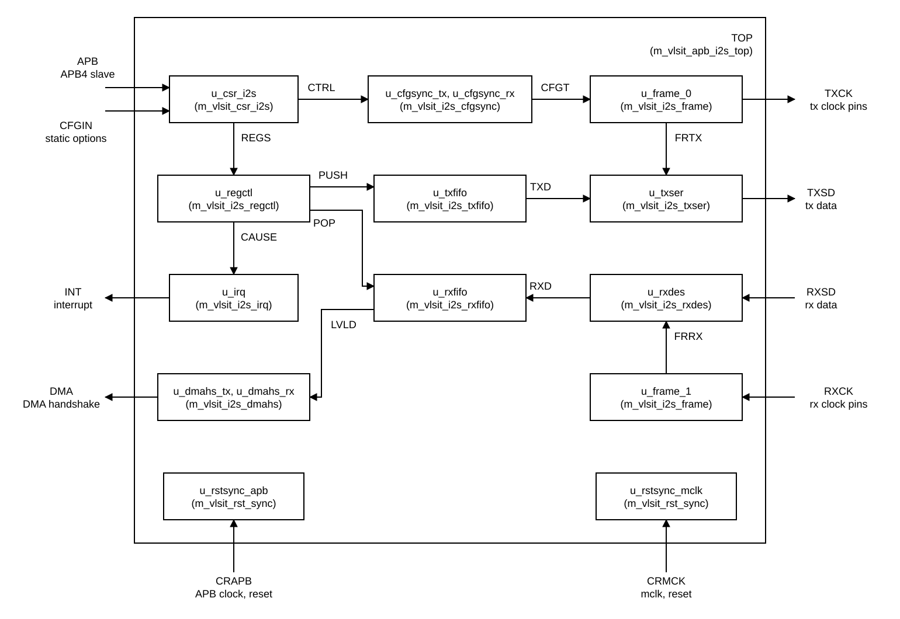

```json
{
  "page_name": "BLOCK_DIAGRAM",
  "out_name": "m_vlsit_apb_i2s_top_block_diagram.drawio",
  "table_suffix": "",
  "layout": {
    "gap_h": 100,
    "gap_v": 90,
    "margin": 40,
    "block_h": 80
  },
  "top": {
    "frame_label": [
      "TOP",
      "(m_vlsit_apb_i2s_top)"
    ],
    "block_label": [
      "TOP",
      "(m_vlsit_apb_i2s_top)"
    ],
    "block_row": [
      "TOP (m_vlsit_apb_i2s_top)",
      "Structural top of the APB I2S controller.",
      "Section 14.2"
    ]
  },
  "frame_row": [
    "TOP (m_vlsit_apb_i2s_top) frame",
    "Structural top of the APB I2S controller. It holds no logic: it instantiates the register block, the FIFOs, the frame engines and the support blocks. The APB domain is on the left, the master clock domain on the right.",
    "Section 14.2"
  ],
  "frame_interfaces": [
    "APB",
    "CFGIN",
    "INT",
    "DMA",
    "CRAPB",
    "TXCK",
    "TXSD",
    "RXSD",
    "RXCK",
    "CRMCK"
  ],
  "blocks": [
    {
      "key": "csr",
      "label": [
        "u_csr_i2s",
        "(m_vlsit_csr_i2s)"
      ],
      "width": 220,
      "row": 0,
      "col": 0,
      "row_name": "u_csr_i2s (m_vlsit_csr_i2s)",
      "function": "Generated register block of the APB completer. It decodes addresses, answers the bus with one wait state, holds every software-visible field and reports register read and write events.",
      "source": "Section 14.2, 5.1"
    },
    {
      "key": "regctl",
      "label": [
        "u_regctl",
        "(m_vlsit_i2s_regctl)"
      ],
      "width": 260,
      "row": 1,
      "col": 0,
      "row_name": "u_regctl (m_vlsit_i2s_regctl)",
      "function": "Register control. It turns data register events into FIFO push and pop actions in the fixed line order, runs the flush and reset requests, and builds the status and level fields.",
      "source": "Section 14.2, 5.1"
    },
    {
      "key": "irq",
      "label": [
        "u_irq",
        "(m_vlsit_i2s_irq)"
      ],
      "width": 220,
      "row": 2,
      "col": 0,
      "row_name": "u_irq (m_vlsit_i2s_irq)",
      "function": "Interrupt logic. It sets the raw causes from events and levels, applies the injection and the enable, builds the masked status and drives the single interrupt output.",
      "source": "Section 14.2, 5.1"
    },
    {
      "key": "dma",
      "label": [
        "u_dmahs_tx, u_dmahs_rx",
        "(m_vlsit_i2s_dmahs)"
      ],
      "width": 260,
      "row": 3,
      "col": 0,
      "row_name": "u_dmahs_tx, u_dmahs_rx (m_vlsit_i2s_dmahs)",
      "function": "DMA handshake. For each direction it raises the request from the watermark condition, holds it until the acknowledge, and drives the single indication.",
      "source": "Section 14.2, 5.1"
    },
    {
      "key": "rsta",
      "label": [
        "u_rstsync_apb",
        "(m_vlsit_rst_sync)"
      ],
      "width": 240,
      "row": 4,
      "col": 0,
      "row_name": "u_rstsync_apb (m_vlsit_rst_sync)",
      "function": "Reset synchronizer of the APB domain. It asserts the local reset asynchronously and releases it synchronously to the APB clock.",
      "source": "Section 14.2, 5.1"
    },
    {
      "key": "cfg",
      "label": [
        "u_cfgsync_tx, u_cfgsync_rx",
        "(m_vlsit_i2s_cfgsync)"
      ],
      "width": 280,
      "row": 0,
      "col": 1,
      "row_name": "u_cfgsync_tx, u_cfgsync_rx (m_vlsit_i2s_cfgsync)",
      "function": "Configuration and event crossing. It carries the configuration snapshot, the slot mask and the flush and reset requests to the master clock domain, and the events and flags back.",
      "source": "Section 14.2, 5.1"
    },
    {
      "key": "txf",
      "label": [
        "u_txfifo",
        "(m_vlsit_i2s_txfifo)"
      ],
      "width": 260,
      "row": 1,
      "col": 1,
      "row_name": "u_txfifo (m_vlsit_i2s_txfifo)",
      "function": "Transmit FIFO. One FIFO per data line, written from the APB side and read from the serial side across the clock boundary.",
      "source": "Section 14.2, 5.1"
    },
    {
      "key": "rxf",
      "label": [
        "u_rxfifo",
        "(m_vlsit_i2s_rxfifo)"
      ],
      "width": 260,
      "row": 2,
      "col": 1,
      "row_name": "u_rxfifo (m_vlsit_i2s_rxfifo)",
      "function": "Receive FIFO. One FIFO per data line, written from the serial side and read from the APB side across the clock boundary.",
      "source": "Section 14.2, 5.1"
    },
    {
      "key": "frm0",
      "label": [
        "u_frame_0",
        "(m_vlsit_i2s_frame)"
      ],
      "width": 260,
      "row": 0,
      "col": 2,
      "row_name": "u_frame_0 (m_vlsit_i2s_frame)",
      "function": "Frame engine of the transmit unit. It makes or follows the bit clock and the frame sync, counts bits and slots, runs the unit state machine and detects errors and timeouts.",
      "source": "Section 14.2, 5.1"
    },
    {
      "key": "txs",
      "label": [
        "u_txser",
        "(m_vlsit_i2s_txser)"
      ],
      "width": 260,
      "row": 1,
      "col": 2,
      "row_name": "u_txser (m_vlsit_i2s_txser)",
      "function": "Transmit serializer. It loads one word per line at each enabled slot, shifts it out most significant bit first, pads and masks the slot, and drives the data lines and their output enable.",
      "source": "Section 14.2, 5.1"
    },
    {
      "key": "rxd",
      "label": [
        "u_rxdes",
        "(m_vlsit_i2s_rxdes)"
      ],
      "width": 260,
      "row": 2,
      "col": 2,
      "row_name": "u_rxdes (m_vlsit_i2s_rxdes)",
      "function": "Receive deserializer. It samples each data line, assembles the word, aligns or packs it and pushes it at the end of each enabled slot.",
      "source": "Section 14.2, 5.1"
    },
    {
      "key": "frm1",
      "label": [
        "u_frame_1",
        "(m_vlsit_i2s_frame)"
      ],
      "width": 260,
      "row": 3,
      "col": 2,
      "row_name": "u_frame_1 (m_vlsit_i2s_frame)",
      "function": "Frame engine of the receive unit. It makes or follows the bit clock and the frame sync, counts bits and slots, runs the unit state machine and detects errors and timeouts.",
      "source": "Section 14.2, 5.1"
    },
    {
      "key": "rstm",
      "label": [
        "u_rstsync_mclk",
        "(m_vlsit_rst_sync)"
      ],
      "width": 240,
      "row": 4,
      "col": 2,
      "row_name": "u_rstsync_mclk (m_vlsit_rst_sync)",
      "function": "Reset synchronizer of the master clock domain. It asserts the local reset asynchronously and releases it synchronously to the master clock.",
      "source": "Section 14.2, 5.1"
    }
  ],
  "connectors": [
    {
      "id": "REGS",
      "src": "csr",
      "src_side": "B",
      "dst": "regctl",
      "dst_side": "T"
    },
    {
      "id": "CTRL",
      "src": "csr",
      "src_side": "R",
      "dst": "cfg",
      "dst_side": "L"
    },
    {
      "id": "CFGT",
      "src": "cfg",
      "src_side": "R",
      "dst": "frm0",
      "dst_side": "L"
    },
    {
      "id": "PUSH",
      "src": "regctl",
      "src_side": "R",
      "dst": "txf",
      "dst_side": "L"
    },
    {
      "id": "POP",
      "src": "regctl",
      "src_side": "R",
      "dst": "rxf",
      "dst_side": "L"
    },
    {
      "id": "CAUSE",
      "src": "regctl",
      "src_side": "B",
      "dst": "irq",
      "dst_side": "T"
    },
    {
      "id": "TXD",
      "src": "txf",
      "src_side": "R",
      "dst": "txs",
      "dst_side": "L"
    },
    {
      "id": "RXD",
      "src": "rxd",
      "src_side": "L",
      "dst": "rxf",
      "dst_side": "R"
    },
    {
      "id": "FRTX",
      "src": "frm0",
      "src_side": "B",
      "dst": "txs",
      "dst_side": "T"
    },
    {
      "id": "FRRX",
      "src": "frm1",
      "src_side": "T",
      "dst": "rxd",
      "dst_side": "B"
    },
    {
      "id": "LVLD",
      "src": "rxf",
      "src_side": "L",
      "dst": "dma",
      "dst_side": "R"
    }
  ],
  "externals": [
    {
      "id": "APB",
      "block": "csr",
      "side": "L",
      "dir": "in",
      "pos": -20,
      "text": [
        "APB",
        "APB4 slave"
      ]
    },
    {
      "id": "CFGIN",
      "block": "csr",
      "side": "L",
      "dir": "in",
      "pos": 20,
      "text": [
        "CFGIN",
        "static options"
      ]
    },
    {
      "id": "INT",
      "block": "irq",
      "side": "L",
      "dir": "out",
      "pos": 0,
      "text": [
        "INT",
        "interrupt"
      ]
    },
    {
      "id": "DMA",
      "block": "dma",
      "side": "L",
      "dir": "out",
      "pos": 0,
      "text": [
        "DMA",
        "DMA handshake"
      ]
    },
    {
      "id": "CRAPB",
      "block": "rsta",
      "side": "B",
      "dir": "in",
      "pos": 0,
      "text": [
        "CRAPB",
        "APB clock, reset"
      ]
    },
    {
      "id": "TXCK",
      "block": "frm0",
      "side": "R",
      "dir": "out",
      "pos": 0,
      "text": [
        "TXCK",
        "tx clock pins"
      ]
    },
    {
      "id": "TXSD",
      "block": "txs",
      "side": "R",
      "dir": "out",
      "pos": 0,
      "text": [
        "TXSD",
        "tx data"
      ]
    },
    {
      "id": "RXSD",
      "block": "rxd",
      "side": "R",
      "dir": "in",
      "pos": 0,
      "text": [
        "RXSD",
        "rx data"
      ]
    },
    {
      "id": "RXCK",
      "block": "frm1",
      "side": "R",
      "dir": "in",
      "pos": 0,
      "text": [
        "RXCK",
        "rx clock pins"
      ]
    },
    {
      "id": "CRMCK",
      "block": "rstm",
      "side": "B",
      "dir": "in",
      "pos": 0,
      "text": [
        "CRMCK",
        "mclk, reset"
      ]
    }
  ],
  "nets": [],
  "interfaces": [
    {
      "id": "APB",
      "name": "APB4 completer interface (CLK-APB)",
      "category": "standard protocol (AMBA APB4)",
      "active": "external requester -> IP",
      "signals": "external requester -> IP: i_apb_psel, i_apb_penable, i_apb_pwrite, i_apb_paddr, i_apb_pwdata, i_apb_pstrb, i_apb_pprot; IP -> external requester: o_apb_pready, o_apb_pslverr, o_apb_prdata"
    },
    {
      "id": "CFGIN",
      "name": "Static CSR option inputs (CLK-APB)",
      "category": "custom",
      "active": "SoC -> IP",
      "signals": "SoC -> IP: i_protect_en, i_slverr_en"
    },
    {
      "id": "INT",
      "name": "Interrupt output (CLK-APB)",
      "category": "custom",
      "active": "IP -> interrupt controller",
      "signals": "IP -> interrupt controller: o_int_i2s"
    },
    {
      "id": "DMA",
      "name": "DMA handshake (CLK-APB)",
      "category": "custom (request, single, acknowledge)",
      "active": "IP -> DMA controller (request, single); DMA controller -> IP (acknowledge)",
      "signals": "IP -> DMA controller: o_dma_tx_req, o_dma_tx_single, o_dma_rx_req, o_dma_rx_single; DMA controller -> IP: i_dma_tx_ack, i_dma_rx_ack"
    },
    {
      "id": "CRAPB",
      "name": "Clock and reset of the APB domain",
      "category": "custom",
      "active": "SoC -> IP",
      "signals": "i_clk_apb, i_rst_n_apb (reset: level, active-low)"
    },
    {
      "id": "TXCK",
      "name": "Transmit bit clock and frame sync pins (CLK-MCLK)",
      "category": "custom (serial audio)",
      "active": "IP <-> external audio device",
      "signals": "IP -> external: o_bclk_tx, o_bclk_tx_oe, o_ws_tx, o_ws_tx_oe; external -> IP: i_bclk_tx, i_ws_tx"
    },
    {
      "id": "TXSD",
      "name": "Transmit data lines (CLK-MCLK)",
      "category": "custom (serial audio)",
      "active": "IP -> external audio device",
      "signals": "IP -> external: o_sdo_0 to o_sdo_3, o_sdo_oe"
    },
    {
      "id": "RXSD",
      "name": "Receive data lines (CLK-MCLK)",
      "category": "custom (serial audio)",
      "active": "external audio device -> IP",
      "signals": "external -> IP: i_sdi_0 to i_sdi_3"
    },
    {
      "id": "RXCK",
      "name": "Receive bit clock and frame sync pins (CLK-MCLK)",
      "category": "custom (serial audio)",
      "active": "IP <-> external audio device",
      "signals": "IP -> external: o_bclk_rx, o_bclk_rx_oe, o_ws_rx, o_ws_rx_oe; external -> IP: i_bclk_rx, i_ws_rx"
    },
    {
      "id": "CRMCK",
      "name": "Clock and reset of the master clock domain",
      "category": "custom",
      "active": "SoC -> IP",
      "signals": "i_clk_mclk, i_rst_n_mclk (reset: level, active-low)"
    },
    {
      "id": "REGS",
      "name": "Register fields, status and events",
      "category": "custom",
      "active": "u_csr_i2s <-> u_regctl",
      "signals": "Field ports of the generated block; o_reg_rd_en, o_reg_rd_addr, o_reg_wr_en, o_reg_wr_addr"
    },
    {
      "id": "CTRL",
      "name": "Control fields to the crossing",
      "category": "custom",
      "active": "u_csr_i2s -> u_cfgsync_tx, u_cfgsync_rx",
      "signals": "Configuration, mask, enable, flush and reset fields"
    },
    {
      "id": "CFGT",
      "name": "Synchronized configuration and events",
      "category": "custom",
      "active": "u_cfgsync_tx, u_cfgsync_rx <-> u_frame_0 and u_frame_1",
      "signals": "Snapshot, mask, requests; flags and events back"
    },
    {
      "id": "PUSH",
      "name": "Transmit FIFO push",
      "category": "custom",
      "active": "u_regctl -> u_txfifo",
      "signals": "Push strobe, line select, data, flush"
    },
    {
      "id": "POP",
      "name": "Receive FIFO pop",
      "category": "custom",
      "active": "u_regctl -> u_rxfifo",
      "signals": "Pop strobe, line select, flush; head data back"
    },
    {
      "id": "CAUSE",
      "name": "Cause information",
      "category": "custom",
      "active": "u_regctl -> u_irq",
      "signals": "Levels, flags and events used for the causes"
    },
    {
      "id": "TXD",
      "name": "Transmit FIFO read",
      "category": "custom",
      "active": "u_txser -> u_txfifo",
      "signals": "Pop strobe, line words"
    },
    {
      "id": "RXD",
      "name": "Receive FIFO write",
      "category": "custom",
      "active": "u_rxdes -> u_rxfifo",
      "signals": "Push strobe, line words"
    },
    {
      "id": "FRTX",
      "name": "Frame events to the transmit serializer",
      "category": "custom",
      "active": "u_frame_0 -> u_txser",
      "signals": "Slot start, bit position, mask, padding"
    },
    {
      "id": "FRRX",
      "name": "Frame events to the receive deserializer",
      "category": "custom",
      "active": "u_frame_1 -> u_rxdes",
      "signals": "Slot start, bit sample, mask"
    },
    {
      "id": "LVLD",
      "name": "FIFO levels to the DMA handshake",
      "category": "custom",
      "active": "u_rxfifo -> u_dmahs_tx, u_dmahs_rx",
      "signals": "Level and flags"
    }
  ],
  "legend_note": "The enclosing frame is the top module; blocks inside are its instances. The left column is the APB clock domain, the right column the master clock domain, the middle column crosses the boundary.",
  "library_sha256": "15DFB183E267D2A94F8CAB316E01EB3D2E9D2F9C006DC816790A394F4123506C"
}
```

*Figure 5-1. Block diagram of the top module. Source: `figures/m_vlsit_apb_i2s_top_block_diagram.drawio` (draw.io, VLSIT library, drawn by `vlsit_spec_diagram.py`).*

### 5.3 Transaction and dataflow

**Configuration and start.** Software programs the registers of a unit (frame, sync, clock, mask, FIFO, timeout), fills the transmit FIFO, and sets the enable bit of the unit. The rising edge of the enable bit sends one snapshot of all configuration fields to the master domain through a handshake; the frame engine leaves OFF only when the snapshot has arrived.

**Transmit path.** Software writes the samples of a frame to the transmit data register; each write pushes a word, spread over the lines in the fixed order. At each enabled slot the serializer pops one word per line, takes the data_w valid bits (or two packed samples), shifts them out MSB first on the launch edge of the bit clock, and pads the rest of the slot with zeros. A masked slot is skipped. An empty FIFO at a slot start sends zeros and raises the underrun cause.

**Receive path.** At each enabled slot the deserializer samples each line on the sample edge of the bit clock, aligns the word, and pushes one word per line. A full FIFO drops the word and raises the overrun cause. Software reads the receive data register; each read pops a word in the same fixed order.

**Master and slave.** A master makes the bit clock and the frame sync from counters. A slave synchronizes the external bit clock and frame sync to the master clock, detects the edges, and uses the same frame engine. Either way the transmit and receive units have identical timing.

**Completion and resource release.** A frame completes when the last slot has been shifted; the frame-done cause is set for the chosen unit. A disabled unit finishes its frame and then returns to OFF.

### 5.4 Invariants

- INV-001: Words enter and leave a logical FIFO in the same fixed order: enabled slot by slot, line 0 first inside a slot.
- INV-002: A FIFO of a line is never written when full and never read when empty; the dropped word sets the matching cause.
- INV-003: Pointers of an asynchronous FIFO cross only in Gray code through synchronizers of PARA_I2S_SYNC_DEPTH stages.
- INV-004: The serial data outputs are low, or released when tri-state is selected, whenever the unit is stopped or the slot is masked.
- INV-005: The configuration of a running unit never changes except the slot mask, and the mask changes only at a frame boundary.
- INV-006: The DMA request of a direction falls in the cycle after the acknowledge rises.
- INV-007: A unit leaves OFF only after the configuration snapshot has been received.
- INV-008: Both units never use each other's clock at the same time.

## 6. External interfaces and ports

### 6.1 Interface inventory

| Interface ID | Type and revision | Role | Direction at IP boundary | Clock domain | Required / optional | Configurations |
|---|---|---|---|---|---|---|
| IF-001 | AMBA APB4 (REF-002) | Completer | Requests in, responses out | CLK-APB | Required | All |
| IF-002 | Transmit serial interface: bit clock, frame sync, data lines, output enable | Transmitter, master or slave | In and out | CLK-MCLK | Optional | PARA_I2S_TX_EN = 1 |
| IF-003 | Receive serial interface: bit clock, frame sync, data lines | Receiver, master or slave | In and out | CLK-MCLK | Optional | PARA_I2S_RX_EN = 1 |
| IF-004 | DMA handshake: request, single, acknowledge, per direction | Peripheral side | Out and in | CLK-APB | Optional | PARA_I2S_DMA_EN = 1 |
| IF-005 | Interrupt output `o_int_i2s` | Interrupt source | Out | CLK-APB | Required | All |
| IF-006 | Static CSR options `i_protect_en`, `i_slverr_en` | CSR options | In | CLK-APB | Required | All |
| IF-007 | Clocks and resets | Inputs | In | n/a | Required | All |

### 6.2 Complete port list

The table lists every port of the IP family. A structural wrapper (profile) contains the subset of its configuration: ports of an absent unit or line are not present, and the polarity of the interrupt and DMA signals is active high; an active-low profile is a separate wrapper (DEC-011). Parameters never create or remove a port inside one wrapper (REF-003 PRT-03). Pins that can be inputs or outputs by role are split into an input, an output and an output enable, so that the pad wrapper can build the bidirectional pad (REF-003 NAM). The Reset / idle column is the value while the reset is asserted or the unit is stopped.

| Port | Direction | Width | Meaning (function) | Clock domain | Signal type | Reset / idle value | Timing / sampling | Configurations |
|---|---|---:|---|---|---|---|---|---|
| i_clk_apb | Input | 1 | APB clock. Clocks the register block, the APB side of the FIFOs, the interrupt logic and the DMA handshake. | CLK-APB | clock | n/a | Rising edge | All |
| i_rst_n_apb | Input | 1 | APB-domain reset, active low. | Asynchronous | reset, active low | n/a | Asserted asynchronously; released synchronously inside the IP | All |
| i_clk_mclk | Input | 1 | Master clock. Clocks all serial logic; the bit clock of a master is made from it. | CLK-MCLK | clock | n/a | Rising edge | All |
| i_rst_n_mclk | Input | 1 | Master-clock-domain reset, active low. | Asynchronous | reset, active low | n/a | Asserted asynchronously; released synchronously inside the IP | All |
| i_apb_psel | Input | 1 | APB select. Marks the IP as the target of a transfer. | CLK-APB | level | n/a | Sampled on the rising edge of `i_clk_apb` | All |
| i_apb_penable | Input | 1 | APB enable. Marks the access phase. | CLK-APB | level | n/a | Sampled on the rising edge of `i_clk_apb` | All |
| i_apb_pwrite | Input | 1 | APB write. High for a write, low for a read. | CLK-APB | level | n/a | Stable from setup to completion | All |
| i_apb_paddr | Input | 16 | APB byte address. Bits [1:0] shall be zero; the register map uses the low 10 bits. | CLK-APB | data (valid while `i_apb_psel` is high) | n/a | Stable from setup to completion | All |
| i_apb_pwdata | Input | 32 | APB write data. | CLK-APB | data (valid while `i_apb_psel`, `i_apb_penable` and `i_apb_pwrite` are high) | n/a | Stable until completion | All |
| i_apb_pstrb | Input | 4 | APB write strobes. All four bits shall be high for a write. | CLK-APB | data (valid while `i_apb_psel` and `i_apb_pwrite` are high) | n/a | Stable until completion | All |
| i_apb_pprot | Input | 3 | APB protection. Only bit 1 (non-secure) is used. | CLK-APB | data (valid while `i_apb_psel` is high) | n/a | Stable until completion | All |
| o_apb_pready | Output | 1 | APB ready. Completes the transfer. | CLK-APB | level | 0 | Registered; one wait state in the normal case | All |
| o_apb_pslverr | Output | 1 | APB error. High with ready for a rejected access. | CLK-APB | level | 0 | Valid when `o_apb_pready` is high | All |
| o_apb_prdata | Output | 32 | APB read data. | CLK-APB | data (valid when `o_apb_pready` is high in a read) | 0 | Registered | All |
| i_protect_en | Input | 1 | Enables the non-secure access check of the CSR. | CLK-APB | static | n/a | Constant after reset | All |
| i_slverr_en | Input | 1 | Enables the error response of the CSR (strobe, alignment, protection). | CLK-APB | static | n/a | Constant after reset | All |
| o_bclk_tx | Output | 1 | Bit clock of the transmit unit, driven when the unit is a master. A signal on a pad, not a clock inside the IP. | CLK-MCLK | level | 0 | Toggles from `i_clk_mclk`; half period set by the divider | PARA_I2S_TX_EN = 1, PARA_I2S_MASTER_EN = 1 |
| o_bclk_tx_oe | Output | 1 | Output enable of the transmit bit clock. High while the unit is a running master. | CLK-MCLK | level | 0 | Registered on `i_clk_mclk` | PARA_I2S_TX_EN = 1, PARA_I2S_MASTER_EN = 1 |
| i_bclk_tx | Input | 1 | Bit clock of the transmit unit, supplied by the other device when the unit is a slave. | Asynchronous | level | n/a | Synchronized to `i_clk_mclk`; at most one eighth of its frequency | PARA_I2S_TX_EN = 1 |
| o_ws_tx | Output | 1 | Frame sync (word select) of the transmit unit, driven when the unit is a master. | CLK-MCLK | level | 0 | Changes at the launch edge of the bit clock | PARA_I2S_TX_EN = 1, PARA_I2S_MASTER_EN = 1 |
| o_ws_tx_oe | Output | 1 | Output enable of the transmit frame sync. High while the unit is a running master. | CLK-MCLK | level | 0 | Registered on `i_clk_mclk` | PARA_I2S_TX_EN = 1, PARA_I2S_MASTER_EN = 1 |
| i_ws_tx | Input | 1 | Frame sync of the transmit unit, supplied by the other device when the unit is a slave. | Asynchronous | level | n/a | Synchronized to `i_clk_mclk` | PARA_I2S_TX_EN = 1 |
| o_sdo_0 | Output | 1 | Serial data output of transmit line 0. | CLK-MCLK | data (valid from the launch edge of the bit clock) | 0 | Changes at the launch edge; low or released while stopped or masked | PARA_I2S_TX_EN = 1, PARA_I2S_TX_LINES > 0 |
| o_sdo_1 | Output | 1 | Serial data output of transmit line 1. | CLK-MCLK | data (valid from the launch edge of the bit clock) | 0 | Changes at the launch edge; low or released while stopped or masked | PARA_I2S_TX_EN = 1, PARA_I2S_TX_LINES > 1 |
| o_sdo_2 | Output | 1 | Serial data output of transmit line 2. | CLK-MCLK | data (valid from the launch edge of the bit clock) | 0 | Changes at the launch edge; low or released while stopped or masked | PARA_I2S_TX_EN = 1, PARA_I2S_TX_LINES > 2 |
| o_sdo_3 | Output | 1 | Serial data output of transmit line 3. | CLK-MCLK | data (valid from the launch edge of the bit clock) | 0 | Changes at the launch edge; low or released while stopped or masked | PARA_I2S_TX_EN = 1, PARA_I2S_TX_LINES > 3 |
| o_sdo_oe | Output | 1 | Output enable of the data lines. High while a slot is driven; low in masked slots when tri-state is selected and while stopped. | CLK-MCLK | level | 0 | Registered on `i_clk_mclk` | PARA_I2S_TX_EN = 1, PARA_I2S_TRI_EN = 1 |
| o_bclk_rx | Output | 1 | Bit clock of the receive unit, driven when the unit is a master. A signal on a pad, not a clock inside the IP. | CLK-MCLK | level | 0 | Toggles from `i_clk_mclk`; half period set by the divider | PARA_I2S_RX_EN = 1, PARA_I2S_MASTER_EN = 1 |
| o_bclk_rx_oe | Output | 1 | Output enable of the receive bit clock. High while the unit is a running master. | CLK-MCLK | level | 0 | Registered on `i_clk_mclk` | PARA_I2S_RX_EN = 1, PARA_I2S_MASTER_EN = 1 |
| i_bclk_rx | Input | 1 | Bit clock of the receive unit, supplied by the other device when the unit is a slave. | Asynchronous | level | n/a | Synchronized to `i_clk_mclk`; at most one eighth of its frequency | PARA_I2S_RX_EN = 1 |
| o_ws_rx | Output | 1 | Frame sync (word select) of the receive unit, driven when the unit is a master. | CLK-MCLK | level | 0 | Changes at the launch edge of the bit clock | PARA_I2S_RX_EN = 1, PARA_I2S_MASTER_EN = 1 |
| o_ws_rx_oe | Output | 1 | Output enable of the receive frame sync. High while the unit is a running master. | CLK-MCLK | level | 0 | Registered on `i_clk_mclk` | PARA_I2S_RX_EN = 1, PARA_I2S_MASTER_EN = 1 |
| i_ws_rx | Input | 1 | Frame sync of the receive unit, supplied by the other device when the unit is a slave. | Asynchronous | level | n/a | Synchronized to `i_clk_mclk` | PARA_I2S_RX_EN = 1 |
| i_sdi_0 | Input | 1 | Serial data input of receive line 0. | Asynchronous | data (valid at the sample edge of the bit clock) | n/a | Synchronized to `i_clk_mclk`, sampled at the sample edge | PARA_I2S_RX_EN = 1, PARA_I2S_RX_LINES > 0 |
| i_sdi_1 | Input | 1 | Serial data input of receive line 1. | Asynchronous | data (valid at the sample edge of the bit clock) | n/a | Synchronized to `i_clk_mclk`, sampled at the sample edge | PARA_I2S_RX_EN = 1, PARA_I2S_RX_LINES > 1 |
| i_sdi_2 | Input | 1 | Serial data input of receive line 2. | Asynchronous | data (valid at the sample edge of the bit clock) | n/a | Synchronized to `i_clk_mclk`, sampled at the sample edge | PARA_I2S_RX_EN = 1, PARA_I2S_RX_LINES > 2 |
| i_sdi_3 | Input | 1 | Serial data input of receive line 3. | Asynchronous | data (valid at the sample edge of the bit clock) | n/a | Synchronized to `i_clk_mclk`, sampled at the sample edge | PARA_I2S_RX_EN = 1, PARA_I2S_RX_LINES > 3 |
| o_dma_tx_req | Output | 1 | DMA transmit request. High while the watermark condition holds; held until the acknowledge. | CLK-APB | level | 0 | Registered; handshake of REQ-FUNC-028 | PARA_I2S_DMA_EN = 1, PARA_I2S_TX_EN = 1 |
| i_dma_tx_ack | Input | 1 | DMA transmit acknowledge. | CLK-APB | level | n/a | Sampled on the rising edge of `i_clk_apb` | PARA_I2S_DMA_EN = 1, PARA_I2S_TX_EN = 1 |
| o_dma_tx_single | Output | 1 | DMA transmit single indication. High while one word can be moved; low while the acknowledge is high. | CLK-APB | level | 0 | Registered | PARA_I2S_DMA_EN = 1, PARA_I2S_TX_EN = 1 |
| o_dma_rx_req | Output | 1 | DMA receive request. High while the watermark condition holds; held until the acknowledge. | CLK-APB | level | 0 | Registered; handshake of REQ-FUNC-028 | PARA_I2S_DMA_EN = 1, PARA_I2S_RX_EN = 1 |
| i_dma_rx_ack | Input | 1 | DMA receive acknowledge. | CLK-APB | level | n/a | Sampled on the rising edge of `i_clk_apb` | PARA_I2S_DMA_EN = 1, PARA_I2S_RX_EN = 1 |
| o_dma_rx_single | Output | 1 | DMA receive single indication. High while one word can be moved; low while the acknowledge is high. | CLK-APB | level | 0 | Registered | PARA_I2S_DMA_EN = 1, PARA_I2S_RX_EN = 1 |
| o_int_i2s | Output | 1 | Interrupt output. OR of the eight masked causes. Active high. | CLK-APB | level | 0 | Registered | All |

### 6.3 Protocol behavior

**APB4 completer (IF-001, REF-002).** Revision Issue D, completer role, optional signals PSTRB and PPROT[1] only. The generated CSR block gives the timing of section 11.4.

| Case | Legal behavior | Illegal / unsupported case | IP response | Requirement IDs |
|---|---|---|---|---|
| Read or write of a register at an aligned address | PSEL, then PENABLE; PREADY after one wait state | None | Data returned or stored | REQ-IF-001, REQ-IF-002 |
| Write with a partial strobe | PSTRB all ones | PSTRB with a low bit | PSLVERR, no change when `i_slverr_en` is 1 | REQ-IF-003 |
| Address with bits [1:0] not zero | Word-aligned address | Misaligned address | PSLVERR when `i_slverr_en` is 1 | REQ-IF-003 |
| Address that is not a register | Any aligned address | Reserved or absent register | OKAY, read returns 0, write ignored | REQ-IF-004 |
| Non-secure access | PPROT[1] low | PPROT[1] high when `i_protect_en` is 1 | PSLVERR when `i_slverr_en` is 1 | REQ-IF-003, REQ-SEC-001 |
| Bus of 8 or 16 bits | Not supported | Any other data width | Not supported (DEC-001) | REQ-IF-001 |

**Serial interface (IF-002 and IF-003, REF-006).** One bit clock, one frame sync and one to four data lines per direction. The frame follows REQ-FUNC-003 to REQ-FUNC-009.

| Case | Legal behavior | Illegal / unsupported case | IP response | Requirement IDs |
|---|---|---|---|---|
| I2S frame | Frame sync low for the left half, MSB one bit clock after its change, data launched on the trailing edge and sampled on the leading edge | Other formats of REF-006 | Not defined by REF-006 | REQ-FUNC-004 |
| Word shorter than the slot | Valid bits then zeros (transmit) or ignored bits (receive) | Data width larger than the slot width | Not allowed; the software rule of section 11.2 | REQ-FUNC-003, REQ-FUNC-009 |
| Slave frame start | Frame sync becomes active | Frame sync active inside a frame | Ignored; sync flag and cause set | REQ-FUNC-022 |
| Slave clock | Master clock at least 8 times the bit clock | Slower master clock | Not specified | REQ-FUNC-018 |
| Master clock off | Unit stopped | Unit running without master clock | Hung cause when a timeout is set | REQ-FUNC-023 |
| Receiver and transmitter sharing | Only one of the two uses the other's clock | Both sharing | The transmitter follows its own clock; software error | REQ-FUNC-019 |

**DMA handshake (IF-004).** Four-phase handshake of REQ-FUNC-028 and REQ-FUNC-029. The acknowledge is sampled on the APB clock; the DMA controller clock must be phase aligned and an integer multiple of it.

| Case | Legal behavior | Illegal / unsupported case | IP response | Requirement IDs |
|---|---|---|---|---|
| Burst | Request high until acknowledge, then low until acknowledge falls | Acknowledge without request | Ignored | REQ-FUNC-028 |
| Single | Single high while one word can be moved | None | Cleared while acknowledge is high | REQ-FUNC-029 |
| Burst longer than the space | Burst not longer than the free (transmit) or valid (receive) words at the request | Longer burst | Overrun or empty read | REQ-FUNC-030 |

### 6.4 Interrupts and events

All eight causes use the four registers raw status, enable, injection and masked status (REQ-IF-009, REQ-IF-010). There is one output `o_int_i2s`, active high and registered, equal to the OR of the masked status.

| Signal/event | Polarity | Assert condition | Clear/deassert condition | Mask/priority | Crossing | Reset state |
|---|---|---|---|---|---|---|
| Cause `tx_wm` (level) | High | Transmit FIFO level at or below the watermark | Write 1 to the raw bit once the FIFO is refilled | Enable bit; no priority | Master to APB through the FIFO pointer synchronizer | Clear |
| Cause `tx_und` | High | Transmit slot found the FIFO empty | Write 1 to the raw bit (flush first when auto restart is off) | Enable bit | Master to APB | Clear |
| Cause `tx_ovr` | High | A write found the transmit FIFO full | Write 1 to the raw bit | Enable bit | APB only | Clear |
| Cause `rx_wm` (level) | High | Receive FIFO level at or above the watermark | Write 1 to the raw bit once the FIFO is drained | Enable bit | Master to APB through the FIFO pointer synchronizer | Clear |
| Cause `rx_ovr` | High | A received word found the FIFO full | Write 1 to the raw bit (flush first when auto restart is off) | Enable bit | Master to APB | Clear |
| Cause `sync` | High | External frame sync arrived inside a frame (either unit) | Write 1 to the raw bit and to the unit flag | Enable bit | Master to APB | Clear |
| Cause `hung` | High | Timeout expired in a running unit (either unit) | Write 1 to the raw bit and to the unit flag | Enable bit | Master to APB | Clear |
| Cause `frm` | High | End of a frame of the unit chosen by the frame-source bit | Write 1 to the raw bit | Enable bit | Master to APB | Clear |
| `o_int_i2s` | High | OR of the masked status | All masked status bits clear | n/a | APB | Low |

## 7. Clock, reset, and power

### 7.1 Clock domains

| Domain | Clock port | Edge | Frequency range | Source | Relationship to other clocks | Gating policy |
|---|---|---|---|---|---|---|
| CLK-APB | `i_clk_apb` | Rising | 10 to 200 MHz (ASM-006) | SoC peripheral clock | Asynchronous to CLK-MCLK | No gating inside the IP |
| CLK-MCLK | `i_clk_mclk` | Rising | 2 MHz to 100 MHz (ASM-006); 12.288 MHz for a 3.072 MHz bit clock | Audio PLL or oscillator | Asynchronous to CLK-APB | Gating belongs to the SoC |

The bit clocks are signals, not clocks: a master bit clock is the master clock divided by twice the divider value (REQ-FUNC-017); a slave bit clock may be at most one eighth of the master clock (REQ-FUNC-018).

### 7.2 CDC and RDC

All crossings use dedicated modules (REF-003 CLK-01, CLK-02) with PARA_I2S_SYNC_DEPTH synchronizer stages (2 or 3). A crossing source is a flop in its own domain.

| Crossing ID | From → to | Signals | Structure | Reset handling | Constraints / verification |
|---|---|---|---|---|---|
| CDC-001 | APB → MCLK | Transmit FIFO write data and write pointer, per line | Gray-pointer asynchronous FIFO | Both resets; the flush and soft reset also reset the pointers | Max-delay on the pointer crossing; CDC tool |
| CDC-002 | MCLK → APB | Receive FIFO write data and write pointer, per line | Gray-pointer asynchronous FIFO | As CDC-001 | As CDC-001 |
| CDC-003 | APB → MCLK | Configuration snapshot of a unit (frame, sync, clock, FIFO and option fields) | Handshake-qualified bus synchronizer triggered by the rising edge of the enable bit | Reset in each domain | Quasi-static between snapshots |
| CDC-004 | APB → MCLK | Slot mask | Handshake bus synchronizer, accepted at the next frame boundary | Reset in each domain | Quasi-static |
| CDC-005 | MCLK → APB | Underrun, overrun, sync, hung and frame events | Toggle (pulse) synchronizer | Reset in the MCLK domain | CDC tool |
| CDC-006 | MCLK → APB | Busy flag and the FIFO read or write pointer used for the level | Level synchronizer and Gray pointer synchronizer | Reset in the MCLK domain | CDC tool |
| CDC-007 | APB → MCLK | Flush and soft reset requests | Toggle synchronizer with acknowledge back | Reset in each domain | Flush allowed while stopped or in error |
| CDC-008 | External → MCLK | `i_bclk_tx`, `i_ws_tx`, `i_bclk_rx`, `i_ws_rx`, `i_sdi_x` | Two-flop synchronizer, then edge detect | Reset in the MCLK domain | Asynchronous inputs; the master clock must be at least 8 times the bit clock |

RDC: the two resets are independent. A reset of one domain alone leaves the FIFO pointers inconsistent; the integrator shall assert both resets together, or software shall write the global soft reset after a one-domain reset (DEC-007).

### 7.3 Reset domains and sequencing

| Reset ID | Port | Polarity / assertion | Sync or async | Scope | Deassertion | Reset value |
|---|---|---|---|---|---|---|
| RST-APB | `i_rst_n_apb` | Active-low | Async assertion, synchronous release inside the IP (`u_rstsync_apb`) | Register block and all APB-domain logic | Synchronous to `i_clk_apb` | Registers take the workbook reset values; FIFOs empty |
| RST-MCLK | `i_rst_n_mclk` | Active-low | Async assertion, synchronous release inside the IP (`u_rstsync_mclk`) | Master clock domain logic | Synchronous to `i_clk_mclk` | Outputs low; engines OFF |

Software resets: the global soft reset and the unit soft resets reset state and FIFOs and keep the configuration (REQ-FUNC-025); they are not hardware resets and do not use the reset ports. During reset all data, bit clock, frame sync and output enable outputs are low and the interrupt output is inactive. Warm and retention reset are not supported.

### 7.4 Power intent (if applicable)

N/A: the IP is a single power domain with no retention, isolation or low-power entry. The SoC may stop `i_clk_mclk` and `i_clk_apb` when both units are stopped; the busy flags tell when this is safe.

## 8. Parameters and elaboration configurations

Parameters follow REF-003 PAR-01 and PAR-02. Defaults are those of CFG-FULL. A parameter that switches a feature off removes its logic and, where it has one, its ports from the wrapper of the profile (REQ-PARAM-002).

| Parameter | Purpose | Default | Legal values / range | Dependencies / invalid combinations | Effect |
|---|---|---|---|---|---|
| PARA_I2S_TX_EN | Transmit unit present | 1 | 0, 1 | At least one of the two units is 1 | Adds the transmit unit, its registers and ports |
| PARA_I2S_RX_EN | Receive unit present | 1 | 0, 1 | As above | Adds the receive unit, its registers and ports |
| PARA_I2S_TX_LINES | Transmit data lines | 1 | 1 to 4 | Only with the transmit unit | Lines, FIFO count, `o_sdo_x` ports |
| PARA_I2S_RX_LINES | Receive data lines | 1 | 1 to 4 | Only with the receive unit | Lines, FIFO count, `i_sdi_x` ports |
| PARA_I2S_FIFO_DEPTH | Words per line FIFO | 16 | 2, 4, 8, 16, 32, 64, 128, 256 | Power of two | Storage, level width, capability field |
| PARA_I2S_MAX_SLOTS | Largest frame length | 32 | 2 to 32 | At least 2 | Slot counter width, mask width |
| PARA_I2S_FMT_EXT_EN | Left-justified, PCM, TDM, custom sync and more than 2 slots | 1 | 0, 1 | When 0, MAX_SLOTS is forced to 2 | Frame sync logic |
| PARA_I2S_PACK_EN | 16-bit packing | 1 | 0, 1 | None | Packing logic |
| PARA_I2S_MASTER_EN | Bit clock divider and master role | 1 | 0, 1 | When 0 the units are slaves only | Divider, bit clock and frame sync outputs |
| PARA_I2S_ONDEM_EN | On-demand frame start | 1 | 0, 1 | Needs the master divider | Ready check at frame boundary |
| PARA_I2S_TRI_EN | Release of masked transmit slots | 1 | 0, 1 | Needs the transmit unit | Output enable logic |
| PARA_I2S_HUNG_EN | Hung-clock timer | 1 | 0, 1 | None | Timeout counter |
| PARA_I2S_DMA_EN | DMA handshake | 1 | 0, 1 | None | Handshake FSMs and ports |
| PARA_I2S_SYNC_DEPTH | Synchronizer stages | 2 | 2, 3 | None | Latency of every crossing |

| Configuration | Parameter overrides | Features/interfaces | Expected hierarchy | Elaboration/lint/synthesis target |
|---|---|---|---|---|
| CFG-FULL | Defaults | Section 4 | Top with all 13 children | Elaborate, lint, synthesize (ASM-004) |
| CFG-MIC | TX_EN 0, RX_LINES 4, FIFO_DEPTH 32, MASTER_EN 0, ONDEM_EN 0 | Section 4 | Without transmit blocks | Elaborate, lint |
| CFG-MIN | FMT_EXT_EN 0, MAX_SLOTS 2, PACK_EN 0, MASTER_EN 0, ONDEM_EN 0, TRI_EN 0, HUNG_EN 0, DMA_EN 0, FIFO_DEPTH 4 | Section 4 | Smallest | Elaborate, lint |
| CFG-DUAL | TX_LINES 4, RX_LINES 4, FIFO_DEPTH 64 | Section 4 | Four lines each | Elaborate, lint |

Illegal configurations are rejected at elaboration, not clamped: both units absent, a line count outside 1 to 4, a FIFO depth that is not a power of two from 2 to 256, a slot count below 2, on-demand without the master divider, tri-state without the transmit unit. The register fields that depend on a feature (for example `pack`) are ignored when the feature is off, and the capability register shows it.

## 9. Data representation and arithmetic

Bit numbering: bit 0 is the least significant bit. Serial data is sent and received MSB first as two's complement values handled as unsigned vectors; no arithmetic is done on samples, so there is no overflow, rounding or saturation (REF-003 TYP-01).

| Quantity | Width | Encoding / range | Extension / truncation | Overflow / invalid behavior |
|---|---:|---|---|---|
| Sample in the FIFO word | 32 | data_w valid bits, right or left aligned | Transmit: zeros fill the rest of the slot; receive: bits after data_w ignored, a shorter word zero padded at the least significant end | None |
| Packed sample pair | 32 | Two 16-bit samples, first in the low half | None | Packing with data_w above 16 is not allowed |
| Data register word | 32 | The FIFO word | Written upper bits that are not valid are ignored | None |
| Slot count, slot width, data width | see workbook | Real numbers: 1 to 32 slots, 8 to 32 bits, 8 to 32 bits | Not minus-one codes | A value outside the range is not allowed (section 11.2 rule) |
| Slot mask | 32 | One bit per slot, bit n enables slot n | Bits above the slot count ignored | None |
| Bit clock divider | see workbook | Master clock cycles per half period, 1 or more | None | 0 in master mode is not allowed |
| Watermark and level | see workbook | Words of the logical FIFO, 0 to FIFO depth x lines | A watermark above the capacity always triggers the transmit cause (level at or below the watermark) and never triggers the receive cause (level at or above it), as REQ-FUNC-016 states (corrected on 2026-11-20, DEC-020) | None |
| Timeout | see workbook | Units of 256 master clock cycles | None | 0 turns the detector off |
| Frame position | n/a | Slot counter and bit counter inside the slot | n/a | n/a |

Reserved, absent and unused register bits read 0 and ignore writes (REQ-IF-005, REQ-REG-007).

## 10. Detailed functional behavior

### 10.1 Modes and state transitions

The IP has two finite-state machines. `frame` runs in each of the two frame engines (instances `u_frame_0` for the transmit unit and `u_frame_1` for the receive unit) and controls the life of a unit from start to stop, including error handling. `dmahs` runs in the DMA handshake block, once for each direction. All states are enum members named `ENUM_ST_` followed by the state name in capitals; an unused encoding recovers to `ENUM_ST_OFF` (`frame`) or `ENUM_ST_IDLE` (`dmahs`). The diagrams are generated from the JSON specifications in `figures/`.

#### FSM `frame` (unit run control, module m_vlsit_i2s_frame)

<!-- FSM-DIAGRAM:frame -->
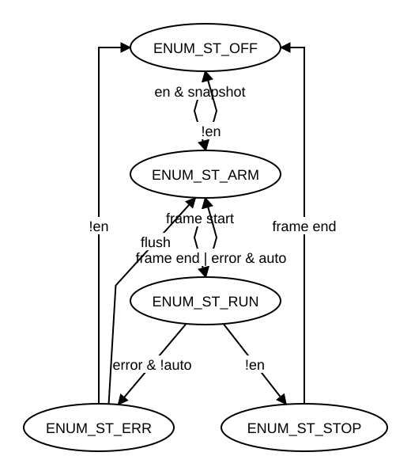

```json
{
  "page_name": "FSM_FRAME",
  "out_name": "frame_fsm.drawio",
  "function": "frame",
  "initial": "ENUM_ST_OFF",
  "state_pattern": "^ENUM_ST_[A-Z0-9_]+$",
  "states": [
    {
      "name": "ENUM_ST_OFF"
    },
    {
      "name": "ENUM_ST_ARM"
    },
    {
      "name": "ENUM_ST_RUN"
    },
    {
      "name": "ENUM_ST_ERR"
    },
    {
      "name": "ENUM_ST_STOP"
    }
  ],
  "transitions": [
    {
      "src": "ENUM_ST_OFF",
      "dst": "ENUM_ST_ARM",
      "label": "en & snapshot"
    },
    {
      "src": "ENUM_ST_ARM",
      "dst": "ENUM_ST_RUN",
      "label": "frame start"
    },
    {
      "src": "ENUM_ST_RUN",
      "dst": "ENUM_ST_ARM",
      "label": "frame end | error & auto"
    },
    {
      "src": "ENUM_ST_RUN",
      "dst": "ENUM_ST_ERR",
      "label": "error & !auto"
    },
    {
      "src": "ENUM_ST_RUN",
      "dst": "ENUM_ST_STOP",
      "label": "!en"
    },
    {
      "src": "ENUM_ST_ARM",
      "dst": "ENUM_ST_OFF",
      "label": "!en"
    },
    {
      "src": "ENUM_ST_ERR",
      "dst": "ENUM_ST_ARM",
      "label": "flush"
    },
    {
      "src": "ENUM_ST_ERR",
      "dst": "ENUM_ST_OFF",
      "label": "!en"
    },
    {
      "src": "ENUM_ST_STOP",
      "dst": "ENUM_ST_OFF",
      "label": "frame end"
    }
  ],
  "layout": {
    "margin": 40
  }
}
```

*Figure 10-1. FSM state diagram of frame. Source: `figures/frame_fsm.drawio` (draw.io, VLSIT library, generated by `vlsit_fsm_diagram.py`).*
<!-- /FSM-DIAGRAM:frame -->

| Mode/state | Entry condition | Behavior | Exit condition | Outputs / side effects |
|---|---|---|---|---|
| ENUM_ST_OFF | Reset, soft reset, or end of a stopped unit | Outputs idle; busy low; counters cleared | Enable bit set and the configuration snapshot received | Data low, output enables low, bit clock and frame sync low |
| ENUM_ST_ARM | Snapshot received, or end of a frame | Waits for the frame start: a master counts to the frame boundary and, with on-demand, waits for data or room; a slave waits for the active edge of the frame sync | Frame start | Busy high; the new slot mask is accepted here |
| ENUM_ST_RUN | Frame start | Runs the slots of the frame: shifts or samples bits, pops or pushes one word per line at each enabled slot | End of the last slot, an underrun or overrun, or the enable cleared | Frame-done event at the end |
| ENUM_ST_ERR | Underrun or overrun with auto restart off | Transmit sends zeros, receive discards; the FIFO is not accessed | Flush written, or enable cleared | Underrun or overrun cause kept; zeros on the lines |
| ENUM_ST_STOP | Enable cleared while running | Finishes the running frame | End of the frame | Busy high until the end |

The transition from ENUM_ST_RUN to ENUM_ST_ARM covers both the end of a frame and, with auto restart on, an underrun or overrun: the unit abandons the rest of the frame and waits in ARM until the FIFO is ready for a whole frame.

#### FSM `dmahs` (DMA handshake of one direction, module m_vlsit_i2s_dmahs)

<!-- FSM-DIAGRAM:dmahs -->
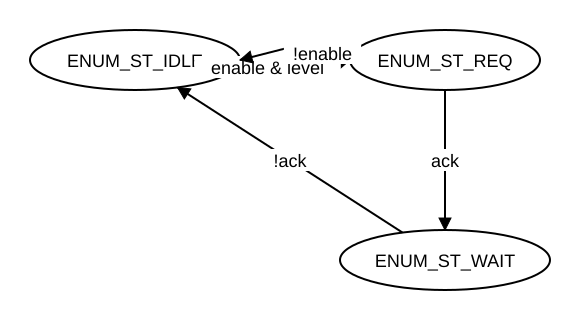

```json
{
  "page_name": "FSM_DMAHS",
  "out_name": "dmahs_fsm.drawio",
  "function": "dmahs",
  "initial": "ENUM_ST_IDLE",
  "state_pattern": "^ENUM_ST_[A-Z0-9_]+$",
  "states": [
    {
      "name": "ENUM_ST_IDLE"
    },
    {
      "name": "ENUM_ST_REQ"
    },
    {
      "name": "ENUM_ST_WAIT"
    }
  ],
  "transitions": [
    {
      "src": "ENUM_ST_IDLE",
      "dst": "ENUM_ST_REQ",
      "label": "enable & level"
    },
    {
      "src": "ENUM_ST_REQ",
      "dst": "ENUM_ST_WAIT",
      "label": "ack"
    },
    {
      "src": "ENUM_ST_WAIT",
      "dst": "ENUM_ST_IDLE",
      "label": "!ack"
    },
    {
      "src": "ENUM_ST_REQ",
      "dst": "ENUM_ST_IDLE",
      "label": "!enable"
    }
  ],
  "layout": {
    "margin": 40
  }
}
```

*Figure 10-2. FSM state diagram of dmahs. Source: `figures/dmahs_fsm.drawio` (draw.io, VLSIT library, generated by `vlsit_fsm_diagram.py`).*
<!-- /FSM-DIAGRAM:dmahs -->

| Mode/state | Entry condition | Behavior | Exit condition | Outputs / side effects |
|---|---|---|---|---|
| ENUM_ST_IDLE | Reset or handshake complete | Request low; samples the watermark condition | DMA enabled and the condition holds | Request low |
| ENUM_ST_REQ | Condition met | Request held high until the acknowledge, even if the level changes | Acknowledge high, or DMA disabled | Request high |
| ENUM_ST_WAIT | Acknowledge seen | Request low; waits for the acknowledge to fall | Acknowledge low | Request low; single cleared while the acknowledge is high |

### 10.2 Operations

| Operation ID | Inputs / preconditions | Processing semantics | Result / completion | Latency / ordering |
|---|---|---|---|---|
| OP-001 | Configuration written; enable bit set | The rising edge of the enable sends a snapshot of the configuration to the master domain; `frame` leaves OFF when it arrives | Unit armed | Snapshot latency of the synchronizer, about 2 x PARA_I2S_SYNC_DEPTH cycles |
| OP-002 | Enable bit cleared | The unit finishes the running frame and returns to OFF; busy falls | Unit stopped | End of the current frame |
| OP-003 | Transmit unit running, master | Frame engine counts bits, makes bit clock and frame sync, serializer shifts words out MSB first on the launch edge, pads with zeros | Frame sent | One word per line at each enabled slot start |
| OP-004 | Receive unit running, slave | Frame engine detects frame start from the external sync, deserializer samples on the sample edge, pushes one word per line at each enabled slot | Words in the FIFO | Word pushed at the end of each enabled slot |
| OP-005 | Format selected | The preset derives sync width, polarity and position from nslot and slot_w; custom uses the sync register | Frame sync shape of the format | At the next frame start |
| OP-006 | Slot mask written | The mask crosses by handshake and is accepted at the next frame boundary | Slots enabled or skipped | At most one frame |
| OP-007 | Transmit FIFO empty at a slot start | Slot sends zeros, cause set; with auto restart the unit abandons the frame and restarts when a whole frame is ready, otherwise it enters ERR | Stream recovers or waits for a flush | Restart at a frame boundary |
| OP-008 | Receive FIFO full when a word arrives | Word dropped, cause set; with auto restart the unit abandons the frame and restarts when the FIFO has room for a whole frame, otherwise it enters ERR | Stream recovers or waits for a flush | Restart at a frame boundary |
| OP-009 | Master with on-demand | At the frame boundary the unit waits until the transmit FIFO holds a whole frame or the receive FIFO has room for one | No underrun or overrun from a late DMA | Delay of the frame start |
| OP-010 | Slave running | A frame sync inside a frame sets the sync flag; no bit clock or frame sync for the timeout sets the hung flag | Flag and cause set | Timeout x 256 master clock cycles |
| OP-011 | Data register access | A write of the transmit data register pushes a word, a read of the receive data register pops a word, in the fixed line order | FIFO updated | One word per access |
| OP-012 | DMA enabled, condition holds | Request, acknowledge, request low, acknowledge low, again if the condition still holds | Burst moved by the DMA controller | At least four APB clock cycles |
| OP-013 | A word can be moved | Single high; cleared while acknowledge is high | Single transfer by the DMA controller | As OP-012 |
| OP-014 | Cause occurs | Raw bit set; injection sets it by software; masked status is raw AND enable; the output is the OR | Interrupt visible to the SoC | Registered in the APB domain |
| OP-015 | Flush or soft reset written | FIFO and state reset; the bit clears itself | Unit state OFF or ARM, FIFO empty | Request crosses to the master domain |
| OP-016 | APB transfer | Setup, access, completion with one wait state; errors per section 11.4 | Register read or written, or error response | One wait state in the normal case |
| OP-017 | Reset asserted | Registers and flops reset; FIFOs empty | Idle state | Release synchronized in each domain |

### 10.3 Cycle-level behavior

**Waveform plan (rule R-024).** The user confirmed on 2026-11-20 a plan of the proposed list plus corner cases (option C) for the first version of this IP. The list below adapts that plan to the redesigned IP, keeping the coverage: one success and one error case of every interface and the corner cases (reset, start, stop, mask, recovery). The adaptation is recorded as ASM-011. Each waveform is a WaveJSON source in `figures/` with its SVG.

| Waveform ID | Function / operation | Scenario (success / error / corner) | Signals shown | Figure | Confirmed by user |
|---|---|---|---|---|---|
| WF-001 | OP-016 APB write and read of a register (register side of OP-011) | Success | APB request and response, register events | [SVG](figures/wf_001_apb_rw.svg), [JSON](figures/wf_001_apb_rw.json) | 2026-11-20 |
| WF-002 | OP-016 APB error responses | Error (partial strobe, misaligned address) | APB request and response | [SVG](figures/wf_002_apb_error.svg), [JSON](figures/wf_002_apb_error.json) | 2026-11-20 |
| WF-003 | OP-003 I2S transmit frame, master | Success | `o_bclk_tx`, `o_ws_tx`, `o_sdo_0` | [SVG](figures/wf_003_i2s_tx_master.svg), [JSON](figures/wf_003_i2s_tx_master.json) | 2026-11-20 |
| WF-004 | OP-004 I2S receive frame, slave | Success | `i_bclk_rx`, `i_ws_rx`, `i_sdi_0` | [SVG](figures/wf_004_i2s_rx_slave.svg), [JSON](figures/wf_004_i2s_rx_slave.json) | 2026-11-20 |
| WF-005 | OP-005 Frame sync of the I2S and left-justified presets | Success | `o_ws_tx` for two presets, `o_sdo_0` | [SVG](figures/wf_005_fmt_i2s_lj.svg), [JSON](figures/wf_005_fmt_i2s_lj.json) | 2026-11-20 |
| WF-006 | OP-005 PCM short frame, four slots, one masked | Success | `o_ws_tx`, `o_sdo_oe`, `o_sdo_0` | [SVG](figures/wf_006_pcm_tdm_mask.svg), [JSON](figures/wf_006_pcm_tdm_mask.json) | 2026-11-20 |
| WF-007 | OP-006 Slot mask change at a frame boundary | Corner | Mask, receive pushes | [SVG](figures/wf_007_mask_change.svg), [JSON](figures/wf_007_mask_change.json) | 2026-11-20 |
| WF-008 | OP-001 Unit start and snapshot | Success | Enable, snapshot, `frame` state, bit clock | [SVG](figures/wf_008_unit_start.svg), [JSON](figures/wf_008_unit_start.json) | 2026-11-20 |
| WF-009 | OP-007 Transmit underrun with automatic restart | Error | State, level, `i2s_irq_raw.tx_und` | [SVG](figures/wf_009_tx_underrun_auto.svg), [JSON](figures/wf_009_tx_underrun_auto.json) | 2026-11-20 |
| WF-010 | OP-008 Receive overrun, auto restart off | Error | State, level, `i2s_irq_raw.rx_ovr`, flush | [SVG](figures/wf_010_rx_overrun_err.svg), [JSON](figures/wf_010_rx_overrun_err.json) | 2026-11-20 |
| WF-011 | OP-009 On-demand frame start | Corner | State, level, frame sync | [SVG](figures/wf_011_ondemand.svg), [JSON](figures/wf_011_ondemand.json) | 2026-11-20 |
| WF-012 | OP-010 Frame sync error and hung clock | Error | Frame sync, causes | [SVG](figures/wf_012_sync_hung.svg), [JSON](figures/wf_012_sync_hung.json) | 2026-11-20 |
| WF-013 | OP-012 DMA burst handshake | Success | `o_dma_tx_req`, `i_dma_tx_ack`, `o_dma_tx_single` | [SVG](figures/wf_013_dma_burst.svg), [JSON](figures/wf_013_dma_burst.json) | 2026-11-20 |
| WF-014 | OP-013 DMA single transactions | Success | `o_dma_rx_single`, `i_dma_rx_ack` | [SVG](figures/wf_014_dma_single.svg), [JSON](figures/wf_014_dma_single.json) | 2026-11-20 |
| WF-015 | OP-014 Interrupt: raw, enable, injection, masked status | Success | Four registers and `o_int_i2s` | [SVG](figures/wf_015_irq_four.svg), [JSON](figures/wf_015_irq_four.json) | 2026-11-20 |
| WF-016 | OP-002 and OP-015 Unit stop, busy and flush | Corner | Enable, state, busy, flush | [SVG](figures/wf_016_stop_flush.svg), [JSON](figures/wf_016_stop_flush.json) | 2026-11-20 |
| WF-017 | OP-017 Reset assertion and release | Corner (reset) | Both resets and clocks | [SVG](figures/wf_017_reset.svg), [JSON](figures/wf_017_reset.json) | 2026-11-20 |

Time base of the waveforms: one cell is one cycle of `i_clk_mclk` unless a signal is marked as another clock. With divider 2 a bit lasts 4 master clock cycles; the data and frame sync change on the falling edge of the bit clock (launch edge with the default polarity) and are sampled on the rising edge. The figures use 4-bit words and a 4-bit slot for clarity; real slots are 8 to 32 bits.

| Cycle / event | Input condition | State/action | Output condition |
|---|---|---|---|
| Bit -1 | Frame engine in ARM, master | Counts to the frame boundary | Frame sync inactive (high for I2S), bit clock toggling |
| Bit 0 (frame start) | Boundary reached, FIFO ready | `frame` goes to RUN; frame sync becomes active (low for I2S) | `o_ws_tx` low on the launch edge |
| Slot 0 start | One bit clock after the frame sync (early sync) | Serializer pops one word per line | `o_sdo_x` carries the MSB on the next launch edge |
| Bits 1 to data_w | Launch edges | Shift left one bit per bit clock | Bits MSB first |
| Remaining bits of the slot | After data_w bits | Zero padding | `o_sdo_x` low |
| Slot 1 start | One slot width later | Frame sync inactive in the I2S preset | Right word, same pattern |
| End of frame | Last slot done | Frame-done event; `frame` goes to ARM and then RUN again without a gap in continuous mode | Next frame sync active |

#### Waveform figures

**WF-001 OP-016 APB write and read of a register (success)**

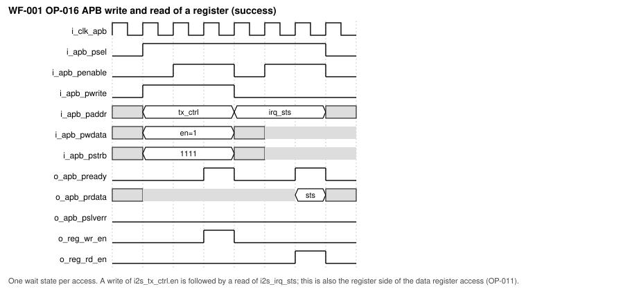

```wavedrom
{"signal": [
  {"name": "i_clk_apb", "wave": "p......."},
  {"name": "i_apb_psel", "wave": "01.....0"},
  {"name": "i_apb_penable", "wave": "001.01.0"},
  {"name": "i_apb_pwrite", "wave": "01..0..."},
  {"name": "i_apb_paddr", "wave": "x=..=..x", "data": ["tx_ctrl", "irq_sts"]},
  {"name": "i_apb_pwdata", "wave": "x=..x...", "data": ["en=1"]},
  {"name": "i_apb_pstrb", "wave": "x=..x...", "data": ["1111"]},
  {"name": "o_apb_pready", "wave": "00010010"},
  {"name": "o_apb_prdata", "wave": "x.....=x", "data": ["sts"]},
  {"name": "o_apb_pslverr", "wave": "0......."},
  {"name": "o_reg_wr_en", "wave": "00010000"},
  {"name": "o_reg_rd_en", "wave": "00000010"}
 ],
 "head": {"text": "WF-001 OP-016 APB write and read of a register (success)"},
 "foot": {"text": "One wait state per access. A write of i2s_tx_ctrl.en is followed by a read of i2s_irq_sts; this is also the register side of the data register access (OP-011)."},
 "config": {"hscale": 1}}
```

*Figure 10-3. OP-016 APB write and read of a register (register side of OP-011). Source: `figures/wf_001_apb_rw.json` (WaveJSON).*

**WF-002 OP-016 APB error responses (PSLVERR)**

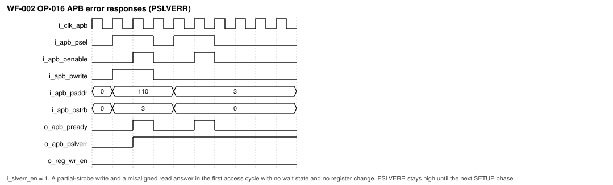

```wavedrom
{"signal": [
  {"name": "i_clk_apb", "wave": "p......."},
  {"name": "i_apb_psel", "wave": "01101100"},
  {"name": "i_apb_penable", "wave": "00100100"},
  {"name": "i_apb_pwrite", "wave": "01100000"},
  {"name": "i_apb_paddr", "wave": "x=.x=.xx", "data": ["tx_ctrl", "0x5"]},
  {"name": "i_apb_pstrb", "wave": "x=.x=.xx", "data": ["0011", "0000"]},
  {"name": "o_apb_pready", "wave": "00100100"},
  {"name": "o_apb_pslverr", "wave": "00100100"},
  {"name": "o_reg_wr_en", "wave": "00000000"}
 ],
 "head": {"text": "WF-002 OP-016 APB error responses (PSLVERR)"},
 "foot": {"text": "i_slverr_en = 1. A partial-strobe write and a misaligned read answer in the first access cycle with no wait state and no register change."},
 "config": {"hscale": 1}}
```

*Figure 10-4. OP-016 APB error responses. Source: `figures/wf_002_apb_error.json` (WaveJSON).*

**WF-003 OP-003 I2S transmit frame, master (success)**

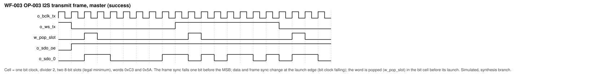

```wavedrom
{"signal": [
  {"name": "i_clk_mclk", "wave": "p..........................................."},
  {"name": "o_bclk_tx", "wave": "00110011001100110011001100110011001100110011"},
  {"name": "o_ws_tx", "wave": "11110000000000000000111111111111111100000000"},
  {"name": "w_pop_word", "wave": "00000001000000000000000100000000000000000000"},
  {"name": "o_sdo_oe", "wave": "11111111111111111111111111111111111111111111"},
  {"name": "o_sdo_0", "wave": "00000000=...=...=...=...=...=...=...=...0000", "data": ["L3", "L2", "L1", "L0", "R3", "R2", "R1", "R0"]}
 ],
 "head": {"text": "WF-003 OP-003 I2S transmit frame, master (success)"},
 "foot": {"text": "Reduced scale: divider 2 (4 master clock cycles per bit), two 4-bit slots. The frame sync falls one bit before the MSB; data and frame sync change at the launch edge (bit clock falling); the word is popped one cycle before its slot."},
 "config": {"hscale": 1}}
```

*Figure 10-5. OP-003 I2S transmit frame, master. Source: `figures/wf_003_i2s_tx_master.json` (WaveJSON).*

**WF-004 OP-004 I2S receive frame, slave (success)**

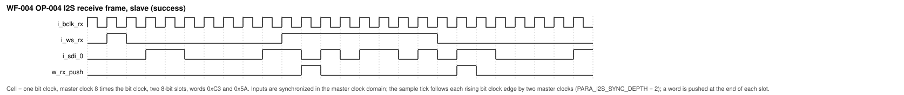

```wavedrom
{"signal": [
  {"name": "i_clk_mclk", "wave": "p......................................................................................."},
  {"name": "i_bclk_rx", "wave": "0000111100001111000011110000111100001111000011110000111100001111000011110000111100001111"},
  {"name": "i_ws_rx", "wave": "1111111100000000000000000000000000000000111111111111111111111111111111110000000000000000"},
  {"name": "i_sdi_0", "wave": "0000000000000000=.......=.......=.......=.......=.......=.......=.......=.......00000000", "data": ["L3", "L2", "L1", "L0", "R3", "R2", "R1", "R0"]},
  {"name": "w_sample", "wave": "0000000100000001000000010000000100000001000000010000000100000001000000010000000100000001"},
  {"name": "w_rx_push", "wave": "0000000000000000000000000000000000000000000000001000000000000000000000000000000010000000"}
 ],
 "head": {"text": "WF-004 OP-004 I2S receive frame, slave (success)"},
 "foot": {"text": "Reduced scale: master clock 8 times the bit clock, two 4-bit slots. Inputs are synchronized (3 master clock cycles); the sample tick follows each rising bit clock edge; a word is pushed at the end of each slot."},
 "config": {"hscale": 1}}
```

*Figure 10-6. OP-004 I2S receive frame, slave. Source: `figures/wf_004_i2s_rx_slave.json` (WaveJSON).*

**WF-005 OP-005 Frame sync of the Philips I2S and the left-justified preset (success)**

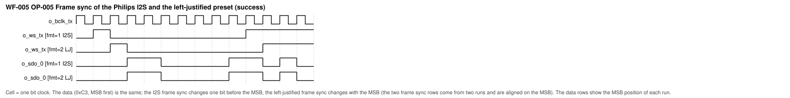

```wavedrom
{"signal": [
  {"name": "o_bclk_tx", "wave": "p..........."},
  {"name": "o_ws_tx [fmt=1 I2S]", "wave": "100001111000"},
  {"name": "o_ws_tx [fmt=2 LJ]", "wave": "110000111100"},
  {"name": "o_sdo_0", "wave": "00========00", "data": ["L3", "L2", "L1", "L0", "R3", "R2", "R1", "R0"]}
 ],
 "head": {"text": "WF-005 OP-005 Frame sync of the Philips I2S and the left-justified preset (success)"},
 "foot": {"text": "Cell = one bit clock. The data is the same; the I2S frame sync changes one bit before the MSB, the left-justified frame sync changes with the MSB."},
 "config": {"hscale": 1}}
```

*Figure 10-7. OP-005 Frame sync of the I2S and left-justified presets. Source: `figures/wf_005_fmt_i2s_lj.json` (WaveJSON).*

**WF-006 OP-005 PCM short frame with four slots, one masked slot (success)**

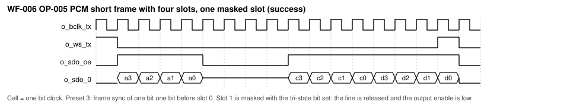

```wavedrom
{"signal": [
  {"name": "o_bclk_tx", "wave": "p................."},
  {"name": "o_ws_tx", "wave": "100000000000000010"},
  {"name": "o_sdo_oe", "wave": "011110000111111110"},
  {"name": "o_sdo_0", "wave": "0====zzzz========0", "data": ["a3", "a2", "a1", "a0", "c3", "c2", "c1", "c0", "d3", "d2", "d1", "d0"]}
 ],
 "head": {"text": "WF-006 OP-005 PCM short frame with four slots, one masked slot (success)"},
 "foot": {"text": "Cell = one bit clock. Preset 3: frame sync of one bit one bit before slot 0. Slot 1 is masked with the tri-state bit set: the line is released and the output enable is low."},
 "config": {"hscale": 1}}
```

*Figure 10-8. OP-005 PCM short frame, four slots, one masked. Source: `figures/wf_006_pcm_tdm_mask.json` (WaveJSON).*

**WF-007 OP-006 Slot mask change at a frame boundary (corner)**

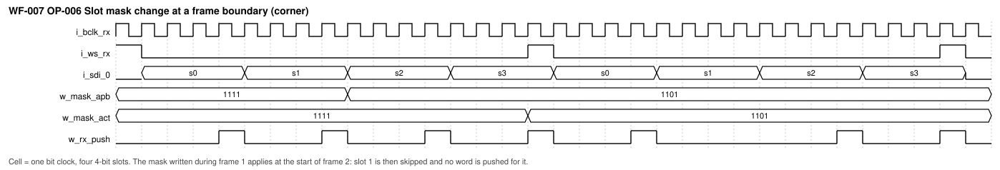

```wavedrom
{"signal": [
  {"name": "i_bclk_rx", "wave": "p................................."},
  {"name": "i_ws_rx", "wave": "1000000000000000100000000000000010"},
  {"name": "i_sdi_0", "wave": "0=...=...=...=...=...=...=...=...0", "data": ["s0", "s1", "s2", "s3", "s0", "s1", "s2", "s3"]},
  {"name": "w_mask_apb", "wave": "=........=........................", "data": ["1111", "1101"]},
  {"name": "w_mask_act", "wave": "=...............=.................", "data": ["1111", "1101"]},
  {"name": "w_rx_push", "wave": "0000100010001000100010000000100010"}
 ],
 "head": {"text": "WF-007 OP-006 Slot mask change at a frame boundary (corner)"},
 "foot": {"text": "Cell = one bit clock, four 4-bit slots. The mask written during frame 1 applies at the start of frame 2: slot 1 is then skipped and no word is pushed for it."},
 "config": {"hscale": 1}}
```

*Figure 10-9. OP-006 Slot mask change at a frame boundary. Source: `figures/wf_007_mask_change.json` (WaveJSON).*

**WF-008 OP-001 Unit start: snapshot and first frame (success)**

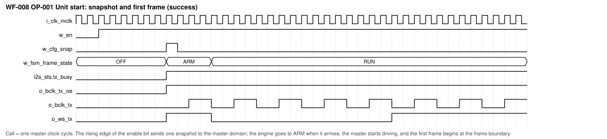

```wavedrom
{"signal": [
  {"name": "i_clk_mclk", "wave": "p......................................."},
  {"name": "w_en", "wave": "0011111111111111111111111111111111111111"},
  {"name": "w_cfg_snap", "wave": "0000000010000000000000000000000000000000"},
  {"name": "w_fsm_frame_state", "wave": "=.......=...=...........................", "data": ["OFF", "ARM", "RUN"]},
  {"name": "i2s_sts.tx_busy", "wave": "0000000011111111111111111111111111111111"},
  {"name": "o_bclk_tx_oe", "wave": "0000000011111111111111111111111111111111"},
  {"name": "o_bclk_tx", "wave": "0000000000110011001100110011001100110011"},
  {"name": "o_ws_tx", "wave": "0000000011110000000000000000111111111111"}
 ],
 "head": {"text": "WF-008 OP-001 Unit start: snapshot and first frame (success)"},
 "foot": {"text": "Cell = one master clock cycle. The rising edge of the enable bit sends one snapshot to the master domain; the engine goes to ARM when it arrives, the master starts driving, and the first frame begins at the frame boundary."},
 "config": {"hscale": 1}}
```

*Figure 10-10. OP-001 Unit start and snapshot. Source: `figures/wf_008_unit_start.json` (WaveJSON).*

**WF-009 OP-007 Transmit underrun with automatic restart (error)**

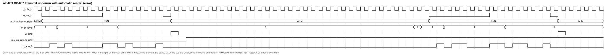

```wavedrom
{"signal": [
  {"name": "o_bclk_tx", "wave": "p........................."},
  {"name": "o_ws_tx", "wave": "00001111011111110000111100"},
  {"name": "w_fsm_frame_state", "wave": "=........=......=.........", "data": ["RUN", "ARM", "RUN"]},
  {"name": "w_tx_level", "wave": "==...=........=..=...=....", "data": ["2", "1", "0", "2", "1", "0"]},
  {"name": "w_und", "wave": "00000000010000000000000000"},
  {"name": "i2s_irq_raw.tx_und", "wave": "00000000001111111111111111"},
  {"name": "o_sdo_0", "wave": "0========00000000========0", "data": ["L3", "L2", "L1", "L0", "R3", "R2", "R1", "R0", "N3", "N2", "N1", "N0", "M3", "M2", "M1", "M0"]}
 ],
 "head": {"text": "WF-009 OP-007 Transmit underrun with automatic restart (error)"},
 "foot": {"text": "Cell = one bit clock, auto restart on. The FIFO is empty when slot 0 of frame 2 starts: zeros, tx_und cause, the unit abandons the frame and waits in ARM; two words written later restart it at a frame boundary."},
 "config": {"hscale": 1}}
```

*Figure 10-11. OP-007 Transmit underrun with automatic restart. Source: `figures/wf_009_tx_underrun_auto.json` (WaveJSON).*

**WF-010 OP-008 Receive overrun with auto restart off (error)**

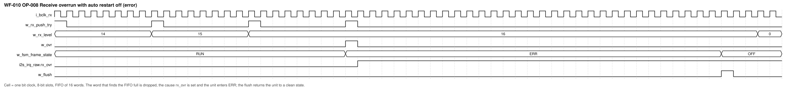

```wavedrom
{"signal": [
  {"name": "i_bclk_rx", "wave": "p................................."},
  {"name": "w_rx_push_try", "wave": "0000100010001000000000000000100010"},
  {"name": "w_rx_level", "wave": "=...=...=...........=.......=.....", "data": ["0", "1", "2", "0", "1"]},
  {"name": "w_rx_ovr", "wave": "0000000000001000000000000000000000"},
  {"name": "w_fsm_frame_state", "wave": "=............=.......=..=.........", "data": ["RUN", "ERR", "ARM", "RUN"]},
  {"name": "i2s_irq_raw.rx_ovr", "wave": "0000000000000111111100000000000000"},
  {"name": "w_flush", "wave": "0000000000000000000010000000000000"}
 ],
 "head": {"text": "WF-010 OP-008 Receive overrun with auto restart off (error)"},
 "foot": {"text": "Cell = one bit clock; the FIFO capacity is two words for illustration. The third word finds the FIFO full: it is dropped and the unit enters ERR; after the drain and the flush it restarts at a frame boundary."},
 "config": {"hscale": 1}}
```

*Figure 10-12. OP-008 Receive overrun, auto restart off. Source: `figures/wf_010_rx_overrun_err.json` (WaveJSON).*

**WF-011 OP-009 On-demand frame start (corner)**

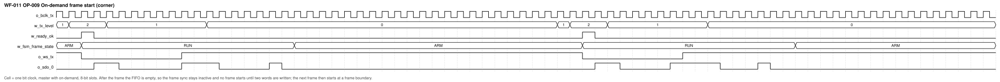

```wavedrom
{"signal": [
  {"name": "o_bclk_tx", "wave": "p............................"},
  {"name": "w_tx_level", "wave": "==...=...........=..=...=....", "data": ["2", "1", "0", "2", "1", "0"]},
  {"name": "w_apb_wr_frame", "wave": "00000000000000001000000000000"},
  {"name": "w_ready", "wave": "00000000000000000111000000000"},
  {"name": "w_fsm_frame_state", "wave": "=........=.........=.........", "data": ["RUN", "ARM", "RUN"]},
  {"name": "o_ws_tx", "wave": "00001111111111111110000111100"},
  {"name": "o_sdo_0", "wave": "0========00000000000========0", "data": ["L3", "L2", "L1", "L0", "R3", "R2", "R1", "R0", "N3", "N2", "N1", "N0", "M3", "M2", "M1", "M0"]}
 ],
 "head": {"text": "WF-011 OP-009 On-demand frame start (corner)"},
 "foot": {"text": "Cell = one bit clock, master with on-demand. After frame 1 the FIFO is empty, so the frame sync stays inactive and no frame starts until two words are written; then frame 2 starts at the next bit."},
 "config": {"hscale": 1}}
```

*Figure 10-13. OP-009 On-demand frame start. Source: `figures/wf_011_ondemand.json` (WaveJSON).*

**WF-012 OP-010 Frame sync error and hung clock, slave (error)**

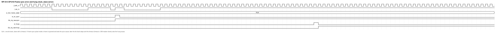

```wavedrom
{"signal": [
  {"name": "i_bclk_rx", "wave": "p.............0000000000"},
  {"name": "i_ws_rx", "wave": "100010001000000000000000"},
  {"name": "w_fsm_frame_state", "wave": "=.......................", "data": ["RUN"]},
  {"name": "w_sync_err", "wave": "000001000000000000000000"},
  {"name": "i2s_irq_raw.sync", "wave": "000000111111111111111111"},
  {"name": "w_tmo_run", "wave": "000000000000001111111100"},
  {"name": "w_hung", "wave": "000000000000000000000010"},
  {"name": "i2s_irq_raw.hung", "wave": "000000000000000000000001"}
 ],
 "head": {"text": "WF-012 OP-010 Frame sync error and hung clock, slave (error)"},
 "foot": {"text": "Cell = one bit clock, TDM slave with a timeout. A frame sync pulse inside a frame is ignored and sets the sync cause; later the bit clock stops, the timeout runs out and the hung cause is set."},
 "config": {"hscale": 1}}
```

*Figure 10-14. OP-010 Frame sync error and hung clock. Source: `figures/wf_012_sync_hung.json` (WaveJSON).*

**WF-013 OP-012 DMA burst handshake (success)**

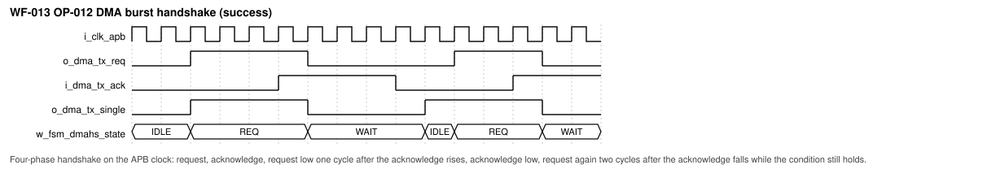

```wavedrom
{"signal": [
  {"name": "i_clk_apb", "wave": "p............."},
  {"name": "w_cond", "wave": "01111111111111"},
  {"name": "o_dma_tx_req", "wave": "00111100001111"},
  {"name": "i_dma_tx_ack", "wave": "00000111100000"},
  {"name": "o_dma_tx_single", "wave": "01111000011111"}
 ],
 "head": {"text": "WF-013 OP-012 DMA burst handshake (success)"},
 "foot": {"text": "Four-phase handshake on the APB clock: request, acknowledge, request low, acknowledge low, request again while the condition still holds."},
 "config": {"hscale": 1}}
```

*Figure 10-15. OP-012 DMA burst handshake. Source: `figures/wf_013_dma_burst.json` (WaveJSON).*

**WF-014 OP-013 DMA single transactions (success)**

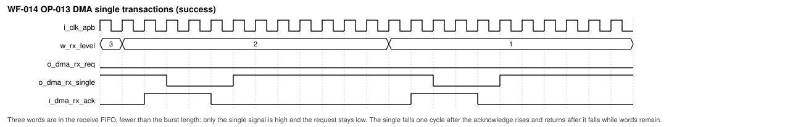

```wavedrom
{"signal": [
  {"name": "i_clk_apb", "wave": "p................."},
  {"name": "w_rx_level", "wave": "=....=.....=.....=", "data": ["3", "2", "1", "0"]},
  {"name": "o_dma_rx_req", "wave": "000000000000000000"},
  {"name": "o_dma_rx_single", "wave": "110001110001110000"},
  {"name": "i_dma_rx_ack", "wave": "001110001110001110"}
 ],
 "head": {"text": "WF-014 OP-013 DMA single transactions (success)"},
 "foot": {"text": "Block size not a multiple of the burst length: three single transfers. The single signal clears while the acknowledge is high and returns while words remain."},
 "config": {"hscale": 1}}
```

*Figure 10-16. OP-013 DMA single transactions. Source: `figures/wf_014_dma_single.json` (WaveJSON).*

**WF-015 OP-014 Interrupt cause through raw, enable, injection and masked status (success)**

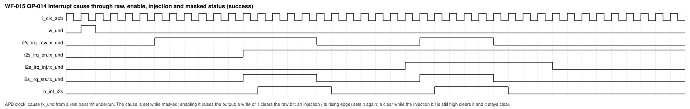

```wavedrom
{"signal": [
  {"name": "i_clk_apb", "wave": "p......................."},
  {"name": "w_event", "wave": "001000000000000000000000"},
  {"name": "i2s_irq_raw.tx_und", "wave": "000111111110000111110000"},
  {"name": "i2s_irq_en.tx_und", "wave": "000000111111111111111111"},
  {"name": "i2s_irq_inj.tx_und", "wave": "000000000000001111000000"},
  {"name": "i2s_irq_sts.tx_und", "wave": "000000111110000111110000"},
  {"name": "o_int_i2s", "wave": "000000011111000011111000"},
  {"name": "w_apb_clr", "wave": "000000000010000000010000"}
 ],
 "head": {"text": "WF-015 OP-014 Interrupt cause through raw, enable, injection and masked status (success)"},
 "foot": {"text": "APB clock, cause tx_und. A cause is set while masked; enabling it raises the output; a write of 1 clears the raw bit; an injection sets it again; the clear after the injection removes it."},
 "config": {"hscale": 1}}
```

*Figure 10-17. OP-014 Interrupt: raw, enable, injection, masked status. Source: `figures/wf_015_irq_four.json` (WaveJSON).*

**WF-016 OP-002 and OP-015 Unit stop, busy and flush (corner)**

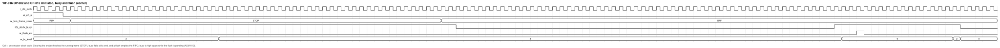

```wavedrom
{"signal": [
  {"name": "i_clk_mclk", "wave": "p..................."},
  {"name": "w_en", "wave": "11110000000000000000"},
  {"name": "w_fsm_frame_state", "wave": "=....=......=.......", "data": ["RUN", "STOP", "OFF"]},
  {"name": "i2s_sts.tx_busy", "wave": "11111111111100000000"},
  {"name": "w_flush", "wave": "00000000000000100000"},
  {"name": "w_tx_level", "wave": "=..............=....", "data": ["6", "0"]}
 ],
 "head": {"text": "WF-016 OP-002 and OP-015 Unit stop, busy and flush (corner)"},
 "foot": {"text": "Cell = one master clock cycle. Clearing the enable finishes the running frame (STOP), busy falls at its end, and a flush empties the FIFO."},
 "config": {"hscale": 1}}
```

*Figure 10-18. OP-002 and OP-015 Unit stop, busy and flush. Source: `figures/wf_016_stop_flush.json` (WaveJSON).*

**WF-017 OP-017 Reset assertion and release on both domains (corner)**

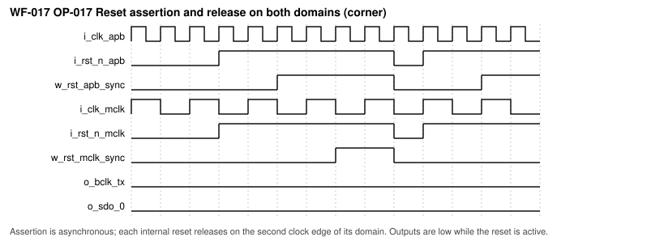

```wavedrom
{"signal": [
  {"name": "i_clk_apb", "wave": "p............."},
  {"name": "i_rst_n_apb", "wave": "00011111101111"},
  {"name": "w_rst_apb_sync", "wave": "00000111100011"},
  {"name": "i_clk_mclk", "wave": "p......", "period": 2},
  {"name": "i_rst_n_mclk", "wave": "00011111101111"},
  {"name": "w_rst_mclk_sync", "wave": "00000001100000"},
  {"name": "o_bclk_tx", "wave": "00000000000000"},
  {"name": "o_sdo_0", "wave": "00000000000000"}
 ],
 "head": {"text": "WF-017 OP-017 Reset assertion and release on both domains (corner)"},
 "foot": {"text": "Assertion is asynchronous; each internal reset releases on the second clock edge of its domain. Outputs are low while the reset is active."},
 "config": {"hscale": 1}}
```

*Figure 10-19. OP-017 Reset assertion and release. Source: `figures/wf_017_reset.json` (WaveJSON).*


### 10.4 Arbitration, buffering, and throughput

- **Units and lines.** The two units do not arbitrate; only the shared-clock option couples their timing. Lines of one unit move in lockstep and share the frame.
- **FIFO behavior.** Push and pop of the logical FIFO happen on the two sides of the asynchronous FIFOs. A full FIFO drops the new word (overrun), an empty FIFO supplies zeros to the serializer (underrun); there is no backpressure on the serial side.
- **DMA.** The two directions have separate handshakes. The data register has one address for each direction, so the DMA controller uses a fixed address (REQ-REG-004).
- **Latency.** A word received in the master domain becomes visible to software after PARA_I2S_SYNC_DEPTH + 1 APB clock cycles; a word written by software is visible to the serializer after PARA_I2S_SYNC_DEPTH + 1 master clock cycles.
- **Throughput.** The serial rate is one bit per bit clock per line. Sustained transfer without loss needs the service rate of section 13 (REQ-PERF-001).

### 10.5 Memories and storage

| Storage ID | Kind | Depth × width | Ports | Read latency | Write mask | Reset/init | ECC/parity | Implementation |
|---|---|---|---|---|---|---|---|---|
| MEM-001 | Transmit FIFO, one per line | PARA_I2S_FIFO_DEPTH × 32 bit, up to four lines | Write port in CLK-APB, read port in CLK-MCLK | 1 master clock cycle | None (whole word) | Pointers reset; contents not initialized, guarded by the pointers | None (DEC-012) | Inferred register array; a memory macro behind a wrapper is allowed from the depth set in TBD-006 |
| MEM-002 | Receive FIFO, one per line | Same | Write port in CLK-MCLK, read port in CLK-APB | 1 APB clock cycle | None | As MEM-001 | None | As MEM-001 |

A flush resets the pointers without erasing the contents. A read of an empty receive FIFO returns 0 and has no other effect.

**Level counters (ASM-015).** The library FIFO shows no occupancy, so each FIFO module counts the words itself: the transmit module counts accepted writes in the APB domain and popped slots in the master domain (Gray coded, crossed by a synchronizer), the receive module counts pushed slots in the master domain and popped words in the APB domain. The level is the writes minus the pops times the number of lines, 12 bits wide, which holds the largest capacity of 1024 words. After a flush the counter of the register side is set to the synchronized counter of the other side, so the level is 0.

## 11. Register and programming model

### 11.1 CSR specification source

The CSR specification of this IP is defined only in the VLSIT CSR workbook (REF-005). This document does not declare or restate the register interface, register map, register fields, offsets, access types, or reset values. The workbook is the single source of truth.

| Item | Specification |
|---|---|
| CSR workbook file | `I2S_CSR.xlsx` in this folder, with its JSON description `I2S_CSR.json` |
| Sheet used for this IP | `CSR` |
| Workbook revision / date | 2026-11-20 |
| CSR generator | APB-CSR-Generator, canonical repository `https://github.com/nguyenquanicd/APB-CSR-Generator` version 3.3 or later (event sideband needs 3.0 or later; the commit is recorded when the RTL is generated, ASM-007) |
| CSR module name | `m_vlsit_csr_i2s` |
| Register prefix | `i2s` |
| IP version | 1.0, workbook register `i2s_version` (rule R-067) |
| Asynchronous | 0 (one clock) |
| APB clock and register clock | `i_clk_apb` drives both; `i_clk_reg` and `i_rst_n_reg` of the CSR module are tied to `i_clk_apb` and `i_rst_n_apb` |
| Source of `i_protect_en` and `i_slverr_en` | IP input ports, constant after reset |
| Register event sideband | On (`o_reg_rd_en`, `o_reg_rd_addr`, `o_reg_wr_en`, `o_reg_wr_addr`) |
| Repeated registers | None: each unit has its own block of registers with the same layout |

**Why the register map looks like this.** The map was designed for the shortest driver, and it differs on purpose from the databook of the vendor IP and from the two SoC references:

1. **Two identical unit blocks.** The transmit block and the receive block have the same registers at the same offsets from their base, with the same field positions, so a driver has one function for both units and passes the block base (REQ-REG-002, REQ-IF-007). The reference IPs keep different registers or different bit positions for transmit and receive.
2. **Global block first.** Version, capability, global control and status, and the four interrupt registers come first, so the probe and the interrupt handler touch only the lowest addresses.
3. **Real numbers.** Slot count, slot width, data width and the clock divider hold the real number, not a minus-one code, and the FIFO level and watermark are in words (REQ-REG-003).
4. **One data register per direction.** The samples of all slots and lines go through one address in a fixed order; there are no left and right register pairs and no per-line registers, so DMA needs no address increment and software cannot get a pair out of step (REQ-REG-004).
5. **Presets instead of bit fields.** A format number sets the frame sync of the common formats; software writes five numbers (format, slots, slot width, data width, divider) to describe a stream.
6. **Snapshot at start.** The configuration is latched when the enable bit rises, so there is no update strobe and no half-applied configuration; only the slot mask may change while running.
7. **Four interrupt registers.** All eight causes use raw status (write 1 to clear), enable, injection and masked status with the same bit positions (REQ-IF-009).
8. **Self-describing.** The capability register lets one binary driver adapt to the build (REQ-REG-005).

### 11.2 Software sequences

Register names are exactly as in the workbook. The flow shows a stream with one unit; the second unit is programmed with the same steps on its own block. A name written with `tx` in the table applies to `rx` with the same field and the other block.

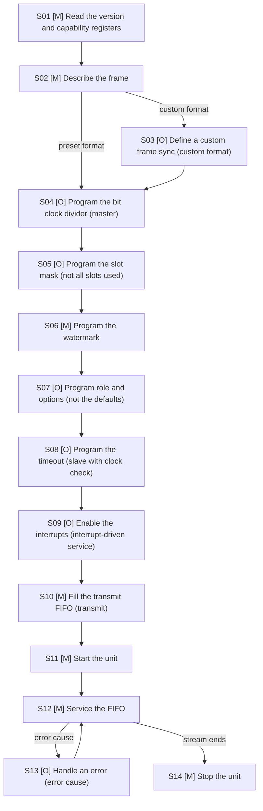

| No. | Step | Option (M/O) | Interface | CSR | Description |
|---|---|---|---|---|---|
| S01 | Read the version and capability registers | M | APB4 read (REF-002 §3.3) | Read `i2s_version.major`, `i2s_version.minor` and every field of `i2s_cap` | Confirms the register model and shows which units, lines, FIFO depth and options the build has, so that one driver fits every configuration. |
| S02 | Describe the frame | M | APB4 write (REF-002 §3.1), unit stopped | Write `i2s_tx_frame.fmt`, `nslot`, `slot_w`, `data_w`, `align` and `pack` (real numbers) | Selects the format and the slot geometry; the preset derives the frame sync from them. Write while `i2s_tx_ctrl.en` is 0; the data width must not exceed the slot width. |
| S03 | Define a custom frame sync | O (format custom) | APB4 write | Write `i2s_tx_sync.sync_w`, `fsp`, `fse` and `bpol` | Shapes the frame sync of a nonstandard codec; the preset formats ignore these fields except `bpol`. |
| S04 | Program the bit clock divider | O (master role) | APB4 write | Write `i2s_tx_clk.div` | Sets the half period of the bit clock in master clock cycles; the bit clock is the master clock divided by twice this number. |
| S05 | Program the slot mask | O (some slots unused) | APB4 write | Write `i2s_tx_mask.mask` (may be repeated while running) | Skips slots of other devices on a shared TDM line; a change applies at the next frame boundary. |
| S06 | Program the watermark | M | APB4 write | Write `i2s_tx_fifo.wm` | Sets when the watermark cause and the DMA request fire, which fixes the service latency the stream tolerates (section 13). |
| S07 | Program role and options | O (not the defaults) | APB4 write, unit stopped | Write `i2s_tx_ctrl.role`, `shr`, `ondem`, `auto`, `tri` and `dma` (leave `en` 0) | Chooses master or slave, shared clock, waiting frames, automatic restart, line release and DMA requests. |
| S08 | Program the timeout | O (slave with clock check) | APB4 write | Write `i2s_tx_tmo.tmo` | Turns on the hung-clock detector with a time in units of 256 master clock cycles. |
| S09 | Enable the interrupts | O (interrupt-driven service) | APB4 write | Write 1 to `i2s_irq_raw.tx_wm` to `frm` to clear old causes, then set the wanted bits of `i2s_irq_en` | Unmasks the causes that wake the driver; all are masked after reset. |
| S10 | Fill the transmit FIFO | M (transmit) | APB4 write, or DMA through the handshake | Write `i2s_tx_data.data` for every sample of the first frames in slot order (line 0 first inside a slot) | Provides data before the start so that the first frame is not an underrun. |
| S11 | Start the unit | M | APB4 write | Write `i2s_tx_ctrl.en` = 1 (and `i2s_rx_ctrl.en` = 1 for the receiver) | Latches the configuration and starts the frames; a master begins to drive the bit clock and frame sync. |
| S12 | Service the FIFO | M | APB4 read and write, interrupt or DMA | Read `i2s_irq_sts`; write `i2s_tx_data.data` to refill, or read `i2s_rx_data.data` to drain; write 1 to the cleared bit of `i2s_irq_raw` | Keeps the transmit FIFO filled and the receive FIFO drained; `i2s_tx_sts.level` and `i2s_rx_sts.level` show the fill. |
| S13 | Handle an error | O (error cause) | APB4 read and write | Read `i2s_irq_raw.tx_und`, `tx_ovr`, `rx_ovr`, `sync`, `hung`; read `i2s_tx_sts.sync`, `hung` to find the unit; write `i2s_tx_ctrl.flush` = 1 when `auto` is 0; write 1 to the raw and unit flags | Recovers from an underrun, overrun, frame sync error or lost clock. |
| S14 | Stop the unit | M | APB4 read and write | Write `i2s_tx_ctrl.en` = 0, poll `i2s_sts.tx_busy` until 0, then write `i2s_tx_ctrl.flush` = 1 | Lets the last frame finish, then empties the FIFO. |

**Rules for software** (not enforced by hardware): write `i2s_tx_frame`, `i2s_tx_sync`, `i2s_tx_clk`, `i2s_tx_ctrl` options and `i2s_tx_tmo` only while `i2s_tx_ctrl.en` is 0; keep `data_w` not larger than `slot_w`, and `pack` only with `data_w` of 16 or less; keep `nslot` not larger than `i2s_cap.max_slot`; never set `shr` in both units; write whole frames to the transmit data register and read whole frames from the receive data register; in slave mode the master clock shall be at least 8 times the bit clock.

### 11.3 CSR connection to the design

Name each register and field only as written in the workbook; offsets, widths, types and reset values are not repeated here. All CSR ports are in CLK-APB. A signal from CLK-MCLK is synchronized by the IP (section 7.2), not by the CSR.

| Workbook register.field | Direction at the CSR | Design signal | Clock domain of the signal | Behavior notes |
|---|---|---|---|---|
| `i2s_version.*`, `i2s_cap.*` | status in | Constants tied in the wrapper from the parameters | CLK-APB | Constant after reset |
| `i2s_ctrl.srst` | control out (`wo`) and hardware clear | Global soft reset request: `u_regctl` issues the flush and reset requests of both units and clears the bit when both have finished | CLK-APB to CLK-MCLK (CDC-007) | Cleared by hardware when the reset has been done |
| `i2s_ctrl.frm_sel` | control out | Source of the frame-done cause | CLK-APB | Static |
| `i2s_sts.tx_busy`, `rx_busy` | status in | Enable bit OR the synchronized busy flag of the frame engine OR a pending flush or soft reset | CLK-APB (from CDC-006) | Live (ASM-019) |
| `i2s_sts.irq` | status in | OR of the masked status from `u_irq` | CLK-APB | Live |
| `i2s_irq_raw.*` | hardware load, `w1c` | Set pulses and level conditions from `u_irq` | CLK-APB | A hardware load wins over a simultaneous clear, so no event is lost; a level cause is loaded every cycle while its condition holds |
| `i2s_irq_en.*`, `i2s_irq_inj.*` | control out | Enable and injection bits to `u_irq` | CLK-APB | The injection sets the raw bit on its rising edge |
| `i2s_irq_sts.*` | status in | Raw AND enable from `u_irq` | CLK-APB | Live |
| `i2s_tx_ctrl.*`, `i2s_rx_ctrl.*` (`en`, `role`, `shr`, `ondem`, `auto`, `tri`, `dma`) | control out | Option bits to `u_cfgsync_tx, u_cfgsync_rx` (snapshot) and to `u_dmahs_tx, u_dmahs_rx` (`dma`) | CLK-APB to CLK-MCLK (CDC-003) | `en` rising edge triggers the snapshot; the others are read at that time |
| `i2s_tx_ctrl.srst`, `flush` and the receive equivalents | control out (`wo`) and hardware clear | Unit reset and flush requests from `u_regctl` to the unit crossing and the FIFO | CLK-APB to CLK-MCLK (CDC-007) | Cleared by hardware when the FIFO flush has finished; the bits read 0, so software polls the busy flag (ASM-019) |
| `i2s_tx_frame.*`, `i2s_tx_sync.*`, `i2s_tx_clk.*`, `i2s_tx_tmo.*` and the receive equivalents | control out | Frame, sync, divider and timeout fields to `u_cfgsync_tx, u_cfgsync_rx` | CLK-APB to CLK-MCLK (CDC-003) | Part of the snapshot |
| `i2s_tx_mask.mask`, `i2s_rx_mask.mask` | control out | Slot mask to `u_cfgsync_tx, u_cfgsync_rx` | CLK-APB to CLK-MCLK (CDC-004) | Accepted at the next frame boundary |
| `i2s_tx_fifo.wm`, `i2s_rx_fifo.wm` | control out | Watermark to `u_irq` and `u_dmahs_tx, u_dmahs_rx` | CLK-APB | Compared with the level in the APB domain |
| `i2s_tx_sts.*`, `i2s_rx_sts.*` (`busy`, `empty`, `full`, `level`) | status in | Flags and level from the FIFO modules | CLK-APB (from CDC-006) | Live |
| `i2s_tx_sts.sync`, `hung` and the receive equivalents | hardware load, `w1c` | Sticky unit flags from `u_cfgsync_tx, u_cfgsync_rx` | CLK-APB (from CDC-005) | Cleared by writing 1 |
| `i2s_tx_data.data` | control out (`wo`) | Word to push into `u_txfifo` | CLK-APB | The write event comes one cycle before the CSR loads the field, so `u_regctl` pushes one cycle after the event and then clears the field (ASM-005, checked on the generated CSR) |
| `i2s_rx_data.data` | status in | Word at the head of `u_rxfifo` | CLK-APB | The CSR samples the head word in the cycle of the read event; the pop is taken in the same cycle (ASM-005) |

The write event of the transmit data register and the read event of the receive data register come from the register event outputs of the CSR; `u_regctl` decodes the event address and distributes the words over the lines in the fixed order.

### 11.4 APB access behavior of the CSR

The CSR block is generated by APB-CSR-Generator with `Asynchronous` = 0 and the behavior below. The `wo` fields read as zero.

| Case | Behavior |
|---|---|
| Normal read or write | PREADY after 1 wait state; a read returns the value sampled in the second cycle; a write stores. |
| Write with PSTRB not all ones | PSLVERR and no change when `i_slverr_en` = 1 (0 wait states); whole-word write when `i_slverr_en` = 0. |
| Address not word aligned | PSLVERR when `i_slverr_en` = 1; with 0 no register matches. |
| Aligned address that is not a register | OKAY, 1 wait state; read returns 0; write is ignored. |
| Non-secure access (PPROT[1] = 1) | PSLVERR when `i_protect_en` = 1 and `i_slverr_en` = 1. |
| Reserved bits | Read as 0; write ignored. |
| Reset | Registers take the workbook reset value; asynchronous assertion, release synchronous to `i_clk_apb` through `u_rstsync_apb`. |
| Field priorities | `w1c`: hardware load wins over a simultaneous software clear; `wo`: hardware clear wins over a simultaneous software write. |
| Register events | `o_reg_rd_en` and `o_reg_wr_en` are one-cycle pulses in `i_clk_apb` with their address; a read of an aligned unmapped address also produces a read event. |

Software must write full 32-bit words and wait for PREADY; 8-bit and 16-bit register access is not supported (DEC-001).

## 12. Error handling and recovery

| Error ID | Detection condition | Observable response/status | Interrupt | Clear/recovery | Reset behavior |
|---|---|---|---|---|---|
| ERR-001 | Transmit slot needs a word and the FIFO is empty | Zeros sent; `i2s_irq_raw.tx_und` set; auto restart off: state ERR | `o_int_i2s` if enabled | Flush when `auto` is 0, clear the raw bit; with `auto` the unit restarts | Cleared by reset |
| ERR-002 | Write to a full transmit FIFO | Word dropped; `i2s_irq_raw.tx_ovr` set | `o_int_i2s` if enabled | Clear the raw bit | Cleared by reset |
| ERR-003 | Received word finds the FIFO full | Word dropped; `i2s_irq_raw.rx_ovr` set; auto restart off: state ERR | `o_int_i2s` if enabled | Drain, flush when `auto` is 0, clear the raw bit | Cleared by reset |
| ERR-004 | External frame sync arrives inside a frame | Sync ignored; `i2s_irq_raw.sync` and the unit flag set | `o_int_i2s` if enabled | Clear both flags | Cleared by reset |
| ERR-005 | No bit clock edge or frame sync for the timeout | `i2s_irq_raw.hung` and the unit flag set; the unit keeps waiting | `o_int_i2s` if enabled | Clear both flags; restore the clock | Cleared by reset |
| ERR-006 | APB write with a partial strobe, misaligned address, or non-secure access with protection on | PSLVERR, no register change | None | Retry with a full-word aligned secure access | None |
| ERR-007 | Illegal configuration (data width above slot width, nslot above the build maximum, divider 0 in master mode, packing with data width above 16) | Behavior not specified | None | Correct the registers while the unit is stopped | Reset value |
| ERR-008 | Configuration written while the unit runs | Ignored until the next start (except the slot mask) | None | Stop and start | None |
| ERR-009 | Both units set to share the clock | The transmitter follows its own clock | None | Clear `shr` in one unit | Reset value |

Simultaneous errors are independent sticky causes; there is no priority. Underrun and overrun stop the stream only when auto restart is off.

## 13. Performance, power, and area

Hard requirements are those of REQ-PERF-001. Numeric implementation targets are goals until a synthesis run is made (TBD-002).

| Metric ID | Metric | Target / limit | Conditions | Measurement method | Hard / goal |
|---|---|---|---|---|---|
| PPA-001 | Maximum frequency | APB clock at least 200 MHz, master clock at least 100 MHz (ASM-006); exact targets TBD-002 | Typical corner of the project library | STA with the constraints of section 17 | Goal |
| PPA-002 | Area | TBD-002 | CFG-FULL, CFG-MIC and CFG-MIN | Cell area | Goal |
| PPA-003 | Power | TBD-002 | Both units running at 48 kHz stereo | Power analysis | Goal |
| PERF-001 | Sustained service rate | No loss when the service latency is below the times of PERF-002 and PERF-003 | Section 10.4 | Simulation, analysis | Hard |
| PERF-002 | Time before a transmit FIFO underruns after the watermark is reached | About watermark / w frames x frame period, where w is the number of words per frame | w = enabled slots x lines; frame period = nslot x slot_w / bit clock frequency | Analysis | Hard |
| PERF-003 | Time before a receive FIFO overruns after the watermark is reached | About (capacity - watermark) / w frames x frame period | Capacity = FIFO depth x lines | Analysis | Hard |
| PERF-004 | APB cost of one sample | 1 register access of 3 APB clock cycles (one setup and two access cycles with one wait state) | Section 11.4 | Simulation | Hard |

Example (ASM-003): 48 kHz stereo, one line, depth 16 (capacity 16 words), watermark 8: w = 2 words per frame, frame period 20.8 microseconds, so the transmit FIFO gives 4 frames = 83 microseconds of service latency after the watermark, and the DMA burst shall not exceed the free space at the request (8 words).

Do not claim timing closure from RTL synthesis alone. The SDC and analysis flow are in section 17.

## 14. RTL implementation contract

### 14.1 Required coding baseline

The VLSIT RTL Design Rules v2 (REF-003) are the mandatory RTL coding authority; the RTL shall comply with them without project-local exceptions (REQ-RTL-001). In particular for this IP:

- One synthesizable module per `.sv` file with the module name equal to the file name; the top is a structural wrapper with ANSI ports (`input wire`, `output logic`), named connections and no logic.
- Parameters are declared as `parameter logic [31:0]` with names starting `PARA_` and the three comment lines of PAR-02; derived constants start `LPARA_` and sit in the parameter port list.
- Every FSM of section 10.1 has an enum type, a current-state register named `reg_fsm_` plus the function plus `_current_state` in its own `always_ff`, a next-state signal `w_fsm_` plus the function plus `_nxt_state`, enum members `ENUM_ST_` plus the state name, and a safe recovery to the first state.
- All serial logic runs on `i_clk_mclk`; the bit clock is an enable or a registered signal, never a clock (REQ-CLK-002). No negative-edge flops and no inverted clocks in RTL.
- Clock domain crossings and reset synchronizers are in dedicated modules; no logic between a source flop and the first synchronizer stage; technology cells only in wrapper modules with instance names starting `u_dont_touch_`.
- Active-low non-reset signals end in `_n`; names do not exceed 30 characters; abbreviations follow NAM-08; unsigned four-state `logic` vectors; no signed types, packages, interfaces, macros, `casex` or latches; SVA and testbenches stay outside the synthesis set.
- The generated CSR (`m_vlsit_csr_i2s`) is produced by APB-CSR-Generator from the workbook and is not edited by hand.

Reuse candidates from the library `common_rtl` (to be confirmed at RTL generation): Gray-pointer asynchronous FIFO (`001_AsyncGrayFIFO`), Gray code synchronizer (`013_AsyncGrayCodeSync`), 2-phase and 4-phase handshake (`011_Async2PhaseHandshake`, `010_Async4PhaseHandshake`).

### 14.2 RTL hierarchy

| Module | Responsibility | Parent / instance | Clock/reset domains | Interface |
|---|---|---|---|---|
| m_vlsit_apb_i2s_top | Structural top of the profile: interface, parameters, interconnect, instances | SoC / `u_apb_i2s` | APB and master | Section 6.2 |
| m_vlsit_rst_sync | Reset synchronizer of one domain; library module reused, not copied (DEC-015) | top / `u_rstsync_apb`, `u_rstsync_mclk` | One each | Asynchronous reset in, synchronized reset out |
| m_vlsit_csr_i2s | Generated APB4 register block | top / `u_csr_i2s` | APB | APB, field ports, register events |
| m_vlsit_i2s_regctl | Register-event decode, line distribution, flush and reset, status and level | top / `u_regctl` | APB | CSR ports, FIFO strobes and flags |
| m_vlsit_i2s_irq | Eight causes, raw, enable, injection, masked status, output | top / `u_irq` | APB | Causes, CSR fields, `o_int_i2s` |
| m_vlsit_i2s_cfgsync | Snapshot, mask, request and event crossings of one unit; uses the library `m_vlsit_ahs4_top`, `m_vlsit_event_sync` and `m_vlsit_afifo_cell_sync` (DEC-015) | top / `u_cfgsync_tx` (transmit), `u_cfgsync_rx` (receive) | APB and master | Fields, events |
| m_vlsit_i2s_txfifo | Transmit FIFOs of all lines: one library `m_vlsit_afifo_top` per line, plus the level counters (ASM-015) | top / `u_txfifo` | APB and master | Push, pop, level, flags |
| m_vlsit_i2s_rxfifo | Receive FIFOs of all lines: one library `m_vlsit_afifo_top` per line, plus the level counters (ASM-015) | top / `u_rxfifo` | Master and APB | Push, pop, level, flags |
| m_vlsit_i2s_frame | Frame engine of one unit; FSM `frame` | top / `u_frame_0` (transmit), `u_frame_1` (receive) | Master | Snapshot, mask, pins, FIFO flags, frame events |
| m_vlsit_i2s_txser | Transmit shift registers | top / `u_txser` | Master | Frame events, words, `o_sdo_x`, `o_sdo_oe` |
| m_vlsit_i2s_rxdes | Receive shift registers | top / `u_rxdes` | Master | Frame events, `i_sdi_x`, words |
| m_vlsit_i2s_dmahs | DMA handshake of one direction; FSM `dmahs` | top / `u_dmahs_tx` (transmit), `u_dmahs_rx` (receive) | APB | Level conditions, request, single, acknowledge |

The structural top holds the interface, the parameters, the interconnect and the instances only, plus constant tie-offs of the absent units (DEC-019); the state owners are the FSMs in `u_frame_0`, `u_frame_1`, `u_dmahs_tx` and `u_dmahs_rx`, the FIFO pointers in the library FIFOs and the level counters in the FIFO modules, and the register flops in the CSR. The APB protocol adapter is the generated CSR. Library modules (reused, listed in `rtl/filelist.f`, never copied): `m_vlsit_afifo_top` and its children (001_AsyncGrayFIFO), `m_vlsit_ahs4_top` and its children (010_Async4PhaseHandshake), `m_vlsit_event_sync`, `m_vlsit_afifo_cell_sync` and `m_vlsit_rst_sync` (000_Common).

### 14.3 Synthesis assumptions

| Item | Value / source |
|---|---|
| Top / source file list | `m_vlsit_apb_i2s_top` and the files of 14.2; `filelist.f` is produced by the RTL generation step |
| Frontend version and options | Recorded with every synthesis result (REF-003 SCP-02) |
| Parameters/configuration | One of CFG-FULL, CFG-MIC, CFG-MIN, CFG-DUAL of section 8 |
| Libraries/corners | Project library |
| Memory flow | Inferred arrays; macro wrapper per TBD-006 |
| Lint rule configuration | The VLSIT RTL rule check and the project lint tool, zero errors |

## 15. Verification specification

### 15.1 Scope and strategy

Levels: block simulation of each module and of the top with a serial BFM that plays the codec (master and slave, all presets) and an APB master; protocol compliance of APB4 with a protocol checker (REF-002) and of the serial frame with assertions derived from REF-006 and section 6.3; integration with a DMA controller model; CDC and RDC analysis with a static tool; lint and the rule check; synthesis checks. Configurations: all four of section 4 plus the minimum and maximum of every parameter of section 8. Seeds: every random test logs its seed. Reference model: the frame and the FIFO order are predicted by an independent model written from this specification, not from the RTL.

### 15.2 Requirement-based test plan

| Test ID | Requirements | Scenario / stimulus | Expected result | Test type | Configuration |
|---|---|---|---|---|---|
| TEST-001 | REQ-FUNC-001, REQ-RESET-001, REQ-RESET-002, REQ-REG-001, REQ-REG-002, REQ-REG-003, REQ-REG-004, REQ-REG-005, REQ-REG-008, REQ-IF-007 | Read every register after reset; compare with the workbook; check outputs idle; compare the two unit blocks | Workbook reset values; blocks identical | Directed | CFG-FULL |
| TEST-002 | REQ-FUNC-002, REQ-FUNC-026, REQ-FUNC-027 | Change registers while running, clear the enable mid-frame | Running unit unchanged; stops at the frame end; busy follows | Directed | All |
| TEST-003 | REQ-FUNC-003, REQ-FUNC-004, REQ-FUNC-009, REQ-IF-011 | Fill the FIFO and capture the lines with a codec BFM for many widths and slot counts | MSB first, frame sync one bit early, zero fill, edges as specified | Directed and random | CFG-FULL, CFG-MIN |
| TEST-004 | REQ-FUNC-003, REQ-FUNC-009, REQ-FUNC-018 | Drive the lines from the BFM with random words and master clock ratios of 8 and more | FIFO holds the words, truncation and zero padding as specified | Directed and random | CFG-FULL, CFG-MIN |
| TEST-005 | REQ-FUNC-005, REQ-FUNC-006, REQ-FUNC-007, REQ-FUNC-008 | Run each preset and custom sync shapes against the BFM | Frame sync width, polarity and position per format | Directed | CFG-FULL |
| TEST-006 | REQ-FUNC-010 | Every data width, both alignments, packing on and off | Sample position in the FIFO word as specified | Directed | CFG-FULL |
| TEST-007 | REQ-FUNC-012, REQ-FUNC-013, REQ-FUNC-030 | One to four lines, random slot masks, fill to full and drain | Fixed word order; level and flush correct | Directed and random | CFG-DUAL, CFG-MIC |
| TEST-008 | REQ-FUNC-011 | Change the mask at random times; tri-state on and off | Mask applies at a frame boundary; masked slots skipped, zero or released | Directed and random | CFG-FULL |
| TEST-009 | REQ-FUNC-014, REQ-ERR-001 | Starve the FIFO with auto restart on and off | Zeros, cause, ERR or restart at a frame boundary | Directed | All |
| TEST-010 | REQ-FUNC-015 | Overfill the FIFO with auto restart on and off | Dropped word, cause, ERR or restart | Directed | All |
| TEST-011 | REQ-FUNC-016 | Cross the watermark up and down for both units | Cause per condition; level in words | Directed | All |
| TEST-012 | REQ-FUNC-022, REQ-FUNC-023 | Early frame sync in a frame; stop the bit clock | Sync and hung flags and causes | Directed | CFG-FULL |
| TEST-013 | REQ-FUNC-017, REQ-FUNC-020, REQ-CLK-004 | Every divider value in a range; start and stop a master | Bit clock period; enables only while running | Directed | CFG-FULL |
| TEST-014 | REQ-FUNC-019, REQ-FUNC-031 | Run one unit as master and the other sharing or independent; stop one | Same timing when sharing; no influence otherwise | Directed | CFG-FULL |
| TEST-015 | REQ-FUNC-021 | Slow software against a master with on-demand | No underrun or overrun; frames wait | Directed | CFG-FULL |
| TEST-016 | REQ-FUNC-024, REQ-IF-009, REQ-IF-010 | Raise every cause by event and by injection with all mask values | Raw, enable, injection, masked status and output as specified | Directed | All |
| TEST-017 | REQ-FUNC-028, REQ-FUNC-029, REQ-IF-012 | Burst and single transfers with a DMA BFM, all watermarks | Handshake order; single behavior | Directed and random | CFG-FULL, CFG-DUAL |
| TEST-018 | REQ-IF-001, REQ-IF-002, REQ-IF-003, REQ-IF-004, REQ-IF-005, REQ-IF-006, REQ-SEC-001 | Back-to-back transfers, partial strobe, misaligned and unmapped addresses, non-secure access | Responses of section 11.4; no change on an error | Protocol checker and directed | All |
| TEST-019 | REQ-IF-008 | Write and read the data registers | One push per write and one pop per read in the fixed order | Directed | All |
| TEST-020 | REQ-FUNC-025, REQ-REG-006 | Unit and global soft reset and flush while running and stopped | State and FIFO reset; configuration kept; bits return to 0 | Directed | All |
| TEST-021 | REQ-CLK-001, REQ-CLK-002, REQ-CLK-003, REQ-CDC-001, REQ-CDC-002, REQ-CDC-003, REQ-CDC-004 | Random clock ratios and phases, reset in one or both domains, CDC and RDC tool run | No loss across the boundary; zero unwaived CDC findings | Simulation and CDC analysis | All |
| TEST-022 | REQ-PARAM-001, REQ-PARAM-002, REQ-REG-007 | Elaborate every legal and illegal combination; access registers of absent features | Illegal combinations rejected; absent features inactive | Elaboration and directed | All |
| TEST-023 | REQ-PERF-001 | Service latency sweep around PERF-002 and PERF-003 | No loss inside the margin; underrun or overrun outside it | Simulation, analysis | All |
| TEST-024 | REQ-RTL-001, REQ-VER-001, REQ-DFT-001 | Run the rule check, lint and DFT review | No error; review recorded | Inspection, lint | All |

Cover reset and release, minimum and maximum parameters, back-to-back frames, simultaneous push and pop, errors, invalid programming values and boundary FIFO levels in every test that applies.

### 15.3 Assertions and coverage

SVA and verification-only code stay outside the synthesis set. X policy: no X shall propagate from a written register or FIFO word; unwritten FIFO payload is never read because the level guards the pointer.

| Property / coverage ID | Intent | Requirements | Checker / source set | Acceptance criterion |
|---|---|---|---|---|
| SVA-001 | APB4 protocol: PENABLE follows PSEL, signals stable during wait states | REQ-IF-001 | APB protocol checker | No violation |
| SVA-002 | Serial outputs change only at the launch edge of the bit clock | REQ-IF-011 | Serial BFM | No violation |
| SVA-003 | In the I2S preset the frame sync changes one bit clock before the MSB | REQ-FUNC-004 | Serial BFM | No violation |
| SVA-004 | No write to a full or read from an empty FIFO changes its content | INV-002 | FIFO checker | No violation |
| SVA-005 | Gray pointers change at most one bit per cycle across the boundary | REQ-CDC-001, INV-003 | CDC checker | No violation |
| SVA-006 | DMA order: request, acknowledge, request low, acknowledge low | REQ-FUNC-028 | DMA BFM | No violation |
| SVA-007 | The configuration of a running unit does not change except the mask | INV-005 | Unit checker | No violation |
| SVA-008 | Data lines low or released while stopped or masked | INV-004 | Serial BFM | No violation |
| SVA-009 | Words in and out of a logical FIFO keep the fixed order | INV-001 | Scoreboard | No violation |
| SVA-010 | Masked status equals raw AND enable; output equals the OR; injection sets the raw bit on its rising edge | REQ-IF-009, REQ-IF-010 | Interrupt checker | No violation |
| COV-001 | Every preset by data width, slot width and slot count | REQ-FUNC-003 to REQ-FUNC-008 | Coverage group | 100 percent |
| COV-002 | Watermark crossings up and down, with and without DMA | REQ-FUNC-016 | Coverage group | 100 percent |
| COV-003 | Underrun and overrun with auto restart on and off | REQ-FUNC-014, REQ-FUNC-015 | Coverage group | 100 percent |
| COV-004 | Mask changes at frame boundaries, tri-state on and off | REQ-FUNC-011 | Coverage group | 100 percent |
| COV-005 | Master and slave, shared clock, on-demand | REQ-FUNC-017 to REQ-FUNC-021 | Coverage group | 100 percent |
| COV-006 | Every APB error case and every register access type | REQ-IF-003, REQ-IF-004 | Coverage group | 100 percent |
| COV-007 | Every interrupt cause raised by event and by injection | REQ-IF-009, REQ-IF-010 | Coverage group | 100 percent |

### 15.4 Formal, CDC, and RDC

| Analysis | Scope | Assumptions / constraints | Evaluation method |
|---|---|---|---|
| Formal | FIFO pointer logic, `frame` and `dmahs` FSMs | Clock and reset behavior as in section 7 | Proof of INV-002, INV-006, INV-007 and absence of deadlock |
| CDC / RDC | CDC-001 to CDC-008 and the two resets | Clocks asynchronous; slave bit clock at most one eighth of the master clock | Structural CDC tool run with zero unwaived violations |

## 16. DFT and testability

No test ports or scan architecture are defined yet (TBD-005); until then the following defaults apply.

| Topic | Requirement / decision |
|---|---|
| Scan architecture and scan eligibility | All flops are scan-eligible; the structural wrapper may add scan ports and test-mode reset override (REF-003 RST-04); TBD-005 |
| Scan/test clocks, controls, reset behavior | Both clocks are controlled in test mode by the SoC; reset override sits in the wrapper |
| Test-mode entry/exit and safe state | Defined by the SoC DFT methodology |
| MBIST, memory repair, LBIST | N/A: the FIFOs are inferred register arrays; a macro (TBD-006) gets its BIST wrapper per HIE-06 |
| Test access, wrappers, test points | None in the IP |
| Clock-gating test enable | N/A: no clock gating inside the IP |
| ATPG constraints and exclusions | Quasi-static configuration nets are not exclusions; none |
| DFT insertion architecture and generated test artifacts | Done by the integrator |

## 17. Physical design and timing integration

### 17.1 Timing constraints and budgets

The IP owns the constraints of its two clocks at its ports and its internal crossings; the SoC integrator supplies the clock periods, latencies and the pad timing. A constraint file is delivered with the RTL (`sdc/` folder, produced by the RTL generation step).

#### 17.1.1 Clock and analysis scenarios

| Clock ID | Port / source object | Primary/generated and master | Period, waveform, phase / ratio | Latency / uncertainty / transition | Clock group / mode | Constraint source |
|---|---|---|---|---|---|---|
| CLK-APB | `i_clk_apb` | Primary | SoC value (TBD-004) | SoC value | Group A | `sdc/i2s_clocks.sdc` |
| CLK-MCLK | `i_clk_mclk` | Primary | SoC value (TBD-004) | SoC value | Group B | `sdc/i2s_clocks.sdc` |

Corners: setup at the slow corner and hold at the fast corner of the project library; one functional mode, no case analysis. The external bit clocks `i_bclk_tx` and `i_bclk_rx` are data signals sampled on CLK-MCLK; no clock is defined on them.

#### 17.1.2 Interface timing budgets

REF-006 Table 1 gives the limits seen by the external device: the data and frame sync delay after the bit clock edge is at most 0.8 of the bit clock period, the hold time is not negative, and the receiver set-up time is at least 0.2 of the bit period. The IP side of these limits is bounded by the master clock period, because outputs change on master clock edges.

| Interface / port group | Direction | Reference clock | External min / max delay | Input transition / output load | IP timing budget | Mode / condition | Constraint source |
|---|---|---|---|---|---|---|---|
| APB4 request ports | Input | CLK-APB | SoC value (TBD-003) | SoC | At most half a period to the first flop | All | `sdc/i2s_io.sdc` |
| APB4 response ports | Output | CLK-APB | SoC value | SoC | Registered outputs | All | `sdc/i2s_io.sdc` |
| `o_bclk_x`, `o_ws_x`, `o_sdo_x`, `o_sdo_oe` | Output | CLK-MCLK | Device set-up and hold (TBD-003); at most 0.8 bit periods after the bit clock edge (REF-006) | Device | Registered on `i_clk_mclk`; one master clock period after the launch tick | Master and transmit | `sdc/i2s_io.sdc` |
| `i_bclk_x`, `i_ws_x`, `i_sdi_x` | Input | CLK-MCLK (asynchronous) | Device (TBD-003) | Device | Two-flop synchronizer; set-up at least 0.2 bit periods (REF-006) | Slave and receive | `sdc/i2s_io.sdc` |
| DMA and interrupt ports | In/Out | CLK-APB | SoC value | SoC | Registered outputs | DMA, interrupt | `sdc/i2s_io.sdc` |
| `i_protect_en`, `i_slverr_en` | Input | none (static) | none | none | Static after reset | All | `sdc/i2s_io.sdc` |

Asynchronous resets are synchronized inside the IP; the reset ports have recovery and removal checks against the first synchronizer flop.

#### 17.1.3 Timing exception inventory

| Exception ID | Type / SDC command | From | Through | To | Value and setup/hold/min/max meaning | Mode / condition | Technical rationale |
|---|---|---|---|---|---|---|---|
| EXC-001 | `set_clock_groups -asynchronous` | CLK-APB | none | CLK-MCLK | No relationship between the domains | All | REQ-CLK-001; crossings proved by the CDC flow |
| EXC-002 | `set_max_delay -datapath_only` | Gray pointer flops of the asynchronous FIFOs | none | First synchronizer flops | One source period of the faster clock | All | Bounds the skew of a bundled pointer (CDC-001, CDC-002, CDC-006) |
| EXC-003 | `set_max_delay -datapath_only` | Flops of the snapshot and mask buses (CDC-003, CDC-004) | none | Destination capture flops | One period of the destination clock | All | Data stable before the handshake is seen |
| EXC-004 | `set_false_path` | `i_protect_en`, `i_slverr_en` | none | CSR flops | Not timed | All | Static after reset |
| EXC-005 | `set_false_path` | External inputs `i_bclk_x`, `i_ws_x`, `i_sdi_x` | none | First synchronizer flops | Not timed as a synchronous path | Slave and receive | Asynchronous inputs, covered by CDC-008 |

No multicycle path is used.

Illustrative SDC forms (replace the values, confirm syntax for the selected tool):

~~~tcl
create_clock -name CLK_APB -period $PERIOD_APB [get_ports i_clk_apb]
create_clock -name CLK_MCLK -period $PERIOD_MCLK [get_ports i_clk_mclk]
set_clock_groups -asynchronous -group [get_clocks CLK_APB] -group [get_clocks CLK_MCLK]
set_false_path -from [get_ports {i_protect_en i_slverr_en}]
~~~

### 17.2 Physical assumptions

| Topic | Requirement / assumption |
|---|---|
| Hard/memory macros and views | None for depths up to the TBD-006 threshold |
| Floorplan, placement region, pin placement | Serial pins grouped; placement region per SoC |
| Utilization/congestion target | Standard SoC value |
| Power intent, clock/reset trees | Single power domain; one tree per clock |
| High-fanout controls, physical-only cells | Unit enables fan out to the frame engine and shifters |
| ECO/spare cells | Per SoC methodology |
| Extraction and timing-analysis corners | Per project library |
| Delivery form: RTL/netlist/hardened layout | Soft RTL |

## 18. Security, safety, and reliability

| Topic | Requirement / rationale | Verification method / expected behavior |
|---|---|---|
| Security boundary and threat assumptions | N/A: audio data path without secrets | None |
| Access control / privilege | Required: PPROT[1] check on every APB access when `i_protect_en` is 1 (REQ-SEC-001) | Directed test TEST-018 |
| Secure clearing / zeroization | N/A: no secret storage; FIFOs are flushed by software | None |
| Information leakage / side channels | N/A: audio data is not classified in this specification | None |
| ECC/parity and fault detection | N/A: no ECC or parity on FIFOs (DEC-012) | None |
| Safety goal / integrity level | N/A: no ASIL or SIL target is given | None |
| Diagnostics, fail-safe state, recovery | Underrun, overrun, sync and hung causes; the output falls back to zeros (REQ-ERR-001) | TEST-007, TEST-008, TEST-012 |

## 19. Requirement-to-verification traceability

| Requirement ID | RTL module/location | Test/property | Verification method / analysis | Configuration |
|---|---|---|---|---|
| REQ-FUNC-001 | u_frame_0, u_frame_1, u_txser | TEST-001 | Reset test | All |
| REQ-FUNC-002 | u_cfgsync_tx, u_cfgsync_rx, u_frame_0, u_frame_1 | TEST-002 | Simulation | All |
| REQ-FUNC-003 | u_frame_0, u_frame_1, u_txser, u_rxdes | TEST-003, TEST-004 | Simulation | All |
| REQ-FUNC-004 | u_frame_0, u_frame_1 | TEST-003 | Simulation, waveform check | Preset 1 |
| REQ-FUNC-005 | u_frame_0, u_frame_1 | TEST-005 | Simulation | Preset 2 |
| REQ-FUNC-006 | u_frame_0, u_frame_1 | TEST-005 | Simulation | Presets 3 and 4 |
| REQ-FUNC-007 | u_frame_0, u_frame_1 | TEST-005 | Simulation | Preset 5 |
| REQ-FUNC-008 | u_frame_0, u_frame_1 | TEST-005 | Simulation | Custom |
| REQ-FUNC-009 | u_frame_0, u_frame_1, u_txser, u_rxdes | TEST-003, TEST-004 | Simulation | All |
| REQ-FUNC-010 | u_txser, u_rxdes | TEST-006 | Directed test | PARA_I2S_PACK_EN = 1 for packing |
| REQ-FUNC-011 | u_cfgsync_tx, u_cfgsync_rx, u_frame_0, u_frame_1, u_txser, u_rxdes | TEST-008 | Simulation | All (tri-state with PARA_I2S_TRI_EN) |
| REQ-FUNC-012 | u_regctl, u_txfifo, u_rxfifo, u_txser, u_rxdes | TEST-007 | Simulation | PARA lines greater than 1 |
| REQ-FUNC-013 | u_regctl, u_txfifo, u_rxfifo | TEST-007 | Simulation | All |
| REQ-FUNC-014 | u_frame_0, u_txser, u_txfifo | TEST-009 | Simulation | Transmit unit |
| REQ-FUNC-015 | u_frame_1, u_rxdes, u_rxfifo | TEST-010 | Simulation | Receive unit |
| REQ-FUNC-016 | u_regctl, u_irq, u_dmahs_tx, u_dmahs_rx | TEST-011 | Simulation | All |
| REQ-FUNC-017 | u_frame_0, u_frame_1 | TEST-013 | Simulation | PARA_I2S_MASTER_EN = 1 |
| REQ-FUNC-018 | u_frame_0, u_frame_1 | TEST-004 | Simulation | All |
| REQ-FUNC-019 | u_frame_0, u_frame_1, m_vlsit_apb_i2s_top | TEST-014 | Directed test | Both units |
| REQ-FUNC-020 | u_frame_0, u_frame_1 | TEST-013 | Simulation | Master |
| REQ-FUNC-021 | u_frame_0, u_frame_1, u_txfifo, u_rxfifo | TEST-015 | Simulation | PARA_I2S_ONDEM_EN = 1 |
| REQ-FUNC-022 | u_frame_0, u_frame_1 | TEST-012 | Simulation | Slave |
| REQ-FUNC-023 | u_frame_0, u_frame_1 | TEST-012 | Simulation | PARA_I2S_HUNG_EN = 1 |
| REQ-FUNC-024 | u_irq, u_cfgsync_tx, u_cfgsync_rx | TEST-016 | Simulation | All |
| REQ-FUNC-025 | u_regctl, u_cfgsync_tx, u_cfgsync_rx, u_frame_0, u_frame_1 | TEST-020 | Simulation | All |
| REQ-FUNC-026 | u_frame_0, u_frame_1 | TEST-002 | Simulation | All |
| REQ-FUNC-027 | u_frame_0, u_frame_1 | TEST-002 | Simulation | All |
| REQ-FUNC-028 | u_dmahs_tx, u_dmahs_rx | TEST-017 | Simulation | PARA_I2S_DMA_EN = 1 |
| REQ-FUNC-029 | u_dmahs_tx, u_dmahs_rx | TEST-017 | Simulation | PARA_I2S_DMA_EN = 1 |
| REQ-FUNC-030 | u_regctl, u_txfifo, u_rxfifo | TEST-007 | Simulation | All |
| REQ-FUNC-031 | All modules | TEST-014 | Simulation | Both units |
| REQ-IF-001 | u_csr_i2s | TEST-018 | Protocol checker | All |
| REQ-IF-002 | u_csr_i2s | TEST-018 | Simulation | All |
| REQ-IF-003 | u_csr_i2s | TEST-018 | Protocol checker | All |
| REQ-IF-004 | u_csr_i2s | TEST-018 | Simulation | All |
| REQ-IF-005 | u_csr_i2s | TEST-018 | Simulation | All |
| REQ-IF-006 | u_csr_i2s | TEST-018 | Inspection | All |
| REQ-IF-007 | I2S_CSR.xlsx (workbook) | TEST-001 | Workbook check | Both units |
| REQ-IF-008 | u_regctl, u_csr_i2s | TEST-019 | Simulation | All |
| REQ-IF-009 | u_irq, u_csr_i2s | TEST-016 | Workbook check, simulation | All |
| REQ-IF-010 | u_irq, u_csr_i2s | TEST-016 | Simulation | All |
| REQ-IF-011 | u_frame_0, u_frame_1, u_txser, u_rxdes | TEST-003 | Simulation, timing analysis | All |
| REQ-IF-012 | u_dmahs_tx, u_dmahs_rx | TEST-017 | Inspection | PARA_I2S_DMA_EN = 1 |
| REQ-CLK-001 | u_cfgsync_tx, u_cfgsync_rx, u_frame_0, u_frame_1, u_txfifo, u_rxfifo | TEST-021 | CDC analysis | All |
| REQ-CLK-002 | u_cfgsync_tx, u_cfgsync_rx, u_frame_0, u_frame_1, u_txfifo, u_rxfifo | TEST-021 | Inspection, lint | All |
| REQ-CLK-003 | u_cfgsync_tx, u_cfgsync_rx, u_frame_0, u_frame_1, u_txfifo, u_rxfifo | TEST-021 | Integration check | PARA_I2S_DMA_EN = 1 |
| REQ-CLK-004 | u_cfgsync_tx, u_cfgsync_rx, u_frame_0, u_frame_1, u_txfifo, u_rxfifo | TEST-013 | Inspection | PARA_I2S_MASTER_EN = 1 |
| REQ-RESET-001 | u_rstsync_apb, u_rstsync_mclk | TEST-001 | Reset test | All |
| REQ-RESET-002 | u_rstsync_apb, u_rstsync_mclk, u_txfifo, u_rxfifo | TEST-001 | Reset test | All |
| REQ-CDC-001 | u_cfgsync_tx, u_cfgsync_rx, u_txfifo, u_rxfifo | TEST-021 | CDC analysis | All |
| REQ-CDC-002 | u_cfgsync_tx, u_cfgsync_rx, u_txfifo, u_rxfifo | TEST-021 | CDC analysis | All |
| REQ-CDC-003 | u_cfgsync_tx, u_cfgsync_rx, u_txfifo, u_rxfifo | TEST-021 | CDC analysis | All |
| REQ-CDC-004 | u_cfgsync_tx, u_cfgsync_rx, u_txfifo, u_rxfifo | TEST-021 | Lint, CDC analysis | All |
| REQ-PARAM-001 | m_vlsit_apb_i2s_top | TEST-022 | Elaboration | All |
| REQ-PARAM-002 | m_vlsit_apb_i2s_top | TEST-022 | Elaboration, simulation | All |
| REQ-REG-001 | I2S_CSR.xlsx (workbook), u_csr_i2s | TEST-001 | Inspection | All |
| REQ-REG-002 | I2S_CSR.xlsx (workbook), u_csr_i2s | TEST-001 | Workbook check | All |
| REQ-REG-003 | I2S_CSR.xlsx (workbook), u_csr_i2s | TEST-001 | Workbook check | All |
| REQ-REG-004 | I2S_CSR.xlsx (workbook), u_csr_i2s | TEST-001 | Workbook check | All |
| REQ-REG-005 | I2S_CSR.xlsx (workbook), u_csr_i2s | TEST-001 | Reset/read test | All |
| REQ-REG-006 | u_regctl | TEST-020 | Simulation | All |
| REQ-REG-007 | u_csr_i2s, m_vlsit_apb_i2s_top | TEST-022 | Simulation | All |
| REQ-REG-008 | I2S_CSR.xlsx (workbook), u_csr_i2s | TEST-001 | Reset test | CFG-FULL |
| REQ-ERR-001 | u_frame_0, u_frame_1, u_irq | TEST-009 | Simulation | All |
| REQ-PERF-001 | u_txfifo, u_rxfifo, u_dmahs_tx, u_dmahs_rx | TEST-023 | Simulation, analysis | All |
| REQ-RTL-001 | All modules | TEST-024 | Lint, rule check | All |
| REQ-VER-001 | Verification environment | TEST-024 | Review | All |
| REQ-DFT-001 | m_vlsit_apb_i2s_top wrapper | TEST-024 | DFT review | All |
| REQ-SEC-001 | u_csr_i2s | TEST-018 | Directed test | All |

## 20. Assumptions, dependencies, and decisions

| ID | Type | Assumption / dependency / unresolved decision | Technical impact / version / configuration | Resolution / status |
|---|---|---|---|---|
| ASM-001 | Assumption | The product class is an audio SoC with a stereo I2S codec and a TDM microphone array (user selection on 2026-11-20); the named product and its numbers were not supplied. | Rows of section 1.4 and the sizing examples. | Open: user to confirm. |
| ASM-002 | Assumption | Audio rates 8 to 192 kHz with 48 kHz typical, a 12.288 MHz master clock and a 3.072 MHz bit clock, derived by arithmetic. | Numbers in sections 1.4, 7.1 and 13. | Open: user to confirm. |
| ASM-003 | Assumption | FIFO depth 16 and watermark 8 as the example for 83 microseconds of service latency at 48 kHz. | Example in section 13. | Open: user to confirm. |
| ASM-004 | Assumption | The delivered default configuration CFG-FULL is: both units, one line each, FIFO depth 16, 32 slots, every optional feature on, Philips preset, 2 slots of 32 bits, divider 2. | Reset values of the workbook (DEC-010). | Decided by this specification; confirm. |
| ASM-005 | Assumption | A write event of the transmit data register pushes one word and a read event of the receive data register pops one word. Checked on the generated CSR (2026-11-20): the write event comes one cycle before the CSR loads the data field, so the push is taken one cycle after the event; the read event comes in the cycle in which the CSR samples the read data, so the pop is taken in that cycle. | FIFO access, section 11.3. | Resolved by the check; the RTL follows it. |
| ASM-006 | Assumption | Clock ranges: APB 10 to 200 MHz, master clock 2 to 100 MHz. No reference states a range. | Sections 7.1, 13 and 17. | Open: integrator to confirm. |
| ASM-007 | Assumption | APB-CSR-Generator version 3.3 or later; the commit is recorded at CSR generation. | Port names of the clear and event signals. | Open until RTL generation. |
| ASM-008 | Assumption | A slave needs a master clock of at least 8 times the bit clock, taken from the requirement of the MCU reference (REF-007); the exact minimum of this IP follows from the synchronizer depth and is checked in TBD-001. | REQ-FUNC-018, CDC-008. | Open. |
| ASM-009 | Assumption | The presets other than Philips I2S are defined by this specification from REF-007 and REF-008, because REF-006 defines only the Philips frame: left-justified as I2S without the early sync, PCM short as a one-bit active-high sync one bit early, PCM long as an active-high sync as wide as the first slot starting with the first bit, TDM as a one-bit active-high sync one bit early. | REQ-FUNC-005 to REQ-FUNC-007. | Open: confirm the exact shapes (DEP-001). |
| ASM-010 | Assumption | A level cause (watermark) is loaded into the raw bit in every cycle in which its condition holds; the hardware load wins over a software clear, so the raw bit clears only after the condition has gone. | REQ-IF-010, section 11.3. | Decided. |
| ASM-011 | Assumption | The waveform plan of section 10.3 is the plan confirmed by the user on 2026-11-20 (option C) adapted to the redesigned IP: the clock gating waveform is replaced by format, mask, start, recovery and on-demand waveforms. The adaptation was not re-confirmed. | Waveform coverage. | Open: user to confirm. |
| ASM-012 | Assumption | The sync, hung and frame-done causes are common to the two units; the unit flags in the status registers identify the unit, and a bit selects which unit raises the frame-done cause. | Interrupt use, section 6.4. | Decided; confirm. |
| ASM-013 | Assumption | The timeout unit is 256 master clock cycles. | REQ-FUNC-023. | Decided. |
| DEP-001 | Dependency | REF-006 defines only the Philips I2S frame. Left-justified, PCM short and long, and TDM have no standard in `reference/md_doc`; they come from the two SoC manuals (survey in `reference/SoC_I2S_Feature_Survey.md`). | Rule R-006: those statements are open until a standard or the user confirms them. | Open. |
| DEP-002 | Dependency | APB-CSR-Generator with register event sideband. | Section 11. | Open until RTL generation. |
| DEP-003 | Dependency | The DMA controller clock is phase aligned with the APB clock and an integer multiple of its frequency. | REQ-CLK-003. | Integration check. |
| DEP-004 | Dependency | The integrator supplies a master clock that is at least 8 times the bit clock of every slave. | REQ-FUNC-018. | Integration check. |
| DEC-001 | Decision | APB4 with 32-bit data through APB-CSR-Generator; 8-bit and 16-bit buses and APB2 timing are not supported. | One wait state; PSLVERR for bad accesses. | Decided (user). |
| DEC-002 | Decision | Each unit has one logical FIFO made of one FIFO per data line and one data register at one address; the words move in the fixed order slot by slot and line by line. The left and right register pairs, per-line data registers and FIFO combine of the references are not used. | Software model and DMA address. | Decided (proposal accepted). |
| DEC-003 | Decision | Eight interrupt causes (tx_wm, tx_und, tx_ovr, rx_wm, rx_ovr, sync, hung, frm), each with the four registers raw, enable, injection and masked status, and one output. | Interrupt block and driver. | Decided (user). |
| DEC-004 | Decision | Dropped from the references: PDM, A-law and mu-law, byte order and bit order control, AC97, stop and debug power modes, vendor component identifiers. | Scope. | Decided (user for PDM, proposal for the rest). |
| DEC-005 | Decision | One master clock runs all serial logic; the bit clock is a signal made by an enable counter or synchronized from the pin; there is no inverted clock input and no clock gating output. The role of each unit is independent and a divider makes the bit clock in master mode. | Clocking, section 7. | Decided (user). |
| DEC-006 | Decision | Transmit and receive are independent units; the configuration is latched at the rising edge of the enable bit; only the slot mask may change while running; a shared-clock option couples the clocks. | Registers and CDC. | Decided (user and proposal). |
| DEC-007 | Decision | Reset release is synchronized inside the IP (REF-003 RST-02). A reset of one domain alone leaves the FIFO pointers inconsistent. | Reset integration. | Decided by the rule. |
| DEC-008 | Decision | CDC architecture: Gray-pointer asynchronous FIFOs for sample data, a handshake bus synchronizer for the configuration snapshot and the mask, toggle synchronizers for events, two-flop synchronizers for the external inputs. | Latency and area; section 7.2. | Author's choice; confirm. |
| DEC-009 | Decision | The workbook is the superset of all configurations; parameters remove logic and ports, and registers of removed features stay inactive; the capability register reports the build. | Register behavior of absent features. | Decided (user asked for enable/disable parameters). |
| DEC-010 | Decision | Reset values that depend on a parameter are the values of CFG-FULL; another configuration needs the workbook edited and the CSR regenerated. | Workbook per configuration. | Decided. |
| DEC-011 | Decision | Interrupt and DMA polarity are active high; active-low profiles are separate wrappers with the suffix `_n`. | Port list. | Decided. |
| DEC-012 | Decision | No ECC or parity on the FIFOs. | Section 18. | Decided. |
| DEC-013 | Decision | The register map follows the principles of section 11.1 (identical unit blocks, global block first, real numbers, one data register per direction, presets, snapshot at start, four interrupt registers, capability register) and differs from the vendor databook and the SoC references by design. | Software programming model. | Decided (user goal). |
| ASM-014 | Assumption | Slave frame sync check: the active edge of the frame sync is expected in the bit that follows the launch tick of the window position (the bit before the first bit for the early formats). A missing edge, seen at the end of that window, is a sync error and the unit goes back to ARM; an edge outside the window is a sync error and is ignored (REQ-FUNC-022 names only the second case). A slave tolerates a skew of one master clock cycle between the bit clock and the frame sync. | Section 12, `frame` FSM, REQ-FUNC-022, ERR-004. | Author's choice; confirm. |
| ASM-015 | Assumption | The FIFO modules count the level themselves (section 10.5) because the library asynchronous FIFO exposes no occupancy. The watermark and the DMA conditions use this level in the APB domain; the ready check of the master uses the empty and full thresholds of the library FIFO. | `u_txfifo`, `u_rxfifo`, `u_regctl`. | Author's choice; confirm. |
| ASM-016 | Assumption | A master delays the sample tick and the sample context (active, slot enabled, bit valid, last bit, packing half) by the synchronizer depth, so the synchronized data input is sampled at the instant of the real sample edge for any divider. A shared-clock unit takes the delayed clock of the other unit. | Section 10.3, REQ-IF-011. | Author's choice; confirm. |
| ASM-017 | Assumption | The event crossings (underrun or overrun, sync, hung, frame done, flush done, flush and reset requests) always use the two-stage event synchronizer of the library; `PARA_I2S_SYNC_DEPTH` sets the stages of the pointer, count, handshake and level crossings and the pin synchronizers. Events that come faster than the round trip of the crossing coalesce. | Section 7.2. | Author's choice; confirm. |
| ASM-018 | Assumption | Frame engine details not fixed by the references: the bit clock idles at the launch level; the frame sync idles at its inactive level while the unit runs without a frame and low while OFF; the data lines drive zeros while the unit runs without a frame; an early format decides at the tick that launches the last bit whether the next frame follows, and the frame sync of the next frame is already launched then; a disable that comes at that tick may still start one frame sync without data; a master stops the clock abruptly at a soft reset. | Section 10.1, 10.3. | Author's choice; confirm. |
| ASM-019 | Assumption | Fields that are `wo` read as 0, so software cannot poll the self-clearing reset and flush bits. The busy flag of a unit is therefore high while the enable bit is set, while the engine is running, and while a flush or soft reset of the unit is pending; software polls busy before it writes the FIFO again. A write that comes while the FIFO is in its software reset is dropped without a cause. | Section 11.2, 11.3. | Author's choice; confirm. |
| ASM-020 | Assumption | With packing the number of enabled slots in a frame shall be even; an odd number leaves one unpaired sample (receive: dropped, transmit: the unused half of the last word). | REQ-FUNC-010, section 9. | Author's choice; confirm. |
| ASM-021 | Assumption | An underrun of any line at the start of a slot makes the whole slot send zeros and no line is popped; an overrun of any line drops the whole slot of all lines, so the lines stay in lockstep (INV-001). | REQ-FUNC-014, REQ-FUNC-015. | Author's choice; confirm. |
| ASM-022 | Assumption | The transmit unit drives zeros with its output enable high while it runs without a frame, and releases the lines in masked slots only when the tri-state bit is set. | INV-004, REQ-FUNC-011. | Author's choice; confirm. |
| DEC-014 | Decision | The FIFO storage is an inferred RTL array (flops) in every line FIFO; the macro wrapper of the library is not used. TBD-006 stays open for a later depth limit. | MEM-001, MEM-002. | Confirmed by the designer, 2026-11-20. |
| DEC-015 | Decision | The RTL reuses the common library and does not copy it: `m_vlsit_afifo_top` per data line for the transmit and receive FIFOs, `m_vlsit_rst_sync` for both resets, `m_vlsit_event_sync` and `m_vlsit_afifo_cell_sync` for events and flags, `m_vlsit_ahs4_top` for the configuration snapshot and the slot mask. The sources are listed in `rtl/filelist.f`. | Section 14.2. | Confirmed by the designer, 2026-11-20. |
| DEC-016 | Decision | The RTL is written in `rtl/` beside this specification; this specification is edited in place after the original files were saved in `rtl/spec_original`. File header: project VLSIT APB I2S Controller, author Nguyen Hung Quan. | Deliverables. | Confirmed by the designer, 2026-11-20. |
| DEC-017 | Decision | The CSR workbook switches Register Event Sideband on (the workbook template has no row for it, so the row 9 of the sheet was added by a script) and the field `rst` of the three control registers is renamed `srst`: the RTL rule checker reads a port named `..._rst` as a reset input (NAM-TBL). The workbook change follows R-076 (fix at the source). | Section 11, `rtl/csr`. | Author's choice; confirm. A fix of the `fill` command of the specification tool is proposed. |
| DEC-018 | Decision | `m_vlsit_i2s_cfgsync` is instantiated once for each unit and `m_vlsit_i2s_dmahs` once for each direction (`u_cfgsync_tx`, `u_cfgsync_rx`, `u_dmahs_tx`, `u_dmahs_rx`); each module describes one unit. | Section 14.2. | Author's choice; confirm. |
| DEC-019 | Decision | Ports of an absent unit or feature stay in the interface of the top and are tied off, because a SystemVerilog parameter cannot remove ports; the capability register reports the build. | REQ-PARAM-002, section 4. | Author's choice; confirm. |
| DEC-020 | Decision | Section 9 said that a watermark above the capacity never triggers the transmit cause; REQ-FUNC-016 (level at or below the watermark) gives the opposite, and the RTL follows REQ-FUNC-016. The sentence of section 9 was corrected. | Section 9, REQ-FUNC-016. | Corrected by the author; confirm. |
| TBD-001 | Unresolved | TBD: minimum master clock to bit clock ratio for slaves and the latency budget of the crossings. | A low ratio can miss bit clock edges or delay flags; decision from the architect with the SoC clock plan. | Open. |
| TBD-002 | Unresolved | TBD: frequency, area and power targets in the project library. | Sets the targets of section 13; decision from the project once the library is chosen. | Open. |
| TBD-003 | Unresolved | TBD: setup and hold budgets of the serial and APB pins. | Needed for the I/O constraints of section 17; decision from the SoC integrator and the codec data sheet. | Open. |
| TBD-004 | Unresolved | TBD: clock periods, latencies and uncertainties of the two clocks. | Needed for the clock constraints of section 17; supplied by the SoC. | Open. |
| TBD-005 | Unresolved | TBD: DFT architecture and the names of scan and test ports of the wrapper. | Section 16; decision from the SoC DFT team. | Open. |
| TBD-006 | Unresolved | TBD: FIFO depth from which a memory macro replaces the inferred register array. | Area and timing of the FIFOs; decision from physical design. | Open; the RTL uses the array for every depth (DEC-014). |

## 21. Glossary

| Term / acronym | Definition |
|---|---|
| APB | Advanced Peripheral Bus, the AMBA bus used for register access |
| CDC | Clock domain crossing |
| Bit clock | Serial clock that times one bit on the data lines |
| Frame sync | Signal that marks the start (and the channel) of a frame; word select in I2S |
| Frame | One cycle of slots; stereo I2S has 2 slots |
| Slot | One time slot of a frame, slot width bit clocks long |
| Master / slave | The device that makes the bit clock and frame sync / the device that follows them |
| Master clock | The audio clock `i_clk_mclk` from which a master makes the bit clock and on which all serial logic runs |
| DMA | Direct memory access, here the handshake between the IP and a DMA controller |
| FIFO | First-in first-out buffer |
| Watermark | FIFO level that raises a cause and a DMA request |
| Preset | Ready-made frame format selected by one number |
| TDM | Time division multiplexing: several slots on one data line |
| Underrun / overrun | A slot that finds an empty transmit FIFO / a word that finds a full FIFO |

## 22. References used to shape this template

These sources informed the document organization. Add exact licensed/project manuals to [Normative references](#21-normative-references); this template does not replace them.

1. Arm, *Introducing the Arm architecture*: distinguishes architecture specifications, product-specific Technical Reference Manuals (TRMs), and Configuration/Integration Manuals (CIMs), with CIMs aimed at SoC integration.  
   https://developer.arm.com/-/media/Arm%20Developer%20Community/PDF/Learn%20the%20Architecture/Introducing%20the%20Arm%20architecture.pdf
2. Arm, *CoreLink SIE-200 System IP for Embedded Technical Reference Manual*, DDI 0571: functional-description example includes function, port list, bus properties, and read/write timing.  
   https://developer.arm.com/documentation/ddi0571/latest/functional-description/ahb5-to-internal-sram-interface-module
3. Synopsys, *DesignWare DW_axi IP Directory*: lists Databook, Installation Guide, Release Notes, and User Guide as distinct documents.  
   https://www.synopsys.com/dw/ipdir.php?c=DW_axi
4. Synopsys, *Using DW_ahb_dmac in an AXI Subsystem*: references Databook functional-description and integration-considerations chapters; discusses configuration, interface propagation, subsystem connections, clock assumptions, performance/area trade-offs, and integration.  
   https://www.synopsys.com/dw/dwtb/ahb_dmac/ahb_dmac.html
5. Synopsys, *What Is Static Timing Analysis?*: overview of static timing analysis and definitions of false-path and multicycle-path concepts.  
   https://www.synopsys.com/glossary/what-is-static-timing-analysis.html

