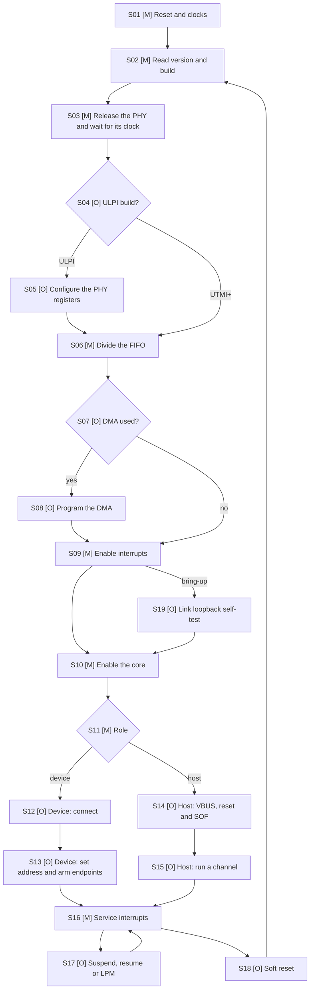

# USB 2.0 Controller Design Specification

> **Purpose:** Normative design contract for architecture, RTL, verification, DFT, and physical integration of this IP.
>
> Replace every angle-bracket placeholder. Mark inapplicable sections **N/A** with a reason. Do not silently omit a required decision. Use **TBD** only with its technical impact and the decision needed recorded in [Assumptions, dependencies, and decisions](#20-assumptions-dependencies-and-decisions).
>
> Requirement terms: **shall** = mandatory and testable; **should** = recommended; **may** = optional. Give every mandatory requirement a stable REQ-<AREA>-<NNN> identifier and a verification method.

## Document map

1. [Purpose, scope, and product context](#1-purpose-scope-and-product-context)
2. [Normative references and precedence](#2-normative-references-and-precedence)
3. [Requirements and traceability](#3-requirements-and-traceability)
4. [Features and configurations](#4-features-and-configurations)
5. [Architecture](#5-architecture)
6. [External interfaces and ports](#6-external-interfaces-and-ports)
7. [Clock, reset, and power](#7-clock-reset-and-power)
8. [Parameters and elaboration configurations](#8-parameters-and-elaboration-configurations)
9. [Data representation and arithmetic](#9-data-representation-and-arithmetic)
10. [Detailed functional behavior](#10-detailed-functional-behavior)
11. [Register and programming model (CSR from workbook)](#11-register-and-programming-model)
12. [Error handling and recovery](#12-error-handling-and-recovery)
13. [Performance, power, and area](#13-performance-power-and-area)
14. [RTL implementation contract](#14-rtl-implementation-contract)
15. [Verification specification](#15-verification-specification)
16. [DFT and testability](#16-dft-and-testability)
17. [Physical design and timing integration](#17-physical-design-and-timing-integration)
18. [Security, safety, and reliability](#18-security-safety-and-reliability)
19. [Requirement-to-verification traceability](#19-requirement-to-verification-traceability)
20. [Assumptions, dependencies, and decisions](#20-assumptions-dependencies-and-decisions)
21. [Glossary](#21-glossary)
22. [References used to shape this template](#22-references-used-to-shape-this-template)

## 1. Purpose, scope, and product context

### 1.1 Purpose and scope

The USB 2.0 Controller is a synthesizable digital link layer that lets an SoC act as a USB 2.0 device, a USB 2.0 host, or a dual-role port that becomes host or device from the plug type read from the PHY. It implements the packet layer, transaction engines, speed negotiation, suspend and resume, and data buffering of the USB 2.0 specification (REF-001), and connects to an external or on-chip PHY through UTMI+ (REF-006) or ULPI (REF-007). Software reaches it through an APB4 register block and moves payload through a shared FIFO RAM that either an internal AXI4 master DMA or an external DMA controller serves. The role, the PHY interface, the data interface, the number of endpoints and host channels, the FIFO depth, Link Power Management (LPM) and host split transactions are build-time choices, so one source serves a small device-only part and a full dual-role part.

**Included:** device role (high-speed and full-speed); host role (high-speed, full-speed and low-speed); dual-role selection by the ID indication of the PHY without HNP, SRP or ADP; UTMI+ interface (8-bit or 16-bit) and ULPI 8-bit single-data-rate interface including PHY register access; token, data and handshake packet processing, CRC5 and CRC16, data toggle, PING and NYET flow control, SOF and microframe generation and tracking; high-bandwidth isochronous endpoints; chirp-based high-speed detection for both roles; suspend, resume and remote wakeup; USB 2.0 test modes; optional LPM L1; optional host split transactions; shared dynamic FIFO RAM with optional double buffering; optional descriptor-based scatter-gather DMA; automatic zero-length packet and end-on-short-packet termination; host interval polling; isochronous incomplete flags; port over-current protection; link loopback; AXI4 master DMA or AXI4 slave FIFO port with external DMA request and acknowledge; APB4 control and status registers; one interrupt output; scan-based DFT support.

**Excluded:** the PHY, the analog transceiver and the pad cells; USB hub function and hub controller; On-The-Go HNP, SRP and ADP protocols; battery charging detection (BC 1.2); HSIC and inter-chip variants; UTMI+ FsLsSerialMode and ULPI serial, carkit, 4-bit and double-data-rate modes; USB class drivers, descriptors and enumeration software; VBUS power switch and charge pump; external memory beyond the FIFO RAM; USB 3.x.

### 1.2 Deployment assumptions

| Item | Specification |
|---|---|
| Target SoC / product class | Application SoC or microcontroller of a multirotor drone: a flight-controller class part that acts as USB device (CDC-ACM telemetry, firmware update) and as host for a companion camera or modem; a USB 2.0 hub-less point-to-point or one-hub topology (user answer 2026-11-20, ASM-006) |
| Technology / library assumptions | Synthesizable SystemVerilog under VLSIT RTL Design Rules v2; ASIC standard-cell flow; FIFO RAM is a single-port 1RW SRAM macro or inferred memory wrapped as `u_dont_touch_sram`; no technology-specific cell outside the library wrappers |
| Operating modes and workload | High-speed 480 Mb/s, full-speed 12 Mb/s and, in host role, low-speed 1.5 Mb/s; payload up to 24.576 MB/s of isochronous traffic (three 1024-byte transactions per 125 us microframe, REF-001 section 5.9.2) and bulk traffic limited by the FIFO RAM and the DMA |
| Security / privilege context | CSR access privilege check through `i_protect_en` and PPROT[1]; no secure data path (section 18) |
| External dependencies | USB 2.0 PHY with UTMI+ or ULPI interface that supplies the interface clock (ASM-009); system AXI4 interconnect or external DMA controller; clock and reset controller; software USB stack; FIFO RAM macro (DEP-004) |

### 1.3 Feature summary

| Feature ID | Feature | Required / optional | Configuration condition | Requirements |
|---|---|---|---|---|
| FEAT-001 | USB 2.0 device role, high-speed and full-speed | Optional | PARA_USB2_ROLE = 0 or 2 | REQ-FUNC-001, REQ-FUNC-002, REQ-FUNC-003, REQ-FUNC-004, REQ-FUNC-005, REQ-FUNC-006, REQ-FUNC-007, REQ-FUNC-008, REQ-FUNC-013, REQ-FUNC-024 |
| FEAT-002 | USB 2.0 host role, high-speed, full-speed and low-speed | Optional | PARA_USB2_ROLE = 1 or 2 | REQ-FUNC-010, REQ-FUNC-011, REQ-FUNC-012, REQ-FUNC-014, REQ-FUNC-015, REQ-FUNC-016 |
| FEAT-003 | Dual-role selection by the PHY ID indication, no HNP, SRP or ADP | Optional | PARA_USB2_ROLE = 2 | REQ-FUNC-023 |
| FEAT-004 | UTMI+ PHY interface, 8-bit or 16-bit | Optional | wrapper `m_usb2_top_utmi_*`, PARA_USB2_PHY_IF = 0 | REQ-IF-001, REQ-IF-002 |
| FEAT-005 | ULPI 8-bit SDR PHY interface with PHY register access | Optional | wrapper `m_usb2_top_ulpi_*`, PARA_USB2_PHY_IF = 1 | REQ-IF-003, REQ-IF-004 |
| FEAT-006 | Shared dynamic FIFO RAM | Required | Always present | REQ-FUNC-026, REQ-FUNC-027 |
| FEAT-007 | AXI4 master DMA | Optional | wrapper `m_usb2_top_*_axim`, PARA_USB2_DATA_IF = 0 | REQ-IF-006, REQ-PERF-001 |
| FEAT-008 | AXI4 slave FIFO port with external DMA request and acknowledge | Optional | wrapper `m_usb2_top_*_axis`, PARA_USB2_DATA_IF = 1 | REQ-IF-007, REQ-IF-009 |
| FEAT-009 | Configurable number of endpoints and host channels | Required | PARA_USB2_NUM_EP, PARA_USB2_NUM_HC | REQ-FUNC-028, REQ-PARAM-001 |
| FEAT-010 | Link Power Management, L1 sleep | Optional | PARA_USB2_LPM_EN = 1 | REQ-FUNC-021 |
| FEAT-011 | Host split transactions | Optional | PARA_USB2_SPLIT_EN = 1 and PARA_USB2_ROLE = 1 or 2 | REQ-FUNC-017 |
| FEAT-012 | Suspend, resume and remote wakeup | Required | Always present | REQ-FUNC-018, REQ-FUNC-019, REQ-FUNC-020 |
| FEAT-013 | USB 2.0 test modes | Required | Always present | REQ-FUNC-022 |
| FEAT-014 | Interrupt reporting | Required | Always present | REQ-IF-008, REQ-ERR-001 |
| FEAT-015 | APB4 control and status registers | Required | Always present | REQ-IF-005, REQ-REG-001 |
| FEAT-016 | High-bandwidth isochronous endpoints | Required | Always present (ASM-005) | REQ-FUNC-009 |
| FEAT-017 | Double-buffered endpoints and channels | Optional | PARA_USB2_DBUF_EN = 1 | REQ-FUNC-029 |
| FEAT-018 | Automatic zero-length packet and end-on-short-packet termination | Required | Always present | REQ-FUNC-030, REQ-FUNC-031 |
| FEAT-019 | Host interval polling of interrupt and isochronous channels | Required | Host roles | REQ-FUNC-032 |
| FEAT-020 | Isochronous incomplete and missed-transfer flags | Required | Always present | REQ-FUNC-033 |
| FEAT-021 | Port over-current protection and VBUS switch control | Required | Host roles | REQ-FUNC-034, REQ-IF-010 |
| FEAT-022 | Link loopback for bring-up | Required | Always present | REQ-FUNC-035 |
| FEAT-023 | Descriptor-based scatter-gather DMA | Optional | PARA_USB2_SG_EN = 1 and PARA_USB2_DATA_IF = 0 | REQ-FUNC-036 |

### 1.4 Real-world applications of the features

| Feature ID | Real-world application (named system, example product) | What the application needs from the feature | Typical values | Consequence if missing or wrong | Requirements | Source |
|---|---|---|---|---|---|---|
| FEAT-001 | Flight controller board of a multirotor drone (autopilot class, for example a Pixhawk-class board) connected to a ground-station PC: CDC-ACM virtual serial port carrying MAVLink telemetry and a DFU or mass-storage path for firmware and log transfer | A device that enumerates at high-speed, falls back to full-speed on a full-speed host, and sustains bulk IN and OUT endpoints without loss | MAVLink at 921600 baud is about 92 KB/s; firmware image of 1 MB takes about 20 s at 50 KB/s; 6 endpoints (CDC data in/out, CDC notification, DFU or MSC in/out) | The ground-station cannot connect, telemetry drops, or the firmware update fails and the drone cannot be flown | REQ-FUNC-001 to REQ-FUNC-008, REQ-FUNC-013, REQ-FUNC-024 | user answer 2026-11-20 (option A); numbers ASM-006 |
| FEAT-002 | Companion computer link on the same drone: SoC as host for a USB video-class (UVC) camera and an LTE modem | A host that resets and chirps a high-speed device, issues SOF every 125 us and schedules isochronous IN transfers before bulk traffic | UVC isochronous IN 1 to 3 transactions of up to 1024 bytes per microframe (up to 24.576 MB/s); an MJPEG 720p30 stream is a few MB/s (ASM-006) | Camera frames are dropped or the device is not recognized, and the payload video link fails | REQ-FUNC-010 to REQ-FUNC-016 | user answer 2026-11-20 (option A); numbers ASM-006 |
| FEAT-003 | Single micro-AB connector of a drone flight controller: an A-plug cable (camera) makes it host, a B-plug cable to a PC makes it device | Role chosen from the ID indication of the PHY, role changes only after the cable is removed, no negotiation protocol | ID debounce within 50 ms of IdPullup (UTMI+ section 2.2.1); one role per attachment | The port stays in the wrong role and a camera or PC is not recognized | REQ-FUNC-023 | user answer 2026-11-20 (dual-role by ID pin, no HNP/SRP) |
| FEAT-004 | Drone application SoC with an on-chip high-speed PHY macro whose digital side is UTMI+ | Parallel 8-bit data interface at 60 MHz or 16-bit at 30 MHz, with LineState filtering and TXReady handshake | 8-bit 60 MHz = 480 Mb/s; 16-bit 30 MHz = 480 Mb/s (REF-006 Table 1) | The link cannot meet the 8 to 192 bit-time turnaround limits or mis-times chirp, and high-speed negotiation fails | REQ-IF-001, REQ-IF-002 | user answer 2026-11-20 (UTMI+ or ULPI per build), UTMI+ spec |
| FEAT-005 | Drone autopilot that uses an external ULPI PHY chip to save pins | 8 or 12 signal pin interface with a PHY-supplied 60 MHz clock and PHY register access to set up the transceiver | 12 signals: clock, dir, nxt, stp, data[7:0] (REF-007 section 3) | The PHY cannot be configured and the link never reaches high-speed | REQ-IF-003, REQ-IF-004 | user answer 2026-11-20, ULPI spec |
| FEAT-006 | Flight controller device with 6 endpoints sharing one RAM | One RAM split dynamically among Rx, Tx and host channels so the camera host and the telemetry device never need dedicated buffers | 4 KB default (PARA_USB2_FIFO_DEPTH = 1024 words); isochronous endpoint needs 1024 bytes per transaction | Buffer overflow loses data or the RAM is oversized | REQ-FUNC-026, REQ-FUNC-027 | user answer 2026-11-20 (shared RAM), DWC_otg databook as design reference |
| FEAT-007 | Drone SoC with an AXI interconnect and no spare DMA channel: the controller moves camera payload to DDR | Bursts of up to 16 beats, 4 KB boundary respect, error response reporting | 16 beats x 4 bytes = 64 bytes per burst; 24.576 MB/s needs at least 1 burst per 2.6 us | Camera payload overruns the FIFO and the CPU copies data at high load | REQ-IF-006, REQ-PERF-001 | user answer 2026-11-20 (AXI4 master DMA) |
| FEAT-008 | Drone SoC whose system DMA controller already serves other peripherals | Per-channel request and acknowledge handshake so the shared DMA controller moves telemetry data | 4 channels by default, one burst per acknowledge pulse | The shared DMA controller cannot serve USB or a channel is starved | REQ-IF-007, REQ-IF-009 | user answer 2026-11-20 ("AXI4 slave with DMA handshake") |
| FEAT-009 | Flight controller (6 endpoints) versus companion host (8 channels) | Area scales with the number of endpoints and channels the product really uses | 1 to 15 endpoints besides EP0, 1 to 16 host channels | Unused endpoints waste gates, too few endpoints block a function | REQ-FUNC-028, REQ-PARAM-001 | user answer 2026-11-20 (option A) |
| FEAT-010 | Battery-powered payload camera on a drone that sleeps between frames | Entry to L1 sleep with a resume latency far shorter than L2 suspend | HIRD 0000B = 50 us, each step adds 75 us (REF-008 section 4.1) | Payload draws more power and cuts flight time | REQ-FUNC-021 | user answer 2026-11-20 (LPM option) |
| FEAT-011 | Drone SoC host reaching a full-speed LTE modem or a low-speed RC dongle behind one high-speed hub | Start-split and complete-split transactions with the hub transaction translator | SPLIT token PID 1000B; one hub between host and device | Full-speed and low-speed devices behind a high-speed hub are not reachable | REQ-FUNC-017 | user answer 2026-11-20 (split option) |
| FEAT-012 | Drone ground-station link that suspends when the drone is idle | Detect idle for 3.0 ms, suspend within 10 ms, wake by remote wakeup within the limits | idle 3.0 ms, resume 20 ms, remote wake 1 to 15 ms (REF-001 section 7.1.7) | The host puts the device into an unresponsive state or fails the compliance test | REQ-FUNC-018 to REQ-FUNC-020 | USB 2.0 section 7.1.7.6 and 7.1.7.7 |
| FEAT-013 | Product USB-IF high-speed compliance test of the flight controller | Test_J, Test_K, Test_SE0_NAK and Test_Packet on command | test packet of REF-001 section 7.1.20 repeated until the exit action | The board cannot be certified | REQ-FUNC-022 | USB 2.0 section 7.1.20 |
| FEAT-014 | Interrupt controller of the drone SoC servicing the USB stack | One level interrupt with per-cause status | one output, causes listed in section 6.4 | The driver polls and misses events | REQ-IF-008, REQ-ERR-001 | user answer 2026-11-20 (single interrupt), ASM-013 |
| FEAT-015 | SoC peripheral bus of the drone SoC | APB4 access to control, status and FIFO configuration | 32-bit data, 16-bit address, one wait state | Software cannot configure the controller | REQ-IF-005, REQ-REG-001 | user answer 2026-11-20 (APB4 CSR) |
| FEAT-016 | UVC camera isochronous stream and audio streaming from a companion | Up to three transactions per microframe with DATA2, DATA1, DATA0 or MDATA sequencing | 3 x 1024 bytes per 125 us = 24.576 MB/s | Video resolution is limited to less than a high-bandwidth stream | REQ-FUNC-009 | USB 2.0 section 5.9.2, ASM-005 |
| FEAT-017 | UVC camera and bulk streams of the companion link, a high-speed bulk packet of 512 bytes every 8.5 us at 60 MB/s | Two packet buffers per endpoint or channel so that the DMA or software refills one while the bus uses the other | 2 buffers of 512 bytes per bulk endpoint; refill time of one packet 8.5 us (512 bytes at 60 MB/s) | NAK storms and lost isochronous packets when the buffer is not refilled within one packet time | REQ-FUNC-029 | user answer 2026-11-20 (all six candidates); double buffering exists in the RP2040 USB controller (reference SoC manual, ASM-024) |
| FEAT-018 | CDC-ACM virtual serial port of the flight controller carrying MAVLink messages, and bulk file transfer | A message that is an exact multiple of the maximum packet size (64 bytes full-speed, 512 bytes high-speed) must end with a zero-length packet; unknown-length receive must end on a short packet | 128-byte message on a 64-byte endpoint; 1024-byte transfer on a 512-byte endpoint | The host waits for more data and the message is never delivered, or software must add the packet by hand | REQ-FUNC-030, REQ-FUNC-031 | REF-001 section 5.8.3 (transfer ends with a short or zero-length packet); TI AM335x mentions short-packet termination modes (ASM-024) |
| FEAT-019 | HID joystick, hub status and UVC control endpoints polled by the host of the drone companion link | Hardware issues the transaction of each periodic channel once per interval so the CPU does not wake every (micro)frame | interval of 1 to 65535 microframes (high-speed) or frames (full-speed); 8 channels; 125 us microframe | The CPU wakes every 125 us per polled endpoint, or a poll is missed and latency grows | REQ-FUNC-032 | user answer 2026-11-20; RP2040 polls up to 15 interrupt endpoints in hardware (reference SoC manual, ASM-024) |
| FEAT-020 | UVC camera isochronous stream at 30 frames per second on the companion link | A flag for each microframe in which an isochronous transfer was incomplete or missed, so the driver drops a damaged frame instead of showing it | one microframe = 125 us; 8000 microframes per second | A damaged video frame is shown to the operator or a stale frame is used for visual navigation | REQ-FUNC-033 | REF-001 section 5.6 (no retry of isochronous data); user answer 2026-11-20 |
| FEAT-021 | 5 V rail of a USB camera or LTE modem powered from the drone battery through a load switch with an over-current flag | The port power switch is cut and software is informed when the load switch reports over-current | switch off within 2 CLK-BUS cycles after a filtered flag of 16 CLK-BUS cycles | A shorted camera cable pulls down the supply of the flight controller, with loss of flight control | REQ-FUNC-034, REQ-IF-010 | REF-001 section 7.2.1.2.1 (host shall implement over-current protection); user answer 2026-11-20 |
| FEAT-022 | Board bring-up of the flight controller before the USB PHY is wired or its clock is stable | Packets sent by the link return to the receiver with PID and CRC checked, with counters for good and bad packets | 12-bit counters, 4095 packets | Link defects are found only with the PHY and a bus analyzer, which delays bring-up | REQ-FUNC-035 | user answer 2026-11-20; TI AM335x has a UTMI loopback test mode (reference SoC manual, ASM-024) |
| FEAT-023 | UVC video payload of 24.576 MB/s moved to DDR on the companion link | A descriptor list lets the DMA move many packets and interrupt once per list instead of once per packet | 64 KB per list means about 375 interrupts per second instead of 24 000 | The CPU load of per-packet interrupts starves the flight controller tasks | REQ-FUNC-036 | user answer 2026-11-20; ESP32-S3 and TI AM335x provide scatter-gather or descriptor DMA (reference SoC manuals, ASM-024) |

## 2. Normative references and precedence

### 2.1 Normative references

| Ref ID | Document and revision | Applicable clauses | Authority / notes |
|---|---|---|---|
| REF-001 | Universal Serial Bus Specification, Revision 2.0, April 27 2000, with ECNs of the usb_20_20240927 package (`reference/md_doc/vlsit_usb_usb_2_0_spec.md`) | chapter 5, 7.1.7, 7.1.18, 7.1.20, 8, 9, 11.17 to 11.21 | USB protocol authority |
| REF-002 | On-The-Go and Embedded Host Supplement to USB 2.0, Revision 2.0 version 1.1a (`vlsit_usb_otg_eh_2_0_v1_1a.md`) | ID pin, A-device and B-device roles | Dual-role plug behavior; HNP, SRP and ADP excluded |
| REF-003 | VLSIT RTL Design Rules v2, VLSIT_RTL_Design_Rule.md (same folder as the template) | All applicable rules | Mandatory RTL coding, hierarchy, reset, CDC, and naming baseline |
| REF-004 | IEEE 1800-2017 SystemVerilog | Synthesizable subset | Subject to REF-003 and selected frontend support |
| REF-005 | VLSIT CSR Specification Template workbook `VLSIT_USB20_CONTROLLER_CSR.xlsx` | Configuration and register definition sheets | Sole authority for the register interface (section 11) |
| REF-006 | UTMI+ Specification, Revision 1.0, February 25 2004 (`vlsit_utmi_plus_spec_1_0.md`) and USB 2.0 Transceiver Macrocell Interface (UTMI) Specification, Version 1.05, 3/29/2001 (`vlsit_utmi_spec_1_05.md`) | levels 0 to 3, signal definitions, LineState filtering | UTMI+ interface authority; level 0 is UTMI 1.05 |
| REF-007 | UTMI+ Low Pin Interface (ULPI) Specification, Revision 1.1, October 20 2004 (`vlsit_ulpi_spec_1_1.md`) | TX CMD, RX CMD, register set, low power mode | ULPI interface authority |
| REF-008 | USB 2.0 Link Power Management Addendum ECN (`vlsit_usb_usb2_lpm_ecn.md`) | sections 1, 2, 4 | LPM extended transaction and L1 |
| REF-009 | AMBA APB Protocol Specification, Arm IHI 0024 Issue D (`vlsit_apb_amba_apb_ihi0024d.md`) | APB4 | CSR bus authority |
| REF-010 | AMBA AXI Protocol Specification v1.0 (AXI3 era, `vlsit_axi_amba_axi_ihi0022b_v1_0.md`) | burst rules, channel handshake | The only AXI text available; the profile is limited to its behavior and uses no AXI4-only feature (ASM-007) |
| REF-011 | DWC_otg USB 2.0 Hi-Speed OTG Databook 5.00b, Synopsys, July 2024 | chapter 3 Configuration Parameters | Design reference for configuration choices only; not copied and not normative |
| REF-012 | TI AM335x Technical Reference Manual, spruh73q, chapter 16 USB; Espressif ESP32-S3 Technical Reference Manual v1.8, chapter 32; Raspberry Pi RP2040 Datasheet, section 4.1 | feature lists only | Reference SoC manuals read on 2026-11-20 for the features of FEAT-017 to FEAT-023; not copied, not normative, copyright holders restrict redistribution |
| REF-013 | TI TUSB1210 Stand-Alone USB Transceiver Chip Silicon, data sheet SLLSE09J, November 2009, revised July 2021 | sections 5, 6.6, 6.7, 6.13, 6.14, 7.3.1.1, 7.4.1, 7.5 | External ULPI PHY of the integration example of section 14.5; read on 2026-11-25; not normative for the IP |
| REF-014 | Microchip USB3320 Hi-Speed USB 2.0 ULPI transceiver, data sheet DS00001792E (`research/phy_microchip_usb3320.md`) | Table 5-1 (= ULPI 1.1 Table 40), 6.2.4.4, 6.2.4.5 | Defined PHY rows; OpMode 11b optional and not implemented; read on 2026-11-25; not normative for the IP, copyright of Microchip |
| REF-015 | Microchip USB3500 Hi-Speed USB host, device or OTG PHY with UTMI+ interface, data sheet DS00002103A (`research/phy_microchip_usb3500.md`) | Table 2-1 (OpMode), Table 5-1, 6.2, 6.4 | UTMI+ PHY rows and OpMode 11b reserved; read on 2026-11-25 |
| REF-016 | USB 2.0 Transceiver Macrocell Interface (UTMI) Specification, Version 1.05, Intel, 3/29/2001 (official copy, `research/utmi_1_05_intel.md`) | 4.1 OpMode, 5.16 operational modes | OpMode 0 to 2, 3 reserved, mode 1 soft disconnect; read on 2026-11-25 |

### ECN applicability (USB 2.0 package, 2024-09-27)

| ECN | Applies to this IP | Effect |
|---|---|---|
| TEST_MODE selector values | Yes | Selectors 0x06 and 0x07 reserved for OTG and EH compliance; the IP uses 0x01 to 0x05 (REQ-FUNC-022) |
| Phase-locked SOFs | Yes (host) | REQ-FUNC-037 |
| Link Power Management | Yes (optional) | REF-008, REQ-FUNC-021 |
| Double Isochronous IN bandwidth | No | Only for directly connected inbox eUSB2 devices; the IP supports up to three transactions per microframe |
| Suspend current limit | No | Concerns the supply current of devices, which is a board and PHY property |
| Connect timing update | Partly | The soft-connect timing after attach is a software rule of the driver (S12 of section 11.2) |
| Other ECNs of the package (connector, cable, HSIC, eUSB2 repeater, inter-chip) | No | Mechanical, electrical or other interfaces outside the scope |

### 2.2 Source-of-truth and conflict handling

1. The selected external protocol revision defines protocol behavior for the declared interface profile.
2. Approved product requirements and decisions (section 20) define product-specific behavior.
3. This specification defines the IP contract and shall remain consistent with the selected protocol and the VLSIT RTL Design Rules v2.
4. REF-003 is the mandatory RTL coding, hierarchy, reset, CDC, and naming baseline. If a proposed requirement conflicts with it, revise the specification requirement or choose a compliant implementation; do not create a local RTL exception.
5. REF-005 is the only place where CSRs are specified. Do not declare registers, fields, offsets, access types, or reset values in this specification.
6. The USB 2.0 specification REF-001 wins over UTMI+, ULPI and the LPM addendum on bus behavior; REF-008 overrides the PID table 8-1 of REF-001 with its Table 2-1 (EXT PID 0000B).
7. Record the exact protocol revision, role, and optional-signal configuration. Do not include protocol signals absent from the selected revision/profile.
8. Resolve conflicts through an explicit product decision; do not guess or weaken a requirement.

**Naming rule:** the default naming rule of vlsit-rtl-generator (VLSIT_RTL_Design_Rule.md v2, section 2), path `C:\Users\PC\.claude\skills\vlsit-asic-ip-microspec\reference\templates\VLSIT_RTL_Design_Rule.md`, version v2 (rule R-026, user answer 2026-11-20). The UTMI+ signal SuspendM is named `o_utmi_suspend_n` because NAM-05 gives active-low signals the suffix `_n`.

### 2.3 Compliance declaration

| Standard | Revision / profile | Role implemented | Options | Deviations |
|---|---|---|---|---|
| USB 2.0 | Revision 2.0 with ECNs | Device (HS, FS) and host (HS, FS, LS) | high-bandwidth isochronous, PING, optional LPM and split | None declared; certification is not claimed |
| UTMI+ | Revision 1.0, levels 0 to 3 as needed by the role | Link side (SIE) | 8-bit and 16-bit interface; level 0 for device, level 1 for host HS/FS, level 2 for host LS, level 3 when PARA_USB2_SPLIT_EN = 1 | FsLsSerialMode not used |
| ULPI | Revision 1.1, 8-bit SDR synchronous mode | Link side | PHY supplies the 60 MHz clock; register access; low power mode for suspend (REQ-IF-011) | 4-bit, DDR, serial, carkit and link-supplied clock modes not used |
| AMBA APB | APB4 (Issue D) | Completer | PSTRB, PPROT, PSLVERR used | None |
| AMBA AXI | Behavior of the AXI3 text REF-010 (IHI 0022 v1.0) as a subset that is also legal in AXI4 | Manager (DATA_IF = 0) or Subordinate (DATA_IF = 1) | INCR bursts of at most 16 beats; no lock, QoS, region or user; no AXI4-only feature | ASM-007 |
| LPM addendum | ECN of the usb_20_20240927 package | Device and host | L1 only | None |

## 3. Requirements and traceability

| ID | Requirement using shall/should/may | Source | Applies to | Verification method |
|---|---|---|---|---|
| REQ-FUNC-001 | The device shall reset its function address to 0, shall hold a 7-bit programmable address, and shall ignore any token whose address or endpoint field does not match an initialized endpoint. | REF-001 section 8.3.2 | Device roles | Simulation |
| REQ-FUNC-002 | The controller shall decode the full PID field and shall ignore every packet whose PID check bits are not the one's complement of the PID bits or whose PID is undefined; a device shall not respond to a valid PID for a transaction type or direction it does not support. | REF-001 section 8.3.1 | All roles | Simulation, assertion |
| REQ-FUNC-003 | The controller shall compute CRC5 (polynomial X^5+X^2+1, residual 01100B) over token ADDR and ENDP or SOF frame number and CRC16 (polynomial X^16+X^15+X^2+1, residual 1000000000001101B) over the data field, seeded with all ones, before bit stuffing and after bit unstuffing, and shall ignore the protected fields of a packet with a failed CRC. | REF-001 section 8.3.5 | All roles | Simulation, directed vectors |
| REQ-FUNC-004 | The controller shall keep data-toggle sequence bits per endpoint and direction, shall accept the DATA0 data stage of a SETUP transaction, return ACK and set its sequence bit so that host and device sequence bits are equal at the end of the SETUP, and shall retry with the same toggle when no handshake is received. | REF-001 section 8.6 | All roles | Simulation |
| REQ-FUNC-005 | A high-speed device bulk or control OUT endpoint shall answer PING with ACK or NAK and shall answer OUT data with NYET when it accepts the data but cannot accept another maximum packet. | REF-001 section 8.5.1, Table 8-1 | Device roles | Simulation |
| REQ-FUNC-006 | A device shall wait at least 8 bit times in high-speed (2 bit times in full-speed) after a received packet and shall start its response within 192 bit times (6.5 bit times full-speed, detachable cable). | REF-001 section 7.1.18 | Device roles | Simulation with timing checker |
| REQ-FUNC-007 | Endpoint 0 shall always be present as a control endpoint, and the build parameter shall select the number of additional endpoints. | REF-001 section 5.3.1.1 | Device roles | Elaboration, simulation |
| REQ-FUNC-008 | The data field shall be 0 to 1024 bytes in integral bytes; in low-speed the data payload shall not exceed 8 bytes. | REF-001 section 8.3.4, 8.4.4 | All roles | Simulation |
| REQ-FUNC-009 | The controller shall support up to three transactions per microframe for high-bandwidth isochronous endpoints using the DATA2, DATA1, DATA0 and MDATA PIDs. | REF-001 section 5.9.2, Table 8-1 | All roles | Simulation |
| REQ-FUNC-010 | The host shall transmit an SOF packet every 1.00 ms +/- 0.0005 ms in full-speed and every 125 us +/- 0.0625 us in high-speed, with an 11-bit frame number that rolls over after 7FFH and repeats eight times in high-speed. | REF-001 section 8.3.3, 8.4.3 | Host roles | Simulation |
| REQ-FUNC-011 | The host root port shall drive reset for at least 50 ms in total, with each SE0 assertion at least 10 ms and gaps shorter than 3 ms, and shall allow 10 ms reset recovery before the first request. | REF-001 section 7.1.7.5 | Host roles | Simulation |
| REQ-FUNC-012 | The host shall run the high-speed detection handshake: detect the device Chirp K for at least 2.5 us, start the alternating Chirp K and Chirp J within 100 us of the end of the device chirp, hold each chirp 40 to 60 us, and end the sequence 100 to 500 us before reset end. | REF-001 section 7.1.7.5 | Host roles | Simulation |
| REQ-FUNC-013 | A high-speed capable device shall send Chirp K for 1.0 to 7.0 ms starting from reset time T0, shall move to the high-speed Default state within 500 us of detecting K-J-K-J-K-J, and shall return to full-speed Default if the sequence is not seen 1.0 to 2.5 ms after its own chirp. | REF-001 section 7.1.7.5 | Device roles | Simulation |
| REQ-FUNC-014 | After receiving a packet the host shall wait at least 8 bit times in high-speed before transmitting, shall keep at least 88 bit times between its own back-to-back packets and at most 192 bit times for a response; in full-speed and low-speed the host shall provide at least 2 bit times of J and at most 7.5 bit times for a response. | REF-001 section 7.1.18 | Host roles | Simulation with timing checker |
| REQ-FUNC-015 | The host shall schedule the periodic (isochronous and interrupt) channels of a (micro)frame before the non-periodic channels, shall not start a transaction that cannot finish before the next SOF, shall keep periodic transactions within 80 % of a high-speed microframe and 90 % of a full-speed or low-speed frame, and shall refuse to arm a periodic channel that would exceed the limit (ch_en is cleared and frm_ovr is set). | REF-001 section 5.7.4 | Host roles | Simulation |
| REQ-FUNC-016 | The host shall detect disconnect and connect in full-speed and low-speed by SE0 or non-SE0 for 2.5 us and in high-speed by the PHY HostDisconnect indication evaluated at each SOF, and shall switch to full-speed on a high-speed disconnect. | REF-006 section 2.2.1.10, REF-001 section 7.1.7.3 | Host roles | Simulation |
| REQ-FUNC-017 | When PARA_USB2_SPLIT_EN = 1 the host shall issue start-split and complete-split transactions with the SPLIT token (PID 1000B), shall accept NYET and the ERR handshake from the hub, and shall use the UTMI+ level 3 preamble path for low-speed devices behind a hub. | REF-001 section 8.4.2, 11.17 to 11.21; REF-006 section 2 | Host roles with split | Simulation |
| REQ-FUNC-018 | A device shall enter suspend after more than 3.0 ms of constant idle and shall draw suspend current within 10 ms of bus inactivity; a high-speed device shall revert to full-speed no later than 3.125 ms after the start of idle and sample the line 100 to 875 us after reversion. | REF-001 section 7.1.7.6 | Device roles | Simulation |
| REQ-FUNC-019 | A device with remote wakeup enabled shall wait until the bus has been idle for 5 ms before driving resume and shall drive resume for 1 to 15 ms. | REF-001 section 7.1.7.7 | Device roles | Simulation |
| REQ-FUNC-020 | The host shall drive resume for at least 20 ms, end it with a low-speed EOP when the port was in low-speed or full-speed or with a transition to high-speed idle when it was in high-speed, and shall send SOF within 3 ms afterward. | REF-001 section 7.1.7.7 | Host roles | Simulation |
| REQ-FUNC-021 | When PARA_USB2_LPM_EN = 1 the controller shall decode the EXT token (PID 0000B) followed by the LPM token (SubPID 0011B) with bmAttributes bLinkState, HIRD and bRemoteWake, and shall answer with a handshake, shall begin L1 within 10 us after sending the ACK, and as host shall issue the LPM transaction and wait at least 10 us after the end of resume signaling before addressing the device (values as read from a partly garbled table of REF-008, ASM-001). | REF-008 sections 2.1, 2.2, 4.1 | LPM builds | Simulation |
| REQ-FUNC-022 | The controller shall support the test selectors 0x01 Test_J, 0x02 Test_K, 0x03 Test_SE0_NAK, 0x04 Test_Packet and, for the host port only, 0x05 Test_Force_Enable; a device shall enter the selected mode no later than 3 ms after the status stage of SetFeature(TEST_MODE), shall answer an invalid selector with a request error, and shall leave the mode only by power cycle or reset of i_rst_n_phy; Test_Packet shall send the packet of REF-001 section 7.1.20 repeatedly and Test_SE0_NAK shall answer valid IN tokens with NAK. | REF-001 sections 7.1.20, 9.4.9; USB ECN TEST_MODE selector values | All roles | Simulation |
| REQ-FUNC-023 | In dual-role builds the controller shall act as host when the ID indication is mini-A, as device when it is mini-B, shall change role only after session end and detach, and shall let a CSR field override the PHY indication. | REF-002; REF-006 section 2.2.1; user answer 2026-11-20 | PARA_USB2_ROLE = 2 | Simulation |
| REQ-FUNC-024 | A device shall come out of reset in high-speed only when the chirp handshake succeeds and otherwise in full-speed. | REF-001 section 7.1.7.5 | Device roles | Simulation |
| REQ-FUNC-025 | The controller shall treat the loss of an expected response as a transaction error: in high-speed a device or host shall not time out before 736 bit times and shall time out within 816 bit times after the end of the packet (92 to 102 cycles of a 60 MHz CLK-PHY, 46 to 51 cycles at 30 MHz); in full-speed and low-speed a device shall time out between 16 and 18 bit times and a host shall wait at least 18 bit times; a host that signals an error by timeout shall wait the full time before the next token. | REF-001 sections 7.1.19.1, 7.1.19.2, 8.7.2 | All roles | Simulation with timing checker |
| REQ-FUNC-026 | The FIFO RAM shall be one memory that software divides into receive, transmit and host-channel regions through the CSR. | User answer 2026-11-20 | All roles | Simulation |
| REQ-FUNC-027 | The FIFO manager shall never let the packet engine read data that was not written or overwrite unread data, and shall answer NAK (device) or defer the channel (host) when no space or data exists. | REF-001 section 8.4.6 | All roles | Assertion, simulation |
| REQ-FUNC-028 | The number of device endpoints and host channels shall follow PARA_USB2_NUM_EP and PARA_USB2_NUM_HC, and unused logic shall be absent. | User answer 2026-11-20 | All roles | Elaboration, lint |
| REQ-FUNC-029 | When PARA_USB2_DBUF_EN = 1 and the dbuf field of an endpoint or channel is 1, the FIFO manager shall split its region into two packet buffers, shall fill or drain one while the bus side uses the other, shall swap them at the end of each packet, and shall report the buffer in use in buf_cur. | User answer 2026-11-20 | All roles with DBUF | Simulation |
| REQ-FUNC-030 | With zlp_en = 1 an IN endpoint or OUT channel shall send one zero-length packet after the last full packet when the transfer size is a non-zero multiple of the maximum packet size. | REF-001 section 5.8.3 | All roles | Simulation |
| REQ-FUNC-031 | With short_end = 1 an OUT endpoint or IN channel shall end the transfer at the first packet whose payload is shorter than the maximum packet size or is zero length, set the done flag, and leave the number of bytes not received in xsize. | REF-001 section 5.8.3 | All roles | Simulation |
| REQ-FUNC-032 | With poll_en = 1 a host channel shall issue its transaction once every interval microframes (high-speed) or frames (full-speed and low-speed), shall retry a NAK or NYET in the next interval, shall re-arm itself after a completed transfer when poll_rep = 1, and shall set poll_miss when the previous packet was not consumed at the next interval. | ASM-021 | Host roles | Simulation |
| REQ-FUNC-033 | The controller shall set iso_inc in the endpoint or channel interrupt register and in the global interrupt register when an isochronous IN token finds no data ready, when a received isochronous packet has an error, or when a host isochronous transfer is not done in its scheduled microframe; no retry shall be made. | REF-001 section 5.6 | All roles | Simulation |
| REQ-FUNC-034 | With oc_en = 1 the controller shall drop o_vbus_pwr_en within 2 CLK-BUS cycles after i_ovrcur_n has been low for 16 consecutive CLK-BUS cycles, shall set ocur and oc_act, shall hold the port in the power-off state, and shall restore power only after software clears ocur and writes vbus_drv again. | REF-001 section 7.2.1.2.1, ASM-022 | Host roles | Simulation |
| REQ-FUNC-035 | With lpbk = 1 the link shall feed its transmitted bytes into its own receiver, isolate the PHY pins in the idle state of section 6.2, and count good and bad packets in u2_lpbk_sts. | ASM-023 | All roles | Simulation |
| REQ-FUNC-036 | When PARA_USB2_SG_EN = 1 and sg_mode = 1 the AXI4 master DMA shall treat the address register of an endpoint or channel as the pointer to the current 8-byte descriptor of section 9, shall read one descriptor per packet, shall move the packet to or from the buffer of the descriptor, shall write back `done`, `err`, `short` and the number of bytes not transferred, shall add 8 to the pointer after each packet, and shall pulse `dma_err` for an OUT packet that does not fit the buffer. | ASM-020 | AXI-master wrappers with SG | Simulation |
| REQ-FUNC-037 | After a selective suspend or an L1 state the host shall resume the SOF transmission phase-locked to the SOFs sent before it; the microframe timer shall keep counting through the suspend or L1 interval. | USB 2.0 Phase-locked SOFs ECN | Host roles | Simulation |
| REQ-FUNC-038 | For interrupt and isochronous IN split transactions the host shall send one start-split in the microframe before the transaction is budgeted, and complete-splits in each following microframe as REF-001 section 11.18.4 states (two complete-splits for interrupt transactions plus a third unless the budget started in microframe Y6); it shall never send more than one complete-split in a microframe for the same transaction and never a complete-split for a full-speed isochronous OUT. | REF-001 section 11.18.4 | Host roles with split | Simulation |
| REQ-FUNC-039 | For bulk and control split transactions the host shall retry the start-split on NAK or error until the error count reaches three, shall retry the complete-split on NYET or error, and shall retry a failed complete-split before other bulk or control split transactions. | REF-001 sections 11.17.1, 11.17.2, 11.17.3 | Host roles with split | Simulation |
| REQ-FUNC-040 | When PARA_USB2_RAM_PAR_EN = 1 each FIFO RAM word shall carry one parity bit written with the data and checked on every read; a parity error shall set ram_par, abort the packet being read or received, and answer the host with no handshake (IN) or NAK (OUT). | Review F-017, ASM-025 | All roles with parity | Simulation, fault injection |
| REQ-FUNC-041 | In UTMI+ builds o_utmi_drvvbus shall follow the power-off state of REQ-FUNC-034 within 4 CLK-PHY cycles after the command reaches CLK-PHY; in ULPI builds the link shall clear DrvVbus in the OTG Control register of the PHY by a register write as soon as the PHY clock runs, and until then o_vbus_pwr_en alone cuts the power. | REF-006 section 2.2.1.6, REF-007 section 4.2 | Host roles | Simulation |
| REQ-IF-001 | The UTMI+ wrapper shall implement the link side of UTMI+ Revision 1.0 at the level the role needs: level 0 for device, level 1 for host high-speed and full-speed, level 2 for low-speed, level 3 for split. | REF-006 section 2 | UTMI+ wrappers | Protocol checker |
| REQ-IF-002 | The UTMI+ data width shall follow PARA_USB2_UTMI_W (8 or 16 bits) with CLK-PHY of 60 MHz or 30 MHz, and the link shall use LineState only after the PHY filtering of Table 1. | REF-006 section 2.1.1 | UTMI+ wrappers | Simulation |
| REQ-IF-003 | The ULPI wrapper shall implement the link side of ULPI Revision 1.1 in 8-bit synchronous mode: TX CMD and RX CMD bytes, dir, nxt and stp handshake, register read and write commands, and the PHY-supplied 60 MHz clock. | REF-007 sections 3, 4 | ULPI wrappers | Protocol checker |
| REQ-IF-004 | The ULPI wrapper shall convert ULPI to the internal UTMI+-style stream so that the response time limits of REQ-FUNC-006 and REQ-FUNC-014 hold including the PHY pipeline delay. | REF-007 Tables 8 to 10 | ULPI wrappers | Simulation with timing checker |
| REQ-IF-005 | The CSR shall be an APB4 completer with the behavior of section 11.4. | REF-009 | All wrappers | Protocol checker |
| REQ-IF-006 | The AXI master DMA shall issue only INCR bursts of at most 16 beats that do not cross a 4 KB boundary, shall use only full-width aligned beats, and shall report BRESP and RRESP errors in the interrupt status; the profile is limited to the behavior of the AXI3 text REF-010 and uses no AXI4-only feature (ASM-007). | REF-010 | AXI-master wrappers | Protocol checker |
| REQ-IF-007 | The AXI slave port shall give access to the FIFO region windows with FIXED and INCR bursts of at most 16 beats and shall respond SLVERR to an access outside the windows; the profile is limited to the behavior of the AXI3 text REF-010 (ASM-007). | REF-010 | AXI-slave wrappers | Protocol checker |
| REQ-IF-008 | `o_int_usb` shall be a level output that is high while any enabled interrupt status bit is set and shall be registered in CLK-BUS. | Product decision ASM-013 | All wrappers | Simulation |
| REQ-IF-009 | For each DMA channel `o_dma_req` shall rise when the mapped FIFO crosses its threshold, shall stay high until the DMA controller finishes the burst, and `i_dma_ack` shall be a one-cycle pulse per burst. | User answer 2026-11-20 | AXI-slave wrappers | Simulation |
| REQ-IF-010 | `i_ovrcur_n` shall be an asynchronous active-low input synchronized and filtered in CLK-BUS (CDC-006), and `o_vbus_pwr_en` shall be a registered output of CLK-BUS that is 0 whenever the port power is off. | REF-001 section 7.2.1.2.1 | All wrappers | Simulation, CDC analysis |
| REQ-IF-011 | In ULPI builds the link shall enter low power mode by writing SuspendM = 0 in the Function Control register, may stop CLK-PHY at least five cycles after the PHY accepted the write, and shall leave the mode by asserting stp asynchronously until the PHY has dropped dir after at least five clock cycles, then releasing stp in the cycle after dir falls; while the clock is stopped the wake detector of `m_usb2_ulpilp` in CLK-BUS shall watch LineState and the interrupt indication on data[3:0]. | REF-007 sections 3.9.1 to 3.9.3 | ULPI wrappers | Protocol checker, simulation |
| REQ-IF-012 | The UTMI+ wrapper, and the ULPI wrapper through the Function Control and OTG Control registers, shall drive XcvrSelect, TermSelect, OpMode, DpPulldown and DmPulldown with the values of the table of section 6.3 for each bus state, use only defined rows of ULPI 1.1 Table 40 and never OpMode 11b, and shall change them only while the bus is idle. | REF-006 sections 2.2.1.11, 2.3.1, 2.4.1, 3.1; ULPI 1.1 Table 40 via REF-014 Table 5-1; DEC-048 | UTMI+ and ULPI wrappers | Protocol checker, assertion a_phy_row |
| REQ-IF-013 | In ULPI builds the role controller shall take the ID indication from bit 6 of the RX CMD byte, valid 50 ms after IdPullup is set in the OTG Control register of the PHY, and the initialization flow shall write IdPullup, DpPulldown and DmPulldown there for the selected role. | REF-007 sections 3.8.1, 4.2 | ULPI wrappers, dual-role | Simulation |
| REQ-IF-014 | With win_en = 1 the DMA shall transfer only buffers and descriptors whose addresses lie between u2_dma_wbase and u2_dma_wlim; a violation shall stop the transfer before any AXI access to the address, set dma_err and mark the descriptor err. | Review F-018 | AXI-master wrappers | Simulation |
| REQ-CLK-001 | CLK-PHY shall be supplied by the PHY at 60 MHz (8-bit UTMI+ or ULPI) or 30 MHz (16-bit UTMI+) and the controller shall stay functional while CLK-BUS is asynchronous to it. | REF-006 Table 1, REF-007 | All wrappers | Simulation, CDC |
| REQ-CLK-002 | Every crossing between CLK-PHY and CLK-BUS shall use a structure listed in section 7.2. | REF-003 | All wrappers | CDC analysis |
| REQ-CLK-003 | Every CSR field that CLK-PHY consumes or produces shall cross through the register command FIFO (CLK-BUS to CLK-PHY) or the register update FIFO (CLK-PHY to CLK-BUS) of section 7.2; a multi-bit value shall never cross as unqualified levels, and each register shall be delivered as one whole 32-bit word. | REF-003 | All wrappers | CDC analysis, simulation |
| REQ-RESET-001 | Each domain shall assert reset asynchronously and release it synchronously, and a CSR software reset shall return all protocol state to its reset value. | REF-003 | All wrappers | Reset test |
| REQ-RESET-002 | A bus reset (SE0 for more than 2.5 us in full-speed) shall wake the device from suspend and return it to the Default state. | REF-001 section 7.1.7.5 | Device roles | Simulation |
| REQ-PARAM-001 | Parameter values outside section 8 are configuration errors; the elaboration check module `m_usb2_cfgchk` shall report them (REQ-PARAM-003, REQ-PARAM-004) and the RTL behavior for them is undefined. | ASM-011 | All wrappers | Lint, elaboration |
| REQ-PARAM-002 | Host logic shall be absent when PARA_USB2_ROLE = 0, device logic shall be absent when PARA_USB2_ROLE = 1, and LPM, split, double-buffer and scatter-gather logic shall be absent when their enable is 0. | User answer 2026-11-20 | All wrappers | Synthesis area report |
| REQ-PARAM-003 | The core shall derive every CSR bank count (`u2_epi_*`, `u2_epo_*`, `u2_hc_*`, `u2_dma_map`) from PARA_USB2_NUM_EP, PARA_USB2_NUM_HC and PARA_USB2_NUM_DMA_CH, so that the integrator ties no bank count by hand. | Review F-020 | All wrappers | Elaboration, lint |
| REQ-PARAM-004 | PARA_USB2_FIFO_DEPTH shall be at least 256 words (the receive region) and a power of two; the regions of the endpoints and channels are sized by software (DEC-041). | Review F-021 | All wrappers | Elaboration, lint |
| REQ-REG-001 | Software-visible registers shall exist only in the CSR workbook REF-005, with the version register at offset 0x0. | R-016, R-067 | All wrappers | CSR validation |
| REQ-REG-002 | u2_sts.xq_free shall report the free entries (0 to 8) of the register command FIFO; a CSR write to a crossing field while xq_free = 0 shall be dropped and shall set xq_ovf. | Review F-001 | All wrappers | Simulation |
| REQ-REG-003 | A hardware update shall be applied to a CSR field only when its generation tag equals the CSR-side tag of that register; a software write to the register increments the tag, so a stale update is dropped and the software value is sent to CLK-PHY. | Review F-014 | All wrappers | Simulation, assertion |
| REQ-ERR-001 | The controller shall report in the interrupt status the events: PID error, CRC error, bit-stuff error, response timeout, babble, FIFO overflow or underflow, AXI error and DMA error. | REF-001 section 8.7 | All roles | Simulation |
| REQ-ERR-002 | A host shall detect babble as a received data packet longer than the maximum packet size of its channel (channel flag) or longer than 1024 bytes (global flag), shall not acknowledge it, halt the channel and report it (DEC-043, DEC-046). Bus activity past the end of a frame is detected and isolated by hubs (REF-001 section 8.7.4) and is outside this host. | REF-001 section 8.7.4 | Host roles | Simulation |
| REQ-PERF-001 | With CLK-BUS at 100 MHz or faster the AXI4 master DMA shall sustain 24.576 MB/s of isochronous IN traffic without FIFO overflow (goal). | ASM-008 | AXI-master wrappers | Simulation |
| REQ-RTL-001 | RTL shall comply with REF-003. | REF-003 | All wrappers | Lint, rule check |
| REQ-VER-001 | Verification shall include a protocol checker per interface and a USB bus functional model for each role. | R-024 plan | All wrappers | Review |
| REQ-VER-002 | PARA_USB2_TSCALE shall divide every millisecond-scale timer of the speed and power controller by its value in simulation, shall be 1 in every delivered netlist, and each timing requirement shall be tested at least once with TSCALE = 1. | Review F-028 | All wrappers | Simulation |
| REQ-VER-003 | The verification plan shall include interoperability tests of the device role with a real host stack (CDC-ACM, mass storage) and of the host role with a real device stack (UVC, CDC-ACM), and a compliance pre-check list. | Review F-026 | All wrappers | Review, FPGA prototype |
| REQ-DFT-001 | All flip-flops of both domains shall be scannable with a test-enable on every clock gate, and test mode shall override reset sources in the reset controller only. | REF-003 | All wrappers | DFT checks |

## 4. Features and configurations

| Configuration ID | Enabled features | Disabled features | Interfaces / widths | Intended use | Verification target |
|---|---|---|---|---|---|
| CFG-FC-DEV | FEAT-001, FEAT-005, FEAT-008, FEAT-012, FEAT-013 (device only, ULPI, AXI slave, 6 endpoints) | host, split, LPM | ULPI 8-bit, AXI4 slave 32-bit | Flight controller as USB device | Device regression, ULPI protocol checker |
| CFG-CAM-HOST | FEAT-002, FEAT-004, FEAT-007, FEAT-009, FEAT-011, FEAT-017 to FEAT-023 (host only, UTMI+, AXI master, 8 channels, split, double buffering, scatter-gather) | device, LPM | UTMI+ 16-bit, AXI4 master 32-bit | Companion link to UVC camera | Host regression, isochronous throughput |
| CFG-DUAL-FULL | FEAT-001 to FEAT-003, FEAT-005, FEAT-007, FEAT-010, FEAT-011, FEAT-017 | none | ULPI 8-bit, AXI4 master 64-bit | Micro-AB port that is host or device | Role switch, all protocol tests |
| CFG-MIN | FEAT-001, FEAT-004, FEAT-008 with 2 endpoints | host, LPM, split | UTMI+ 8-bit, AXI4 slave 32-bit | Smallest device (area check) | Elaboration and area report |

For each optional feature: a feature whose enable parameter is 0 is absent from the netlist, and the ports of its interface remain in the fixed wrapper port list and are tied (inputs ignored, outputs 0). The wrapper selects the PHY interface and the data interface, because a wrapper port list is static. Illegal combinations: PARA_USB2_ROLE = 0 with PARA_USB2_SPLIT_EN = 1; PARA_USB2_PHY_IF = 1 with PARA_USB2_UTMI_W = 16; PARA_USB2_DATA_IF = 1 with PARA_USB2_NUM_DMA_CH = 0; PARA_USB2_SG_EN = 1 with PARA_USB2_DATA_IF = 1; PARA_USB2_TSCALE other than 1 in a delivered netlist; PARA_USB2_FIFO_DEPTH smaller than the largest maximum packet of the configuration (REQ-PARAM-001).

## 5. Architecture

### 5.1 Overview and block responsibilities

The controller is a structural top (`m_usb2_core`) inside four fixed-profile wrappers. A PHY interface block turns UTMI+ or ULPI into one internal packet stream. The USB link (SIE) assembles and disassembles packets, checks PID and CRC, and times the turn-around. A device engine and a host engine run the transactions of their role on the link. A speed and power controller runs reset, chirp, suspend, resume, LPM and test modes. All packet payload goes through the FIFO manager that owns a single-port RAM in CLK-PHY; the bus side reaches the RAM through request and data crossings and is served by the AXI4 master DMA or by the AXI4 slave port with DMA handshake. The APB CSR controls everything and collects status and interrupts.

| Block | Responsibility | Inputs / outputs | Clock/reset domain | State or storage |
|---|---|---|---|---|
| `m_usb2_phyif_utmi` / `m_usb2_phyif_ulpi` | Present one internal byte stream and control interface to the link; the ULPI block builds TX CMD, decodes RX CMD, runs PHY register access and turnaround | UTMI+ or ULPI pins; internal Tx and Rx stream, line state, mode control | CLK-PHY / i_rst_n_phy | Byte registers, ULPI FSM |
| `m_usb2_lnk` | Frame packets with SYNC-less byte stream, check PID, CRC5, CRC16, run the bus turn-around timers | Stream from the PHY block; transaction requests from device and host engines | CLK-PHY | Packet shift registers, timers |
| `m_usb2_dev` | Device address, endpoint match, data toggle, handshake choice, PING and NYET, high-bandwidth isochronous, control transfer SETUP handling | Link packets, FIFO status, endpoint CSR configuration | CLK-PHY | Per-endpoint toggle and status |
| `m_usb2_host` | Channel scheduler, per-channel transaction engine, SOF generation, split handling (optional) | Link packets, channel CSR configuration, FIFO status | CLK-PHY | Channel state, frame counter |
| `m_usb2_spd` | Reset, chirp and speed selection, suspend, resume, LPM (optional), remote wakeup, test modes, role control from ID | Line state, mode CSR fields, bus idle timers | CLK-PHY | Port and link FSMs, timers |
| `m_usb2_fifo` | Single-port RAM, dynamic regions, packet-engine port and bus port arbitration, pointer management | Packet byte stream, bus access requests | CLK-PHY | RAM, region pointers |
| `m_usb2_dma` | AXI4 master DMA between FIFO regions and memory (DATA_IF = 0) | FIFO bus port, AXI4 master | CLK-BUS | Descriptor-less address and count registers |
| `m_usb2_axs` | AXI4 slave windows and DMA request and acknowledge logic (DATA_IF = 1) | FIFO bus port, AXI4 slave, `o_dma_req`, `i_dma_ack` | CLK-BUS | Burst counters |
| `m_usb2_irq` | Status collection, enable, mask, interrupt output | Event pulses from both domains | CLK-BUS | Status bits |
| `m_vlsit_csr_usb2` | APB4 register block generated from REF-005 | APB4, control outputs, status inputs | CLK-BUS | Register flip-flops |
| `m_usb2_rst`, `m_usb2_cdc_*` | Reset synchronizers and crossings between CLK-PHY and CLK-BUS | Resets, crossing signals | both | Synchronizer flip-flops |

Additions of 2026-11-20: `m_usb2_fifo` also implements the two-buffer ping-pong of FEAT-017 and the zero-length-packet and short-packet termination of FEAT-018; `m_usb2_host` holds the interval timers of FEAT-019 (`m_usb2_poll`) and the over-current control path starts in `m_usb2_ocp` (CLK-BUS, FEAT-021); `m_usb2_lnk` holds the loopback multiplexer of FEAT-022; `m_usb2_dma` holds the descriptor engine of FEAT-023 when PARA_USB2_SG_EN = 1; `m_usb2_irq` collects the `iso_inc` and `ocur` events.

### 5.2 Block diagram


```json
{
  "page_name": "BLOCK_DIAGRAM",
  "out_name": "m_usb2_top_block_diagram.drawio",
  "table_suffix": "",
  "layout": {
    "gap_h": 120,
    "gap_v": 110,
    "margin": 40,
    "block_h": 60
  },
  "top": {
    "frame_label": [
      "TOP",
      "(m_usb2_core)"
    ],
    "block_label": [
      "TOP",
      "(m_usb2_core)"
    ],
    "block_row": [
      "TOP (m_usb2_core)",
      "Structural top of the USB 2.0 controller.",
      "Section 14.2"
    ]
  },
  "frame_row": [
    "TOP (m_usb2_core) frame",
    "Structural top of the USB 2.0 controller. It instantiates the blocks below and holds no logic of its own. The four wrappers add the fixed port profile of the PHY and data interfaces.",
    "Section 14.2"
  ],
  "frame_interfaces": [
    "PHY",
    "AXI",
    "APB",
    "INT",
    "CKPHY",
    "CKBUS"
  ],
  "blocks": [
    {
      "key": "phyif",
      "label": [
        "u_phyif",
        "(m_usb2_phyif_*)"
      ],
      "width": 160,
      "row": 0,
      "col": 0,
      "row_name": "u_phyif (m_usb2_phyif_*)",
      "function": "PHY interface. Adapts the UTMI+ or ULPI pins of the PHY to one internal byte stream and mode control.",
      "source": "Section 14.2, 5.1"
    },
    {
      "key": "lnk",
      "label": [
        "u_lnk",
        "(m_usb2_lnk)"
      ],
      "width": 180,
      "row": 0,
      "col": 1,
      "row_name": "u_lnk (m_usb2_lnk)",
      "function": "USB link. Assembles and disassembles packets, checks PID and CRC, and times the bus turn-around.",
      "source": "Section 14.2, 5.1"
    },
    {
      "key": "dev",
      "label": [
        "u_dev",
        "(m_usb2_dev)"
      ],
      "width": 180,
      "row": 0,
      "col": 2,
      "row_name": "u_dev (m_usb2_dev)",
      "function": "Device engine. Matches address and endpoint, keeps the data toggle and chooses the handshake.",
      "source": "Section 14.2, 5.1"
    },
    {
      "key": "fifo",
      "label": [
        "u_fifo",
        "(m_usb2_fifo)"
      ],
      "width": 180,
      "row": 0,
      "col": 3,
      "row_name": "u_fifo (m_usb2_fifo)",
      "function": "FIFO manager. Owns the shared RAM, divides it into regions and arbitrates the packet and bus ports.",
      "source": "Section 14.2, 5.1"
    },
    {
      "key": "spd",
      "label": [
        "u_spd",
        "(m_usb2_spd)"
      ],
      "width": 160,
      "row": 1,
      "col": 0,
      "row_name": "u_spd (m_usb2_spd)",
      "function": "Speed and power controller. Runs reset, chirp, suspend, resume, link power management, test modes and the role choice.",
      "source": "Section 14.2, 5.1"
    },
    {
      "key": "host",
      "label": [
        "u_host",
        "(m_usb2_host)"
      ],
      "width": 180,
      "row": 1,
      "col": 1,
      "row_name": "u_host (m_usb2_host)",
      "function": "Host engine. Schedules channels, sends frame markers and runs the host transactions and split phases.",
      "source": "Section 14.2, 5.1"
    },
    {
      "key": "cdc",
      "label": [
        "u_cdc",
        "(m_usb2_cdc_*)"
      ],
      "width": 180,
      "row": 1,
      "col": 3,
      "row_name": "u_cdc (m_usb2_cdc_*)",
      "function": "Clock crossing. Moves levels, event pulses and the FIFO bus port between the two clock domains.",
      "source": "Section 14.2, 7.2"
    },
    {
      "key": "rst",
      "label": [
        "u_rst",
        "(m_usb2_rst)"
      ],
      "width": 160,
      "row": 2,
      "col": 0,
      "row_name": "u_rst (m_usb2_rst)",
      "function": "Reset controller. Synchronizes the release of both resets and runs the soft-reset sequence.",
      "source": "Section 14.2, 7.3"
    },
    {
      "key": "csr",
      "label": [
        "u_csr",
        "(m_vlsit_csr_usb2)"
      ],
      "width": 180,
      "row": 2,
      "col": 1,
      "row_name": "u_csr (m_vlsit_csr_usb2)",
      "function": "Register block. Generated bus-accessible control and status registers.",
      "source": "Section 14.2, 11"
    },
    {
      "key": "irq",
      "label": [
        "u_irq",
        "(m_usb2_irq)"
      ],
      "width": 180,
      "row": 2,
      "col": 2,
      "row_name": "u_irq (m_usb2_irq)",
      "function": "Interrupt block. Collects event flags and drives the interrupt output.",
      "source": "Section 14.2, 6.4"
    },
    {
      "key": "dma",
      "label": [
        "u_dma",
        "(m_usb2_dma)"
      ],
      "width": 180,
      "row": 2,
      "col": 3,
      "row_name": "u_dma (m_usb2_dma)",
      "function": "Data mover. Moves payload between memory and the FIFO regions, or serves window accesses and DMA requests.",
      "source": "Section 14.2, 5.1"
    }
  ],
  "connectors": [
    {
      "id": "BYTE",
      "src": "phyif",
      "src_side": "R",
      "dst": "lnk",
      "dst_side": "L"
    },
    {
      "id": "DEVP",
      "src": "lnk",
      "src_side": "R",
      "dst": "dev",
      "dst_side": "L"
    },
    {
      "id": "FPKT",
      "src": "dev",
      "src_side": "R",
      "dst": "fifo",
      "dst_side": "L"
    },
    {
      "id": "HOSTP",
      "src": "lnk",
      "src_side": "B",
      "dst": "host",
      "dst_side": "T"
    },
    {
      "id": "MODE",
      "src": "spd",
      "src_side": "T",
      "dst": "phyif",
      "dst_side": "B"
    },
    {
      "id": "FBUS",
      "src": "fifo",
      "src_side": "B",
      "dst": "cdc",
      "dst_side": "T"
    },
    {
      "id": "XDMA",
      "src": "cdc",
      "src_side": "B",
      "dst": "dma",
      "dst_side": "T"
    },
    {
      "id": "RCTL",
      "src": "rst",
      "src_side": "R",
      "dst": "csr",
      "dst_side": "L"
    },
    {
      "id": "EVT",
      "src": "irq",
      "src_side": "L",
      "dst": "csr",
      "dst_side": "R"
    }
  ],
  "externals": [
    {
      "id": "PHY",
      "block": "phyif",
      "side": "L",
      "dir": "in",
      "pos": 0,
      "text": [
        "PHY",
        "UTMI+ or ULPI"
      ]
    },
    {
      "id": "AXI",
      "block": "dma",
      "side": "R",
      "dir": "out",
      "pos": 0,
      "text": [
        "AXI",
        "AXI4, DMA req"
      ]
    },
    {
      "id": "APB",
      "block": "csr",
      "side": "B",
      "dir": "in",
      "pos": -50,
      "text": [
        "APB",
        "APB4 slave"
      ]
    },
    {
      "id": "INT",
      "block": "irq",
      "side": "B",
      "dir": "out",
      "pos": 0,
      "text": [
        "INT",
        "o_int_usb"
      ]
    },
    {
      "id": "CKPHY",
      "block": "lnk",
      "side": "T",
      "dir": "in",
      "pos": 0,
      "text": [
        "CKPHY",
        "i_clk_phy, i_rst_n_phy"
      ]
    },
    {
      "id": "CKBUS",
      "block": "rst",
      "side": "B",
      "dir": "in",
      "pos": 0,
      "text": [
        "CKBUS",
        "i_clk_bus, i_rst_n_bus, i_dft_test_en, i_dft_scan_en"
      ]
    }
  ],
  "nets": [
    {
      "entry": "CKPHY",
      "sinks": [
        {
          "id": "CP1",
          "block": "phyif",
          "side": "T",
          "pos": 0
        },
        {
          "id": "CP2",
          "block": "dev",
          "side": "T",
          "pos": 0
        },
        {
          "id": "CP3",
          "block": "fifo",
          "side": "R",
          "pos": 0
        }
      ]
    },
    {
      "entry": "CKBUS",
      "sinks": [
        {
          "id": "CB1",
          "block": "csr",
          "side": "B",
          "pos": 50
        },
        {
          "id": "CB2",
          "block": "dma",
          "side": "B",
          "pos": 0
        }
      ]
    }
  ],
  "interfaces": [
    {
      "id": "PHY",
      "name": "PHY interface (UTMI+ or ULPI) and VBUS switch pins",
      "category": "standard protocol (UTMI+ 1.0 or ULPI 1.1)",
      "active": "PHY <-> TOP",
      "signals": "TOP -> PHY: o_phy_rst_n, o_vbus_pwr_en, o_utmi_dataout, o_utmi_txvalid, o_utmi_txvalidh, o_utmi_opmode, o_utmi_xcvrsel, o_utmi_termsel, o_utmi_suspend_n, o_utmi_databus16_8, o_utmi_bitstuff_en, o_utmi_bitstuff_en_h, o_utmi_dppulldown, o_utmi_dmpulldown, o_utmi_drvvbus, o_utmi_chrgvbus, o_utmi_dischrgvbus, o_utmi_idpullup, o_ulpi_stp, o_ulpi_data, o_ulpi_data_oe; PHY -> TOP: i_ovrcur_n, i_utmi_datain, i_utmi_txready, i_utmi_rxvalid, i_utmi_rxvalidh, i_utmi_rxactive, i_utmi_rxerror, i_utmi_linestate, i_utmi_hostdisc, i_utmi_iddig, i_utmi_avalid, i_utmi_bvalid, i_utmi_vbusvalid, i_utmi_sessend, i_ulpi_dir, i_ulpi_nxt, i_ulpi_data"
    },
    {
      "id": "AXI",
      "name": "Data interface (CLK-BUS)",
      "category": "standard protocol (AXI4 profile) and custom DMA handshake",
      "active": "TOP <-> SoC",
      "signals": "TOP -> SoC: o_axim_awid, o_axim_awaddr, o_axim_awlen, o_axim_awsize, o_axim_awburst, o_axim_awcache, o_axim_awprot, o_axim_awvalid, o_axim_wdata, o_axim_wstrb, o_axim_wlast, o_axim_wvalid, o_axim_bready, o_axim_arid, o_axim_araddr, o_axim_arlen, o_axim_arsize, o_axim_arburst, o_axim_arcache, o_axim_arprot, o_axim_arvalid, o_axim_rready, o_axis_awready, o_axis_wready, o_axis_bid, o_axis_bresp, o_axis_bvalid, o_axis_arready, o_axis_rid, o_axis_rdata, o_axis_rresp, o_axis_rlast, o_axis_rvalid, o_dma_req; SoC -> TOP: i_axim_awready, i_axim_wready, i_axim_bid, i_axim_bresp, i_axim_bvalid, i_axim_arready, i_axim_rid, i_axim_rdata, i_axim_rresp, i_axim_rlast, i_axim_rvalid, i_axis_awid, i_axis_awaddr, i_axis_awlen, i_axis_awsize, i_axis_awburst, i_axis_awvalid, i_axis_wdata, i_axis_wstrb, i_axis_wlast, i_axis_wvalid, i_axis_bready, i_axis_arid, i_axis_araddr, i_axis_arlen, i_axis_arsize, i_axis_arburst, i_axis_arvalid, i_axis_rready, i_dma_ack"
    },
    {
      "id": "APB",
      "name": "Register interface (CLK-BUS)",
      "category": "standard protocol (APB4)",
      "active": "SoC -> TOP",
      "signals": "SoC -> TOP: i_apb_paddr, i_apb_pwdata, i_apb_pwrite, i_apb_penable, i_apb_psel, i_apb_pstrb, i_apb_pprot, i_protect_en, i_slverr_en; TOP -> SoC: o_apb_pready, o_apb_pslverr, o_apb_prdata"
    },
    {
      "id": "INT",
      "name": "Interrupt output",
      "category": "custom level",
      "active": "TOP -> SoC",
      "signals": "TOP -> SoC: o_int_usb"
    },
    {
      "id": "CKPHY",
      "name": "Clock and reset of the PHY domain",
      "category": "custom",
      "active": "PHY or SoC -> TOP",
      "signals": "i_clk_phy, i_rst_n_phy"
    },
    {
      "id": "CKBUS",
      "name": "Clock and reset of the bus domain",
      "category": "custom",
      "active": "SoC -> TOP",
      "signals": "i_clk_bus, i_rst_n_bus, i_dft_test_en, i_dft_scan_en"
    },
    {
      "id": "BYTE",
      "name": "Byte stream and line state",
      "category": "custom",
      "active": "u_phyif <-> u_lnk",
      "signals": "byte data, valid, ready, line state"
    },
    {
      "id": "DEVP",
      "name": "Device packet interface",
      "category": "custom",
      "active": "u_lnk <-> u_dev",
      "signals": "packet type, fields, data bytes, handshake request"
    },
    {
      "id": "FPKT",
      "name": "FIFO packet port",
      "category": "custom",
      "active": "u_dev <-> u_fifo",
      "signals": "word address, data, read and write strobes, status"
    },
    {
      "id": "HOSTP",
      "name": "Host packet interface",
      "category": "custom",
      "active": "u_lnk <-> u_host",
      "signals": "packet type, fields, data bytes, handshake request"
    },
    {
      "id": "MODE",
      "name": "Mode and speed control",
      "category": "custom",
      "active": "u_spd -> u_phyif",
      "signals": "OpMode, XcvrSelect, TermSelect, suspend, chirp"
    },
    {
      "id": "FBUS",
      "name": "FIFO bus port",
      "category": "custom",
      "active": "u_fifo <-> u_cdc",
      "signals": "request, address, write data, read data"
    },
    {
      "id": "XDMA",
      "name": "DMA or window port",
      "category": "custom",
      "active": "u_cdc <-> u_dma",
      "signals": "request, address, data in the bus clock"
    },
    {
      "id": "RCTL",
      "name": "Reset control",
      "category": "custom",
      "active": "u_rst -> u_csr",
      "signals": "soft-reset request and completion"
    },
    {
      "id": "EVT",
      "name": "Interrupt status",
      "category": "custom",
      "active": "u_irq <-> u_csr",
      "signals": "event flags, masks, injection"
    }
  ],
  "legend_note": "The enclosing frame is the top module; blocks inside are its instances.",
  "library_sha256": "15DFB183E267D2A94F8CAB316E01EB3D2E9D2F9C006DC816790A394F4123506C"
}
```

*Figure 5-1. Block diagram of m_usb2_core (the four wrappers add the fixed port profile). Source: `figures/m_usb2_top_block_diagram.drawio` (draw.io, VLSIT library, drawn by `vlsit_spec_diagram.py`).*

### 5.3 Transaction and dataflow

Device OUT: the PHY block delivers a token; the link checks PID and CRC5; the device engine matches address and endpoint, checks the FIFO space of the endpoint, then receives the data packet into the FIFO and answers ACK, NAK or NYET within the turn-around time. Device IN: the device engine checks that the endpoint FIFO holds a packet, sends the data packet with the data-toggle PID and waits for ACK. Host: the scheduler picks a channel per (micro)frame, sends the token and the data (OUT) or waits for data (IN), then handles the handshake; a split channel first sends the start-split, then complete-split tokens until the hub returns data or an error. Bus side: software, DMA or the external DMA controller writes or reads the FIFO regions through `m_usb2_fifo`; the crossing between CLK-BUS and CLK-PHY is the only link between the two worlds.

### 5.4 Invariants

- At most one packet is on the bus link at a time and the transmit and receive paths never run together.
- Region read and write pointers of the FIFO never cross; a packet is committed to the packet side only after its CRC is checked.
- Host role and device role are never active at the same time; a role change happens only after session end.
- The ULPI data bus is driven by the link only while `i_ulpi_dir` is low.
- The response timers count in CLK-PHY cycles of the PHY clock, never in CLK-BUS cycles.

## 6. External interfaces and ports

### 6.1 Interface inventory

| Interface ID | Type and revision | Role | Direction at IP boundary | Clock domain | Required / optional | Configurations |
|---|---|---|---|---|---|---|
| IF-001 | UTMI+ Revision 1.0 (8 or 16 bit) | Link (SIE) | Mixed | CLK-PHY | Optional (UTMI+ wrappers) | PARA_USB2_PHY_IF = 0 |
| IF-002 | ULPI Revision 1.1, 8-bit SDR | Link | Mixed | CLK-PHY | Optional (ULPI wrappers) | PARA_USB2_PHY_IF = 1 |
| IF-003 | APB4 (Issue D) | Completer | Input and output | CLK-BUS | Required | All |
| IF-004 | AXI4 profile (INCR, at most 16 beats) | Manager | Mixed | CLK-BUS | Optional (AXI-master wrappers) | PARA_USB2_DATA_IF = 0 |
| IF-005 | AXI4 profile (FIXED, INCR, at most 16 beats) | Subordinate | Mixed | CLK-BUS | Optional (AXI-slave wrappers) | PARA_USB2_DATA_IF = 1 |
| IF-006 | DMA request and acknowledge (custom) | Requester | Mixed | CLK-BUS | Optional (AXI-slave wrappers) | PARA_USB2_DATA_IF = 1 |
| IF-007 | Interrupt (level) | Source | Output | CLK-BUS | Required | All |
| IF-008 | Clock, reset, PHY reset | Receiver | Mixed | see section 7 | Required | All |

### 6.2 Complete port list

The four wrappers are `m_usb2_top_utmi_axim`, `m_usb2_top_utmi_axis`, `m_usb2_top_ulpi_axim` and `m_usb2_top_ulpi_axis`. Each wrapper carries the ports marked for its profile in the Configurations column plus the ports marked All wrappers. A wrapper port list is static: parameters change widths only. Widths written as PARA_ names are set by the wrapper parameter of that name. Pad-level bidirectional signals (`io_ulpi_data`) belong to the pad wrapper outside this IP.

| Port | Direction | Width | Meaning (function) | Clock domain | Signal type | Reset / idle value | Timing / sampling | Configurations |
|---|---|---:|---|---|---|---|---|---|
| `i_clk_phy` | Input | 1 | Interface clock from the PHY; clocks the protocol engines, the FIFO RAM and the PHY interface | clock source | clock | running after PHY reset | rising edge | All wrappers |
| `i_clk_bus` | Input | 1 | System bus clock; clocks APB, AXI, DMA and the CSR | clock source | clock | running | rising edge | All wrappers |
| `i_rst_n_phy` | Input | 1 | Active-low reset of CLK-PHY domain; asserted asynchronously, released synchronously inside the IP | asynchronous | reset | asserted at power-up | release synchronized by m_usb2_rst | All wrappers |
| `i_rst_n_bus` | Input | 1 | Active-low reset of CLK-BUS domain; asserted asynchronously, released synchronously inside the IP | asynchronous | reset | asserted at power-up | release synchronized by m_usb2_rst | All wrappers |
| `o_phy_rst_n` | Output | 1 | Active-low reset request to the PHY, driven from a CSR field and from i_rst_n_bus | CLK-BUS | level | 0 (asserted) | changes only on rising i_clk_bus | All wrappers |
| `i_apb_paddr` | Input | 16 | APB byte address of the CSR access | CLK-BUS | data (valid while i_apb_psel is 1) | don't care | sampled in the SETUP and ACCESS phases | All wrappers |
| `i_apb_pwdata` | Input | 32 | APB write data | CLK-BUS | data (valid while i_apb_psel and i_apb_pwrite are 1) | don't care | sampled in the ACCESS phase | All wrappers |
| `i_apb_pwrite` | Input | 1 | APB direction, 1 = write | CLK-BUS | level | 0 | sampled in the SETUP phase | All wrappers |
| `i_apb_penable` | Input | 1 | APB enable, marks the ACCESS phase | CLK-BUS | level | 0 | sampled each CLK-BUS edge | All wrappers |
| `i_apb_psel` | Input | 1 | APB select of this slave | CLK-BUS | level | 0 | sampled each CLK-BUS edge | All wrappers |
| `i_apb_pstrb` | Input | 4 | APB write byte strobes; all four 1 for a full-word write; a partial strobe is an error when `i_slverr_en` = 1 and a byte-lane mask otherwise | CLK-BUS | data (valid with i_apb_pwrite) | don't care | sampled in the ACCESS phase | All wrappers |
| `i_apb_pprot` | Input | 3 | APB protection attributes; only bit 1 is used | CLK-BUS | data (valid while i_apb_psel is 1) | don't care | sampled in the SETUP phase | All wrappers |
| `o_apb_pready` | Output | 1 | APB ready of this slave | CLK-BUS | level | 0 | registered output of the CSR | All wrappers |
| `o_apb_pslverr` | Output | 1 | APB slave error, see section 11.4 | CLK-BUS | level | 0 | registered output of the CSR | All wrappers |
| `o_apb_prdata` | Output | 32 | APB read data | CLK-BUS | data (valid when o_apb_pready is 1 for a read) | 0 | registered output of the CSR | All wrappers |
| `i_protect_en` | Input | 1 | Enables the PPROT[1] non-secure check of the CSR | static | static | constant after reset | tie-off or integration constant | All wrappers |
| `i_slverr_en` | Input | 1 | Enables PSLVERR responses of the CSR | static | static | constant after reset | tie-off or integration constant | All wrappers |
| `i_ovrcur_n` | Input | 1 | Active-low over-current flag from the external VBUS power switch; filtered for 16 CLK-BUS cycles and synchronized inside the IP | asynchronous (synchronized to CLK-BUS) | level | 1 (no over-current) | sampled by the synchronizer of CDC-006; tie to 1 when no switch flag exists | All wrappers |
| `o_vbus_pwr_en` | Output | 1 | Enable of the external VBUS power switch; 1 when u2_hport.vbus_drv is 1 and no over-current is latched | CLK-BUS | level | 0 (power off) | changes on rising i_clk_bus; goes low within 2 cycles after the filtered over-current | All wrappers |
| `i_dft_test_en` | Input | 1 | Test mode enable: overrides the resets in `m_usb2_rst` and bypasses the FIFO RAM macro | static | static | 0 | constant during test mode | All wrappers |
| `i_dft_scan_en` | Input | 1 | Scan shift enable, also the test enable of every clock gate | static | level | 0 | asserted by the scan controller during shift | All wrappers |
| `o_int_usb` | Output | 1 | Interrupt request, high while an enabled and unmasked interrupt status bit is set | CLK-BUS | level | 0 | registered in CLK-BUS; cleared by software via the CSR | All wrappers |
| `o_utmi_dataout` | Output | 16 | Transmit data from the link to the PHY (DataOut); bits [15:8] are used only when PARA_USB2_UTMI_W = 16 | CLK-PHY | data (valid while o_utmi_txvalid is 1) | 0 | launched on rising i_clk_phy | UTMI+ wrappers |
| `i_utmi_datain` | Input | 16 | Receive data from the PHY (DataIn); bits [15:8] are used only when PARA_USB2_UTMI_W = 16 | CLK-PHY | data (valid while i_utmi_rxvalid is 1) | don't care | sampled on rising i_clk_phy | UTMI+ wrappers |
| `o_utmi_txvalid` | Output | 1 | Transmit data valid, low byte (TXValid) | CLK-PHY | level | 0 | held until i_utmi_txready accepts each byte | UTMI+ wrappers |
| `o_utmi_txvalidh` | Output | 1 | Transmit data valid, high byte (TXValidH), 16-bit mode only | CLK-PHY | level | 0 | held until i_utmi_txready accepts each word | UTMI+ wrappers |
| `i_utmi_txready` | Input | 1 | PHY accepts the transmit data (TXReady); asserted for every transmitted byte including chirp data | CLK-PHY | level | 0 | sampled on rising i_clk_phy | UTMI+ wrappers |
| `i_utmi_rxvalid` | Input | 1 | Receive data valid, low byte (RXValid) | CLK-PHY | level | 0 | sampled on rising i_clk_phy | UTMI+ wrappers |
| `i_utmi_rxvalidh` | Input | 1 | Receive data valid, high byte (RXValidH), 16-bit mode only | CLK-PHY | level | 0 | sampled on rising i_clk_phy | UTMI+ wrappers |
| `i_utmi_rxactive` | Input | 1 | Receive in progress (RXActive), high from SYNC detection until end of packet | CLK-PHY | level | 0 | sampled on rising i_clk_phy | UTMI+ wrappers |
| `i_utmi_rxerror` | Input | 1 | Receive error (RXError), for example a bit-stuff error | CLK-PHY | level | 0 | sampled on rising i_clk_phy | UTMI+ wrappers |
| `i_utmi_linestate` | Input | 2 | Line state of D+ and D- (LineState), after the PHY filtering of UTMI+ Table 1 | CLK-PHY | data (always valid) | don't care | sampled on rising i_clk_phy | UTMI+ wrappers |
| `o_utmi_opmode` | Output | 2 | Operational mode (OpMode): normal, non-driving, disable bit stuffing and NRZI, or no SYNC and EOP | CLK-PHY | data (static between packets) | 00 | stable before o_utmi_txvalid rises | UTMI+ wrappers |
| `o_utmi_xcvrsel` | Output | 2 | Transceiver select (XcvrSelect): high-speed, full-speed, low-speed or preamble mode | CLK-PHY | data (static between packets) | full-speed | changed only while the bus is idle | UTMI+ wrappers |
| `o_utmi_termsel` | Output | 1 | Termination select (TermSelect): full-speed pull-up or high-speed termination | CLK-PHY | level | full-speed | changed only while the bus is idle | UTMI+ wrappers |
| `o_utmi_suspend_n` | Output | 1 | Active-low suspend request to the PHY (SuspendM, UTMI+ name) | CLK-PHY | level | 1 (active) | changed by the suspend controller | UTMI+ wrappers |
| `o_utmi_databus16_8` | Output | 1 | Selects 16-bit (1) or 8-bit (0) data interface (DataBus16_8) | CLK-PHY | static | PARA_USB2_UTMI_W = 16 | constant after reset | UTMI+ wrappers |
| `o_utmi_bitstuff_en` | Output | 1 | Transmit bit-stuffing enable for the low byte (TxBitstuffEnable) | CLK-PHY | level | 1 | stable during a packet | UTMI+ wrappers |
| `o_utmi_bitstuff_en_h` | Output | 1 | Transmit bit-stuffing enable for the high byte (TxBitstuffEnableH) | CLK-PHY | level | 1 | stable during a packet | UTMI+ wrappers |
| `o_utmi_dppulldown` | Output | 1 | Connects the 15 kohm pull-down to D+ (DpPulldown); 1 in host role | CLK-PHY | static | 0 | not toggled during normal operation | UTMI+ wrappers |
| `o_utmi_dmpulldown` | Output | 1 | Connects the 15 kohm pull-down to D- (DmPulldown); 1 in host role | CLK-PHY | static | 0 | not toggled during normal operation | UTMI+ wrappers |
| `i_utmi_hostdisc` | Input | 1 | Host disconnect indication (HostDisconnect), valid when both pull-downs are enabled | CLK-PHY | level | 1 | sampled on rising i_clk_phy | UTMI+ wrappers |
| `o_utmi_drvvbus` | Output | 1 | Drive 5 V on VBUS (DrvVbus), host role | CLK-PHY | level | 0 | driven from a CSR field | UTMI+ wrappers |
| `o_utmi_chrgvbus` | Output | 1 | Charge VBUS through a resistor (ChrgVbus), at least 30 ms | CLK-PHY | level | 0 | driven from a CSR field | UTMI+ wrappers |
| `o_utmi_dischrgvbus` | Output | 1 | Discharge VBUS through a resistor (DischrgVbus), at least 50 ms | CLK-PHY | level | 0 | driven from a CSR field | UTMI+ wrappers |
| `o_utmi_idpullup` | Output | 1 | Enables sampling of the ID pin (IdPullup) | CLK-PHY | level | 1 | driven from a CSR field | UTMI+ wrappers |
| `i_utmi_iddig` | Input | 1 | ID pin state: 0 = mini-A plug, 1 = mini-B plug (IdDig); valid within 50 ms of o_utmi_idpullup = 1 | CLK-PHY | level | 1 | sampled by the role controller | UTMI+ wrappers |
| `i_utmi_avalid` | Input | 1 | A-peripheral session valid (AValid) | CLK-PHY | level | 0 | sampled on rising i_clk_phy | UTMI+ wrappers |
| `i_utmi_bvalid` | Input | 1 | B-peripheral session valid (BValid) | CLK-PHY | level | 0 | sampled on rising i_clk_phy | UTMI+ wrappers |
| `i_utmi_vbusvalid` | Input | 1 | VBUS above the operating threshold (VbusValid) | CLK-PHY | level | 0 | sampled on rising i_clk_phy | UTMI+ wrappers |
| `i_utmi_sessend` | Input | 1 | VBUS below the B-device session end threshold (SessEnd) | CLK-PHY | level | 1 | sampled on rising i_clk_phy | UTMI+ wrappers |
| `i_ulpi_dir` | Input | 1 | Data bus direction from the PHY: high while the PHY drives i_ulpi_data | CLK-PHY | level | 1 | sampled on rising i_clk_phy | ULPI wrappers |
| `i_ulpi_nxt` | Input | 1 | PHY next-byte indication for transmit and receive data | CLK-PHY | level | 0 | sampled on rising i_clk_phy | ULPI wrappers |
| `o_ulpi_stp` | Output | 1 | Link stop of the transmit packet or register write; in ULPI low power mode it is driven by the always-on `m_usb2_ulpilp` and is asserted asynchronously to wake the PHY (REF-007 section 3.9.3) | CLK-PHY (CLK-BUS in low power mode) | pulse (1 cycle); level in low power mode | 1 until the first TX CMD | launched on rising i_clk_phy; asynchronous release in low power mode | ULPI wrappers |
| `i_ulpi_data` | Input | 8 | ULPI data bus value driven by the PHY (RX CMD and receive data) | CLK-PHY | data (valid while i_ulpi_dir is 1) | don't care | sampled on rising i_clk_phy | ULPI wrappers |
| `o_ulpi_data` | Output | 8 | ULPI data bus value driven by the link (TX CMD and transmit data) | CLK-PHY | data (valid while o_ulpi_data_oe is 1) | 0 | launched on rising i_clk_phy | ULPI wrappers |
| `o_ulpi_data_oe` | Output | 1 | Output enable of o_ulpi_data; 0 whenever i_ulpi_dir is 1 | CLK-PHY | level | 0 | pad wrapper drives io_ulpi_data from it | ULPI wrappers |
| `o_axim_awid` | Output | PARA_USB2_AXI_ID_W | Write address ID | CLK-BUS | data (valid with o_axim_awvalid) | 0 | stable until o_axim_awready | AXI-master wrappers |
| `o_axim_awaddr` | Output | PARA_USB2_AXI_ADDR_W | Write burst start address | CLK-BUS | data (valid with o_axim_awvalid) | 0 | stable until o_axim_awready | AXI-master wrappers |
| `o_axim_awlen` | Output | 8 | Write burst length minus one; at most 15 | CLK-BUS | data (valid with o_axim_awvalid) | 0 | stable until o_axim_awready | AXI-master wrappers |
| `o_axim_awsize` | Output | 3 | Write beat size, equal to the bus width | CLK-BUS | data (valid with o_axim_awvalid) | 0 | stable until o_axim_awready | AXI-master wrappers |
| `o_axim_awburst` | Output | 2 | Write burst type; INCR only | CLK-BUS | data (valid with o_axim_awvalid) | 01 | stable until o_axim_awready | AXI-master wrappers |
| `o_axim_awcache` | Output | 4 | Write cache attributes from a CSR field | CLK-BUS | data (valid with o_axim_awvalid) | 0 | stable until o_axim_awready | AXI-master wrappers |
| `o_axim_awprot` | Output | 3 | Write protection attributes from a CSR field | CLK-BUS | data (valid with o_axim_awvalid) | 0 | stable until o_axim_awready | AXI-master wrappers |
| `o_axim_awvalid` | Output | 1 | Write address valid | CLK-BUS | level | 0 | held until o_axim_awready | AXI-master wrappers |
| `i_axim_awready` | Input | 1 | Write address ready from the interconnect | CLK-BUS | level | 0 | sampled each CLK-BUS edge | AXI-master wrappers |
| `o_axim_wdata` | Output | PARA_USB2_AXI_DATA_W | Write data | CLK-BUS | data (valid with o_axim_wvalid) | 0 | stable until i_axim_wready | AXI-master wrappers |
| `o_axim_wstrb` | Output | PARA_USB2_AXI_DATA_W/8 | Write byte strobes | CLK-BUS | data (valid with o_axim_wvalid) | 0 | stable until i_axim_wready | AXI-master wrappers |
| `o_axim_wlast` | Output | 1 | Last beat of the write burst | CLK-BUS | level (valid with o_axim_wvalid) | 0 | stable until i_axim_wready | AXI-master wrappers |
| `o_axim_wvalid` | Output | 1 | Write data valid | CLK-BUS | level | 0 | held until i_axim_wready | AXI-master wrappers |
| `i_axim_wready` | Input | 1 | Write data ready from the interconnect | CLK-BUS | level | 0 | sampled each CLK-BUS edge | AXI-master wrappers |
| `i_axim_bid` | Input | PARA_USB2_AXI_ID_W | Write response ID | CLK-BUS | data (valid with i_axim_bvalid) | don't care | sampled when both bvalid and bready are 1 | AXI-master wrappers |
| `i_axim_bresp` | Input | 2 | Write response code; 10 and 11 are errors | CLK-BUS | data (valid with i_axim_bvalid) | don't care | sampled when both bvalid and bready are 1 | AXI-master wrappers |
| `i_axim_bvalid` | Input | 1 | Write response valid | CLK-BUS | level | 0 | sampled each CLK-BUS edge | AXI-master wrappers |
| `o_axim_bready` | Output | 1 | Write response ready | CLK-BUS | level | 0 | high while a write response is expected | AXI-master wrappers |
| `o_axim_arid` | Output | PARA_USB2_AXI_ID_W | Read address ID | CLK-BUS | data (valid with o_axim_arvalid) | 0 | stable until i_axim_arready | AXI-master wrappers |
| `o_axim_araddr` | Output | PARA_USB2_AXI_ADDR_W | Read burst start address | CLK-BUS | data (valid with o_axim_arvalid) | 0 | stable until i_axim_arready | AXI-master wrappers |
| `o_axim_arlen` | Output | 8 | Read burst length minus one; at most 15 | CLK-BUS | data (valid with o_axim_arvalid) | 0 | stable until i_axim_arready | AXI-master wrappers |
| `o_axim_arsize` | Output | 3 | Read beat size, equal to the bus width | CLK-BUS | data (valid with o_axim_arvalid) | 0 | stable until i_axim_arready | AXI-master wrappers |
| `o_axim_arburst` | Output | 2 | Read burst type; INCR only | CLK-BUS | data (valid with o_axim_arvalid) | 01 | stable until i_axim_arready | AXI-master wrappers |
| `o_axim_arcache` | Output | 4 | Read cache attributes from a CSR field | CLK-BUS | data (valid with o_axim_arvalid) | 0 | stable until i_axim_arready | AXI-master wrappers |
| `o_axim_arprot` | Output | 3 | Read protection attributes from a CSR field | CLK-BUS | data (valid with o_axim_arvalid) | 0 | stable until i_axim_arready | AXI-master wrappers |
| `o_axim_arvalid` | Output | 1 | Read address valid | CLK-BUS | level | 0 | held until i_axim_arready | AXI-master wrappers |
| `i_axim_arready` | Input | 1 | Read address ready from the interconnect | CLK-BUS | level | 0 | sampled each CLK-BUS edge | AXI-master wrappers |
| `i_axim_rid` | Input | PARA_USB2_AXI_ID_W | Read data ID | CLK-BUS | data (valid with i_axim_rvalid) | don't care | sampled when both rvalid and rready are 1 | AXI-master wrappers |
| `i_axim_rdata` | Input | PARA_USB2_AXI_DATA_W | Read data | CLK-BUS | data (valid with i_axim_rvalid) | don't care | sampled when both rvalid and rready are 1 | AXI-master wrappers |
| `i_axim_rresp` | Input | 2 | Read response code; 10 and 11 are errors | CLK-BUS | data (valid with i_axim_rvalid) | don't care | sampled when both rvalid and rready are 1 | AXI-master wrappers |
| `i_axim_rlast` | Input | 1 | Last beat of the read burst | CLK-BUS | level (valid with i_axim_rvalid) | don't care | sampled when both rvalid and rready are 1 | AXI-master wrappers |
| `i_axim_rvalid` | Input | 1 | Read data valid | CLK-BUS | level | 0 | sampled each CLK-BUS edge | AXI-master wrappers |
| `o_axim_rready` | Output | 1 | Read data ready | CLK-BUS | level | 0 | high while a read burst is outstanding and space exists | AXI-master wrappers |
| `i_axis_awid` | Input | PARA_USB2_AXI_ID_W | Write address ID | CLK-BUS | data (valid with i_axis_awvalid) | don't care | sampled when awvalid and awready are 1 | AXI-slave wrappers |
| `i_axis_awaddr` | Input | PARA_USB2_AXI_ADDR_W | Write address into the FIFO access window | CLK-BUS | data (valid with i_axis_awvalid) | don't care | sampled when awvalid and awready are 1 | AXI-slave wrappers |
| `i_axis_awlen` | Input | 8 | Write burst length minus one; at most 15 | CLK-BUS | data (valid with i_axis_awvalid) | don't care | sampled when awvalid and awready are 1 | AXI-slave wrappers |
| `i_axis_awsize` | Input | 3 | Write beat size | CLK-BUS | data (valid with i_axis_awvalid) | don't care | sampled when awvalid and awready are 1 | AXI-slave wrappers |
| `i_axis_awburst` | Input | 2 | Write burst type; FIXED and INCR accepted | CLK-BUS | data (valid with i_axis_awvalid) | don't care | sampled when awvalid and awready are 1 | AXI-slave wrappers |
| `i_axis_awvalid` | Input | 1 | Write address valid | CLK-BUS | level | 0 | sampled each CLK-BUS edge | AXI-slave wrappers |
| `o_axis_awready` | Output | 1 | Write address ready | CLK-BUS | level | 0 | registered | AXI-slave wrappers |
| `i_axis_wdata` | Input | PARA_USB2_AXI_DATA_W | Write data into a FIFO | CLK-BUS | data (valid with i_axis_wvalid) | don't care | sampled when wvalid and wready are 1 | AXI-slave wrappers |
| `i_axis_wstrb` | Input | PARA_USB2_AXI_DATA_W/8 | Write byte strobes | CLK-BUS | data (valid with i_axis_wvalid) | don't care | sampled when wvalid and wready are 1 | AXI-slave wrappers |
| `i_axis_wlast` | Input | 1 | Last beat of the write burst | CLK-BUS | level (valid with i_axis_wvalid) | don't care | sampled when wvalid and wready are 1 | AXI-slave wrappers |
| `i_axis_wvalid` | Input | 1 | Write data valid | CLK-BUS | level | 0 | sampled each CLK-BUS edge | AXI-slave wrappers |
| `o_axis_wready` | Output | 1 | Write data ready; low while the target FIFO is full | CLK-BUS | level | 0 | registered | AXI-slave wrappers |
| `o_axis_bid` | Output | PARA_USB2_AXI_ID_W | Write response ID | CLK-BUS | data (valid with o_axis_bvalid) | 0 | held until i_axis_bready | AXI-slave wrappers |
| `o_axis_bresp` | Output | 2 | Write response code | CLK-BUS | data (valid with o_axis_bvalid) | 0 | held until i_axis_bready | AXI-slave wrappers |
| `o_axis_bvalid` | Output | 1 | Write response valid | CLK-BUS | level | 0 | held until i_axis_bready | AXI-slave wrappers |
| `i_axis_bready` | Input | 1 | Write response ready | CLK-BUS | level | 0 | sampled each CLK-BUS edge | AXI-slave wrappers |
| `i_axis_arid` | Input | PARA_USB2_AXI_ID_W | Read address ID | CLK-BUS | data (valid with i_axis_arvalid) | don't care | sampled when arvalid and arready are 1 | AXI-slave wrappers |
| `i_axis_araddr` | Input | PARA_USB2_AXI_ADDR_W | Read address into the FIFO access window | CLK-BUS | data (valid with i_axis_arvalid) | don't care | sampled when arvalid and arready are 1 | AXI-slave wrappers |
| `i_axis_arlen` | Input | 8 | Read burst length minus one; at most 15 | CLK-BUS | data (valid with i_axis_arvalid) | don't care | sampled when arvalid and arready are 1 | AXI-slave wrappers |
| `i_axis_arsize` | Input | 3 | Read beat size | CLK-BUS | data (valid with i_axis_arvalid) | don't care | sampled when arvalid and arready are 1 | AXI-slave wrappers |
| `i_axis_arburst` | Input | 2 | Read burst type; FIXED and INCR accepted | CLK-BUS | data (valid with i_axis_arvalid) | don't care | sampled when arvalid and arready are 1 | AXI-slave wrappers |
| `i_axis_arvalid` | Input | 1 | Read address valid | CLK-BUS | level | 0 | sampled each CLK-BUS edge | AXI-slave wrappers |
| `o_axis_arready` | Output | 1 | Read address ready | CLK-BUS | level | 0 | registered | AXI-slave wrappers |
| `o_axis_rid` | Output | PARA_USB2_AXI_ID_W | Read data ID | CLK-BUS | data (valid with o_axis_rvalid) | 0 | held until i_axis_rready | AXI-slave wrappers |
| `o_axis_rdata` | Output | PARA_USB2_AXI_DATA_W | Read data from a FIFO | CLK-BUS | data (valid with o_axis_rvalid) | 0 | held until i_axis_rready | AXI-slave wrappers |
| `o_axis_rresp` | Output | 2 | Read response code | CLK-BUS | data (valid with o_axis_rvalid) | 0 | held until i_axis_rready | AXI-slave wrappers |
| `o_axis_rlast` | Output | 1 | Last beat of the read burst | CLK-BUS | level (valid with o_axis_rvalid) | 0 | held until i_axis_rready | AXI-slave wrappers |
| `o_axis_rvalid` | Output | 1 | Read data valid | CLK-BUS | level | 0 | held until i_axis_rready | AXI-slave wrappers |
| `i_axis_rready` | Input | 1 | Read data ready | CLK-BUS | level | 0 | sampled each CLK-BUS edge | AXI-slave wrappers |
| `o_dma_req` | Output | PARA_USB2_NUM_DMA_CH | DMA request per channel, high while the mapped FIFO holds enough data to read or enough space to write | CLK-BUS | level | 0 | rises and falls only on rising i_clk_bus; stays high until the DMA controller finishes the burst | AXI-slave wrappers |
| `i_dma_ack` | Input | PARA_USB2_NUM_DMA_CH | DMA burst-complete acknowledge per channel from the external DMA controller | CLK-BUS | pulse (1 cycle) | 0 | sampled each CLK-BUS edge; one pulse per completed burst | AXI-slave wrappers |

### 6.3 Protocol behavior

| Case | Legal behavior | Illegal / unsupported case | IP response | Requirement IDs |
|---|---|---|---|---|
| UTMI+ transmit | `o_utmi_txvalid` stays high until `i_utmi_txready` has accepted every byte; the link never changes `o_utmi_opmode` or `o_utmi_xcvrsel` while transmitting | PHY drops TXReady mid-packet | Hold data, count a timeout, report PHY error | REQ-IF-001, REQ-ERR-001 |
| UTMI+ receive | Packet bytes while `i_utmi_rxvalid` is 1 and `i_utmi_rxactive` is 1; `i_utmi_rxerror` ends the packet as errored | RXValid without RXActive | Ignore bytes, count PID or bit-stuff error | REQ-IF-001, REQ-ERR-001 |
| ULPI transmit and receive | TX CMD byte, then data with `i_ulpi_nxt`, then `o_ulpi_stp`; RX CMD when `i_ulpi_dir` rises with `i_ulpi_nxt` low | Link drives while dir is high | Link releases the bus (`o_ulpi_data_oe` low) at once and aborts the TX CMD | REQ-IF-003 |
| ULPI register access | Immediate register read or write command, extended command with an address byte; aborted when a receive starts | Register access while a packet is on the bus | Retry after the receive (REQ-IF-011) | REQ-IF-003 |
| APB4 access | See section 11.4 | Unaligned or partial-strobe write | PSLVERR when `i_slverr_en` = 1; byte-lane write when 0 | REQ-IF-005 |
| AXI4 master burst | INCR burst of at most 16 beats, address aligned to the beat size, no 4 KB crossing | Error response | Stop the channel, set DMA error status, raise interrupt | REQ-IF-006 |
| AXI4 slave access | FIXED or INCR burst of at most 16 beats into a region window | Access outside any window or FIFO empty or full | SLVERR response, error status | REQ-IF-007 |
| DMA handshake | `o_dma_req` high until the burst is acknowledged by a one-cycle `i_dma_ack` | Acknowledge without request | Ignore the pulse and count a DMA error | REQ-IF-009 |
| Over-current input | `i_ovrcur_n` high in normal operation; low for 16 CLK-BUS cycles means over-current | Glitch shorter than 16 cycles; flag low while `oc_en` = 0 | Ignore the glitch; ignore the flag when disabled; otherwise power off and set `ocur` | REQ-FUNC-034, REQ-IF-010 |
| ULPI low power mode | Link writes SuspendM = 0; the PHY asserts dir with nxt low and drives data[3:0]; the link wakes the PHY with stp | Data driven by the link while the PHY is in low power mode; stp released before dir falls | Link releases the bus, wake detector in CLK-BUS asserts stp asynchronously until dir falls | REQ-IF-011 |

**UTMI+ and ULPI control values (REQ-IF-012, DEC-048).** Source: the defined rows of ULPI 1.1 Table 40 (section 4.4), as
reproduced in the Microchip USB3320 data sheet Table 5-1 (REF-014, whose note 1 says it is the same table); the USB3500 UTMI+
data sheet (REF-015) has the same rows, and UTMI 1.05 (REF-016) defines OpMode 0 to 2 with 3 reserved. A combination that is
not in the table is not ensured by a PHY (REF-014 note 5-1). XcvrSelect: 00b high-speed, 01b full-speed, 10b low-speed, 11b
low-speed packet on a full-speed bus (level 3 preamble). OpMode: 00b normal with SYNC and EOP appended, 01b non-driving (all
terminations removed), 10b disable bit stuffing and NRZI (chirp, resume, Test_J and Test_K). OpMode 11b (normal without
automatic SYNC and EOP) is optional in UTMI+ and ULPI and not implemented by common PHYs (REF-013 7.5.5, REF-014 6.2.4.5,
REF-015 Table 2-1); the IP never drives it (DEC-048). The same values reach a ULPI PHY through the Function Control (04h) and
OTG Control (0Ah) registers. The encoding of chirp K and chirp J on DataOut during OpMode = 10b is fixed by REF-006 section 3.1.

| Bus state of the IP (RTL state) | XcvrSelect | TermSelect | OpMode | DpPulldown, DmPulldown | SuspendM | Table 40 row and note |
|---|---|---|---|---|---|---|
| Device not connected: soft_conn = 0 or no VBUS (`DV_OFF`) | 01b | 0 | 01b | 0, 0 | 1 | tri-state drivers; non-driving, the device is invisible (UTMI 1.05 OpMode 1 soft disconnect; DEC-048 PHY-05) |
| Device attached, full-speed idle and active, reset detect, full-speed check after 3 ms idle, resume detect (`DV_FS`, `DV_RST`, `DV_FSCHK`, `DV_RESM`) | 01b | 1 | 00b | 0, 0 | 1 | peripheral full-speed; pull-up on D+ |
| Device chirp and wait for the hub chirps (`DV_CHK`, `DV_CHJ`) | 00b | 1 | 10b | 0, 0 | 1 | peripheral chirp; full-speed termination kept until K-J-K-J-K-J is seen (UTMI 1.05 high-speed detection handshake, T1 to T7); TXReady must be answered for chirp data |
| Device high-speed active (`DV_HS`) | 00b | 0 | 00b | 0, 0 | 1 | peripheral high-speed |
| Device suspend and L1, also after high-speed operation (`DV_SUSP`) | 01b | 1 | 00b | 0, 0 | 0 | peripheral HS/FS suspend; the D+ pull-up stays on, so the hub does not see a disconnect (USB 2.0 7.1.7.6; DEC-048 PHY-04) |
| Device remote-wakeup signaling (`DV_RWAKE`) | 01b | 1 | 10b | 0, 0 | 1 | peripheral HS/FS resume; OpMode returns to 00b only after the TX end delay |
| Host not connected, debounce, connected full-speed idle (`HP_OFF`, `HP_DBNC`, `HP_CONN`) | 01b | 1 | 00b | 1, 1 | 1 | host full-speed |
| Host port reset: SE0 and the rest of the 50 ms (`HP_SE0`, `HP_RSTW`) | 00b | 0 | 00b | 1, 1 | 1 | host high-speed row with nothing transmitted: the 45 ohm terminations hold D+ and D- at SE0 for a device of any speed (DEC-048 PHY-01, closes TBD-017); the line is SE0 when the reset ends, so the speed of a port without the high-speed handshake is the speed found at the connect (BUG-051) |
| Host listen window and host chirp (`HP_LISTK`, `HP_CHIRP`) | 00b | 0 | 10b | 1, 1 | 1 | host chirp; the host sends alternating chirp K and J |
| Host high-speed enabled (`HP_EN`, speed HS) | 00b | 0 | 00b | 1, 1 | 1 | host high-speed |
| Host full-speed enabled (`HP_EN`, speed FS) | 01b | 1 | 00b | 1, 1 | 1 | host full-speed |
| Host low-speed direct (`HP_EN`, speed LS) | 10b | 1 | 00b | 1, 1 | 1 | host low-speed (UTMI+ level 2) |
| Host low-speed behind a hub | 11b | 1 | 00b | 1, 1 | 1 | host full-speed row with XcvrSelect 11b (UTMI+ level 3, preamble at full-speed) |
| Host port suspended or in L1, high- or full-speed port (`HP_SUSP`) | 01b | 1 | 00b | 1, 1 | 0 | host HS/FS suspend; the high-speed terminations would hold SE0 and reset the device (USB 2.0 7.1.7.6; DEC-048 PHY-02) |
| Host port suspended, low-speed port (`HP_SUSP`) | 10b | 1 | 00b | 1, 1 | 0 | host LS suspend |
| Host resume signaling, high- or full-speed port (`HP_RESM`) | 01b | 1 | 10b | 1, 1 | 1 | host HS/FS resume; resume K is full-speed signaling (USB 2.0 7.1.7.7; DEC-048 PHY-03); a high-speed port returns to the high-speed row after the resume |
| Host resume signaling, low-speed port (`HP_RESM`) | 10b | 1 | 10b | 1, 1 | 1 | host LS resume |
| Test mode Test_J, Test_K | 00b | 0 | 10b | per role | 1 | host Test_J/Test_K row; for a device the same values (USB 2.0 7.1.20); continuous stream of FFh (J) or 00h (K) without bit stuffing and NRZI; the speed state is held |
| Test mode Test_SE0_NAK, Test_Packet | 00b | 0 | 00b | per role | 1 | high-speed row of the role; the speed state is held until reset or power cycle |
| Link loopback (lpbk = 1) | 01b | 1 | 01b | per role | 1 | tri-state drivers; PHY pins idle (non-driving) |

Verification of the table: the testbench assertion `a_phy_row` (SVA-016) checks in every CLK-PHY cycle of every simulation that
the pins (UTMI+) or the virtual pins built from the PHY registers (ULPI) form a row of Table 40, and only a suspend row while
SuspendM is low; the ULPI PHY model rejects a Function Control write with OpMode 11b; the scenarios check the rows of host reset,
suspend and resume and of device suspend and soft disconnect, and derive the host reset SE0 from the row instead of forcing it
(TEST-038).

### 6.4 Interrupts and events

| Signal/event | Polarity | Assert condition | Clear/deassert condition | Mask/priority | Crossing | Reset state |
|---|---|---|---|---|---|---|
| `o_int_usb` | Active-high level | Any enabled status bit of the interrupt registers is 1 | Software clears the status bits of the interrupt register | Per-cause enable bits in the CSR; no priority | Event pulses cross from CLK-PHY to CLK-BUS through `m_usb2_cdc_pulse` | 0 |
| Cause: PID, CRC, bit-stuff, timeout, babble | Event | Packet error or timeout of REQ-ERR-001 | Software clear | Enable | CLK-PHY to CLK-BUS | 0 |
| Cause: SOF, reset, suspend, resume, connect, disconnect, role change, test-mode done | Event | Bus event of the roles | Software clear | Enable | CLK-PHY to CLK-BUS | 0 |
| Cause: endpoint or channel transfer complete, FIFO overflow or underflow | Event | Packet end or FIFO condition | Software clear | Enable | CLK-PHY to CLK-BUS | 0 |
| Cause: AXI error, DMA error, LPM event | Event | Bus-side error or LPM transaction | Software clear | Enable | CLK-BUS or crossing | 0 |
| Cause: iso_inc, ocur, ram_par, xq_ovf | Event | Isochronous incomplete or missed transfer; port over-current; FIFO RAM parity error; register command FIFO overflow | Software clear | Enable | CLK-PHY to CLK-BUS; CLK-BUS (ocur, xq_ovf) | 0 |

## 7. Clock, reset, and power

### 7.1 Clock domains

| Domain | Clock port | Edge | Frequency range | Source | Relationship to other clocks | Gating policy |
|---|---|---|---|---|---|---|
| CLK-PHY | `i_clk_phy` | Rising | 60 MHz (8-bit UTMI+ and ULPI) or 30 MHz (16-bit UTMI+); the PHY may stop it in ULPI low power mode | PHY | Asynchronous to CLK-BUS | Stopped only by the PHY; no internal gating in the first release |
| CLK-BUS | `i_clk_bus` | Rising | At least 30 MHz for high-speed 32-bit data; 100 MHz or faster recommended for REQ-PERF-001 (ASM-008) | SoC clock controller | Asynchronous to CLK-PHY | Controlled by the SoC; the CSR must stay clocked |

### 7.2 CDC and RDC

| Crossing ID | From → to | Signals | Structure | Reset handling | Constraints / verification |
|---|---|---|---|---|---|
| CDC-001 | CLK-BUS → CLK-PHY | Register command stream: every CSR write to a field that CLK-PHY uses (role, enables, test mode, address, endpoint and channel fields, FIFO region pointers, flush and start requests) | Register command FIFO in `m_usb2_xreg`: asynchronous Gray-pointer FIFO of 8 entries of 48 bits {register id 8, entry index 4, value 32, generation tag 4}, filled by the CSR write strobes in CLK-BUS and drained in CLK-PHY into shadow registers that hold the value for the engines; order of writes preserved | Both FIFO sides reset in their domains; entries in flight at a soft reset are discarded | Gray-pointer constraint (EXC-002), CDC tool; software reads u2_sts.xq_free (REQ-REG-002) |
| CDC-002 | CLK-PHY → CLK-BUS | Register update stream: values that hardware changes (xsize, pkt_cnt, DMA address, buf_cur, link and port status, speed, line state) | Register update FIFO in `m_usb2_xreg`: same format, written by the engines in CLK-PHY when a value changes and drained into the `i_hw_wdata_*` and `i_hw_we_*` ports of the CSR in CLK-BUS; an entry is applied only if its generation tag equals the CSR-side tag of the register (REQ-REG-003), otherwise it is dropped | Both sides reset in their domains | Gray-pointer constraint (EXC-002), CDC tool |
| CDC-003 | CLK-PHY → CLK-BUS | Event pulses (interrupt causes) | Pulse stretch and toggle synchronizer `m_usb2_cdc_pulse` | Both domains reset | CDC tool |
| CDC-004 | CLK-BUS ↔ CLK-PHY | FIFO bus-port requests, write data and read data | Asynchronous FIFO with Gray pointers (library 001_AsyncGrayFIFO) per direction | Reset of each FIFO side in its domain | Gray-code constraint, CDC tool |
| CDC-005 | CLK-BUS → CLK-PHY | Soft-reset request | Pulse synchronizer inside `m_usb2_rst` | Reset controller | CDC tool |
| CDC-006 | asynchronous → CLK-BUS | `i_ovrcur_n` | Two-flop synchronizer followed by a 16-cycle filter counter in `m_usb2_ocp` | Reset in CLK-BUS | set_false_path to the synchronizer, CDC tool |
| CDC-007 | asynchronous → CLK-BUS and CLK-BUS → pin | ULPI `i_ulpi_dir`, `i_ulpi_data[3:0]` in low power mode; `o_ulpi_stp` wake request | Two-flop synchronizers on the inputs inside `m_usb2_ulpilp`; the wake request drives `o_ulpi_stp` through a glitch-free hand-off from the CLK-PHY driver | Always-on logic in CLK-BUS, reset by i_rst_n_bus | set_false_path on the inputs, CDC tool; the hand-off is held by assertion SVA-014 |

### 7.3 Reset domains and sequencing

| Reset ID | Port | Polarity / assertion | Sync or async | Scope | Deassertion | Reset value |
|---|---|---|---|---|---|---|
| RST-PHY | `i_rst_n_phy` | Active-low | Async assertion / synchronized release | Protocol engines, FIFO manager, PHY block | Released synchronously to CLK-PHY by `m_usb2_rst` | All state in IDLE or detached |
| RST-BUS | `i_rst_n_bus` | Active-low | Async assertion / synchronized release | CSR, DMA, AXI blocks, interrupt block | Released synchronously to CLK-BUS | Registers at their workbook values |

Sources: pin resets, and a CSR soft-reset field that resets the CLK-PHY domain through CDC-005 while the CSR keeps its values. The two domains must not run with one domain reset while the other is active without the soft-reset sequence in section 11.2. The FIFO RAM content is not reset; region pointers are reset and the data is valid only between the write and read pointers. A bus reset on the USB wire is handled by the speed controller and does not reset the domains. Stopped-clock rule (F-019): when CLK-PHY is stopped by the PHY, asserting i_rst_n_phy resets the state asynchronously, its release waits for the first rising edges of the restarted clock, and the soft reset of the CSR completes only after CLK-PHY runs; software shall check u2_sts.phyclk_ok = 1 before writing swrst and a soft reset that does not finish within 1 ms of CLK-BUS time shall be treated as an error by software. In test mode the reset override is inside `m_usb2_rst` only.

### 7.4 Power intent (if applicable)

N/A: no power domain is defined inside the IP, so no isolation or retention applies; whole-IP power gating is an SoC decision (ASM-016). The IP supports USB suspend and LPM L1 states that stop the PHY clock; the clock-stop and restart sequence uses UTMI+ SuspendM (REF-006) or ULPI low power mode (REQ-IF-011). The CSR domain stays clocked.

## 8. Parameters and elaboration configurations

Parameters are declared on `m_usb2_core`; each wrapper fixes PARA_USB2_PHY_IF and PARA_USB2_DATA_IF, because a wrapper port list is static (ASM-002). Parameters use `parameter logic [31:0] PARA_xx` (xx is the parameter name) with the three PAR-02 comment lines above the declaration; derived values are `LPARA_xx`.

| Parameter | Purpose | Default | Legal values / range | Dependencies / invalid combinations | Effect |
|---|---|---|---|---|---|
| PARA_USB2_ROLE | Role: 0 device, 1 host, 2 dual-role by ID | 2 | 0, 1, 2 | Split needs 1 or 2 | Presence of device and host logic and the role controller |
| PARA_USB2_PHY_IF | PHY interface: 0 UTMI+, 1 ULPI (fixed by wrapper) | 0 | 0, 1 | 1 needs PARA_USB2_UTMI_W = 8 | PHY block selection |
| PARA_USB2_UTMI_W | UTMI+ data width in bits | 8 | 8, 16 | Must be 8 with ULPI | Data path width and CLK-PHY frequency |
| PARA_USB2_DATA_IF | Data interface: 0 AXI4 master DMA, 1 AXI4 slave with DMA handshake (fixed by wrapper) | 0 | 0, 1 | none | DMA or slave block |
| PARA_USB2_NUM_EP | Device endpoints besides EP0 | 8 | 1 to 15 | Used when ROLE is 0 or 2 | Endpoint logic and CSR banks |
| PARA_USB2_NUM_HC | Host channels | 8 | 1 to 16 | Used when ROLE is 1 or 2 | Channel logic and CSR banks |
| PARA_USB2_FIFO_DEPTH | FIFO RAM depth in 32-bit words | 1024 | 256 to 32768, power of two | At least 256 words for a 1024-byte packet | RAM macro size |
| PARA_USB2_LPM_EN | LPM L1 support | 0 | 0, 1 | none | LPM logic and CSR fields |
| PARA_USB2_SPLIT_EN | Host split transactions | 0 | 0, 1 | Needs ROLE 1 or 2 | Split engine and level 3 PHY path |
| PARA_USB2_AXI_ADDR_W | AXI address width | 32 | 32, 40, 64 | none | Port widths |
| PARA_USB2_AXI_DATA_W | AXI data width | 32 | 32, 64 | none | Port widths and FIFO packing |
| PARA_USB2_AXI_ID_W | AXI ID width | 4 | 1 to 8 | none | Port widths |
| PARA_USB2_NUM_DMA_CH | External DMA handshake channels | 4 | 1 to 16 | DATA_IF = 1 | `o_dma_req`, `i_dma_ack` widths |
| PARA_USB2_DBUF_EN | Double-buffered endpoints and channels | 1 | 0, 1 | none | Two-buffer logic in `m_usb2_fifo`; regions must hold two packets when `dbuf` is set |
| PARA_USB2_SG_EN | Descriptor-based scatter-gather DMA | 0 | 0, 1 | Needs PARA_USB2_DATA_IF = 0 | Descriptor engine in `m_usb2_dma` |
| PARA_USB2_RAM_PAR_EN | One parity bit per FIFO RAM word | 1 | 0, 1 | none | RAM word of 33 or 65 bits; ram_par flag |
| PARA_USB2_TSCALE | Verification-only divider of the millisecond timers | 1 | 1, 16, 256, 4096 | must be 1 in every delivered netlist (REQ-VER-002) | Timer reload values |
| LPARA_USB2_RAM_W | RAM word width in data bits, derived: 64 when PARA_USB2_UTMI_W = 16, else 32 | 32 | 32, 64 | follows PARA_USB2_UTMI_W | RAM width and bandwidth (section 10.4) |

| Configuration | Parameter overrides | Features/interfaces | Expected hierarchy | Elaboration/lint/synthesis target |
|---|---|---|---|---|
| CFG-FC-DEV | ROLE 0, NUM_EP 6, FIFO_DEPTH 1024, ULPI, DATA_IF 1 | Device, ULPI, AXI slave | no host, no split, no master DMA | Lint clean, area report |
| CFG-CAM-HOST | ROLE 1, NUM_HC 8, UTMI_W 16, SPLIT_EN 1, DATA_IF 0, DBUF_EN 1, SG_EN 1 | Host, UTMI+, AXI master | no device engine | Lint clean, area report |
| CFG-DUAL-FULL | ROLE 2, NUM_EP 8, NUM_HC 8, LPM_EN 1, SPLIT_EN 1, AXI_DATA_W 64, DBUF_EN 1 | All | all blocks | Lint clean, area report |
| CFG-MIN | ROLE 0, NUM_EP 2, FIFO_DEPTH 256, UTMI+ 8-bit, DATA_IF 1 | Device only | smallest set | Area check |

Illegal values are configuration errors (REQ-PARAM-001): the delivered configuration check `m_usb2_cfgchk` reports them, and outside the synthesis branch (macro `VLSIT_SYNTHESIS` not defined) elaboration stops with `$error`; the RTL behavior for them is not defined (ASM-011).

## 9. Data representation and arithmetic

Bits and bytes follow REF-001 section 8.1 and 8.3: every field is sent least-significant bit first and data bytes are sent in the order of the FIFO. Multi-bit fields below are written most-significant bit first. A 32-bit FIFO word holds byte 0 (the first byte on the bus) in bits [7:0] and byte 3 in bits [31:24] (little-endian packing); the AXI4 data lanes follow the same order. Packed hardware data is unsigned four-state logic (REF-003); no quantity of this IP has a signed meaning.

PID values (most-significant bit first, the check field is the complement of the low four bits, REF-001 Table 8-1 and REF-008 Table 2-1): OUT 0001B, IN 1001B, SOF 0101B, SETUP 1101B, DATA0 0011B, DATA1 1011B, DATA2 0111B, MDATA 1111B, ACK 0010B, NAK 1010B, STALL 1110B, NYET 0110B, PRE and ERR 1100B, SPLIT 1000B, PING 0100B, EXT 0000B.

| Quantity | Width | Encoding / range | Extension / truncation | Overflow / invalid behavior |
|---|---:|---|---|---|
| PID | 8 | 4-bit type and 4-bit complement check | none | Check failure or undefined type: packet ignored, pid_err event (REQ-FUNC-002) |
| Device address ADDR | 7 | 0 to 127; 0 after reset | none | Mismatch: token ignored |
| Endpoint number ENDP | 4 | 0 to 15 | none | Not initialized or not present: token ignored |
| Frame number | 11 | 0 to 7FFH, rolls over | none | Rolls over to 0 |
| CRC5 | 5 | polynomial X^5+X^2+1, seed 11111B, residual 01100B | computed on ADDR and ENDP or frame number | Mismatch: crc_err event |
| CRC16 | 16 | polynomial X^16+X^15+X^2+1, seed all ones, residual 1000000000001101B | computed on the data field | Mismatch: crc_err event |
| Data field | 0 to 8192 bits | 0 to 1024 bytes, integral bytes; low-speed 8 bytes | none | Longer than the maximum packet size of the endpoint: babble event and packet dropped |
| FIFO word | 32 | four bytes, byte 0 in bits [7:0] | last word of a packet carries 1 to 4 valid bytes (byte count in packet status) | Partial word is padded with zeros, padding is not sent |
| Transfer size (CSR) | 19 | 0 to 524287 bytes | hardware counts down | Underflow is not allowed: the engine stops at 0 |
| Packet count (CSR) | 10 | 0 to 1023 packets | hardware counts down | Stops at 0 |
| Speed code | 2 | 0 high-speed, 1 full-speed, 2 low-speed, 3 reserved | none | 3 never produced |
| HIRD code | 4 | 0000B = 50 us, each step adds 75 us (REF-008 section 4.1) | none | Reserved values are passed through unchanged |
| Microframe length | 16 | CLK-PHY cycles per 125 us | none | 0 is illegal and keeps the reset value |

Scatter-gather descriptor (PARA_USB2_SG_EN = 1, sg_mode = 1; DEC-013): each descriptor is two 32-bit words in system memory, aligned to 8 bytes, little-endian, and describes the buffer of one USB packet. The DMA address register of the endpoint or channel (`u2_epi_dma`, `u2_epo_dma`, `u2_hc_dma`) holds the address of the current descriptor and hardware adds 8 to it after each packet. Word 0 is the buffer address bits [31:0]; bits [63:32] come from `u2_dma_hi`. Word 1 holds `len` in bits [15:0] (size of the buffer in bytes, 0 to 65535), the software bits `last` (bit 16), `ioc` (bit 17) and [23:18], which hardware keeps as written, and the status written back by hardware in bits [31:24]: bit 24 `done`, bit 25 `err` (the packet did not fit the buffer), bit 26 `short` (bytes of the buffer were left over), other bits 0. After the packet hardware rewrites `len` with the number of bytes not transferred. An IN (transmit) descriptor sends min(`len`, maximum packet size, bytes left of the transfer) bytes, so software gives `len` not larger than the maximum packet size; a transmit descriptor with `len` = 0 ends the transfer. An OUT (receive) packet longer than `len` is not stored: the descriptor gets `err` and `done`, `len` stays unchanged and the DMA pulses `dma_err`. The interrupts are those of the endpoint or channel; `last` and `ioc` are not interpreted by hardware (ASM-020, DEC-013).

Reserved, undefined and illegal values: the controller never produces a reserved encoding on the bus, ignores a packet with an undefined PID, and a reserved CSR value is treated as the reset value of its field. Don't-care values are used only for data that is not valid (section 6.2).

## 10. Detailed functional behavior

### 10.1 Modes and state transitions

Eight finite-state machines are specified. Each has its diagram, and one table whose rows are the states. Every state name is the full RTL enum member (`ENUM_ST_` followed by the function and state name). Each FSM recovers from an illegal encoding by returning to its initial state on the next cycle. The speed and port FSMs live in `m_usb2_spd`, the packet FSMs in `m_usb2_lnk`, the transaction FSMs in the device and host engines, and the PHY and DMA FSMs in their blocks (section 14.2).

#### 10.1.1 Device link and speed state (`m_usb2_spd`, state register `reg_fsm_dev_link_current_state`)

<!-- FSM-DIAGRAM:dev_link -->


```json
{
  "page_name": "FSM_DEV_LINK",
  "out_name": "usb2_fsm_dev_link.drawio",
  "function": "dev_link",
  "initial": "ENUM_ST_DL_DETACH",
  "state_pattern": "^ENUM_ST_[A-Z0-9_]+$",
  "states": [
    {
      "name": "ENUM_ST_DL_DETACH"
    },
    {
      "name": "ENUM_ST_DL_FS_IDLE"
    },
    {
      "name": "ENUM_ST_DL_CHIRP_K"
    },
    {
      "name": "ENUM_ST_DL_CHIRP_WAIT"
    },
    {
      "name": "ENUM_ST_DL_HS_ACT"
    },
    {
      "name": "ENUM_ST_DL_FS_ACT"
    },
    {
      "name": "ENUM_ST_DL_SUSPEND"
    },
    {
      "name": "ENUM_ST_DL_RESUME"
    }
  ],
  "transitions": [
    {
      "src": "ENUM_ST_DL_DETACH",
      "dst": "ENUM_ST_DL_FS_IDLE",
      "label": "vbus valid & soft_conn"
    },
    {
      "src": "ENUM_ST_DL_FS_IDLE",
      "dst": "ENUM_ST_DL_CHIRP_K",
      "label": "SE0 > 2.5 us & hs allowed"
    },
    {
      "src": "ENUM_ST_DL_FS_IDLE",
      "dst": "ENUM_ST_DL_FS_ACT",
      "label": "SE0 > 2.5 us & hs disabled"
    },
    {
      "src": "ENUM_ST_DL_CHIRP_K",
      "dst": "ENUM_ST_DL_CHIRP_WAIT",
      "label": "chirp K done (1 to 7 ms)"
    },
    {
      "src": "ENUM_ST_DL_CHIRP_WAIT",
      "dst": "ENUM_ST_DL_HS_ACT",
      "label": "K-J-K-J-K-J seen"
    },
    {
      "src": "ENUM_ST_DL_CHIRP_WAIT",
      "dst": "ENUM_ST_DL_FS_ACT",
      "label": "no hub chirp in 2.5 ms"
    },
    {
      "src": "ENUM_ST_DL_HS_ACT",
      "dst": "ENUM_ST_DL_SUSPEND",
      "label": "idle 3 ms & J after revert"
    },
    {
      "src": "ENUM_ST_DL_FS_ACT",
      "dst": "ENUM_ST_DL_SUSPEND",
      "label": "idle > 3 ms"
    },
    {
      "src": "ENUM_ST_DL_HS_ACT",
      "dst": "ENUM_ST_DL_CHIRP_K",
      "label": "bus reset"
    },
    {
      "src": "ENUM_ST_DL_FS_ACT",
      "dst": "ENUM_ST_DL_CHIRP_K",
      "label": "bus reset & hs allowed"
    },
    {
      "src": "ENUM_ST_DL_SUSPEND",
      "dst": "ENUM_ST_DL_RESUME",
      "label": "K seen or rmt_wake"
    },
    {
      "src": "ENUM_ST_DL_SUSPEND",
      "dst": "ENUM_ST_DL_CHIRP_K",
      "label": "SE0 reset & hs allowed"
    },
    {
      "src": "ENUM_ST_DL_RESUME",
      "dst": "ENUM_ST_DL_HS_ACT",
      "label": "resume end, was HS"
    },
    {
      "src": "ENUM_ST_DL_RESUME",
      "dst": "ENUM_ST_DL_FS_ACT",
      "label": "resume end, was FS"
    },
    {
      "src": "ENUM_ST_DL_FS_ACT",
      "dst": "ENUM_ST_DL_DETACH",
      "label": "vbus lost"
    }
  ],
  "layout": {
    "margin": 40
  }
}
```

*Figure 10-1. FSM state diagram of dev_link. Source: `figures/usb2_fsm_dev_link.drawio` (draw.io, VLSIT library, generated by `vlsit_fsm_diagram.py`).*
<!-- /FSM-DIAGRAM:dev_link -->

| Mode/state | Entry condition | Behavior | Exit condition | Outputs / side effects |
|---|---|---|---|---|
| `ENUM_ST_DL_DETACH` | reset; vbus lost (FS_ACT) | Waits for VBUS and soft connect: pull-up off, bus not driven | vbus valid & soft_conn (to FS_IDLE) | o_utmi_termsel = FS, no pull-up connect |
| `ENUM_ST_DL_FS_IDLE` | vbus valid & soft_conn (DETACH) | Full-speed default state after attach: FS pull-up on, watches for reset | SE0 > 2.5 us & hs allowed (to CHIRP_K); SE0 > 2.5 us & hs disabled (to FS_ACT) | XcvrSelect = FS |
| `ENUM_ST_DL_CHIRP_K` | SE0 > 2.5 us & hs allowed (FS_IDLE); bus reset (HS_ACT); bus reset & hs allowed (FS_ACT); SE0 reset & hs allowed (SUSPEND) | Drives Chirp K after reset detect: chirp K for 1.0 to 7.0 ms from T0 | chirp K done (1 to 7 ms) (to CHIRP_WAIT) | OpMode = chirp, TXValid held |
| `ENUM_ST_DL_CHIRP_WAIT` | chirp K done (1 to 7 ms) (CHIRP_K) | Waits for the hub K-J chirps: counts K and J of at least 2.5 us each | K-J-K-J-K-J seen (to HS_ACT); no hub chirp in 2.5 ms (to FS_ACT) | pull-up kept, hs termination off |
| `ENUM_ST_DL_HS_ACT` | K-J-K-J-K-J seen (CHIRP_WAIT); resume end, was HS (RESUME) | High-speed Default, Address or Configured: packet engines enabled in HS | idle 3 ms & J after revert (to SUSPEND); bus reset (to CHIRP_K) | XcvrSelect = HS, TermSelect = HS |
| `ENUM_ST_DL_FS_ACT` | SE0 > 2.5 us & hs disabled (FS_IDLE); no hub chirp in 2.5 ms (CHIRP_WAIT); resume end, was FS (RESUME) | Full-speed Default, Address or Configured: packet engines enabled in FS | idle > 3 ms (to SUSPEND); bus reset & hs allowed (to CHIRP_K); vbus lost (to DETACH) | XcvrSelect = FS, enum_done |
| `ENUM_ST_DL_SUSPEND` | idle 3 ms & J after revert (HS_ACT); idle > 3 ms (FS_ACT) | Suspended after 3 ms idle: PHY SuspendM low, suspend current only | K seen or rmt_wake (to RESUME); SE0 reset & hs allowed (to CHIRP_K) | suspend interrupt, o_utmi_suspend_n = 0 |
| `ENUM_ST_DL_RESUME` | K seen or rmt_wake (SUSPEND) | Resume signaling seen or driven: K state until resume end, remembers speed | resume end, was HS (to HS_ACT); resume end, was FS (to FS_ACT) | resume interrupt, o_utmi_suspend_n = 1 |

#### 10.1.2 Host root port state (`m_usb2_spd`, state register `reg_fsm_host_port_current_state`)

<!-- FSM-DIAGRAM:host_port -->


```json
{
  "page_name": "FSM_HOST_PORT",
  "out_name": "usb2_fsm_host_port.drawio",
  "function": "host_port",
  "initial": "ENUM_ST_HP_NODEV",
  "state_pattern": "^ENUM_ST_[A-Z0-9_]+$",
  "states": [
    {
      "name": "ENUM_ST_HP_NODEV"
    },
    {
      "name": "ENUM_ST_HP_DEBNC"
    },
    {
      "name": "ENUM_ST_HP_RESET"
    },
    {
      "name": "ENUM_ST_HP_CHIRP_DET"
    },
    {
      "name": "ENUM_ST_HP_CHIRP_TX"
    },
    {
      "name": "ENUM_ST_HP_EN_HS"
    },
    {
      "name": "ENUM_ST_HP_EN_FS"
    },
    {
      "name": "ENUM_ST_HP_EN_LS"
    },
    {
      "name": "ENUM_ST_HP_SUSP"
    },
    {
      "name": "ENUM_ST_HP_RESUME"
    },
    {
      "name": "ENUM_ST_HP_OC"
    }
  ],
  "transitions": [
    {
      "src": "ENUM_ST_HP_NODEV",
      "dst": "ENUM_ST_HP_DEBNC",
      "label": "non-SE0 on D+ or D-"
    },
    {
      "src": "ENUM_ST_HP_DEBNC",
      "dst": "ENUM_ST_HP_NODEV",
      "label": "SE0 again"
    },
    {
      "src": "ENUM_ST_HP_DEBNC",
      "dst": "ENUM_ST_HP_RESET",
      "label": "stable & prst"
    },
    {
      "src": "ENUM_ST_HP_RESET",
      "dst": "ENUM_ST_HP_CHIRP_DET",
      "label": "SE0 driven & not LS & hs allowed"
    },
    {
      "src": "ENUM_ST_HP_RESET",
      "dst": "ENUM_ST_HP_EN_LS",
      "label": "LS device & reset >= 50 ms"
    },
    {
      "src": "ENUM_ST_HP_CHIRP_DET",
      "dst": "ENUM_ST_HP_CHIRP_TX",
      "label": "device K >= 2.5 us"
    },
    {
      "src": "ENUM_ST_HP_CHIRP_DET",
      "dst": "ENUM_ST_HP_EN_FS",
      "label": "no chirp & reset >= 50 ms"
    },
    {
      "src": "ENUM_ST_HP_CHIRP_TX",
      "dst": "ENUM_ST_HP_EN_HS",
      "label": "K/J chirps done, reset end"
    },
    {
      "src": "ENUM_ST_HP_EN_HS",
      "dst": "ENUM_ST_HP_SUSP",
      "label": "port_susp"
    },
    {
      "src": "ENUM_ST_HP_EN_FS",
      "dst": "ENUM_ST_HP_SUSP",
      "label": "port_susp"
    },
    {
      "src": "ENUM_ST_HP_EN_LS",
      "dst": "ENUM_ST_HP_SUSP",
      "label": "port_susp"
    },
    {
      "src": "ENUM_ST_HP_SUSP",
      "dst": "ENUM_ST_HP_RESUME",
      "label": "port_res"
    },
    {
      "src": "ENUM_ST_HP_RESUME",
      "dst": "ENUM_ST_HP_EN_HS",
      "label": "resume >= 20 ms, was HS"
    },
    {
      "src": "ENUM_ST_HP_RESUME",
      "dst": "ENUM_ST_HP_EN_FS",
      "label": "resume >= 20 ms, was FS"
    },
    {
      "src": "ENUM_ST_HP_EN_HS",
      "dst": "ENUM_ST_HP_NODEV",
      "label": "disconnect"
    },
    {
      "src": "ENUM_ST_HP_EN_FS",
      "dst": "ENUM_ST_HP_NODEV",
      "label": "SE0 > 2.5 us"
    },
    {
      "src": "ENUM_ST_HP_EN_LS",
      "dst": "ENUM_ST_HP_NODEV",
      "label": "SE0 > 2.5 us"
    },
    {
      "src": "ENUM_ST_HP_EN_HS",
      "dst": "ENUM_ST_HP_OC",
      "label": "over-current"
    },
    {
      "src": "ENUM_ST_HP_EN_FS",
      "dst": "ENUM_ST_HP_OC",
      "label": "over-current"
    },
    {
      "src": "ENUM_ST_HP_EN_LS",
      "dst": "ENUM_ST_HP_OC",
      "label": "over-current"
    },
    {
      "src": "ENUM_ST_HP_SUSP",
      "dst": "ENUM_ST_HP_OC",
      "label": "over-current"
    },
    {
      "src": "ENUM_ST_HP_OC",
      "dst": "ENUM_ST_HP_NODEV",
      "label": "flag cleared & vbus_drv written"
    }
  ],
  "layout": {
    "margin": 40
  }
}
```

*Figure 10-2. FSM state diagram of host_port. Source: `figures/usb2_fsm_host_port.drawio` (draw.io, VLSIT library, generated by `vlsit_fsm_diagram.py`).*
<!-- /FSM-DIAGRAM:host_port -->

| Mode/state | Entry condition | Behavior | Exit condition | Outputs / side effects |
|---|---|---|---|---|
| `ENUM_ST_HP_NODEV` | reset; SE0 again (DEBNC); disconnect (EN_HS); SE0 > 2.5 us (EN_FS); SE0 > 2.5 us (EN_LS); flag cleared & vbus_drv written (OC) | No device attached: pull-downs on, watches D+ and D- | non-SE0 on D+ or D- (to DEBNC) | host_sts.port_conn = 0 |
| `ENUM_ST_HP_DEBNC` | non-SE0 on D+ or D- (NODEV) | Attach debounce: waits for stable connect | SE0 again (to NODEV); stable & prst (to RESET) | conn interrupt after debounce |
| `ENUM_ST_HP_RESET` | stable & prst (DEBNC) | Drives SE0 reset: reset of at least 50 ms in total | SE0 driven & not LS & hs allowed (to CHIRP_DET); LS device & reset >= 50 ms (to EN_LS) | bus reset on root port, rstbusy |
| `ENUM_ST_HP_CHIRP_DET` | SE0 driven & not LS & hs allowed (RESET) | Watches for the device Chirp K: timer for K of at least 2.5 us | device K >= 2.5 us (to CHIRP_TX); no chirp & reset >= 50 ms (to EN_FS) | hs termination off |
| `ENUM_ST_HP_CHIRP_TX` | device K >= 2.5 us (CHIRP_DET) | Sends alternating Chirp K and J: each chirp 40 to 60 us, ends 100 to 500 us before reset end | K/J chirps done, reset end (to EN_HS) | OpMode = chirp |
| `ENUM_ST_HP_EN_HS` | K/J chirps done, reset end (CHIRP_TX); resume >= 20 ms, was HS (RESUME) | Port enabled at high-speed: SOF every 125 us, channels scheduled | port_susp (to SUSP); disconnect (to NODEV); over-current (to OC) | enum_done, port_speed = HS |
| `ENUM_ST_HP_EN_FS` | no chirp & reset >= 50 ms (CHIRP_DET); resume >= 20 ms, was FS (RESUME) | Port enabled at full-speed: SOF every 1 ms | port_susp (to SUSP); SE0 > 2.5 us (to NODEV); over-current (to OC) | enum_done, port_speed = FS |
| `ENUM_ST_HP_EN_LS` | LS device & reset >= 50 ms (RESET) | Port enabled at low-speed: keep-alive and LS traffic through preamble or direct | port_susp (to SUSP); SE0 > 2.5 us (to NODEV); over-current (to OC) | enum_done, port_speed = LS |
| `ENUM_ST_HP_SUSP` | port_susp (EN_HS); port_susp (EN_FS); port_susp (EN_LS) | Port suspended: no SOF, device suspends after 3 ms | port_res (to RESUME); over-current (to OC) | suspend interrupt |
| `ENUM_ST_HP_RESUME` | port_res (SUSP) | Drives resume K: at least 20 ms, then EOP or HS idle | resume >= 20 ms, was HS (to EN_HS); resume >= 20 ms, was FS (to EN_FS) | resume interrupt |
| `ENUM_ST_HP_OC` | over-current (EN_HS); over-current (EN_FS); over-current (EN_LS); over-current (SUSP) | Port power cut after over-current: o_vbus_pwr_en and o_utmi_drvvbus low, port disabled | flag cleared & vbus_drv written (to NODEV) | ocur interrupt, oc_act = 1 |

#### 10.1.3 Link packet receiver (`m_usb2_lnk`, state register `reg_fsm_pkt_rx_current_state`)

<!-- FSM-DIAGRAM:pkt_rx -->


```json
{
  "page_name": "FSM_PKT_RX",
  "out_name": "usb2_fsm_pkt_rx.drawio",
  "function": "pkt_rx",
  "initial": "ENUM_ST_PR_IDLE",
  "state_pattern": "^ENUM_ST_[A-Z0-9_]+$",
  "states": [
    {
      "name": "ENUM_ST_PR_IDLE"
    },
    {
      "name": "ENUM_ST_PR_PID"
    },
    {
      "name": "ENUM_ST_PR_TOKEN"
    },
    {
      "name": "ENUM_ST_PR_DATA"
    },
    {
      "name": "ENUM_ST_PR_CRC"
    },
    {
      "name": "ENUM_ST_PR_DONE"
    },
    {
      "name": "ENUM_ST_PR_ERR"
    }
  ],
  "transitions": [
    {
      "src": "ENUM_ST_PR_IDLE",
      "dst": "ENUM_ST_PR_PID",
      "label": "rx active"
    },
    {
      "src": "ENUM_ST_PR_PID",
      "dst": "ENUM_ST_PR_TOKEN",
      "label": "PID ok & token or SOF"
    },
    {
      "src": "ENUM_ST_PR_PID",
      "dst": "ENUM_ST_PR_DATA",
      "label": "PID ok & data"
    },
    {
      "src": "ENUM_ST_PR_PID",
      "dst": "ENUM_ST_PR_DONE",
      "label": "PID ok & handshake"
    },
    {
      "src": "ENUM_ST_PR_PID",
      "dst": "ENUM_ST_PR_ERR",
      "label": "PID check fail"
    },
    {
      "src": "ENUM_ST_PR_TOKEN",
      "dst": "ENUM_ST_PR_CRC",
      "label": "2 token bytes"
    },
    {
      "src": "ENUM_ST_PR_DATA",
      "dst": "ENUM_ST_PR_CRC",
      "label": "rx end"
    },
    {
      "src": "ENUM_ST_PR_DATA",
      "dst": "ENUM_ST_PR_ERR",
      "label": "rx error or overflow"
    },
    {
      "src": "ENUM_ST_PR_CRC",
      "dst": "ENUM_ST_PR_DONE",
      "label": "CRC residual ok"
    },
    {
      "src": "ENUM_ST_PR_CRC",
      "dst": "ENUM_ST_PR_ERR",
      "label": "CRC fail"
    },
    {
      "src": "ENUM_ST_PR_DONE",
      "dst": "ENUM_ST_PR_IDLE",
      "label": "result reported"
    },
    {
      "src": "ENUM_ST_PR_ERR",
      "dst": "ENUM_ST_PR_IDLE",
      "label": "rx idle"
    }
  ],
  "layout": {
    "margin": 40
  }
}
```

*Figure 10-3. FSM state diagram of pkt_rx. Source: `figures/usb2_fsm_pkt_rx.drawio` (draw.io, VLSIT library, generated by `vlsit_fsm_diagram.py`).*
<!-- /FSM-DIAGRAM:pkt_rx -->

| Mode/state | Entry condition | Behavior | Exit condition | Outputs / side effects |
|---|---|---|---|---|
| `ENUM_ST_PR_IDLE` | reset; result reported (DONE); rx idle (ERR) | Waits for a packet: RxActive low | rx active (to PID) | none |
| `ENUM_ST_PR_PID` | rx active (IDLE) | Reads and checks the PID: complement check of the 4 check bits | PID ok & token or SOF (to TOKEN); PID ok & data (to DATA); PID ok & handshake (to DONE); PID check fail (to ERR) | PID error flag on failure |
| `ENUM_ST_PR_TOKEN` | PID ok & token or SOF (PID) | Collects the token fields: ADDR, ENDP or frame number | 2 token bytes (to CRC) | none |
| `ENUM_ST_PR_DATA` | PID ok & data (PID) | Collects data bytes: writes bytes to the FIFO port | rx end (to CRC); rx error or overflow (to ERR) | FIFO write strobe |
| `ENUM_ST_PR_CRC` | 2 token bytes (TOKEN); rx end (DATA) | Checks CRC5 or CRC16: compares the remainder with the residual | CRC residual ok (to DONE); CRC fail (to ERR) | CRC error flag on failure |
| `ENUM_ST_PR_DONE` | PID ok & handshake (PID); CRC residual ok (CRC) | Reports a good packet: one-cycle packet-valid | result reported (to IDLE) | packet type and fields to the engine |
| `ENUM_ST_PR_ERR` | PID check fail (PID); rx error or overflow (DATA); CRC fail (CRC) | Discards the packet: ignores the rest of the packet | rx idle (to IDLE) | error event to the interrupt block |

#### 10.1.4 Link packet transmitter (`m_usb2_lnk`, state register `reg_fsm_pkt_tx_current_state`)

<!-- FSM-DIAGRAM:pkt_tx -->


```json
{
  "page_name": "FSM_PKT_TX",
  "out_name": "usb2_fsm_pkt_tx.drawio",
  "function": "pkt_tx",
  "initial": "ENUM_ST_PT_IDLE",
  "state_pattern": "^ENUM_ST_[A-Z0-9_]+$",
  "states": [
    {
      "name": "ENUM_ST_PT_IDLE"
    },
    {
      "name": "ENUM_ST_PT_IPD"
    },
    {
      "name": "ENUM_ST_PT_PID"
    },
    {
      "name": "ENUM_ST_PT_DATA"
    },
    {
      "name": "ENUM_ST_PT_CRC"
    },
    {
      "name": "ENUM_ST_PT_END"
    }
  ],
  "transitions": [
    {
      "src": "ENUM_ST_PT_IDLE",
      "dst": "ENUM_ST_PT_IPD",
      "label": "tx request"
    },
    {
      "src": "ENUM_ST_PT_IPD",
      "dst": "ENUM_ST_PT_PID",
      "label": "turn-around time elapsed"
    },
    {
      "src": "ENUM_ST_PT_PID",
      "dst": "ENUM_ST_PT_DATA",
      "label": "data packet"
    },
    {
      "src": "ENUM_ST_PT_PID",
      "dst": "ENUM_ST_PT_CRC",
      "label": "token packet"
    },
    {
      "src": "ENUM_ST_PT_PID",
      "dst": "ENUM_ST_PT_END",
      "label": "handshake packet"
    },
    {
      "src": "ENUM_ST_PT_DATA",
      "dst": "ENUM_ST_PT_CRC",
      "label": "last data byte accepted"
    },
    {
      "src": "ENUM_ST_PT_CRC",
      "dst": "ENUM_ST_PT_END",
      "label": "CRC bytes accepted"
    },
    {
      "src": "ENUM_ST_PT_END",
      "dst": "ENUM_ST_PT_IDLE",
      "label": "tx idle"
    }
  ],
  "layout": {
    "margin": 40
  }
}
```

*Figure 10-4. FSM state diagram of pkt_tx. Source: `figures/usb2_fsm_pkt_tx.drawio` (draw.io, VLSIT library, generated by `vlsit_fsm_diagram.py`).*
<!-- /FSM-DIAGRAM:pkt_tx -->

| Mode/state | Entry condition | Behavior | Exit condition | Outputs / side effects |
|---|---|---|---|---|
| `ENUM_ST_PT_IDLE` | reset; tx idle (END) | Waits for a transmit request: TXValid low | tx request (to IPD) | none |
| `ENUM_ST_PT_IPD` | tx request (IDLE) | Waits the inter-packet delay: 8 bit times minimum (HS) or 2 bit times (FS) | turn-around time elapsed (to PID) | none |
| `ENUM_ST_PT_PID` | turn-around time elapsed (IPD) | Sends the PID byte: PID with check field | data packet (to DATA); token packet (to CRC); handshake packet (to END) | TXValid high |
| `ENUM_ST_PT_DATA` | data packet (PID) | Sends data bytes: reads bytes from the FIFO port | last data byte accepted (to CRC) | FIFO read strobe |
| `ENUM_ST_PT_CRC` | token packet (PID); last data byte accepted (DATA) | Sends CRC bytes: CRC5 or CRC16 after the fields | CRC bytes accepted (to END) | none |
| `ENUM_ST_PT_END` | handshake packet (PID); CRC bytes accepted (CRC) | Ends the packet: TXValid low | tx idle (to IDLE) | tx done to the engine |

#### 10.1.5 Device endpoint transaction (`m_usb2_dev`, state register `reg_fsm_dev_xact_current_state`)

<!-- FSM-DIAGRAM:dev_xact -->


```json
{
  "page_name": "FSM_DEV_XACT",
  "out_name": "usb2_fsm_dev_xact.drawio",
  "function": "dev_xact",
  "initial": "ENUM_ST_DX_IDLE",
  "state_pattern": "^ENUM_ST_[A-Z0-9_]+$",
  "states": [
    {
      "name": "ENUM_ST_DX_IDLE"
    },
    {
      "name": "ENUM_ST_DX_OUT_DATA"
    },
    {
      "name": "ENUM_ST_DX_OUT_RESP"
    },
    {
      "name": "ENUM_ST_DX_IN_DATA"
    },
    {
      "name": "ENUM_ST_DX_IN_ACK"
    },
    {
      "name": "ENUM_ST_DX_PING_RESP"
    }
  ],
  "transitions": [
    {
      "src": "ENUM_ST_DX_IDLE",
      "dst": "ENUM_ST_DX_OUT_DATA",
      "label": "OUT or SETUP token matched"
    },
    {
      "src": "ENUM_ST_DX_IDLE",
      "dst": "ENUM_ST_DX_IN_DATA",
      "label": "IN token matched"
    },
    {
      "src": "ENUM_ST_DX_IDLE",
      "dst": "ENUM_ST_DX_PING_RESP",
      "label": "PING token matched"
    },
    {
      "src": "ENUM_ST_DX_OUT_DATA",
      "dst": "ENUM_ST_DX_OUT_RESP",
      "label": "data packet received"
    },
    {
      "src": "ENUM_ST_DX_OUT_DATA",
      "dst": "ENUM_ST_DX_IDLE",
      "label": "time-out or bad CRC"
    },
    {
      "src": "ENUM_ST_DX_OUT_RESP",
      "dst": "ENUM_ST_DX_IDLE",
      "label": "ACK, NAK or NYET sent"
    },
    {
      "src": "ENUM_ST_DX_IN_DATA",
      "dst": "ENUM_ST_DX_IN_ACK",
      "label": "data packet sent"
    },
    {
      "src": "ENUM_ST_DX_IN_DATA",
      "dst": "ENUM_ST_DX_IDLE",
      "label": "NAK or STALL sent"
    },
    {
      "src": "ENUM_ST_DX_IN_ACK",
      "dst": "ENUM_ST_DX_IDLE",
      "label": "ACK received or time-out"
    },
    {
      "src": "ENUM_ST_DX_PING_RESP",
      "dst": "ENUM_ST_DX_IDLE",
      "label": "ACK or NAK sent"
    }
  ],
  "layout": {
    "margin": 40
  }
}
```

*Figure 10-5. FSM state diagram of dev_xact. Source: `figures/usb2_fsm_dev_xact.drawio` (draw.io, VLSIT library, generated by `vlsit_fsm_diagram.py`).*
<!-- /FSM-DIAGRAM:dev_xact -->

| Mode/state | Entry condition | Behavior | Exit condition | Outputs / side effects |
|---|---|---|---|---|
| `ENUM_ST_DX_IDLE` | reset; time-out or bad CRC (OUT_DATA); ACK, NAK or NYET sent (OUT_RESP); NAK or STALL sent (IN_DATA); ACK received or time-out (IN_ACK); ACK or NAK sent (PING_RESP) | Waits for a token: address and endpoint decode | OUT or SETUP token matched (to OUT_DATA); IN token matched (to IN_DATA); PING token matched (to PING_RESP) | none |
| `ENUM_ST_DX_OUT_DATA` | OUT or SETUP token matched (IDLE) | Waits for the OUT or SETUP data packet: turn-around timer running | data packet received (to OUT_RESP); time-out or bad CRC (to IDLE) | FIFO write |
| `ENUM_ST_DX_OUT_RESP` | data packet received (OUT_DATA) | Chooses the handshake: ACK, NAK, NYET or STALL by FIFO space and toggle | ACK, NAK or NYET sent (to IDLE) | handshake request to the transmitter |
| `ENUM_ST_DX_IN_DATA` | IN token matched (IDLE) | Sends the IN data packet or a handshake: data with DATA0, DATA1 or high-bandwidth PID | data packet sent (to IN_ACK); NAK or STALL sent (to IDLE) | FIFO read |
| `ENUM_ST_DX_IN_ACK` | data packet sent (IN_DATA) | Waits for the host ACK: turn-around timer running | ACK received or time-out (to IDLE) | toggle update on ACK |
| `ENUM_ST_DX_PING_RESP` | PING token matched (IDLE) | Answers PING: ACK when space for a maximum packet, else NAK | ACK or NAK sent (to IDLE) | handshake request |

#### 10.1.6 Host channel transaction (`m_usb2_host`, state register `reg_fsm_host_xact_current_state`)

<!-- FSM-DIAGRAM:host_xact -->


```json
{
  "page_name": "FSM_HOST_XACT",
  "out_name": "usb2_fsm_host_xact.drawio",
  "function": "host_xact",
  "initial": "ENUM_ST_HX_IDLE",
  "state_pattern": "^ENUM_ST_[A-Z0-9_]+$",
  "states": [
    {
      "name": "ENUM_ST_HX_IDLE"
    },
    {
      "name": "ENUM_ST_HX_TOKEN"
    },
    {
      "name": "ENUM_ST_HX_OUT_DATA"
    },
    {
      "name": "ENUM_ST_HX_WAIT_HS"
    },
    {
      "name": "ENUM_ST_HX_WAIT_DATA"
    },
    {
      "name": "ENUM_ST_HX_SEND_ACK"
    },
    {
      "name": "ENUM_ST_HX_SSPLIT"
    },
    {
      "name": "ENUM_ST_HX_CSPLIT"
    },
    {
      "name": "ENUM_ST_HX_DONE"
    }
  ],
  "transitions": [
    {
      "src": "ENUM_ST_HX_IDLE",
      "dst": "ENUM_ST_HX_TOKEN",
      "label": "channel granted"
    },
    {
      "src": "ENUM_ST_HX_TOKEN",
      "dst": "ENUM_ST_HX_OUT_DATA",
      "label": "OUT or SETUP token sent"
    },
    {
      "src": "ENUM_ST_HX_TOKEN",
      "dst": "ENUM_ST_HX_WAIT_DATA",
      "label": "IN token sent"
    },
    {
      "src": "ENUM_ST_HX_TOKEN",
      "dst": "ENUM_ST_HX_SSPLIT",
      "label": "start-split token sent"
    },
    {
      "src": "ENUM_ST_HX_TOKEN",
      "dst": "ENUM_ST_HX_CSPLIT",
      "label": "complete-split token sent"
    },
    {
      "src": "ENUM_ST_HX_OUT_DATA",
      "dst": "ENUM_ST_HX_WAIT_HS",
      "label": "data packet sent"
    },
    {
      "src": "ENUM_ST_HX_OUT_DATA",
      "dst": "ENUM_ST_HX_DONE",
      "label": "isochronous, no handshake"
    },
    {
      "src": "ENUM_ST_HX_WAIT_HS",
      "dst": "ENUM_ST_HX_DONE",
      "label": "handshake or time-out"
    },
    {
      "src": "ENUM_ST_HX_WAIT_DATA",
      "dst": "ENUM_ST_HX_SEND_ACK",
      "label": "good data packet"
    },
    {
      "src": "ENUM_ST_HX_WAIT_DATA",
      "dst": "ENUM_ST_HX_DONE",
      "label": "NAK, STALL, error or time-out"
    },
    {
      "src": "ENUM_ST_HX_SEND_ACK",
      "dst": "ENUM_ST_HX_DONE",
      "label": "ACK sent"
    },
    {
      "src": "ENUM_ST_HX_SSPLIT",
      "dst": "ENUM_ST_HX_WAIT_HS",
      "label": "start-split data sent"
    },
    {
      "src": "ENUM_ST_HX_CSPLIT",
      "dst": "ENUM_ST_HX_WAIT_DATA",
      "label": "complete-split IN token sent"
    },
    {
      "src": "ENUM_ST_HX_WAIT_DATA",
      "dst": "ENUM_ST_HX_CSPLIT",
      "label": "NYET, retry complete-split"
    },
    {
      "src": "ENUM_ST_HX_DONE",
      "dst": "ENUM_ST_HX_IDLE",
      "label": "status reported"
    }
  ],
  "layout": {
    "margin": 40
  }
}
```

*Figure 10-6. FSM state diagram of host_xact. Source: `figures/usb2_fsm_host_xact.drawio` (draw.io, VLSIT library, generated by `vlsit_fsm_diagram.py`).*
<!-- /FSM-DIAGRAM:host_xact -->

| Mode/state | Entry condition | Behavior | Exit condition | Outputs / side effects |
|---|---|---|---|---|
| `ENUM_ST_HX_IDLE` | reset; status reported (DONE) | Waits for a granted channel: scheduler grants one channel | channel granted (to TOKEN) | none |
| `ENUM_ST_HX_TOKEN` | channel granted (IDLE) | Sends the token: OUT, IN, SETUP or SPLIT token with CRC5 | OUT or SETUP token sent (to OUT_DATA); IN token sent (to WAIT_DATA); start-split token sent (to SSPLIT); complete-split token sent (to CSPLIT) | token request to the transmitter |
| `ENUM_ST_HX_OUT_DATA` | OUT or SETUP token sent (TOKEN) | Sends the data packet: 88 bit times minimum after the token in HS | data packet sent (to WAIT_HS); isochronous, no handshake (to DONE) | FIFO read |
| `ENUM_ST_HX_WAIT_HS` | data packet sent (OUT_DATA); start-split data sent (SSPLIT) | Waits for the device handshake: turn-around timer running | handshake or time-out (to DONE) | toggle update on ACK |
| `ENUM_ST_HX_WAIT_DATA` | IN token sent (TOKEN); complete-split IN token sent (CSPLIT) | Waits for the device data packet: turn-around timer running | good data packet (to SEND_ACK); NAK, STALL, error or time-out (to DONE); NYET, retry complete-split (to CSPLIT) | FIFO write |
| `ENUM_ST_HX_SEND_ACK` | good data packet (WAIT_DATA) | Sends ACK for received data: handshake after good CRC | ACK sent (to DONE) | handshake request |
| `ENUM_ST_HX_SSPLIT` | start-split token sent (TOKEN) | Start-split phase: SPLIT token with SC = 0, then the full-speed or low-speed token and data; at most three attempts | start-split data sent (to WAIT_HS) | split state to the channel |
| `ENUM_ST_HX_CSPLIT` | complete-split token sent (TOKEN); NYET, retry complete-split (WAIT_DATA) | Complete-split phase: SPLIT token with SC = 1 in the scheduled microframes; retry on NYET or error | complete-split IN token sent (to WAIT_DATA) | split state to the channel |
| `ENUM_ST_HX_DONE` | isochronous, no handshake (OUT_DATA); handshake or time-out (WAIT_HS); NAK, STALL, error or time-out (WAIT_DATA); ACK sent (SEND_ACK) | Reports the transaction result: writes the interrupt flags of the channel | status reported (to IDLE) | hc_int flags, channel summary |

#### 10.1.7 ULPI link interface (`m_usb2_phyif_ulpi`, state register `reg_fsm_ulpi_if_current_state`)

<!-- FSM-DIAGRAM:ulpi_if -->


```json
{
  "page_name": "FSM_ULPI_IF",
  "out_name": "usb2_fsm_ulpi_if.drawio",
  "function": "ulpi_if",
  "initial": "ENUM_ST_UL_IDLE",
  "state_pattern": "^ENUM_ST_[A-Z0-9_]+$",
  "states": [
    {
      "name": "ENUM_ST_UL_IDLE"
    },
    {
      "name": "ENUM_ST_UL_TXCMD"
    },
    {
      "name": "ENUM_ST_UL_TXDATA"
    },
    {
      "name": "ENUM_ST_UL_TXSTOP"
    },
    {
      "name": "ENUM_ST_UL_RX"
    },
    {
      "name": "ENUM_ST_UL_REGCMD"
    },
    {
      "name": "ENUM_ST_UL_REGDATA"
    },
    {
      "name": "ENUM_ST_UL_REGRD"
    },
    {
      "name": "ENUM_ST_UL_LP"
    },
    {
      "name": "ENUM_ST_UL_WAKE"
    }
  ],
  "transitions": [
    {
      "src": "ENUM_ST_UL_IDLE",
      "dst": "ENUM_ST_UL_TXCMD",
      "label": "tx request & dir low"
    },
    {
      "src": "ENUM_ST_UL_TXCMD",
      "dst": "ENUM_ST_UL_TXDATA",
      "label": "nxt high"
    },
    {
      "src": "ENUM_ST_UL_TXDATA",
      "dst": "ENUM_ST_UL_TXSTOP",
      "label": "last byte accepted"
    },
    {
      "src": "ENUM_ST_UL_TXSTOP",
      "dst": "ENUM_ST_UL_IDLE",
      "label": "stp driven one cycle"
    },
    {
      "src": "ENUM_ST_UL_IDLE",
      "dst": "ENUM_ST_UL_RX",
      "label": "dir high"
    },
    {
      "src": "ENUM_ST_UL_RX",
      "dst": "ENUM_ST_UL_IDLE",
      "label": "dir low"
    },
    {
      "src": "ENUM_ST_UL_TXCMD",
      "dst": "ENUM_ST_UL_RX",
      "label": "dir high (abort)"
    },
    {
      "src": "ENUM_ST_UL_TXDATA",
      "dst": "ENUM_ST_UL_RX",
      "label": "dir high (abort)"
    },
    {
      "src": "ENUM_ST_UL_IDLE",
      "dst": "ENUM_ST_UL_REGCMD",
      "label": "phy_acc start & bus idle"
    },
    {
      "src": "ENUM_ST_UL_REGCMD",
      "dst": "ENUM_ST_UL_REGDATA",
      "label": "write, nxt high"
    },
    {
      "src": "ENUM_ST_UL_REGCMD",
      "dst": "ENUM_ST_UL_REGRD",
      "label": "read, dir high"
    },
    {
      "src": "ENUM_ST_UL_REGDATA",
      "dst": "ENUM_ST_UL_IDLE",
      "label": "stp driven"
    },
    {
      "src": "ENUM_ST_UL_REGRD",
      "dst": "ENUM_ST_UL_IDLE",
      "label": "data byte captured"
    },
    {
      "src": "ENUM_ST_UL_REGCMD",
      "dst": "ENUM_ST_UL_RX",
      "label": "dir high (abort)"
    },
    {
      "src": "ENUM_ST_UL_REGDATA",
      "dst": "ENUM_ST_UL_LP",
      "label": "SuspendM = 0 written"
    },
    {
      "src": "ENUM_ST_UL_LP",
      "dst": "ENUM_ST_UL_WAKE",
      "label": "wake request"
    },
    {
      "src": "ENUM_ST_UL_WAKE",
      "dst": "ENUM_ST_UL_IDLE",
      "label": "dir low, stp released"
    }
  ],
  "layout": {
    "margin": 40
  }
}
```

*Figure 10-7. FSM state diagram of ulpi_if. Source: `figures/usb2_fsm_ulpi_if.drawio` (draw.io, VLSIT library, generated by `vlsit_fsm_diagram.py`).*
<!-- /FSM-DIAGRAM:ulpi_if -->

| Mode/state | Entry condition | Behavior | Exit condition | Outputs / side effects |
|---|---|---|---|---|
| `ENUM_ST_UL_IDLE` | reset; stp driven one cycle (TXSTOP); dir low (RX); stp driven (REGDATA); data byte captured (REGRD); dir low, stp released (WAKE) | Idles with the bus released or sending idle: stp low, data bus per dir | tx request & dir low (to TXCMD); dir high (to RX); phy_acc start & bus idle (to REGCMD) | none |
| `ENUM_ST_UL_TXCMD` | tx request & dir low (IDLE) | Sends the TX CMD byte: TX CMD with PID or NOPID | nxt high (to TXDATA); dir high (abort) (to RX) | o_ulpi_data_oe high |
| `ENUM_ST_UL_TXDATA` | nxt high (TXCMD) | Sends data bytes on nxt: byte changes when nxt is high | last byte accepted (to TXSTOP); dir high (abort) (to RX) | o_ulpi_data_oe high |
| `ENUM_ST_UL_TXSTOP` | last byte accepted (TXDATA) | Ends the packet: stp high for one cycle | stp driven one cycle (to IDLE) | o_ulpi_stp pulse |
| `ENUM_ST_UL_RX` | dir high (IDLE); dir high (abort) (TXCMD); dir high (abort) (TXDATA); dir high (abort) (REGCMD) | Receives RX CMD and data: dir high, nxt marks data bytes | dir low (to IDLE) | o_ulpi_data_oe low, stream to the link |
| `ENUM_ST_UL_REGCMD` | phy_acc start & bus idle (IDLE) | Sends a PHY register command: immediate or extended register read or write | write, nxt high (to REGDATA); read, dir high (to REGRD); dir high (abort) (to RX) | o_ulpi_data_oe high |
| `ENUM_ST_UL_REGDATA` | write, nxt high (REGCMD) | Sends the register write data: data on nxt then stop | stp driven (to IDLE); SuspendM = 0 written (to LP) | o_ulpi_stp pulse |
| `ENUM_ST_UL_REGRD` | read, dir high (REGCMD) | Captures the register read data: turnaround then data byte | data byte captured (to IDLE) | phy_acc.rdata updated |
| `ENUM_ST_UL_LP` | SuspendM = 0 written (REGDATA) | ULPI low power mode, PHY clock may be stopped: dir high, nxt low, data[3:0] carry the low power signals (LineState, int) | wake request (to WAKE) | o_ulpi_data_oe low, wake detector of `m_usb2_ulpilp` active |
| `ENUM_ST_UL_WAKE` | wake request (LP) | Wakes the PHY: stp driven asynchronously until the PHY drops dir after at least 5 clock cycles | dir low, stp released (to IDLE) | o_ulpi_stp high, released in the cycle after dir falls |

#### 10.1.8 AXI4 master DMA burst engine (`m_usb2_dma`, state register `reg_fsm_dma_axi_current_state`)

<!-- FSM-DIAGRAM:dma_axi -->


```json
{
  "page_name": "FSM_DMA_AXI",
  "out_name": "usb2_fsm_dma_axi.drawio",
  "function": "dma_axi",
  "initial": "ENUM_ST_DM_IDLE",
  "state_pattern": "^ENUM_ST_[A-Z0-9_]+$",
  "states": [
    {
      "name": "ENUM_ST_DM_IDLE"
    },
    {
      "name": "ENUM_ST_DM_AR"
    },
    {
      "name": "ENUM_ST_DM_RDATA"
    },
    {
      "name": "ENUM_ST_DM_AW"
    },
    {
      "name": "ENUM_ST_DM_WDATA"
    },
    {
      "name": "ENUM_ST_DM_BRESP"
    },
    {
      "name": "ENUM_ST_DM_ERR"
    },
    {
      "name": "ENUM_ST_DM_DESC_RD"
    },
    {
      "name": "ENUM_ST_DM_DESC_WB"
    }
  ],
  "transitions": [
    {
      "src": "ENUM_ST_DM_IDLE",
      "dst": "ENUM_ST_DM_AR",
      "label": "IN data, FIFO has space"
    },
    {
      "src": "ENUM_ST_DM_AR",
      "dst": "ENUM_ST_DM_RDATA",
      "label": "arready"
    },
    {
      "src": "ENUM_ST_DM_RDATA",
      "dst": "ENUM_ST_DM_IDLE",
      "label": "rlast & buffer mode"
    },
    {
      "src": "ENUM_ST_DM_IDLE",
      "dst": "ENUM_ST_DM_AW",
      "label": "OUT data, FIFO has data"
    },
    {
      "src": "ENUM_ST_DM_AW",
      "dst": "ENUM_ST_DM_WDATA",
      "label": "awready"
    },
    {
      "src": "ENUM_ST_DM_WDATA",
      "dst": "ENUM_ST_DM_BRESP",
      "label": "wlast accepted"
    },
    {
      "src": "ENUM_ST_DM_BRESP",
      "dst": "ENUM_ST_DM_IDLE",
      "label": "bresp okay & buffer mode"
    },
    {
      "src": "ENUM_ST_DM_RDATA",
      "dst": "ENUM_ST_DM_ERR",
      "label": "rresp error"
    },
    {
      "src": "ENUM_ST_DM_BRESP",
      "dst": "ENUM_ST_DM_ERR",
      "label": "bresp error"
    },
    {
      "src": "ENUM_ST_DM_ERR",
      "dst": "ENUM_ST_DM_IDLE",
      "label": "error status set"
    },
    {
      "src": "ENUM_ST_DM_IDLE",
      "dst": "ENUM_ST_DM_DESC_RD",
      "label": "sg_mode & list armed"
    },
    {
      "src": "ENUM_ST_DM_DESC_RD",
      "dst": "ENUM_ST_DM_AR",
      "label": "IN descriptor read"
    },
    {
      "src": "ENUM_ST_DM_DESC_RD",
      "dst": "ENUM_ST_DM_AW",
      "label": "OUT descriptor read"
    },
    {
      "src": "ENUM_ST_DM_DESC_RD",
      "dst": "ENUM_ST_DM_ERR",
      "label": "rresp error"
    },
    {
      "src": "ENUM_ST_DM_RDATA",
      "dst": "ENUM_ST_DM_DESC_WB",
      "label": "rlast & sg_mode"
    },
    {
      "src": "ENUM_ST_DM_BRESP",
      "dst": "ENUM_ST_DM_DESC_WB",
      "label": "bresp okay & sg_mode"
    },
    {
      "src": "ENUM_ST_DM_DESC_WB",
      "dst": "ENUM_ST_DM_IDLE",
      "label": "status written"
    }
  ],
  "layout": {
    "margin": 40
  }
}
```

*Figure 10-8. FSM state diagram of dma_axi. Source: `figures/usb2_fsm_dma_axi.drawio` (draw.io, VLSIT library, generated by `vlsit_fsm_diagram.py`).*
<!-- /FSM-DIAGRAM:dma_axi -->

| Mode/state | Entry condition | Behavior | Exit condition | Outputs / side effects |
|---|---|---|---|---|
| `ENUM_ST_DM_IDLE` | reset; rlast & buffer mode (RDATA); bresp okay & buffer mode (BRESP); error status set (ERR); status written (DESC_WB) | Waits for a request: arbitrates endpoint and channel requests | IN data, FIFO has space (to AR); OUT data, FIFO has data (to AW); sg_mode & list armed (to DESC_RD) | none |
| `ENUM_ST_DM_AR` | IN data, FIFO has space (IDLE); IN descriptor read (DESC_RD) | Issues the read address: INCR burst of burst_len beats | arready (to RDATA) | o_axim_arvalid |
| `ENUM_ST_DM_RDATA` | arready (AR) | Receives read data into the FIFO port: stores each beat | rlast & buffer mode (to IDLE); rresp error (to ERR); rlast & sg_mode (to DESC_WB) | o_axim_rready |
| `ENUM_ST_DM_AW` | OUT data, FIFO has data (IDLE); OUT descriptor read (DESC_RD) | Issues the write address: INCR burst of burst_len beats | awready (to WDATA) | o_axim_awvalid |
| `ENUM_ST_DM_WDATA` | awready (AW) | Sends write data from the FIFO port: last beat with wlast | wlast accepted (to BRESP) | o_axim_wvalid |
| `ENUM_ST_DM_BRESP` | wlast accepted (WDATA) | Waits for the write response: checks bresp | bresp okay & buffer mode (to IDLE); bresp error (to ERR); bresp okay & sg_mode (to DESC_WB) | o_axim_bready |
| `ENUM_ST_DM_ERR` | rresp error (RDATA); bresp error (BRESP); rresp error (DESC_RD) | Handles an AXI error: stops the transfer if ahb_err_stop is 1 | error status set (to IDLE) | axi_err and dma_err raw flags |
| `ENUM_ST_DM_DESC_RD` | sg_mode & list armed (IDLE) | Reads a descriptor (scatter-gather): AXI read burst of two beats from the list address | IN descriptor read (to AR); OUT descriptor read (to AW); rresp error (to ERR) | o_axim_arvalid |
| `ENUM_ST_DM_DESC_WB` | rlast & sg_mode (RDATA); bresp okay & sg_mode (BRESP) | Writes back the descriptor status (scatter-gather): rewrites word 1 with done, err, short and bytes not transferred; adds 8 to the descriptor pointer | status written (to IDLE) | o_axim_awvalid, dma_err on an overflow |


### 10.2 Operations

| Operation ID | Inputs / preconditions | Processing semantics | Result / completion | Latency / ordering |
|---|---|---|---|---|
| OP-001 | Device role; `u2_dctrl.soft_conn` = 1; bus reset on the wire | Chirp handshake of REQ-FUNC-013, speed selection, move to Default state | `enum` interrupt, `u2_sts.speed` valid | Within the timing of REF-001 7.1.7.5 |
| OP-002 | Device role; endpoint armed (`ep_en` = 1) and FIFO space; OUT or SETUP token matched | Receive data packet, check CRC16 and toggle, store in FIFO, answer ACK, NAK, NYET or STALL | `done` flag of the endpoint, `ep_xfer` interrupt | Handshake within 192 bit times (HS) |
| OP-003 | Device role; IN token matched; FIFO holds a packet | Send data packet with the toggle or high-bandwidth PID, wait for ACK | `done` flag, toggle updated | Data within 192 bit times of the token |
| OP-004 | High-speed device bulk or control OUT endpoint; PING token | Answer ACK when space for a maximum packet exists, else NAK; answer NYET after accepting data when no further space | PING and NYET counted in endpoint flags | Handshake within the response limit |
| OP-005 | Host role; port debounced; `u2_hport.prst` = 1 | Drive reset at least 50 ms, run the chirp handshake of REQ-FUNC-012 | `u2_hsts.port_en` = 1, `enum` interrupt | Reset 50 ms, recovery 10 ms |
| OP-006 | Host role; `u2_hport.sof_en` = 1 | Send SOF each (micro)frame with the frame number | `sof` interrupt | 125 us +/- 0.0625 us (HS), 1 ms +/- 0.0005 ms (FS) |
| OP-007 | Host role; channel programmed and `ch_en` = 1 | Send token, data and handshake for OUT, SETUP and IN, retry per toggle rules | `done` and result flags in `u2_hc_int` | Periodic before non-periodic |
| OP-008 | Host role with split; `u2_hc_spl.split_en` = 1 | Start-split then complete-split transactions to the hub | Result flags, NYET and ERR handled | Complete-split after the hub delay |
| OP-009 | Either role; bus idle 3 ms | Enter suspend; resume by bus K, remote wakeup or port resume | `suspend` and `resume` interrupts | Timings of REF-001 7.1.7.6 and 7.1.7.7 |
| OP-010 | LPM build; LPM token received or `u2_hport.lpm_req` = 1 | Enter L1, answer ACK, NYET or STALL, resume after HIRD or remote wake | `lpm_evt` interrupt | Per REF-008 |
| OP-011 | `u2_dctrl.test_mode` or `u2_hport.test_mode` not 0 | Enter the test mode and stay until reset | Bus pattern of REF-001 7.1.20 | Immediately after the request |
| OP-012 | AXI master build; `u2_ctrl.dma_en` = 1 | Move data between memory and the FIFO region in bursts of `burst_len` beats | `done` flag, error flags on AXI error | See PERF-001 |
| OP-013 | AXI slave build | Serve window accesses and raise `o_dma_req` per mapped channel | Data moved by the external DMA controller | Request until acknowledged |
| OP-014 | ULPI build; `u2_phy_acc.start` = 1 | Read or write one PHY register through the ULPI register commands | `phy_done` interrupt, `rdata` valid | After the bus is idle |
| OP-015 | Dual-role build | Read the ID indication, select host or device role, change only after detach | `role_chg` interrupt | After the 50 ms ID sampling time |
| OP-016 | `dbuf` = 1 on an endpoint or channel; PARA_USB2_DBUF_EN = 1 | Alternate two packet buffers: bus side uses one while the DMA or software fills or drains the other | `buf_cur` toggles after each packet | No refill stall while a buffer is free |
| OP-017 | `zlp_en` = 1 (IN, OUT channel) or `short_end` = 1 (OUT, IN channel) | Send a zero-length packet after the last full packet, or end the transfer on a short packet | `done` flag, `xsize` holds the remainder | Same transfer, one extra packet |
| OP-018 | Host channel with `poll_en` = 1 and `interval` set | Issue the transaction every interval; retry NAK or NYET in the next interval; re-arm when `poll_rep` = 1 | `done` or `poll_miss` flag | Interval in microframes or frames |
| OP-019 | Isochronous endpoint or channel | Detect IN token with no data, isochronous packet error, or a transfer not done in its microframe | `iso_inc` flags | No retry |
| OP-020 | Host role; `oc_en` = 1; `i_ovrcur_n` low for 16 CLK-BUS cycles | Cut port power and enter the power-off state | `ocur` flag, `oc_act` = 1 | Power off within 2 CLK-BUS cycles after the filter |
| OP-021 | AXI master build with PARA_USB2_SG_EN = 1; `sg_mode` = 1 | Fetch a descriptor, run its data transfer, write back the status, follow the list to the last descriptor | `done`, `err`, `short` flags and the bytes not transferred; pointer moved by 8 | One descriptor per packet |
| OP-022 | `lpbk` = 1 before `core_en` | Loop the transmitted bytes into the receiver, count good and bad packets | `u2_lpbk_sts` counters | Same as normal packet timing |

### 10.3 Cycle-level behavior

**Waveform plan (rule R-024).** The user confirmed on 2026-11-20 the proposed list of 25 waveforms plus the corner cases, 30 waveforms in total (option C), and on the same date the 7 waveforms WF-031 to WF-037 of the operations OP-016 to OP-022 added with the six candidate features (option A). Every operation of section 10.2 and the success and error cases of the interfaces appear in the plan. Each figure is drawn from the WaveJSON file beside it.

| Waveform ID | Function / operation | Scenario (success / error / corner) | Signals shown | Figure | Confirmed by user |
|---|---|---|---|---|---|
| WF-001 | OP-001 device reset and chirp to high-speed | success | linestate, txvalid, xcvrsel, termsel, enum flag | figures/usb2_wf001.svg | 2026-11-20 |
| WF-002 | OP-001 chirp without hub answer, full-speed fallback | corner | linestate, txvalid, termsel, enum flag | figures/usb2_wf002.svg | 2026-11-20 |
| WF-003 | OP-002 device OUT data packet with ACK | success | UTMI+ receive and transmit, epo done flag | figures/usb2_wf003.svg | 2026-11-20 |
| WF-004 | OP-002 device OUT with CRC error | error | UTMI+ receive, crc_err flag | figures/usb2_wf004.svg | 2026-11-20 |
| WF-005 | OP-004 PING with ACK and OUT with NYET | success | UTMI+ receive and transmit, space | figures/usb2_wf005.svg | 2026-11-20 |
| WF-006 | OP-003 device IN data packet with host ACK | success | UTMI+ receive and transmit, epi done flag | figures/usb2_wf006.svg | 2026-11-20 |
| WF-007 | OP-003 device IN with no data, NAK | error | UTMI+ receive and transmit, nak flag | figures/usb2_wf007.svg | 2026-11-20 |
| WF-008 | OP-002 control SETUP transaction | success | UTMI+ receive and transmit, setup flag | figures/usb2_wf008.svg | 2026-11-20 |
| WF-009 | OP-005 host port reset and chirp handshake | success | prst, linestate, txvalid, port_en, enum | figures/usb2_wf009.svg | 2026-11-20 |
| WF-010 | OP-006 host start-of-frame | success | UTMI+ transmit, sof flag | figures/usb2_wf010.svg | 2026-11-20 |
| WF-011 | OP-007 host OUT then IN transaction | success | UTMI+ transmit and receive, hc done flag | figures/usb2_wf011.svg | 2026-11-20 |
| WF-012 | OP-007 host IN with no response | error | UTMI+ transmit, turn-around, timeout flag | figures/usb2_wf012.svg | 2026-11-20 |
| WF-013 | OP-008 start-split and complete-split bulk IN | success | UTMI+ transmit and receive, hc done flag | figures/usb2_wf013.svg | 2026-11-20 |
| WF-014 | OP-009 device suspend and remote wakeup | success | linestate, suspend_n, rmt_wake, flags | figures/usb2_wf014.svg | 2026-11-20 |
| WF-015 | OP-010 LPM L1 entry and exit | success | UTMI+ receive and transmit, l1_state, lpm_evt | figures/usb2_wf015.svg | 2026-11-20 |
| WF-016 | OP-011 Test_Packet | success | test_mode, UTMI+ transmit | figures/usb2_wf016.svg | 2026-11-20 |
| WF-017 | OP-012 AXI master read burst | success | AR, R channels | figures/usb2_wf017.svg | 2026-11-20 |
| WF-018 | OP-012 AXI master write with error response | error | AW, W, B channels, axi_err, dma_err | figures/usb2_wf018.svg | 2026-11-20 |
| WF-019 | OP-013 DMA request and acknowledge | success | o_dma_req, i_dma_ack, AXI slave read | figures/usb2_wf019.svg | 2026-11-20 |
| WF-020 | UTMI+ transmit wait and receive error (IF-001) | error | txvalid, txready, rxerror, stuf_err | figures/usb2_wf020.svg | 2026-11-20 |
| WF-021 | ULPI transmit, receive and TX CMD abort (IF-002) | corner | dir, nxt, stp, data, data_oe | figures/usb2_wf021.svg | 2026-11-20 |
| WF-022 | OP-014 ULPI PHY register write and read | success | phy_acc fields, ULPI pins | figures/usb2_wf022.svg | 2026-11-20 |
| WF-023 | APB4 write, read and w1c clear (IF-003) | success | APB4 signals, irq_raw flag | figures/usb2_wf023.svg | 2026-11-20 |
| WF-024 | OP-015 role change on an A-plug | success | iddig, vbusvalid, pulldowns, drvvbus, role | figures/usb2_wf024.svg | 2026-11-20 |
| WF-025 | Soft reset of the protocol engines (IF-008) | success | core_en, swrst, rstbusy, domain reset | figures/usb2_wf025.svg | 2026-11-20 |
| WF-026 | OP-007 host back-to-back packets with 88 bit times | corner | UTMI+ transmit, inter-packet counter | figures/usb2_wf026.svg | 2026-11-20 |
| WF-027 | OP-002 device OUT with the receive region full | corner | UTMI+ receive and transmit, region full, nak | figures/usb2_wf027.svg | 2026-11-20 |
| WF-028 | OP-003 high-bandwidth isochronous IN | corner | UTMI+ receive and transmit, mult | figures/usb2_wf028.svg | 2026-11-20 |
| WF-029 | OP-012 AXI burst split at 4 KB | corner | AR channel address and length | figures/usb2_wf029.svg | 2026-11-20 |
| WF-030 | ULPI direction change in the middle of a packet (IF-002) | corner | dir, nxt, data, data_oe, retry | figures/usb2_wf030.svg | 2026-11-20 |
| WF-031 | OP-016 double-buffered bulk OUT endpoint | success | UTMI+ receive and transmit, buffers A and B, buf_cur | figures/usb2_wf031.svg | 2026-11-20 |
| WF-032 | OP-017 automatic zero-length packet | success | UTMI+ receive and transmit, xsize, zlp pending | figures/usb2_wf032.svg | 2026-11-20 |
| WF-033 | OP-018 host interval polling with NAK and retry | success | microframe tick, poll due, UTMI+ packets, flags | figures/usb2_wf033.svg | 2026-11-20 |
| WF-034 | OP-019 isochronous IN with no data ready | error | UTMI+ packets, iso_inc flags | figures/usb2_wf034.svg | 2026-11-20 |
| WF-035 | OP-020 port over-current, power off and restore | error | i_ovrcur_n, filter, o_vbus_pwr_en, ocur, vbus_drv | figures/usb2_wf035.svg | 2026-11-20 |
| WF-036 | OP-021 scatter-gather descriptor read, burst and write-back | success | AXI read and write-back channels, DMA state | figures/usb2_wf036.svg | 2026-11-20 |
| WF-037 | OP-022 link loopback self-test | success | lpbk, internal streams, packet counters | figures/usb2_wf037.svg | 2026-11-20 |


```wavedrom
{
 "signal": [
  {
   "name": "i_clk_phy",
   "wave": "p.|.|......."
  },
  {
   "name": "i_utmi_linestate",
   "wave": "==|=|=======",
   "data": [
    "J",
    "SE0",
    "K",
    "K",
    "J",
    "K",
    "J",
    "K",
    "J",
    "SE0"
   ]
  },
  {
   "name": "o_utmi_txvalid",
   "wave": "0.|1|0......"
  },
  {
   "name": "o_utmi_xcvrsel",
   "wave": "=.|.|......=",
   "data": [
    "FS",
    "HS"
   ]
  },
  {
   "name": "o_utmi_termsel",
   "wave": "1.|.|......0"
  },
  {
   "name": "u2_irq_raw.enum",
   "wave": "0.|.|......1"
  }
 ],
 "head": {
  "text": "WF-001: device reset and chirp to high-speed (OP-001, success)"
 },
 "foot": {
  "text": "Not to scale. Cycle 1: bus reset starts (T0). Cycle 3: device Chirp K (1 to 7 ms). Cycles 5 to 10: hub K-J-K-J-K-J. Cycle 11: high-speed termination on, enum flag set."
 },
 "config": {
  "hscale": 1
 }
}
```

*Figure 10-9. OP-001 device reset and chirp to high-speed (success). Source: `figures/usb2_wf001.json`.*


```wavedrom
{
 "signal": [
  {
   "name": "i_clk_phy",
   "wave": "p.|..|...."
  },
  {
   "name": "i_utmi_linestate",
   "wave": "==|==|==..",
   "data": [
    "J",
    "SE0",
    "K",
    "SE0",
    "SE0",
    "J"
   ]
  },
  {
   "name": "o_utmi_txvalid",
   "wave": "0.|10|...."
  },
  {
   "name": "o_utmi_xcvrsel",
   "wave": "=.|..|....",
   "data": [
    "FS"
   ]
  },
  {
   "name": "o_utmi_termsel",
   "wave": "1.|..|...."
  },
  {
   "name": "u2_irq_raw.enum",
   "wave": "0.|..|.1.."
  }
 ],
 "head": {
  "text": "WF-002: no hub chirp, device falls back to full-speed (OP-001, corner)"
 },
 "foot": {
  "text": "Not to scale. The device sends Chirp K (cycle 3), sees no K-J-K-J-K-J within 1.0 to 2.5 ms (gap), and stays full-speed with the pull-up on."
 },
 "config": {
  "hscale": 1
 }
}
```

*Figure 10-10. OP-001 chirp without hub answer, full-speed fallback (corner). Source: `figures/usb2_wf002.json`.*


```wavedrom
{
 "signal": [
  {
   "name": "i_clk_phy",
   "wave": "p..............."
  },
  [
   "PHY to link",
   {
    "name": "i_utmi_rxactive",
    "wave": "01..0.1....0...."
   },
   {
    "name": "i_utmi_rxvalid",
    "wave": "01..0.1....0...."
   },
   {
    "name": "i_utmi_datain",
    "wave": "x===x.=====x....",
    "data": [
     "OUT",
     "ADDR",
     "EP,C5",
     "DATA0",
     "D0",
     "D1",
     "CRCL",
     "CRCH"
    ]
   }
  ],
  [
   "Link to PHY",
   {
    "name": "o_utmi_txvalid",
    "wave": "0............10."
   },
   {
    "name": "i_utmi_txready",
    "wave": "0............10."
   },
   {
    "name": "o_utmi_dataout",
    "wave": "x............=x.",
    "data": [
     "ACK"
    ]
   }
  ],
  {
   "name": "u2_epo_int.done",
   "wave": "0.............1."
  }
 ],
 "head": {
  "text": "WF-003: device OUT data packet accepted with ACK (OP-002, success)"
 },
 "foot": {
  "text": "UTMI+ 8-bit, one byte per CLK-PHY cycle in high-speed. Token, data packet, then ACK within the turn-around time."
 },
 "config": {
  "hscale": 1
 }
}
```

*Figure 10-11. OP-002 device OUT data packet with ACK (success). Source: `figures/usb2_wf003.json`.*


```wavedrom
{
 "signal": [
  {
   "name": "i_clk_phy",
   "wave": "p..............."
  },
  [
   "PHY to link",
   {
    "name": "i_utmi_rxactive",
    "wave": "01..0.1....0...."
   },
   {
    "name": "i_utmi_rxvalid",
    "wave": "01..0.1....0...."
   },
   {
    "name": "i_utmi_datain",
    "wave": "x===x.=====x....",
    "data": [
     "OUT",
     "ADDR",
     "EP,C5",
     "DATA0",
     "D0",
     "D1",
     "CRCL",
     "CRCH"
    ]
   }
  ],
  [
   "Link to PHY",
   {
    "name": "o_utmi_txvalid",
    "wave": "0..............."
   },
   {
    "name": "i_utmi_txready",
    "wave": "0..............."
   },
   {
    "name": "o_utmi_dataout",
    "wave": "x...............",
    "data": []
   }
  ],
  {
   "name": "u2_irq_raw.crc_err",
   "wave": "0...........1..."
  }
 ],
 "head": {
  "text": "WF-004: device OUT data with CRC error, no handshake (OP-002, error)"
 },
 "foot": {
  "text": "The CRC16 residual does not match: the packet is ignored, no handshake is sent, and the crc_err flag is set (REQ-ERR-001)."
 },
 "config": {
  "hscale": 1
 }
}
```

*Figure 10-12. OP-002 device OUT with CRC error (error). Source: `figures/usb2_wf004.json`.*


```wavedrom
{
 "signal": [
  {
   "name": "i_clk_phy",
   "wave": "p......................."
  },
  [
   "PHY to link",
   {
    "name": "i_utmi_rxactive",
    "wave": "01..0....1..01....0....."
   },
   {
    "name": "i_utmi_rxvalid",
    "wave": "01..0....1..01....0....."
   },
   {
    "name": "i_utmi_datain",
    "wave": "x===x....===x=====x.....",
    "data": [
     "PING",
     "ADDR",
     "EP,C5",
     "OUT",
     "ADDR",
     "EP,C5",
     "DATA0",
     "D0",
     "D1",
     "CRCL",
     "CRCH"
    ]
   }
  ],
  [
   "Link to PHY",
   {
    "name": "o_utmi_txvalid",
    "wave": "0.....10............10.."
   },
   {
    "name": "i_utmi_txready",
    "wave": "0.....10............10.."
   },
   {
    "name": "o_utmi_dataout",
    "wave": "x.....=x............=x..",
    "data": [
     "ACK",
     "NYET"
    ]
   }
  ],
  {
   "name": "w_ep_space_one_pkt",
   "wave": "1..................0...."
  }
 ],
 "head": {
  "text": "WF-005: PING answered with ACK, then OUT data answered with NYET (OP-004, success)"
 },
 "foot": {
  "text": "High-speed bulk OUT endpoint. PING finds space (ACK); the data packet fills the last space, so the handshake is NYET."
 },
 "config": {
  "hscale": 1
 }
}
```

*Figure 10-13. OP-004 PING with ACK and OUT with NYET (success). Source: `figures/usb2_wf005.json`.*


```wavedrom
{
 "signal": [
  {
   "name": "i_clk_phy",
   "wave": "p..............."
  },
  [
   "PHY to link",
   {
    "name": "i_utmi_rxactive",
    "wave": "01..0........10."
   },
   {
    "name": "i_utmi_rxvalid",
    "wave": "01..0........10."
   },
   {
    "name": "i_utmi_datain",
    "wave": "x===x........=x.",
    "data": [
     "IN",
     "ADDR",
     "EP,C5",
     "ACK"
    ]
   }
  ],
  [
   "Link to PHY",
   {
    "name": "o_utmi_txvalid",
    "wave": "0....1....0....."
   },
   {
    "name": "i_utmi_txready",
    "wave": "0....1....0....."
   },
   {
    "name": "o_utmi_dataout",
    "wave": "x....=====x.....",
    "data": [
     "DATA1",
     "D0",
     "D1",
     "CRCL",
     "CRCH"
    ]
   }
  ],
  {
   "name": "u2_epi_int.done",
   "wave": "0..............1"
  }
 ],
 "head": {
  "text": "WF-006: device IN data packet, host ACK (OP-003, success)"
 },
 "foot": {
  "text": "Token, data packet with the DATA1 toggle PID, host ACK; the toggle then changes."
 },
 "config": {
  "hscale": 1
 }
}
```

*Figure 10-14. OP-003 device IN data packet with host ACK (success). Source: `figures/usb2_wf006.json`.*


```wavedrom
{
 "signal": [
  {
   "name": "i_clk_phy",
   "wave": "p........"
  },
  [
   "PHY to link",
   {
    "name": "i_utmi_rxactive",
    "wave": "01..0...."
   },
   {
    "name": "i_utmi_rxvalid",
    "wave": "01..0...."
   },
   {
    "name": "i_utmi_datain",
    "wave": "x===x....",
    "data": [
     "IN",
     "ADDR",
     "EP,C5"
    ]
   }
  ],
  [
   "Link to PHY",
   {
    "name": "o_utmi_txvalid",
    "wave": "0....10.."
   },
   {
    "name": "i_utmi_txready",
    "wave": "0....10.."
   },
   {
    "name": "o_utmi_dataout",
    "wave": "x....=x..",
    "data": [
     "NAK"
    ]
   }
  ],
  {
   "name": "u2_epi_int.nak",
   "wave": "0......1."
  }
 ],
 "head": {
  "text": "WF-007: device IN with no data ready, NAK (OP-003, error)"
 },
 "foot": {
  "text": "The IN endpoint FIFO is empty or the endpoint is not armed, so the device answers NAK and the nak flag is set."
 },
 "config": {
  "hscale": 1
 }
}
```

*Figure 10-15. OP-003 device IN with no data, NAK (error). Source: `figures/usb2_wf007.json`.*


```wavedrom
{
 "signal": [
  {
   "name": "i_clk_phy",
   "wave": "p................"
  },
  [
   "PHY to link",
   {
    "name": "i_utmi_rxactive",
    "wave": "01..0.1.....0...."
   },
   {
    "name": "i_utmi_rxvalid",
    "wave": "01..0.1.....0...."
   },
   {
    "name": "i_utmi_datain",
    "wave": "x===x.======x....",
    "data": [
     "SETUP",
     "ADDR",
     "EP,C5",
     "DATA0",
     "B0",
     "B1",
     "B7",
     "CRCL",
     "CRCH"
    ]
   }
  ],
  [
   "Link to PHY",
   {
    "name": "o_utmi_txvalid",
    "wave": "0.............10."
   },
   {
    "name": "i_utmi_txready",
    "wave": "0.............10."
   },
   {
    "name": "o_utmi_dataout",
    "wave": "x.............=x.",
    "data": [
     "ACK"
    ]
   }
  ],
  {
   "name": "u2_epo_int.setup",
   "wave": "0..............1."
  }
 ],
 "head": {
  "text": "WF-008: control SETUP transaction (OP-002, success)"
 },
 "foot": {
  "text": "SETUP data stage is always DATA0 and is ACKed; the sequence bits of host and device are equal afterwards."
 },
 "config": {
  "hscale": 1
 }
}
```

*Figure 10-16. OP-002 control SETUP transaction (success). Source: `figures/usb2_wf008.json`.*


```wavedrom
{
 "signal": [
  {
   "name": "i_clk_phy",
   "wave": "p..|..|...|..."
  },
  {
   "name": "u2_hport.prst",
   "wave": "01.|..|...|..0"
  },
  {
   "name": "i_utmi_linestate",
   "wave": "===|==|===|===",
   "data": [
    "J",
    "SE0",
    "SE0",
    "K",
    "K",
    "K",
    "J",
    "K",
    "J",
    "SE0",
    "SE0"
   ]
  },
  {
   "name": "o_utmi_txvalid",
   "wave": "0..|..|1..|.0."
  },
  {
   "name": "o_utmi_xcvrsel",
   "wave": "==.|..|...|...",
   "data": [
    "FS",
    "HS"
   ]
  },
  {
   "name": "o_utmi_termsel",
   "wave": "==.|..|...|...",
   "data": [
    "FS",
    "HS"
   ]
  },
  {
   "name": "o_utmi_opmode",
   "wave": "=..|=.|...|=..",
   "data": [
    "00",
    "10",
    "00"
   ]
  },
  {
   "name": "u2_hsts.port_en",
   "wave": "0..|..|...|..1"
  },
  {
   "name": "u2_irq_raw.enum",
   "wave": "0..|..|...|..1"
  }
 ],
 "head": {
  "text": "WF-009: host port reset and chirp handshake (OP-005, success)"
 },
 "foot": {
  "text": "Not to scale. Host drives SE0 for at least 50 ms with the high-speed terminations (XcvrSelect HS, TermSelect HS, OpMode 00b: host high-speed row of ULPI 1.1 Table 40, nothing transmitted, DEC-048); device Chirp K is seen (cycles 4 and 5) while the host listens in the host chirp row (OpMode 10b); the host sends alternating K and J chirps (cycles 7 to 11), then the port is enabled at high-speed."
 },
 "config": {
  "hscale": 1
 }
}
```

*Figure 10-17. OP-005 host port reset and chirp handshake (success). Source: `figures/usb2_wf009.json`.*


```wavedrom
{
 "signal": [
  {
   "name": "i_clk_phy",
   "wave": "p....||||||....."
  },
  {
   "name": "o_utmi_txvalid",
   "wave": "01..0||||||1..0."
  },
  {
   "name": "i_utmi_txready",
   "wave": "01..0||||||1..0."
  },
  {
   "name": "o_utmi_dataout",
   "wave": "x===x||||||===x.",
   "data": [
    "SOF",
    "FN,FN",
    "FN,C5",
    "SOF",
    "FN",
    "FN,C5"
   ]
  },
  {
   "name": "u2_irq_raw.sof",
   "wave": "0.1..||||||....."
  }
 ],
 "head": {
  "text": "WF-010: host start-of-frame every microframe (OP-006, success)"
 },
 "foot": {
  "text": "Not to scale. SOF every 125 us (+/- 0.0625 us) with the same frame number eight times, then the next frame number."
 },
 "config": {
  "hscale": 1
 }
}
```

*Figure 10-18. OP-006 host start-of-frame (success). Source: `figures/usb2_wf010.json`.*


```wavedrom
{
 "signal": [
  {
   "name": "i_clk_phy",
   "wave": "p....|||.........||.....|.........."
  },
  [
   "PHY to link",
   {
    "name": "i_utmi_rxactive",
    "wave": "0....|||.......10||.....|.1...0...."
   },
   {
    "name": "i_utmi_rxvalid",
    "wave": "0....|||.......10||.....|.1...0...."
   },
   {
    "name": "i_utmi_datain",
    "wave": "x....|||.......=x||.....|.====x....",
    "data": [
     "ACK",
     "DATA1",
     "D0",
     "CRCL",
     "CRCH"
    ]
   }
  ],
  [
   "Link to PHY",
   {
    "name": "o_utmi_txvalid",
    "wave": "01..0|||1....0...||.1..0|.......10."
   },
   {
    "name": "i_utmi_txready",
    "wave": "01..0|||1....0...||.1..0|.......10."
   },
   {
    "name": "o_utmi_dataout",
    "wave": "x===x|||=====x...||.===x|.......=x.",
    "data": [
     "OUT",
     "ADDR",
     "EP,C5",
     "DATA0",
     "D0",
     "D1",
     "CRCL",
     "CRCH",
     "IN",
     "ADDR",
     "EP,C5",
     "ACK"
    ]
   }
  ],
  {
   "name": "u2_hc_int.done",
   "wave": "0....|||.........||.....|.........1"
  }
 ],
 "head": {
  "text": "WF-011: host OUT transaction then IN transaction (OP-007, success)"
 },
 "foot": {
  "text": "Not to scale. OUT token, at least 88 bit times (gap), data, device ACK; then IN token, device data, host ACK."
 },
 "config": {
  "hscale": 1
 }
}
```

*Figure 10-19. OP-007 host OUT then IN transaction (success). Source: `figures/usb2_wf011.json`.*


```wavedrom
{
 "signal": [
  {
   "name": "i_clk_phy",
   "wave": "p....|||...."
  },
  [
   "PHY to link",
   {
    "name": "i_utmi_rxactive",
    "wave": "0....|||...."
   },
   {
    "name": "i_utmi_rxvalid",
    "wave": "0....|||...."
   },
   {
    "name": "i_utmi_datain",
    "wave": "x....|||....",
    "data": []
   }
  ],
  [
   "Link to PHY",
   {
    "name": "o_utmi_txvalid",
    "wave": "01..0|||...."
   },
   {
    "name": "i_utmi_txready",
    "wave": "01..0|||...."
   },
   {
    "name": "o_utmi_dataout",
    "wave": "x===x|||....",
    "data": [
     "IN",
     "ADDR",
     "EP,C5"
    ]
   }
  ],
  {
   "name": "w_turnaround_expired",
   "wave": "0....|||10.."
  },
  {
   "name": "u2_hc_int.timeout",
   "wave": "0....|||.1.."
  }
 ],
 "head": {
  "text": "WF-012: host IN token with no response, time-out (OP-007, error)"
 },
 "foot": {
  "text": "Not to scale. The device does not answer within the bus turn-around time; the channel sets the timeout flag and software decides the retry."
 },
 "config": {
  "hscale": 1
 }
}
```

*Figure 10-20. OP-007 host IN with no response (error). Source: `figures/usb2_wf012.json`.*


```wavedrom
{
 "signal": [
  {
   "name": "i_clk_phy",
   "wave": "p....|||........|||.....|.....|......"
  },
  [
   "PHY to link",
   {
    "name": "i_utmi_rxactive",
    "wave": "0....|||......10|||.....|.....|1...0."
   },
   {
    "name": "i_utmi_rxvalid",
    "wave": "0....|||......10|||.....|.....|1...0."
   },
   {
    "name": "i_utmi_datain",
    "wave": "x....|||......=x|||.....|.....|====x.",
    "data": [
     "ACK",
     "DATA0",
     "D0",
     "CRCL",
     "CRCH"
    ]
   }
  ],
  [
   "Link to PHY",
   {
    "name": "o_utmi_txvalid",
    "wave": "01..0|||.1..0...|||.1..0|.1..0|......"
   },
   {
    "name": "i_utmi_txready",
    "wave": "01..0|||.1..0...|||.1..0|.1..0|......"
   },
   {
    "name": "o_utmi_dataout",
    "wave": "x===x|||.===x...|||.===x|.===x|......",
    "data": [
     "SPLIT",
     "HUB,SC0",
     "PORT",
     "IN",
     "ADDR",
     "EP,C5",
     "SPLIT",
     "HUB,SC1",
     "PORT",
     "IN",
     "ADDR",
     "EP,C5"
    ]
   }
  ],
  {
   "name": "u2_hc_int.done",
   "wave": "0....|||........|||.....|.....|.....1"
  }
 ],
 "head": {
  "text": "WF-013: start-split and complete-split bulk IN through a hub (OP-008, success)"
 },
 "foot": {
  "text": "Not to scale. Start-split: SPLIT token then IN token, hub ACK. Later complete-split: SPLIT token then IN token, and the hub returns the data."
 },
 "config": {
  "hscale": 1
 }
}
```

*Figure 10-21. OP-008 start-split and complete-split bulk IN (success). Source: `figures/usb2_wf013.json`.*


```wavedrom
{
 "signal": [
  {
   "name": "i_clk_phy",
   "wave": "p..|.....|...."
  },
  {
   "name": "i_utmi_linestate",
   "wave": "==.|=.===|====",
   "data": [
    "J",
    "J",
    "J",
    "K",
    "K",
    "J",
    "K",
    "K",
    "J",
    "J"
   ]
  },
  {
   "name": "o_utmi_suspend_n",
   "wave": "1.0|..1..|...."
  },
  {
   "name": "o_utmi_xcvrsel",
   "wave": "=..|.....|....",
   "data": [
    "FS"
   ]
  },
  {
   "name": "o_utmi_termsel",
   "wave": "=..|.....|....",
   "data": [
    "FS"
   ]
  },
  {
   "name": "u2_dctrl.rmt_wake",
   "wave": "0..|.1...|0..."
  },
  {
   "name": "u2_dsts.susp_det",
   "wave": "0.1|.....|.0.."
  },
  {
   "name": "u2_irq_raw.suspend",
   "wave": "0.1|.....|...."
  },
  {
   "name": "u2_irq_raw.resume",
   "wave": "0..|.....|..1."
  }
 ],
 "head": {
  "text": "WF-014: device suspend and remote wakeup (OP-009, success)"
 },
 "foot": {
  "text": "Not to scale. 3 ms idle, suspend; after 5 ms idle software sets rmt_wake, the device drives K for 1 to 15 ms; hardware clears rmt_wake. XcvrSelect and TermSelect stay in the full-speed row while suspended, also for a device that was in high-speed operation, so the D+ pull-up stays on (peripheral suspend row of ULPI 1.1 Table 40, DEC-048)."
 },
 "config": {
  "hscale": 1
 }
}
```

*Figure 10-22. OP-009 device suspend and remote wakeup (success). Source: `figures/usb2_wf014.json`.*


```wavedrom
{
 "signal": [
  {
   "name": "i_clk_phy",
   "wave": "p.........||...||....."
  },
  [
   "PHY to link",
   {
    "name": "i_utmi_rxactive",
    "wave": "01..0.1..0||...||....."
   },
   {
    "name": "i_utmi_rxvalid",
    "wave": "01..0.1..0||...||....."
   },
   {
    "name": "i_utmi_datain",
    "wave": "x===x.===x||...||.....",
    "data": [
     "EXT",
     "ADDR",
     "EP,C5",
     "LPM",
     "bmAttr",
     "CRC5"
    ]
   }
  ],
  [
   "Link to PHY",
   {
    "name": "o_utmi_txvalid",
    "wave": "0.........||10.||....."
   },
   {
    "name": "i_utmi_txready",
    "wave": "0.........||10.||....."
   },
   {
    "name": "o_utmi_dataout",
    "wave": "x.........||=x.||.....",
    "data": [
     "ACK"
    ]
   }
  ],
  {
   "name": "u2_dsts.l1_state",
   "wave": "0.........||..1||.0..."
  },
  {
   "name": "u2_irq_raw.lpm_evt",
   "wave": "0.........||.1.||....."
  }
 ],
 "head": {
  "text": "WF-015: LPM L1 entry and exit (OP-010, success)"
 },
 "foot": {
  "text": "Not to scale. EXT token and LPM token, device ACK, L1 for the HIRD time (gap), resume, then back to L0."
 },
 "config": {
  "hscale": 1
 }
}
```

*Figure 10-23. OP-010 LPM L1 entry and exit (success). Source: `figures/usb2_wf015.json`.*


```wavedrom
{
 "signal": [
  {
   "name": "i_clk_phy",
   "wave": "p............."
  },
  {
   "name": "u2_dctrl.test_mode",
   "wave": "==............",
   "data": [
    "0",
    "4"
   ]
  },
  {
   "name": "o_utmi_txvalid",
   "wave": "0..1.........."
  },
  {
   "name": "i_utmi_txready",
   "wave": "0..1.........."
  },
  {
   "name": "o_utmi_dataout",
   "wave": "x..===========",
   "data": [
    "00",
    "00",
    "00",
    "C3",
    "00",
    "AA",
    "AA",
    "EE",
    "EE",
    "FE",
    "7F"
   ]
  }
 ],
 "head": {
  "text": "WF-016: Test_Packet transmitted repeatedly (OP-011, success)"
 },
 "foot": {
  "text": "Test pattern of REF-001 section 7.1.20 (not to scale, first bytes shown); the pattern repeats until reset."
 },
 "config": {
  "hscale": 1
 }
}
```

*Figure 10-24. OP-011 Test_Packet (success). Source: `figures/usb2_wf016.json`.*


```wavedrom
{
 "signal": [
  {
   "name": "i_clk_bus",
   "wave": "p............"
  },
  {
   "name": "o_axim_arvalid",
   "wave": "01.0........."
  },
  {
   "name": "i_axim_arready",
   "wave": "0.10........."
  },
  {
   "name": "o_axim_araddr",
   "wave": "x=.x.........",
   "data": [
    "A0"
   ]
  },
  {
   "name": "o_axim_arlen",
   "wave": "x=.x.........",
   "data": [
    "3"
   ]
  },
  {
   "name": "i_axim_rvalid",
   "wave": "0....1...0..."
  },
  {
   "name": "o_axim_rready",
   "wave": "0...1.....0.."
  },
  {
   "name": "i_axim_rdata",
   "wave": "x....====x...",
   "data": [
    "R0",
    "R1",
    "R2",
    "R3"
   ]
  },
  {
   "name": "i_axim_rlast",
   "wave": "0.......10..."
  }
 ],
 "head": {
  "text": "WF-017: AXI master read burst into the FIFO (OP-012, success)"
 },
 "foot": {
  "text": "INCR burst of four beats of 32 bits (awlen = 3). The data goes to the FIFO region of the endpoint."
 },
 "config": {
  "hscale": 1
 }
}
```

*Figure 10-25. OP-012 AXI master read burst (success). Source: `figures/usb2_wf017.json`.*


```wavedrom
{
 "signal": [
  {
   "name": "i_clk_bus",
   "wave": "p............."
  },
  {
   "name": "o_axim_awvalid",
   "wave": "01.0.........."
  },
  {
   "name": "i_axim_awready",
   "wave": "0.10.........."
  },
  {
   "name": "o_axim_wvalid",
   "wave": "0..1...0......"
  },
  {
   "name": "i_axim_wready",
   "wave": "0..1...0......"
  },
  {
   "name": "o_axim_wlast",
   "wave": "0.....10......"
  },
  {
   "name": "i_axim_bvalid",
   "wave": "0.......10...."
  },
  {
   "name": "i_axim_bresp",
   "wave": "x.......=x....",
   "data": [
    "SLVERR"
   ]
  },
  {
   "name": "u2_irq_raw.axi_err",
   "wave": "0.........1..."
  },
  {
   "name": "u2_irq_raw.dma_err",
   "wave": "0.........1..."
  }
 ],
 "head": {
  "text": "WF-018: AXI master write burst with error response (OP-012, error)"
 },
 "foot": {
  "text": "BRESP = SLVERR: the DMA stops the endpoint (ahb_err_stop = 1), and axi_err and dma_err are set."
 },
 "config": {
  "hscale": 1
 }
}
```

*Figure 10-26. OP-012 AXI master write with error response (error). Source: `figures/usb2_wf018.json`.*


```wavedrom
{
 "signal": [
  {
   "name": "i_clk_bus",
   "wave": "p.....|....."
  },
  {
   "name": "w_fifo_level_ge_thr",
   "wave": "01....|..0.."
  },
  {
   "name": "o_dma_req",
   "wave": "0.1...|.0..."
  },
  {
   "name": "i_axis_arvalid",
   "wave": "0..1.0|....."
  },
  {
   "name": "o_axis_rvalid",
   "wave": "0...1.|0...."
  },
  {
   "name": "i_dma_ack",
   "wave": "0.....|10..."
  }
 ],
 "head": {
  "text": "WF-019: external DMA request and acknowledge (OP-013, success)"
 },
 "foot": {
  "text": "o_dma_req rises when the mapped FIFO reaches req_thr and stays high until the burst is read; the DMA controller pulses i_dma_ack once."
 },
 "config": {
  "hscale": 1
 }
}
```

*Figure 10-27. OP-013 DMA request and acknowledge (success). Source: `figures/usb2_wf019.json`.*


```wavedrom
{
 "signal": [
  {
   "name": "i_clk_phy",
   "wave": "p..............."
  },
  [
   "Link to PHY",
   {
    "name": "o_utmi_txvalid",
    "wave": "01.....0........"
   },
   {
    "name": "i_utmi_txready",
    "wave": "01..01.0........"
   },
   {
    "name": "o_utmi_dataout",
    "wave": "x======x........",
    "data": [
     "PID",
     "B0",
     "B1",
     "B2",
     "B2",
     "B3"
    ]
   }
  ],
  [
   "PHY to link",
   {
    "name": "i_utmi_rxactive",
    "wave": "0........1....0."
   },
   {
    "name": "i_utmi_rxvalid",
    "wave": "0........1...0.."
   },
   {
    "name": "i_utmi_rxerror",
    "wave": "0...........1.0."
   },
   {
    "name": "i_utmi_datain",
    "wave": "x........===x...",
    "data": [
     "PID",
     "B0",
     "B1"
    ]
   }
  ],
  {
   "name": "u2_irq_raw.stuf_err",
   "wave": "0.............1."
  }
 ],
 "head": {
  "text": "WF-020: UTMI+ transmit wait and receive error (IF-001, error)"
 },
 "foot": {
  "text": "While i_utmi_txready is low (cycle 4) the byte B2 is held. A receive packet ends with i_utmi_rxerror: the packet is dropped and the stuf_err flag is set."
 },
 "config": {
  "hscale": 1
 }
}
```

*Figure 10-28. UTMI+ transmit wait and receive error (IF-001) (error). Source: `figures/usb2_wf020.json`.*


```wavedrom
{
 "signal": [
  {
   "name": "i_clk_phy",
   "wave": "p....................."
  },
  {
   "name": "i_ulpi_dir",
   "wave": "0.......1....0...1...."
  },
  {
   "name": "i_ulpi_nxt",
   "wave": "0.1..0....1.0........."
  },
  {
   "name": "o_ulpi_stp",
   "wave": "0....10..............."
  },
  {
   "name": "o_ulpi_data_oe",
   "wave": "01....0........1.0...."
  },
  {
   "name": "o_ulpi_data",
   "wave": "x====x.........=.x....",
   "data": [
    "TXCMD",
    "D0",
    "D1",
    "D2",
    "TXCMD"
   ]
  },
  {
   "name": "i_ulpi_data",
   "wave": "x........====x........",
   "data": [
    "RXCMD",
    "D0",
    "D1",
    "D2"
   ]
  }
 ],
 "head": {
  "text": "WF-021: ULPI transmit and receive turnaround, TX CMD aborted by dir (IF-002, success and error)"
 },
 "foot": {
  "text": "TX CMD with PID, data on nxt, stp one cycle. dir rises (cycle 8): the PHY drives RX CMD and data. A second TX CMD (cycle 15) is aborted when dir rises (cycle 17): the link releases the bus at once."
 },
 "config": {
  "hscale": 1
 }
}
```

*Figure 10-29. ULPI transmit, receive and TX CMD abort (IF-002) (corner). Source: `figures/usb2_wf021.json`.*


```wavedrom
{
 "signal": [
  {
   "name": "i_clk_phy",
   "wave": "p......................."
  },
  {
   "name": "u2_phy_acc.start",
   "wave": "01......01..........0..."
  },
  {
   "name": "u2_phy_acc.busy",
   "wave": "0.1.....0.1..........0.."
  },
  {
   "name": "i_ulpi_dir",
   "wave": "0..............1..0....."
  },
  {
   "name": "i_ulpi_nxt",
   "wave": "0..1..0.....1.0........."
  },
  {
   "name": "o_ulpi_stp",
   "wave": "0.....10................"
  },
  {
   "name": "o_ulpi_data_oe",
   "wave": "0.1....0...1...0........"
  },
  {
   "name": "o_ulpi_data",
   "wave": "x.==x.xx...=x...........",
   "data": [
    "REGW",
    "WDATA",
    "REGR"
   ]
  },
  {
   "name": "i_ulpi_data",
   "wave": "x...............=x......",
   "data": [
    "RDATA"
   ]
  },
  {
   "name": "u2_phy_acc.rdata",
   "wave": "=..................=....",
   "data": [
    "old",
    "RDATA"
   ]
  },
  {
   "name": "u2_irq_raw.phy_done",
   "wave": "0.......1..............."
  }
 ],
 "head": {
  "text": "WF-022: ULPI PHY register write then read (OP-014, success)"
 },
 "foot": {
  "text": "Register write: command, address in the command, data byte, stp. Register read: command, turnaround (dir high), data byte, dir low. rdata is valid when busy falls."
 },
 "config": {
  "hscale": 1
 }
}
```

*Figure 10-30. OP-014 ULPI PHY register write and read (success). Source: `figures/usb2_wf022.json`.*


```wavedrom
{
 "signal": [
  {
   "name": "i_clk_bus",
   "wave": "p............."
  },
  {
   "name": "i_apb_psel",
   "wave": "01........01.0"
  },
  {
   "name": "i_apb_penable",
   "wave": "0.1.01.01.0..."
  },
  {
   "name": "i_apb_pwrite",
   "wave": "x1..0..1..x..."
  },
  {
   "name": "i_apb_paddr",
   "wave": "x=..=..=..x...",
   "data": [
    "irq_en",
    "irq_raw",
    "irq_raw"
   ]
  },
  {
   "name": "i_apb_pwdata",
   "wave": "x=..x..=..x...",
   "data": [
    "0x3",
    "0x1"
   ]
  },
  {
   "name": "o_apb_pready",
   "wave": "0..10.10.10..."
  },
  {
   "name": "o_apb_prdata",
   "wave": "x.....=x......",
   "data": [
    "0x1"
   ]
  },
  {
   "name": "u2_irq_raw.sof",
   "wave": "1........0...."
  }
 ],
 "head": {
  "text": "WF-023: APB4 write, read and w1c clear of an interrupt flag (IF-003, success)"
 },
 "foot": {
  "text": "Each access has one wait state: PREADY rises one cycle after PENABLE. The write of 1 to a w1c bit clears it (a new event in the same cycle would be kept)."
 },
 "config": {
  "hscale": 1
 }
}
```

*Figure 10-31. APB4 write, read and w1c clear (IF-003) (success). Source: `figures/usb2_wf023.json`.*


```wavedrom
{
 "signal": [
  {
   "name": "i_clk_phy",
   "wave": "p..|....|....."
  },
  {
   "name": "i_utmi_vbusvalid",
   "wave": "1..|.0..|.1..."
  },
  {
   "name": "i_utmi_iddig",
   "wave": "1..|0...|....."
  },
  {
   "name": "o_utmi_dppulldown",
   "wave": "0..|....|1...."
  },
  {
   "name": "o_utmi_dmpulldown",
   "wave": "0..|....|1...."
  },
  {
   "name": "o_utmi_drvvbus",
   "wave": "0..|....|.1..."
  },
  {
   "name": "u2_sts.role",
   "wave": "0..|....|..1.."
  },
  {
   "name": "u2_irq_raw.role_chg",
   "wave": "0..|....|..1.."
  }
 ],
 "head": {
  "text": "WF-024: dual-role port changes from device to host on an A-plug (OP-015, success)"
 },
 "foot": {
  "text": "Not to scale. The B-plug cable is removed (VBUS lost), a micro-A plug is attached (ID low, 50 ms sampling), the core releases the device pull-up, enables the pull-downs and drives VBUS: the role becomes host."
 },
 "config": {
  "hscale": 1
 }
}
```

*Figure 10-32. OP-015 role change on an A-plug (success). Source: `figures/usb2_wf024.json`.*


```wavedrom
{
 "signal": [
  {
   "name": "i_clk_bus",
   "wave": "p..........."
  },
  {
   "name": "u2_ctrl.core_en",
   "wave": "10.........1"
  },
  {
   "name": "u2_ctrl.swrst",
   "wave": "0.1.....0..."
  },
  {
   "name": "u2_sts.rstbusy",
   "wave": "0..1....0..."
  },
  {
   "name": "w_rst_n_phy_core",
   "wave": "1....0.1...."
  },
  {
   "name": "o_utmi_txvalid",
   "wave": "0..........."
  }
 ],
 "head": {
  "text": "WF-025: soft reset of the protocol engines (IF-008, success)"
 },
 "foot": {
  "text": "Software clears core_en, writes swrst = 1; the pulse crosses to CLK-PHY (CDC-005), the engines are reset, hardware clears swrst; registers keep their values."
 },
 "config": {
  "hscale": 1
 }
}
```

*Figure 10-33. Soft reset of the protocol engines (IF-008) (success). Source: `figures/usb2_wf025.json`.*


```wavedrom
{
 "signal": [
  {
   "name": "i_clk_phy",
   "wave": "p....|||||........"
  },
  [
   "Link to PHY",
   {
    "name": "o_utmi_txvalid",
    "wave": "01..0|||||.1...0.."
   },
   {
    "name": "i_utmi_txready",
    "wave": "01..0|||||.1...0.."
   },
   {
    "name": "o_utmi_dataout",
    "wave": "x===x|||||.====x..",
    "data": [
     "OUT",
     "ADDR",
     "EP,C5",
     "DATA0",
     "D0",
     "CRCL",
     "CRCH"
    ]
   }
  ],
  {
   "name": "w_ipd_cnt_ge_88bt",
   "wave": "0..1.|||||0......."
  }
 ],
 "head": {
  "text": "WF-026: host back-to-back packets with at least 88 bit times between them (OP-007, corner)"
 },
 "foot": {
  "text": "Not to scale. At least 88 bit times (eleven bytes in 8-bit UTMI+) separate two packets sent by the host in a row."
 },
 "config": {
  "hscale": 1
 }
}
```

*Figure 10-34. OP-007 host back-to-back packets with 88 bit times (corner). Source: `figures/usb2_wf026.json`.*


```wavedrom
{
 "signal": [
  {
   "name": "i_clk_phy",
   "wave": "p................."
  },
  [
   "PHY to link",
   {
    "name": "i_utmi_rxactive",
    "wave": "01..0.1....0......"
   },
   {
    "name": "i_utmi_rxvalid",
    "wave": "01..0.1....0......"
   },
   {
    "name": "i_utmi_datain",
    "wave": "x===x.=====x......",
    "data": [
     "OUT",
     "ADDR",
     "EP,C5",
     "DATA1",
     "D0",
     "D1",
     "CRCL",
     "CRCH"
    ]
   }
  ],
  [
   "Link to PHY",
   {
    "name": "o_utmi_txvalid",
    "wave": "0.............10.."
   },
   {
    "name": "i_utmi_txready",
    "wave": "0.............10.."
   },
   {
    "name": "o_utmi_dataout",
    "wave": "x.............=x..",
    "data": [
     "NAK"
    ]
   }
  ],
  {
   "name": "w_rx_region_full",
   "wave": "1................."
  },
  {
   "name": "u2_epo_int.nak",
   "wave": "0...............1."
  }
 ],
 "head": {
  "text": "WF-027: device OUT with the receive region full, NAK and overflow flag (OP-002, corner)"
 },
 "foot": {
  "text": "No space for the packet: the data is not stored, the device answers NAK, and the nak flag is set; the host retries."
 },
 "config": {
  "hscale": 1
 }
}
```

*Figure 10-35. OP-002 device OUT with the receive region full (corner). Source: `figures/usb2_wf027.json`.*


```wavedrom
{
 "signal": [
  {
   "name": "i_clk_phy",
   "wave": "p..........|..........|..........."
  },
  [
   "PHY to link",
   {
    "name": "i_utmi_rxactive",
    "wave": "01..0......|1..0......|1..0......."
   },
   {
    "name": "i_utmi_rxvalid",
    "wave": "01..0......|1..0......|1..0......."
   },
   {
    "name": "i_utmi_datain",
    "wave": "x===x......|===x......|===x.......",
    "data": [
     "IN",
     "ADDR",
     "EP,C5",
     "IN",
     "ADDR",
     "EP,C5",
     "IN",
     "ADDR",
     "EP,C5"
    ]
   }
  ],
  [
   "Link to PHY",
   {
    "name": "o_utmi_txvalid",
    "wave": "0.....1...0|.....1...0|.....1...0."
   },
   {
    "name": "i_utmi_txready",
    "wave": "0.....1...0|.....1...0|.....1...0."
   },
   {
    "name": "o_utmi_dataout",
    "wave": "x.....====x|.....====x|.....====x.",
    "data": [
     "DATA2",
     "D0",
     "CRCL",
     "CRCH",
     "DATA1",
     "D0",
     "CRCL",
     "CRCH",
     "DATA0",
     "D0",
     "CRCL",
     "CRCH"
    ]
   }
  ],
  {
   "name": "u2_epi_ctl.mult",
   "wave": "=.................................",
   "data": [
    "2"
   ]
  }
 ],
 "head": {
  "text": "WF-028: high-bandwidth isochronous IN, three transactions in one microframe (OP-003, corner)"
 },
 "foot": {
  "text": "Not to scale. mult = 2: DATA2, DATA1 and DATA0 PIDs follow in the three IN transactions of the microframe; isochronous has no handshake."
 },
 "config": {
  "hscale": 1
 }
}
```

*Figure 10-36. OP-003 high-bandwidth isochronous IN (corner). Source: `figures/usb2_wf028.json`.*


```wavedrom
{
 "signal": [
  {
   "name": "i_clk_bus",
   "wave": "p........."
  },
  {
   "name": "o_axim_arvalid",
   "wave": "01.0.1.0.."
  },
  {
   "name": "i_axim_arready",
   "wave": "0.10..10.."
  },
  {
   "name": "o_axim_araddr",
   "wave": "x=.x.=.x..",
   "data": [
    "0xFE0",
    "0x1000"
   ]
  },
  {
   "name": "o_axim_arlen",
   "wave": "x=.x.=.x..",
   "data": [
    "7",
    "7"
   ]
  }
 ],
 "head": {
  "text": "WF-029: AXI master burst split at the 4 KB boundary (OP-012, corner)"
 },
 "foot": {
  "text": "A 16-beat transfer that starts at 0xFE0 is split: eight beats up to 0xFFF, then eight beats from 0x1000, so no burst crosses a 4 KB boundary (REQ-IF-006)."
 },
 "config": {
  "hscale": 1
 }
}
```

*Figure 10-37. OP-012 AXI burst split at 4 KB (corner). Source: `figures/usb2_wf029.json`.*


```wavedrom
{
 "signal": [
  {
   "name": "i_clk_phy",
   "wave": "p................."
  },
  {
   "name": "i_ulpi_dir",
   "wave": "0.....1......0...."
  },
  {
   "name": "i_ulpi_nxt",
   "wave": "0.1...0.1...0....."
  },
  {
   "name": "o_ulpi_stp",
   "wave": "0................."
  },
  {
   "name": "o_ulpi_data_oe",
   "wave": "01....0..........."
  },
  {
   "name": "o_ulpi_data",
   "wave": "x=====x...........",
   "data": [
    "TXCMD",
    "D0",
    "D1",
    "D2",
    "D3"
   ]
  },
  {
   "name": "i_ulpi_data",
   "wave": "x......===x.......",
   "data": [
    "RXCMD",
    "R0",
    "R1"
   ]
  },
  {
   "name": "w_tx_retry",
   "wave": "0............10..."
  }
 ],
 "head": {
  "text": "WF-030: ULPI direction change in the middle of a transmit packet (IF-002, corner)"
 },
 "foot": {
  "text": "The PHY raises dir during the packet (cycle 6): the link releases the data bus at once and does not drive stp. After the receive ends (dir low) the link repeats the packet."
 },
 "config": {
  "hscale": 1
 }
}
```

*Figure 10-38. ULPI direction change in the middle of a packet (IF-002) (corner). Source: `figures/usb2_wf030.json`.*


```wavedrom
{
 "signal": [
  {
   "name": "i_clk_phy",
   "wave": "p................................."
  },
  [
   "PHY to link",
   {
    "name": "i_utmi_rxactive",
    "wave": "01..0.1....0.....1..0.1....0......"
   },
   {
    "name": "i_utmi_rxvalid",
    "wave": "01..0.1....0.....1..0.1....0......"
   },
   {
    "name": "i_utmi_datain",
    "wave": "x===x.=====x.....===x.=====x......",
    "data": [
     "OUT",
     "ADDR",
     "EP,C5",
     "DATA0",
     "D0",
     "D1",
     "CRCL",
     "CRCH",
     "OUT",
     "ADDR",
     "EP,C5",
     "DATA1",
     "D0",
     "D1",
     "CRCL",
     "CRCH"
    ]
   }
  ],
  [
   "Link to PHY",
   {
    "name": "o_utmi_txvalid",
    "wave": "0............10...............10.."
   },
   {
    "name": "i_utmi_txready",
    "wave": "0............10...............10.."
   },
   {
    "name": "o_utmi_dataout",
    "wave": "x............=x...............=x..",
    "data": [
     "ACK",
     "ACK"
    ]
   }
  ],
  [
   "Buffers of the endpoint region",
   {
    "name": "w_buf_a",
    "wave": "=.....=.....=.......=.............",
    "data": [
     "free",
     "bus fills",
     "DMA drains",
     "free"
    ]
   },
   {
    "name": "w_buf_b",
    "wave": "=.....................=.....=.....",
    "data": [
     "free",
     "bus fills",
     "DMA drains"
    ]
   },
   {
    "name": "u2_epo_ctl.buf_cur",
    "wave": "0...........1...............0....."
   }
  ]
 ],
 "head": {
  "text": "WF-031: double-buffered bulk OUT endpoint, two packets (OP-016, success)"
 },
 "foot": {
  "text": "Packet 1 goes to buffer A; while the DMA drains A, packet 2 is received into buffer B. buf_cur toggles at the end of each packet."
 },
 "config": {
  "hscale": 1
 }
}
```

*Figure 10-39. OP-016 double-buffered bulk OUT endpoint (success). Source: `figures/usb2_wf031.json`.*


```wavedrom
{
 "signal": [
  {
   "name": "i_clk_phy",
   "wave": "p...............||..............."
  },
  [
   "PHY to link",
   {
    "name": "i_utmi_rxactive",
    "wave": "01..0.........10||.1..0.......10."
   },
   {
    "name": "i_utmi_rxvalid",
    "wave": "01..0.........10||.1..0.......10."
   },
   {
    "name": "i_utmi_datain",
    "wave": "x===x.........=x||.===x.......=x.",
    "data": [
     "IN",
     "ADDR",
     "EP,C5",
     "ACK",
     "IN",
     "ADDR",
     "EP,C5",
     "ACK"
    ]
   }
  ],
  [
   "Link to PHY",
   {
    "name": "o_utmi_txvalid",
    "wave": "0.....1....0....||......1..0....."
   },
   {
    "name": "i_utmi_txready",
    "wave": "0.....1....0....||......1..0....."
   },
   {
    "name": "o_utmi_dataout",
    "wave": "x.....=====x....||......===x.....",
    "data": [
     "DATA1",
     "D0",
     "D511",
     "CRCL",
     "CRCH",
     "DATA0",
     "CRCL",
     "CRCH"
    ]
   }
  ],
  {
   "name": "u2_epi_xfr.xsize",
   "wave": "=..............=||...............",
   "data": [
    "512",
    "0"
   ]
  },
  {
   "name": "w_zlp_pending",
   "wave": "0..............1||.............0."
  },
  {
   "name": "u2_epi_int.done",
   "wave": "0...............||.............1."
  }
 ],
 "head": {
  "text": "WF-032: automatic zero-length packet after a full packet, zlp_en = 1 (OP-017, success)"
 },
 "foot": {
  "text": "Not to scale. xsize = 512 equals one maximum packet: after the first packet is ACKed the hardware answers the next IN token with a zero-length packet, then sets done."
 },
 "config": {
  "hscale": 1
 }
}
```

*Figure 10-40. OP-017 automatic zero-length packet (success). Source: `figures/usb2_wf032.json`.*


```wavedrom
{
 "signal": [
  {
   "name": "i_clk_phy",
   "wave": "p................................."
  },
  [
   "Microframes and polling",
   {
    "name": "w_uframe_tick",
    "wave": "010......10......10......10......."
   },
   {
    "name": "u2_hc_cfg.interval",
    "wave": "=.................................",
    "data": [
     "2"
    ]
   },
   {
    "name": "w_poll_due",
    "wave": "010..............10..............."
   }
  ],
  [
   "PHY to link",
   {
    "name": "i_utmi_rxactive",
    "wave": "0......10..............1...0......"
   },
   {
    "name": "i_utmi_rxvalid",
    "wave": "0......10..............1...0......"
   },
   {
    "name": "i_utmi_datain",
    "wave": "x......=x..............====x......",
    "data": [
     "NAK",
     "DATA0",
     "D0",
     "CRCL",
     "CRCH"
    ]
   }
  ],
  [
   "Link to PHY",
   {
    "name": "o_utmi_txvalid",
    "wave": "0.1..0............1..0.......10..."
   },
   {
    "name": "i_utmi_txready",
    "wave": "0.1..0............1..0.......10..."
   },
   {
    "name": "o_utmi_dataout",
    "wave": "x.===x............===x.......=x...",
    "data": [
     "IN",
     "ADDR",
     "EP,C5",
     "IN",
     "ADDR",
     "EP,C5",
     "ACK"
    ]
   }
  ],
  {
   "name": "u2_hc_int.nak",
   "wave": "0........1........................"
  },
  {
   "name": "u2_hc_int.done",
   "wave": "0..............................1.."
  }
 ],
 "head": {
  "text": "WF-033: host interval polling, NAK then retry at the next interval (OP-018, success)"
 },
 "foot": {
  "text": "interval = 2 microframes. The first poll is answered with NAK; the hardware retries at the next interval (two microframes later), receives the data and ACKs it."
 },
 "config": {
  "hscale": 1
 }
}
```

*Figure 10-41. OP-018 host interval polling with NAK and retry (success). Source: `figures/usb2_wf033.json`.*


```wavedrom
{
 "signal": [
  {
   "name": "i_clk_phy",
   "wave": "p............."
  },
  [
   "PHY to link",
   {
    "name": "i_utmi_rxactive",
    "wave": "01..0........."
   },
   {
    "name": "i_utmi_rxvalid",
    "wave": "01..0........."
   },
   {
    "name": "i_utmi_datain",
    "wave": "x===x.........",
    "data": [
     "IN",
     "ADDR",
     "EP,C5"
    ]
   }
  ],
  [
   "Link to PHY",
   {
    "name": "o_utmi_txvalid",
    "wave": "0.....1..0...."
   },
   {
    "name": "i_utmi_txready",
    "wave": "0.....1..0...."
   },
   {
    "name": "o_utmi_dataout",
    "wave": "x.....===x....",
    "data": [
     "DATA0",
     "CRCL",
     "CRCH"
    ]
   }
  ],
  {
   "name": "u2_epi_int.iso_inc",
   "wave": "0........1...."
  },
  {
   "name": "u2_irq_raw.iso_inc",
   "wave": "0..........1.."
  }
 ],
 "head": {
  "text": "WF-034: isochronous IN token with no data ready, incomplete flag (OP-019, error)"
 },
 "foot": {
  "text": "The isochronous endpoint has no packet ready: the device sends a zero-length packet, nothing is retried, and the iso_inc flags are set (endpoint flag first, then the global flag after the clock crossing)."
 },
 "config": {
  "hscale": 1
 }
}
```

*Figure 10-42. OP-019 isochronous IN with no data ready (error). Source: `figures/usb2_wf034.json`.*


```wavedrom
{
 "signal": [
  {
   "name": "i_clk_bus",
   "wave": "p...||............"
  },
  {
   "name": "i_ovrcur_n",
   "wave": "1.0.||............"
  },
  {
   "name": "w_oc_filter_cnt",
   "wave": "=.==||===.........",
   "data": [
    "0",
    "1",
    "2",
    "15",
    "16",
    "0"
   ]
  },
  {
   "name": "o_vbus_pwr_en",
   "wave": "1...||...0.....1.."
  },
  {
   "name": "o_utmi_drvvbus",
   "wave": "1...||....0.....1."
  },
  {
   "name": "u2_hsts.oc_act",
   "wave": "0...||..1........."
  },
  {
   "name": "u2_irq_raw.ocur",
   "wave": "0...||..1..0......"
  },
  {
   "name": "u2_hport.vbus_drv",
   "wave": "1...||......0.1..."
  }
 ],
 "head": {
  "text": "WF-035: port over-current: filter, power off, flag, restore (OP-020, error)"
 },
 "foot": {
  "text": "Not to scale. i_ovrcur_n low for 16 CLK-BUS cycles (gap) sets ocur and oc_act; o_vbus_pwr_en falls within 2 cycles and o_utmi_drvvbus follows through CDC-001. Power returns only after software clears ocur and rewrites vbus_drv (0 then 1)."
 },
 "config": {
  "hscale": 1
 }
}
```

*Figure 10-43. OP-020 port over-current, power off and restore (error). Source: `figures/usb2_wf035.json`.*


```wavedrom
{
 "signal": [
  {
   "name": "i_clk_bus",
   "wave": "p...........|||.........."
  },
  {
   "name": "reg_fsm_dma_axi_current_state",
   "wave": "==.....=..=.|||.=......=.",
   "data": [
    "IDLE",
    "DESC_RD",
    "AR",
    "RDATA",
    "DESC_WB",
    "IDLE"
   ]
  },
  [
   "Read channel",
   {
    "name": "o_axim_arvalid",
    "wave": "01.0....1.0.|||.........."
   },
   {
    "name": "i_axim_arready",
    "wave": "0.10.....10.|||.........."
   },
   {
    "name": "o_axim_araddr",
    "wave": "x=.x....=.x.|||..........",
    "data": [
     "DESC0",
     "BUF0"
    ]
   },
   {
    "name": "o_axim_arlen",
    "wave": "x=.x....=.x.|||..........",
    "data": [
     "1",
     "15"
    ]
   },
   {
    "name": "i_axim_rvalid",
    "wave": "0...1.0....1|||0........."
   }
  ],
  [
   "Write-back channel",
   {
    "name": "o_axim_awvalid",
    "wave": "0...........|||..1.0....."
   },
   {
    "name": "i_axim_awready",
    "wave": "0...........|||...10....."
   },
   {
    "name": "o_axim_awaddr",
    "wave": "x...........|||..=.x.....",
    "data": [
     "DESC0+4"
    ]
   },
   {
    "name": "o_axim_wvalid",
    "wave": "0...........|||....10...."
   },
   {
    "name": "i_axim_bvalid",
    "wave": "0...........|||......10.."
   }
  ]
 ],
 "head": {
  "text": "WF-036: scatter-gather: descriptor read, data burst, status write-back (OP-021, success)"
 },
 "foot": {
  "text": "Not to scale. The descriptor (two beats) is read, its buffer is moved in a 16-beat burst (IN endpoint), then word 1 is rewritten with done and the bytes not transferred; with ioc = 0 no interrupt is raised for this descriptor."
 },
 "config": {
  "hscale": 1
 }
}
```

*Figure 10-44. OP-021 scatter-gather descriptor read, burst and write-back (success). Source: `figures/usb2_wf036.json`.*


```wavedrom
{
 "signal": [
  {
   "name": "i_clk_phy",
   "wave": "p..................."
  },
  {
   "name": "u2_ctrl.lpbk",
   "wave": "01.................."
  },
  {
   "name": "u2_lpbk_sts.clr",
   "wave": "0.10................"
  },
  {
   "name": "o_utmi_txvalid",
   "wave": "0..................."
  },
  [
   "Internal transmit stream",
   {
    "name": "w_tx_valid",
    "wave": "0....1..0...1..0...."
   },
   {
    "name": "w_tx_data",
    "wave": "x....===x...===x....",
    "data": [
     "OUT",
     "ADDR",
     "EP,C5",
     "IN",
     "ADDR",
     "EP,C5"
    ]
   }
  ],
  [
   "Looped receive stream",
   {
    "name": "w_rx_active",
    "wave": "0.....1..0...1..0..."
   },
   {
    "name": "w_rx_data",
    "wave": "x.....===x...===x...",
    "data": [
     "OUT",
     "ADDR",
     "EP,C5",
     "IN",
     "ADDR",
     "EP,C5"
    ]
   }
  ],
  {
   "name": "u2_lpbk_sts.pkt_ok",
   "wave": "=.........=......=..",
   "data": [
    "0",
    "1",
    "2"
   ]
  },
  {
   "name": "u2_lpbk_sts.pkt_err",
   "wave": "=...................",
   "data": [
    "0"
   ]
  }
 ],
 "head": {
  "text": "WF-037: link loopback self-test with two packets (OP-022, success)"
 },
 "foot": {
  "text": "With lpbk = 1 the PHY pins stay idle (o_utmi_txvalid = 0); each transmitted token returns to the receiver one cycle later, passes the PID and CRC5 check, and increments pkt_ok."
 },
 "config": {
  "hscale": 1
 }
}
```

*Figure 10-45. OP-022 link loopback self-test (success). Source: `figures/usb2_wf037.json`.*

Timing rules that apply to every waveform of this IP: all signals of CLK-PHY change after the rising edge of `i_clk_phy`; all signals of CLK-BUS change after the rising edge of `i_clk_bus`; a UTMI+ byte is accepted in the cycle where `o_utmi_txvalid` and `i_utmi_txready` are both high; a ULPI byte is accepted in the cycle where `i_ulpi_nxt` is high.

### 10.4 Arbitration, buffering, and throughput

- **FIFO RAM port arbitration (m_usb2_fifo):** the packet engine has the highest priority because the bus turn-around times are fixed (192 bit times is 24 cycles of 60 MHz); the bus-side access port takes free cycles in round-robin order between the DMA or window requests of the channels. The RAM is a single-port 1RW memory (decision of 2026-11-20): one 32-bit word per CLK-PHY cycle.
- **Bandwidth check (review F-003):** the RAM has one port in CLK-PHY, so its capacity is the word width times CLK-PHY. The packet stream of high-speed is 60 MB/s and the bus side may use up to 60 MB/s. The RAM word is therefore 32 bits at 60 MHz and 64 bits at 30 MHz (LPARA_USB2_RAM_W).

| Configuration | CLK-PHY | RAM word | RAM capacity | Packet engine | Bus side | Use |
|---|---|---|---|---|---|---|
| UTMI+ 8-bit | 60 MHz | 32 bits | 240 MB/s | 60 MB/s | 60 MB/s | 50 % |
| UTMI+ 16-bit, 64-bit RAM word (chosen) | 30 MHz | 64 bits | 240 MB/s | 60 MB/s | 60 MB/s | 50 % |
| UTMI+ 16-bit, 32-bit RAM word (rejected) | 30 MHz | 32 bits | 120 MB/s | 60 MB/s | 60 MB/s | 100 %, no margin |
| ULPI 8-bit | 60 MHz | 32 bits | 240 MB/s | 60 MB/s | 60 MB/s | 50 % |
- **Host channel arbitration:** periodic channels first (ASM-014), within each class the channel with the lowest index first, then rotate after a transaction to avoid starvation of high indexes.
- **Backpressure:** a full receive region causes NAK (device) or channel deferral (host); an empty transmit region causes NAK on IN (device) or no token (host); the bus-side port stalls AXI `wready` or `rvalid`.
- **Latency:** the bus-side access crosses CLK-PHY and CLK-BUS through the asynchronous FIFOs of CDC-004, adding about 4 cycles of the slower clock in each direction; the packet engine never waits for the bus side.
- **Throughput:** target 24.576 MB/s of isochronous IN traffic with CLK-BUS at 100 MHz or faster (REQ-PERF-001); bulk traffic is limited by the FIFO space and the DMA.
- **Double buffering and polling:** with `dbuf` = 1 the packet engine and the bus side work on different buffers of the region, so the bus side has one packet time (8.5 us for 512 bytes at 60 MB/s) to refill; the interval timers of the host count microframes in CLK-PHY and start a channel at the beginning of the right microframe, before non-periodic channels (ASM-014).

### 10.5 Memories and storage

| Storage ID | Kind | Depth x width | Ports | Read latency | Write mask | Reset/init | ECC/parity | Implementation |
|---|---|---|---|---|---|---|---|---|
| MEM-001 | FIFO RAM (shared regions) | PARA_USB2_FIFO_DEPTH x LPARA_USB2_RAM_W (+1 parity bit when PARA_USB2_RAM_PAR_EN = 1) | one read-write port in CLK-PHY | 1 cycle | byte lanes not needed; whole words | content not reset; pointers reset | one parity bit per word (REQ-FUNC-040) | macro or memory-compiler instance wrapped as `u_dont_touch_sram` (DEP-004) |
| MEM-002 | Bus-side crossing FIFOs | 8 x 36 per direction | one write and one read port in separate clocks | 1 cycle | none | pointers reset in each domain | none | library 001_AsyncGrayFIFO |
| MEM-003 | Endpoint and channel state | per entry flip-flops | n/a | 0 | n/a | reset values of the workbook | none | flip-flops in the CSR and the engines |
| MEM-004 | Descriptor lists (scatter-gather) | system memory, 8 bytes per descriptor | AXI4 master reads and writes | n/a | none | software initializes | none | outside the IP; the descriptor engine keeps only the current descriptor |

Collisions: the RAM arbitration of section 10.4 never allows two accesses in one cycle. A read of a word written in the previous cycle returns the new word because the packet engine and the bus port only read words below the committed write pointer. Region pointers outside the RAM depth are rejected by the configuration check and by an assertion; an access to an invalid address is not generated.

## 11. Register and programming model

### 11.1 CSR specification source

The CSR specification of this IP shall be defined only in the VLSIT CSR Specification Template workbook (REF-005, `VLSIT_USB20_CONTROLLER_CSR.xlsx`). This document shall not declare or restate the register interface, register map, register fields, offsets, access types, or reset values. The workbook is the single source of truth, so the two documents cannot diverge.

| Item | Specification |
|---|---|
| CSR workbook file | [VLSIT_USB20_CONTROLLER_CSR.xlsx](reference/VLSIT_USB20_CONTROLLER_CSR.xlsx); JSON source `csr/regs_usb2.json` made by `csr/gen_csr.py` |
| Sheet used for this IP | CSR |
| Workbook revision / date | 1.0 / 2026-11-20 |
| CSR generator | APB-CSR-Generator (`https://github.com/nguyenquanicd/APB-CSR-Generator`), version to be pinned when the RTL is generated (DEP-002) |
| CSR module name | `m_vlsit_csr_usb2` |
| Register prefix | `u2` (shorter than `usb2` so that every generated port name stays within 30 characters, NAM-07) |
| IP version | 1.0; `u2_version` at offset 0x0 (rule R-067) |
| Asynchronous | 0 = one clock, `i_clk_apb` only |
| APB clock and register clock | `i_clk_apb` and `i_clk_reg` are both driven by `i_clk_bus` (CLK-BUS); `i_rst_n_apb` and `i_rst_n_reg` by the synchronized `i_rst_n_bus` |
| Source of `i_protect_en` and `i_slverr_en` | IP input ports, constant after reset |
| Repeated register groups | PARAMETERIZED banks; the core derives each generated count parameter `PARA_U2_xx_COUNT` (xx is the upper-case register name) from PARA_USB2_NUM_EP plus 1 (device endpoint banks `u2_epi_*`, `u2_epo_*`), PARA_USB2_NUM_HC (host banks `u2_hc_*`) or PARA_USB2_NUM_DMA_CH (`u2_dma_map`), so the integrator ties no count by hand (REQ-PARAM-003) |

Workbook requirements:

- The workbook has `Table - Configuration` and `Table - Register Definition`. Protocol APB, data width 32, address width 16 and write strobe 4 are fixed by the template.
- Every software-visible register and field is declared in the workbook. The first workbook register is the read-only `u2_version` at offset `0x0`.
- Registers of features that a build omits (host, device, LPM, split, PHY access, DMA) remain present with the same address; their control fields have no effect and their status fields read as reset values.
- The CSR RTL is generated from the workbook and never written by hand. No register table is repeated in this document.

### 11.2 Software sequences

Initialization, role start, transfer, interrupt service, suspend and reset follow the flow below. Register and field names are those of the workbook.



| No. | Step | Option (M/O) | Interface | CSR | Description |
|---|---|---|---|---|---|
| S01 | Reset and clocks | M | System: release `i_rst_n_bus` and `i_rst_n_phy`; APB4 not used yet | N/A: no register is accessed before the reset is released | Brings both clock domains out of reset so that the CSR answers and the protocol engines start in their idle states |
| S02 | Read version and build | M | APB4 read | `u2_version` (major and minor); `u2_build` (role_cfg, phy_ulpi, utmi_16, axi_slave, lpm_cfg, split_cfg, num_ep, num_hc, fifo_log2, sg_cfg, dbuf_cfg) | Lets the driver check compatibility and discover which features, widths and counts this build has |
| S03 | Release the PHY and wait for its clock | M | APB4 write, then poll | write `u2_ctrl.phy_rst` = 0; poll `u2_sts.phyclk_ok` = 1 | Keeps the PHY in reset until its supply is stable and proves that CLK-PHY runs before the protocol engines are used |
| S04 | ULPI build? | O (condition: `u2_build.phy_ulpi` = 1) | APB4 read | read `u2_build.phy_ulpi` | Selects the optional PHY configuration path |
| S05 | Configure the PHY registers | O (ULPI builds) | APB4 write and poll | write `u2_phy_acc.reg_addr`, `wdata`, `rd_wr` = 1, `start` = 1; poll `u2_phy_acc.busy` = 0 or wait for `u2_irq_raw.phy_done`; registers written at start-up: Function Control (XcvrSelect, TermSelect, OpMode), OTG Control (IdPullup, DpPulldown, DmPulldown for the role, DrvVbus in host role), USB Interrupt Enable Rising and Falling (all 1, needed in low power mode) | Writes the PHY registers through the ULPI register commands so that the PHY is in the mode of the role before the first packet |
| S06 | Divide the FIFO | M | APB4 write | `u2_fifo_rx.start` and `size`; `u2_fifo_hnp`; `u2_fifo_hpt`; `u2_epi_buf.start` and `size` per IN endpoint | Assigns RAM regions to receive, host transmit and device IN endpoints before any packet arrives, so that no region overlaps |
| S07 | DMA used? | O (condition: AXI master build or an external DMA controller) | APB4 read | read `u2_build.axi_slave` | Chooses between programming the DMA and moving data through the FIFO window |
| S08 | Program the DMA | O (DMA path) | APB4 write | `u2_dma_cfg.burst_len`, `axi_cache`, `axi_prot`, `req_thr`, `sg_mode` (descriptor lists, scatter-gather builds); `u2_dma_hi.addr_hi`; `u2_dma_map.region`, `dir_in`, `ch_en` (AXI slave builds); `u2_ctrl.dma_en` = 1 | Sets burst length, attributes and the channel map so the DMA can serve the FIFO regions |
| S09 | Enable interrupts | M | APB4 write | `u2_irq_en` (all causes the driver handles); `u2_epi_ien`, `u2_epo_ien`, `u2_hc_ien` | Lets the chosen causes reach `o_int_usb` |
| S10 | Enable the core | M | APB4 write | `u2_ctrl.core_en` = 1 | Starts the engines after all configuration is in place |
| S11 | Role | M | APB4 read | read `u2_sts.role` (dual-role builds read `u2_sts.id_a_plug`; write `u2_ctrl.role_ovr_en` and `role_ovr` to override) | Selects the device or the host path |
| S12 | Device: connect | O (device role) | APB4 write | `u2_dctrl.soft_conn` = 1 after `u2_sts.vbus_valid` = 1; wait for `u2_irq_raw.busrst` and `enum`, read `u2_sts.speed` | Connects the pull-up so the host sees the device and learns the negotiated speed |
| S13 | Device: set address and arm endpoints | O (device role) | APB4 write | `u2_dctrl.dev_addr`; per endpoint `u2_epi_ctl` or `u2_epo_ctl` (`mps`, `type`, `ep_en`), `u2_epi_xfr` or `u2_epo_xfr` (`xsize`, `pkt_cnt`), `u2_epi_dma` or `u2_epo_dma` (`addr`); optional `dbuf` and `zlp_en` (IN) or `short_end` (OUT) in the control register | Matches the address of the host request and arms the transfers of the function |
| S14 | Host: VBUS, reset and SOF | O (host role) | APB4 write | `u2_hport.oc_en` = 1 and `u2_hport.vbus_drv` = 1 (clear `u2_irq_raw.ocur` after an over-current); wait for `u2_hsts.port_conn`; `u2_hport.prst` = 1 and poll until clear; wait for `enum`; `u2_hport.sof_en` = 1 | Powers the port, resets and chirps the attached device, and starts the frame timing |
| S15 | Host: run a channel | O (host role) | APB4 write | `u2_hc_ctrl` fields, `u2_hc_spl` (split builds), `u2_hc_xfer`, `u2_hc_dma`, `u2_hc_cfg` (`dbuf`, `zlp_en`, `short_end`, `poll_en`, `poll_rep`, `interval`); `u2_hc_ctrl.ch_en` = 1; read `u2_hc_int` | Programs one device endpoint transfer and reads its result |
| S16 | Service interrupts | M | APB4 read and write | read `u2_irq_sts`; read `u2_ep_sum_i`, `u2_ep_sum_o`, `u2_hc_sum`; clear flags with writes of 1 to `u2_irq_raw`, `u2_epi_int`, `u2_epo_int`, `u2_hc_int` | Finds the cause of `o_int_usb` and clears the sticky flags; a new event in the cycle of the clear is kept |
| S17 | Suspend, resume or LPM | O (condition: bus idle, power policy) | APB4 write | host: `u2_hport.port_susp`, `port_res`, `lpm_req` with `lpm_hird`, `lpm_rwake`, `lpm_addr`; device: `u2_dctrl.rmt_wake`; `u2_lpm_cfg.resp` | Saves power and wakes the bus within the limits of REQ-FUNC-018 to REQ-FUNC-021 |
| S18 | Soft reset | O (condition: error recovery) | APB4 write, then poll | `u2_ctrl.swrst` = 1; poll until 0; clear `u2_ctrl.core_en` first | Returns the protocol engines to idle without clearing the registers, then the sequence restarts at S02 |
| S19 | Link loopback self-test | O (condition: bring-up without a PHY) | APB4 write, then read | write `u2_ctrl.lpbk` = 1 and `u2_lpbk_sts.clr` = 1 before `u2_ctrl.core_en` = 1; run a channel or endpoint transfer; read `u2_lpbk_sts.pkt_ok` and `pkt_err`; clear `u2_ctrl.lpbk` afterward | Checks PID, CRC, FIFO and DMA paths of the link without a PHY before the real bus is used |

**Register writes that cross to CLK-PHY.** Before a group of writes to endpoint, channel, FIFO, role or enable fields software reads `u2_sts.xq_free` and issues at most that many writes (REQ-REG-002); a write while `xq_free` is 0 is dropped and sets `xq_ovf`. A written value reaches the engines within 8 cycles of the slower clock after it enters the register command FIFO, so software starts a transfer with `ep_en` or `ch_en` as the last write of its group and waits for the flags of the endpoint or channel, never for an immediate effect.

### 11.3 CSR connection to the design

| Workbook register.field | Direction at the CSR | Design signal | Clock domain of the signal | Behavior notes |
|---|---|---|---|---|
| `u2_ctrl` (`core_en`, `phy_rst`, `role_ovr_en`, `role_ovr`, `dma_en`, `ahb_err_stop`) | control out | enables, role override and DMA control | CLK-BUS, synchronized to CLK-PHY by CDC-001 | Changed only while `core_en` is 0 except `core_en` itself |
| `u2_ctrl.swrst` | control out and hardware load (rwi) | soft-reset request and completion | CLK-BUS | Software write wins over a hardware clear in the same cycle; hardware clears it again after the reset ends |
| `u2_sts`, `u2_build` | status in | speed, role, line state, VBUS, ID, build parameters | CLK-PHY synchronized by CDC-002; constants | Values are read only; line state may change at any time |
| `u2_irq_raw` | hardware load (w1c) | event pulses from both domains | CLK-BUS after CDC-003 | Hardware set wins over a software clear |
| `u2_irq_en`, `u2_irq_inj`, `u2_irq_sts` | control out and status in | interrupt masks and injection | CLK-BUS | Injection raises the raw flag on the rising edge |
| `u2_dctrl`, `u2_dsts` | control out and status in | device address, connect, remote wake, test mode, frame number, LPM state | CLK-PHY via CDC-001 and CDC-002 | `rmt_wake` is rwi: hardware clears it when the resume ends |
| `u2_hport`, `u2_hsts` | control out, hardware load, status in | root port reset, suspend, resume, VBUS, SOF, LPM request, port status | CLK-PHY via CDC-001 and CDC-002 | `prst`, `port_susp`, `port_res`, `lpm_req` are rwi |
| `u2_sof_cfg`, `u2_dma_cfg`, `u2_dma_hi` | control out | microframe length, DMA burst and attributes, high address | CLK-PHY (sof_cfg) and CLK-BUS (DMA) | Written before enable |
| `u2_phy_acc` | control out, hardware load, status in | ULPI register access | CLK-PHY via CDC-001 and CDC-002 | `start` is rwi, cleared when the access ends |
| `u2_fifo_rx`, `u2_fifo_hnp`, `u2_fifo_hpt`, `u2_fifo_ctl`, `u2_epi_buf` | control out and hardware load | FIFO region pointers and flush requests | CLK-PHY via CDC-001 | Written before `core_en`; flush bits are rwi |
| `u2_ep_sum_i`, `u2_ep_sum_o`, `u2_hc_sum` | status in | OR of the enabled flags per entry | CLK-BUS | Read only |
| `u2_lpm_cfg` | control out | LPM answer and runtime enable | CLK-PHY via CDC-001 | Has effect only in LPM builds |
| `u2_dma_map` | control out | DMA channel to region map | CLK-BUS | Used in AXI slave builds |
| `u2_epi_*`, `u2_epo_*` banks | control out, hardware load, status in | per-endpoint configuration, transfer, DMA address, interrupt flags | CLK-PHY via CDC-001 and CDC-002 | `ep_en` is rwi; `xsize`, `pkt_cnt` and `addr` are updated by hardware |
| `u2_hc_*` banks | control out, hardware load, status in | per-channel configuration, transfer, split, interrupt flags | CLK-PHY via CDC-001 and CDC-002 | `ch_en`, `ch_dis` are rwi |
| `u2_hc_cfg` bank | control out and status in | double buffer, termination, polling and interval of each channel | CLK-PHY via CDC-001 | `buf_cur` is status; others written before `ch_en` |
| `u2_lpbk_sts`, `u2_ctrl.lpbk` | control out, hardware load, status in | loopback mux and packet counters | CLK-PHY via CDC-001 and CDC-002 | `clr` is rwi, cleared by hardware |
| `u2_hport.oc_en`, `u2_hsts.oc_act`, `u2_irq_raw.ocur` | control out and status in, hardware load | over-current enable, input state and event | CLK-BUS (`m_usb2_ocp`) | The flag is w1c and is held until software clears it |
| `u2_hport.ext_vbus` | control out | ULPI DrvVbusExternal: OTG Control bit 6 is written as DrvVbus AND ext_vbus (DEC-048 PHY-06) | CLK-PHY via CDC-001 (with the rest of `u2_hport`) | No effect in UTMI+ builds; set only when the PHY switches VBUS through its own enable pin |
| `u2_dma_cfg.sg_mode`, `u2_build` extension fields | control out and status in | descriptor mode and build constants | CLK-BUS | Constants are tied from PARA_USB2_SG_EN, PARA_USB2_DBUF_EN and PARA_USB2_FIFO_DEPTH |

A signal from a clock domain other than the register clock is carried by the register command FIFO and the register update FIFO of section 7.2, not synchronized bit by bit by the CSR. Rule for a software write that meets a hardware update of the same `rwi` field (REQ-REG-003): every software write to the register increments the generation tag of that register in CLK-BUS and sends the written word to CLK-PHY; an update entry from CLK-PHY carries the tag it was produced under and is applied only if the tag still equals the CSR-side tag, otherwise it is dropped because a newer software value is in flight. A `count-down` field such as xsize therefore never loses the software value, and a stale count never overwrites it. A hardware load to a `w1c` field wins over a software clear, so a new event is kept.

### 11.4 APB access behavior of the CSR

| Case | Behavior |
|---|---|
| Normal read or write | PREADY after 1 wait state because Asynchronous = 0 (single clock `i_clk_apb`) |
| Write with PSTRB not all ones | PSLVERR and no change when `i_slverr_en` = 1; when 0, no PSLVERR and only the byte lanes selected by PSTRB are updated (generator 3.6) |
| Address not word aligned | PSLVERR when `i_slverr_en` = 1 |
| Aligned address that is not a register | OKAY; read returns 0; write is ignored |
| Non-secure access (PPROT[1] = 1) | PSLVERR when `i_protect_en` = 1 and `i_slverr_en` = 1 |
| Reserved bits | Read as 0; write ignored |
| Reset | Registers take the reset value of the workbook; asynchronous assert, release synchronous to `i_clk_apb` |

These cases are the behavior of the APB-CSR-Generator listed in the generator reference of the skill; the exact generator version is pinned at RTL generation (DEP-002).

### 11.5 Software integration and driver plan

**Compatibility statement (review F-013).** The register model of REF-005 is new: it is not register-compatible with DWC_otg, Mentor MUSB or ChipIdea, so no existing Linux gadget or host controller driver, TinyUSB port or vendor HAL runs on it unchanged. A driver for this IP is a deliverable of the product plan, not of this specification.

| Driver module | Scope | Registers used |
|---|---|---|
| Core and PHY | probe by `u2_version` and `u2_build`, reset and clock sequence S01 to S03, PHY register setup S05 | `u2_ctrl`, `u2_sts`, `u2_build`, `u2_phy_acc` |
| FIFO and DMA | region division S06, DMA setup S08, descriptor lists, window check | `u2_fifo_*`, `u2_dma_*`, `u2_dma_map` |
| Interrupt service | S16: read `u2_irq_sts`, summaries, per-entry flags, clear by w1c | `u2_irq_*`, `u2_ep_sum_*`, `u2_hc_sum`, `u2_epi_int`, `u2_epo_int`, `u2_hc_int` |
| Device stack | enumeration, EP0 control state machine, endpoint arm and halt, remote wakeup, LPM answer | `u2_dctrl`, `u2_dsts`, `u2_epi_*`, `u2_epo_*`, `u2_lpm_cfg` |
| Host stack | port reset and enumeration, channel scheduling, split, polling, over-current | `u2_hport`, `u2_hsts`, `u2_hc_*` |

EP0 control transfer reference (device): arm EP0 OUT for the SETUP packet (`ep_en`), on the `setup` flag read the eight bytes from the receive region, arm the data stage with `xsize` and the direction, arm the status stage in the opposite direction with a zero-length packet, and on `ep_dis` or `stall` follow the halt rules of REF-001 section 8.5.3. A DWC_otg-compatible register view is an option that would cost registers and is recorded as TBD-013 for a product decision.

## 12. Error handling and recovery

| Error ID | Detection condition | Observable response/status | Interrupt | Clear/recovery | Reset behavior |
|---|---|---|---|---|---|
| ERR-001 | PID check failure or undefined PID | Packet ignored, no handshake | `pid_err` | Write 1 to the flag | Flag cleared by reset |
| ERR-002 | CRC5 or CRC16 mismatch | Fields ignored; device sends no handshake, host retries per toggle rules | `crc_err` | Write 1 | Cleared |
| ERR-003 | PHY RXError, bit-stuff error | Packet dropped | `stuf_err` | Write 1 | Cleared |
| ERR-004 | No response within the bus turn-around time | Transaction error; host channel flag `timeout` or `xact_err` | `timeout`, `hc_xfer` | Write 1; software retries | Cleared |
| ERR-005 | Babble or loss of activity at the end of a (micro)frame | Host stops transmitting; device port left to the hub | `babble` | Write 1 | Cleared |
| ERR-006 | FIFO write with no space or read with no data | Data dropped (OUT) or zero padding not sent; NAK on the bus | `fifo_ovf`, `fifo_udf` | Write 1; flush region | Cleared |
| ERR-007 | AXI BRESP or RRESP of 10 or 11 | DMA stops when `ahb_err_stop` = 1; endpoint or channel flag | `axi_err`, `dma_err` | Write 1; software reprograms | Cleared |
| ERR-008 | AXI slave access outside the windows | SLVERR response | `axi_err` | Write 1 | Cleared |
| ERR-009 | CSR access error of section 11.4 | PSLVERR when enabled | none | None | n/a |
| ERR-010 | ULPI abort: `i_ulpi_dir` rises during a transmit or register access | Transmit aborted and retried by the engine; register access retried | none for transmit; `phy_done` after the retry | None | Engine returns to idle |
| ERR-011 | Illegal parameter or configuration | Not defined (REQ-PARAM-001) | none | Correct the configuration | n/a |
| ERR-012 | Descriptor error: AXI error while reading or writing a descriptor, or `len` larger than the buffer region | List stopped, `err` written back when possible | `dma_err`, `axi_err` | Write 1; software rebuilds the list | Cleared |
| ERR-013 | Over-current: `i_ovrcur_n` low for 16 CLK-BUS cycles while `oc_en` = 1 | Power off, port in the over-current state | `ocur` | Clear the flag and write `vbus_drv` again | Flag cleared by reset; power off after reset |
| ERR-014 | Poll miss: polled data not consumed at the next interval | Next transaction deferred | `poll_miss`, `hc_xfer` | Write 1; software drains the buffer | Cleared |
| ERR-015 | FIFO RAM parity error on a read (PARA_USB2_RAM_PAR_EN = 1) | Packet aborted, no handshake (IN) or NAK (OUT) | `ram_par` | Write 1; software resets the endpoint | Cleared |
| ERR-016 | Register command FIFO full | Write dropped | `xq_ovf` | Write 1; software reads `xq_free` before writing | Cleared |
| ERR-017 | DMA address outside the window (win_en = 1) | Transfer stopped before the AXI access | `dma_err` | Write 1; software corrects the address | Cleared |

Simultaneous errors set their own flags independently; there is no priority. A transmit-time error of the PHY aborts the packet and the flags of the packet type are set.

## 13. Performance, power, and area

| Metric ID | Metric | Target / limit | Conditions | Measurement method | Hard / goal |
|---|---|---|---|---|---|
| PPA-001 | Maximum frequency of CLK-PHY | 60 MHz (16.667 ns) | Typical corner of the target library, to be named at synthesis | STA with the constraints of section 17 | Hard |
| PPA-002 | Maximum frequency of CLK-BUS | 200 MHz goal | Same corner | STA | Goal |
| PPA-003 | Area per configuration | To be measured | CFG-MIN, CFG-FC-DEV, CFG-CAM-HOST, CFG-DUAL-FULL after synthesis; the DWC_otg databook reports that host-only or device-only builds save 2 to 3K gates and LPM adds about 1.2K (REF-011, for scale only) | Synthesis area report | Goal after measurement |
| PPA-004 | Power | Clock gating of idle engines, FIFO RAM enable only on access | Activity from simulation | Power analysis | Goal |
| PERF-001 | Isochronous throughput | 24.576 MB/s sustained without overflow | CLK-BUS at 100 MHz or faster, AXI4 master, no wait states on the interconnect | Simulation | Goal |
| PERF-002 | Device response time (link decision time from the end of the received packet to TXValid or the TX CMD) | At most 14 CLK-PHY cycles at 60 MHz (UTMI+ 8-bit and ULPI, REF-006 and REF-007 Table 10) and at most 4 cycles at 30 MHz (UTMI+ 16-bit); within 24 cycles (192 bit times) at the connector | HS | Simulation with timing checker, cycle budget table below | Hard |
| PERF-003 | Bus-side latency | At most 8 cycles of the slower clock for a window access through CDC-004 | Any ratio | Simulation | Goal |

**Turnaround cycle budget (review F-009).** A device that answers a token must start its packet within 192 bit times (REF-001 section 7.1.18.2, 24 cycles at 60 MHz, 12 cycles at 30 MHz). The PHY consumes part of it: the Receive End Delay is 3 to 8 CLK at 60 MHz and 2 to 6 CLK at 30 MHz, and the TX Start Delay is 1 to 2 CLK (UTMI 1.05 section 6.4 and REF-006 section 2.1.1.5; ULPI Table 9). What remains for the link is the SIE decision time:

| Interface | Limit at the connector | PHY Receive End Delay (max) | PHY TX Start Delay (max) | Link decision time allowed | Link path of this IP (stages) | Margin |
|---|---|---|---|---|---|---|
| UTMI+ 8-bit, 60 MHz | 24 CLK | 8 CLK | 2 CLK | 14 CLK (UTMI 1.05) | handshake 3, IN data 4 | 10 CLK |
| UTMI+ 16-bit, 30 MHz | 12 CLK | 6 CLK | 2 CLK | 4 CLK | handshake 3, IN data 4 with prefetch | 0 CLK for IN data |
| ULPI 8-bit, 60 MHz | 24 CLK | 8 CLK | 2 CLK | 14 CLK (ULPI Table 10, receive-transmit 1 to 14) | handshake 4, IN data 5 (TX CMD stage) | 9 CLK |

Link path stages: (1) RXActive falling edge detected, (2) token CRC5 and endpoint match, (3) handshake or PID byte presented, (4) first data word available (the first word of every armed IN packet is prefetched into the engine before the IN token, so no RAM latency is on the path), (5) ULPI TX CMD driven. The 16-bit configuration has no margin for IN data, so it needs the prefetch and no extra pipeline stage. Host transmit-to-transmit spacing is 88 to 192 bit times (11 to 24 CLK at 60 MHz; ULPI Table 10: 15 to 24 clocks counted from stp).

**Area proxy and power assumption (review F-012).** Label: proxy, not a mapped area (no library or corner).

| Item | Default counts | Maximum counts | Basis |
|---|---|---|---|
| CSR control flip-flops (rw, rwi, w1c bits) | 3 873 | 6 939 | `csr/regs_usb2.json`; banks of 9 endpoint, 8 channel and 4 DMA entries (default) or 16 each (maximum) |
| CSR status inputs (ro bits) | 300 | 364 | same source, not flip-flops |
| FIFO RAM | 4 KB (1 024 x 32) | 128 KB (32 768 x 32) | PARA_USB2_FIFO_DEPTH default and maximum, plus one parity bit per word |
| Crossing FIFOs | 2 x 8 x 48 + 8 x 36 bits | same | CDC-001, CDC-002, MEM-002 |

Power assumption: activity of the CLK-PHY domain follows the traffic, the FIFO RAM is enabled only on an access, and an idle bus (suspend, L1) stops CLK-PHY through the PHY; a power number is produced only from simulation activity of TEST-006 and TEST-017 on the CFG-DUAL-FULL netlist. Evaluation of sharing the device and host register banks (the DWC_otg databook, REF-011 table 3-4, reuses the device registers as host registers because the roles are exclusive): the host banks hold 1 288 control flip-flops at 8 channels, about a third of the default total; sharing is not adopted in this release because it changes the software model (TBD-013).

Timing closure is not claimed from RTL synthesis alone. The SDC and analysis flow are described in section 17.

## 14. RTL implementation contract

### 14.1 Required coding baseline

The VLSIT RTL Design Rules v2 in VLSIT_RTL_Design_Rule.md (same folder as the template) is the mandatory RTL coding authority. Specifications and RTL deliverables shall comply with it; do not add project-local RTL exceptions.

At minimum: use one synthesizable module per .sv file with matching module/filename; keep each top a structural wrapper containing the interface, parameters, interconnect declarations, and named submodule instances only; use ANSI ports with input wire and output logic; end every active-low non-reset signal name in _n; use unsigned four-state logic vectors; and keep SVA, testbench and UVM code outside synthesis RTL. Use always_comb or continuous assignments for combinational logic, with defaults and explicit case defaults, and always_ff for state with one clock per process and separate next-state logic.

Declare overridable parameters as `parameter logic [31:0] PARA_xx` with exactly the three PAR-02 comment lines immediately above each declaration, and derived localparams as `localparam logic [31:0] LPARA_xx` in the parameter port list after them. Use dedicated reset-synchronizer and CDC modules; asynchronous reset assertion may be asynchronous but release shall be synchronous per receiving domain. Test reset override logic belongs in the reset controller, not in a functional leaf. CDC source values are registered with no combinational logic before the first synchronizer stage or between stages.

Use statically bounded, zero-based generate loops and declare the genvar in the generate-for header. Use named port and parameter connections. Prefer clock enables; any clock gate shall use an approved dedicated module with a scan test-enable. Do not use signed or two-state hardware types, packages or imports, interfaces, RTL macros, initial blocks, simulation delays, casex, plain always, latches, multiple drivers, positional or wildcard connections, or unsupported constructs. Each RTL file header shall contain Project, Author, AI Flow, AI Flow Page, Date and Description. REF-003 is the detailed authority.

### 14.2 RTL hierarchy

| Module | Responsibility | Parent / instance | Clock/reset domains | Interface |
|---|---|---|---|---|
| `m_usb2_top_utmi_axim`, `m_usb2_top_utmi_axis`, `m_usb2_top_ulpi_axim`, `m_usb2_top_ulpi_axis` | Structural wrappers with the fixed port profile of section 6.2 | SoC | both | UTMI+ or ULPI, APB4, AXI4 master or slave, interrupt |
| `m_usb2_core` | Structural top of all blocks with the parameters of section 8 | wrapper / `u_core` | both | internal buses |
| `m_usb2_phyif_utmi` | UTMI+ link side adapter | `u_phyif` | CLK-PHY | byte stream, line and mode control |
| `m_usb2_phyif_ulpi` | ULPI link side adapter, TX CMD and RX CMD, PHY register access | `u_phyif` | CLK-PHY | byte stream, line and mode control |
| `m_usb2_lnk` | Packet receiver and transmitter, PID and turn-around timers | `u_lnk` | CLK-PHY | packets to engines |
| `m_usb2_crc5`, `m_usb2_crc16` | CRC generation and check (combinational slice per byte with registered remainder) | `u_crc5`, `u_crc16` in `m_usb2_lnk` | CLK-PHY | byte in, remainder out |
| `m_usb2_dev` | Device engine, endpoint state | `u_dev` | CLK-PHY | packets, FIFO status |
| `m_usb2_host` | Host scheduler, channel engines, split | `u_host` | CLK-PHY | packets, FIFO status |
| `m_usb2_spd` | Speed, reset, chirp, suspend, resume, LPM, test modes, role | `u_spd` | CLK-PHY | line state, mode controls |
| `m_usb2_fifo` | RAM wrapper, regions, arbitration | `u_fifo` | CLK-PHY | packet port, bus port |
| `m_usb2_dma` | AXI4 master DMA | `u_dma` | CLK-BUS | FIFO bus port, AXI4 master |
| `m_usb2_axs` | AXI4 slave windows and DMA request or acknowledge | `u_axs` | CLK-BUS | FIFO bus port, AXI4 slave |
| `m_usb2_irq` | Interrupt status collection and output | `u_irq` | CLK-BUS | event pulses, `o_int_usb` |
| `m_usb2_poll` | Interval timers of the host channels (inside the host engine) | `u_poll` in `m_usb2_host` | CLK-PHY | frame and microframe counts, channel requests |
| `m_usb2_ocp` | Over-current synchronizer, filter and power-off control | `u_ocp` | CLK-BUS | `i_ovrcur_n`, `o_vbus_pwr_en`, event |
| `m_usb2_lpbk` | Loopback multiplexer and packet counters (inside the link) | `u_lpbk` in `m_usb2_lnk` | CLK-PHY | byte stream, counters |
| `m_usb2_xreg` | Register command FIFO, register update FIFO, generation tags, shadow registers of CLK-PHY (CDC-001, CDC-002) | `u_xreg` | both | CSR write strobes and hardware loads, shadow registers, update stream |
| `m_usb2_ulpilp` | ULPI low power wake detector and hand-off of `o_ulpi_stp` (always on, CDC-007) | `u_ulpilp` in `m_usb2_phyif_ulpi` | CLK-BUS | `i_ulpi_dir`, `i_ulpi_data[3:0]`, `o_ulpi_stp` request |
| `m_usb2_cfgchk` | Elaboration check of the parameters and derivation of the bank counts (REQ-PARAM-003, REQ-PARAM-004) | `u_cfgchk` | none (elaboration) | parameters |
| `m_usb2_regs` | Generated CSR integration: CSR instance, slot decode, hardware-load decode, `m_usb2_xreg` and `m_usb2_irq` instances (DEC-001, DEC-002) | `u_regs` | both | APB4, shadow words, published words, event sets, command clears |
| `m_usb2_lnkrx`, `m_usb2_lnktx` | Packet receiver and packet transmitter of the link (DEC-005) | `u_rx`, `u_tx` in `m_usb2_lnk` | CLK-PHY | PHY byte lanes, packet events, payload stream |
| `m_usb2_cdc_fifo` | Crossing of the FIFO bus port: request, response and event FIFOs (DEC-006) | `u_cdc_fifo` | both | bus operations, rows, packet and credit events |
| `m_vlsit_csr_usb2` | Generated CSR | `u_csr` | CLK-BUS | APB4 |
| `m_usb2_rst`, `m_usb2_cdc_level`, `m_usb2_cdc_pulse`, `m_usb2_cdc_fifo` | Reset synchronizers and crossings (library cells and common_rtl modules) | `u_rst`, `u_cdc_*` | both | resets, crossing signals |

The structural top holds only instances; the state of each function lives in the child module named in the table.

### 14.3 Synthesis assumptions

| Item | Value / source |
|---|---|
| Top / source file list | One of the four wrappers; `filelist.f` generated with the RTL (rtl/filelist.f) |
| Frontend version and options | Verilator 5.053 lint (`--lint-only`), library `common_rtl` cells and FIFO; the canonical [RTL filelist](../rtl/filelist.f) lists all wrapper profiles and shared dependencies in compile order |
| Parameters/configuration | One of CFG-FC-DEV, CFG-CAM-HOST, CFG-DUAL-FULL, CFG-MIN of section 8 |
| Libraries/corners | To be fixed by the SoC flow |
| Memory flow | FIFO RAM as `u_dont_touch_sram` wrapper around a memory-compiler macro (DEP-004) |
| Lint rule configuration | VLSIT rule check and the lint flow of the RTL skill |
| Expected critical paths | CRC16 update per byte in `m_usb2_crc16` (one byte per cycle at 60 MHz, a pipeline stage between byte capture and remainder); token decode and endpoint match (stage 2 of the turnaround path); RAM arbitration of `m_usb2_fifo`; address generation of the DMA at CLK-BUS; a synthesis run of CFG-DUAL-FULL is required before RTL sign-off |

### 14.4 Integration checklist

| Item | What the integrator provides or checks |
|---|---|
| Wrapper | choose one of `m_usb2_top_utmi_axim`, `_utmi_axis`, `_ulpi_axim`, `_ulpi_axis`; set the parameters of section 8 |
| Clocks | `i_clk_phy` from the PHY (60 MHz or 30 MHz); `i_clk_bus` at 30 MHz or faster (100 MHz or faster for REQ-PERF-001); asynchronous groups of EXC-001 |
| Resets | `i_rst_n_phy`, `i_rst_n_bus`; `o_phy_rst_n` to the PHY; release order in section 11.2 S01 to S03 |
| Tie-offs | `i_protect_en`, `i_slverr_en` constants; `i_ovrcur_n` = 1 when no switch flag exists; `i_dft_test_en` = 0, `i_dft_scan_en` = 0 outside test; unused AXI or DMA ports of the other profile do not exist in the wrapper |
| Pads | bidirectional `io_ulpi_data` pad wrapper driven by `o_ulpi_data_oe`, `o_ulpi_data`, `i_ulpi_data`; `o_ulpi_stp` must be a pin that the link can drive while CLK-PHY is stopped |
| Macros | FIFO RAM macro of `LPARA_USB2_RAM_W` (+1 parity) bits and PARA_USB2_FIFO_DEPTH words, wrapped as `u_dont_touch_sram`; library synchronizer cells |
| VBUS | `o_vbus_pwr_en` to the load switch and `i_ovrcur_n` from its flag; board filter (ASM-022); with a ULPI PHY that switches VBUS itself (CPEN), set `u2_hport.ext_vbus` (DEC-048) |
| Interrupt and DMA | `o_int_usb` to the interrupt controller; DMA channel mapping for AXI-slave builds; address window of the SoC (u2_dma_wbase and wlim) |
| Power-up checks | read `u2_version` and `u2_build`; wait for `u2_sts.phyclk_ok`; run the loopback self-test S19 if no PHY is wired yet |
| External ULPI PHY | worked example for TI TUSB1210 (pins, clock mode, power-up, pad timing, VBUS options, open point TBD-018) in section 14.5 |

### 14.5 Integration example: external ULPI PHY TI TUSB1210

Status: integration guidance written on 2026-11-25 from the TUSB1210 datasheet (REF-013, SLLSE09J, revised July 2021) and the RTL of this IP. It has not been checked on silicon or on an FPGA board, and the ULPI PHY model of the verification environment does not model the TUSB1210-specific behavior listed in 14.5.6. Values quoted from REF-013 must be re-read from the datasheet revision used for the board.

#### 14.5.1 Configuration

| Item | Setting | Reason |
|---|---|---|
| Wrapper | `m_usb2_top_ulpi_axim` or `m_usb2_top_ulpi_axis` (PARA_USB2_PHY_IF = 1, PARA_USB2_UTMI_W = 8) | TUSB1210 has a 12-pin ULPI 8-bit SDR interface (REF-013 section 1); the IP supports only that ULPI mode (section 4, REQ-IF-003) |
| ULPI clock mode | Output clock mode: TUSB1210 drives the 60 MHz CLOCK | The IP needs the PHY-supplied clock (ASM-009); its link-supplied clock mode is not implemented |
| Reference clock of the PHY | 19.2 MHz (CFG tied to GND) or 26 MHz (CFG tied to VDDIO), square wave of 3.0 V to 3.6 V on REFCLK, 250 ppm, 600 ps rms jitter | REF-013 sections 6.13, 7.3.1.1.3; the PHY switches CLOCK to an output after it detects 4 REFCLK edges; a crystal is not supported |
| PARA_USB2_ROLE | 0, 1 or 2 | Since DEC-048 every PHY row of the IP is a defined row of ULPI 1.1 Table 40, which TUSB1210 supports; the host port reset no longer uses OpMode 11b (TBD-017 closed) |

#### 14.5.2 Pin connection

| IP port | SoC pad | TUSB1210 pin | Notes |
|---|---|---|---|
| `i_clk_phy` | 1.8 V input, clock-capable pad | 26 CLOCK | 60 MHz from the PHY; source of CLK_PHY (define the clock at this pad) |
| `i_ulpi_dir` | 1.8 V input | 31 DIR | PHY owns the data bus while high |
| `i_ulpi_nxt` | 1.8 V input | 2 NXT | |
| `o_ulpi_stp` | 1.8 V output | 29 STP | The PHY has an internal pull-up on STP in every mode (REF-013 section 7.4.1); the IP drives it low out of reset and drives it asynchronously in low power mode (REQ-IF-011), so the pad must be driven while CLK-PHY is stopped |
| `o_ulpi_data[7:0]`, `i_ulpi_data[7:0]`, `o_ulpi_data_oe` | 8 bidirectional 1.8 V pads | 3, 4, 5, 6, 7, 9, 10, 13 DATA0 to DATA7 | The pad wrapper drives the pin while `o_ulpi_data_oe` = 1; the IP sets it to 0 whenever DIR is 1 |
| `o_phy_rst_n` | 1.8 V output | 27 RESETB | Low resets the PHY logic and tri-states the ULPI bus; at least 0.2 us low, or 8 CLOCK cycles when CLOCK runs (REF-013 section 6.7); controlled by `u2_ctrl.phy_rst` (flow S03) |
| `o_vbus_pwr_en` (host roles) | GPIO-type output | none: to the EN pin of the external 5 V load switch | Option A (recommended): this pin switches VBUS and follows the over-current rules of REQ-FUNC-034; leave CPEN unconnected and `u2_hport.ext_vbus` = 0 (14.5.6 item 2) |
| `i_ovrcur_n` (host roles) | input (asynchronous, filtered in the IP, REQ-FUNC-034) | none: from the FAULT/OC output of the load switch | TUSB1210 has no over-current input pin; tie to 1 in device-only builds |
| none | none | 11 CS | Tie to VDDIO (or drive from a 1.8 V GPIO to power the PHY down); low tri-states the ULPI bus |
| none | none | 14 CFG | Strap: GND for 19.2 MHz, VDDIO for 26 MHz |
| none | none | 1 REFCLK | 19.2 or 26 MHz, 3.3 V square-wave oscillator (not a 1.8 V SoC pad) |
| none | none | 17 CPEN | Option A: leave unconnected. Option B: CPEN drives the switch; set `u2_hport.ext_vbus` = 1 so the IP writes DrvVbusExternal with DrvVbus (DEC-048 PHY-06); the over-current flag of the switch still goes to `i_ovrcur_n`, and the IP clears DrvVbus on over-current (REQ-FUNC-041) |
| none | none | 18 DP, 19 DM, 22 VBUS, 23 ID | To the USB connector; VBUS is protected from -2 V to 20 V, DP/DM/ID tolerate a short to VBUS (REF-013 section 1); ID only for a micro-AB connector (dual-role) |
| none | none | 21 VBAT, 28/30 VDD18, 32 VDDIO, 20 VDD33, 12 VDD15 | VBAT supply input; VDD18 and VDDIO 1.8 V inputs (VDDIO absolute maximum 1.98 V); VDD33 and VDD15 are internal LDO outputs that need only their filter capacitors (values in REF-013 section 8) |

The ULPI pads of the SoC must be 1.8 V I/O: the TUSB1210 digital I/O run from VDDIO (1.8 V), with input thresholds of 0.35 x VDDIO and 0.65 x VDDIO on CS, CFG and RESETB (REF-013 section 6.7).

#### 14.5.3 Power-up and software flow

1. Supplies: VBAT, VDD18 and VDDIO on, CS high. The PHY needs 2.84 ms to 4.10 ms from CS to supplies OK (REF-013 Table 6-1, tDEL_CS_SUPPLYOK). Keep `u2_ctrl.phy_rst` = 1 (RESETB low) during that time.
2. REFCLK running before RESETB is released (the PHY selects output clock mode from REFCLK edges).
3. Flow S03 (section 11.2): write `u2_ctrl.phy_rst` = 0; the PLL locks and DIR falls 0.54 ms to 0.647 ms after RESETB rises (tDEL_RST_DIR; PLL lock 300 us typical). Poll `u2_sts.phyclk_ok` = 1. The ULPI adapter of the IP starts register commands only when DIR is low, so no extra wait is needed in software.
4. Flow S05 (ULPI builds): the IP writes Function Control (04h) and OTG Control (0Ah) by itself from the mode of the speed engine. Writes that software adds through `u2_phy_acc` to other registers are kept, because the IP rewrites only 04h and 0Ah. TUSB1210 registers above 3Fh (VENDOR_SPECIFIC2 at 80h and up) are reachable: the adapter uses the extended register command for addresses above 3Fh.
5. Optional identity check: read registers 02h and 03h through `u2_phy_acc`; TUSB1210 returns the product ID 1507h (REF-013 section 7.5.4).
6. Dual-role builds: the IP sets IdPullup (OTG Control bit 0) and reads the ID from the RX CMD (REQ-IF-013); the plug is valid 50 ms later.

#### 14.5.4 Interface timing (output clock mode)

TUSB1210 values (REF-013 section 6.14, output clock column): link-to-PHY setup 6.0 ns minimum, hold 0.0 ns minimum; PHY output delay 1.2 ns minimum to 5.0 ns maximum after CLOCK. With the clock defined at the SoC clock pad and board delays Tclk (clock trace, PHY to SoC) and Td (data trace):

| Constraint | Formula | Example, Tclk = Td = 0.5 ns |
|---|---|---|
| `set_input_delay -max` on DIR, NXT, DATA | 5.0 + Td,max - Tclk,min | 5.0 ns |
| `set_input_delay -min` | 1.2 + Td,min - Tclk,max | 1.2 ns |
| `set_output_delay -max` on STP, DATA | 6.0 + Td,max + Tclk,max | 7.0 ns |
| `set_output_delay -min` | 0.0 + Td,min + Tclk,min | 1.0 ns |

The generic budgets of `sdc/usb2_io.sdc` (input delay 10.667 ns maximum and 0 ns minimum, output delay 7.667 ns maximum and 0 ns minimum) are more pessimistic than these values as long as Td,max + Tclk,max is at most 1.667 ns; for longer traces replace them with the formulas above. STA of the integrated pads has not been run (section 17.1).

#### 14.5.5 Low power

The IP enters ULPI low power mode by writing SuspendM = 0 in Function Control (REQ-IF-011). In that mode TUSB1210 holds DIR high and shows LineState on DATA0 and DATA1 and the interrupt on DATA3 (REF-013 Table 7-2); the IP reads them through the synchronizers of `m_usb2_ulpilp` (CDC-007). The IP wakes the PHY by driving STP high asynchronously; TUSB1210 sets SuspendM back to 1 when it leaves low power mode (REF-013 section 7.5.5).

#### 14.5.6 Differences that need attention

1. Host port reset (TBD-017, closed by DEC-048): the SE0 of a host port reset used to be driven with the full-speed row and OpMode 11b, which TUSB1210 marks reserved ("No SYNC and EOP generation feature not supported", REF-013 section 7.5.5). Since DEC-048 the IP drives the host high-speed row 00b / 0 / 00b with nothing transmitted: the 45 ohm terminations hold the line at SE0. The other rows that DEC-048 corrected (host suspend and resume of a high-speed port, device suspend after high speed, device soft disconnect) also matter for this PHY, because TUSB1210 applies the termination resistors from the Function Control value (REF-013 section 7.5.5, TERMSELECT).
2. VBUS switch: TUSB1210 drives CPEN only when both DrvVbus and DrvVbusExternal (OTG Control bits 5 and 6) are 1 (REF-013 section 7.5.11). Since DEC-048 the IP writes DrvVbusExternal = DrvVbus AND `u2_hport.ext_vbus`. Option A (recommended): `o_vbus_pwr_en` drives the load switch, CPEN is unconnected, ext_vbus = 0. Option B: CPEN drives the switch with ext_vbus = 1; the IP clears DrvVbus, and with it CPEN, on over-current (REQ-FUNC-034, 041), and `o_vbus_pwr_en` falls as well.
3. AutoResume (TBD-018): Interface Control bit 4 is 1 after reset on TUSB1210, so the PHY transmits resume signaling by itself (REF-013 section 7.5.8). The Microchip USB3320 has the opposite default (0) and states that the bit should be enabled for host applications (USB3320 data sheet DS00001792E section 6.2.4.4). The IP drives resume itself and was verified with neither setting in the host role over ULPI, so the right setting is open (TBD-018); keep the PHY default until it is decided. Software can change the bit through `u2_phy_acc` (IFC_CTRL_SET 08h or IFC_CTRL_CLR 09h); the IP does not rewrite that register.
4. VBUS valid: keep UseExternalVbusIndicator = 0 (the IP writes 0); the PHY then takes VBUS valid from its own comparator on the VBUS pin.
5. Not used by the IP: UART (carkit) mode, 3-pin and 6-pin serial modes, HNP and SRP (VBUS charge and discharge bits are written 0 unless the CSR asks for them).

#### 14.5.7 What remains to be verified

| Item | How |
|---|---|
| Host reset and rows with a real PHY (DEC-048) | done in simulation: a_phy_row in every run, ULPI PHY model rejects OpMode 11b, host tests over ULPI (t_host_ulpi_ocp); to be confirmed on hardware |
| AutoResume interaction (TBD-018) | ULPI host and device suspend tests with the PHY model in AutoResume mode |
| Pad timing | STA of the integrated pads with the board delays of 14.5.4 |
| Hardware | bring-up on an FPGA board with a TUSB1210 module: enumeration as a device and as a host (rows of DEC-048) |

## 15. Verification specification

### 15.1 Scope and strategy

Levels: block simulation of the link, engines and PHY adapters; interface protocol checking for UTMI+, ULPI, APB4 and AXI4; integration simulation with a USB bus functional model for a host and a device and a PHY model; formal proof of the CRC modules and of the FIFO pointer invariants; CDC and RDC analysis; lint and synthesis checks; FPGA prototype with a USB PHY chip after RTL, with interoperability runs against real stacks (REQ-VER-003); simulation time scaling by PARA_USB2_TSCALE (REQ-VER-002); no post-silicon plan in this release. Random tests use a recorded seed; a failing seed is reproducible. Configurations: the four of section 8 plus a minimum and maximum endpoint count.

### 15.2 Requirement-based test plan

| Test ID | Requirements | Scenario / stimulus | Expected result | Test type | Configuration |
|---|---|---|---|---|---|
| TEST-001 | REQ-FUNC-001, REQ-FUNC-002, REQ-FUNC-007 | Token with matching, mismatching and uninitialized address or endpoint; PID with a bad check field and undefined PID | Mismatch and bad PID are ignored; match is processed | Directed | CFG-FC-DEV |
| TEST-002 | REQ-FUNC-003 | Token and data packets with known CRC5 and CRC16 vectors, corrupted bits, bit-stuffed CRC | Residual match accepts; corruption ignored | Directed, formal equivalence to a model | CFG-FC-DEV, CFG-CAM-HOST |
| TEST-003 | REQ-FUNC-004, REQ-FUNC-005, REQ-FUNC-025 | Control SETUP then OUT and IN; lost ACK and retry; PING and NYET on a high-speed bulk OUT; response time-out | Toggle and handshake follow REF-001 8.5 and 8.6 | Directed with bus model | CFG-FC-DEV |
| TEST-004 | REQ-FUNC-006, REQ-FUNC-014, REQ-IF-004 | Measure turn-around and inter-packet delay at the PHY interface for HS, FS and LS, with the ULPI pipeline | Delays within the limits of REF-001 7.1.18 | Directed with timing checker | all configurations |
| TEST-005 | REQ-FUNC-008, REQ-FUNC-009 | Data packets of 0, 1, MPS and 1024 bytes; low-speed 8 bytes; three isochronous transactions per microframe | Sizes accepted; PID sequence DATA2, DATA1, DATA0 | Directed | CFG-DUAL-FULL |
| TEST-006 | REQ-FUNC-010, REQ-FUNC-015, REQ-FUNC-016 | Host SOF timing and frame number; periodic before non-periodic; disconnect in FS and HS | SOF period within tolerance; order as specified | Directed with timing checker | CFG-CAM-HOST |
| TEST-007 | REQ-FUNC-011, REQ-FUNC-012, REQ-FUNC-013, REQ-FUNC-024 | Reset and chirp handshake between the host model and the device model, with a full-speed-only partner and with a missing hub chirp | HS reached when chirp succeeds; FS otherwise; timing of REF-001 7.1.7.5 | Directed back-to-back | CFG-DUAL-FULL |
| TEST-008 | REQ-FUNC-017 | Start-split and complete-split to a hub model for a full-speed bulk IN and a low-speed interrupt endpoint | NYET and ERR handled; data returned | Directed | CFG-CAM-HOST |
| TEST-009 | REQ-FUNC-018, REQ-FUNC-019, REQ-FUNC-020, REQ-RESET-002 | Idle 3 ms to suspend, remote wakeup after 5 ms, host resume of 20 ms, reset from suspend | State and timings per REF-001 7.1.7.6 and 7.1.7.7 | Directed | CFG-DUAL-FULL |
| TEST-010 | REQ-FUNC-021 | LPM token with each bLinkState, HIRD and remote-wake value; ACK, NYET and STALL answers; host LPM request | Device enters L1; resume latency within REF-008 | Directed | CFG-DUAL-FULL |
| TEST-011 | REQ-FUNC-022 | Each test mode on the device and on the host; test packet bit pattern; Test_SE0_NAK answers IN with NAK | Waveform and handshake per REF-001 7.1.20 | Directed | all configurations |
| TEST-012 | REQ-FUNC-023 | A-plug and B-plug ID values, override field, role change after detach | Role follows ID; no role change with a device attached | Directed | CFG-DUAL-FULL |
| TEST-013 | REQ-FUNC-026, REQ-FUNC-027, REQ-FUNC-028, REQ-PARAM-002 | Divide the FIFO into regions, fill to overflow, drain to underflow, flush; elaborate with minimum and maximum endpoint and channel counts | No lost or invented data; NAK when full; unused logic absent | Directed, random, synthesis report | CFG-MIN, CFG-DUAL-FULL |
| TEST-014 | REQ-IF-001, REQ-IF-002 | UTMI+ transmit, receive, mode and Vbus signals with 8-bit and 16-bit interface | Protocol checker passes | Protocol checker, directed | CFG-CAM-HOST, CFG-MIN |
| TEST-015 | REQ-IF-003 | ULPI TX CMD, RX CMD, receive abort of a transmit, register read and write, extended register access | Protocol checker passes | Protocol checker, directed | CFG-FC-DEV, CFG-DUAL-FULL |
| TEST-016 | REQ-IF-005, REQ-REG-001, REQ-IF-008 | CSR access: reset values, read-write, w1c, rwi priority, unaligned and partial-strobe access, interrupt output | Behavior of section 11.4 | Directed, protocol checker, CSR validation | all configurations |
| TEST-017 | REQ-IF-006, REQ-PERF-001 | AXI4 master bursts of 1 to 16 beats near a 4 KB boundary, error responses, sustained 24.576 MB/s isochronous IN | No rule violation, no overflow, error status set | Protocol checker, directed | CFG-CAM-HOST, CFG-DUAL-FULL |
| TEST-018 | REQ-IF-007, REQ-IF-009 | AXI4 slave access to FIFO windows, access outside, DMA request and acknowledge handshake | SLVERR outside windows; handshake as specified | Protocol checker, directed | CFG-FC-DEV, CFG-MIN |
| TEST-019 | REQ-CLK-001, REQ-CLK-002, REQ-RESET-001 | Random phase and ratio between CLK-PHY and CLK-BUS; asynchronous assertion and synchronous release; soft reset sequence | No data loss; reset behavior of section 7.3 | Random, CDC and reset analysis | all configurations |
| TEST-020 | REQ-PARAM-001 | Elaborate every illegal parameter combination of section 4 in the configuration check | Each is reported | Lint, script | all configurations |
| TEST-021 | REQ-ERR-001, REQ-ERR-002 | Inject PID, CRC, bit-stuff, time-out, babble, overflow, underflow, AXI and DMA errors | Flags and interrupt as specified in section 12 | Directed | all configurations |
| TEST-022 | REQ-RTL-001, REQ-VER-001, REQ-DFT-001 | Rule check, lint, review of the verification plan, scan insertion check | No error; plan reviewed | Lint, review, DFT flow | all configurations |
| TEST-023 | REQ-FUNC-029 | Double-buffered bulk IN and OUT with the DMA refill slower and faster than the bus; buf_cur toggling | No overlap of buffers, no stall when a buffer is free | Directed, formal | CFG-CAM-HOST, CFG-DUAL-FULL |
| TEST-024 | REQ-FUNC-030, REQ-FUNC-031 | Bulk IN of 0, 1, MPS, 2 x MPS bytes with zlp_en; bulk OUT with short_end and a zero-length packet | ZLP only for non-zero multiples; transfer ends on a short packet with the remainder in xsize | Directed | all configurations |
| TEST-025 | REQ-FUNC-032 | Interrupt channels with interval 1, 3, 100 and a NAKing device; poll_rep with and without draining | Transactions at the right microframes, retry on NAK, poll_miss set | Directed with timing checker | CFG-CAM-HOST |
| TEST-026 | REQ-FUNC-033 | Isochronous IN token with no data; isochronous OUT with a CRC error; host isochronous transfer that misses its microframe | iso_inc flags in the endpoint, channel and global registers; no retry | Directed | CFG-DUAL-FULL |
| TEST-027 | REQ-FUNC-034, REQ-IF-010 | Glitch of 15 and 16 cycles on i_ovrcur_n, oc_en 0 and 1, restore of power | Power off within 2 cycles after 16 low cycles, restore only after the flag is cleared | Directed, CDC analysis | CFG-CAM-HOST |
| TEST-028 | REQ-FUNC-036 | Descriptor lists of two OUT and two IN packets with the last and ioc bits set, an OUT packet longer than the buffer of its descriptor, and the pointer after each packet | Status written back once per packet with the software bits kept; pointer advanced by 8; `err` and `dma_err` for the long packet which is not stored; data of the OUT and IN packets match | Directed, protocol checker | CFG-CAM-HOST |
| TEST-029 | REQ-FUNC-035 | lpbk = 1 with good and corrupted packets; counter clear and saturation | Counters match; PHY pins idle | Directed | all configurations |
| TEST-030 | REQ-CLK-003, REQ-REG-002, REQ-REG-003 | Bursts of CSR writes longer than xq_free, hardware updates of xsize racing software writes, soft reset with entries in flight, random CLK-PHY and CLK-BUS ratios | Order preserved, overflow flagged by xq_ovf, stale updates dropped, no torn value read | Directed, random, formal, CDC analysis | all configurations |
| TEST-031 | REQ-IF-011, REQ-IF-013, REQ-FUNC-041 | ULPI low power entry, clock stop, wake by stp, resume detection by the wake detector, ID bit and OTG Control writes, DrvVbus clear after over-current | Sequences of REF-007 3.9.2 and 3.9.3 hold; role follows the ID bit | Directed with PHY model | CFG-FC-DEV, CFG-DUAL-FULL |
| TEST-032 | REQ-IF-012 | XcvrSelect, TermSelect, OpMode and pull-down values at every bus state of the table of section 6.3, including chirp and test modes | Values equal the table and change only while idle | Protocol checker, directed | CFG-CAM-HOST, CFG-MIN |
| TEST-033 | REQ-FUNC-038, REQ-FUNC-039 | Split transactions with interrupt IN, isochronous IN and bulk OUT through a hub model with NYET, NAK, error and microframe Y6 cases | Start-split and complete-split microframes as in REF-001 11.18.4; three-strike retry | Directed | CFG-CAM-HOST |
| TEST-034 | REQ-FUNC-037 | Host SOF stream across selective suspend and L1 with the timer kept running | SOF phase equal before and after | Directed with timing checker | CFG-DUAL-FULL |
| TEST-035 | REQ-FUNC-040, REQ-IF-014 | Single-bit RAM faults injected on read of IN and OUT packets; DMA buffers and descriptors inside, on the edge of and outside the window | ram_par flag, packet aborted, no wrong data sent; transfers outside the window stopped before the AXI access | Fault injection, directed | CFG-CAM-HOST, CFG-DUAL-FULL |
| TEST-036 | REQ-PARAM-003, REQ-PARAM-004, REQ-VER-002 | Elaborate every configuration, derive the bank counts, reject too-small FIFO depths; run the reset and suspend tests with TSCALE = 256 and with TSCALE = 1 | Counts derived; illegal depth rejected; timings correct in both runs | Lint, elaboration, simulation | all configurations |
| TEST-037 | REQ-VER-003 | Device role with a Linux host stack (CDC-ACM, mass storage) and host role with a Linux device (UVC, CDC-ACM) on an FPGA prototype with a USB PHY chip | Enumeration and data transfer pass | FPGA interoperability | CFG-DUAL-FULL |
| TEST-038 | REQ-IF-012, REQ-FUNC-011, REQ-FUNC-018, REQ-FUNC-020 | Every simulation with the assertion a_phy_row; host reset row 00b / 0 / 00b with the line state derived from the row (SE0 for a full- and a low-speed device), host suspend 01b / 1 / 00b and resume 01b / 1 / 10b rows, device suspend and L1 row 01b / 1 / 00b, device soft-disconnect non-driving row; ULPI OTG Control bits 6:5 with u2_hport.ext_vbus 0 and 1 | Only defined rows of ULPI 1.1 Table 40; mutants M28 to M33 (the rows and the DrvVbusExternal write before DEC-048) killed | Assertion, directed, mutation | CFG-CAM-HOST, CFG-MIN, ULPI builds |

Cover reset and release, minimum and maximum parameters, backpressure, simultaneous events, ordering, errors, invalid inputs, boundaries and low-power transitions through the tests above.

### 15.3 Assertions and coverage

| Property / coverage ID | Intent | Requirements | Checker / source set | Acceptance criterion |
|---|---|---|---|---|
| SVA-001 | `o_utmi_txvalid` stays high until `i_utmi_txready` accepts each byte; opmode and xcvrsel stable during a packet | REQ-IF-001 | UTMI+ checker | Never fails; disable during reset |
| SVA-002 | `o_ulpi_data_oe` is low whenever `i_ulpi_dir` is high; `o_ulpi_stp` is one cycle | REQ-IF-003 | ULPI checker | Never fails |
| SVA-003 | Response starts within 192 bit times after the received packet and not before 8 bit times (HS) | REQ-FUNC-006, REQ-FUNC-014 | Timing checker | Never fails |
| SVA-004 | FIFO read pointer never passes the write pointer and never overwrites unread data | REQ-FUNC-027 | Formal and simulation | Proven or never fails |
| SVA-005 | AXI burst of at most 16 beats, INCR, no 4 KB crossing, valid stable until ready | REQ-IF-006 | AXI checker | Never fails |
| SVA-006 | Host and device engines are never active in the same cycle | REQ-FUNC-023 | Simulation | Never fails |
| SVA-007 | SOF period within tolerance | REQ-FUNC-010 | Timing checker | Never fails |
| SVA-008 | CSR rwi and w1c priorities | REQ-IF-005 | CSR checker | Never fails |
| SVA-009 | `o_vbus_pwr_en` is 0 within 2 CLK-BUS cycles after 16 consecutive low samples of `i_ovrcur_n` while `oc_en` = 1 | REQ-FUNC-034 | Simulation | Never fails |
| SVA-010 | A descriptor status is written back exactly once and the list stops at `last` | REQ-FUNC-036 | Simulation | Never fails |
| SVA-011 | With `dbuf` = 1 the two buffers of a region never overlap and are used alternately | REQ-FUNC-029 | Simulation, formal | Never fails |
| SVA-012 | The register command FIFO never overflows silently: a write while xq_free = 0 is dropped and sets xq_ovf; the order of commands is preserved | REQ-CLK-003, REQ-REG-002 | Simulation, formal | Never fails |
| SVA-013 | A hardware update whose generation tag differs from the CSR-side tag never changes the CSR field | REQ-REG-003 | Simulation, formal | Never fails |
| SVA-014 | `o_ulpi_stp` has no glitch at the hand-off between CLK-PHY and the wake detector, and is released only in the cycle after `i_ulpi_dir` falls | REQ-IF-011 | Simulation | Never fails |
| SVA-015 | A parity error aborts the packet and no wrong data is sent | REQ-FUNC-040 | Simulation, fault injection | Never fails |
| SVA-016 | XcvrSelect, TermSelect, OpMode and the pull-downs always form a defined row of ULPI 1.1 Table 40, never OpMode 11b, and only a suspend row while SuspendM is low (`a_phy_row`) | REQ-IF-012, DEC-048 | Simulation (every run) | Never fails |
| COV-001 | Every PID type received and sent in each role | REQ-FUNC-002 | Functional coverage | 100 % |
| COV-002 | Each FSM state and transition of section 10.1 | REQ-FUNC-001 | Code and functional coverage | 100 % of reachable |
| COV-003 | Each speed and role combination, each endpoint type, each interrupt cause | REQ-FUNC-023 | Functional coverage | 100 % |
| COV-004 | FIFO full, empty, wrap and flush crossed with the transfer types | REQ-FUNC-027 | Functional coverage | 100 % |

Verification-only code stays outside the synthesis RTL. The X policy: no X on any output after reset; resetless payload (FIFO RAM content) is read only below the write pointer, which the assertions check.

### 15.4 Formal, CDC, and RDC

| Analysis | Scope | Assumptions / constraints | Evaluation method |
|---|---|---|---|
| Formal | CRC5 and CRC16 against a bit-serial model; FIFO pointer invariants; one-hot or legal state of each FSM | Free inputs within the legal protocol | Formal tool, bounded or full proof |
| CDC / RDC | The five crossings of section 7.2 and the two reset domains | CLK-PHY and CLK-BUS asynchronous; waivers only with a recorded reason | CDC tool run and the vlsit-cdc-review and vlsit-rdc-review flows |

## 16. DFT and testability

| Topic | Requirement / decision |
|---|---|
| Scan architecture and scan eligibility | All flip-flops of CLK-PHY and CLK-BUS are scannable; chains per domain; the PHY pads and analog macros are outside the IP |
| Scan/test clocks, controls, reset behavior | The SoC clock controller owns the scan clock mux and drives `i_clk_phy` and `i_clk_bus` with the scan clock in test mode; `i_dft_test_en` makes `m_usb2_rst` override the resets and `i_dft_scan_en` is the test enable of every clock gate |
| Test-mode entry/exit and safe state | Test mode is controlled by the SoC; outputs to the PHY go to the idle states of section 6.2 |
| MBIST, memory repair, LBIST | MBIST of the FIFO RAM macro by the SoC memory flow; no repair; no LBIST |
| Test access, wrappers, test points | Functional ports `i_dft_test_en` and `i_dft_scan_en` are in section 6.2; the scan chain ports `i_dft_scan_in_*` and `o_dft_scan_out_*` are added by the scan insertion flow; the FIFO RAM wrapper bypasses the macro when `i_dft_test_en` = 1 and MBIST is added by the SoC memory flow |
| Clock-gating test enable | Any clock gate takes the scan test-enable |
| ATPG constraints and exclusions | CLK-PHY stopped by the PHY is replaced by the scan clock; the FIFO RAM is bypassed or wrapped by the memory flow |
| DFT insertion architecture and generated test artifacts | Scan chains, ATPG vectors and the DFT report are produced by the SoC DFT flow |

## 17. Physical design and timing integration

### 17.1 Timing constraints and budgets

The IP owns the clock definitions of its two input clocks and the exceptions of section 7.2; the SoC integrator supplies the interface timing of the PHY pins (TBD-007) and the bus. SDC files are delivered with the RTL.

#### 17.1.1 Clock and analysis scenarios

| Clock ID | Port / source object | Primary/generated and master | Period, waveform, phase / ratio | Latency / uncertainty / transition | Clock group / mode | Constraint source |
|---|---|---|---|---|---|---|
| CLK-PHY | `i_clk_phy` | Primary | 16.667 ns (60 MHz) or 33.333 ns (30 MHz, 16-bit UTMI+); 50 % duty | Set by the SoC; uncertainty by the SoC | Group A, asynchronous to group B | `sdc/usb2_clocks.sdc` (delivered in this folder) |
| CLK-BUS | `i_clk_bus` | Primary | 5.000 ns goal (200 MHz) | Set by the SoC | Group B, asynchronous to group A | `sdc/usb2_clocks.sdc` |

Corners and views: setup at the slow corner and hold at the fast corner of the target library, to be named by the SoC flow. Case analysis: none in the IP; modes are selected by static ports.

#### 17.1.2 Interface timing budgets

| Interface / port group | Direction | Reference clock | External min / max delay | Input transition / output load | IP timing budget | Mode / condition | Constraint source |
|---|---|---|---|---|---|---|---|
| UTMI+ inputs | Input | CLK-PHY | assumed 50 % of the period (8.33 ns at 60 MHz) until the PHY macro datasheet gives numbers (ASM-027, TBD-007) | PHY output drive | Half period for setup | UTMI+ builds | `sdc/usb2_io.sdc` |
| UTMI+ outputs | Output | CLK-PHY | assumed 50 % of the period (ASM-027, TBD-007) | PHY input load | Half period | UTMI+ builds | `sdc/usb2_io.sdc` |
| ULPI inputs and outputs | Input and output | CLK-PHY | ULPI Table 5 as read, PHY output clock mode: input setup 6.0 ns, input hold 0.0 ns, output delay 9.0 ns maximum (the converted table is partly garbled; verify with the official copy, ASM-027) | PHY and pad | Per REF-007 Table 5 | ULPI builds | `sdc/usb2_io.sdc` |
| APB4 and interrupt | Input and output | CLK-BUS | SoC bus budget | SoC | 40 % of the period each way | All | SoC |
| AXI4 and DMA handshake | Input and output | CLK-BUS | SoC bus budget | SoC | 40 % of the period each way | AXI builds | SoC |
| Static ports (`i_protect_en`, `i_slverr_en`) | Input | none | constant after reset | n/a | none | All | false path |
| Over-current input `i_ovrcur_n` | Input | none (asynchronous) | external switch flag, no clock relation | n/a | synchronizer in CLK-BUS | All | false path |

Maximum transition, capacitance and fanout come from the library; the SoC flow supplies the driving cell.

#### 17.1.3 Timing exception inventory

| Exception ID | Type / SDC command | From | Through | To | Value and setup/hold/min/max meaning | Mode / condition | Technical rationale |
|---|---|---|---|---|---|---|---|
| EXC-001 | set_clock_groups -asynchronous | clocks CLK_PHY | none | clocks CLK_BUS | Both directions are asynchronous | All | Independent clocks; crossings are the structures of section 7.2, analyzed by CDC |
| EXC-002 | set_max_delay -datapath_only | Gray pointer registers of the crossing FIFOs | none | their first synchronizer flip-flops | One period of the faster clock | All | Bounds the skew of the Gray pointer bits |
| EXC-003 | set_false_path | `i_protect_en`, `i_slverr_en` | none | their destination registers | No timing relationship | All | Static after reset |
| EXC-004 | set_false_path | asynchronous reset assertion paths | none | reset synchronizer inputs | No timing check on assertion | All | Release is synchronized and timed |
| EXC-005 | set_false_path | `i_ovrcur_n` | none | first flop of the over-current synchronizer | No timing check; the filter and CDC-006 cover the crossing | All | Asynchronous input from an external power switch |

Illustrative SDC forms for this IP (exact objects are set when the RTL exists):

~~~tcl
create_clock -name CLK_PHY -period 16.667 [get_ports i_clk_phy]
create_clock -name CLK_BUS -period 5.000 [get_ports i_clk_bus]
set_clock_groups -asynchronous -group [get_clocks CLK_PHY] -group [get_clocks CLK_BUS]
set_false_path -from [get_ports {i_protect_en i_slverr_en}]
~~~

### 17.2 Physical assumptions

| Topic | Requirement / assumption |
|---|---|
| Hard/memory macros and views | One single-port SRAM macro for the FIFO RAM, placed near `m_usb2_fifo` (DEP-004) |
| Floorplan, placement region, pin placement | PHY-side pins grouped on one edge; bus pins on another |
| Utilization/congestion target | Standard soft-IP target of the SoC flow |
| Power intent, clock/reset trees | Two clock trees and two reset trees; no power domain inside the IP |
| High-fanout controls, physical-only cells | Core enable and role controls are high fanout and buffered by the flow |
| ECO/spare cells | By the SoC flow |
| Extraction and timing-analysis corners | By the SoC flow |
| Delivery form: RTL/netlist/hardened layout | Soft RTL |

## 18. Security, safety, and reliability

| Topic | Requirement / rationale | Verification method / expected behavior |
|---|---|---|
| Security boundary and threat assumptions | Required: the USB bus and the bus master are untrusted for data content; the CSR is protected by the privilege check | Review |
| Access control / privilege | Required: `i_protect_en` and PPROT[1] limit CSR access (section 11.4); an optional DMA address window (u2_dma_wbase, u2_dma_wlim, win_en) contains a faulty buffer or descriptor address (REQ-IF-014); the AXI master attributes come from `u2_dma_cfg.axi_prot` | CSR test, DMA window test |
| Secure clearing / zeroization | N/A: the IP holds no key material; FIFO content is not cleared on reset | Review |
| Information leakage / side channels | N/A: no secret data path; a stale FIFO word is never read because reads stay below the write pointer | Assertion SVA-004 |
| ECC/parity and fault detection | Required: one parity bit per FIFO RAM word when PARA_USB2_RAM_PAR_EN = 1 (default), checked on every read before the CRC is generated, error flag `ram_par` (REQ-FUNC-040, ASM-025); the USB CRC protects the wire but not the RAM, because the CRC is generated from the bytes read from the RAM | Fault injection test |
| Safety goal / integrity level | N/A: no safety integrity level is targeted; the drone flight-critical path is outside this IP | Review |
| Diagnostics, fail-safe state, recovery | Required: soft reset, error flags, time-outs, flush, disable of the failing DMA channel, and power cut on over-current (section 12, REQ-FUNC-034) | Error tests |

## 19. Requirement-to-verification traceability

| Requirement ID | RTL module/location | Test/property | Verification method / analysis | Configuration |
|---|---|---|---|---|
| REQ-FUNC-001 | m_usb2_dev | TEST-001 | Directed | CFG-FC-DEV |
| REQ-FUNC-002 | m_usb2_lnk | TEST-001 | Directed | CFG-FC-DEV |
| REQ-FUNC-003 | m_usb2_lnk (m_usb2_crc5, m_usb2_crc16) | TEST-002 | Directed, formal equivalence to a model | CFG-FC-DEV, CFG-CAM-HOST |
| REQ-FUNC-004 | m_usb2_dev, m_usb2_host | TEST-003 | Directed with bus model | CFG-FC-DEV |
| REQ-FUNC-005 | m_usb2_dev | TEST-003 | Directed with bus model | CFG-FC-DEV |
| REQ-FUNC-006 | m_usb2_lnk, m_usb2_dev | TEST-004 | Directed with timing checker | all configurations |
| REQ-FUNC-007 | m_usb2_dev | TEST-001 | Directed | CFG-FC-DEV |
| REQ-FUNC-008 | m_usb2_lnk | TEST-005 | Directed | CFG-DUAL-FULL |
| REQ-FUNC-009 | m_usb2_dev, m_usb2_host | TEST-005 | Directed | CFG-DUAL-FULL |
| REQ-FUNC-010 | m_usb2_host | TEST-006 | Directed with timing checker | CFG-CAM-HOST |
| REQ-FUNC-011 | m_usb2_spd | TEST-007 | Directed back-to-back | CFG-DUAL-FULL |
| REQ-FUNC-012 | m_usb2_spd | TEST-007 | Directed back-to-back | CFG-DUAL-FULL |
| REQ-FUNC-013 | m_usb2_spd | TEST-007 | Directed back-to-back | CFG-DUAL-FULL |
| REQ-FUNC-014 | m_usb2_lnk, m_usb2_host | TEST-004 | Directed with timing checker | all configurations |
| REQ-FUNC-015 | m_usb2_host | TEST-006 | Directed with timing checker | CFG-CAM-HOST |
| REQ-FUNC-016 | m_usb2_spd | TEST-006 | Directed with timing checker | CFG-CAM-HOST |
| REQ-FUNC-017 | m_usb2_host | TEST-008 | Directed | CFG-CAM-HOST |
| REQ-FUNC-018 | m_usb2_spd | TEST-009 | Directed | CFG-DUAL-FULL |
| REQ-FUNC-019 | m_usb2_spd | TEST-009 | Directed | CFG-DUAL-FULL |
| REQ-FUNC-020 | m_usb2_spd | TEST-009 | Directed | CFG-DUAL-FULL |
| REQ-FUNC-021 | m_usb2_spd, m_usb2_dev, m_usb2_host | TEST-010 | Directed | CFG-DUAL-FULL |
| REQ-FUNC-022 | m_usb2_spd | TEST-011 | Directed | all configurations |
| REQ-FUNC-023 | m_usb2_spd | TEST-012 | Directed | CFG-DUAL-FULL |
| REQ-FUNC-024 | m_usb2_spd | TEST-007 | Directed back-to-back | CFG-DUAL-FULL |
| REQ-FUNC-025 | m_usb2_lnk | TEST-003 | Directed with bus model | CFG-FC-DEV |
| REQ-FUNC-026 | m_usb2_fifo | TEST-013 | Directed, random, synthesis report | CFG-MIN, CFG-DUAL-FULL |
| REQ-FUNC-027 | m_usb2_fifo | TEST-013 | Directed, random, synthesis report | CFG-MIN, CFG-DUAL-FULL |
| REQ-FUNC-028 | m_usb2_core | TEST-013 | Directed, random, synthesis report | CFG-MIN, CFG-DUAL-FULL |
| REQ-FUNC-029 | m_usb2_fifo | TEST-023 | Directed, formal | CFG-CAM-HOST, CFG-DUAL-FULL |
| REQ-FUNC-030 | m_usb2_fifo, m_usb2_dev, m_usb2_host | TEST-024 | Directed | all configurations |
| REQ-FUNC-031 | m_usb2_fifo, m_usb2_dev, m_usb2_host | TEST-024 | Directed | all configurations |
| REQ-FUNC-032 | m_usb2_host (m_usb2_poll) | TEST-025 | Directed with timing checker | CFG-CAM-HOST |
| REQ-FUNC-033 | m_usb2_dev, m_usb2_host, m_usb2_irq | TEST-026 | Directed | CFG-DUAL-FULL |
| REQ-FUNC-034 | m_usb2_ocp, m_usb2_spd | TEST-027 | Directed, CDC analysis | CFG-CAM-HOST |
| REQ-FUNC-035 | m_usb2_lnk (m_usb2_lpbk) | TEST-029 | Directed | all configurations |
| REQ-FUNC-036 | m_usb2_dma | TEST-028 | Directed, protocol checker | CFG-CAM-HOST |
| REQ-FUNC-037 | m_usb2_host, m_usb2_spd | TEST-034 | Directed with timing checker | CFG-DUAL-FULL |
| REQ-FUNC-038 | m_usb2_host | TEST-033 | Directed | CFG-CAM-HOST |
| REQ-FUNC-039 | m_usb2_host | TEST-033 | Directed | CFG-CAM-HOST |
| REQ-FUNC-040 | m_usb2_fifo | TEST-035 | Fault injection, directed | CFG-CAM-HOST, CFG-DUAL-FULL |
| REQ-FUNC-041 | m_usb2_ocp, m_usb2_phyif_ulpi | TEST-031 | Directed with PHY model | CFG-FC-DEV, CFG-DUAL-FULL |
| REQ-IF-001 | m_usb2_phyif_utmi | TEST-014 | Protocol checker, directed | CFG-CAM-HOST, CFG-MIN |
| REQ-IF-002 | m_usb2_phyif_utmi | TEST-014 | Protocol checker, directed | CFG-CAM-HOST, CFG-MIN |
| REQ-IF-003 | m_usb2_phyif_ulpi | TEST-015 | Protocol checker, directed | CFG-FC-DEV, CFG-DUAL-FULL |
| REQ-IF-004 | m_usb2_phyif_ulpi | TEST-004 | Directed with timing checker | all configurations |
| REQ-IF-005 | m_vlsit_csr_usb2 | TEST-016 | Directed, protocol checker, CSR validation | all configurations |
| REQ-IF-006 | m_usb2_dma | TEST-017 | Protocol checker, directed | CFG-CAM-HOST, CFG-DUAL-FULL |
| REQ-IF-007 | m_usb2_axs | TEST-018 | Protocol checker, directed | CFG-FC-DEV, CFG-MIN |
| REQ-IF-008 | m_usb2_irq | TEST-016 | Directed, protocol checker, CSR validation | all configurations |
| REQ-IF-009 | m_usb2_axs | TEST-018 | Protocol checker, directed | CFG-FC-DEV, CFG-MIN |
| REQ-IF-010 | m_usb2_ocp | TEST-027 | Directed, CDC analysis | CFG-CAM-HOST |
| REQ-IF-011 | m_usb2_phyif_ulpi (m_usb2_ulpilp) | TEST-031 | Directed with PHY model | CFG-FC-DEV, CFG-DUAL-FULL |
| REQ-IF-012 | m_usb2_phyif_utmi, m_usb2_phyif_ulpi, m_usb2_spd | TEST-032, TEST-038 | Protocol checker, assertion SVA-016, directed, mutation | CFG-CAM-HOST, CFG-MIN, ULPI builds |
| REQ-IF-013 | m_usb2_phyif_ulpi, m_usb2_spd | TEST-031 | Directed with PHY model | CFG-FC-DEV, CFG-DUAL-FULL |
| REQ-IF-014 | m_usb2_dma | TEST-035 | Fault injection, directed | CFG-CAM-HOST, CFG-DUAL-FULL |
| REQ-CLK-001 | m_usb2_top_* | TEST-019 | Random, CDC and reset analysis | all configurations |
| REQ-CLK-002 | m_usb2_cdc_* | TEST-019 | Random, CDC and reset analysis | all configurations |
| REQ-CLK-003 | m_usb2_xreg | TEST-030 | Directed, random, formal, CDC analysis | all configurations |
| REQ-RESET-001 | m_usb2_rst | TEST-019 | Random, CDC and reset analysis | all configurations |
| REQ-RESET-002 | m_usb2_spd | TEST-009 | Directed | CFG-DUAL-FULL |
| REQ-PARAM-001 | m_usb2_core (configuration check) | TEST-020 | Lint, script | all configurations |
| REQ-PARAM-002 | m_usb2_core | TEST-013 | Directed, random, synthesis report | CFG-MIN, CFG-DUAL-FULL |
| REQ-PARAM-003 | m_usb2_cfgchk | TEST-036 | Lint, elaboration, simulation | all configurations |
| REQ-PARAM-004 | m_usb2_cfgchk | TEST-036 | Lint, elaboration, simulation | all configurations |
| REQ-REG-001 | m_vlsit_csr_usb2 | TEST-016 | Directed, protocol checker, CSR validation | all configurations |
| REQ-REG-002 | m_usb2_xreg, m_vlsit_csr_usb2 | TEST-030 | Directed, random, formal, CDC analysis | all configurations |
| REQ-REG-003 | m_usb2_xreg | TEST-030 | Directed, random, formal, CDC analysis | all configurations |
| REQ-ERR-001 | m_usb2_irq | TEST-021 | Directed | all configurations |
| REQ-ERR-002 | m_usb2_host | TEST-021 | Directed | all configurations |
| REQ-PERF-001 | m_usb2_dma | TEST-017 | Protocol checker, directed | CFG-CAM-HOST, CFG-DUAL-FULL |
| REQ-RTL-001 | all modules | TEST-022 | Lint, review, DFT flow | all configurations |
| REQ-VER-001 | verification environment | TEST-022 | Lint, review, DFT flow | all configurations |
| REQ-VER-002 | m_usb2_spd | TEST-036 | Lint, elaboration, simulation | all configurations |
| REQ-VER-003 | verification environment | TEST-037 | FPGA interoperability | CFG-DUAL-FULL |
| REQ-DFT-001 | all modules | TEST-022 | Lint, review, DFT flow | all configurations |

## 20. Assumptions, dependencies, and decisions

This section lists the assumptions, dependencies and open decisions of the specification. Each item has an ID and states its effect on behavior, interface, timing, verification or integration.


| ID | Type | Assumption / dependency / unresolved decision | Technical impact / version / configuration | Resolution / status | Owner | Opened |
|---|---|---|---|---|---|---|
| ASM-001 | Assumption | The UTMI+ 1.0, ULPI 1.1 and UTMI 1.05 texts in `reference/md_doc/` come from third-party mirrors (nxp.com, sparkfun.com) and the Intel site; their licences forbid redistribution or are unverified, so the converted files stay out of version control. The UTMI+ copy has 26 pages, the page-level `verify` check reports differences, and some tables (ULPI Table 5 and Table 24) are partly garbled; numbers read from them are marked 'as read'. | Protocol statements citing these files rest on copies whose completeness is unconfirmed (review F-007) | Open: the user supplies official copies and the pages that differ by more than 5 % are inspected | user | 2026-11-20 |
|  ASM-002 | Assumption | The PHY interface and the data interface are chosen by the wrapper module (`m_usb2_top_utmi_axim` and three others), and the core carries PARA_USB2_PHY_IF and PARA_USB2_DATA_IF, because a wrapper port list is static (REF-003 PRT-03). | The user asked for a parameter; the choice is a parameter of the core and a module name of the top | Accepted 2026-11-20: author decision under the goal of finishing the specification and writing the RTL as proposed; the user may revise it | spec owner | 2026-11-20  |
|  ASM-003 | Assumption | The UTMI+ data width (8 or 16 bit) is a build parameter PARA_USB2_UTMI_W, not a runtime choice. | One width per build; 16-bit halves CLK-PHY frequency | Accepted 2026-11-20: author decision under the goal of finishing the specification and writing the RTL as proposed; the user may revise it | spec owner | 2026-11-20  |
| ASM-004 | Assumption | Speeds are fixed: device HS and FS, host HS, FS and LS; a low-speed device role is not provided. | Removes speed parameters; host LS logic is present in every host build | User answer 2026-11-20 (fixed full set) | spec owner | 2026-11-20 |
|  ASM-005 | Assumption | High-bandwidth isochronous (up to three transactions per microframe) is always present in both roles. | DATA2 and MDATA PID handling and larger FIFO need in every build | Accepted 2026-11-20: author decision under the goal of finishing the specification and writing the RTL as proposed; the user may revise it | spec owner | 2026-11-20  |
|  ASM-006 | Assumption | The drone application numbers of section 1.4 (MAVLink 921600 baud, 6 endpoints, 8 channels, MJPEG 720p30 a few MB/s) are typical values proposed by the author, not measured. | Sizing of endpoints, channels and FIFO | Accepted 2026-11-20: author decision under the goal of finishing the specification and writing the RTL as proposed; the user may revise it | spec owner | 2026-11-20  |
| ASM-007 | Assumption | The only AXI text in `md_doc` is AXI v1.0 (AXI3 era). The profile is limited to the behavior of that text (INCR bursts of at most 16 beats, no lock, QoS, region or user), which is also legal in AXI4; no AXI4-only feature is used. | AXI4 256-beat INCR bursts and the AXI4 protocol text are not used | Applied to the text of REQ-IF-006, REQ-IF-007 and section 2.3 (review F-006); the AXI4 standard is still to be added to `md_doc` | spec owner | 2026-11-20 |
|  ASM-008 | Assumption | CLK-BUS is at least 30 MHz for high-speed 32-bit transfers and 100 MHz or faster for the 24.576 MB/s goal. | Bus clock requirement for the integrator | Accepted 2026-11-20: author decision under the goal of finishing the specification and writing the RTL as proposed; the user may revise it | spec owner | 2026-11-20  |
|  ASM-009 | Assumption | The PHY supplies the interface clock (60 MHz or 30 MHz) in UTMI+ mode and a 60 MHz clock output in ULPI mode; the link-supplied clock mode is not used. | CLK-PHY is not generated inside the IP | Accepted 2026-11-20: author decision under the goal of finishing the specification and writing the RTL as proposed; the user may revise it | spec owner | 2026-11-20  |
| ASM-010 | Assumption | The UTMI+ FsLsSerialMode and the ULPI 4-bit, DDR, serial and carkit modes are not supported. | Fewer pins and states | User answer 2026-11-20 (UTMI+ or ULPI per build) | spec owner | 2026-11-20 |
|  ASM-011 | Assumption | Illegal parameter values are configuration errors and not defined by the RTL; a configuration check script and a verification-only checker report them. | Integration must use legal values | Accepted 2026-11-20: author decision under the goal of finishing the specification and writing the RTL as proposed; the user may revise it | spec owner | 2026-11-20  |
| ASM-012 | Assumption | DMA uses buffer addresses held in registers by default; scatter-gather descriptor lists are an option (PARA_USB2_SG_EN). | Software splits large transfers when SG is off | User answer 2026-11-20: scatter-gather added as an option | spec owner | 2026-11-20 |
|  ASM-013 | Assumption | One interrupt output; no per-endpoint interrupt pins. | Software reads status registers to find the cause | Accepted 2026-11-20: author decision under the goal of finishing the specification and writing the RTL as proposed; the user may revise it | spec owner | 2026-11-20  |
|  ASM-014 | Assumption | Host scheduling serves periodic channels before non-periodic channels within a (micro)frame. | Scheduler order and bandwidth | Accepted 2026-11-20: author decision under the goal of finishing the specification and writing the RTL as proposed; the user may revise it | spec owner | 2026-11-20  |
| ASM-015 | Assumption | On-The-Go HNP, SRP and ADP are not provided; the role follows the ID indication and changes only after detach. | REF-002 dual-role handshakes are not implemented | User answer 2026-11-20 (no HNP/SRP) | spec owner | 2026-11-20 |
|  ASM-016 | Assumption | Whole-IP power gating, battery charging detection and HSIC are not part of the IP. | Out of scope | Accepted 2026-11-20: author decision under the goal of finishing the specification and writing the RTL as proposed; the user may revise it | spec owner | 2026-11-20  |
|  ASM-017 | Assumption | A test mode is entered by the device through SetFeature(TEST_MODE) and by the host through a port test-mode CSR field. | CSR field and command decode | Accepted 2026-11-20: author decision under the goal of finishing the specification and writing the RTL as proposed; the user may revise it | spec owner | 2026-11-20  |
| ASM-018 | Assumption | A reference IP search (GitHub, 2026-11-20) found no IP that meets all evidence criteria for a USB 2.0 device or host core; ultraembedded/core_ulpi_wrapper (GPL-3.0, FPGA and testbench) qualified for the ULPI wrapper only and is not copied. | No borrowed code; log in `research/reference_ip_log.md` | Closed for this draft | spec owner | 2026-11-20 |
|  DEP-001 | Dependency | Library modules of `common_rtl`: asynchronous Gray FIFO (001), Gray synchronizer (013), handshake synchronizers (010, 011), and the VLSIT cell wrappers for synchronizers and SRAM. | Reused by instantiation | Accepted 2026-11-20: author decision under the goal of finishing the specification and writing the RTL as proposed; the user may revise it | spec owner | 2026-11-20  |
|  DEP-002 | Dependency | APB-CSR-Generator builds `m_vlsit_csr_usb2` from the workbook. | CSR RTL is generated | Accepted 2026-11-20: author decision under the goal of finishing the specification and writing the RTL as proposed; the user may revise it | spec owner | 2026-11-20  |
| DEP-003 | Dependency | A USB 2.0 PHY with UTMI+ or ULPI interface. | Integration | External | integrator | 2026-11-20 |
| DEP-004 | Dependency | A single-port RAM macro or memory-compiler instance for the FIFO RAM. | `u_dont_touch_sram` wrapper | External | integrator | 2026-11-20 |
| DEP-005 | Dependency | For AXI-slave wrappers, an external DMA controller that follows the request and acknowledge protocol of REQ-IF-009. | Integration | External | integrator | 2026-11-20 |
| TBD-001 | Decision | FIFO RAM organization: a single-port RAM with arbitration in CLK-PHY (assumed) versus a true dual-port RAM. Impact: area and bus-side throughput. Decision needed from the user. | Section 10.5 | Resolved 2026-11-20: single-port 1RW RAM with arbitration in CLK-PHY, as proposed | spec owner | 2026-11-20 |
|  TBD-002 | Decision | The DMA request threshold and burst size fields, and how a request maps to a FIFO region. Decision needed. | CSR fields, REQ-IF-009 | Accepted 2026-11-20: author decision under the goal of finishing the specification and writing the RTL as proposed; the user may revise it | spec owner | 2026-11-20  |
| TBD-003 | Decision | The exact CSR map (endpoint and channel banks). | Section 11 | Resolved 2026-11-20: defined in the workbook; the prefix is `u2` (not `usb2`) because generated port names must stay within 30 characters (NAM-07); the user may change the prefix | spec owner | 2026-11-20 |
|  TBD-004 | Decision | Waveform plan of section 10.3 must be agreed with the user (rule R-024) before any waveform is drawn. | Section 10.3 | Accepted 2026-11-20: author decision under the goal of finishing the specification and writing the RTL as proposed; the user may revise it | spec owner | 2026-11-20  |
| TBD-005 | Decision | ULPI low power mode and register access abort. | Section 6.3, 7.4 | Resolved 2026-11-20: REQ-IF-011, FSM ulpi_if states LP and WAKE, CDC-007 and `m_usb2_ulpilp` from REF-007 sections 3.9.1 to 3.9.3 | spec owner | 2026-11-20 |
|  TBD-006 | Decision | The block diagram of section 5.2 is not yet drawn. The eight FSM diagrams of section 10.1 are drawn. | Section 5.2 | Accepted 2026-11-20: author decision under the goal of finishing the specification and writing the RTL as proposed; the user may revise it | spec owner | 2026-11-20  |
| TBD-007 | Decision | UTMI+ input and output delays need the PHY macro datasheet; the ULPI numbers are 'as read' from a garbled table. | Section 17 | Resolved 2026-11-21 and confirmed by the user: no PHY is chosen yet, so the 50 % budget stays the contract (UTMI+ 1.0 gives no setup or hold numbers, checked in the converted text, so the 50 % budget is the design contract) as constraint variables: `sdc/usb2_io.sdc` holds each budget as a variable (UTMI+ 50 % of the period, ULPI numbers of REF-007 Table 5 as read, ASM-027), the integrator sets the numbers of the PHY macro datasheet | user | 2026-11-21 |
|  TBD-008 | Decision | The file list and the frontend options are fixed when the RTL is generated. | Section 14.3 | Resolved 2026-11-21: historical profile filelists were generated with the RTL and lint ran with Verilator. The current layout uses the single `rtl/filelist.f` | spec owner | 2026-11-20  |
| TBD-009 | Decision | DFT port names and scan architecture. | Section 16 | Resolved 2026-11-20: ports `i_dft_test_en` and `i_dft_scan_en` in section 6.2; chain ports by the insertion flow; scan clock mux owned by the SoC | spec owner | 2026-11-20 |
| TBD-010 | Decision | FIFO RAM parity or ECC for the drone product. | Section 18 | Resolved 2026-11-20 as ASM-025: one parity bit per word, default on | user | 2026-11-20 |
|  ASM-019 | Assumption | The CSR holds the high address word `u2_dma_hi` shared by all buffers, so every DMA buffer lies in one 4 GB window; the microframe length `u2_sof_cfg.uf_len` is programmed by software for the 30 MHz case. | Software must follow the rules of section 11.2 | Accepted 2026-11-20: author decision under the goal of finishing the specification and writing the RTL as proposed; the user may revise it | spec owner | 2026-11-20  |
|  ASM-020 | Assumption | The scatter-gather descriptor is two 32-bit words (address, length and control with write-back status) as defined in section 9 and describes one packet (DEC-013); the format is proposed by the author and is not the format of any reference SoC. | DMA engine and driver | Accepted 2026-11-20: author decision under the goal of finishing the specification and writing the RTL as proposed; revised 2026-11-21 to one descriptor per packet; the user may revise it Implemented and verified in simulation (`tb_dev_sg`, `tb_dev_sg64`, `tb_host_sg`). Decided by the author under the delegation of the project goal (the author proposes and writes the RTL); the user may still revise it. Confirmed by the user on 2026-11-21 (accepted as is). | spec owner | 2026-11-20  |
|  ASM-021 | Assumption | Host interval polling counts microframes in high-speed and frames in full-speed and low-speed from a 16-bit `interval`, retries NAK or NYET at the next interval, and raises `poll_miss` when the packet is not consumed. | Host scheduler | Accepted 2026-11-20: author decision under the goal of finishing the specification and writing the RTL as proposed; the user may revise it Implemented and verified in simulation (`tb_host_iso`: one isochronous packet per interval; `tb_host_flags`: `babble`, `iso_inc`). Confirmed by the user on 2026-11-21 (accepted as is). | spec owner | 2026-11-20  |
|  ASM-022 | Assumption | The over-current input is active low, filtered for 16 CLK-BUS cycles, and the power-off state is held until software clears the flag and writes `vbus_drv` again; the 16-cycle filter must be checked against the load switch datasheet. | Port power control | Accepted 2026-11-20: author decision under the goal of finishing the specification and writing the RTL as proposed; the user may revise it Implemented and verified in simulation (`tb_host_flags`: a 5-cycle pulse is filtered, a long pulse sets `oc_act` and switches the power off, the power stays off); the load-switch datasheet check stays in TBD-012. Confirmed by the user on 2026-11-21 (accepted as is). | spec owner | 2026-11-20  |
|  ASM-023 | Assumption | Link loopback feeds the transmit bytes of the packet transmitter into the packet receiver; the PHY pins are held idle; counters saturate at 4095. | Bring-up tests | Accepted 2026-11-20: author decision under the goal of finishing the specification and writing the RTL as proposed; the user may revise it Implemented and verified in simulation (`tb_dev_feat`: loopback counters). Confirmed by the user on 2026-11-21 (accepted as is). | spec owner | 2026-11-20  |
| ASM-024 | Assumption | The reference SoC manuals (TI AM335x TRM, ESP32-S3 TRM, RP2040 datasheet) were downloaded on 2026-11-20 to `C:\HQuan\007_Document\USB\soc_manuals`, only their feature lists were read, nothing was copied, and the files stay out of version control. | Source of the ideas of FEAT-017 to FEAT-023 | Closed | spec owner | 2026-11-20 |
| TBD-011 | Decision | Confirm the waveform plan for OP-016 to OP-022 (proposed WF-031 to WF-037) before drawing (rule R-024). | Section 10.3 | Resolved 2026-11-20: user chose option A, seven waveforms WF-031 to WF-037 drawn | spec owner | 2026-11-20 |
| TBD-012 | Decision | Over-current filter time and polarity against the load switch datasheet of the drone board. | Section 6.2 and 11 | Resolved 2026-11-21 as the parameter `PARA_USB2_OC_FILT` (default 16 CLK-BUS cycles, polarity active low, ASM-022; the filter and the power-off are verified in `tb_host_flags`); the load switch datasheet sets its value | spec owner | 2026-11-21 |
|  ASM-025 | Assumption | A FIFO RAM soft error is detected by one parity bit per word (PARA_USB2_RAM_PAR_EN, default 1), not by ECC; the CRC does not protect the RAM because it is generated from the RAM output. | RAM width and `ram_par` flag | Accepted 2026-11-20: author decision under the goal of finishing the specification and writing the RTL as proposed; the user may revise it | spec owner | 2026-11-20  |
|  ASM-026 | Assumption | Millisecond timers can be divided by PARA_USB2_TSCALE in simulation only. | Verification time | Accepted 2026-11-20: author decision under the goal of finishing the specification and writing the RTL as proposed; the user may revise it | spec owner | 2026-11-20  |
| ASM-027 | Assumption | The UTMI+ input and output delays are assumed to be 50 % of the CLK-PHY period and the ULPI delays are read from a partly garbled table. | `sdc/usb2_io.sdc` | Open until the PHY datasheet and the official ULPI text are available | user | 2026-11-20 |
|  ASM-028 | Assumption | The first word of every armed IN packet is prefetched before the IN token so that the 16-bit UTMI+ turnaround budget of 4 cycles holds. | Engine and FIFO design | Accepted 2026-11-20: author decision under the goal of finishing the specification and writing the RTL as proposed; the user may revise it | spec owner | 2026-11-20  |
|  TBD-013 | Decision | Sharing the device and host register banks (about 1 288 flip-flops) and a DWC_otg-compatible register view. | Section 11, 13 | Accepted 2026-11-20: author decision under the goal of finishing the specification and writing the RTL as proposed; the user may revise it | spec owner | 2026-11-20  |
|  TBD-014 | Decision | L1 timing values (TL1 parameters) of the LPM ECN are not yet in REQ-FUNC-021. | Section 3 | Accepted 2026-11-20: author decision under the goal of finishing the specification and writing the RTL as proposed; the user may revise it | spec owner | 2026-11-20  |
| DEC-001 | Decision | The CSR workbook sets `Register Event Sideband` = 1 (sheet CSR and ASYNC_CSR). The generated CSR then has `o_reg_wr_en` and `o_reg_wr_addr`: one pulse for each accepted write. | `m_usb2_csrif` captures the written register word one cycle after the pulse and pushes it into the command FIFO of `m_usb2_xreg` (CDC-001) | Decided 2026-11-20 during RTL generation; implemented in `rtl/csr`, `m_usb2_xreg` | spec owner | 2026-11-20 |
| DEC-002 | Decision | The update FIFO (CDC-002) carries the entry {slot 8, kind 4, word 32, tag 4}. Kinds: 1 = event set mask, 2 = command clear mask, 3 = published register word. A scanner in CLK-PHY visits one slot per cycle (worst case about NS cycles, NS about 190) and pushes the pending kinds, so a pulse is never lost while the FIFO is full. The generation tag stays in the entry but is not used to drop an update: a clear is a per-bit mask. Pulses of the same bit that arrive twice before the push merge into one flag. | `u2_sts.xq_free` is the free count of the command FIFO seen through a Gray pop counter; `xq_ovf` is raised when a CSR write hits a full command FIFO and is dropped. Added module `m_usb2_csrif` (generated glue: CSR instance, slot decode, hardware load decode) | Decided 2026-11-20; implemented in `m_usb2_xreg` | spec owner | 2026-11-20 |
| DEC-003 | Decision | Pipeline options: `PARA_USB2_PIPE_PHY_IN` (register the UTMI+ receive pins), `PARA_USB2_PIPE_RX` (register on the PHY inputs of the link), `PARA_USB2_PIPE_CRC` (register between byte extraction and the CRC16 and field processing), `PARA_USB2_PIPE_XREG` (register on the shadow words). Each option adds one cycle to the turn-around path; the default is 0 for all. The transmit path is not pipelined: the pins are driven straight from the flops of the link, so TXReady needs no extra stage. | Latency budget of section 10 (turn-around of 14 CLK at 60 MHz, 4 CLK at 30 MHz) must be re-checked when an option is set | Decided 2026-11-20; implemented in `m_usb2_phyif_utmi`, `m_usb2_lnkrx`, `m_usb2_xreg` | spec owner | 2026-11-20 |
| DEC-004 | Decision | `m_usb2_ulpilp` watches `i_ulpi_dir` only. The ULPI interrupt on data[3] is not used and the low data bits are not routed to the always-on logic. | Interface of CDC-007 reduced to one pin | Decided 2026-11-20; implemented in `m_usb2_ulpilp` | spec owner | 2026-11-20 |
| DEC-005 | Decision | `m_usb2_lnk` is split into `m_usb2_lnkrx` (lane extraction, PID check and class, token, split and handshake fields, data stream with the CRC16 bytes removed by a two-byte delay line) and `m_usb2_lnktx` (generator and byte packer for one or two lanes); loopback and its two 12-bit counters stay in `m_usb2_lnk`. An EXT token (PID 0000) makes the next packet the LPM extended token (REF-008). The PHY adapters hand over one stream: data lanes with two valid bits, `rx_active`, `rx_err` and, for transmit, a valid that stays high through the packet and a ready that accepts a word. | The two blocks are not in the hierarchy table of section 14.2 | Decided 2026-11-20; implemented in `m_usb2_lnk`, `m_usb2_lnkrx`, `m_usb2_lnktx`; scratch simulation of the loop with 8-bit and 16-bit lanes passes | spec owner | 2026-11-20 |
| DEC-006 | Decision | FIFO manager (`m_usb2_fifo`): one RAM of rows of four chunks (32 bit for 8-bit UTMI+, 64 bit for 16-bit UTMI+, parity bit per row), queues as rings (queue 0 receive region with a packet length queue of 8, one transmit ring per device IN endpoint, then host non-periodic and periodic). Every packet starts on a row boundary, so the maximum packet size of an IN endpoint or host OUT channel must be a multiple of the row size (4 or 8 bytes) except for the last packet. The bus port is credit based: the bus side writes rows (OP_WR), commits a packet (OP_COMMIT), reads rows of the head packet (OP_RD) and releases it (OP_POP); the manager returns packet events (tag, length) and credit events (queue, rows). The RAM is the library 1W1R macro; `PARA_USB2_RAM_1P` = 1 serializes the accesses for a single-port macro. | Resolves TBD-001 (single port with arbitration is an option, default is two ports) and TBD-002 (request threshold: credit of the queue). RAM word width is derived as `LPARA_USB2_RAM_W`. | Decided 2026-11-21; implemented in `m_usb2_fifo`, `m_usb2_cdc_fifo`; scratch simulation 8-bit and 16-bit rows, two and one port | spec owner | 2026-11-21 |
| DEC-007 | Decision | Device engine (`m_usb2_dev`): tokens SOF, SETUP, OUT, IN, PING and the LPM extended token are handled; an OUT or SETUP packet goes into the receive region only when the room for a maximum packet and a packet length entry exist; ACK, NAK, NYET (high-speed bulk or control when the room for another packet is missing) and STALL follow the rules of REF-001 8.5; a toggle mismatch is answered with ACK and the data are dropped; IN sends the packet only when the queue holds all its rows, waits for the host ACK (timeout 160 cycles) and commits on ACK; commands (`set_nak`, `clr_nak`, `set_d0`, `set_d1`, `ep_dis`, `ep_en`) act on the rising edge of the shadow bit and are cleared through the clear mask; `ep_en` clears the NAK status; the transfer ends when `pkt_cnt` reaches 1 (a value of 0 means no packet limit), when `xsize` is used up, or on a short OUT packet; `zlp_en` sends a zero-length packet after a full last packet. Isochronous endpoints use DATA0 only and the high-bandwidth PID sequences (DATA1, DATA2, MDATA) are not implemented; `buf_cur` only toggles after each packet (the double buffer is provided by the ring). Test_SE0_NAK is not implemented. | Deviations from REQ-FUNC for high-bandwidth isochronous and for the double-buffer behavior | Decided 2026-11-21; implemented in `m_usb2_dev`; scratch full-chip simulation (SETUP, OUT, IN, NAK, done flags) | spec owner | 2026-11-21 |
| DEC-008 | Decision | Host engine (`m_usb2_host`): SOF every (micro)frame from `u2_sof_cfg.uf_len` (full-speed frame is eight times longer); periodic channels (isochronous, interrupt) are served before non-periodic channels, lowest index first; a transaction starts only when the (micro)frame has more time left than (length + 48 bytes) times the byte time; of the OUT channels that share one host queue only the lowest armed one is served (head of line) and the DMA fills them in the same order; NAK delays the channel to the next (micro)frame, NYET starts the PING flow (high-speed), STALL halts the channel, a missing answer is an error and the third error halts the channel; interval polling counts microframes (high-speed) or frames; split transactions send the SPLIT token (start, then complete in a later microframe) before the normal token. Not implemented: high-bandwidth multi-transaction (`mc`), `poll_miss`, `frm_ovr`, `babble` and `iso_inc` flags of `u2_hc_int`, host LPM request (`u2_hport.lpm_req`), the host side of the 80 % and 90 % periodic limits beyond the time check. | Software must arm OUT channels of one class in channel order | Decided 2026-11-21; implemented in `m_usb2_host`; scratch simulation of connect, reset, SOF, OUT and IN | spec owner | 2026-11-21 |
| DEC-009 | Decision | Speed engine (`m_usb2_spd`): device attach as full-speed, 3 us SE0 reset detect, device chirp K of 1.6 ms, host chirp KJ pairs counted (six changes), fallback to full-speed after 2.5 ms, high-speed idle of 3 ms goes back to the full-speed check (reset or suspend); suspend at 3 ms of idle J; resume on a non-J line; remote wake drives K for 10 ms; host: connect debounce 100 ms, port reset SE0 for 3 ms, listen window 2.5 ms for the device chirp, host chirp units of 50 us, reset total 50 ms, resume K 20 ms; Test_J, Test_K and Test_Packet (53-byte payload of REF-001 7.1.20 sent through the link) are generated; all times are in microseconds, multiplied by the CLK-PHY frequency and divided by `PARA_USB2_TSCALE`. The chirp and resume streams are bytes of 0x00 (K) and 0xFF (J) with OpMode 2. The SE0 of a host reset is driven with the high-speed terminations and nothing transmitted (DEC-048; the first assumption of OpMode 3, TBD-015, is withdrawn). | The chirp timing of the high-speed handshake is not simulated; role changes only while detached | Decided 2026-11-21; implemented in `m_usb2_spd` | spec owner | 2026-11-21 |
| DEC-010 | Decision | DMA (`m_usb2_dma`): one AXI beat is one RAM row, so the AXI data width equals four chunks of the UTMI+ width (32 bit for 8-bit UTMI+, 64 bit for 16-bit UTMI+; `m_usb2_cfgchk` flags other values); bursts are INCR, at most `burst_len` beats and never across 4 KB; the last beat of a received packet has write strobes; the buffer address moves forward by the padded size of the packet and is loaded into the `addr` field through the hardware load; buffer addresses must be aligned to the row size; the transmit fill reads packet by packet and waits for credit; scatter-gather descriptors (`PARA_USB2_SG_EN`, `sg_mode`) are not implemented and `PARA_USB2_SG_EN` must be 0. | Deviation from section 8, where the AXI data width was independent of the UTMI+ width | Decided 2026-11-21; implemented in `m_usb2_dma`; scratch simulation with 32-bit and 64-bit AXI | spec owner | 2026-11-21 |
| DEC-011 | Decision | AXI slave windows (`m_usb2_axs`): channel c is the 4 KB window with address bits [15:12] = c; `u2_dma_map` selects direction and region (device IN endpoint number, 30 host non-periodic, 31 host periodic; for read channels the tag of the packets); a write channel writes one row per beat and commits at the last beat, a read channel reads the head packet of its region and releases it after the last row; `o_dma_req[c]` is high while the channel can move a packet and is withdrawn by `i_dma_ack[c]` (rule revised by DEC-036); an access to a channel that is not enabled or has the wrong direction gets SLVERR. | Software and the external DMA controller must read exactly the rows of the packet | Decided 2026-11-21; implemented in `m_usb2_axs`; scratch simulation with a window read and a window write | spec owner | 2026-11-21 |
| DEC-012 | Decision | Structure and options: `m_usb2_core` holds the parameter check, resets, over-current block, CSR integration, PHY adapter, link, speed engine, engines, FIFO manager, crossing and DMA or AXI slave; the four wrappers fix `PARA_USB2_PHY_IF` and `PARA_USB2_DATA_IF`. Pipeline and resource options (all default 0, one cycle each): `PARA_USB2_PIPE_PHY_IN`, `PARA_USB2_PIPE_RX`, `PARA_USB2_PIPE_CRC`, `PARA_USB2_PIPE_XREG`, `PARA_USB2_RAM_1P`; build options: `PARA_USB2_NUM_EP`, `PARA_USB2_NUM_HC`, `PARA_USB2_FIFO_DEPTH`, `PARA_USB2_RAM_PAR_EN`, `PARA_USB2_AXI_ADDR_W`, `PARA_USB2_AXI_ID_W`, `PARA_USB2_NUM_DMA_CH`. `m_usb2_regs` and the core are generated by [gen_regs.py](../archive/rtl_generator/gen_regs.py) and [gen_core.py](../archive/rtl_generator/gen_core.py); the CSR files in `rtl/csr` come from the workbook and are not edited. A crossing of single bits (over-current state to CLK-PHY, PHY alive flag to CLK-BUS) uses the library synchronizer; the PHY alive flag is the release of the CLK-PHY reset, not a clock monitor. | The generated CSR files still have the findings NAM-07 and NAM-TBL of the rule checker (long generated names, field names with rst and clk); they must be fixed in the workbook or the generator | Decided 2026-11-21 | spec owner | 2026-11-21 |
| DEC-013 | Decision | Scatter-gather (`m_usb2_dma`, `PARA_USB2_SG_EN` = 1 and `u2_hsts.sg_mode` = 1): one 8-byte descriptor per USB packet in both directions, because the receive drain serves the packet events of all endpoints in order and keeps no per-endpoint descriptor state. The receive drain reads the descriptor (AXI read, two beats on 32 bit and one beat on 64 bit), writes the packet to the buffer, then writes word 1 back (single beat, lane of word 1) and moves the pointer; the transmit fill does the same around the packet it reads. Both engines share the AXI channels only for the descriptors: an engine starts a packet only when the other holds neither channel, the transmit fill wins a tie, and a transmit write-back waits for the receive packet in progress. Bytes not transferred, `done`, `err` and `short` are written back; `last` and `ioc` are kept as written and not interpreted, so interrupts stay those of the endpoint or channel; `sg_mode` changes only while the DMA is idle. | Per-packet descriptors cost one extra AXI read and one write per packet; a list that spans many packets of one endpoint without software work needs the endpoint to be re-armed per transfer | Decided 2026-11-21 | spec owner | 2026-11-21 |
| DEC-014 | Decision | Command bits in the CLK-PHY shadow words (`m_usb2_xreg`): the bits that the engine consumes (the clear mask of the hardware-clear fields such as `ep_en`, `clr_nak`, `set_d0`, `ep_dis` and the port and channel commands) also leave the shadow word in CLK-PHY, so a second write of the same command gives a new edge for the engine; before this change the shadow kept the bit and a repeated command was not seen. A command written in the cycle of a clear wins. | Found with the scatter-gather test that re-arms an endpoint; every earlier test armed each endpoint once | Decided 2026-11-21 | spec owner | 2026-11-21 |
| DEC-015 | Decision | Host split transactions (`m_usb2_host`, `PARA_USB2_SPLIT_EN`): a channel with `split_en` sends a SPLIT token (hub address, port, SC, S, E, ET, CRC5) before its IN or OUT token. A start-split OUT carries the data and the ACK of the hub moves the channel to its complete phase; a start-split IN is answered by an ACK handshake; the complete phase of an OUT sends no data, reads nothing from the FIFO and needs no queue data to be scheduled; the complete phase of an IN receives the data. A NYET answer to a complete-split (OUT or IN) delays the retry to the next tick. | Verified in `tb_host_split` (start and complete split of an OUT and an IN transfer, token fields, NYET then ACK or DATA); the first version could not send a complete-split of an OUT and counted the ACK handshake of a start-split IN as an error | Decided 2026-11-21 | spec owner | 2026-11-21 |
| DEC-016 | Decision | Host LPM request (`u2_hport.lpm_req`): the rising edge of the request bit is kept as a pending flag until the host handler is idle and not sending a SOF; the handler then sends the EXT token and the LPM token (hird, remote-wake and address from the register) and waits for the answer. An ACK moves the port to the L1 suspend state (speed engine) and every answer, including NYET, STALL and a timeout, raises the `lpm` event; the bit is cleared by hardware when the transaction starts. | Verified in `tb_host_feat` and `tb_host16` (the pending flag was added because a request that arrived while the handler was busy was lost) | Decided 2026-11-21 | spec owner | 2026-11-21 |
| DEC-017 | Decision | High-bandwidth isochronous IN endpoints (`m_usb2_dev`): `u2_epi_ctl.mult` (1 to 3, 0 counts as 1) limits the packets per microframe; a counter per endpoint is cleared at every SOF and counts the committed packets; the PID of a data packet is DATA2 when three packets remain, DATA1 when two remain and DATA0 for the last one; an IN token beyond `mult` packets in the microframe is answered like an isochronous endpoint without data (zero-length DATA0 and the iso event). | Verified in `tb_dev_hbiso` | Decided 2026-11-21 | spec owner | 2026-11-21 |
| DEC-018 | Decision | Host polling flags (`m_usb2_host`): `poll_miss` is set when a periodic channel was due at the last tick and has not been served; `frm_ovr` when a due periodic channel did not fit into the time left of the microframe; `babble` when an IN data packet is longer than the maximum packet size (the transaction is an error and the channel halts); `iso_inc` for an error on an isochronous transaction. | all four flags are verified in `tb_host_flags` (`babble` with the channel halt, `iso_inc`, `poll_miss`, `frm_ovr`) | Decided 2026-11-21 | spec owner | 2026-11-21 |
| DEC-019 | Decision | Test_SE0_NAK (`m_usb2_spd`, `m_usb2_dev`): in test mode 3 the speed engine keeps the device active and `o_test_nak` makes the device answer NAK to every IN token. | Verified in `tb_dev_feat` (test mode 3 path) | Decided 2026-11-21 | spec owner | 2026-11-21 |
| DEC-020 | Decision | Transmitter watchdog (`m_usb2_lnktx`): when the payload source gives no byte for 15 cycles in the payload state the packet is aborted, so a source that disappears cannot hang the link. | Found in a simulation where the FIFO read was cancelled | Decided 2026-11-21 | spec owner | 2026-11-21 |
| DEC-021 | Decision | CSR names: fields and registers whose names carry a reset or clock token were renamed because the naming rules NAM-TBL and NAM-08 conflict (`swrst`, `prst`, `rstbusy`, `phyclk_ok`, `busrst`); the workbook, the generator input and the specification text use the new names. | The generated CSR files have no rule-check error after the change | Decided 2026-11-21 | spec owner | 2026-11-21 |
| DEC-022 | Decision | ULPI low-power wake request (`m_usb2_ulpilp`): the request is a level from the bus-side CSR (remote wake of a device: `u2_dctrl.rmt_wake` with `rmt_wake_en`; resume of a host port: `u2_hport.port_res`), because CLK-PHY may be stopped and the speed engine cannot run; one wake handshake is made for each low-power period, so a request that stays set until the speed engine clears it cannot start a second stp. Before this change the request was a CLK-PHY pulse of the speed engine, which cannot fire while the PHY clock is stopped and crossed into CLK-BUS without a synchronizer. | Verified for the host in `tb_host_ulpi` (SuspendM written to 0, clock stopped, stp held until dir rose and fell, port resumed, SuspendM written back to 1) and for the device in `tb_dev_ulpi_lp` (suspend, SuspendM = 0, clock stopped, remote wake request, stp held, wake handshake, `rmt_wake` cleared by hardware, resume flag) | Decided 2026-11-21 | spec owner | 2026-11-21 |
| DEC-023 | Decision | PHY register access (`u2_phy_acc`): the access direction is passed to the ULPI adapter as written in the register (`rd_wr` = 1 is a write); the first integration inverted it, so a CSR write ran a read command on the ULPI bus. | Found with the ULPI host test that writes a PHY scratch register, reads it back and reads the vendor ID | Decided 2026-11-21 | spec owner | 2026-11-21 |
| DEC-024 | Decision | ULPI register read data (`m_usb2_phyif_ulpi`): the data byte of a register read (dir high, nxt low, in the state that waits for it) is not decoded as an RX CMD; before this change the register value changed the line state, the VBUS state and RxActive of the link (a read of a register whose low bits are 00 looked like SE0 and disconnected the host port). | Found with the ULPI host test that reads PHY registers | Decided 2026-11-21 | spec owner | 2026-11-21 |
| DEC-025 | Decision | Timing round (FPGA place-and-route, `syn/fpga.py`): (1) the scanner of `m_usb2_xreg` decides a push of a published word from the registered dirty flag (one cycle old) instead of the 32-bit comparison, which was the head of the longest path of CLK-PHY; a changed value is still pushed with its current value and an extra push of an unchanged value is harmless; (2) new option `PARA_USB2_PIPE_MODE` registers the PHY mode outputs of `m_usb2_spd` (transceiver select, termination, operation mode, suspend, pull-downs) at the cost of one cycle on those outputs; (3) the OpMode that the host drives for the SE0 of a port reset is the parameter `PARA_USB2_RST_OPMODE` (default 3), so the PHY datasheet answer of TBD-015 is a build value and not a code change; item (3) is superseded by DEC-048, which removes the parameter. | The measured effect is in `RTL_REPORT.md` | Decided 2026-11-21 | spec owner | 2026-11-21 |
| DEC-026 | Decision | NYET decision of the device (`m_usb2_dev`): the free rows reported by the FIFO manager already count the rows of the packet that just ended, so the high-speed bulk OUT answers NYET when the free rows are fewer than a maximum packet; the first version subtracted the packet rows a second time, the 17-bit result wrapped around and the device answered ACK with a full FIFO. | Found with `tb_dev_nyet` (NYET, PING answered NAK while the FIFO is full and ACK after the drain) | Decided 2026-11-21 | spec owner | 2026-11-21 |
| DEC-027 | Decision | Resource pass: the pointers and row counters of `m_usb2_fifo` and the credit counters of `m_usb2_dma` are as wide as the RAM needs (`clog2(rows)` bits for a pointer, one bit more for a count) and no longer 16 and 17 bits; the region base and size words of the CSR stay 16 bits wide. A region size larger than the RAM depth is a configuration error (it was undefined before). At the default depth of 1024 words and 8-bit UTMI+ `m_usb2_fifo` went from 13156 to 10001 generic cells (-24 %) and from 1307 to 989 flops. | Measured with `syn/area.py`; the regression passes unchanged | Decided 2026-11-21 | spec owner | 2026-11-21 |
| DEC-028 | Decision | Latency budget, measured in simulation (`tb_dev_utmi`, trace of `rxactive`, `dat_end`, the device transmit request and `txvalid`): the first transmitted byte follows the fall of `rxactive` after 4 CLK-PHY cycles for a data packet and for a token (one cycle to the end of packet event, one to the transmit request, two to `txvalid`). At 60 MHz one cycle is 8 high-speed bit times, so the answer starts after 32 bit times, above the minimum of 8 and well below the maximum of 192 bit times of REF-001; a shorter path would only add timing risk, so no cycle is removed. The testbench measure of 8 cycles (11 with all pipeline options) includes its own receive-end delay. | The pipeline options add one cycle each on the paths they register | Decided 2026-11-21 | spec owner | 2026-11-21 |
| DEC-029 | Decision | Timing options tuned against a target (`syn/fpga_target.py`: CLK-PHY 120 MHz, CLK-BUS 150 MHz, three seeds per configuration): `PARA_USB2_PIPE_XREG` now also registers the entry that `m_usb2_xreg` writes into the update FIFO (the status words that feed the scanner are long cones); a new entry is decided only when that stage is empty, so updates take one cycle more and the rate is at most one entry per two cycles. Every pipeline option is functionally transparent: the device tests are run with all options off and on (`PIPE` = 0 and 1) in the regression. | The target was not reached by any configuration (about 100 MHz on both clocks); see `RTL_REPORT.md` for the three-seed results | Decided 2026-11-21 | spec owner | 2026-11-21 |
| DEC-030 | Decision | CSR block regenerated with APB-CSR-Generator 3.6 (commit a8fb7d4, change "Support WSTRB") from the unchanged workbook (46 registers, 535 ports, same names and widths). Behavior change: PSTRB always masks the bytes written, and `i_slverr_en` = 0 only removes PSLVERR; the generator also adds a check of each `PARA_*_COUNT` value. That check was an `initial $error` outside a simulation branch and broke P2 and P14 (38 errors); the generator now wraps it in `` `ifndef VLSIT_SYNTHESIS `` (SCP-03), the fix is made at the generator source and the generated files are not edited (R-073, R-076). Rule check of the whole `rtl` folder: 0 errors; 31 simulation runs pass. | Generator change is local and uncommitted in the APB-CSR-Generator repository; its own regression (27 checks) passes | Decided 2026-11-21 | spec owner | 2026-11-21 |
| DEC-031 | Decision | Logic depth reduction by module, measured as the longest topological path of the generic-gate netlist (`ltp`): device 58 to 48 (registered per-endpoint data-available flag `reg_have_i`), host 65 to 49 (registered eligibility stage `reg_elig`, `reg_elig_p`, `reg_done_d2` in the scheduler), FIFO manager 52 to 39 (rows left to issue kept as a down counter with a registered `reg_rd_more` flag instead of a 17-bit comparator). Each change is functionally transparent; there is no new option and no latency change at the interface (DEC-028). | A few flip-flops more per module | Decided 2026-11-21 | spec owner | 2026-11-21 |
| DEC-032 | Decision | New timing option `PARA_USB2_PIPE_AXS` (default 0) for the AXI4 slave wrappers: a register slice on the read data channel of `m_usb2_axs`, so RID, RDATA, RRESP, RLAST and RVALID come from flip-flops and the FIFO read data no longer reaches the pins combinationally; a beat is taken from the FIFO when the output register is empty or is read in the same cycle, so the throughput stays one beat per cycle and the first beat is one CLK-BUS cycle later. Tested with `tb_dev_axis` at `PIPE` = 1 with a throttled RREADY. Measured: no visible CLK-BUS gain on the FPGA runs (the critical path is the request path to the bus port FIFO, 7 to 8 LUT levels, routing dominated); the option is kept for integrations where RDATA has a tight output budget. | One CLK-BUS cycle more on the first read beat | Decided 2026-11-21 | spec owner | 2026-11-21 |
| DEC-033 | Decision | Resource pass on `m_usb2_axs`: the credits and the row counters (`reg_credit`, `reg_r_left`, `reg_r_rq_left`, `reg_w_rows`) take their width from `PARA_USB2_FIFO_DEPTH` instead of a fixed 17 bits, as DEC-027 did for the FIFO manager and the DMA; the comparison of ARLEN with the rows of the head packet now uses the full row count instead of its low 8 bits. No behavior change for a packet that fits the FIFO. | Shorter carry chains in the CLK-BUS domain; the counters wrap if the CSR programs a region larger than the FIFO RAM (already illegal) | Decided 2026-11-21 | spec owner | 2026-11-21 |
| DEC-034 | Decision | Timing reference changed from the FPGA flow to a standard-cell library: the OSU FreePDK45 cells (`gscl45nm.lib`, typical corner, supplied by the user) with `syn/asic_sta.py` (Yosys mapping, ABC gate sizing and `stime`). Longest combinational delay, no wire load: 1.49 to 1.63 ns for the five top configurations and 0.82 to 1.55 ns per module, against periods of 6.67 ns (CLK-BUS 150 MHz) and 8.33 ns (CLK-PHY 120 MHz). With the clock-to-output delay (up to about 1.7 ns at the second load point of the only resettable flip-flop of this library) and its setup time (up to 0.6 ns) the path stays below 4 ns, so both targets are met before layout with the pipeline options off; the options remain as margin for wire delay, slower corners and FPGA targets. | Pre-layout estimate only: no wire load, no clock tree, typical corner, FIFO RAM macro and IO budgets excluded; sign-off STA in the target technology is still required | Decided 2026-11-21 | spec owner | 2026-11-21 |
| DEC-035 | Decision | The timing optimization round is closed. Status of the targets: CLK-PHY 120 MHz and CLK-BUS 150 MHz are met in the pre-layout estimate of DEC-034 and are not signed off. On the ECP5 flow (nextpnr) CLK-PHY reaches 120 MHz with all pipeline options on and CLK-BUS reaches at most 136 MHz. Sign-off STA (post-layout netlist, clock tree, extracted parasitics, several corners) is an integration task in the target technology. | The 150 MHz CLK-BUS figure must not be quoted as a guaranteed frequency | Accepted by the user on 2026-11-21 | spec owner | 2026-11-21 |
| DEC-036 | Decision | Request line of the AXI-slave windows (revises the last sentence of DEC-011 after BUG-030 of `verification/sim/docs/bugs.md`): `o_dma_req[c]` follows the condition of the channel (write window: the transmit queue of the region has credit; read window: the head packet carries the tag of the region) but is low while a burst of that window is in progress (from its address until the write response or the release of the read packet) and for one cycle after an `i_dma_ack` pulse; the previous rule kept the request low until the condition fell, which stalled a DMA controller that moves one burst per request. A bus row write into a full transmit queue now waits (WREADY low) instead of overwriting unread rows (BUG-031, REQ-FUNC-027); every refused AXI access sets `axi_err` (BUG-032, ERR-008). Open: the threshold `u2_dma_cfg.req_thr` is not used (FND-011) and the text of `u2_dma_map` differs from DEC-011 (FND-012). | A request may be high again right after a finished burst when more room or another packet exists | Decided 2026-11-21 under the user's instruction to fix the bugs found by the verification runs; to be confirmed by the spec owner | spec owner | 2026-11-21 |
| DEC-037 | Decision | Verification-driven corrections of the RTL (2026-11-21, `verification/sim/docs/bugs.md` BUG-001 to BUG-032): CRC5 bit order, registered interrupt output, over-current latch hold, device chirp TermSelect, token to a non-existent endpoint, ACK time-out values, short-packet termination, the DMA window of REQ-IF-014 with the stop of the DMA after a bus error, IN-token flags, isochronous increment sources, global time-out flag, suspend and resume states, 400 us full-speed check, remote wake and L1 entry timing, LPM token checks, soft reset, test mode holding the high-speed state, reserved test selectors, PIPE_MODE chirp start, command FIFO full flag, DrvVbus following the port power, transmit-queue selection of the FIFO control, host ACK of data with a wrong PID, ULPI transmit start after the function-control write, idle data bus after a DIR abort, loopback mode pins, and the AXI-slave items of DEC-036. Each fix has a failing run and a passing run in `verification/sim/runs`; the spec tables were changed where the RTL now follows them (section 6.3 mode table). | Some changes alter observable behavior (for example the ACK time-out and the L1 entry delay); the corresponding rows of section 8 and the test plan were updated | Decided 2026-11-21 under the user's instruction; each root cause is still to be confirmed by a human (R-238) | spec owner | 2026-11-21 |
| DEC-038 | Decision | Request threshold of the AXI-slave windows (closes FND-011): `u2_dma_cfg.req_thr` (32-bit words, reset 0x10) is used by the WRITE windows: `o_dma_req[c]` needs at least `req_thr` free words in the transmit queue of the mapped region (at least one row, never more than the whole region); the READ windows ignore it because a packet is the unit and ask while a packet of their region waits. `m_usb2_axs` has the new input `i_req_thr`; tested by `t_dev_axis_thr`. | A write window asks later when the threshold is large; req_thr above the region size behaves as the region size | Decided 2026-11-21 under the user's instruction (the user asked the agent to choose the best proposal) | spec owner | 2026-11-21 |
| DEC-039 | Decision | Meaning of `u2_dma_map` (closes FND-012): `dir_in` = 1 is a WRITE window (the DMA writes the rows of the transmit queue of an IN endpoint or host queue), `dir_in` = 0 is a READ window (the DMA reads the received packets of an OUT region); `region` is the device endpoint number (0 to 15) for both window kinds, 0x1E and 0x1F select the host non-periodic and periodic queue of a write window. The CSR workbook and `csr/gen_csr.py` carry the new text; the comments of the generated CSR RTL still hold the old text until the next regeneration (a regeneration with the current generator drops the register event sideband ports, so it was not done). | Software written to the old text would swap the two directions | Decided 2026-11-21 | spec owner | 2026-11-21 |
| DEC-040 | Decision | Double buffering (closes FND-014): the ring queues of the FIFO manager are the two-buffer mechanism of FEAT-017: a region that holds two packets lets the DMA or the AXI slave refill while the bus sends the other one. `PARA_USB2_DBUF_EN`, `dbuf` and `buf_cur` have no logic of their own and are informational; REQ-FUNC-029 is met by regions of at least two maximum packets, bin `cg_dbuf.swap` = a packet is sent while the next one is queued, `cg_dbuf.both_full` = two packets queued at once; `a_fifo_dbuf` is replaced by the FIFO invariants of `t_fml_fifo`. | Software must size a region for two packets to get the overlap | Decided 2026-11-21 | spec owner | 2026-11-21 |
| DEC-041 | Decision | REQ-PARAM-004 (closes FND-007): the elaboration check requires `PARA_USB2_FIFO_DEPTH` of at least 256 words (the receive region) and a power of two; the region sizes of the endpoints and channels depend on run-time packet sizes (u2_epi_buf) and are a software responsibility, because a worst-case sum of maximum packet sizes would exceed every practical depth. | A configuration can still be programmed with too small regions | Decided 2026-11-21 | spec owner | 2026-11-21 |
| DEC-042 | Decision | Accepted behaviors recorded as decisions (close FND-001, 002, 003, 004, 006, 010, 013; FND-005 stays open for a test): FND-001 an existing endpoint that software never enabled answers NAK; FND-002 `u2_sts.speed` is undefined before the first enumeration (the reset text is read as informative); FND-003 a read burst that ends with an error response commits its packet and raises `axi_err` and `dma_err`, software must discard the transfer; FND-004 `win_en` gates both the DMA address window and the AXI-slave windows; FND-006 re-arming an endpoint needs `ep_en` = 0 first, a write while it reads 1 is ignored; FND-010 a lost response sets `timeout`, `xact_err` is for damaged packets; FND-013 the packet length of a write window comes from the transfer registers, a zero-length packet uses `epi_ctl.zlp_en`. | Software has to follow these rules | Decided 2026-11-21 | spec owner | 2026-11-21 |
| DEC-043 | Decision | Babble reporting (verification round, BUG-038, BUG-039): a packet longer than the largest legal packet (1024 bytes) sets `u2_irq_raw.babble`; a packet longer than the maximum packet size of a host channel sets the channel flag `u2_hc_int.babble` only, halts the channel, is dropped and is NOT acknowledged. The host response time-out ends when the device starts its packet, so packets of up to 1024 bytes are received completely. | Software that waits for the global flag sees only the 1024-byte case | Decided 2026-11-21 | spec owner | 2026-11-21 |
| DEC-044 | Decision | FIFO underflow of an IN packet (closes FND-005): the device starts an IN packet only when all its rows are in the FIFO and answers NAK otherwise (test `t_dev_axis_udf`), so `fifo_udf` and `u2_epi_int.unf` can only be raised by the starvation guard of the link transmitter (BUG-037), a defensive path that normal operation never reaches. | The flag stays 0 in every legal flow | Decided 2026-11-21 | spec owner | 2026-11-21 |
| DEC-045 | Decision | Time scaling and the host (closes FND-009): `PARA_USB2_TSCALE` is a simulation aid (REQ-VER-002) and must be 1 in every delivered netlist; at TSCALE > 1 the host frame-budget estimate is divided too and the SOF interval is not accurate, so host timing is verified only at TSCALE = 1 (`t_host_budget`, `t_host_enum_bulk_dma`, `t_dir_timing_ts1`). | A configuration with TSCALE > 1 must not be used for timing | Decided 2026-11-21 | spec owner | 2026-11-21 |
| DEC-046 | Decision | REQ-ERR-002 restated (closes the open point left by DEC-043): the end-of-frame babble of the original text is the duty of the hubs (USB 2.0 8.7.4); the host detects the oversize-packet babble of DEC-043. The bins `cg_babble.hs` and `cg_babble.fs` mean the oversize-packet case (`t_host_babble`). | A device that keeps the bus active past the end of a frame is not detected by this host | Decided 2026-11-21 | spec owner | 2026-11-21 |
| DEC-047 | Decision | Oversize OUT packet and isochronous error (verification round, BUG-040, BUG-041): a device drops an OUT data packet longer than the maximum packet size of the endpoint without any handshake and counts it as a bad packet (SETUP packets are exempt: endpoint 0 SETUP always carries 8 bytes); a host isochronous channel never retries after an error (no data, bad data, time-out): the packet slot is used up, iso_inc is set in the channel and global registers and the transfer ends at its last slot (REQ-FUNC-033); a periodic (interrupt or isochronous) split transaction sends at most three complete-splits, one per microframe, and starts again with a start-split when the third one was answered NYET or with an error (BUG-042, REQ-FUNC-038); in high-speed the host waits 7 CLK-PHY cycles (8-bit UTMI+, 2 cycles for 16-bit) before a packet that follows its own packet, which gives a measured gap of 96 bit times (BUG-043, REQ-FUNC-014). | USB 2.0 sections 5.6, 8.5.3 | Decided 2026-11-22 (agent, on the verification evidence; human confirmation pending) | spec owner | 2026-11-22 |
| DEC-048 | Decision | PHY rows checked against ULPI 1.1 Table 40 (REF-014 Table 5-1; REF-015, REF-016, REF-013; approved by the user 2026-11-25 after the review of the TUSB1210 integration). Five states of `m_usb2_spd` drove a combination that a PHY does not ensure; all now use a defined row (table of section 6.3): PHY-01 host port reset (`HP_SE0`, `HP_RSTW`): 01b / 1 / 11b replaced by 00b / 0 / 00b, the SE0 coming from the high-speed terminations with nothing transmitted (OpMode 11b is optional and not implemented by TUSB1210, USB3320, USB3500; with OpMode 11b and no transmit the line stayed J, so no device could be reset on such a PHY); `PARA_USB2_RST_OPMODE` removed from `m_usb2_spd`, `m_usb2_core` and the four wrappers. PHY-02 host suspend of a high-speed port: 00b / 0 / 00b replaced by 01b / 1 / 00b (the 45 ohm terminations held SE0, so a suspended device would see a reset). PHY-03 host resume of a high-speed port: 00b / 0 / 10b replaced by 01b / 1 / 10b (resume K is full-speed signaling). PHY-04 device suspend and L1 after high-speed operation: 00b / 0 / 00b replaced by 01b / 1 / 00b (the D+ pull-up was removed, the hub would see a disconnect; this also violated the earlier row of section 6.3). PHY-05 soft-disconnected device: 01b / 0 / 00b without pull-downs replaced by the non-driving row (OpMode 01b). PHY-06: new CSR field `u2_hport.ext_vbus` (bit 23, rw, reset 0; workbook, `m_vlsit_csr_usb2` regenerated with generator a8fb7d4 and the local guard patch, `m_usb2_regs` and `m_usb2_core` wired by hand): in ULPI builds OTG Control bit 6 DrvVbusExternal = DrvVbus AND ext_vbus, so a PHY that switches VBUS through its own pin (CPEN of TUSB1210) can drive it; UseExternalVbusIndicator stays 0. PHY-07 (AutoResume) stays open as TBD-018. Consequence found by regression (BUG-051, 2026-11-26): the end of a reset without the high-speed handshake no longer samples the line (SE0 under this row); the port keeps the low-speed result of the connect, otherwise full speed. Verification: assertion `a_phy_row` (SVA-016) in every simulation, ULPI PHY model rejects OpMode 11b, scenario checks and TEST-038, mutants M28 to M33. | Observable change on the PHY pins and registers in the states above; software sees no change except the new field; the parameter `PARA_USB2_RST_OPMODE` no longer exists | Decided 2026-11-25 (user approval of review/2026-11-25_phy_compat_change_plan.md: fix PHY-01 to PHY-05, remove the parameter, CSR bit for DrvVbusExternal, non-driving row) | spec owner | 2026-11-25 |
| TBD-015 | Decision | Drive of SE0 for a host port reset and the PHY mode for it. | Section 10.1, DEC-009, DEC-025 | Superseded 2026-11-25 by DEC-048: OpMode 11b is optional and not implemented by common PHYs; the reset SE0 uses the high-speed terminations and `PARA_USB2_RST_OPMODE` is removed (the decision of 2026-11-21 was an author assumption, not a datasheet answer) | spec owner | 2026-11-25 |
| TBD-016 | Decision | Limits that remain after the verification rounds: the AXI data width is fixed to four chunks of the UTMI+ width (DEC-010); the scatter-gather `last` and `ioc` bits are kept but not interpreted and every packet has its own descriptor (DEC-013); synthesis was run with generic gates and on one FPGA family, and no ASIC library, ASIC STA, CDC, RDC or formal tool was run (the SDC files in `sdc/` are untested). | Sections 3, 8 and 10; DEC-010, DEC-013, DEC-025 | Resolved 2026-11-21 as recorded limits; every feature of the specification is implemented and simulated | spec owner | 2026-11-21 |
| TBD-017 | Decision | Host port reset with a ULPI PHY that does not support OpMode 11b (TI TUSB1210, REF-013 section 7.5.5): the SE0 row of the speed engine uses XcvrSelect 01b, TermSelect 1 and OpMode = PARA_USB2_RST_OPMODE, so no parameter value gives a reset SE0 on such a PHY. Options: an option that drives the reset SE0 with the high-speed terminations (XcvrSelect 00b, TermSelect 0, OpMode 10b, as the chirp listen row), or a PHY with OpMode 11b. | Sections 10.1, 14.5.6; DEC-009, DEC-025, TBD-015 | Closed 2026-11-25 by DEC-048 (PHY-01): the reset SE0 now uses the host high-speed row 00b / 0 / 00b of ULPI 1.1 Table 40, which TUSB1210, USB3320 and USB3500 support; the host and dual-role builds are no longer blocked | spec owner | 2026-11-25 |
| TBD-018 | Decision | ULPI PHY AutoResume (Interface Control bit 4, 1 after reset on TUSB1210): the IP drives resume signaling itself and was not verified with the PHY resuming by itself; the Microchip USB3320 data sheet recommends AutoResume = 1 for host applications (its default is 0). Keep the PHY default until decided (section 14.5.6). | Section 14.5.6; REQ-FUNC-018, REQ-FUNC-020 | Open (2026-11-25): verify the IP in the host role over ULPI with AutoResume 0 and 1, then fix the setting | spec owner | 2026-11-25 |

## 21. Glossary

| Term / acronym | Definition |
|---|---|
| APB4 | Advanced Peripheral Bus, AMBA 4 version |
| AXI4 | Advanced eXtensible Interface, AMBA 4 version (profile of section 6) |
| Bit time | Duration of one bit on the bus: 2.08 ns in high-speed, 83.3 ns in full-speed, 666.7 ns in low-speed |
| Chirp | High-speed detection handshake signaling of K and J states during reset |
| CDC | Clock domain crossing |
| DMA | Direct memory access |
| EOP | End of packet |
| EXT | Extension token (PID 0000B) of the LPM addendum |
| FIFO | First-in first-out buffer; here the regions of the shared RAM |
| HIRD | Host initiated resume duration of the LPM token |
| HNP, SRP, ADP | OTG host negotiation, session request and attach detection protocols (not provided) |
| LPM | Link Power Management, L1 sleep state |
| Microframe | 125 us high-speed frame division |
| NYET | Handshake: data accepted but no space for another packet |
| PHY | Physical layer transceiver |
| SIE | Serial interface engine, the link layer of this IP |
| SOF | Start-of-frame packet |
| Split transaction | Start-split and complete-split token pair used to reach full-speed and low-speed devices through a high-speed hub |
| UTMI+ | USB 2.0 Transceiver Macrocell Interface plus host and OTG extensions |
| ULPI | UTMI+ Low Pin Interface |
| TT | Transaction translator of a hub |
| ZLP | Zero-length packet, a data packet with no payload that ends a transfer |
| Scatter-gather | DMA that follows a list of descriptors, each pointing to one buffer |
| Over-current | Load current above the limit of the port power switch, reported by the switch |
| Loopback | Test mode in which transmitted data returns to the receiver inside the IP |
| Descriptor | Two-word memory structure that describes one DMA buffer |
| Generation tag | 4-bit counter per register that marks which software write a hardware update belongs to |
| Register command FIFO | Asynchronous FIFO that carries CSR writes from CLK-BUS to CLK-PHY |
| Register update FIFO | Asynchronous FIFO that carries hardware-changed values from CLK-PHY to CLK-BUS |
| SIE decision time | Time the link needs from the end of a received packet to the start of its response |

## 22. References used to shape this template

These sources informed the document organization. Add exact licensed or project manuals to the normative references of section 2; this template does not replace them.

1. Arm, *Introducing the Arm architecture*: distinguishes architecture specifications, product-specific Technical Reference Manuals (TRMs), and Configuration/Integration Manuals (CIMs), with CIMs aimed at SoC integration. [Link](https://developer.arm.com/-/media/Arm%20Developer%20Community/PDF/Learn%20the%20Architecture/Introducing%20the%20Arm%20architecture.pdf)
2. Arm, *CoreLink SIE-200 System IP for Embedded Technical Reference Manual*, DDI 0571: functional-description example includes function, port list, bus properties, and read/write timing. [Link](https://developer.arm.com/documentation/ddi0571/latest/functional-description/ahb5-to-internal-sram-interface-module)
3. Synopsys, *DesignWare DW_axi IP Directory*: lists Databook, Installation Guide, Release Notes, and User Guide as distinct documents. [Link](https://www.synopsys.com/dw/ipdir.php?c=DW_axi)
4. Synopsys, *Using DW_ahb_dmac in an AXI Subsystem*: references Databook functional-description and integration-considerations chapters; discusses configuration, interface propagation, subsystem connections, clock assumptions, performance and area trade-offs, and integration. [Link](https://www.synopsys.com/dw/dwtb/ahb_dmac/ahb_dmac.html)
5. Synopsys, *What Is Static Timing Analysis?*: overview of static timing analysis and definitions of false-path and multicycle-path concepts. [Link](https://www.synopsys.com/glossary/what-is-static-timing-analysis.html)
