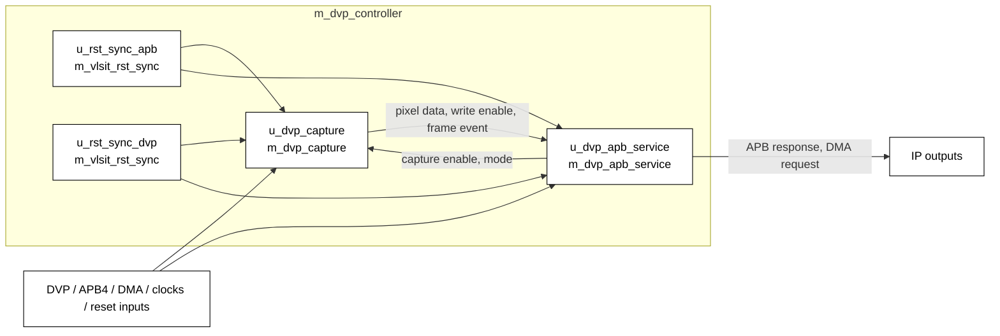
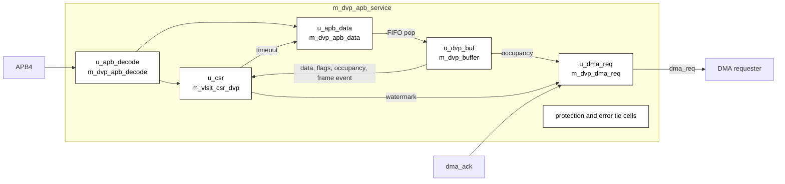
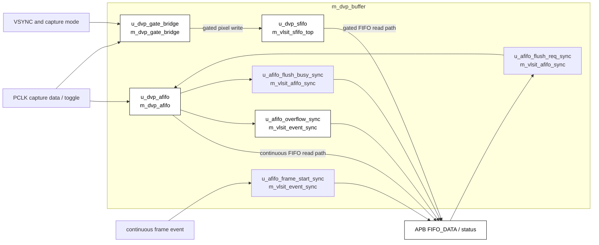
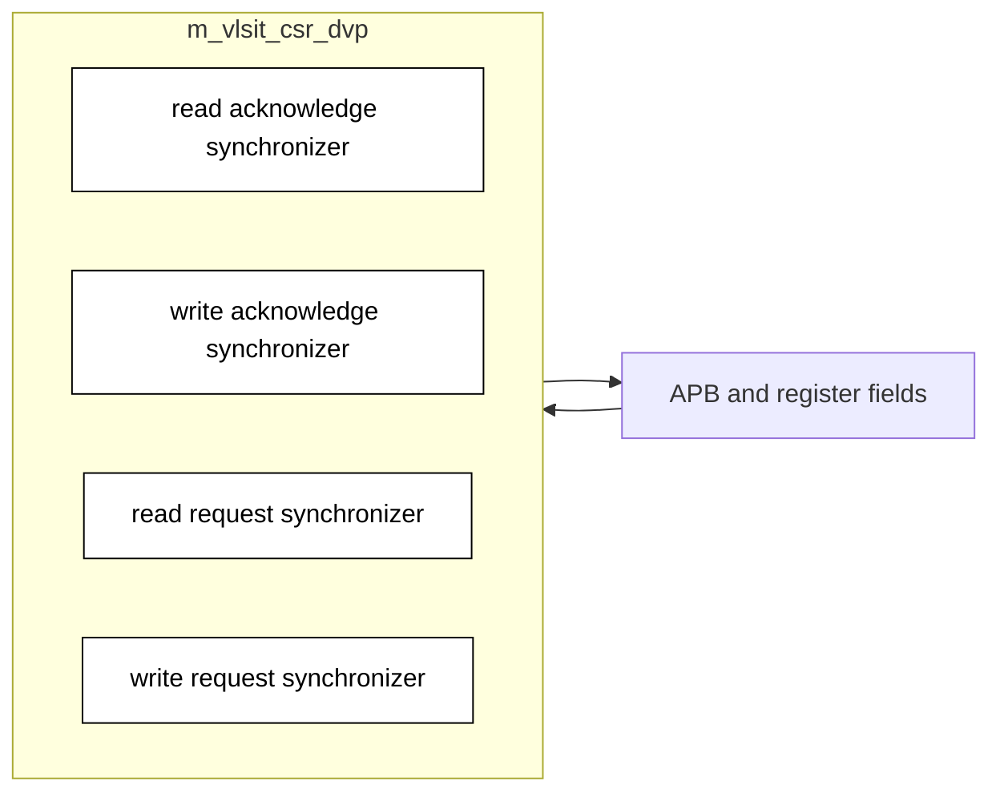

# RTL IP Report — DVP Controller — Timeout, frame count, and FIFO flush — plan version 1

Status: Implemented; plan version 2 approved on 2026-11-22; 116 approved files promoted and hash-verified in the requested project directory.

## 1. Inputs and scope

| Item | Value |
|---|---|
| RTL directories | DVP RTL, common RTL libraries and cells, AsyncGrayFIFO, and SyncFIFO. The resolved scan covers 89 source files/definitions and 35 reachable module types including cell models (0 unresolved); the RTL-only hierarchy scan covers 28 modules/files and reports 21 technology-cell instances outside its source set. |
| Top module | `m_dvp_controller`; selected from the DVP file list and the DVP integration hierarchy. Scanner candidates also include standalone `m_vlsit_clk_inv` and `m_vlsit_afifo_top`, which are not this IP's configured top. |
| Specification | The original implementation-aligned package under `spec/rtl_generation_2026-11-22/` remains unchanged. The approved update is recorded in `spec/rtl_update_2026-11-22/` (HDS v0.3, CSR v1.1). |
| Requirement source | User decision in this session: make the empty-read timeout CSR-programmable with reset `0xFFFF_FFFF`; add a frame counter and FIFO flush; omit other optional features and keep the implementation simple. |
| Task-start snapshot | `task_start_snapshot/` contains all 12 DVP RTL and generated CSR source files before proposed edits. |
| Tools available | Python 3.12, `openpyxl` 3.1.5, Verilator, Slang, Icarus Verilog, and `vvp` are available. Modified-RTL checks are recorded in `verification/`; strict Verilator lint exits 1 on 24 warnings and reports zero errors. |
| Analysis limits | Static hierarchy analysis, RTL rule checks, lint, CSR checks, and one directed simulation were run. CDC/RDC signoff, STA, synthesis, DFT, and sensor/SoC integration were not run. Technology-cell wrappers remain library-dependent. |
| Pre-existing working-tree changes | `025_DVP_Controller/` is untracked in this worktree, so Git status cannot separate prior user content from this task. A task-start snapshot was captured before the first RTL edit. No unrelated common FIFO RTL was changed. |

Analysis inputs and scanner results are in this folder: `scan.json`, `scan_modified.json`, `scan_modified_rtl_only.json`, `scan_tables.md`, `scan_tables_modified.md`, `csr_hints.md`, `csr_workbook_analysis.json`, `csr_cells.json`, and `task_start_snapshot/`.

## 2. Hierarchy (top-down)

The modified RTL-only scan reports 24 functional module types reachable from `m_dvp_controller`, plus three standalone source modules (`m_vlsit_afifo_rd`, `m_vlsit_afifo_top`, and `m_vlsit_clk_inv`) that are not this IP's configured top. The resolved scan also includes technology cell models and the added flush/frame event synchronizers. The DVP top has reset synchronizers, the camera capture path, and the APB service. The service owns the CSR, FIFO_DATA endpoint, selected buffers, and DMA request FSM. Updated instance-path inventory and per-module instance totals are in [`scan_tables_modified.md`](reference/rtl_change_2026-11-22/scan_tables_modified.md); the task-start scan is retained in [`scan_tables.md`](reference/rtl_change_2026-11-22/scan_tables.md), and the modified RTL-only scan is [`scan_modified_rtl_only.json`](reference/rtl_change_2026-11-22/scan_modified_rtl_only.json).

| Level | Instance path | Module | Count | Parent / evidence |
|---:|---|---|---:|---|
| 0 | `m_dvp_controller` | `m_dvp_controller` | 1 | DVP top; `rtl/m_dvp_controller.sv:12` |
| 1 | `u_rst_sync_apb` | `m_vlsit_rst_sync` | 1 | Top; `rtl/m_dvp_controller.sv:86` |
| 1 | `u_rst_sync_dvp` | `m_vlsit_rst_sync` | 1 | Top; `rtl/m_dvp_controller.sv:93` |
| 1 | `u_dvp_capture` | `m_dvp_capture` | 1 | Top; `rtl/m_dvp_controller.sv:100` |
| 1 | `u_dvp_apb_service` | `m_dvp_apb_service` | 1 | Top; `rtl/m_dvp_controller.sv:123` |
| 2 | `u_dvp_apb_service.u_apb_decode` | `m_dvp_apb_decode` | 1 | Service; `rtl/m_dvp_apb_service.sv:105` |
| 2 | `u_dvp_apb_service.u_csr` | `m_vlsit_csr_dvp` | 1 | Service; `rtl/m_dvp_apb_service.sv:145` |
| 2 | `u_dvp_apb_service.u_apb_data` | `m_dvp_apb_data` | 1 | Service; `rtl/m_dvp_apb_service.sv:180` |
| 2 | `u_dvp_apb_service.u_dvp_buf` | `m_dvp_buffer` | 1 | Service; `rtl/m_dvp_apb_service.sv:199` |
| 2 | `u_dvp_apb_service.u_dma_req` | `m_dvp_dma_req` | 1 | Service; `rtl/m_dvp_apb_service.sv:230` |
| 3 | `u_dvp_apb_service.u_dvp_buf.u_dvp_afifo` | `m_dvp_afifo` | 1 | Buffer; `rtl/m_dvp_buffer.sv:136` |
| 3 | `u_dvp_apb_service.u_dvp_buf.u_dvp_gate_bridge` | `m_dvp_gate_bridge` | 1 | Buffer; `rtl/m_dvp_buffer.sv:183` |
| 3 | `u_dvp_apb_service.u_dvp_buf.u_dvp_sfifo` | `m_vlsit_sfifo_top` | 1 | Buffer; `rtl/m_dvp_buffer.sv:201` |
| 4+ | FIFO pointer, memory, synchronizer, reset and tie children | Common reusable modules | 1 or parameterized | Full source paths and conditional children: `scan_tables.md`; technology library cells are unresolved external dependencies. |

Technology-cell modules resolve to simulation/RTL models from `000_Common/rtl_cells`; mapping and characterization against a selected implementation library remain integration obligations. Unreachable `m_vlsit_afifo_top`, `m_vlsit_afifo_rd`, and `m_vlsit_clk_inv` are not instantiated by this DVP top.

All scanned module types: `m_dvp_controller`, `m_dvp_capture`, `m_dvp_apb_service`, `m_dvp_apb_decode`, `m_dvp_apb_data`, `m_dvp_buffer`, `m_dvp_dma_req`, `m_dvp_afifo`, `m_dvp_afifo_rd`, `m_dvp_gate_bridge`, `m_vlsit_csr_dvp`, `m_vlsit_csr_sync`, `m_vlsit_afifo_cell_sync`, `m_vlsit_afifo_mem`, `m_vlsit_afifo_ram_macro`, `m_vlsit_afifo_rd`, `m_vlsit_afifo_sync`, `m_vlsit_afifo_top`, `m_vlsit_afifo_wr`, `m_vlsit_clk_inv`, `m_vlsit_event_sync`, `m_vlsit_rst_sync`, `m_vlsit_sfifo_mem`, `m_vlsit_sfifo_ram_macro`, `m_vlsit_sfifo_rd`, `m_vlsit_sfifo_top`, `m_vlsit_sfifo_wr`, and `m_vlsit_tie`.

## 3. Block diagrams

### 3.1 TOP block diagram: `m_dvp_controller`



### 3.2 Level 1 block diagram: `m_dvp_apb_service`



### 3.3 Level 2 block diagrams: `m_dvp_buffer`, `m_vlsit_csr_dvp`





### 3.4 Hierarchy evidence files

Updated scanner-generated diagrams for the modified RTL are in `mermaid_modified/`: [`top_m_dvp_controller.mmd`](reference/rtl_change_2026-11-22/mermaid_modified/top_m_dvp_controller.mmd), [`l1_m_dvp_apb_service.mmd`](reference/rtl_change_2026-11-22/mermaid_modified/l1_m_dvp_apb_service.mmd), [`l2_m_dvp_buffer.mmd`](reference/rtl_change_2026-11-22/mermaid_modified/l2_m_dvp_buffer.mmd), [`l2_m_vlsit_csr_dvp.mmd`](reference/rtl_change_2026-11-22/mermaid_modified/l2_m_vlsit_csr_dvp.mmd), and the reset/tie child diagrams. They show the selected Level 2 hierarchy. The existing draw.io under `figures/` describes an older hierarchy and is not current evidence.

## 4. Functional analysis by instance

| Instance | Module | Role and behavior | Connections / evidence |
|---|---|---|---|
| `m_dvp_controller` | `m_dvp_controller` | Exposes source-synchronous DVP, APB4 and DMA batch interfaces; releases reset independently in APB and pixel-clock domains. | `rtl/m_dvp_controller.sv:45-70,86-145` |
| `u_dvp_capture` | `m_dvp_capture` | Synchronizes capture/mode controls into the pixel domain; qualifies samples with HREF and frame state; writes continuous samples to AFIFO or holds gated payload and toggles one valid event per sample. | `rtl/m_dvp_capture.sv:55-175` |
| `u_dvp_apb_service` | `m_dvp_apb_service` | Routes APB to generated CSR or FIFO_DATA; supplies CSR fields to capture/buffer logic; connects DMA request state. | `rtl/m_dvp_apb_service.sv:90-260` |
| `u_dvp_apb_service.u_apb_decode` | `m_dvp_apb_decode` | Reserves the configured FIFO_DATA word and forwards other addresses to CSR. | `rtl/m_dvp_apb_decode.sv` |
| `u_dvp_apb_service.u_csr` | `m_vlsit_csr_dvp` | Implements APB register read/write behavior from the supplied CSR workbook. | `rtl/csr/m_vlsit_csr_dvp.sv`; workbook analyzed read-only. |
| `u_dvp_apb_service.u_apb_data` | `m_dvp_apb_data` | Waits on empty FIFO reads, errors on malformed endpoint accesses or timeout, and pops exactly once on successful APB completion. | `rtl/m_dvp_apb_data.sv:40-96` |
| `u_dvp_apb_service.u_dvp_buf` | `m_dvp_buffer` | Selects AFIFO or SFIFO read data/status, tracks gated occupancy, joins overflow events and blocks mode changes unless safe. It is the smallest existing host for selected-FIFO flush control. | `rtl/m_dvp_buffer.sv:100-271` |
| `u_dvp_apb_service.u_dma_req` | `m_dvp_dma_req` | Requests at watermark, holds REQ to ACK, and rearms after occupancy falls below watermark. | `rtl/m_dvp_dma_req.sv:42-72` |
| `u_dvp_apb_service.u_dvp_buf.u_dvp_afifo` | `m_dvp_afifo` | Local top combines common Gray-pointer write logic, DVP-local read logic and dual-clock memory; its software-reset pins are currently tied inactive. | `rtl/m_dvp_afifo.sv:68-153` |
| `u_dvp_apb_service.u_dvp_buf.u_dvp_gate_bridge` | `m_dvp_gate_bridge` | Uses APB-clock two-flop synchronizers for VSYNC and pixel toggle, detects both toggle edges, gates writes by frame/capture state. | `rtl/m_dvp_gate_bridge.sv:52-102` |
| `u_dvp_apb_service.u_dvp_buf.u_dvp_sfifo` | `m_vlsit_sfifo_top` | Common synchronous FIFO in APB clock domain; has an existing software-reset/busy handshake tied inactive by DVP. | `002_SyncFIFO/rtl/m_vlsit_sfifo_top.sv:40-66` |
| `u_rst_sync_apb`, `u_rst_sync_dvp` | `m_vlsit_rst_sync` | Asynchronous assertion and destination-clock-synchronous reset release. | `rtl_lib/m_vlsit_rst_sync.sv`; instantiated at top lines 86 and 93. |
| AFIFO/SFIFO child instances | Common FIFO, memory, synchronizer and tie modules | Implement Gray-pointer CDC, FIFO storage/read/write control, technology-cell synchronization and static ties. | Complete instance-level evidence is in `scan_tables.md`. |

## 5. Module interfaces and signals

The detailed port inventory (direction, width, and source line) for all 28 scanned modules is [`scan_tables.md`](reference/rtl_change_2026-11-22/scan_tables.md), generated by the RTL scanner. This plan changes only existing DVP modules plus workbook-generated CSR RTL; no top-level port is added.

| Module | Main interface signals / domain | Interface class | Function / evidence |
|---|---|---|---|
| `m_dvp_controller` | APB4 `i_paddr/i_psel/i_penable/i_pwrite/i_pwdata/i_pstrb/i_pprot` and `o_pready/o_prdata/o_pslverr`; DVP `i_clk_dvp/i_dvp_data/i_dvp_vsync/i_dvp_href`; DMA `i_dma_ack/o_dma_req` | APB4 plus custom sensor and request/ack | Top ports, `rtl/m_dvp_controller.sv:45-70` |
| `m_dvp_capture` | DVP clock, pixel bus, VSYNC/HREF; AFIFO push; gated data/toggle | FIFO push and custom toggle-valid | `rtl/m_dvp_capture.sv:33-50` |
| `m_dvp_apb_service` | APB4, CSR field wires, FIFO pop/data/status, DMA REQ/ACK | APB4 plus FIFO and handshake | `rtl/m_dvp_apb_service.sv:40-85` |
| `m_dvp_apb_data` | APB access, timeout, show-ahead FIFO head/empty, single pop | APB endpoint + FIFO push/pop | `rtl/m_dvp_apb_data.sv:18-38` |
| `m_dvp_buffer` | APB/DVP clocks and resets, both sample paths, selected FIFO state, mode and capture controls | FIFO push/pop + CDC events | `rtl/m_dvp_buffer.sv:37-66` |
| `m_dvp_afifo`, `m_dvp_afifo_rd` | Write clock/data and read clock/pop/head/empty/occupancy; reset request/ack across domains | Asynchronous FIFO handshake | `rtl/m_dvp_afifo.sv:33-52`; `rtl/m_dvp_afifo_rd.sv:36-57` |
| `m_dvp_gate_bridge` | APB clock; synchronized VSYNC/toggle and held pixel payload; SFIFO push | Custom CDC/toggle handshake | `rtl/m_dvp_gate_bridge.sv:21-37` |
| `m_vlsit_csr_dvp` | APB4 and APB-clocked CSR fields | Generated APB4 CSR | `rtl/csr/m_vlsit_csr_dvp.sv`; source workbook is the CSR JSON/XLSX. |
| `m_dvp_apb_decode`, `m_dvp_dma_req` | Address select; occupancy/watermark/ACK and level REQ | Decode; request/ack handshake | `rtl/m_dvp_apb_decode.sv`; `rtl/m_dvp_dma_req.sv:20-39` |
| Common FIFO/reset/tie modules | Clock/reset, FIFO pointer/data, threshold, event sync and constant ties | FIFO handshake / CDC / custom | Exact ports in `scan_tables.md`; technology cells are external. |

The individual common-module subsections, including generated and currently unreachable scan candidates, are listed below with their source port inventory in `scan_tables.md`.

| Module | Source interface inventory | Evidence |
|---|---|---|
| `m_vlsit_afifo_cell_sync` | destination clock/reset, data input/output | `rtl_lib/m_vlsit_afifo_cell_sync.sv` |
| `m_vlsit_afifo_mem` | dual-clock FIFO memory write/read ports | `rtl/m_vlsit_afifo_mem.sv` |
| `m_vlsit_afifo_ram_macro` | SRAM wrapper clock/address/data/enable | `rtl_lib/m_vlsit_afifo_ram_macro.sv` |
| `m_vlsit_afifo_sync` | destination clock/reset, synchronized vector input/output | `rtl/m_vlsit_afifo_sync.sv` |
| `m_vlsit_afifo_wr` | write clock/reset/data, read pointer, software reset handshake | `001_AsyncGrayFIFO/rtl/m_vlsit_afifo_wr.sv` |
| `m_vlsit_csr_sync` | CSR source/destination clock/reset and handshake data | `rtl/csr/m_vlsit_csr_sync.sv` |
| `m_vlsit_event_sync` | event source/destination clock/reset and pulse output | `rtl_lib/m_vlsit_event_sync.sv` |
| `m_vlsit_rst_sync` | source reset, destination clock, released reset output | `rtl_lib/m_vlsit_rst_sync.sv` |
| `m_vlsit_sfifo_mem` | synchronous FIFO memory write/read ports | `rtl/m_vlsit_sfifo_mem.sv` |
| `m_vlsit_sfifo_ram_macro` | SRAM wrapper clock/address/data/enable | `rtl_lib/m_vlsit_sfifo_ram_macro.sv` |
| `m_vlsit_sfifo_rd` | read clock/reset, read enable/data, pointers and reset handshake | `002_SyncFIFO/rtl/m_vlsit_sfifo_rd.sv` |
| `m_vlsit_sfifo_top` | synchronous FIFO write/read, flags, and software reset/busy | `002_SyncFIFO/rtl/m_vlsit_sfifo_top.sv` |
| `m_vlsit_sfifo_wr` | write clock/reset/data, full and software reset/busy | `002_SyncFIFO/rtl/m_vlsit_sfifo_wr.sv` |
| `m_vlsit_tie` | parameterized constant output | `rtl_lib/m_vlsit_tie.sv` |
| `m_vlsit_afifo_rd`, `m_vlsit_afifo_top`, `m_vlsit_clk_inv` | read-side/top/cell-wrapper candidates not instantiated by DVP top | `scan_tables.md`; unreachable in configured top |

## 6. CSR map

Source: `spec/rtl_generation_2026-11-22/VLSIT_DVP_CONTROLLER_CSR.xlsx` and corresponding JSON. The workbook was analyzed using the skill's read-only workbook analyzer. Existing workbook remains unchanged; a versioned copy is planned. FIFO_DATA is a separate endpoint at `0x0100`.

| Offset | Register / field | Bits | Access | Reset | Function / planned delta |
|---:|---|---:|---|---:|---|
| `0x00` | `dvp_version.major` / `.minor` | `[31:16]` / `[15:0]` | RO | `0x0001_0001` | IP interface version; minor increments from 0 to 1 for the CSR additions. |
| `0x04` | `dvp_ctrl.capture_en` | `[0]` | RW | `0` | Starts/stops capture. |
| `0x04` | `dvp_ctrl.pclk_mode` | `[1]` | RW | `0` | Selects continuous AFIFO or gated SFIFO mode; unchanged. |
| `0x04` | `dvp_ctrl.fifo_flush` | `[2]` | RWI | `0` | Self-clearing request/status: software writes 1; hardware loads 0 after selected FIFO reset completes. |
| `0x08` | `dvp_wmark.level` | `[31:0]` | RW | `0` | DMA watermark; zero disables REQ. |
| `0x0C` | `dvp_timeout.cycles` | `[31:0]` | RW | `0xFFFF_FFFF` | APB empty-FIFO timeout; remains fully software programmable. |
| `0x10` | `dvp_fifo_sts.active/empty/full/ovf` | `[0]/[1]/[2]/[3]` | RO/RO/RO/W1C | `0/1/0/0` | Selected FIFO state and sticky overflow; unchanged by flush except occupancy/empty/full. |
| `0x14` | `dvp_fifo_level.count` | `[31:0]` | RO | `0` | Selected FIFO occupancy; flush completes with zero. |
| `0x18` | `dvp_frame_count.count` | `[31:0]` | RO | `0` | Modulo-2^32 count of capture-enabled accepted active VSYNC edges. Flush does not clear it. |
| `0x100` | `FIFO_DATA` | `[31:0]` | read-only endpoint | n/a | Existing one-pixel-per-successful-read endpoint, zero-extended to 32 bits. |

The new register occupies the first free aligned CSR word after `0x14`. CSR minor version increments to 1 under the existing 1.x major version. No existing field or FIFO_DATA address changes.

## 7. Software sequence (basic configuration)

| Step | Action | Register / offset | Value | Wait or condition | Purpose |
|---:|---|---|---:|---|---|
| 1 | Wait for reset release; read IP version | `DVP_VERSION` / `0x00` | read | `PREADY=1` | Discover CSR minor version. |
| 2 | Set mode, watermark, and any shorter timeout needed by the SoC | `DVP_CTRL` / `0x04`, `DVP_WMARK` / `0x08`, `DVP_TIMEOUT` / `0x0C` | desired values | Capture disabled, selected mode unchanged during session | Configure path and bound empty reads. Reset timeout is `0xFFFF_FFFF`; at 100 MHz that can hold an empty FIFO read for about 42.95 s. |
| 3 | Enable capture | `DVP_CTRL.CAPTURE_EN` / `0x04[0]` | `1` | Wait for next active VSYNC and `FIFO_STS.ACTIVE=1` | Begin a complete frame. |
| 4 | Service DMA batches and optionally observe frame count | `FIFO_DATA` / `0x100`, `DVP_FRAME_COUNT` / `0x18` | read | Successful FIFO_DATA APB completion pops one pixel; frame count changes on a qualified frame-start event | Drain pixels and observe completed frame-starts. |
| 5 | Stop capture and stop DMA APB reads before flushing | `DVP_CTRL.CAPTURE_EN` / `0x04[0]` | `0` | Wait until capture source is quiescent; for continuous-PCLK mode keep `i_clk_dvp` toggling until flush self-clears | Prevent new writes and let the common FIFO reset handshake complete. |
| 6 | Request FIFO flush and poll the request/status bit | `DVP_CTRL.FIFO_FLUSH` / `0x04[2]` | write `1`; then read until `0` | FIFO_DATA reads paused; verify `FIFO_STS.EMPTY=1` and `FIFO_LEVEL=0` | Clear selected FIFO pointers/occupancy. Overflow W1C and frame counter are retained. |

## 8. Requirement and modification analysis

### 8.1 Requirement

Implement only the approved items: (1) preserve the 32-bit programmable APB timeout and change its reset value to `0xFFFF_FFFF`; (2) add a 32-bit read-only frame counter; (3) add a selected-FIFO software flush request with completion indication through its self-clearing CSR bit. Preserve APB4 behavior, both sensor-clock modes, FIFO_DATA address/data format, overflow behavior, mode-switch safety, external top ports, and the four-APB-cycle gated-pixel integration contract. Do not add IRQ, snapshot, line counter, overrun diagnostics, data packing, DMA redesign, or other optional controls.

### 8.2 Mapping to the RTL

| Requirement item | Module | Code region | Why this location | Evidence |
|---|---|---|---|---|
| Timeout reset `0xFFFF_FFFF` | Generated CSR from workbook | `dvp_timeout.cycles` reset field | CSR workbook is the single source of generated CSR RTL. | `spec/.../VLSIT_DVP_CONTROLLER_CSR.json`; `rtl/csr/m_vlsit_csr_dvp.sv` |
| Count continuous-mode accepted VSYNC starts | `m_dvp_capture` → `m_dvp_buffer` → `m_dvp_apb_service` | Existing active-edge detector plus existing event synchronizer pattern | Keeps the source event in PCLK domain and the CSR counter in APB domain. | `rtl/m_dvp_capture.sv:73-84,104-149`; `rtl/m_dvp_buffer.sv:169-178` |
| Count gated-mode accepted VSYNC starts | `m_dvp_gate_bridge` → `m_dvp_buffer` → `m_dvp_apb_service` | Existing APB two-FF VSYNC edge detector | The gated source has no PCLK during VSYNC; detection already occurs in APB domain. | `rtl/m_dvp_gate_bridge.sv:53-69,86-99` |
| Expose frame count | `m_dvp_apb_service` and generated CSR | APB counter and new RO field input | No third clock domain or top-level port is needed. | `rtl/m_dvp_apb_service.sv:145-171`; current CSR offsets end at `0x14`. |
| Flush selected AFIFO/SFIFO | `m_dvp_buffer`, `m_dvp_afifo`, `m_dvp_apb_service`, generated CSR | Existing common software-reset request/busy interfaces, currently tied inactive | Reuses both existing FIFO reset state machines; local logic only selects/holds request and waits for completion. | `rtl/m_dvp_afifo.sv:68-153`; `rtl/m_dvp_buffer.sv:161-224`; `002_SyncFIFO/rtl/m_vlsit_sfifo_top.sv:52-54` |
| CSR map and software documentation | new versioned HDS, CSR JSON/XLSX, `README.md` | Copy in new spec folder after approval | Preserves the earlier specification and workbook selected by the user. | `spec/rtl_generation_2026-11-22/` |

### 8.3 Strategies (ranked)

| Strategy | Functional coverage | RTL change size | Software-flow impact | New module | Interface and compatibility | Risk |
|---|---|---|---|---|---|---|
| A (recommended) | Timeout reset, path-specific frame counting, selected FIFO flush using existing reset handshakes | Up to 7 existing DVP/generated-CSR RTL files; no top pin change | Adds one CSR bit and one RO register; software polls flush bit | none | APB4/top pins/FIFO_DATA address remain stable; CSR minor becomes 1 | Reset handshakes must be held and observed safely across clocks; continuous-PCLK flush requires sensor clock edges. |
| B | Count only gated-mode frames and add no AFIFO flush | Smaller, but incomplete for the existing dual-mode IP | Less software-visible control | none | Existing modes behave differently | Does not meet the all-mode frame count or FIFO flush request. |

### 8.4 Affected files

| Module / artifact | File | Proposed change | Reason |
|---|---|---|---|
| `m_dvp_capture` | `rtl/m_dvp_capture.sv` | Expose a one-event-per-qualified-frame-start pulse in continuous mode. | Counter source without sampling VSYNC in the wrong domain. |
| `m_dvp_gate_bridge` | `rtl/m_dvp_gate_bridge.sv` | Expose its existing synchronized, capture-enabled VSYNC edge as a frame event. | Avoid a second gated-mode VSYNC synchronizer. |
| `m_dvp_controller` | `rtl/m_dvp_controller.sv` | Wire the frame event between existing blocks. | Internal connection only; no external port change. |
| `m_dvp_buffer` | `rtl/m_dvp_buffer.sv` | Select/synchronize frame event; implement a small flush request/complete controller; reset occupancy estimate on completion; drive selected FIFO software reset. | Existing owner of both FIFOs and mode selection. |
| `m_dvp_afifo` | `rtl/m_dvp_afifo.sv` | Replace software-reset tie-off with a held request interface and expose/synchronize busy to APB. | Existing common AFIFO reset handshake is available but currently unused. |
| `m_dvp_apb_service` | `rtl/m_dvp_apb_service.sv` | Add APB frame counter; connect flush request/completion and frame field; suppress FIFO_DATA pop while flush is active. | CSR/counter and APB access control live in this domain. |
| generated CSR | `rtl/csr/m_vlsit_csr_dvp.sv` | Regenerate from updated workbook; add `DVP_CTRL.FIFO_FLUSH` (`rwi`) and `DVP_FRAME_COUNT` (`ro`); update timeout reset and minor version. | Generated RTL must not be hand-edited. |
| HDS / CSR workbook / CSR JSON / README | new `spec/rtl_update_2026-11-22/` copy and `README.md` | Document requirements, register descriptions, timing, flush behavior and software sequence. | User selected a separate updated spec copy. |
| `rtl/filelist.f` | unchanged unless the generator detects a dependency/file ordering change | No new design module is proposed. | Keep current compile order if unchanged. |

### 8.5 Style profile

| Convention | Current RTL evidence | Rule applied to the change |
|---|---|---|
| Existing one-module-per-file SystemVerilog | `rtl/m_dvp_*.sv`; IEEE 1800-2017 project statement | Keep names and interface groups; no new module. |
| Async-assert/sync-release reset | `rtl/m_dvp_controller.sv:86-96` | Do not create a new reset domain; use existing FIFO software-reset interfaces. |
| Two-/three-process FSM pattern and enum state | `rtl/m_dvp_dma_req.sv:28-72`; common FIFO reset FSMs | Follow the existing state coding style; one process owns each current-state register. |
| CSR generation | `rtl/csr/m_vlsit_csr_dvp.sv` header and `CSR_GENERATED.md` | Modify workbook/JSON and regenerate; never edit generated CSR RTL directly. |
| English header/comments and 2-space indentation | Current DVP RTL headers | Preserve style and add explicit reset/clock-domain comments. |

Format change requested by the user: none.

### 8.6 Minimal-change rationale

The current timeout counter already counts empty APB access cycles and the CSR field is already fully programmable; only its reset metadata changes. Both FIFO families already have software-reset handshakes, so a flush does not require a new FIFO implementation or common-library edits. One APB counter consumes a single 32-bit CSR word and receives path-specific frame events. The update does not alter PCLK modes, FIFO depth, data packing, DMA protocol, external pins, or FIFO_DATA decode.

### 8.7 CSR delta

| Register | Baseline state | New state | Offset | Free-range evidence | Policy |
|---|---|---|---:|---|---|
| `dvp_timeout.cycles` | RW, reset `0x0000_0000` | RW, reset `0xFFFF_FFFF` | `0x0C` | Existing field; user explicitly approved reset change | `approved-change` |
| `dvp_ctrl.fifo_flush` | Reserved `[31:2]` | New RWI `[2]`, reset 0; software sets 1, hardware loads 0 after flush completes | `0x04` | Bit `[2]` is currently reserved in the supplied workbook | `added-free` |
| `dvp_frame_count.count` | absent | New RO `[31:0]`, reset 0, modulo 2^32 | `0x18` | Existing CSR words are `0x00`–`0x14`; `0x18` is the first free aligned word | `added-free` |
| IP version minor | 0 | 1 | `0x00[15:0]` | Version update required for additive CSR fields | `approved-change` |

CSR convention follows the existing workbook generator. The planned RWI flush field is a software-visible pending/busy bit; hardware clears it only after FIFO reset completion. The selected FIFO is flushed; the frame counter and sticky overflow flag are not cleared by FIFO flush. Software must not issue another flush command until the field has returned to zero.

### 8.8 Software-sequence delta

The normal reset/configure/capture sequence is unchanged except that software may now read `DVP_FRAME_COUNT`. To flush: stop DMA APB reads; clear `CAPTURE_EN`; wait for the selected capture source to become quiescent; write one to `DVP_CTRL.FIFO_FLUSH`; poll the bit until hardware clears it; verify `FIFO_STS.EMPTY=1` and `FIFO_LEVEL=0`. In continuous mode, keep `i_clk_dvp` running while the AFIFO reset handshake completes. The sticky overflow bit and frame counter retain their values.

### 8.9 Pre-existing defects

| ID | RTL evidence | Observed behavior | Required behavior | Evidence | Status | Decision date |
|---|---|---|---|---|---|---|
| BUG-001 | `rtl/m_dvp_capture.sv:104-149` | Static scanner sees two assignments to `reg_frame_active` in mutually exclusive `generate` branches. | Exactly one selected driver after elaboration. | The rising and falling sample-edge branches are mutually exclusive at elaboration; this is not a confirmed multi-driver defect. | REJECTED | 2026-11-22 |
| BUG-002 | `rtl/m_dvp_dma_req.sv:54-68` | After ACK, REQ stays low until occupancy drops below watermark. A fixed-length DMA batch that stops above watermark can leave residual samples without a new request. | Existing approved batch contract requires DMA to drain below watermark or poll level; no DMA redesign was selected in this request. | Prior implementation review `review/rtl_crosscheck_2026-11-22/vlsit_impl_2026-11-22.md`, F-004/F-005; HDS REQ/ACK contract. | REJECTED | 2026-11-22 |

No additional confirmed behavioral defect was established from source-only inspection. Gated-mode reset recovery/removal and bundled-data timing remain integration STA/RDC obligations already documented in the HDS; no new asynchronous clock or top-level port is introduced.

### 8.10 Test plan

| Test | Kind | What it checks | Requirement item | Expected on baseline | Expected on modified | Source of expected value |
|---|---|---|---|---|---|---|
| reset and APB smoke | basic | Reset release; version and existing CSR APB reads/writes; no register corruption | Existing APB4 and CSR behavior | pass | pass | Existing HDS and APB4 profile |
| capture/DMA smoke in both modes | basic | Qualified sample ordering, FIFO_DATA pop-once, watermark REQ/ACK | Existing capture/FIFO behavior | pass | pass | Existing HDS REQ-FUNC and REQ-IF requirements |
| timeout default/configuration | feature | Reset read is `0xFFFF_FFFF`; zero and short programmed timeouts return PSLVERR at the specified count; data on terminal cycle wins | Timeout requirement | fail | pass | User-approved reset value and existing timeout cycle definition |
| continuous frame count | feature | Count once per accepted active VSYNC edge through the PCLK-to-APB event synchronizer; no count while capture disabled | Frame-counter requirement | fail | pass | New approved plan requirement |
| gated frame count | feature | Count once per synchronized APB VSYNC edge; multi-cycle pulse produces one count | Frame-counter requirement | fail | pass | Existing 2-FF edge detector and new approved plan requirement |
| gated FIFO flush | feature | Stop capture; flush SFIFO; command self-clears; occupancy becomes zero; overflow/frame count remain unchanged | FIFO-flush requirement | fail | pass | Existing SFIFO software-reset handshake and new plan |
| continuous FIFO flush | feature | Hold AFIFO reset request across clock-domain handshake; command self-clears only after completion; occupancy becomes zero | FIFO-flush requirement | fail | pass | Existing AFIFO software-reset handshake and new plan |
| flush cannot pop stale data | feature | FIFO_DATA does not pop while flush is active; successful read after completion sees empty/timeout | FIFO-flush/APB requirements | fail | pass | APB endpoint and new plan |

Execution policy: lint and simulate the modified RTL only; do not run a baseline regression, per the user's instruction. The "Expected on baseline" entries are design expectations for traceability, not executed results. The directed testbench lives outside `rtl/`. Code coverage is not included.

Validation commands used on the modified RTL:

```powershell
python C:\Users\PC\.agents\skills\vlsit-rtl-generator\scripts\vlsit_rtl_check.py check 025_DVP_Controller\rtl
python C:\Users\PC\.agents\skills\vlsit-rtl-generator\scripts\vlsit_lint_rtl.py lint 025_DVP_Controller\rtl\filelist.f --top m_dvp_controller
```

Icarus Verilog compile and simulation commands, logs and the VCD are documented in `verification/README.md`. No baseline lint or test run was performed.

### 8.11 Budget and approval

| Item | Value |
|---|---|
| Plan version 1 approved change budget | Maximum 8% of baseline DVP RTL code lines. |
| Change budget | Version 1 limit: 8%; plan version 2 requests a 15.15% ceiling for the measured implementation. |
| Baseline RTL code lines | 1,465 nonblank, noncomment lines from the 12-file task-start RTL snapshot. |
| Measured change | 192 added + 30 deleted = 222 changed lines; 15.15% of baseline. |
| Plan version 2 proposed ceiling | 15.15%, limited to the seven existing RTL files listed in section 9.2; no new module or top-level port. |
| Changed collateral | Updated spec/CSR/README, modified-only verification sources, logs, VCD and diagrams; these do not count as RTL code lines. |
| New modules | None. |
| Register policy | Existing register addresses and fields retained except timeout reset; new flush field reuses reserved bit `[2]`; frame count uses free aligned offset `0x18`; CSR minor increments to 1. |

**Plan version 1 was approved and implemented in the worktree.** The official metric now shows that its 8% budget was exceeded: the smallest implemented feature set adds 192 and removes 30 code lines, for 15.15%. The implementation uses no new module or top-level port. It retains the existing DMA drain-below-watermark contract and omits optional review recommendations. It changes timeout reset to `0xFFFF_FFFF`, counts accepted VSYNC frame-start edges in both capture modes, and adds a self-clearing selected-FIFO flush command. Flush requires capture disabled and the source quiescent; continuous mode additionally requires DVP clock edges until the reset handshake completes. Flush does not clear the overflow flag or frame count.

**Plan version 2 approval record:** The user approved increasing the change ceiling from 8% to the measured 15.15% on 2026-11-22, including the seven listed RTL files, CSR behavior and modified-only lint/simulation scope. The approval also covers promotion of the reviewed worktree files to the requested project directory.

Historical plan-version-2 gate: Do you approve plan version 2, including the seven changed RTL files, the measured 15.15% budget, the CSR behavior, the modified-only lint/simulation results, and promotion of the reviewed worktree files to the requested project directory? Reply APPROVE, REVISE, or STOP. Recorded response: **APPROVED** by the user on 2026-11-22.

## 9. Implementation results

### 9.1 Traceability and changed files

| Requirement | RTL mapping | File and lines | Result |
|---|---|---|---|
| Timeout reset default `0xFFFF_FFFF`, still software programmable | Generated CSR field reset | `rtl/csr/m_vlsit_csr_dvp.sv:409-427` | Implemented and read back in simulation. |
| Count accepted frame starts in continuous and gated modes | APB-domain counter receives mode-specific frame event | `rtl/m_dvp_capture.sv:73-84`; `rtl/m_dvp_gate_bridge.sv:53-69`; `rtl/m_dvp_buffer.sv:243-270`; `rtl/m_dvp_apb_service.sv:151-155,209` | Implemented; tests cover both modes. |
| Flush selected AFIFO or SFIFO and report completion | CSR request, APB flush FSM, AFIFO request/busy synchronization, SFIFO reset handshake; block FIFO pops while pending | `rtl/m_dvp_apb_service.sv:128-147,253-264`; `rtl/m_dvp_buffer.sv:153-196,223-259,321-379`; `rtl/m_dvp_afifo.sv:68-153` | Implemented; tests cover both modes, ignored active-capture request, occupancy clear, no pop during flush, and sticky-overflow retention. |

### 9.2 Change metrics

| Metric | Value |
|---|---|
| Baseline RTL code lines | 1,465 |
| Added code lines | 192 |
| Deleted code lines | 30 |
| Change percentage | 15.15 % |
| Changed files | `rtl/csr/m_vlsit_csr_dvp.sv` (+23/-3); `rtl/m_dvp_afifo.sv` (+5/-11); `rtl/m_dvp_apb_service.sv` (+38/-4); `rtl/m_dvp_buffer.sv` (+112/-12); `rtl/m_dvp_capture.sv` (+9/-0); `rtl/m_dvp_controller.sv` (+3/-0); `rtl/m_dvp_gate_bridge.sv` (+2/-0) |
| New modules | none |

Metric source: `vlsit_rtl_change_metrics.py compare review/rtl_change_2026-11-22/task_start_snapshot rtl`; the task-start snapshot contains the 12 original DVP RTL files.

### 9.3 Checks

| Check | Command / scope | Result | Evidence |
|---|---|---|---|
| VLSIT RTL rule checker | Modified DVP RTL | PASS; 0 errors, 21 warnings | `verification/static/rtl_rule_modified_final.log` |
| Verilator lint | Modified RTL filelist, `--lint-only -Wall` | FAIL by exit status 1; 24 warnings and no RTL diagnostic errors (warnings are fatal under default options) | `verification/lint/modified_verilator_project_final.log` |
| Slang lint | Modified RTL filelist | PASS; 0 errors, 2 shared-model cast warnings | `verification/lint/modified_slang_final_2.log` |
| Parameter elaboration | 8/10/12-bit profiles × rising/falling PCLK edge | PASS; all six profiles | `verification/lint/profiles/modified_w*_edge*_final.log` |
| Tests — modified-only directed simulation | Icarus Verilog/VVP run from the promoted project tree; timeout, both frame-count modes, AFIFO/SFIFO flush and reset cases | PASS; compile exit 0; 27 check groups, 2 expected empty-read APB errors; no baseline run | `verification/runs/modified_2026-11-22/iverilog_compile_project_final.log`, `verification/runs/modified_2026-11-22/simulation_modified_project_final.log`, `verification/runs/modified_2026-11-22/dvp_updates.vcd` |
| HDS structure and gap scan | Updated HDS and its declared requirements | PASS; 22 sections, 0 errors; 0 blocking gaps, 15 integration information items | `verification/static/hds_check_modified_final.log`, `verification/static/hds_gaps_modified_final.log` |
| CSR and generated RTL | 7-register JSON validation and generator comparison | PASS; 0 validation errors/warnings; generated source matches | `verification/static/csr_modified_final.log`, `verification/static/csr_generated_modified_final.log` |
| WaveJSON lint | Updated waveform set | PASS; 21 files, 0 errors/warnings | `verification/static/wavejson_modified_final.log` |

The baseline was not linted or simulated, following the user's explicit modified-only instruction. Verilator's warning-only nonzero exit is reported as FAIL; no warning suppression was applied.

### 9.4 Remaining risks and completion

CDC/RDC signoff, STA/SDC, synthesis, DFT, camera timing qualification, and SoC workload signoff remain open. The Verilator warnings must be reviewed if strict warning-free lint is required; most reported warnings arise from intentionally unconnected defensive outputs or shared simulation/model code. Plan version 2 and its 15.15% ceiling were approved on 2026-11-22. The 116 approved files were copied to the requested project directory and SHA-256 verified; target-only user files were retained. The modified-only Icarus regression was rerun there and passed. No baseline test was run.
