# DVP_Controller Design Specification

> **Purpose:** Normative design contract for architecture, RTL, verification, DFT, and physical integration of this IP.
>
> Replace every angle-bracket placeholder. Mark inapplicable sections **N/A** with a reason. Do not silently omit a required decision. Use **TBD** only with its technical impact and the decision needed recorded in [Assumptions, dependencies, and decisions](#20-assumptions-dependencies-and-decisions).
>
> Requirement terms: **shall** = mandatory and testable; **should** = recommended; **may** = optional. Give every mandatory requirement a stable REQ-<AREA>-<NNN> identifier and a verification method.

## Document map

1. [Purpose, scope, and product context](#1-purpose-scope-and-product-context)
2. [Normative references and precedence](#2-normative-references-and-precedence)
3. [Requirements and traceability](#3-requirements-and-traceability)
4. [Features and configurations](#4-features-and-configurations)
5. [Architecture](#5-architecture)
6. [External interfaces and ports](#6-external-interfaces-and-ports)
7. [Clock, reset, and power](#7-clock-reset-and-power)
8. [Parameters and elaboration configurations](#8-parameters-and-elaboration-configurations)
9. [Data representation and arithmetic](#9-data-representation-and-arithmetic)
10. [Detailed functional behavior](#10-detailed-functional-behavior)
11. [Register and programming model (CSR from workbook)](#11-register-and-programming-model)
12. [Error handling and recovery](#12-error-handling-and-recovery)
13. [Performance, power, and area](#13-performance-power-and-area)
14. [RTL implementation contract](#14-rtl-implementation-contract)
15. [Verification specification](#15-verification-specification)
16. [DFT and testability](#16-dft-and-testability)
17. [Physical design and timing integration](#17-physical-design-and-timing-integration)
18. [Security, safety, and reliability](#18-security-safety-and-reliability)
19. [Requirement-to-verification traceability](#19-requirement-to-verification-traceability)
20. [Assumptions, dependencies, and decisions](#20-assumptions-dependencies-and-decisions)
21. [Glossary](#21-glossary)
22. [References used to shape this template](#22-references-used-to-shape-this-template)

## 1. Purpose, scope, and product context

### 1.1 Purpose and scope

DVP_Controller captures a source-synchronous parallel pixel stream from a camera sensor for a smart-camera or embedded-vision system. Each elaborated build selects one compile-time sensor profile. The selected profile supports an 8-, 10-, or 12-bit data bus, a PCLK sampling edge, signal polarities, and frame-valid plus line-valid/HREF synchronization. The controller uses one AMBA APB4 interface for software control/status and system-DMA sample reads; each completed read from the sample-data endpoint transfers one DVP sample. A batch-level DMA request/acknowledge sideband uses a software-configured FIFO watermark. An empty-FIFO read waits for a software-configured timeout measured in APB clock cycles, then completes with an APB slave error if no sample has arrived. The asynchronous FIFO depth is selected by compile-time parameter PARA_FIFO_DEPTH. The CSR map and reset/timeout contract are captured in the validated draft workbook and this specification. Numeric workload, FIFO depth value/overflow recovery, exact sensor-mode timing, pixel-word encoding, and FIFO_DATA endpoint decode remain open in Section 20.

**Included:** compile-time selection of DVP data width, sampling edge, frame/line polarity, and supported sync interpretation; DVP sample capture; buffering between sensor PCLK and APB; APB4 control/status and sample-data access; software-configurable DMA watermark and empty-read timeout; compile-time asynchronous FIFO depth; batch-level DMA request/acknowledge signaling.

**Excluded:** camera sensor initialization over SCCB/I2C; generation of sensor XCLK, reset, or power-down controls; integrated DMA engine; independent HSYNC input; embedded sync-code or BT.656 parser; image processing; external frame memory. The system owns these functions unless a later decision changes the scope.
### 1.2 Deployment assumptions

| Item | Specification |
|---|---|
| Target SoC / product class | Smart camera / embedded vision (user confirmed 2026-11-21); exact SoC/product TBD. |
| Technology / library assumptions | TBD; select the implementation platform and library before PPA targets and synthesis sign-off. |
| Operating modes and workload | One compile-time DVP profile per build; resolution, frame rate, PCLK range, data width target, and maximum DMA stall are pending from the user. |
| Security / privilege context | TBD; APB protection requirements and any privilege behavior have not been selected. |
| External dependencies | Externally configured DVP camera sensor; system DMA acting as APB requester; APB interconnect; system clock/reset sources. Exact clock relationships, sensor mode, and board-level electrical requirements remain TBD. |
### 1.3 Feature summary

| Feature ID | Feature | Required / optional | Configuration condition | Requirements |
|---|---|---|---|---|
| FEAT-001 | Compile-time DVP input profile for 8-, 10-, or 12-bit samples, selected PCLK edge, polarity, and frame-valid plus line-valid/HREF interpretation | Required | One profile is fixed per elaborated build | REQ-FUNC-001, REQ-FUNC-002, REQ-IF-003 |
| FEAT-002 | DVP sample capture and buffering; one APB4 FIFO-data read returns and consumes one sample; empty reads time out with an APB error | Required | Capture enabled by software; FIFO depth selected by PARA_FIFO_DEPTH; timeout threshold programmed by software | REQ-FUNC-003, REQ-IF-001, REQ-IF-002, REQ-IF-005, REQ-PARAM-001 |
| FEAT-003 | APB4 32-bit control/status interface with software-configured DMA watermark and FIFO-empty timeout | Required | One external APB4 interface; control/status CSRs and FIFO data endpoint are internally decoded | REQ-REG-001, REQ-IF-004, REQ-IF-005 |
| FEAT-004 | Batch-level DMA request/acknowledge sideband; payload is read through the APB4 FIFO-data endpoint | Required | A nonzero watermark enables request at the configured occupancy; zero disables notification | REQ-IF-004 |
### 1.4 Real-world applications of the features

The application class is confirmed, but the exact product and numerical workload are still pending. This section is not complete until the user supplies those values or approves a sourced assumption.

| Feature ID | Real-world application (named system, example product) | What the application needs from the feature | Typical values | Consequence if missing or wrong | Requirements | Source |
|---|---|---|---|---|---|---|
| FEAT-001 | Zynq-7020 camera-to-HDMI vision example using OV5640, documented in the reviewed project (illustrative, not the selected product) | Capture sensor data with matching clock edge, polarity and frame/line qualifiers | Example reports 1280 x 720 and an 8-bit DVP path; target fps and PCLK remain pending | Incorrect profile shifts, drops or corrupts samples | REQ-FUNC-001, REQ-FUNC-002 | Project README: https://github.com/Jingyusu888/ac880pro-zynq7020-ov5640-hdmi; target workload pending (DEC-004) |
| FEAT-002 | Same illustrative Zynq-7020 and OV5640 camera path | Retain each active sample while external DMA services APB | 1 sample per FIFO entry; sample width 8 bits in the example; depth/stall target pending | FIFO overflow loses samples or framing | REQ-FUNC-003 | Project README: https://github.com/Jingyusu888/ac880pro-zynq7020-ov5640-hdmi; target workload pending (DEC-004) |
| FEAT-003 | Same camera-to-HDMI system with external DMA | Deliver one sample per APB FIFO-data read | 32-bit APB word; minimum 2 APB cycles per transfer before waits/contention | DMA cannot drain the sensor rate; overflow or incomplete frames result | REQ-IF-001, REQ-REG-001 | REF-001 APB timing; target APB frequency pending (DEC-004) |
| FEAT-004 | Same camera-to-HDMI system with system-owned DMA | Notify DMA when a configured batch threshold is reached | One level REQ and one pulse ACK signal each DMA batch; the 32-bit APB4 interface carries one sample per successful read. Watermark zero disables requests; a nonzero threshold is 1..PARA_FIFO_DEPTH. Batch latency depends on workload (DEC-004). | Late service raises occupancy and can cause overflow | REQ-IF-004 | User-confirmed watermark-controlled batch request; workload pending (DEC-004) |
## 2. Normative references and precedence

### 2.1 Normative references

| Ref ID | Document and revision | Applicable clauses | Authority / notes |
|---|---|---|---|
| REF-001 | AMBA APB Protocol Specification, Arm IHI 0024 Issue D (ID041221), APB4 profile | Sections 2.1, 3.1-3.4, and 4.1; local converted source reference/md_doc/vlsit_apb_amba_apb_ihi0024d.md in the micro-spec skill | Protocol authority for APB4; this design uses a 32-bit data bus, 16-bit address bus, and 4 write strobes per the CSR workbook profile. |
| REF-002 | User-approved DVP Controller design inputs, answers dated 2026-11-21 | Sections 1, 3, 4, 6, 10, 11, and 20 | Product behavior and scope. |
| REF-003 | VLSIT Default RTL Rules for ASIC Synthesis and Tapeout, v2, `VLSIT_RTL_Design_Rule.md`, source: `C:\Users\PC\.codex\skills\vlsit-rtl-generator\reference\VLSIT_RTL_Design_Rule.md` | Section 2 and all applicable clauses | Mandatory RTL coding, hierarchy, reset, CDC, and naming baseline. |
| REF-004 | IEEE 1800-2017 SystemVerilog | Synthesizable subset | Subject to REF-003 and selected frontend support. |
| REF-005 | VLSIT CSR Specification Template workbook, project copy `spec/VLSIT_DVP_CONTROLLER_CSR.xlsx` and source `spec/VLSIT_DVP_CONTROLLER_CSR.json` | Validated project CSR workbook, draft v1.0 | Sole authority for CSR fields, offsets, access types, and reset values; CSR proposal was approved by the user on 2026-11-21. FIFO_DATA remains a separate custom APB endpoint. |
| REF-006 | Exact camera sensor datasheets and register-selected output modes | DVP pixel timing, frame/line qualifier timing and polarity, electrical limits | Vendor-specific authority. Supported sensor family, exact revision, and mode are not yet selected; no universal normative DVP timing document was identified in the reviewed corpus. |
### 2.2 Source-of-truth and conflict handling

1. The selected external protocol revision defines protocol behavior for the declared interface profile.
2. Approved product requirements and decisions define product-specific behavior.
3. This specification defines the IP contract and shall remain consistent with the selected protocol and the VLSIT RTL Design Rules v2.
4. REF-003 is the mandatory RTL coding, hierarchy, reset, CDC, and naming baseline. If a proposed requirement conflicts with it, revise the specification requirement or choose a compliant implementation; do not create a local RTL exception.
5. REF-005 is the only place where CSRs are specified. Do not declare registers, fields, offsets, access types, or reset values in this specification.
6. Record the exact protocol revision, role, and optional-signal configuration. Do not include protocol signals absent from the selected revision/profile.
7. Resolve conflicts through an explicit product decision; do not guess or weaken a requirement.

**Naming rule:** VLSIT RTL naming convention, default naming rule from `vlsit-rtl-generator` section 2; source `C:\Users\PC\.codex\skills\vlsit-rtl-generator\reference\VLSIT_RTL_Design_Rule.md`; version 2. Module names use `module names formed as m_ plus a function name` (the controller top-level name will be `m_dvp_controller` unless later project integration constraints require a reviewed change). Apply all v2 prefixes, abbreviations, and the 30-character identifier limit. Confirmed by user on 2026-11-21.

### 2.3 Compliance declaration

| Standard | Revision / profile | Role implemented | Options | Deviations |
|---|---|---|---|---|
| AMBA APB | Arm IHI 0024 Issue D, APB4, 32-bit data | Completer | PSTRB[3:0], PPROT[2:0], PSLVERR; no APB5 user or wake-up signals | Pixel-data endpoint may extend an APB access with PREADY LOW while its FIFO is empty, as permitted by the selected profile; see Sections 6.3 and 10.2. |
| Sensor DVP pixel output | Frame-valid plus line-valid/HREF profile; exact vendor revision and mode TBD | Capture receiver | Compile-time selected 8/10/12-bit width, PCLK edge, signal polarity, and supported line-sync interpretation | DVP electrical/timing details remain sensor-specific and shall be bound to exact datasheets before sign-off. |
## 3. Requirements and traceability

The requirements below reflect decisions confirmed on 2026-11-21. Numeric workload, FIFO depth value and overflow recovery, exact sensor-mode timing, qualifier pulse geometry, FIFO_DATA endpoint address/encoding, and residual-FIFO stop policy remain open in Section 20. CSR fields and APB/reset/DMA clock-domain choices are recorded in the workbook and decisions table.

| ID | Requirement using shall/should/may | Source | Applies to | Verification method |
|---|---|---|---|---|
| REQ-FUNC-001 | Each elaborated configuration shall select one supported DVP data width of 8, 10, or 12 bits using compile-time configuration. | User answer 2026-11-21; sensor research corpus | All supported profiles | Elaboration check and profile-specific simulation |
| REQ-FUNC-002 | Each elaborated configuration shall use a compile-time-selected PCLK sampling edge, frame/line signal polarity, and sync interpretation; these profile settings shall not change at runtime. | User answer 2026-11-21 | All supported profiles | Parameter sweep, elaboration, and capture simulation |
| REQ-FUNC-003 | The capture path shall buffer every accepted DVP sample for later service by the external DMA. A full FIFO shall not corrupt unread entries; overrun reporting and recovery behavior shall follow the approved policy. | User answer 2026-11-21; DEC-010 | All supported profiles | Async-clock simulation with bounded and over-limit DMA stalls; overflow policy pending |
| REQ-PARAM-001 | The asynchronous sample FIFO capacity shall be set by compile-time parameter PARA_FIFO_DEPTH, expressed in sample entries. When the existing Gray-pointer FIFO is selected, the depth shall be a power of two and at least 2. | User answer 2026-11-21; 001_AsyncGrayFIFO specification | All configurations | Elaboration tests at minimum and representative project-approved depths; parameter legality checks |
| REQ-IF-001 | The controller shall expose one APB4 interface for control/status and system-DMA sample reads. One successful read from the sample-data endpoint shall return exactly one DVP sample and consume exactly one FIFO entry. | User answer 2026-11-21; REF-001 | APB4 data path | APB protocol simulation and FIFO data-order scoreboard |
| REQ-IF-002 | For a read of the sample-data endpoint, the Completer shall hold PREADY LOW while the FIFO is empty and the configured timeout has not expired. It shall pop exactly one entry only when the APB read completes successfully. | User answer 2026-11-21; REF-001 sections 3.1 and 3.4 | APB4 data path | Empty-to-nonempty completion and timed-out read simulations; no pop on error |
| REQ-IF-003 | The controller shall provide frame-valid and line-valid/HREF DVP qualifier inputs; it shall not require an independent HSYNC input or parse embedded sync codes in the selected profile. | User answer 2026-11-21 | DVP input profile | Port inspection and profile-specific simulation |
| REQ-IF-004 | The controller shall assert o_dma_req when the APB-domain occupancy estimate reaches the programmed nonzero watermark; a zero watermark shall keep o_dma_req low. The request shall remain asserted until a one-cycle i_dma_ack pulse in CLK-APB. After acknowledgement, re-arm only after occupancy falls below the watermark and later reaches it again. Payload moves only through successful APB FIFO-data reads. | User answers 2026-11-21; DEC-008, DEC-012 | DMA notification and APB data path | Watermark crossing/ACK/re-arm simulation in CLK-APB |
| REQ-IF-005 | The software-programmed empty-read timeout shall count CLK-APB cycles during an active FIFO-data read access that finds the FIFO empty. If the configured timeout is zero and the FIFO is empty in the first APB access cycle, the transfer shall immediately complete with PREADY=1 and PSLVERR=1, and shall not pop the FIFO. For a positive timeout, if the FIFO remains empty through the configured number of APB access cycles, the transfer shall complete with PREADY=1 and PSLVERR=1 only in the final APB cycle, and shall not pop the FIFO. If a sample is available at the completion decision, the successful read shall take priority and pop exactly one entry. | User answer 2026-11-21; REF-001 section 3.4 | APB4 data path | Threshold-boundary tests for arrival before, at, and after expiration; check final-cycle PSLVERR and pop count |
| REQ-REG-001 | Software shall use the APB4 interface to configure capture operation and inspect controller status; the CSR workbook shall define all software-visible fields and reset values. | User answer 2026-11-21; REF-001 | All supported profiles | Workbook validation, generated-port review, and APB simulation |
| REQ-SCOPE-001 | Camera configuration and auxiliary sensor board controls shall remain outside this IP; the controller shall perform DVP capture only. | User answer 2026-11-21 | All supported profiles | Architecture and port inspection |
| REQ-RESET-001 | A common active-low reset shall assert asynchronously to the IP and deassert through separate synchronizers for CLK-APB and CLK-DVP. No FIFO sample or APB FIFO read shall be accepted until both FIFO domains report initialized; reset leaves capture disabled, FIFO empty, DMA request low, and any pending FIFO-data APB read aborted without a pop. While reset is asserted, PREADY and PSLVERR shall be low; after release the old transfer shall not complete, and the APB master shall issue a fresh setup/access transfer. | User answer 2026-11-21; DEC-012, DEC-017 | All configurations | Reset and pending-read-abort simulation |
## 4. Features and configurations

| Configuration ID | Enabled features | Disabled features | Interfaces / widths | Intended use | Verification target |
|---|---|---|---|---|---|
| CFG-DVP8 | FEAT-001..004 | Integrated DMA, SCCB/I2C, auxiliary sensor controls, image processing, independent HSYNC, embedded sync parser | APB4 32-bit; DVP data width 8 bits; frame-valid and line-valid/HREF | Sensor modes with an 8-bit parallel DVP sample | Elaborate and capture-check the approved 8-bit profiles |
| CFG-DVP10 | FEAT-001..004 | Integrated DMA, SCCB/I2C, auxiliary sensor controls, image processing, independent HSYNC, embedded sync parser | APB4 32-bit; DVP data width 10 bits; frame-valid and line-valid/HREF | Sensor modes with a 10-bit parallel DVP sample | Elaborate and capture-check the approved 10-bit profiles |
| CFG-DVP12 | FEAT-001..004 | Integrated DMA, SCCB/I2C, auxiliary sensor controls, image processing, independent HSYNC, embedded sync parser | APB4 32-bit; DVP data width 12 bits; frame-valid and line-valid/HREF | Sensor modes with a 12-bit parallel DVP sample | Elaborate and capture-check the approved 12-bit profiles |

Each build uses exactly one compile-time data-width/edge/polarity/sync profile. APB4 ports and the frame-valid/line-valid qualifier ports remain structurally present in each wrapper; the DVP data-vector width follows the selected elaboration parameter. Exact legal line-sync encodings and the default delivered width remain open. Features explicitly excluded above are absent from the IP, not tied-off logic.
## 5. Architecture

### 5.1 Overview and block responsibilities

The controller samples a sensor-driven DVP bus in the selected PCLK domain, enqueues each qualified sample in an asynchronous FIFO, and lets the external system DMA read samples through a dedicated FIFO-data address on the single APB4 interface. The APB address decoder routes software control/status accesses to the generated CSR block and pixel-data reads to a custom FIFO endpoint. The custom endpoint waits with PREADY LOW while the FIFO is empty and pops exactly one FIFO entry only when the APB read completes. The DMA request logic uses the software-programmed watermark to signal service availability. The design has no DVP backpressure path, integrated DMA engine, or sensor-configuration bus.

The existing project IP `001_AsyncGrayFIFO` is the candidate FIFO implementation. Its exact integration/version, FIFO depth, entry encoding, and overflow recovery remain to be closed in Section 20. CSR fields and offsets are sourced from the CSR workbook; the custom FIFO_DATA address remains open under DEC-016.

| Block | Responsibility | Inputs / outputs | Clock/reset domain | State or storage |
|---|---|---|---|---|
| `m_dvp_controller` | Structural top-level wrapper | DVP input, APB4, DMA REQ/ACK | CLK-DVP to CLK-APB | Interconnect only |
| `m_dvp_capture` | Sample DVP data and qualify it with frame-valid/line-valid profile | DVP data and qualifiers to FIFO write interface | CLK-DVP | Capture control and optional geometry counters TBD |
| `m_vlsit_afifo_top` | Buffer samples and cross from sensor PCLK to APB clock | Capture write interface and APB-side read interface | CLK-DVP to CLK-APB | FIFO storage and Gray-pointer CDC |
| `m_dvp_apb_service` | Contain APB decode, generated CSR, FIFO-data endpoint, and DMA batch controller | APB4 and DMA sideband; connects to FIFO and capture controls | CLK-APB | APB service subsystem |
| `m_dvp_apb_decode` | Decode the single APB address space and select CSR or FIFO-data endpoint | APB4 request; CSR/data select and response mux | CLK-APB | Address and response selection |
| `m_vlsit_csr_dvp` | Generated control/status CSR block, including the software-configured DMA watermark | Decoded APB4 CSR request and hardware status/events | CLK-APB | Workbook-defined CSR fields |
| `m_dvp_apb_data` | Read FIFO head, wait while empty, and pop on completed APB data read | Decoded APB4 data-port access and FIFO read interface | CLK-APB | No payload storage beyond endpoint response state, if any |
| `m_dvp_dma_req` | Generate batch-level DMA request and consume acknowledgement | FIFO occupancy/watermark, DMA ACK to DMA REQ | CLK-APB; DMA sideband shares APB clock | Request/pending state; re-arm only after occupancy falls below watermark and crosses it again |
### 5.2 Block diagram

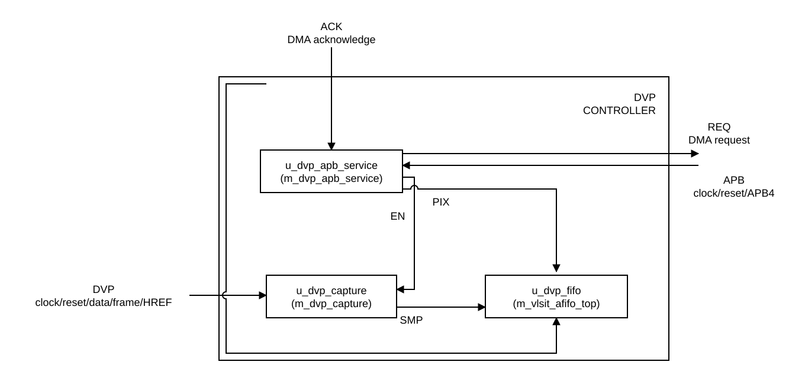

```json
{
  "page_name": "BLOCK_DIAGRAM",
  "out_name": "dvp_controller_block_diagram.drawio",
  "table_suffix": "",
  "layout": {
    "gap_h": 140,
    "gap_v": 140,
    "margin": 70,
    "block_h": 72
  },
  "top": {
    "frame_label": [
      "DVP",
      "CONTROLLER"
    ],
    "block_label": [
      "TOP",
      "(m_dvp_controller)"
    ],
    "block_row": [
      "TOP (m_dvp_controller)",
      "Camera sample capture and APB service.",
      "Section 14.2"
    ]
  },
  "frame_row": [
    "DVP controller",
    "Captures and buffers sensor samples for software and DMA service.",
    "Sections 5.1, 6 and 14.2"
  ],
  "frame_interfaces": [
    "DVP",
    "APB",
    "REQ",
    "ACK"
  ],
  "blocks": [
    {
      "key": "U_DVP_CAPTURE",
      "label": [
        "u_dvp_capture",
        "(m_dvp_capture)"
      ],
      "width": 220,
      "row": 1,
      "col": 0,
      "row_name": "u_dvp_capture (m_dvp_capture)",
      "function": "Samples qualified camera data and writes one sample per accepted PCLK edge.",
      "source": "Section 14.2"
    },
    {
      "key": "U_DVP_FIFO",
      "label": [
        "u_dvp_fifo",
        "(m_vlsit_afifo_top)"
      ],
      "width": 240,
      "row": 1,
      "col": 1,
      "row_name": "u_dvp_fifo (m_vlsit_afifo_top)",
      "function": "Buffers samples between sensor and APB clocks through Gray-pointer CDC.",
      "source": "Section 14.2"
    },
    {
      "key": "U_DVP_APB_SERVICE",
      "label": [
        "u_dvp_apb_service",
        "(m_dvp_apb_service)"
      ],
      "width": 240,
      "row": 0,
      "col": 0,
      "row_name": "u_dvp_apb_service (m_dvp_apb_service)",
      "function": "Decodes APB accesses and manages control, sample reads and DMA batches.",
      "source": "Section 14.2"
    }
  ],
  "connectors": [
    {
      "id": "SMP",
      "src": "U_DVP_CAPTURE",
      "src_side": "R",
      "dst": "U_DVP_FIFO",
      "dst_side": "L"
    },
    {
      "id": "PIX",
      "src": "U_DVP_APB_SERVICE",
      "src_side": "R",
      "dst": "U_DVP_FIFO",
      "dst_side": "T"
    },
    {
      "id": "EN",
      "src": "U_DVP_APB_SERVICE",
      "src_side": "R",
      "dst": "U_DVP_CAPTURE",
      "dst_side": "R"
    }
  ],
  "externals": [
    {
      "id": "DVP",
      "block": "U_DVP_CAPTURE",
      "side": "L",
      "dir": "in",
      "pos": 0,
      "text": [
        "DVP",
        "clock/reset/data/frame/HREF"
      ]
    },
    {
      "id": "APB",
      "block": "U_DVP_APB_SERVICE",
      "side": "R",
      "dir": "in",
      "pos": 0,
      "text": [
        "APB",
        "clock/reset/APB4"
      ]
    },
    {
      "id": "REQ",
      "block": "U_DVP_APB_SERVICE",
      "side": "R",
      "dir": "out",
      "pos": -25,
      "text": [
        "REQ",
        "DMA request"
      ]
    },
    {
      "id": "ACK",
      "block": "U_DVP_APB_SERVICE",
      "side": "T",
      "dir": "in",
      "pos": 35,
      "text": [
        "ACK",
        "DMA acknowledge"
      ]
    }
  ],
  "nets": [
    {
      "entry": "DVP",
      "sinks": [
        {
          "id": "DV0",
          "block": "U_DVP_FIFO",
          "side": "B",
          "pos": -10
        }
      ]
    }
  ],
  "interfaces": [
    {
      "id": "DVP",
      "name": "Sensor DVP input and capture domain",
      "category": "custom source-synchronous interface",
      "active": "camera sensor -> controller",
      "signals": "i_clk_dvp, i_rst_n_sys, rst_n_dvp_sync, i_dvp_data, i_dvp_frame_valid, i_dvp_href"
    },
    {
      "id": "APB",
      "name": "APB4 control/data and service domain",
      "category": "standard protocol (APB4)",
      "active": "system DMA/software -> controller",
      "signals": "i_clk_apb, i_rst_n_sys, rst_n_apb_sync, i_paddr, i_psel, i_penable, i_pwrite, i_pwdata, i_pstrb, i_pprot, o_pready, o_prdata, o_pslverr"
    },
    {
      "id": "REQ",
      "name": "DMA batch request",
      "category": "custom",
      "active": "controller -> system DMA",
      "signals": "o_dma_req"
    },
    {
      "id": "ACK",
      "name": "DMA batch acknowledgement",
      "category": "custom",
      "active": "system DMA -> controller",
      "signals": "i_dma_ack"
    },
    {
      "id": "SMP",
      "name": "Captured sample write",
      "category": "custom",
      "active": "capture block -> FIFO",
      "signals": "sample data and qualified write enable"
    },
    {
      "id": "PIX",
      "name": "FIFO sample service",
      "category": "custom",
      "active": "APB service -> FIFO read control; FIFO returns sample/status",
      "signals": "i_clk_apb, rst_n_apb_sync, show-ahead data, empty, threshold status and read enable"
    },
    {
      "id": "EN",
      "name": "Capture control",
      "category": "custom control",
      "active": "APB service -> capture block",
      "signals": "capture enable"
    }
  ],
  "legend_note": "The APB service subsystem contains address decode, generated CSRs, the FIFO-data endpoint and DMA request logic. Clock and reset signals are grouped with their domain boundary interfaces and distributed to the FIFO."
}
```

*Figure 5-1. DVP controller block and interface diagram. Source: `../figures/dvp_controller_block_diagram.drawio` (draw.io, VLSIT library, drawn by `vlsit_spec_diagram.py`).*

### 5.3 Transaction and dataflow

1. **System setup:** software configures the camera externally, prepares the system DMA, programs the approved draft CSR workbook fields including the DMA watermark, and enables capture. Exact fields and reset values are in the workbook.
2. **DVP sample capture:** the sensor supplies PCLK, data, frame-valid, and line-valid/HREF. `m_dvp_capture` samples data on the compile-time-selected edge and enqueues one sample for each accepted line-valid sample according to the selected profile.
3. **Clock crossing:** the asynchronous FIFO carries the complete sample word from CLK-DVP to CLK-APB as one FIFO entry; no individual data bit is independently synchronized.
- INV-004: the DVP input is never backpressured by APB readiness; overflow handling is observable and deterministic once specified.
- INV-005: the DMA watermark is programmed through the CSR workbook and the DMA notification follows the occupancy threshold; after ACK, re-arm requires occupancy to fall below the watermark before crossing it again.
- INV-006: APB request/control signals follow APB4 stability rules while PREADY is LOW (REF-001 section 3.1).
## 6. External interfaces and ports

### 6.1 Interface inventory

| Interface ID | Protocol | Implemented role | Width / clock | Required | Description |
|---|---|---|---|---|---|
| IF-001 | Sensor-specific DVP | Source-synchronous receiver | Data width selected by PARA_DVP_DATA_W; i_clk_dvp | Yes | Camera samples with frame-valid and line-valid/HREF qualifiers |
| IF-002 | AMBA APB4, Arm IHI 0024 Issue D | Completer | 16-bit address, 32-bit data, 4 strobes; i_clk_apb | Yes | Sole external software and system-DMA access path |
| IF-003 | DMA batch REQ/ACK sideband | Requester output and acknowledgement input | One bit each in CLK-APB | Yes | Announces service batches; DMA transfers samples using APB reads |

### 6.2 Complete port list

The selected APB4 profile is 32-bit data, 16-bit address, PSTRB[3:0], PPROT[2:0] and PSLVERR. APB signals are synchronous to i_clk_apb. Sensor data and qualifiers are synchronous to i_clk_dvp. One common active-low reset asserts asynchronously; release is synchronized independently to CLK-APB and CLK-DVP.

| Port | Direction | Width | Meaning | Clock domain | Signal type | Reset / polarity / encoding | Timing / handshake |
|---|---|---:|---|---|---|---|---|
| i_clk_apb | Input | 1 | APB and CSR clock | CLK-APB | Clock | SoC supplied | APB signals sampled on rising edge |
| i_rst_n_sys | Input | 1 | Common asynchronous reset request for APB and DVP domains | Async input | Reset | Active-low; async assert, independent synchronous release in CLK-APB and CLK-DVP | Local reset synchronizers initialize both FIFO sides before traffic |
| i_clk_dvp | Input | 1 | Sensor pixel clock | CLK-DVP | Clock | Sensor supplied; range TBD | Capture edge selected at elaboration |

| i_dvp_data | Input | PARA_DVP_DATA_W | Parallel sensor sample | CLK-DVP | Data qualified by active frame and line semantics | Unsigned sample | Sampled on PARA_DVP_SAMPLE_EDGE |
| i_dvp_frame_valid | Input | 1 | Frame qualifier or selected frame event | CLK-DVP | Data/qualifier | Polarity and level/pulse semantics selected at elaboration | Synchronous to i_clk_dvp |
| i_dvp_href | Input | 1 | Line-valid/HREF qualifier or selected line event | CLK-DVP | Data/qualifier | Polarity and level/pulse semantics selected at elaboration | Synchronous to i_clk_dvp |
| i_paddr | Input | 16 | APB byte address | CLK-APB | Data valid during transfer | APB4 | Stable through access completion |
| i_psel | Input | 1 | Select this Completer | CLK-APB | Level request | APB4 active-high | Setup and access |
| i_penable | Input | 1 | APB access-phase indicator | CLK-APB | Level request | APB4 active-high | Low in setup, high in access |
| i_pwrite | Input | 1 | APB direction | CLK-APB | Level request | 1=write, 0=read | Stable during access |
| i_pwdata | Input | 32 | APB write data | CLK-APB | Data for write access | APB4 | Stable during access |
| i_pstrb | Input | 4 | APB byte strobes | CLK-APB | Data for write access | APB4 PSTRB[3:0] | Stable during access |
| i_pprot | Input | 3 | APB protection attributes | CLK-APB | Data during access | APB4 PPROT[2:0] | Stable during access |
| o_pready | Output | 1 | Transfer completion / wait response | CLK-APB | Level response | APB4 active-high | Completes when PSEL, PENABLE and PREADY are high |
| o_prdata | Output | 32 | APB read data | CLK-APB | Data valid on completed read | APB4 | FIFO endpoint encoding TBD |
| o_pslverr | Output | 1 | APB error response | CLK-APB | Level response | APB4 active-high | Sampled with completed access |
| i_dma_ack | Input | 1 | Acknowledge DMA batch request | CLK-APB | Pulse, one APB cycle | Active-high | Acknowledges request only; does not pop data |
| o_dma_req | Output | 1 | Request DMA service | CLK-APB | Level request | Active-high | Zero watermark disables; assert at nonzero threshold; ACK then wait below threshold to re-arm |

Internal CSR, FIFO-control and status signals are not top-level ports; document them in the CSR workbook and block diagram.

### 6.3 Protocol behavior

| Operation | Request / acceptance | Response / completion | Wait / error behavior | Requirement |
|---|---|---|---|---|
| DVP sample capture | Selected i_clk_dvp edge with configured frame and line qualifiers active and capture enabled | One sample enqueued in asynchronous FIFO | No sensor backpressure; overrun policy pending | REQ-FUNC-001..003 |
| APB CSR access | APB4 setup then access | Generated CSR response; generator behavior in Section 11.4 | APB4 wait and error response | REQ-IF-001, REQ-REG-001 |
| APB FIFO-data read, nonempty | Read to dedicated FIFO-data endpoint | Returns FIFO head; pop exactly once on completed access | No pop during setup or incomplete/stalled access | REQ-IF-001, REQ-IF-002 |
| APB FIFO-data read, empty | Read to data endpoint | PREADY low while empty until a sample arrives or the software-programmed APB-cycle timeout expires; timeout zero expires in the first access cycle | On timeout, complete with PREADY=1 and PSLVERR=1; do not pop. Data availability wins on the terminal decision cycle. | REQ-IF-002, REQ-IF-005 |
| APB FIFO-data write | Write to read-only endpoint | APB error response | PSLVERR policy awaits CSR error configuration; FIFO unchanged | DEC-016 pending |
| DMA batch request | Nonzero read-domain occupancy threshold is reached | o_dma_req asserts and holds until one-cycle i_dma_ack in CLK-APB; zero watermark disables it | ACK changes request state only; APB reads pop entries | REQ-IF-004 |
| DMA re-arm | After ACK, occupancy falls below a nonzero watermark and later reaches it again | Rearm for a later threshold crossing | Partial frame-end batch remains undecided | REQ-IF-004 |

APB request-side controls/address remain stable through wait states as required by APB4. A FIFO entry is consumed only on completed APB read. The FIFO-data address, alignment rule and unmapped-address behavior must be fixed with the workbook before sign-off.

### 6.4 Interrupts and events

No interrupt output is in scope. DMA notification uses o_dma_req. Sticky status/error fields, if included, are defined only in the CSR workbook; no interrupt behavior is inferred.

## 7. Clock, reset, and power

### 7.1 Clock domains

| Clock ID | Source | Edge | Frequency | Relationship | Reset | Notes |
|---|---|---|---|---|---|---|
| CLK-APB | i_clk_apb, SoC supplied | Rising | TBD from workload | Asynchronous to CLK-DVP by conservative assumption ASM-002 | i_rst_n_sys; local synchronous release | APB, CSR, FIFO read and DMA handshake |
| CLK-DVP | i_clk_dvp, camera supplied | Compile-time selected | Sensor range TBD | Asynchronous to CLK-APB | i_rst_n_sys; local synchronous release | Capture and FIFO write |

The system DMA requester and i_dma_ack are synchronous to CLK-APB by design decision confirmed on 2026-11-21. A DMA running on another clock requires a system-side CDC bridge; it is outside this IP interface.

### 7.2 CDC and RDC

| Crossing | Source to destination | Signals | Mechanism | Constraint / verification |
|---|---|---|---|---|
| CDC-001 | CLK-DVP to CLK-APB | Sample payload | Dual-clock FIFO; Gray pointer synchronizers | CDC structural review; do not synchronize payload bits independently |
| CDC-002 | CLK-APB to CLK-DVP | FIFO read pointer / availability | Gray pointer synchronizer in asynchronous FIFO | CDC/RDC review of synchronizer depth, reset and pointer constraints |
| CDC-003 | CLK-APB to CLK-DVP | Capture enable | Registered control with destination synchronizer or acknowledged update | CDC analysis and enable-boundary simulation |
| CDC-004 | CLK-APB to CLK-DVP | Watermark threshold | Stable multi-bit configuration written before capture and held through capture | Require safe activation handshake or justified static-input constraint |
| CDC-005 | Common reset to local domains | i_rst_n_sys | Asynchronous assertion; independent synchronous release into CLK-APB and CLK-DVP | RDC review; block traffic until both FIFO sides initialize |
| CDC-006 | DMA sideband | i_dma_ack / o_dma_req | Same CLK-APB domain, user-confirmed | Integration check that DMA and APB requester use CLK-APB |

### 7.3 Reset domains and sequencing

| Reset | Port / local signal | Polarity / assertion | Release | Affected state | Required sequence |
|---|---|---|---|---|---|
| RST-SYS | i_rst_n_sys | Active-low, asynchronous assertion | Separate synchronizers release locally in CLK-APB and CLK-DVP | All CSR/APB/DMA state, capture state, and both asynchronous FIFO pointers | Keep capture and FIFO-data service blocked until both FIFO domains report initialized |
| RST-APB-LOCAL | rst_n_apb_sync | Derived active-low reset | Synchronous to CLK-APB | CSR, APB endpoint, DMA request and FIFO read side | Generated CSR reset uses this local reset |
| RST-DVP-LOCAL | rst_n_dvp_sync | Derived active-low reset | Synchronous to CLK-DVP | Capture and FIFO write side | Do not accept samples before local FIFO initialization |
| RST-SW | Software FIFO clear | Not implemented | No software reset/flush path | Capture/FIFO state | The approved CSR set contains no software FIFO-clear control |

The common reset architecture and pending-read abort behavior are user-confirmed. If either clock is stopped during reset, that domain cannot complete synchronous release until its clock resumes; traffic remains blocked until both FIFO domains initialize. Reset cancels an outstanding FIFO-data APB read without completion or pop. After reset release, the APB master starts a fresh setup/access transfer. Software FIFO flush and residual samples on capture stop remain open in Section 20.

### 7.4 Power intent

No power-domain, retention or isolation behavior is selected. Assume an always-on IP domain during capture. Before power gating, stop capture, block APB access and coherently invalidate FIFO state.

## 8. Parameters and elaboration configurations

Parameter declarations follow REF-003 v2: parameter logic [31:0] parameters with the PARA_ prefix with the required three description/value/unit comments. The names below are proposed RTL identifiers. Exact pulse semantics and a delivered sensor profile remain open.

| Parameter | Purpose | Legal values / proposed default | Dependencies and impact |
|---|---|---|---|
| PARA_DVP_DATA_W | Sample-bus width | 8, 10, 12; default proposal 8 | Sets DVP port and FIFO width |
| PARA_DVP_SAMPLE_EDGE | Capture edge | 0 rising, 1 falling; default proposal 0 | Must match sensor output timing |
| PARA_DVP_FRAME_POL | Frame qualifier active polarity | 0 low, 1 high; default proposal 1 | Must match selected mode |
| PARA_DVP_HREF_POL | HREF active polarity | 0 low, 1 high; default proposal 1 | Must match selected mode |
| PARA_DVP_FRAME_MODE | Frame qualifier interpretation | Level/pulse encoding and boundary semantics TBD | Defines frame-active gating |
| PARA_DVP_HREF_MODE | HREF interpretation | Level/pulse encoding and boundary semantics TBD | Defines sample qualification |
| PARA_FIFO_DEPTH | Asynchronous FIFO capacity in captured-sample entries | Power of two, min 2 when the existing Gray-pointer FIFO is selected; default/value pending workload | Sets pointer width, watermark range, buffering interval and area; forwarded to the FIFO as its depth parameter |
| PARA_AFIFO_CELL_TYPE | FIFO pointer synchronizer implementation | Candidate values per AsyncGrayFIFO spec; proposed 2-stage option | Silicon requires qualified library cells |
| PARA_AFIFO_MEM_USE_MACRO | FIFO memory selection | 0 RTL array, 1 SRAM wrapper; proposal 0 | Macro needs compatible dual-clock macro and timing model |

### 8.1 Delivered configuration

Plan for separate builds supporting 8-, 10- and 12-bit samples. Provisional default: 8-bit, rising-edge, active-high level qualifiers. This is an author proposal, not a confirmed sensor profile. Pulse encodings, FIFO capacity, synchronizer and memory choices remain open; no profile is sign-off ready until bound to an exact sensor mode.

## 9. Data representation and arithmetic

| Item | Representation | Width / range | Validity | Status |
|---|---|---|---|---|
| DVP sample | Unsigned raw i_dvp_data sampled on PARA_DVP_SAMPLE_EDGE | 8, 10 or 12 bits | Capture enabled and selected frame/line qualifiers indicate valid sample | Exact qualification profile pending |
| FIFO entry | One captured sample; no color packing or image processing | PARA_DVP_DATA_W bits, possibly metadata | Invalid after reset until written | Sample-per-entry selected; metadata open |
| APB FIFO-data word | One sample per completed 32-bit read | 32 bits | Valid at completed access | Bit placement, zero-extension and marker bits pending DEC-014 |
| Occupancy | Read-domain estimate from synchronized FIFO pointers | Pointer width derived from depth; nominally 0..depth | Approximate due to CDC latency | Not an exact instantaneous sensor-side count |
| DMA watermark | Nonzero level requests a batch when read-domain estimate reaches it; zero disables requests | 0 disables, 1..PARA_FIFO_DEPTH enables | Program before capture; hold stable while active | Values above depth are unreachable and leave REQ low; partial-frame batch policy pending |

For a minimum two-cycle APB transfer, ideal read throughput is at most f_APB/2 samples/s before contention or waits. FIFO sizing must cover arrivals during maximum DMA service delay plus CDC and scheduling margin. Numerical rates and margin await DEC-004.

## 10. Detailed functional behavior

### 10.1 Modes and state transitions

<!-- FSM-DIAGRAM:dma_request -->
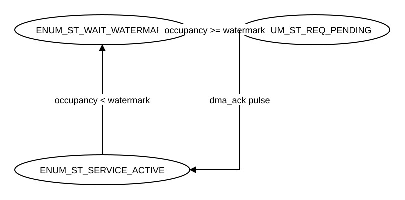

```json
{
  "page_name": "FSM_DMA_REQUEST",
  "out_name": "dvp_dma_request_fsm.drawio",
  "function": "dma_request",
  "initial": "ENUM_ST_WAIT_WATERMARK",
  "state_pattern": "^ENUM_ST_[A-Z0-9_]+$",
  "states": [
    {
      "name": "ENUM_ST_WAIT_WATERMARK"
    },
    {
      "name": "ENUM_ST_REQ_PENDING"
    },
    {
      "name": "ENUM_ST_SERVICE_ACTIVE"
    }
  ],
  "transitions": [
    {
      "src": "ENUM_ST_WAIT_WATERMARK",
      "dst": "ENUM_ST_REQ_PENDING",
      "label": "occupancy >= watermark"
    },
    {
      "src": "ENUM_ST_REQ_PENDING",
      "dst": "ENUM_ST_SERVICE_ACTIVE",
      "label": "dma_ack pulse"
    },
    {
      "src": "ENUM_ST_SERVICE_ACTIVE",
      "dst": "ENUM_ST_WAIT_WATERMARK",
      "label": "occupancy < watermark"
    }
  ],
  "layout": {
    "margin": 50
  }
}
```

*Figure 10-1. FSM state diagram of dma_request. Source: `../figures/dvp_dma_request_fsm.drawio` (draw.io, VLSIT library, generated by `vlsit_fsm_diagram.py`).*
<!-- /FSM-DIAGRAM:dma_request -->

Capture is disabled after reset. Software configures the controller and external sensor before enabling capture. Exact in-flight frame handling on disable is pending.

The batch request controller uses these states:

| State | Outputs / invariant | Transition | Next state |
|---|---|---|---|
| ENUM_ST_WAIT_WATERMARK | o_dma_req=0; request armed | Occupancy estimate >= watermark | ENUM_ST_REQ_PENDING |
| ENUM_ST_REQ_PENDING | o_dma_req=1 until acknowledged | One-cycle i_dma_ack pulse in CLK-APB | ENUM_ST_SERVICE_ACTIVE |
| ENUM_ST_SERVICE_ACTIVE | o_dma_req=0; APB reads pop samples | Occupancy estimate < watermark | ENUM_ST_WAIT_WATERMARK |

The candidate AFIFO read-side threshold can implement a nonzero watermark comparison by setting the empty threshold to watermark minus one and requesting when empty-threshold is deasserted. A separate zero check disables the request when the watermark is zero. Values above PARA_FIFO_DEPTH are unreachable and leave REQ low. Program the watermark before capture and hold it stable while capture is active. Partial-frame batch policy remains open.

### 10.2 Operations

| ID | Operation | Main behavior | Success | Error / corner case |
|---|---|---|---|---|
| OP-001 | Configure and start | Configure sensor externally; program CSRs/watermark; enable capture | Capture begins on selected PCLK edges | Exact CSR actions pending workbook |
| OP-002 | Capture qualified sample | Capture when frame/line profile qualifies data | One FIFO entry per accepted sample | No backpressure; overflow and recovery policy pending |
| OP-003 | APB FIFO read | Read dedicated endpoint | Return head and pop once on success; return an APB error without pop on timeout | Empty read waits for the configured timeout; zero errors in the first access cycle; reset aborts without pop/error, then the master retries after initialization |
| OP-004 | DMA batch notify | Request at watermark | REQ held to ACK; ACK starts service | Rearm below watermark; partial frame batch pending |
| OP-005 | Stop capture | Software disables capture | No new sample after synchronized boundary | In-flight frame and residual FIFO behavior pending |
| OP-006 | Reset/recovery | Coordinated reset | FIFO empty, REQ low, capture disabled | Independent reset or stopped clock must not expose stale data |

### 10.3 Cycle-level behavior and waveform plan

The waveform plan below is user-confirmed. Each planned figure is rendered as SVG from the adjacent WaveJSON source; see the table and figures below.

The user confirmed this 15-waveform plan on 2026-11-21: 9 operation/error/corner cases plus a capture view for each 8/10/12-bit × rising/falling PCLK profile. Each figure has adjacent WaveJSON source and a rendered SVG. These cycle-level diagrams do not replace exact sensor-mode setup/hold values or SDC input delays.

| Waveform ID | Function / operation | Scenario (success / error / corner) | Signals shown | Figure | Confirmed by user |
|---|---|---|---|---|---|
| WF-001 | OP-002 qualified sample capture; OP-005 stop capture | Success and inactive-qualifier corner | DVP clock/reset, capture enable, frame/line qualifiers, data, sample accept, FIFO full/overflow | [SVG](../figures/waveforms/wf001_capture_qualified_sample.svg) | 2026-11-21 |
| WF-002 | OP-001 configure/start and OP-005 stop | CSR write success and partial-strobe error | APB controls/address/data/strobes/responses, capture enable | [SVG](../figures/waveforms/wf002_csr_apb_success_and_error.svg) | 2026-11-21 |
| WF-003 | OP-003 FIFO-data APB read | Successful back-to-back reads | APB controls/data, FIFO empty/pop, PREADY/PSLVERR | [SVG](../figures/waveforms/wf003_fifo_back_to_back_reads.svg) | 2026-11-21 |
| WF-004 | OP-003 FIFO-data APB read | Sample arrives on timeout terminal decision cycle | APB controls/data, timeout count, FIFO empty/valid/pop | [SVG](../figures/waveforms/wf004_empty_read_data_on_terminal_cycle.svg) | 2026-11-21 |
| WF-005 | OP-004 DMA batch notification | Watermark crossing, ACK, APB drain, below-watermark re-arm | FIFO level/watermark, dma_req/ack, APB read/pop | [SVG](../figures/waveforms/wf005_dma_watermark_ack_and_rearm.svg) | 2026-11-21 |
| WF-006 | OP-002 capture under overflow | Full FIFO rejects sample; sticky overflow is set and cleared | DVP qualifiers/data, FIFO full/write, overflow event, W1C status | [SVG](../figures/waveforms/wf006_fifo_overflow_sticky_status.svg) | 2026-11-21 |
| WF-007 | OP-006 coordinated reset/release | Reset aborts pending FIFO-data APB read; master retries | APB/DVP clocks, common/local reset release, APB response, FIFO pop | [SVG](../figures/waveforms/wf007_reset_aborts_pending_apb_read.svg) | 2026-11-21 |
| WF-008 | OP-003 FIFO-data endpoint error | Write to read-only endpoint; no FIFO mutation | APB write/address/response and FIFO pop/level | [SVG](../figures/waveforms/wf008_fifo_endpoint_write_error.svg) | 2026-11-21 |
| WF-009 | OP-003 FIFO-data APB read | Zero immediate timeout and positive timeout expiry | APB response, timeout count, FIFO empty/pop | [SVG](../figures/waveforms/wf009_empty_fifo_timeout_error.svg) | 2026-11-21 |
| WF-010 | OP-002 profile capture | 8-bit data, rising-edge PCLK sample | PCLK, frame/line valid, 8-bit data, accepted sample | [SVG](../figures/waveforms/wf_profile_8bit_rising.svg) | 2026-11-21 |
| WF-011 | OP-002 profile capture | 8-bit data, falling-edge PCLK sample | PCLK, frame/line valid, 8-bit data, accepted sample | [SVG](../figures/waveforms/wf_profile_8bit_falling.svg) | 2026-11-21 |
| WF-012 | OP-002 profile capture | 10-bit data, rising-edge PCLK sample | PCLK, frame/line valid, 10-bit data, accepted sample | [SVG](../figures/waveforms/wf_profile_10bit_rising.svg) | 2026-11-21 |
| WF-013 | OP-002 profile capture | 10-bit data, falling-edge PCLK sample | PCLK, frame/line valid, 10-bit data, accepted sample | [SVG](../figures/waveforms/wf_profile_10bit_falling.svg) | 2026-11-21 |
| WF-014 | OP-002 profile capture | 12-bit data, rising-edge PCLK sample | PCLK, frame/line valid, 12-bit data, accepted sample | [SVG](../figures/waveforms/wf_profile_12bit_rising.svg) | 2026-11-21 |
| WF-015 | OP-002 profile capture | 12-bit data, falling-edge PCLK sample | PCLK, frame/line valid, 12-bit data, accepted sample | [SVG](../figures/waveforms/wf_profile_12bit_falling.svg) | 2026-11-21 |

#### Waveform figures and machine-readable sources

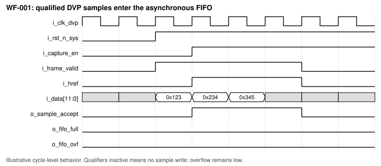

```wavedrom
{
  "signal": [
    {
      "name": "i_clk_dvp",
      "wave": "p......."
    },
    {
      "name": "i_rst_n_sys",
      "wave": "00111111"
    },
    {
      "name": "i_capture_en",
      "wave": "00011111"
    },
    {
      "name": "i_frame_valid",
      "wave": "00111100"
    },
    {
      "name": "i_href",
      "wave": "00011100"
    },
    {
      "name": "i_data[11:0]",
      "wave": "xx===xxx",
      "data": [
        "0x123",
        "0x234",
        "0x345"
      ]
    },
    {
      "name": "o_sample_accept",
      "wave": "00011100"
    },
    {
      "name": "o_fifo_full",
      "wave": "00000000"
    },
    {
      "name": "o_fifo_ovf",
      "wave": "00000000"
    }
  ],
  "head": {
    "text": "WF-001: qualified DVP samples enter the asynchronous FIFO"
  },
  "foot": {
    "text": "Illustrative cycle-level behavior. Qualifiers inactive means no sample write; overflow remains low."
  },
  "config": {
    "hscale": 2.5
  }
}
```

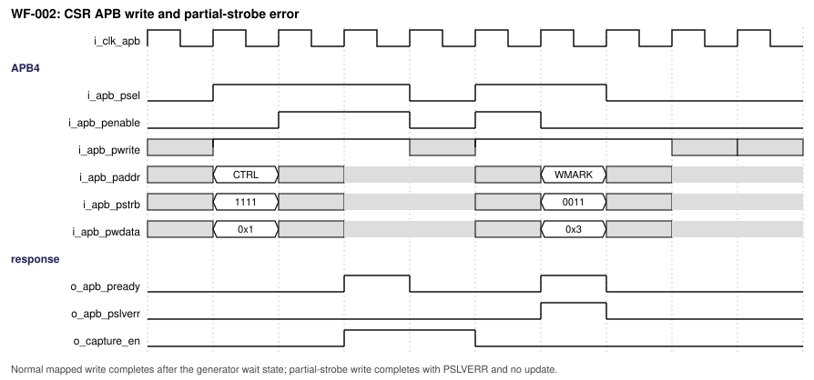

```wavedrom
{
  "signal": [
    {
      "name": "i_clk_apb",
      "wave": "p........."
    },
    [
      "APB4",
      {
        "name": "i_apb_psel",
        "wave": "0111011000"
      },
      {
        "name": "i_apb_penable",
        "wave": "0011010000"
      },
      {
        "name": "i_apb_pwrite",
        "wave": "x111x111xx"
      },
      {
        "name": "i_apb_paddr",
        "wave": "x=x..x=x..",
        "data": [
          "CTRL",
          "WMARK"
        ]
      },
      {
        "name": "i_apb_pstrb",
        "wave": "x=x..x=x..",
        "data": [
          "1111",
          "0011"
        ]
      },
      {
        "name": "i_apb_pwdata",
        "wave": "x=x..x=x..",
        "data": [
          "0x1",
          "0x3"
        ]
      }
    ],
    [
      "response",
      {
        "name": "o_apb_pready",
        "wave": "0001001000"
      },
      {
        "name": "o_apb_pslverr",
        "wave": "0000001000"
      },
      {
        "name": "o_capture_en",
        "wave": "0001100000"
      }
    ]
  ],
  "head": {
    "text": "WF-002: CSR APB write and partial-strobe error"
  },
  "foot": {
    "text": "Normal mapped write completes after the generator wait state; partial-strobe write completes with PSLVERR and no update."
  },
  "config": {
    "hscale": 2.5
  }
}
```

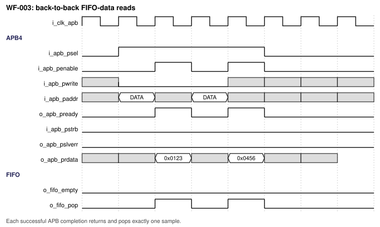

```wavedrom
{
  "signal": [
    {
      "name": "i_clk_apb",
      "wave": "p......."
    },
    [
      "APB4",
      {
        "name": "i_apb_psel",
        "wave": "01111000"
      },
      {
        "name": "i_apb_penable",
        "wave": "00101000"
      },
      {
        "name": "i_apb_pwrite",
        "wave": "x000xxxx"
      },
      {
        "name": "i_apb_paddr",
        "wave": "x=x=xxxx",
        "data": [
          "DATA",
          "DATA"
        ]
      },
      {
        "name": "o_apb_pready",
        "wave": "00101000"
      },
      {
        "name": "o_apb_pslverr",
        "wave": "00000000"
      },
      {
        "name": "o_apb_prdata",
        "wave": "xx=x=xx",
        "data": [
          "0x0123",
          "0x0456"
        ]
      }
    ],
    [
      "FIFO",
      {
        "name": "o_fifo_empty",
        "wave": "00000000"
      },
      {
        "name": "o_fifo_pop",
        "wave": "00101000"
      }
    ]
  ],
  "head": {
    "text": "WF-003: back-to-back FIFO-data reads"
  },
  "foot": {
    "text": "Each successful APB completion returns and pops exactly one sample."
  },
  "config": {
    "hscale": 2.5
  }
}
```

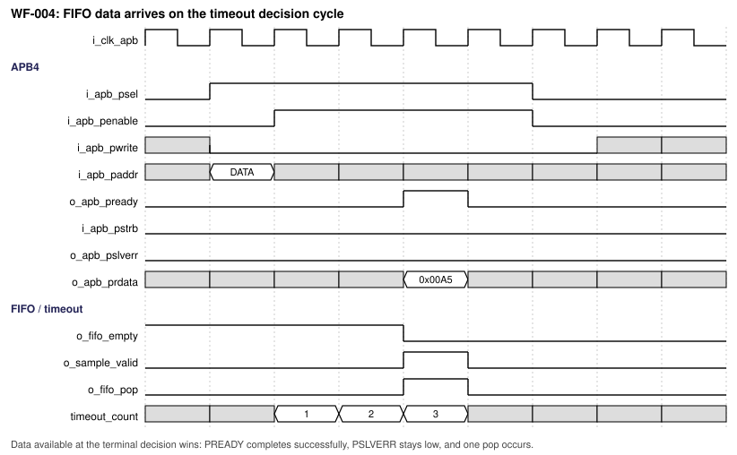

```wavedrom
{
  "signal": [
    {
      "name": "i_clk_apb",
      "wave": "p........"
    },
    [
      "APB4",
      {
        "name": "i_apb_psel",
        "wave": "011111000"
      },
      {
        "name": "i_apb_penable",
        "wave": "001111000"
      },
      {
        "name": "i_apb_pwrite",
        "wave": "x000000xx"
      },
      {
        "name": "i_apb_paddr",
        "wave": "x=xxxxxxx",
        "data": [
          "DATA"
        ]
      },
      {
        "name": "o_apb_pready",
        "wave": "000010000"
      },
      {
        "name": "o_apb_pslverr",
        "wave": "000000000"
      },
      {
        "name": "o_apb_prdata",
        "wave": "xxxx=xxxx",
        "data": [
          "0x00A5"
        ]
      }
    ],
    [
      "FIFO / timeout",
      {
        "name": "o_fifo_empty",
        "wave": "111100000"
      },
      {
        "name": "o_sample_valid",
        "wave": "000010000"
      },
      {
        "name": "o_fifo_pop",
        "wave": "000010000"
      },
      {
        "name": "timeout_count",
        "wave": "xx===xxxx",
        "data": [
          "1",
          "2",
          "3"
        ]
      }
    ]
  ],
  "head": {
    "text": "WF-004: FIFO data arrives on the timeout decision cycle"
  },
  "foot": {
    "text": "Data available at the terminal decision wins: PREADY completes successfully, PSLVERR stays low, and one pop occurs."
  },
  "config": {
    "hscale": 2.5
  }
}
```

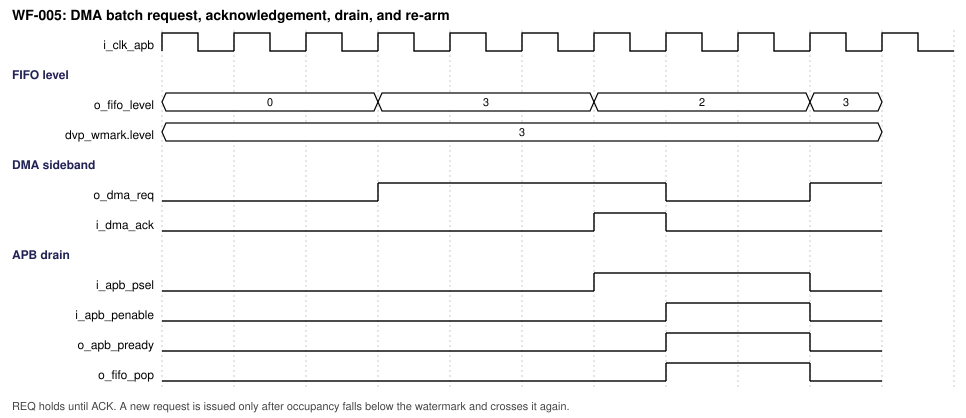

```wavedrom
{
  "signal": [
    {
      "name": "i_clk_apb",
      "wave": "p.........."
    },
    [
      "FIFO level",
      {
        "name": "o_fifo_level",
        "wave": "=..=..=..=",
        "data": [
          "0",
          "3",
          "2",
          "3"
        ]
      },
      {
        "name": "dvp_wmark.level",
        "wave": "=.........",
        "data": [
          "3"
        ]
      }
    ],
    [
      "DMA sideband",
      {
        "name": "o_dma_req",
        "wave": "0001111001"
      },
      {
        "name": "i_dma_ack",
        "wave": "0000001000"
      }
    ],
    [
      "APB drain",
      {
        "name": "i_apb_psel",
        "wave": "0000001110"
      },
      {
        "name": "i_apb_penable",
        "wave": "0000000110"
      },
      {
        "name": "o_apb_pready",
        "wave": "0000000110"
      },
      {
        "name": "o_fifo_pop",
        "wave": "0000000110"
      }
    ]
  ],
  "head": {
    "text": "WF-005: DMA batch request, acknowledgement, drain, and re-arm"
  },
  "foot": {
    "text": "REQ holds until ACK. A new request is issued only after occupancy falls below the watermark and crosses it again."
  },
  "config": {
    "hscale": 2.5
  }
}
```

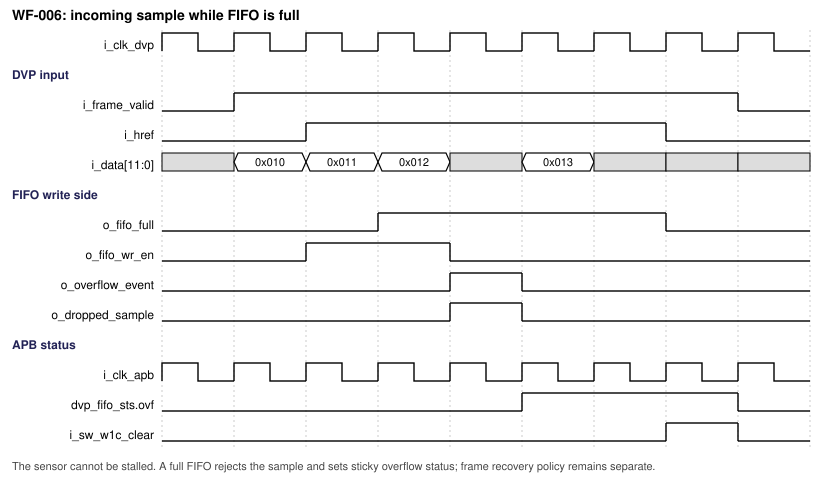

```wavedrom
{
  "signal": [
    {
      "name": "i_clk_dvp",
      "wave": "p........"
    },
    [
      "DVP input",
      {
        "name": "i_frame_valid",
        "wave": "011111110"
      },
      {
        "name": "i_href",
        "wave": "001111100"
      },
      {
        "name": "i_data[11:0]",
        "wave": "x===x=xxx",
        "data": [
          "0x010",
          "0x011",
          "0x012",
          "0x013"
        ]
      }
    ],
    [
      "FIFO write side",
      {
        "name": "o_fifo_full",
        "wave": "000111100"
      },
      {
        "name": "o_fifo_wr_en",
        "wave": "001100000"
      },
      {
        "name": "o_overflow_event",
        "wave": "000010000"
      },
      {
        "name": "o_dropped_sample",
        "wave": "000010000"
      }
    ],
    [
      "APB status",
      {
        "name": "i_clk_apb",
        "wave": "p........"
      },
      {
        "name": "dvp_fifo_sts.ovf",
        "wave": "000001110"
      },
      {
        "name": "i_sw_w1c_clear",
        "wave": "000000010"
      }
    ]
  ],
  "head": {
    "text": "WF-006: incoming sample while FIFO is full"
  },
  "foot": {
    "text": "The sensor cannot be stalled. A full FIFO rejects the sample and sets sticky overflow status; frame recovery policy remains separate."
  },
  "config": {
    "hscale": 2.5
  }
}
```

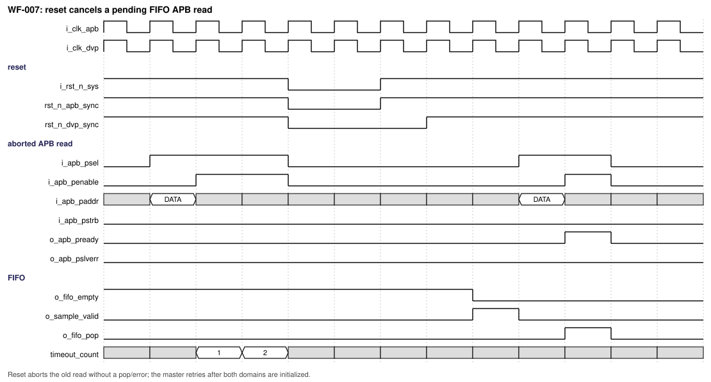

```wavedrom
{
  "signal": [
    {
      "name": "i_clk_apb",
      "wave": "p............"
    },
    {
      "name": "i_clk_dvp",
      "wave": "p............"
    },
    [
      "reset",
      {
        "name": "i_rst_n_sys",
        "wave": "1111001111111"
      },
      {
        "name": "rst_n_apb_sync",
        "wave": "1111001111111"
      },
      {
        "name": "rst_n_dvp_sync",
        "wave": "1111000111111"
      }
    ],
    [
      "aborted APB read",
      {
        "name": "i_apb_psel",
        "wave": "0111000001100"
      },
      {
        "name": "i_apb_penable",
        "wave": "0011000000100"
      },
      {
        "name": "i_apb_paddr",
        "wave": "x=xxxxxxx=xxx",
        "data": [
          "DATA",
          "DATA"
        ]
      },
      {
        "name": "o_apb_pready",
        "wave": "0000000000100"
      },
      {
        "name": "o_apb_pslverr",
        "wave": "0000000000000"
      }
    ],
    [
      "FIFO",
      {
        "name": "o_fifo_empty",
        "wave": "1111111100000"
      },
      {
        "name": "o_sample_valid",
        "wave": "0000000010000"
      },
      {
        "name": "o_fifo_pop",
        "wave": "0000000000100"
      },
      {
        "name": "timeout_count",
        "wave": "xx==xxxxxxxxx",
        "data": [
          "1",
          "2"
        ]
      }
    ]
  ],
  "head": {
    "text": "WF-007: reset cancels a pending FIFO APB read"
  },
  "foot": {
    "text": "Reset aborts the old read without a pop/error; the master retries after both domains are initialized."
  },
  "config": {
    "hscale": 2.5
  }
}
```

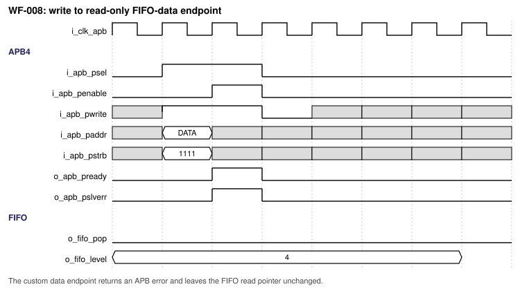

```wavedrom
{
  "signal": [
    {
      "name": "i_clk_apb",
      "wave": "p......."
    },
    [
      "APB4",
      {
        "name": "i_apb_psel",
        "wave": "01100000"
      },
      {
        "name": "i_apb_penable",
        "wave": "00100000"
      },
      {
        "name": "i_apb_pwrite",
        "wave": "x110xxxx"
      },
      {
        "name": "i_apb_paddr",
        "wave": "x=xxxxxx",
        "data": [
          "DATA"
        ]
      },
      {
        "name": "i_apb_pstrb",
        "wave": "x=xxxxxx",
        "data": [
          "1111"
        ]
      },
      {
        "name": "o_apb_pready",
        "wave": "00100000"
      },
      {
        "name": "o_apb_pslverr",
        "wave": "00100000"
      }
    ],
    [
      "FIFO",
      {
        "name": "o_fifo_pop",
        "wave": "00000000"
      },
      {
        "name": "o_fifo_level",
        "wave": "=......",
        "data": [
          "4"
        ]
      }
    ]
  ],
  "head": {
    "text": "WF-008: write to read-only FIFO-data endpoint"
  },
  "foot": {
    "text": "The custom data endpoint returns an APB error and leaves the FIFO read pointer unchanged."
  },
  "config": {
    "hscale": 2.5
  }
}
```

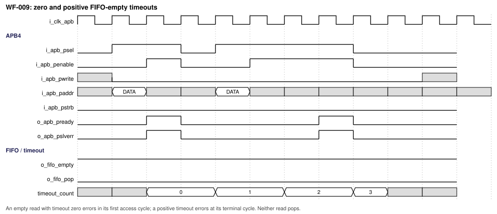

```wavedrom
{
  "signal": [
    {
      "name": "i_clk_apb",
      "wave": "p..........."
    },
    [
      "APB4",
      {
        "name": "i_apb_psel",
        "wave": "01101111000"
      },
      {
        "name": "i_apb_penable",
        "wave": "00100111000"
      },
      {
        "name": "i_apb_pwrite",
        "wave": "x000000000x"
      },
      {
        "name": "i_apb_paddr",
        "wave": "x=xx=xxxxxxx",
        "data": [
          "DATA",
          "DATA"
        ]
      },
      {
        "name": "o_apb_pready",
        "wave": "00100001000"
      },
      {
        "name": "o_apb_pslverr",
        "wave": "00100001000"
      }
    ],
    [
      "FIFO / timeout",
      {
        "name": "o_fifo_empty",
        "wave": "11111111111"
      },
      {
        "name": "o_fifo_pop",
        "wave": "00000000000"
      },
      {
        "name": "timeout_count",
        "wave": "xx=.=.=.=xx",
        "data": [
          "0",
          "1",
          "2",
          "3"
        ]
      }
    ]
  ],
  "head": {
    "text": "WF-009: zero and positive FIFO-empty timeouts"
  },
  "foot": {
    "text": "An empty read with timeout zero errors in its first access cycle; a positive timeout errors at its terminal cycle. Neither read pops."
  },
  "config": {
    "hscale": 2.5
  }
}
```

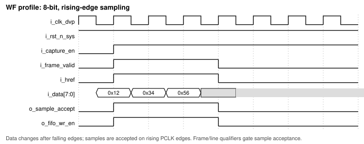

```wavedrom
{
  "signal": [
    {
      "name": "i_clk_dvp",
      "wave": "p......."
    },
    {
      "name": "i_rst_n_sys",
      "wave": "11111111"
    },
    {
      "name": "i_capture_en",
      "wave": "01111111"
    },
    {
      "name": "i_frame_valid",
      "wave": "01110000"
    },
    {
      "name": "i_href",
      "wave": "01110000"
    },
    {
      "name": "i_data[7:0]",
      "wave": "===x....",
      "data": [
        "0x12",
        "0x34",
        "0x56"
      ],
      "phase": 0.5
    },
    {
      "name": "o_sample_accept",
      "wave": "01110000"
    },
    {
      "name": "o_fifo_wr_en",
      "wave": "01110000"
    }
  ],
  "head": {
    "text": "WF profile: 8-bit, rising-edge sampling"
  },
  "foot": {
    "text": "Data changes after falling edges; samples are accepted on rising PCLK edges. Frame/line qualifiers gate sample acceptance."
  },
  "config": {
    "hscale": 2.5
  }
}
```

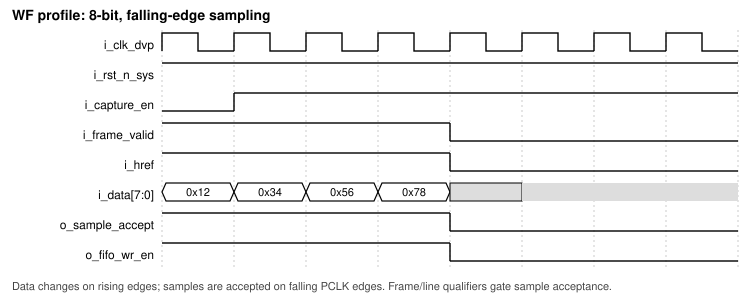

```wavedrom
{
  "signal": [
    {
      "name": "i_clk_dvp",
      "wave": "p......."
    },
    {
      "name": "i_rst_n_sys",
      "wave": "11111111"
    },
    {
      "name": "i_capture_en",
      "wave": "01111111"
    },
    {
      "name": "i_frame_valid",
      "wave": "11110000"
    },
    {
      "name": "i_href",
      "wave": "11110000"
    },
    {
      "name": "i_data[7:0]",
      "wave": "====x...",
      "data": [
        "0x12",
        "0x34",
        "0x56",
        "0x78"
      ],
      "phase": 0.0
    },
    {
      "name": "o_sample_accept",
      "wave": "11110000"
    },
    {
      "name": "o_fifo_wr_en",
      "wave": "11110000"
    }
  ],
  "head": {
    "text": "WF profile: 8-bit, falling-edge sampling"
  },
  "foot": {
    "text": "Data changes on rising edges; samples are accepted on falling PCLK edges. Frame/line qualifiers gate sample acceptance."
  },
  "config": {
    "hscale": 2.5
  }
}
```


```wavedrom
{
  "signal": [
    {
      "name": "i_clk_dvp",
      "wave": "p......."
    },
    {
      "name": "i_rst_n_sys",
      "wave": "11111111"
    },
    {
      "name": "i_capture_en",
      "wave": "01111111"
    },
    {
      "name": "i_frame_valid",
      "wave": "01110000"
    },
    {
      "name": "i_href",
      "wave": "01110000"
    },
    {
      "name": "i_data[9:0]",
      "wave": "===x....",
      "data": [
        "0x012",
        "0x034",
        "0x056"
      ],
      "phase": 0.5
    },
    {
      "name": "o_sample_accept",
      "wave": "01110000"
    },
    {
      "name": "o_fifo_wr_en",
      "wave": "01110000"
    }
  ],
  "head": {
    "text": "WF profile: 10-bit, rising-edge sampling"
  },
  "foot": {
    "text": "Data changes after falling edges; samples are accepted on rising PCLK edges. Frame/line qualifiers gate sample acceptance."
  },
  "config": {
    "hscale": 2.5
  }
}
```


```wavedrom
{
  "signal": [
    {
      "name": "i_clk_dvp",
      "wave": "p......."
    },
    {
      "name": "i_rst_n_sys",
      "wave": "11111111"
    },
    {
      "name": "i_capture_en",
      "wave": "01111111"
    },
    {
      "name": "i_frame_valid",
      "wave": "11110000"
    },
    {
      "name": "i_href",
      "wave": "11110000"
    },
    {
      "name": "i_data[9:0]",
      "wave": "====x...",
      "data": [
        "0x012",
        "0x034",
        "0x056",
        "0x078"
      ],
      "phase": 0.0
    },
    {
      "name": "o_sample_accept",
      "wave": "11110000"
    },
    {
      "name": "o_fifo_wr_en",
      "wave": "11110000"
    }
  ],
  "head": {
    "text": "WF profile: 10-bit, falling-edge sampling"
  },
  "foot": {
    "text": "Data changes on rising edges; samples are accepted on falling PCLK edges. Frame/line qualifiers gate sample acceptance."
  },
  "config": {
    "hscale": 2.5
  }
}
```

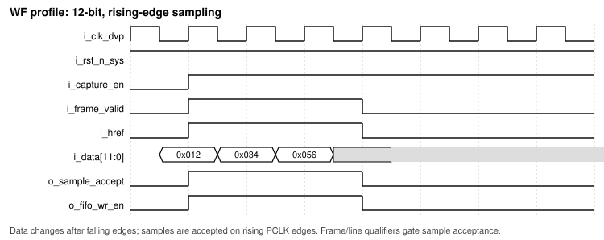

```wavedrom
{
  "signal": [
    {
      "name": "i_clk_dvp",
      "wave": "p......."
    },
    {
      "name": "i_rst_n_sys",
      "wave": "11111111"
    },
    {
      "name": "i_capture_en",
      "wave": "01111111"
    },
    {
      "name": "i_frame_valid",
      "wave": "01110000"
    },
    {
      "name": "i_href",
      "wave": "01110000"
    },
    {
      "name": "i_data[11:0]",
      "wave": "===x....",
      "data": [
        "0x012",
        "0x034",
        "0x056"
      ],
      "phase": 0.5
    },
    {
      "name": "o_sample_accept",
      "wave": "01110000"
    },
    {
      "name": "o_fifo_wr_en",
      "wave": "01110000"
    }
  ],
  "head": {
    "text": "WF profile: 12-bit, rising-edge sampling"
  },
  "foot": {
    "text": "Data changes after falling edges; samples are accepted on rising PCLK edges. Frame/line qualifiers gate sample acceptance."
  },
  "config": {
    "hscale": 2.5
  }
}
```

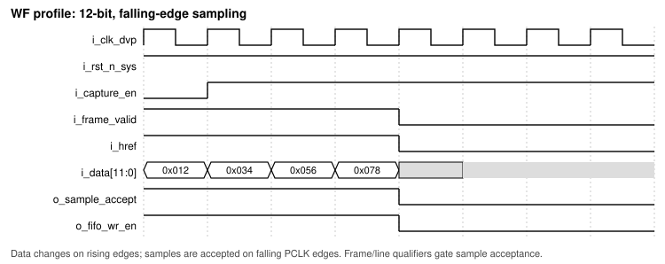

```wavedrom
{
  "signal": [
    {
      "name": "i_clk_dvp",
      "wave": "p......."
    },
    {
      "name": "i_rst_n_sys",
      "wave": "11111111"
    },
    {
      "name": "i_capture_en",
      "wave": "01111111"
    },
    {
      "name": "i_frame_valid",
      "wave": "11110000"
    },
    {
      "name": "i_href",
      "wave": "11110000"
    },
    {
      "name": "i_data[11:0]",
      "wave": "====x...",
      "data": [
        "0x012",
        "0x034",
        "0x056",
        "0x078"
      ],
      "phase": 0.0
    },
    {
      "name": "o_sample_accept",
      "wave": "11110000"
    },
    {
      "name": "o_fifo_wr_en",
      "wave": "11110000"
    }
  ],
  "head": {
    "text": "WF profile: 12-bit, falling-edge sampling"
  },
  "foot": {
    "text": "Data changes on rising edges; samples are accepted on falling PCLK edges. Frame/line qualifiers gate sample acceptance."
  },
  "config": {
    "hscale": 2.5
  }
}
```


### 10.4 Arbitration, buffering, and throughput

One external APB interface permits one transfer at a time. The decoder selects CSR or FIFO-data endpoint. The sensor cannot be stalled; the asynchronous FIFO absorbs rate and service variation. A minimum two-cycle APB read bounds ideal throughput to f_APB/2; contention and wait states lower it. Required depth uses peak active sample rate and maximum DMA service delay plus CDC/arbitration/recovery margin; numeric targets await DEC-004.

### 10.5 Memories and storage

| Memory ID | Storage | Width / depth | Port clocks | Read semantics | Implementation | Status |
|---|---|---|---|---|---|---|
| MEM-001 | Asynchronous DVP sample FIFO | PARA_DVP_DATA_W by PARA_FIFO_DEPTH | Write i_clk_dvp; read i_clk_apb | Candidate show-ahead; valid when nonempty | Candidate reuse of 001_AsyncGrayFIFO, RTL array or SRAM macro | Integration, depth and macro choice pending |

## 11. Register and programming model

This IP has software-visible control/status CSRs plus a custom APB FIFO-data endpoint. The user-approved draft v1.0 CSR workbook is the sole source for register names, fields, offsets, access types, and reset values. Numeric workload and FIFO_DATA address/encoding decisions remain open in Section 20; no register map is duplicated here.

### 11.1 CSR specification source

The CSR workbook is the single source for software-visible register names, fields, offsets, access types, and reset values. The custom FIFO_DATA endpoint is not a CSR and shares the external APB4 interface through a decoder/response mux.

| Item | Specification |
|---|---|
| CSR workbook | spec/VLSIT_DVP_CONTROLLER_CSR.xlsx |
| JSON generation source | spec/VLSIT_DVP_CONTROLLER_CSR.json |
| Workbook sheet | CSR |
| Workbook status | Draft v1.0, generated and validated on 2026-11-21 from the user-approved CSR proposal |
| CSR generator reference | Canonical APB-CSR-Generator v3.3; the RTL flow shall verify the installed revision before generation |
| Generated module | m_vlsit_csr_dvp |
| Register prefix | dvp |
| IP version | 1.0 |
| Asynchronous | 0; the register clock is the APB clock |
| CSR module clocks | Tie i_clk_reg to i_clk_apb and i_rst_n_reg to the synchronized APB-domain reset |
| APB protection | i_protect_en is tied low; protection filtering is disabled |
| APB error checking | i_slverr_en is tied high and remains constant after reset |
| Workbook register set | dvp_version, dvp_ctrl, dvp_wmark, dvp_timeout, dvp_fifo_sts, dvp_fifo_level |

The workbook contains all register offsets, field layouts, access types, reset values, and descriptions. They are intentionally not repeated here. The version register is the first workbook entry as required by the CSR rule. The FIFO_DATA endpoint address and invalid-address decode remain open under DEC-016.

The software programs a nonzero watermark and timeout while capture is disabled, optionally clears stale overflow status, then enables capture. A zero watermark disables DMA requests; a watermark above PARA_FIFO_DEPTH is unreachable and therefore leaves REQ low. A zero timeout causes an immediate APB error if FIFO_DATA is read while empty. The system DMA uses the APB-clocked batch REQ/ACK sideband and drains one sample per successful FIFO_DATA read.

### 11.2 Software sequences

Sensor programming and board-level XCLK, reset, and power-down control are external to this IP. The system DMA owns transfer length and destination memory.

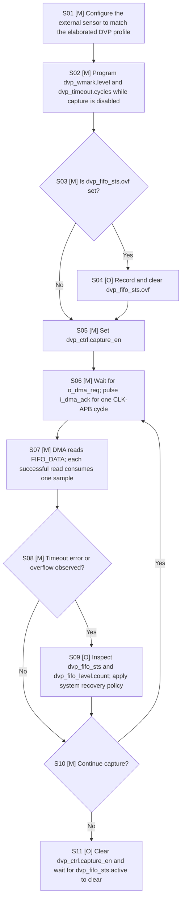

| No. | Step | Option (M/O) | Interface | CSR | Description |
|---|---|---|---|---|---|
| S01 | Configure the external sensor | M | External sensor-control path outside this IP | N/A: sensor configuration is external | Match data width, PCLK sampling edge, qualifier polarity and sync mode to the selected sensor mode. |
| S02 | Program DMA service and timeout | M | APB4 full-word writes | dvp_wmark.level and dvp_timeout.cycles | Write a nonzero watermark within PARA_FIFO_DEPTH, or zero to disable requests; program the empty-read timeout before enabling capture. |
| S03 | Check prior overflow | M | APB4 read | dvp_fifo_sts.ovf | Inspect sticky overflow from a previous capture before starting a new run. |
| S04 | Clear prior overflow | O; only if S03 reports overflow | APB4 full-word write | dvp_fifo_sts.ovf | Record the fault and write one to clear the W1C event before restarting. |
| S05 | Enable capture | M | APB4 full-word write | dvp_ctrl.capture_en | Enable qualified sample capture after profile and service controls are configured. |
| S06 | Accept a DMA batch request | M | Observe o_dma_req; pulse i_dma_ack for one CLK-APB cycle | N/A: sideband handshake | ACK acknowledges the batch request only; it does not pop a sample. |
| S07 | Drain samples | M | System DMA reads FIFO_DATA over APB4 | N/A: custom data endpoint | Each successful read returns and consumes one sample. On PSLVERR, stop the transfer and inspect status before retrying. |
| S08 | Inspect errors and occupancy | O; if a timeout error or overflow is reported | APB4 reads | dvp_fifo_sts and dvp_fifo_level.count | Determine whether FIFO is empty/full and whether overflow was recorded; apply system-level recovery. |
| S09 | Clear overflow after recording it | O; only if dvp_fifo_sts.ovf is set | APB4 full-word write | dvp_fifo_sts.ovf | W1C the sticky event only after software records or handles the dropped-sample condition. |
| S10 | Continue or stop | M after each batch | REQ/ACK and APB status | dvp_fifo_sts.active | Continue by waiting for the next request; otherwise proceed to stop. |
| S11 | Disable capture | O; when capture is no longer required | APB4 full-word write | dvp_ctrl.capture_en | Clear capture enable and wait for active to deassert. Treatment of a partially captured line/frame and residual FIFO entries remains open in Section 20. |

### 11.3 CSR connection to the design

Use exact field names from the workbook. The following are generated CSR ports and internal design connections, not additional top-level ports.

| Workbook register.field | CSR port / direction | Design connection | Clock domain | Behavior |
|---|---|---|---|---|
| dvp_version.major | i_dvp_version_major, input | Constant major version value | CLK-APB | Read-only identification |
| dvp_version.minor | i_dvp_version_minor, input | Constant minor version value | CLK-APB | Read-only identification |
| dvp_ctrl.capture_en | o_dvp_ctrl_capture_en, output | Capture-enable request; synchronize into CLK-DVP | CLK-APB to CLK-DVP | Reset-disabled control; active feedback is exposed through dvp_fifo_sts.active |
| dvp_wmark.level | o_dvp_wmark_level, output | DMA occupancy threshold comparator | CLK-APB | Zero disables requests; nonzero configuration is held stable during capture |
| dvp_timeout.cycles | o_dvp_timeout_cycles, output | Custom FIFO_DATA APB wait counter | CLK-APB | Applies to active FIFO_DATA reads only; the APB transfer is exclusive while waiting |
| dvp_fifo_sts.active | i_dvp_fifo_sts_active, input | Synchronized capture-active indication | CLK-APB | Deasserts after capture disable crosses into CLK-DVP |
| dvp_fifo_sts.empty | i_dvp_fifo_sts_empty, input | APB-side asynchronous FIFO empty flag | CLK-APB | Used by FIFO_DATA reads and DMA status checks |
| dvp_fifo_sts.full | i_dvp_fifo_sts_full, input | FIFO full indication synchronized from CLK-DVP | CLK-APB | May lag the current write-side condition by CDC latency |
| dvp_fifo_sts.ovf | o_dvp_fifo_sts_ovf, output | Sticky W1C status; hardware load uses i_hw_wdata_dvp_fifo_sts_ovf and i_hw_we_dvp_fifo_sts_ovf | CLK-APB | Synchronize the overflow event into CLK-APB and load one; hardware set wins over a same-cycle software clear |
| dvp_fifo_level.count | i_dvp_fifo_level_count, input | APB-side occupancy estimate from synchronized FIFO pointers | CLK-APB | Live estimate from zero through configured FIFO capacity |

All inputs to the synchronous CSR sheet are synchronous to i_clk_apb. Cross-domain sensor signals are synchronized by the DVP controller before they reach the CSR ports. The CSR generator does not synchronize hardware status inputs.

### 11.4 APB access behavior

The APB transfer-phase and signal-stability requirements follow REF-001, AMBA APB IHI 0024D, Appendix A and Sections 3.1–3.4. The generated CSR behavior follows the APB-CSR-Generator reference for Asynchronous=0; confirm the exact generator revision in the RTL flow. The FIFO_DATA endpoint is custom logic and uses the same external APB interface.

| Case | Behavior |
|---|---|
| Normal mapped CSR read or write | With Asynchronous=0, the generated module uses one wait state, then completes when PREADY is high. |
| CSR partial-strobe write | With static i_slverr_en=1, complete with PSLVERR and make no register change. Software writes full words only. |
| CSR unaligned address | Complete with PSLVERR when i_slverr_en=1; no CSR changes. |
| CSR aligned unmapped address | Generator default: complete without error; reads return zero and writes are ignored. |
| CSR access protection | i_protect_en is tied low, so PPROT does not reject an access. |
| Reserved workbook fields | Read as zero and ignore writes. |
| W1C overflow event and clear in one cycle | Hardware load has priority; a new overflow event is retained. |
| FIFO_DATA read while nonempty | Return the FIFO head and assert PREADY on the first APB access cycle; pop exactly once on successful completion. |
| FIFO_DATA read while empty, timeout zero | Complete with PREADY and PSLVERR high in the first APB access cycle; do not pop. |
| FIFO_DATA read while empty, positive timeout | Hold PREADY low while waiting. If the FIFO remains empty through the configured number of APB access cycles, complete with PREADY and PSLVERR high only in the terminal cycle; do not pop. Data available on that terminal decision cycle wins and completes successfully with one pop. |
| FIFO_DATA write | Return an APB error and leave FIFO pointers/data unchanged. |
| Reset during a FIFO_DATA read | Cancel the pending transfer, keep pop and PSLVERR low, reset both FIFO domains; the APB master retries only after reset release and initialization. |
| FIFO_DATA/unmapped/misaligned decode | Address and decode precedence remain open under DEC-016. |

During a wait state, the APB Requester shall hold address and control signals stable and keep PSTRB low for reads, consistent with REF-001. PSLVERR is meaningful only on the final cycle where PSEL, PENABLE and PREADY are all high.

## 12. Error handling and recovery

| Error ID | Condition | Detection | External response | Recovery / software action | Open point |
|---|---|---|---|---|---|
| ERR-001 | Qualified sample arrives while FIFO is full | FIFO write-side overflow indication | Sensor cannot be stalled; sample loss is possible | Proposed sticky APB-visible status; clear/recovery awaits policy decision | DEC-010 |
| ERR-002 | FIFO-data APB read remains empty through the programmed timeout | Empty flag and APB-cycle counter | Complete with PREADY=1 and PSLVERR=1 in the final APB cycle | No FIFO pop; DMA/software observes the error and retries only after checking request/level status | DEC-013, DEC-017 |
| ERR-003 | APB write to read-only FIFO-data endpoint | Address decode and PWRITE | APB error response when enabled | No FIFO state change | DEC-016 |
| ERR-004 | Invalid or misaligned APB address | Decoder / CSR generator | Follow generated CSR behavior; endpoint alignment pending | No unintended FIFO pop or write | DEC-016 |
| ERR-005 | FIFO reset domains released inconsistently | Reset/CDC review | Block access until both sides initialize | Coordinated reset and controlled release | DEC-012 |
| ERR-006 | Unsupported parameter combination | Elaboration checks | Build reports configuration error | Correct compile-time profile | DEC-006 |

A FIFO read must never pop while empty or before APB transfer completion. A FIFO write while full must not corrupt pointers or overwrite unread data. Drop, sticky-event, frame-resynchronization and flush behavior require a decision before implementation sign-off.

## 13. Performance, power, and area

| Metric ID | Metric | Target / formula | Conditions | Verification / measurement | Status |
|---|---|---|---|---|---|
| PERF-001 | Sustained sample capture | Peak active sample rate from sensor PCLK and qualifier duty | Each approved sensor mode | Simulation and analytical rate check | Numeric target pending DEC-004 |
| PERF-002 | Sustained APB drain | At most f_APB/2 samples/s for minimum two-cycle reads, reduced by contention/waits | Back-to-back APB reads | APB throughput simulation | APB frequency and contention pending |
| PERF-003 | Maximum supported service stall | FIFO covers arrivals during agreed stall plus CDC/scheduling margin | Worst approved workload | Bounded-stall simulation and occupancy analysis | Pending DEC-004 |
| PPA-001 | Maximum frequency | Sensor PCLK/APB limits from approved workload and timing | Named library/PVT | STA with approved SDC | Platform and limits pending |
| PPA-002 | Area | Meet selected SoC IP budget | Library and memory choice | Synthesis/physical area report | No target supplied |
| PPA-003 | Dynamic/leakage power | Measure at selected frame rate and switching activity | Named modes/corner | Power analysis | No target supplied |
| PERF-004 | APB FIFO read latency | Minimum two APB cycles when data is available, plus implemented waits | No interconnect wait | APB simulation | Endpoint implementation pending |

FIFO storage depth is compile-time configurable through PARA_FIFO_DEPTH; the project shall select its value after workload and maximum DMA-stall limits are supplied. Required rate counts valid DVP samples, not necessarily complete color pixels. The APB system must sustain the peak average rate or provide adequate buffering for its maximum service interruption.

## 14. RTL implementation contract

### 14.1 Required coding baseline

RTL shall follow VLSIT RTL Design Rules v2 (REF-003), IEEE 1800-2017 synthesizable subset, and the selected naming convention. Parameters use parameter logic [31:0] parameters with the PARA_ prefix with the required three comments. Use separate clock/reset domains, explicit CDC structures and reset synchronizers. Do not add interfaces, macros, packages, initial blocks, delays, latches, multiple drivers, wildcard/positional connections, or unsupported constructs. Each RTL source shall use the required VLSIT header and identifiers shall meet the 30-character limit.

### 14.2 RTL hierarchy

| Module | Function | Parent / instance | Clock domain | Synthesis status |
|---|---|---|---|---|
| m_dvp_controller | Structural top and APB/DVP integration | Top | CLK-APB to CLK-DVP | Synthesizable |
| m_dvp_capture | Apply DVP qualifier profile and enqueue samples | m_dvp_controller / u_dvp_capture | CLK-DVP | Synthesizable |
| m_vlsit_afifo_top | Buffer samples and cross pointer state | m_dvp_controller / u_dvp_fifo | Both domains | Existing candidate; reuse review required |
| m_dvp_apb_service | APB control/data service and batch request | m_dvp_controller / u_dvp_apb_service | CLK-APB | Synthesizable subsystem |
| m_dvp_apb_decode | Select the CSR or FIFO-data endpoint | m_dvp_apb_service / u_dvp_apb_decode | CLK-APB | Synthesizable |
| m_vlsit_csr_dvp | Generated control/status register block | m_dvp_apb_service / u_dvp_csr | CLK-APB | Generated from approved workbook |
| m_dvp_apb_data | FIFO-data APB read endpoint with programmable empty timeout and APB error response | m_dvp_apb_service / u_dvp_data | CLK-APB | Synthesizable |
| m_dvp_dma_req | Watermark-based batch REQ/ACK controller | m_dvp_apb_service / u_dvp_dma_req | CLK-APB | Synthesizable |

Hierarchy and FIFO reuse shall be reviewed after memory, reset and CSR contracts are closed.

### 14.3 Synthesis assumptions

| Item | Assumption / requirement |
|---|---|
| Top / source list | m_dvp_controller; final list follows approved hierarchy and FIFO implementation |
| Frontend / options | TBD by SoC integration; SystemVerilog IEEE 1800-2017 synthesizable subset |
| Parameters | One elaborated profile per build; data width 8, 10 or 12; PARA_FIFO_DEPTH sets asynchronous FIFO sample entries |
| Libraries / corners | Not supplied; PPA/timing sign-off unavailable |
| Memory flow | RTL array initially unless SRAM is selected and characterized |
| Lint configuration | VLSIT RTL rule checker plus project lint setup, to be selected |
| Generated CSR | APB-CSR-Generator output only from approved workbook |

## 15. Verification specification

### 15.1 Scope and strategy

Use a sensor-side DVP driver, APB4 requester, DMA REQ/ACK driver and independent sample scoreboard. Exercise every supported data width, sampling edge and approved qualifier profile. Use unrelated PCLK/APB periods and phases. Verify generated CSRs separately from the custom FIFO-data endpoint. Finalize coverage after workload, sensor modes, overflow, reset and CSR semantics are closed.

### 15.2 Requirement-based test plan

| Test ID | Requirement | Scenario / expected result | Method | Configuration |
|---|---|---|---|---|
| TEST-001 | REQ-FUNC-001, REQ-FUNC-002 | Elaborate 8/10/12-bit widths and approved edge/polarity/modes | Elaboration and directed simulation | CFG-DVP8/10/12 |
| TEST-002 | REQ-FUNC-003 | Capture ordered samples over unrelated clocks and compare with scoreboard | Directed/constrained-random simulation | Approved profiles |
| TEST-003 | REQ-IF-001 | APB reads return ordered samples and pop exactly once | APB monitor and FIFO scoreboard | APB4 |
| TEST-004 | REQ-IF-002 | Empty endpoint waits for data; arrival before timeout completes one read and pops once | Directed wait-state simulation | APB4 |
| TEST-011 | REQ-IF-005 | Test timeout=0 (immediate first-access-cycle error if empty), positive timeout expiry after the programmed number of APB access cycles, data arrival before/on the terminal decision cycle (successful read wins), no FIFO pop on error, and PSLVERR only on the completing APB cycle | Directed APB timeout-boundary simulation with cycle-accurate counter checks | APB4 |
| TEST-005 | REQ-IF-004 | Watermark asserts REQ; ACK deasserts; drain below threshold rearms | Threshold-boundary simulation | APB4/DMA |
| TEST-006 | ERR-001 | Fill FIFO and exercise selected overflow policy/status/recovery | Bounded-stall simulation | Worst workload |
| TEST-007 | REQ-REG-001 | CSR reset, access, side effects and protection/error behavior | Workbook validation and APB regression | Approved workbook |
| TEST-008 | REQ-SCOPE-001 | No camera-control bus, separate HSYNC or embedded parser is required | Port/hierarchy review | All |
| TEST-009 | REQ-RESET-001 | Coordinated reset, stopped-clock and restart do not expose stale samples | CDC-aware simulation and RDC review | All |
| TEST-010 | PERF-001..004 | Measure capture rate, FIFO high-water mark and APB drain under bounded stalls | Simulation and rate analysis | Approved workload |

### 15.3 Assertions and coverage

| Property / coverage | Intent | Expected result | Method | Status |
|---|---|---|---|---|
| FIFO pop safety | Pop only on completed APB FIFO read and nonempty FIFO | One pop per completion; zero otherwise | SVA / simulation | Required |
| Sample ordering | No duplicate, reorder or invented samples absent approved overflow | Scoreboard equality | Simulation | Required |
| APB wait stability | Request address/control remains valid while PREADY is low; PSLVERR is meaningful only with PSEL, PENABLE, and PREADY high | APB4 compliance | Protocol assertions | Required |
| Timeout pop safety | Timeout error completion never pops FIFO; successful completion pops once | Count and response match outcome | SVA / simulation | Required |
| DMA handshake | REQ holds until ACK; re-request waits for re-arm | State transition contract | SVA / simulation | Required |
| Capture qualification | Writes match selected qualifier profile and sample edge | Profile-specific | Scoreboard / coverage | Required |
| Reset convergence | Empty FIFO, REQ low, capture disabled after coordinated reset | Both domains initialized | Assertions / RDC | Required |
| Functional coverage | Width, edge, polarity, sync mode, empty wait, watermark boundaries, overflow, reset, back-to-back reads | Approved bins hit | Coverage model | Exact bins pending profile |

### 15.4 Formal, CDC, and RDC

| Analysis | Scope | Evidence / method | Status |
|---|---|---|---|
| Formal | FIFO push/pop safety, APB completion, request handshake, reset invariants | Assertions and assumptions from closed requirements | Property set pending |
| CDC | DVP/APB FIFO and every control/status crossing | Structural CDC report with synchronizer and constraint review | Required before sign-off |
| RDC | Independent reset assertion and local synchronous release | Reset-domain report plus reset simulation | Required before sign-off |

## 16. DFT and testability

| Topic | Requirement / assumption | Status |
|---|---|---|
| Scan architecture and eligibility | Follow SoC DFT methodology; no dedicated scan port selected | Integration TBD |
| Test clocks and reset | Use SoC test/reset architecture; preserve both clock domains | Integration TBD |
| Test-mode entry/exit | Disable capture and coherently initialize FIFO before functional mode | Proposed integration constraint |
| MBIST / memory test | If hard SRAM selected, use its qualified MBIST/test wrapper | Depends on macro |
| Test access / wrappers | No standalone test access port in scope | SoC integration |
| Clock gating | No clock-gating feature is specified for this IP | Not specified in the selected function; add only after an implementation decision |
| ATPG constraints | Define with selected library and macro | TBD |
| DFT deliverables | Include macro test requirements and integration notes | Required at SoC integration |

## 17. Physical design and timing integration

### 17.1 Timing constraints and budgets

Numeric timing constraints are not sign-off ready without sensor mode, clock ranges, library and SoC timing budget. Constrain both clocks, sensor input min/max timing, APB interface delays and the asynchronous relationship. Do not false-path the whole FIFO/data path; constrain only intended synchronizer crossings and retain CDC analysis.

#### 17.1.1 Clock and analysis scenarios

| Clock ID | Port / source | Type / master | Period / waveform | Latency / uncertainty | Mode | Constraint source |
|---|---|---|---|---|---|---|
| CLK-APB | i_clk_apb | Primary SoC clock | TBD from SoC | TBD | APB active | SoC SDC |
| CLK-DVP | i_clk_dvp | Sensor source-synchronous clock | Sensor period/duty TBD | Sensor/board uncertainty TBD | Approved camera mode | Sensor timing and SoC SDC |

#### 17.1.2 Interface timing budgets

| Interface / port group | Direction | Reference clock | External timing | IP budget | Mode / source |
|---|---|---|---|---|---|
| i_dvp_data, i_dvp_frame_valid, i_dvp_href | Input | i_clk_dvp / selected edge | Sensor setup, hold, clock-to-output and board delay TBD | Close with sensor profile | Sensor datasheet and board constraints |
| APB4 inputs | Input | CLK-APB | SoC output delay/skew TBD | SoC budget | SoC SDC |
| APB4 outputs | Output | CLK-APB | SoC input delay/load TBD | SoC budget | SoC SDC |
| i_dma_ack / o_dma_req | Input/output | CLK-APB proposed | Sideband setup/hold/load TBD | SoC budget | DMA interface contract |

#### 17.1.3 Timing exception inventory

| Exception | Type / path | Rationale | Status |
|---|---|---|---|
| EXC-001 | Asynchronous CLK-DVP to CLK-APB relationship | Independent clocks; crossing only through FIFO and approved synchronizers | Exact SDC endpoints/commands require SoC STA review |
| EXC-002 | Gray-pointer paths to first synchronizer stages | Preserve Gray-code CDC; constrain skew/max delay per STA methodology | Endpoints and values TBD |
| EXC-003 | Static watermark configuration, if retained | Valid only when stable during capture and safely activated | No waiver until CDC review |

This draft authorizes no broad false paths, multicycle paths, disabled arcs or case analysis. Every exception must identify exact endpoints and retain a CDC proof obligation.

### 17.2 Physical assumptions

| Topic | Requirement / assumption |
|---|---|
| Hard/memory macros | None selected; SRAM requires timing, power, physical and test views |
| Floorplan / pin placement | SoC owns placement; preserve synchronizer placement intent |
| Utilization / congestion | No target supplied |
| Power intent / clock trees | SoC-owned; preserve both clocks and local reset release |
| High-fanout controls | Buffer as needed; no numerical target supplied |
| ECO / spare cells | SoC flow |
| Extraction / corners | Technology and sign-off corners TBD |
| Delivery form | Soft RTL IP and integration collateral; hard layout outside scope |

## 18. Security, safety, and reliability

| Topic | Requirement / rationale | Verification / behavior |
|---|---|---|
| Security boundary | APB is the only control/data access path; threat model not supplied | SoC integration review |
| Access control / privilege | APB PPROT is present; privilege filtering depends on CSR generator configuration | APB security tests after decision |
| Secure clearing | Pixel zeroization not required; reset/power-loss contents must be invalidated before exposure | Reset and power-reentry tests |
| Information leakage | No cryptographic processing; camera pixels may be privacy-sensitive at SoC level | SoC access policy |
| ECC / parity | None selected for FIFO storage | Decide from reliability/safety target |
| Safety goal / integrity level | No classification supplied | TBD before safety product use |
| Diagnostics / recovery | Overflow and reset status should be software-visible; exact fields/recovery pending | Workbook and error-path verification |

## 19. Requirement-to-verification traceability

| Requirement ID | RTL module/location | Test/property | Verification method | Configuration |
|---|---|---|---|---|
| REQ-FUNC-001 | m_dvp_capture and parameter checks | TEST-001 | Elaboration and profile simulation | CFG-DVP8/10/12 |
| REQ-FUNC-002 | m_dvp_capture | TEST-001, TEST-002 | Edge/polarity/sync sweep | Approved profiles |
| REQ-FUNC-003 | m_dvp_capture, m_vlsit_afifo_top | TEST-002, TEST-006 | Async-clock scoreboard and bounded-stall test | Approved workload |
| REQ-PARAM-001 | m_dvp_controller / m_vlsit_afifo_top parameter mapping | TEST-001, TEST-006 | Elaboration and depth-boundary simulation | Project-approved parameter values |
| REQ-IF-001 | m_dvp_controller, m_dvp_apb_data | TEST-003 | APB monitor and FIFO scoreboard | APB4 |
| REQ-IF-002 | m_dvp_apb_service FIFO-data endpoint | TEST-004 | Data-before-timeout wait simulation verifies PREADY and exactly one successful pop | APB4 |
| REQ-IF-005 | m_dvp_apb_data | TEST-011 | Timeout-boundary simulation checks final-cycle PSLVERR and zero pop on error | APB4 |
| REQ-IF-003 | m_dvp_controller ports | TEST-008 | Port/hierarchy inspection | All |
| REQ-IF-004 | m_dvp_dma_req | TEST-005 | Handshake and watermark-boundary simulation | APB4/DMA |
| REQ-REG-001 | m_vlsit_csr_dvp and CSR workbook | TEST-007 | Workbook validation and APB regression | Approved CSR |
| REQ-SCOPE-001 | m_dvp_controller hierarchy | TEST-008 | Architecture and port review | All |
| REQ-RESET-001 | Reset synchronizers and FIFO integration | TEST-009 | RDC review and reset simulation | All |
| PERF-001..004 | Capture/FIFO/APB data path | TEST-010 | Compare measurements with workload | Approved workload |
| ERR-001..006 | Capture, decoder, endpoint and CSR | TEST-004, TEST-006, TEST-007, TEST-009 | Directed error/recovery tests | Approved error policy |

## 20. Assumptions, dependencies, and decisions

Record assumptions, dependencies, and unresolved decisions below. Every TBD elsewhere in this draft maps to an item here with its impact on behavior, interface, timing, verification, or integration.


| ID | Type | Assumption / dependency / unresolved decision | Technical impact / version / configuration | Resolution / status |
|---|---|---|---|---|
| ASM-001 | Assumption | The controller should maximize compatibility across common parallel image-sensor interfaces, based on the user's earlier request about camera compatibility. | Drives profile breadth, input pin budget, configuration model, and verification matrix. | Confirmed as the design goal; concrete sensor profiles are limited by DEC-006. |
| ASM-002 | Assumption | Sensor PCLK and APB clock are asynchronous because their sources are independently owned by the camera sensor and SoC. | Requires a dual-clock pixel FIFO and CDC/reset analysis; avoids assuming a fixed phase or frequency ratio. | Conservative architecture assumption pending clock/reset confirmation in DEC-012. |
| DEC-001 | Decision | Support 8-, 10-, and 12-bit DVP sample profiles; select one profile at elaboration using parameters. PCLK edge, frame/line polarity, and supported sync interpretation are compile-time settings, not runtime CSR settings. | One profile per build; changing sensor profiles requires a new elaboration/build. | RESOLVED by user 2026-11-21; exact parameter encodings remain to be specified. |
| DEC-002 | Decision | Use one APB4 interface for control/status and pixel-data reads. The external system DMA is the APB requester; each completed read from the pixel-data endpoint returns and consumes one DVP sample. | 32-bit data, 16-bit address, and 4 write strobes as required by the selected CSR profile; no separate pixel stream or integrated DMA engine. | RESOLVED by user 2026-11-21. |
| DEC-003 | Decision | This IP performs DVP capture only. Sensor register initialization and XCLK/reset/PWDN board controls are external. | Excludes SCCB/I2C sequencer and auxiliary camera-control ports. | RESOLVED by user 2026-11-21. |
| DEC-004 | Unresolved decision | Confirm numeric workload: resolution, fps, maximum PCLK, APB clock, and maximum DMA stall. | Required to check single-sample-per-APB-read throughput, size the FIFO, define overflow recovery, and set performance test limits. | Application class confirmed as smart camera/embedded vision; numeric values pending. |
| DEC-005 | Decision | Use frame-valid and line-valid/HREF inputs. Do not require independent HSYNC and do not parse embedded sync codes in this profile. | Defines the DVP signal set and excludes pulse-code/embedded-code parsers. | RESOLVED by user 2026-11-21; exact level/pulse parameter semantics remain to be specified. |
| DEC-006 | Dependency | Exact vendor datasheet revision and register-selected output mode for every claimed sensor profile. | Required for data setup/hold, PCLK duty/edge behavior, frame/line semantics, polarity, blanking, electrical limits, and SDC input delays. | Required before sign-off; the research corpus is informative, not a universal compatibility guarantee. |
| DEC-007 | Decision | The custom APB FIFO_DATA endpoint completes a read when data is available or the programmed empty-read timeout expires; zero causes immediate error when empty; successful reads pop exactly one sample. | Separate custom endpoint shares the single APB4 interface with the generated CSR block. | User-confirmed 2026-11-21; timeout and reset-abort semantics are defined by DEC-013 and DEC-017. |
| DEC-008 | Decision | A nonzero watermark requests a DMA batch; zero disables requests. o_dma_req holds until one-cycle i_dma_ack in CLK-APB; after ACK it rearms only after occupancy falls below the threshold and later reaches it again. | DMA payload remains APB FIFO_DATA reads; ACK itself does not pop data. | User-confirmed 2026-11-21, including same-APB-clock REQ/ACK. |
| DEC-009 | Decision | The top-level DVP signal profile contains PCLK, parameter-width data, frame-valid, and line-valid/HREF; no separate HSYNC or embedded-code pins are selected. | A static set of input signals per wrapper; the compile-time parameters select legal behavior. | RESOLVED by user 2026-11-21; exact legal parameter values and pulse-mode geometry remain open. |
| DEC-010 | Unresolved decision | Select the PARA_FIFO_DEPTH value/default from the workload and define overflow detection/recovery policy. | FIFO depth is an elaboration-time power-of-two parameter with minimum 2 when the existing Gray-pointer FIFO is used; sensor samples cannot be backpressured, so overflow must remain observable and deterministic. | User confirmed parameterized depth on 2026-11-21; numeric value/default and overflow policy await workload/stall data. |
| DEC-011 | Decision | CSR prefix dvp, IP version 1.0, capture enable, watermark, timeout, FIFO status/level, APB tie-offs, and generator-default error behavior are defined in the validated workbook. | Workbook is the sole source for field layout, offsets, access types, and reset values; FIFO_DATA is a separate custom endpoint. Watermark zero disables REQ; values greater than PARA_FIFO_DEPTH are unreachable and keep REQ low. | User approved the full CSR proposal and safe reset defaults on 2026-11-21; see workbook and JSON source. |
| DEC-012 | Unresolved decision | Provide numeric CLK-APB/CLK-DVP frequencies, maximum PCLK and source-synchronous input timing for the selected sensor mode. | CLK-DVP and CLK-APB are asynchronous domains; DMA REQ/ACK is in CLK-APB; one common active-low reset asserts asynchronously and releases synchronously in each domain. | Common-reset architecture and CLK-APB REQ/ACK domain accepted 2026-11-21; only numeric clock, workload, and input timing remain pending DEC-004/DEC-006. |
| DEC-013 | Decision | Empty FIFO_DATA reads count APB access cycles; zero times out immediately in the first access cycle, while a positive threshold expires after that many empty access cycles. Data available on the terminal decision cycle wins; timeout completion asserts PREADY and PSLVERR without a pop. | Bounds APB blockage and preserves FIFO integrity; response is meaningful only on the APB completion cycle per REF-001 Section 3.4. | User-confirmed 2026-11-21; reset/abort behavior is DEC-017. |
| DEC-017 | Decision | The timeout CSR reset policy and zero-timeout behavior are recorded in the workbook; common reset during a pending FIFO_DATA APB read cancels the transfer with PREADY=0, PSLVERR=0 and no pop. The APB master retries with a fresh setup/access transfer after both FIFO domains initialize. | Prevents a false completion and stale FIFO access across reset. | User-confirmed reset policy and reset-abort behavior 2026-11-21; numeric reset value exists only in the CSR workbook. |
| DEC-014 | Unresolved decision | Define the 32-bit APB pixel-data word: sample bit position/zero extension and whether frame/line markers or sample metadata are carried. | Determines FIFO entry width, workbook/data-endpoint description, DMA framing, and recovery after overflow. | One DVP sample per completed read selected; bit encoding and metadata pending. |
| DEC-015 | Decision | The APB CSR generator shall implement control/status CSRs; a custom APB data endpoint shall implement wait-on-empty and read-pop semantics. The single external APB4 interface is decoded internally. | The APB data endpoint is a FIFO port, not a software-programmable CSR; the CSR workbook remains the sole source for actual CSRs. | Accepted by user with the wait-on-empty choice; custom endpoint behavior must be verified against REF-001. |
| DEC-016 | Unresolved decision | Define APB response and address-alignment behavior for writes to the read-only FIFO-data endpoint and for endpoint/unmapped address decoding. | Determines the shared PREADY/PSLVERR mux and guarantees that invalid accesses cannot pop FIFO data. | Endpoint write shall return an APB error; exact decode/alignment behavior remains pending. |

## 21. Glossary

| Term / acronym | Definition |
|---|---|
| APB | Advanced Peripheral Bus; the selected interface profile is APB4. |
| CDC | Clock-domain crossing. |
| CSR | Control and Status Register. |
| DMA | Direct Memory Access; the system-owned DMA requests service and reads samples through APB. |
| DVP | Digital Video Port; here, a sensor-specific source-synchronous parallel pixel-output interface. |
| FIFO | First In, First Out buffer. |
| HREF | Horizontal reference; a sensor-specific line/pixel-valid qualifier whose active level and semantics are defined by the selected sensor mode. |
| PCLK | Pixel clock supplied by the image sensor; its active sampling edge is selected at elaboration. |
| PREADY | APB Completer signal that extends a transfer when LOW and completes it when HIGH in the access phase. |
| REQ/ACK | Request/acknowledge sideband used for DMA batch notification; exact clocking/rearm behavior is specified in Section 10. |
| SoC | System on Chip. |
| VSYNC | Vertical synchronization/frame-valid qualifier; polarity and active-level meaning are sensor-mode-specific. |


## 22. References used to shape this template

These sources informed the document organization. Add exact licensed/project manuals to [Normative references](#21-normative-references); this template does not replace them.

1. Arm, *Introducing the Arm architecture*: distinguishes architecture specifications, product-specific Technical Reference Manuals (TRMs), and Configuration/Integration Manuals (CIMs), with CIMs aimed at SoC integration.  
   https://developer.arm.com/-/media/Arm%20Developer%20Community/PDF/Learn%20the%20Architecture/Introducing%20the%20Arm%20architecture.pdf
2. Arm, *CoreLink SIE-200 System IP for Embedded Technical Reference Manual*, DDI 0571: functional-description example includes function, port list, bus properties, and read/write timing.  
   https://developer.arm.com/documentation/ddi0571/latest/functional-description/ahb5-to-internal-sram-interface-module
3. Synopsys, *DesignWare DW_axi IP Directory*: lists Databook, Installation Guide, Release Notes, and User Guide as distinct documents.  
   https://www.synopsys.com/dw/ipdir.php?c=DW_axi
4. Synopsys, *Using DW_ahb_dmac in an AXI Subsystem*: references Databook functional-description and integration-considerations chapters; discusses configuration, interface propagation, subsystem connections, clock assumptions, performance/area trade-offs, and integration.  
   https://www.synopsys.com/dw/dwtb/ahb_dmac/ahb_dmac.html
5. Synopsys, *What Is Static Timing Analysis?*: overview of static timing analysis and definitions of false-path and multicycle-path concepts.  
   https://www.synopsys.com/glossary/what-is-static-timing-analysis.html


### DVP research sources (informative; profile authority remains sensor-specific)

The reviewed corpus did not identify a universal normative DVP timing specification. The documents below establish examples of sensor-specific parallel output behavior; they do not make every mode mandatory or prove compatibility with every camera. The exact datasheet revision and output mode used for each supported profile must be selected before sign-off. Local research index and page locators: [`../research/research_report.md`](../research/research_report.md), [`../research/vlsit_source_manifest.csv`](../research/vlsit_source_manifest.csv), and [`../research/vlsit_reference_ip_log.md`](../research/vlsit_reference_ip_log.md). Proprietary sensor datasheets remain local research copies and are not redistributed by this specification.

| Sensor/source | Exact document revision | Informative locator / use |
|---|---|---|
| [OmniVision OV7670/OV7171](https://www.olimex.com/Products/Components/Camera/CAMERA-OV7670/resources/OV7670.pdf) | Data Sheet, revision 1.01 | p. 5 pixel-clock/data timing; p. 12 PCLK behavior and polarity controls. |
| [OmniVision OV2640](https://www.sunnywale.com/uploadfile/2023/0603/OV2640_FullDS_V2.2_Awin.pdf) | Data Sheet, revision 2.2, February 2007 | pp. 13-14 pixel bus, HREF/VSYNC timing figures and tables. |
| [OmniVision OV3640](https://www.welectron.com/mediafiles/productimg/arducam/Image_Sensor/OV3640_DS.pdf) | Product Specification, revision 2.21, October 2008 | p. 40 DVP/HSYNC mode; p. 60 PCLK-to-HREF/data timing. |
| [OmniVision OV7725](https://cdn.sparkfun.com/datasheets/Sensors/LightImaging/OV7725.pdf) | Product Specification, revision 1.4, December 2007 | p. 15 PCLK mode/polarity and HREF/HSYNC configuration. |
| [OmniVision OV5640](https://cdn-learn.adafruit.com/assets/assets/000/118/994/original/OV5640_datasheet.pdf) | Product Specification, revision 2.03, May 2011 | p. 93 DVP timing figure/table; exact values depend on sensor register mode. Redistribution is prohibited by the source notice. |
| [onsemi MT9V034](https://www.onsemi.com/pdf/datasheet/mt9v034-d.pdf) | Datasheet, revision 9, July 2026 | p. 8 output timing; p. 29 line-valid formats. |
| [onsemi MT9V022](https://www.onsemi.com/pdf/datasheet/mt9v022-d.pdf) | Datasheet, revision 10, July 2026 | pp. 22-23 selectable LINE_VALID/FRAME_VALID formats. |
| [onsemi MT9V024](https://www.onsemi.com/pdf/datasheet/mt9v024-d.pdf) | Datasheet, revision 14, July 2026 | p. 7 pixel-valid timing and continuous PIXCLK behavior. |
| [onsemi MT9M034](https://www.onsemi.com/pdf/datasheet/mt9m034-d.pdf) | Datasheet, revision 11, May 2024 | pp. 29-30 12-bit pixel and frame/line timing. |
| [onsemi MT9P031](https://www.onsemi.com/pdf/datasheet/mt9p031-d.pdf) | Datasheet, revision 12, July 2025 | p. 12 pixel launch/capture edge guidance and timing. |
| [ArteryTek AN0087, AT32 DVP Application Note](https://www.arterytek.com/download/APNOTE/AN0087_AT32_MCU_DVP_Application_Note_ZH_V2.0.1.pdf) | v2.0.1, June 19, 2023 | pp. 10-11: vendor-specific selectable PCLK edge and hardware versus embedded-code sync modes. Informative capability example, not a universal DVP standard. |
| [Khan and Wahid, DVP-Based Bridge Architecture](https://doi.org/10.1155/2011/270908) | EURASIP Journal on Embedded Systems, 2011, DOI 10.1155/2011/270908 | Direct DVP bridge and pixel-buffering architecture; open-access research paper, not a normative protocol source. |
| [ZYNQ underwater stereo camera acquisition article](https://joi.usst.edu.cn/html/2024/3/20240310.htm) | Journal article, 2024 | OV5640, programmable sensor setup, AXI4-Stream/VDMA system example; informative application evidence, not a reference IP qualification. |


