# DVP_Controller Design Specification

> **Purpose:** Normative design contract for architecture, RTL, verification, DFT, and physical integration of this IP.
>
> Replace every angle-bracket placeholder. Mark inapplicable sections **N/A** with a reason. Do not silently omit a required decision. Use **TBD** only with its technical impact and the decision needed recorded in [Assumptions, dependencies, and decisions](#20-assumptions-dependencies-and-decisions).
>
> Requirement terms: **shall** = mandatory and testable; **should** = recommended; **may** = optional. Give every mandatory requirement a stable REQ-<AREA>-<NNN> identifier and a verification method.

## Document map

1. [Purpose, scope, and product context](#1-purpose-scope-and-product-context)
2. [Normative references and precedence](#2-normative-references-and-precedence)
3. [Requirements and traceability](#3-requirements-and-traceability)
4. [Features and configurations](#4-features-and-configurations)
5. [Architecture](#5-architecture)
6. [External interfaces and ports](#6-external-interfaces-and-ports)
7. [Clock, reset, and power](#7-clock-reset-and-power)
8. [Parameters and elaboration configurations](#8-parameters-and-elaboration-configurations)
9. [Data representation and arithmetic](#9-data-representation-and-arithmetic)
10. [Detailed functional behavior](#10-detailed-functional-behavior)
11. [Register and programming model (CSR from workbook)](#11-register-and-programming-model)
12. [Error handling and recovery](#12-error-handling-and-recovery)
13. [Performance, power, and area](#13-performance-power-and-area)
14. [RTL implementation contract](#14-rtl-implementation-contract)
15. [Verification specification](#15-verification-specification)
16. [DFT and testability](#16-dft-and-testability)
17. [Physical design and timing integration](#17-physical-design-and-timing-integration)
18. [Security, safety, and reliability](#18-security-safety-and-reliability)
19. [Requirement-to-verification traceability](#19-requirement-to-verification-traceability)
20. [Assumptions, dependencies, and decisions](#20-assumptions-dependencies-and-decisions)
21. [Glossary](#21-glossary)
22. [References used to shape this template](#22-references-used-to-shape-this-template)

## 1. Purpose, scope, and product context

### 1.1 Purpose and scope

DVP_Controller captures source-synchronous parallel camera samples and transfers them to a system DMA through one APB4 interface. Compile-time parameters select sample width (8/10/12 bits), PCLK sample edge, and VSYNC/HREF active levels. The software-programmed `dvp_ctrl.pclk_mode` selects continuous-PCLK or gated-valid-pixel operation before capture is enabled. Continuous mode writes samples into the asynchronous Gray FIFO; gated mode transfers a registered sample and per-pixel toggle-valid event into an APB-clocked synchronous FIFO. Both FIFOs use PARA_FIFO_DEPTH. Gated mode requires at least four CLK-APB cycles between accepted PCLK sample edges and a VSYNC active pulse lasting at least four CLK-APB cycles. The controller provides APB4 control/status, a parameterized FIFO_DATA endpoint, timeout-on-empty, and a watermark-controlled DMA REQ/ACK sideband. This v0.3 revision adds a programmable maximum-default FIFO-empty timeout, a 32-bit accepted-frame counter, and a software-requested flush of the selected FIFO. It retains the implementation-aligned v1.0 behaviors for pixel encoding, FIFO depth, overflow, mode selection, and FIFO_DATA.

**Included:** compile-time sample width, PCLK sample edge, and VSYNC/HREF active levels; CSR-selected continuous/gated PCLK mode; APB-domain VSYNC synchronization for gated mode; continuous-mode AFIFO and gated-mode toggle-valid/SFIFO paths; configurable FIFO depth; APB4 CSR and FIFO_DATA access; DMA watermark/timeout and batch REQ/ACK; frame count and selected-FIFO flush.

**Excluded:** SCCB/I2C sensor initialization; XCLK/reset/PWDN generation; integrated DMA engine; independent HSYNC; embedded sync-code/BT.656 parser; image processing; external frame memory. The system configures the sensor and owns board-level controls.
### 1.2 Deployment assumptions

| Item | Specification |
|---|---|
| Target SoC / product class | Smart camera / embedded vision (user confirmed 2026-11-21); exact SoC/product TBD. |
| Technology / library assumptions | TBD; select the implementation platform and library before PPA targets and synthesis sign-off. |
| Operating modes and workload | Two CSR-selected PCLK modes; gated mode requires a minimum four-CLK-APB-cycle interval between valid PCLK sample edges. FIFO depth is integrator-selected using the sizing formula in Section 13; no fixed resolution/fps/PCLK target is imposed by RTL. |
| Security / privilege context | CSR protection check disabled (`i_protect_en=0`); APB4 PPROT is not used for access filtering. SoC interconnect owns privilege isolation. |
| External dependencies | Externally configured DVP camera sensor; system DMA acting as APB requester; APB interconnect; system clock/reset sources. Exact clock relationships, sensor mode, and board-level electrical requirements remain TBD. |
### 1.3 Feature summary

| Feature ID | Feature | Required / optional | Configuration condition | Requirements |
|---|---|---|---|---|
| FEAT-001 | Compile-time DVP profile for 8/10/12-bit width, selected PCLK edge, and VSYNC/HREF polarity | Required | Profile fixed per build; runtime CSR selects continuous or gated-valid-pixel PCLK path | REQ-FUNC-001, REQ-FUNC-002, REQ-IF-003 |
| FEAT-002 | Qualified sample capture through a mode-specific AFIFO or SFIFO; one APB FIFO_DATA read consumes one sample | Required | `dvp_ctrl.pclk_mode` selects path; both FIFO depths use PARA_FIFO_DEPTH | REQ-FUNC-003..008, REQ-PARAM-001, REQ-IF-001, REQ-IF-002, REQ-IF-005 |
| FEAT-003 | APB4 32-bit control/status and FIFO_DATA access with programmable DMA watermark/timeout, frame counter, and FIFO flush | Required | One external APB4 interface | REQ-REG-001..002, REQ-IF-001..006, REQ-FUNC-009..010 |
| FEAT-004 | Batch-level DMA request/acknowledge sideband; samples are read through APB4 | Required | Watermark zero disables REQ; nonzero watermark uses selected FIFO occupancy | REQ-IF-004 |
### 1.4 Real-world applications of the features

The smart-camera/embedded-vision class is confirmed. Resolution, frame rate, peak PCLK and maximum DMA stall are integration-selected; RTL exposes PARA_FIFO_DEPTH and uses the sizing method in Section 13. This specification makes no product workload claim.

| Feature ID | Real-world application (named system, example product) | What the application needs from the feature | Typical values | Consequence if missing or wrong | Requirements | Source |
|---|---|---|---|---|---|---|
| FEAT-001 | Zynq-7020 camera-to-HDMI vision example using OV5640, documented in the reviewed project (illustrative, not the selected product) | Capture sensor data with matching clock edge, polarity and VSYNC/HREF qualifiers | Example reports 1280 x 720 and an 8-bit DVP path; target fps and PCLK remain pending | Incorrect profile shifts, drops or corrupts samples | REQ-FUNC-001, REQ-FUNC-002 | Project README: https://github.com/Jingyusu888/ac880pro-zynq7020-ov5640-hdmi; target workload pending (DEC-004) |
| FEAT-002 | Same illustrative Zynq-7020 and OV5640 camera path | Retain each active sample while external DMA services APB | 1 sample per FIFO entry; sample width 8 bits in the example; depth/stall target pending | FIFO overflow loses samples or framing | REQ-FUNC-003 | Project README: https://github.com/Jingyusu888/ac880pro-zynq7020-ov5640-hdmi; target workload pending (DEC-004) |
| FEAT-003 | Same camera-to-HDMI system with external DMA | Deliver one sample per APB FIFO-data read | 32-bit APB word; minimum 2 APB cycles per transfer before waits/contention | DMA cannot drain the sensor rate; overflow or incomplete frames result | REQ-IF-001, REQ-REG-001 | REF-001 APB timing; target APB frequency pending (DEC-004) |
| FEAT-004 | Same camera-to-HDMI system with system-owned DMA | Notify DMA when a configured batch threshold is reached | One level REQ and one pulse ACK signal each DMA batch; the 32-bit APB4 interface carries one sample per successful read. Watermark zero disables requests; a nonzero threshold is 1..PARA_FIFO_DEPTH. Batch latency depends on workload (DEC-004). | Late service raises occupancy and can cause overflow | REQ-IF-004 | User-confirmed watermark-controlled batch request; workload pending (DEC-004) |
## 2. Normative references and precedence

### 2.1 Normative references

| Ref ID | Document and revision | Applicable clauses | Authority / notes |
|---|---|---|---|
| REF-001 | AMBA APB Protocol Specification, Arm IHI 0024 Issue D (ID041221), APB4 profile | Sections 2.1, 3.1-3.4, and 4.1; local converted source reference/md_doc/vlsit_apb_amba_apb_ihi0024d.md in the micro-spec skill | Protocol authority for APB4; this design uses a 32-bit data bus, 16-bit address bus, and 4 write strobes per the CSR workbook profile. |
| REF-002 | User-approved DVP Controller design inputs, answers dated 2026-11-21 | Sections 1, 3, 4, 6, 10, 11, and 20 | Product behavior and scope. |
| REF-003 | VLSIT Default RTL Rules for ASIC Synthesis and Tapeout, v2, `VLSIT_RTL_Design_Rule.md`, source: `C:\Users\PC\.codex\skills\vlsit-rtl-generator\reference\VLSIT_RTL_Design_Rule.md` | Section 2 and all applicable clauses | Mandatory RTL coding, hierarchy, reset, CDC, and naming baseline. |
| REF-004 | IEEE 1800-2017 SystemVerilog | Synthesizable subset | Subject to REF-003 and selected frontend support. |
| REF-005 | VLSIT CSR Specification Template workbook, project copy `VLSIT_DVP_CONTROLLER_CSR.xlsx` and source `VLSIT_DVP_CONTROLLER_CSR.json` | Validated project CSR workbook, draft v1.0 | Sole authority for CSR fields, offsets, access types, and reset values; CSR proposal was approved by the user on 2026-11-21. FIFO_DATA remains a separate custom APB endpoint. |
| REF-006 | Exact camera sensor datasheets and register-selected output modes | DVP pixel timing, frame/line qualifier timing and polarity, electrical limits | Vendor-specific authority. Supported sensor family, exact revision, and mode are not yet selected; no universal normative DVP timing document was identified in the reviewed corpus. |
### 2.2 Source-of-truth and conflict handling

1. The selected external protocol revision defines protocol behavior for the declared interface profile.
2. Approved product requirements and decisions define product-specific behavior.
3. This specification defines the IP contract and shall remain consistent with the selected protocol and the VLSIT RTL Design Rules v2.
4. REF-003 is the mandatory RTL coding, hierarchy, reset, CDC, and naming baseline. If a proposed requirement conflicts with it, revise the specification requirement or choose a compliant implementation; do not create a local RTL exception.
5. REF-005 is the only place where CSRs are specified. Do not declare registers, fields, offsets, access types, or reset values in this specification.
6. Record the exact protocol revision, role, and optional-signal configuration. Do not include protocol signals absent from the selected revision/profile.
7. Resolve conflicts through an explicit product decision; do not guess or weaken a requirement.

**Naming rule:** VLSIT RTL naming convention, default naming rule from `vlsit-rtl-generator` section 2; source `C:\Users\PC\.codex\skills\vlsit-rtl-generator\reference\VLSIT_RTL_Design_Rule.md`; version 2. Module names use `module names formed as m_ plus a function name` (the controller top-level name will be `m_dvp_controller` unless later project integration constraints require a reviewed change). Apply all v2 prefixes, abbreviations, and the 30-character identifier limit. Confirmed by user on 2026-11-21.

### 2.3 Compliance declaration

| Standard | Revision / profile | Role implemented | Options | Deviations |
|---|---|---|---|---|
| AMBA APB | Arm IHI 0024 Issue D, APB4, 32-bit data | Completer | PSTRB[3:0], PPROT[2:0], PSLVERR; no APB5 user or wake-up signals | Pixel-data endpoint may extend an APB access with PREADY LOW while its FIFO is empty, as permitted by the selected profile; see Sections 6.3 and 10.2. |
| Sensor DVP pixel output | Parameterized DVP receiver profile; no universal normative DVP timing revision | Capture receiver | Compile-time 8/10/12-bit data width, selected PCLK edge and active levels; CSR selects continuous/gated clock mode | Vendor timing/electrical limits are checked against the selected sensor datasheet and SoC SDC. |
## 3. Requirements and traceability

This revision includes decisions confirmed through 2026-11-22. The fixed workload is intentionally left to integration; depth sizing is parameterized and illustrated in Section 13. Exact sensor mode/timing remains an external dependency. CSR mode selection, FIFO policies, pixel encoding, FIFO_DATA decode, and stop behavior are closed in Section 20.

| ID | Requirement using shall/should/may | Source | Applies to | Verification method |
|---|---|---|---|---|
| REQ-FUNC-001 | Each elaborated configuration shall select one supported DVP data width of 8, 10, or 12 bits using compile-time configuration. | User answer 2026-11-21; sensor research corpus | All supported profiles | Elaboration check and profile-specific simulation |
| REQ-FUNC-002 | Each elaborated configuration shall use compile-time-selected data width, PCLK sampling edge, and VSYNC/HREF active polarity; these profile settings shall not change at runtime. | User answer 2026-11-21/22 | All supported profiles | Parameter sweep, elaboration, and capture simulation |
| REQ-FUNC-003 | The capture path shall preserve FIFO ordering. When full, it shall drop the newest sample, preserve unread entries, and set sticky W1C overflow status; a new event wins over a simultaneous clear. | User decision 2026-11-22; DEC-010, DEC-023 | Both FIFO modes | Overflow/full boundary test; verify no overwrite and set-dominant clear |
| REQ-PARAM-001 | PARA_FIFO_DEPTH shall be a power of two, minimum 2, default 8, and apply to both mode-specific FIFOs. | User decision 2026-11-22; AFIFO implementation | All configurations | Parameter legality and depth-boundary elaboration |
| REQ-IF-001 | The controller shall expose one APB4 interface for control/status and system-DMA sample reads. One successful read from the sample-data endpoint shall return exactly one DVP sample and consume exactly one FIFO entry. | User answer 2026-11-21; REF-001 | APB4 data path | APB protocol simulation and FIFO data-order scoreboard |
| REQ-IF-002 | For a read of the sample-data endpoint, the Completer shall hold PREADY LOW while the FIFO is empty and the configured timeout has not expired. It shall pop exactly one entry only when the APB read completes successfully. | User answer 2026-11-21; REF-001 sections 3.1 and 3.4 | APB4 data path | Empty-to-nonempty completion and timed-out read simulations; no pop on error |
| REQ-IF-003 | The top-level DVP inputs shall be PCLK, parameter-width data, VSYNC, and HREF; VSYNC marks frame start, HREF is a level qualifier, and no independent HSYNC or embedded-code parser is required. In continuous mode, active VSYNC shall overlap at least one selected PCLK edge. In gated mode, each selected PCLK sample edge while HREF is active denotes one valid pixel, and the sensor shall provide no PCLK edge during active VSYNC or during an HREF-high gap with no valid pixel. | User decision 2026-11-22 | All profiles | Port/profile checks and mode-specific capture waveform |
| REQ-IF-004 | The controller shall assert o_dma_req when occupancy of the selected FIFO reaches the programmed nonzero watermark; zero keeps request low. The request remains asserted until a one-cycle i_dma_ack pulse in CLK-APB. After acknowledgement, re-arm only after selected occupancy falls below the watermark and later reaches it again. AFIFO occupancy may lag writes by CDC latency; SFIFO occupancy is counted exactly in CLK-APB. Payload moves only through successful APB FIFO_DATA reads. | User answers 2026-11-21/22; DEC-008, DEC-012, DEC-022 | DMA notification and APB data path | Watermark crossing/ACK/re-arm in both modes |
| REQ-IF-005 | The software-programmed empty-read timeout shall count CLK-APB cycles during an active FIFO-data read access that finds the FIFO empty. If the configured timeout is zero and the FIFO is empty in the first APB access cycle, the transfer shall immediately complete with PREADY=1 and PSLVERR=1, and shall not pop the FIFO. For a positive timeout, if the FIFO remains empty through the configured number of APB access cycles, the transfer shall complete with PREADY=1 and PSLVERR=1 only in the final APB cycle, and shall not pop the FIFO. If a sample is available at the completion decision, the successful read shall take priority and pop exactly one entry. | User answer 2026-11-21; REF-001 section 3.4 | APB4 data path | Threshold-boundary tests for arrival before, at, and after expiration; check final-cycle PSLVERR and pop count |
| REQ-FUNC-009 | The 32-bit frame counter shall increment exactly once for each active VSYNC edge accepted while capture is enabled in the selected mode. Continuous-mode events shall be generated in PCLK after path readiness and synchronized to CLK-APB; gated-mode events shall be generated by the synchronized CLK-APB VSYNC edge detector. The counter shall wrap modulo 2^32, reset only on common reset, and remain unchanged by FIFO flush. | User decision 2026-11-22; DEC-031 | Both modes | One-edge/one-increment tests, disabled-capture suppression, wrap and flush-retention tests |
| REQ-FUNC-010 | A software FIFO flush shall reset only the FIFO selected by `dvp_ctrl.pclk_mode` after capture is disabled and the selected source path is quiescent. The controller shall hold the CSR request until the selected FIFO reset handshake completes, block FIFO_DATA pops while pending, and clear the request in hardware only after reset busy asserts and then deasserts. Flush shall preserve the frame counter and sticky overflow. A continuous-mode flush requires `i_clk_dvp` to keep running. | User decision 2026-11-22; DEC-032 | Both modes | Flush handshake, safety masking, no-pop, occupancy clear, and retained-status checks |
| REQ-REG-002 | The CSR workbook shall expose the programmable timeout with its maximum reset default, the FIFO flush request, and a read-only frame counter; the CSR minor version shall identify the added software interface. | User decision 2026-11-22; DEC-030..032 | APB4 CSR | Workbook validation and APB read/write/reset tests |
| REQ-REG-001 | Software shall use the APB4 interface to configure capture operation and inspect controller status; the CSR workbook shall define all software-visible fields and reset values. | User answer 2026-11-21; REF-001 | All supported profiles | Workbook validation, generated-port review, and APB simulation |
| REQ-SCOPE-001 | Camera configuration and auxiliary sensor board controls shall remain outside this IP; the controller shall perform DVP capture only. | User answer 2026-11-21 | All supported profiles | Architecture and port inspection |
| REQ-FUNC-004 | `dvp_ctrl.pclk_mode` shall select continuous mode (0, reset) or gated-valid-pixel mode (1). The mode bit shall update only when capture is disabled, both mode FIFOs are empty, and the current capture source is quiescent (continuous mode: PCLK capture-disable acknowledgement after the registered AFIFO write pulse drains; gated mode: the synchronized pixel toggle has no pending event). If capture is enabled, the same write sets CAPTURE_EN, either FIFO is nonempty, or the source is not quiescent, the mode bit shall retain its prior value while the APB write completes with OKAY. Software shall read back the field to confirm an accepted mode change. | User decision 2026-11-22; DEC-018, DEC-028 | APB configuration | Mode-lock, nonempty-FIFO and source-quiescence checks |
| REQ-FUNC-005 | Continuous mode shall sample each selected PCLK edge when capture is enabled, a frame has been observed, and HREF is active; each accepted sample shall write once to the DVP-local AFIFO. | User decision 2026-11-22; DEC-018 | Continuous mode | PCLK-edge and AFIFO data-order waveform/test |
| REQ-FUNC-006 | Gated mode shall synchronize VSYNC through two CLK-APB stages and detect its active edge. For each selected PCLK sample edge while HREF is active, the source shall register the pixel and toggle valid once; CLK-APB shall synchronize the toggle through two stages, detect either transition, and enqueue the held sample only when capture is enabled and the APB frame state is active. Toggle tracking continues while capture is disabled so enabling cannot replay a stale event. | User decision 2026-11-22; DEC-020..DEC-024 | Gated mode | Toggle both-edge, capture/frame qualification and bundled-data checks |
| REQ-FUNC-007 | Gated mode shall require a VSYNC active pulse of at least four CLK-APB cycles and at least four CLK-APB cycles between successive accepted PCLK sample edges; the synchronized VSYNC frame-start state shall be established before the first valid pixel event is enqueued. The pixel-spacing limit gives the 2-FF/toggle-detect/FIFO-write path time to consume the held sample. | User decision 2026-11-22; DEC-021, DEC-024 | Gated mode | Waveform and integration timing constraint check |
| REQ-FUNC-008 | Each FIFO_DATA read shall return one unsigned sample zero-extended to 32 bits, with the sample in the least-significant bits and upper bits zero. | User decision 2026-11-21; DEC-014 | Both modes | Width-specific read-data checks |
| REQ-IF-006 | FIFO_DATA byte address shall be PARA_FIFO_DATA_ADDR, default 16'h0100; PARA_FIFO_DATA_ADDR shall be word-aligned and not overlap the CSR map. Decode the four-byte word using PADDR[15:2]; only the aligned base address is valid. Aligned reads pop once on successful completion, writes and misaligned accesses within that word return PSLVERR without pop. | User decision 2026-11-21; DEC-016 | APB4 endpoint | Decode/alignment/write-error checks |
| REQ-PERF-001 | In gated mode, the minimum interval between accepted PCLK sample edges shall satisfy $T_{PIX,min} \ge 4T_{APB}+T_{margin}$, where $T_{margin}$ includes bundled-data setup/hold and clock uncertainty; equivalently, nominal $f_{APB} \ge 4f_{PIX,max}$. This limit applies to peak active-pixel spacing, not frame-average rate. | User decision 2026-11-22; DEC-021, DEC-024 | Gated mode | Waveform and STA/SDC review |
| REQ-RESET-001 | A common active-low reset shall assert asynchronously. APB and continuous-mode PCLK logic use local asynchronous-assert/synchronous-release resets. Gated-mode held-data/toggle launch registers use the APB-local reset because PCLK may be stopped; software shall enable capture only after reset release and before a subsequent active VSYNC pulse that lasts at least four APB cycles before the first pixel. Reset leaves capture disabled, both FIFOs empty, DMA request low, and a pending FIFO_DATA transfer cancelled without completion or pop. | User answer 2026-11-21/22; DEC-012, DEC-017, DEC-029 | All configurations | Reset, gated-PCLK first-pixel and pending-read-abort checks |
## 4. Features and configurations

| Configuration ID | Enabled features | Disabled features | Interfaces / widths | Intended use | Verification target |
|---|---|---|---|---|---|
| CFG-DVP8 | FEAT-001..004 | Integrated DMA, SCCB/I2C, auxiliary sensor controls, image processing, independent HSYNC, embedded sync parser | APB4 32-bit; 8-bit DVP; mode 0 continuous PCLK or mode 1 gated-valid-pixel PCLK | 8-bit sample profiles | Verify both paths and both PCLK sample edges |
| CFG-DVP10 | FEAT-001..004 | Integrated DMA, SCCB/I2C, auxiliary sensor controls, image processing, independent HSYNC, embedded sync parser | APB4 32-bit; 10-bit DVP; mode 0 continuous PCLK or mode 1 gated-valid-pixel PCLK | 10-bit sample profiles | Verify both paths and both PCLK sample edges |
| CFG-DVP12 | FEAT-001..004 | Integrated DMA, SCCB/I2C, auxiliary sensor controls, image processing, independent HSYNC, embedded sync parser | APB4 32-bit; 12-bit DVP; mode 0 continuous PCLK or mode 1 gated-valid-pixel PCLK | 12-bit sample profiles | Verify both paths and both PCLK sample edges |

Each build uses one compile-time width/sample-edge/polarity profile. DVP pins are PCLK, data, VSYNC and level HREF; the active VSYNC edge starts a frame and HREF qualifies each sample. `dvp_ctrl.pclk_mode` selects the runtime datapath. Defaults are 8-bit, rising-edge sample, active-high VSYNC/HREF. Excluded features are absent from the IP.
## 5. Architecture

### 5.1 Overview and block responsibilities

The controller has two CSR-selected datapaths. Continuous-PCLK mode samples in PCLK and writes a DVP-local asynchronous Gray FIFO. Gated-valid-pixel mode captures each selected PCLK edge into a holding register and toggles valid; CLK-APB synchronizes the toggle through two stages, detects both toggle directions and writes the held sample to an APB-clocked synchronous FIFO. In gated mode, CLK-APB also synchronizes VSYNC through two stages and qualifies enqueue with the resulting APB frame state. APB reads consume one sample from the selected FIFO. An APB-domain frame counter counts accepted VSYNC frame starts. A flush FSM resets only the selected FIFO through its software-reset handshake; the sensor is not backpressured and no DMA engine or sensor-configuration bus is integrated.

Continuous mode uses the DVP-local AFIFO top/read-side variant to export the existing APB-domain occupancy estimate while reusing the common Gray-pointer write, memory, and synchronizer children. Gated mode reuses `m_vlsit_sfifo_top` and counts accepted APB-domain writes/reads for an exact CSR level. Both use PARA_FIFO_DEPTH and the same sample encoding. CSR fields are sourced from the updated workbook; FIFO_DATA uses PARA_FIFO_DATA_ADDR, default 16'h0100.

| Block | Responsibility | Inputs / outputs | Clock/reset domain | State or storage |
|---|---|---|---|---|
| `m_dvp_controller` | Structural top-level wrapper | DVP input, APB4, DMA REQ/ACK | CLK-DVP to CLK-APB | Interconnect only |
| `m_dvp_capture` | Sample DVP data at selected PCLK edge; provide continuous AFIFO write and gated-mode data/toggle source | PCLK, VSYNC, HREF, data, mode/capture controls, sample/toggle outputs | PCLK; VSYNC also observed by APB capture path in gated mode | Frame state, pixel hold register and valid toggle |
| `m_dvp_apb_service` | APB decode/response mux, generated CSR, FIFO_DATA endpoint, buffer subsystem and DMA batch control | APB4, capture sample/toggle/frame event, FIFO paths/status, DMA sideband | CLK-APB and nested PCLK FIFO write path | Timeout, frame count, flush, mode selection, occupancy and request state |
| `m_dvp_buffer` | Selects/multiplexes the continuous AFIFO and gated SFIFO paths; reports occupancy, synchronizes frame events, and sequences selected-FIFO flush | Capture sample/toggle/frame inputs, flush request, APB FIFO read/status/control | CLK-APB and PCLK | FIFO storage, mode mux, occupancy monitor and flush FSM |
| `m_dvp_gate_bridge` | Synchronize gated-mode VSYNC and pixel-valid toggle, detect the VSYNC active edge and both pixel-toggle transitions, and enqueue the stable held sample when APB frame/capture qualifiers are active | Raw VSYNC, PCLK data/toggle, APB capture control, frame state and SFIFO write | CLK-APB; synchronizes inputs from VSYNC/PCLK | Two synchronizer chains, active-edge history and last-seen toggle |
| `m_dvp_afifo` | DVP-local AFIFO top wrapper with APB occupancy; reuses common Gray FIFO write/memory/synchronizer children and the local read-side variant | Continuous-mode sample write and APB read/pop/status | CLK-DVP to CLK-APB | Gray pointers and AFIFO storage |
| `m_dvp_afifo_rd` | Local AFIFO read-side variant exposing synchronized-pointer occupancy estimate | Common AFIFO read-side pointers, synchronizer and memory data | CLK-APB | Read pointer, empty status, show-ahead data and occupancy estimate |
| `m_vlsit_sfifo_top` | Store gated-mode samples synchronously in CLK-APB | Gated bridge write and APB FIFO_DATA read/status | CLK-APB | Common FIFO storage reused without modification |
| `m_dvp_apb_decode` | Decode CSR, FIFO_DATA, endpoint alignment and unmapped accesses | APB4 request; CSR/data selects and response mux | CLK-APB | Address and response selection |
| `m_vlsit_csr_dvp` | Generated control/status CSR block, including the software-configured DMA watermark | Decoded APB4 CSR request and hardware status/events | CLK-APB | Workbook-defined CSR fields |
| `m_dvp_apb_data` | Wait for selected FIFO data or timeout; return one zero-extended sample and pop once only on success | Decoded FIFO_DATA APB access and selected FIFO read interface | CLK-APB | Empty timeout counter and held response |
| `m_dvp_dma_req` | Generate batch-level DMA request and consume acknowledgement using occupancy of the selected mode's FIFO | Selected FIFO occupancy/watermark, DMA ACK to DMA REQ | CLK-APB; DMA sideband shares APB clock | Request/pending state; re-arm only after occupancy falls below watermark and crosses it again |
### 5.2 Block diagram

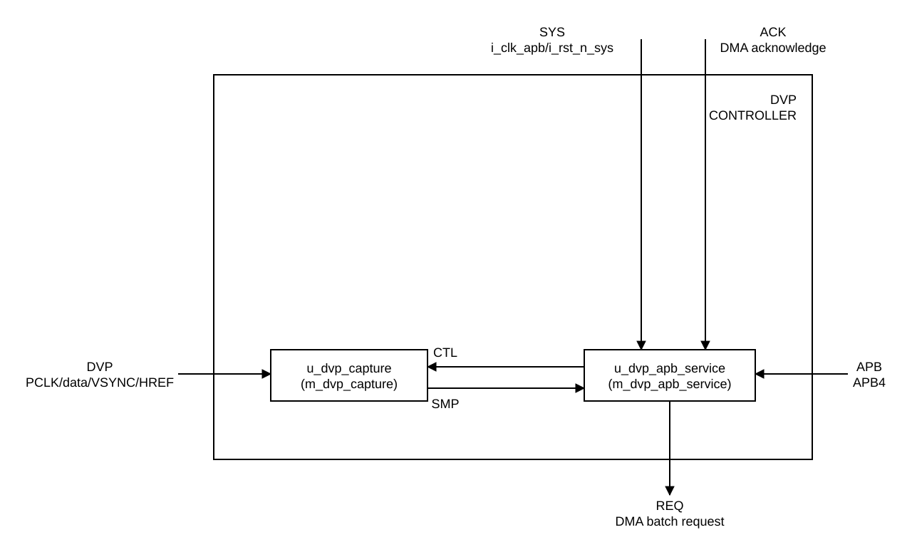

```json
{
  "page_name": "BLOCK_DIAGRAM",
  "out_name": "dvp_controller_block_diagram.drawio",
  "table_suffix": "",
  "layout": {
    "gap_h": 220,
    "gap_v": 180,
    "margin": 80,
    "block_h": 72
  },
  "top": {
    "frame_label": [
      "DVP",
      "CONTROLLER"
    ],
    "block_label": [
      "TOP",
      "(m_dvp_controller)"
    ],
    "block_row": [
      "TOP (m_dvp_controller)",
      "Captures pixels using a CSR-selected PCLK mode and serves them through APB4.",
      "Section 14.2"
    ]
  },
  "frame_row": [
    "DVP controller",
    "Captures qualified pixels through two selectable buffering paths and exposes APB4 data/control.",
    "Sections 5.1, 6 and 14.2"
  ],
  "frame_interfaces": [
    "DVP",
    "APB",
    "SYS",
    "REQ",
    "ACK"
  ],
  "blocks": [
    {
      "key": "U_CAPTURE",
      "label": [
        "u_dvp_capture",
        "(m_dvp_capture)"
      ],
      "width": 220,
      "row": 1,
      "col": 0,
      "row_name": "u_dvp_capture (m_dvp_capture)",
      "function": "Samples sensor pixels, detects frame boundaries and generates continuous or gated-pixel events.",
      "source": "Sections 5.1, 6 and 14.2"
    },
    {
      "key": "U_APB",
      "label": [
        "u_dvp_apb_service",
        "(m_dvp_apb_service)"
      ],
      "width": 240,
      "row": 1,
      "col": 1,
      "row_name": "u_dvp_apb_service (m_dvp_apb_service)",
      "function": "Selects the AFIFO or SFIFO path, serves FIFO_DATA reads and manages CSR and DMA batches.",
      "source": "Sections 5.1 and 14.2"
    }
  ],
  "connectors": [
    {
      "id": "SMP",
      "src": "U_CAPTURE",
      "src_side": "R",
      "dst": "U_APB",
      "dst_side": "L"
    },
    {
      "id": "CTL",
      "src": "U_APB",
      "src_side": "L",
      "dst": "U_CAPTURE",
      "dst_side": "R"
    }
  ],
  "externals": [
    {
      "id": "DVP",
      "block": "U_CAPTURE",
      "side": "L",
      "dir": "in",
      "pos": 0,
      "text": [
        "DVP",
        "PCLK/data/VSYNC/HREF"
      ]
    },
    {
      "id": "APB",
      "block": "U_APB",
      "side": "R",
      "dir": "in",
      "pos": 0,
      "text": [
        "APB",
        "APB4"
      ]
    },
    {
      "id": "SYS",
      "block": "U_APB",
      "side": "T",
      "dir": "in",
      "pos": -30,
      "text": [
        "SYS",
        "i_clk_apb/i_rst_n_sys"
      ]
    },
    {
      "id": "REQ",
      "block": "U_APB",
      "side": "B",
      "dir": "out",
      "pos": 0,
      "text": [
        "REQ",
        "DMA batch request"
      ]
    },
    {
      "id": "ACK",
      "block": "U_APB",
      "side": "T",
      "dir": "in",
      "pos": 45,
      "text": [
        "ACK",
        "DMA acknowledge"
      ]
    }
  ],
  "nets": [],
  "interfaces": [
    {
      "id": "DVP",
      "name": "Sensor DVP sample interface",
      "category": "source-synchronous camera interface",
      "active": "camera sensor -> controller",
      "signals": "i_clk_dvp, i_dvp_data, i_dvp_vsync, i_dvp_href"
    },
    {
      "id": "APB",
      "name": "APB4 control and sample-data access",
      "category": "standard protocol (APB4)",
      "active": "system DMA/software -> controller",
      "signals": "i_paddr, i_psel, i_penable, i_pwrite, i_pwdata, i_pstrb, i_pprot, o_pready, o_prdata, o_pslverr"
    },
    {
      "id": "SYS",
      "name": "APB clock and common reset",
      "category": "clock/reset",
      "active": "SoC -> controller",
      "signals": "i_clk_apb, i_rst_n_sys"
    },
    {
      "id": "REQ",
      "name": "DMA batch request",
      "category": "custom level request",
      "active": "controller -> system DMA",
      "signals": "o_dma_req"
    },
    {
      "id": "ACK",
      "name": "DMA batch acknowledge",
      "category": "custom pulse acknowledge",
      "active": "system DMA -> controller",
      "signals": "i_dma_ack"
    },
    {
      "id": "SMP",
      "name": "Mode-specific captured pixel event",
      "category": "sample and CDC interface",
      "active": "capture block -> APB/buffer subsystem",
      "signals": "sample_data, sample_write, pixel_toggle, frame_active, overflow_event"
    },
    {
      "id": "CTL",
      "name": "Capture configuration",
      "category": "custom control",
      "active": "APB subsystem -> capture block",
      "signals": "pclk_mode, capture_en, sample_edge"
    }
  ],
  "legend_note": "PCLK_MODE=0 selects the continuous AFIFO path. PCLK_MODE=1 selects the gated valid-pixel path: APB-clocked 2-FF synchronizers detect VSYNC and both pixel-toggle transitions, then write the stable held sample to SFIFO. These buffer and decode children are contained in the APB service subsystem; common FIFO/reset helpers are reused.",
  "library_sha256": "15DFB183E267D2A94F8CAB316E01EB3D2E9D2F9C006DC816790A394F4123506C"
}
```

*Figure 1 source: `figures/dvp_controller_block_diagram.drawio` (draw.io, VLSIT library, generated by `vlsit_spec_diagram.py`).*

### 5.3 Transaction and dataflow

1. **System setup:** software configures the camera externally, prepares the system DMA, writes PCLK_MODE while capture is disabled, programs the watermark/timeout and then enables capture in a separate APB write. The CSR workbook defines all fields and reset values.
2. **Frame qualification:** the active edge of VSYNC starts a frame; a multi-cycle active level is edge-detected once. HREF is a level qualifier.
3. **Continuous mode:** each selected PCLK sample edge after frame start, with HREF active and capture armed, writes one sample into the AFIFO.
4. **Gated mode:** each selected PCLK edge with HREF active captures the sample and toggles valid. CLK-APB synchronizes VSYNC and valid through separate 2-FF chains, detects the VSYNC active edge and both valid-toggle transitions, qualifies each pixel event with frame/capture state, and writes the held sample to the SFIFO. The held sample must remain stable through the corresponding SFIFO write.
- INV-004: the DVP input is never backpressured by APB readiness; when full, the selected FIFO drops the newest sample and reports sticky overflow.
- INV-005: the DMA watermark is programmed through the CSR workbook and the DMA notification follows the occupancy threshold; after ACK, re-arm requires occupancy to fall below the watermark before crossing it again.
- INV-006: APB request/control signals follow APB4 stability rules while PREADY is LOW (REF-001 section 3.1).
## 6. External interfaces and ports

### 6.1 Interface inventory

| Interface ID | Protocol | Implemented role | Width / clock | Required | Description |
|---|---|---|---|---|---|
| IF-001 | Sensor-specific DVP | Source-synchronous receiver | Data width selected by PARA_DVP_DATA_W; i_clk_dvp | Yes | Camera supplies VSYNC frame timing and level HREF line qualification; PCLK may be continuous or gated |
| IF-002 | AMBA APB4, Arm IHI 0024 Issue D | Completer | 16-bit address, 32-bit data, 4 strobes; i_clk_apb | Yes | Sole external software and system-DMA access path |
| IF-003 | DMA batch REQ/ACK sideband | Requester output and acknowledgement input | One bit each in CLK-APB | Yes | Announces service batches; DMA transfers samples using APB reads |

### 6.2 Complete port list

The selected APB4 profile is 32-bit data, 16-bit address, PSTRB[3:0], PPROT[2:0] and PSLVERR. APB signals are synchronous to i_clk_apb. Sensor data and qualifiers are synchronous to i_clk_dvp. One common active-low reset asserts asynchronously; release is synchronized independently to CLK-APB and CLK-DVP.

| Port | Direction | Width | Meaning | Clock domain | Signal type | Reset / polarity / encoding | Timing / handshake |
|---|---|---:|---|---|---|---|---|
| i_clk_apb | Input | 1 | APB and CSR clock | CLK-APB | Clock | SoC supplied | APB signals sampled on rising edge |
| i_rst_n_sys | Input | 1 | Common asynchronous reset request for APB and DVP domains | Async input | Reset | Active-low; async assert, independent synchronous release in CLK-APB and CLK-DVP | Local reset synchronizers initialize both FIFO sides before traffic |
| i_clk_dvp | Input | 1 | Sensor PCLK; continuous in mode 0; in mode 1, edges occur only for valid pixels | CLK-DVP | Clock | Sensor-supplied; no numerical maximum in RTL; integration sets STA/SDC limits | In gated mode no PCLK edge occurs during active VSYNC or an HREF-high invalid-pixel gap; the configured edge is the pixel-sample event |
| i_dvp_data | Input | PARA_DVP_DATA_W | Parallel sensor sample | CLK-DVP | Data qualified by active frame and line semantics | Unsigned sample | Sampled on PARA_DVP_SAMPLE_EDGE |
| i_dvp_vsync | Input | 1 | Sensor VSYNC/frame-start pulse | Continuous mode: sampled on selected PCLK edge; gated mode: asynchronous to CLK-APB and synchronized by 2-FF | Data/qualifier | Active level selected by PARA_DVP_VSYNC_ACTIVE; default active-high | Gated mode pulse active width is at least 4 CLK-APB cycles and PCLK has no edge while VSYNC is active |
| i_dvp_href | Input | 1 | Sensor HREF line-activity qualifier | CLK-DVP; gated mode may remain high while PCLK is stopped | Level qualifier, not a sample event by itself | Active level selected by PARA_DVP_HREF_ACTIVE; default active-high | A pixel is accepted only at a configured PCLK edge while HREF is active; no PCLK edge means no sample |
| i_paddr | Input | 16 | APB byte address | CLK-APB | Data valid during transfer | APB4 | Stable through access completion |
| i_psel | Input | 1 | Select this Completer | CLK-APB | Level request | APB4 active-high | Setup and access |
| i_penable | Input | 1 | APB access-phase indicator | CLK-APB | Level request | APB4 active-high | Low in setup, high in access |
| i_pwrite | Input | 1 | APB direction | CLK-APB | Level request | 1=write, 0=read | Stable during access |
| i_pwdata | Input | 32 | APB write data | CLK-APB | Data for write access | APB4 | Stable during access |
| i_pstrb | Input | 4 | APB byte strobes | CLK-APB | Data for write access | APB4 PSTRB[3:0] | Stable during access |
| i_pprot | Input | 3 | APB protection attributes | CLK-APB | Data during access | APB4 PPROT[2:0] | Stable during access |
| o_pready | Output | 1 | Transfer completion / wait response | CLK-APB | Level response | APB4 active-high | Completes when PSEL, PENABLE and PREADY are high |
| o_prdata | Output | 32 | APB read data | CLK-APB | Data valid on completed read | APB4; sample zero-extended in FIFO_DATA reads | CSR reads return mapped register data; FIFO_DATA reads return one sample in low bits |
| o_pslverr | Output | 1 | APB error response | CLK-APB | Level response | APB4 active-high | Sampled with completed access |
| i_dma_ack | Input | 1 | Acknowledge DMA batch request | CLK-APB | Pulse, one APB cycle | Active-high | Acknowledges request only; does not pop data |
| o_dma_req | Output | 1 | Request DMA service | CLK-APB | Level request | Active-high | Zero watermark disables; assert at nonzero threshold; ACK then wait below threshold to re-arm |

Internal CSR, FIFO-control and status signals are not top-level ports; document them in the CSR workbook and block diagram.

### 6.3 Protocol behavior

| Operation | Request / acceptance | Response / completion | Wait / error behavior | Requirement |
|---|---|---|---|---|
| DVP sample capture | Selected PCLK edge after active VSYNC edge, with HREF active and frame/capture armed | One sample enters AFIFO in mode 0 or APB SFIFO in mode 1 | No PCLK edge means no sample even if HREF is active; full drops newest | REQ-FUNC-001..007 |
| APB CSR access | APB4 setup then access | Generated CSR response; generator behavior in Section 11.4 | APB4 wait and error response | REQ-IF-001, REQ-REG-001 |
| APB FIFO-data read, nonempty | Read to dedicated FIFO-data endpoint | Returns FIFO head; pop exactly once on completed access | No pop during setup or incomplete/stalled access | REQ-IF-001, REQ-IF-002 |
| APB FIFO-data read, empty | Read to data endpoint | PREADY low while empty until a sample arrives or the software-programmed APB-cycle timeout expires; timeout zero expires in the first access cycle | On timeout, complete with PREADY=1 and PSLVERR=1; do not pop. Data availability wins on the terminal decision cycle. | REQ-IF-002, REQ-IF-005 |
| APB FIFO-data write | Write to read-only FIFO_DATA endpoint | PREADY=1, PSLVERR=1; no FIFO state change | Endpoint write errors regardless of CSR generator error-enable setting | REQ-IF-006 |
| DMA batch request | Nonzero read-domain occupancy threshold is reached | o_dma_req asserts and holds until one-cycle i_dma_ack in CLK-APB; zero watermark disables it | ACK changes request state only; APB reads pop entries | REQ-IF-004 |
| DMA re-arm | After ACK, selected-FIFO occupancy falls below a nonzero watermark and later reaches it again | Rearm for a later threshold crossing | Notification is watermark-only; no frame-end interrupt or implicit FIFO flush | REQ-IF-004 |

APB request-side controls/address remain stable through wait states as required by APB4. A FIFO entry is consumed only on completed APB read. FIFO_DATA uses PARA_FIFO_DATA_ADDR (default 16'h0100); endpoint writes and misaligned accesses error without popping, while aligned unmapped accesses use the CSR-generator default.

### 6.4 Interrupts and events

No interrupt output is in scope. DMA notification uses o_dma_req. Sticky status/error fields, if included, are defined only in the CSR workbook; no interrupt behavior is inferred.
## 7. Clock, reset, and power

### 7.1 Clock domains

| Clock ID | Source | Edge | Frequency | Relationship | Reset | Notes |
|---|---|---|---|---|---|---|
| CLK-APB | i_clk_apb, SoC supplied | Rising | Numeric limits set by SoC STA/SDC; gated mode VSYNC pulse >=4 periods | Asynchronous to CLK-DVP | i_rst_n_sys; local synchronous release | CSR, APB, gated-mode bridge/FIFO and DMA handshake |
| CLK-DVP | i_clk_dvp, camera supplied | PARA_DVP_SAMPLE_EDGE selects rising or falling | Numeric limits set by sensor mode and SoC STA/SDC | Asynchronous to CLK-APB; may stop in gated mode | i_rst_n_sys; local synchronous release when PCLK edges occur | Continuous mode AFIFO writer or gated-mode sample register/toggle source |

The system DMA requester and i_dma_ack are synchronous to CLK-APB by design decision confirmed on 2026-11-21. A DMA running on another clock requires a system-side CDC bridge; it is outside this IP interface.

### 7.2 CDC and RDC

| Crossing | Source to destination | Signals | Mechanism | Constraint / verification |
|---|---|---|---|---|
| CDC-001 | CLK-DVP to CLK-APB | Continuous-mode sample payload and AFIFO pointers | DVP-local dual-clock AFIFO; Gray pointer synchronizers | CDC structural review; payload not synchronized bit-by-bit |
| CDC-002 | CLK-APB to CLK-DVP | AFIFO read pointer/availability in continuous mode | Gray-pointer synchronizer in AFIFO | CDC/RDC review and Gray-bus skew/max-delay constraints |
| CDC-003 | CLK-DVP to CLK-APB | Gated-mode pixel-valid toggle and held sample bus | Toggle 2-FF for event; bundled-data hold for payload; both-edge detector | Enforce >=4 APB-cycle pixel spacing; constrain data hold/max delay/setup/hold in STA/SDC |
| CDC-004 | Sensor VSYNC to CLK-APB | Gated-mode VSYNC level | Two-flop synchronizer followed by active-edge detector | Active pulse width >=4 CLK-APB cycles |
| CDC-005 | Common reset to APB, continuous PCLK and gated launch state | i_rst_n_sys | APB and continuous-mode logic use local synchronous release; gated data/toggle launch registers use APB-local reset release because PCLK can be stopped | RDC review; gated VSYNC provides at least four APB cycles before the first pixel; verify reset removal timing at the first selected PCLK edge |
| CDC-006 | DMA sideband | i_dma_ack / o_dma_req | Same CLK-APB domain | Integration check that DMA and APB requester use CLK-APB |
| CDC-007 | CLK-DVP to CLK-APB | Continuous-mode accepted frame-start pulse | `m_vlsit_event_sync` request/acknowledge event synchronizer | Frame events are widely spaced; event coalescing is not expected under supported frame timing |
| CDC-008 | CLK-APB to CLK-DVP and return | AFIFO software-reset request and busy level | `m_vlsit_afifo_sync` level synchronizers in both directions | Keep both clocks running; hold request until synchronized busy asserts, then release and wait until busy deasserts |

### 7.3 Reset domains and sequencing

| Reset | Port / local signal | Polarity / assertion | Release | Affected state | Required sequence |
|---|---|---|---|---|---|
| RST-SYS | i_rst_n_sys | Active-low, asynchronous assertion | Separate synchronizers release locally in CLK-APB and CLK-DVP | All CSR/APB/DMA state, capture state, and both mode-specific FIFO states | Keep capture and FIFO-data service blocked until the selected FIFO path and its source domain report initialized |
| RST-APB-LOCAL | rst_n_apb_sync | Derived active-low reset | Synchronous to CLK-APB | CSR, APB endpoint, DMA request and FIFO read side | Generated CSR reset uses this local reset |
| RST-DVP-LOCAL | rst_n_dvp_sync | Derived active-low reset | Synchronous to CLK-DVP | Capture and FIFO write side | Do not accept samples before local FIFO initialization |
| RST-SW | `dvp_ctrl.fifo_flush` | Active-low software-reset request into selected FIFO reset FSM | AFIFO request/busy levels cross through synchronizers; SFIFO reset stays in CLK-APB | Selected FIFO state only | Capture disabled; source quiescent; `i_clk_dvp` running for continuous mode; DMA reads stopped |

The common reset and APB pending-read abort behavior are user-confirmed. Continuous-mode capture and AFIFO write logic release reset synchronously in PCLK; if PCLK is stopped, this path is not ready until PCLK resumes and capture waits for a later active VSYNC. In gated mode, the held-data/toggle launch registers use the APB-local synchronized reset so their initial toggle state is established while PCLK is stopped. The sensor profile shall provide the specified multi-cycle active VSYNC interval before the first valid pixel, and integration STA/RDC shall check reset removal at the first selected PCLK edge. The APB bridge detects the VSYNC frame boundary and preserves the first pixel event after it. Continuous-mode source quiescence is acknowledged only after the staged AFIFO write pulse drains, allowing the APB-side empty estimate to catch up before a mode switch. Reset cancels an outstanding FIFO_DATA read without completion or pop. Capture disable stops new FIFO writes but preserves queued samples for DMA drain. A software flush temporarily blocks FIFO_DATA reads and reports selected occupancy as zero while pending; after the FIFO handshake completes, hardware clears `dvp_ctrl.fifo_flush`. Flush retains frame count and sticky overflow. A continuous-mode flush cannot finish while `i_clk_dvp` is stopped.

### 7.4 Power intent

No power-domain, retention or isolation behavior is selected. Assume an always-on IP domain during capture. Before power gating, stop capture, block APB access and coherently invalidate FIFO state.
## 8. Parameters and elaboration configurations

Parameter declarations follow REF-003 v2. Compile-time parameters use `logic [31:0]`, the `PARA_` prefix, and the required description/value/unit comments. `dvp_ctrl.pclk_mode` is software-programmed and is not an elaboration parameter. VSYNC is an active-level pulse detected on its active edge; HREF is an active-level qualifier.

| Parameter | Purpose | Legal values / proposed default | Dependencies and impact |
|---|---|---|---|
| PARA_DVP_DATA_W | Sample-bus width | 8, 10, 12; default 8 | Sets DVP data and FIFO sample width |
| PARA_DVP_SAMPLE_EDGE | Pixel sample edge | 0=rising, 1=falling; default 0 | One selected edge is used per valid pixel pulse in either mode |
| PARA_DVP_VSYNC_ACTIVE | VSYNC active polarity | 0=active-low, 1=active-high; default 1 | Compile-time sensor profile; gated mode synchronizes active level through 2-FF in CLK-APB |
| PARA_DVP_HREF_ACTIVE | HREF active polarity | 0=active-low, 1=active-high; default 1 | Level qualifier; no pulse-encoding mode is supported |
| PARA_FIFO_DEPTH | Capacity of each sample FIFO in entries | Power of two, minimum 2; default 8 | Applies to both mode paths; integrator may override after Section 13 depth sizing |
| PARA_AFIFO_CELL_TYPE | AFIFO pointer synchronizer implementation | 2 by default | Reused Gray FIFO child modules; cell mapping remains library integration |
| PARA_AFIFO_MEM_USE_MACRO | AFIFO memory selection | 0 RTL array by default | SRAM wrapper is not selected for this version |
| PARA_FIFO_DATA_ADDR | Byte address of FIFO_DATA | 16-bit, word-aligned and outside CSR range; default 16'h0100 | Misaligned accesses within the endpoint word return PSLVERR |

### 8.1 Delivered configuration

Builds support 8-, 10- and 12-bit profiles. Defaults are 8-bit, rising-edge sample, active-high VSYNC/HREF, PARA_FIFO_DEPTH=8, PARA_AFIFO_CELL_TYPE=2 and PARA_AFIFO_MEM_USE_MACRO=0. Sensor timing/electrical compliance is checked against the selected datasheet. `dvp_ctrl.pclk_mode` resets to continuous and is written before capture.
## 9. Data representation and arithmetic

| Item | Representation | Width / range | Validity | Status |
|---|---|---|---|---|
| DVP sample | Unsigned raw i_dvp_data sampled on PARA_DVP_SAMPLE_EDGE | 8, 10 or 12 bits | Capture enabled, frame armed by active VSYNC edge, HREF active, and selected PCLK edge occurs | Same qualification in both modes; only CDC/FIFO path differs |
| FIFO entry | One captured unsigned sample; no packing or metadata | PARA_DVP_DATA_W bits | Invalid after reset until written | Same format in AFIFO and SFIFO paths |
| APB FIFO-data word | One unsigned sample, zero-extended to 32 bits | 32 bits; sample in [PARA_DVP_DATA_W-1:0], upper bits zero | Valid on successful completed aligned FIFO_DATA read | Same in both modes |
| Occupancy | Mode 0: APB read-side estimate from synchronized AFIFO pointers. Mode 1: APB accepted-write/read counter for the SFIFO. | $0..PARA\_FIFO\_DEPTH$ | Mode 0 may lag new sensor writes by CDC latency; mode 1 is exact at APB cycle boundaries. | Status/REQ use the selected mode's occupancy. |
| DMA watermark | Nonzero level requests a batch when selected-FIFO occupancy reaches it; zero disables requests | 0 disables, 1..PARA_FIFO_DEPTH enables | Program before capture and keep stable while active | Values above depth are unreachable and leave REQ low; only watermark crossing generates requests |

For a minimum two-cycle APB transfer, ideal read throughput is at most f_APB/2 samples/s before contention or waits. FIFO sizing must cover arrivals during maximum DMA service delay plus CDC and scheduling margin. Numerical rates and margin await DEC-004.

## 10. Detailed functional behavior

### 10.1 Modes and state transitions

<!-- FSM-DIAGRAM:dma_request -->
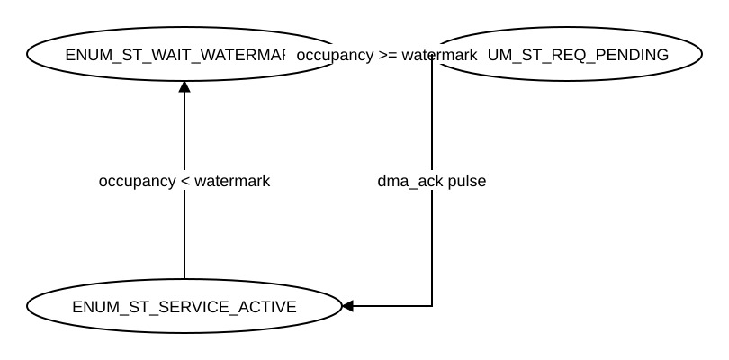

```json
{
  "page_name": "FSM_DMA_REQUEST",
  "out_name": "dvp_dma_request_fsm.drawio",
  "function": "dma_request",
  "initial": "ENUM_ST_WAIT_WATERMARK",
  "state_pattern": "^ENUM_ST_[A-Z0-9_]+$",
  "states": [
    {
      "name": "ENUM_ST_WAIT_WATERMARK"
    },
    {
      "name": "ENUM_ST_REQ_PENDING"
    },
    {
      "name": "ENUM_ST_SERVICE_ACTIVE"
    }
  ],
  "transitions": [
    {
      "src": "ENUM_ST_WAIT_WATERMARK",
      "dst": "ENUM_ST_REQ_PENDING",
      "label": "occupancy >= watermark"
    },
    {
      "src": "ENUM_ST_REQ_PENDING",
      "dst": "ENUM_ST_SERVICE_ACTIVE",
      "label": "dma_ack pulse"
    },
    {
      "src": "ENUM_ST_SERVICE_ACTIVE",
      "dst": "ENUM_ST_WAIT_WATERMARK",
      "label": "occupancy < watermark"
    }
  ],
  "layout": {
    "margin": 50
  }
}
```

*Figure 10-1. FSM state diagram of dma_request. Source: `figures/dvp_dma_request_fsm.drawio` (draw.io, VLSIT library, generated by `vlsit_fsm_diagram.py`).*
<!-- /FSM-DIAGRAM:dma_request -->

Capture is disabled after reset. Software configures the controller and external sensor before enabling capture. On disable, new samples stop after the control crosses the selected path; unread FIFO entries remain available to DMA.

The batch request controller uses these states:

| State | Outputs / invariant | Transition | Next state |
|---|---|---|---|
| ENUM_ST_WAIT_WATERMARK | o_dma_req=0; request armed | Occupancy estimate >= watermark | ENUM_ST_REQ_PENDING |
| ENUM_ST_REQ_PENDING | o_dma_req=1 until acknowledged | One-cycle i_dma_ack pulse in CLK-APB | ENUM_ST_SERVICE_ACTIVE |
| ENUM_ST_SERVICE_ACTIVE | o_dma_req=0; APB reads pop samples | Occupancy estimate < watermark | ENUM_ST_WAIT_WATERMARK |

The AFIFO read-side threshold implements a nonzero watermark comparison by setting the empty threshold to watermark minus one and requesting when empty-threshold is deasserted. A separate zero check disables the request when the watermark is zero. Values above PARA_FIFO_DEPTH are unreachable and leave REQ low. Program the watermark before capture and hold it stable while capture is active. The request is occupancy-based and may assert during a partial frame; frame boundaries do not defer a batch request.

### 10.2 Operations

| ID | Operation | Main behavior | Success | Error / corner case |
|---|---|---|---|---|
| OP-001 | Configure and start | Configure sensor externally; write PCLK_MODE only while capture is disabled, both FIFOs are empty and the current source is quiescent; write watermark and timeout; enable capture in a separate write | Continuous mode arms after the PCLK path is initialized and a subsequent active VSYNC; gated mode arms from the APB-synchronized VSYNC frame state | Unsafe mode writes retain the old mode with APB OKAY; software reads back PCLK_MODE and retries after draining/settling |
| OP-002 | Capture qualified sample | Capture when active-frame state, HREF and the selected PCLK edge qualify data | One FIFO entry per accepted sample | No backpressure; a full FIFO drops the newest sample, preserves unread entries and sets sticky overflow |
| OP-003 | APB FIFO read | Read dedicated endpoint | Return head and pop once on success; return an APB error without pop on timeout | Empty read waits for the configured timeout; zero errors in the first access cycle; reset aborts without pop/error, then the master retries after initialization |
| OP-004 | DMA batch notify | Request at watermark | REQ held to ACK; ACK starts service | Rearm after occupancy falls below watermark; frame boundary does not affect request timing |
| OP-005 | Stop capture | Software disables capture | No new sample after disable reaches the selected capture path | In-flight frame is abandoned; unread FIFO samples remain available for DMA |
| OP-006 | Reset/recovery | Coordinated reset | FIFO empty, REQ low, capture disabled | Independent reset or stopped clock must not expose stale data |
| OP-007 | Monitor frame count | Read `dvp_frame_count.count` | One increment per accepted active VSYNC edge in either mode | No increment while capture is disabled; counter wraps modulo 2^32 |
| OP-008 | Flush selected FIFO | Disable capture, stop DMA reads, request flush, poll until request clears | Selected FIFO empty; frame counter and overflow retained | Request is ignored while capture is enabled; continuous mode requires PCLK running |

### 10.3 Cycle-level behavior and waveform plan

The waveform plan below is user-confirmed. Each planned figure is rendered as SVG from the adjacent WaveJSON source; see the table and figures below.

The user confirmed the original 15-waveform plan on 2026-11-21, added two mode-specific captures on 2026-11-22, and approved the safe mode-switch view with the RTL plan. The original set contains 9 operation/error/corner cases, 6 width/edge profile views, 2 runtime-mode dataflow views, and 1 safe mode-reconfiguration view; this update adds frame-count, AFIFO-flush, and SFIFO-flush waveforms. Each figure has adjacent WaveJSON source and a rendered SVG. These cycle-level diagrams do not replace exact sensor-mode setup/hold values or SDC input delays.

| Waveform ID | Function / operation | Scenario (success / error / corner) | Signals shown | Figure | Confirmed by user |
|---|---|---|---|---|---|
| WF-001 | OP-002 qualified sample capture; OP-005 stop capture | Success and inactive-qualifier corner | DVP clock/reset, capture enable, VSYNC/HREF qualifiers, data, sample accept, FIFO full/overflow | [SVG](figures/waveforms/wf001_capture_qualified_sample.svg) | 2026-11-21 |
| WF-002 | OP-001 configure/start and OP-005 stop | CSR write success and partial-strobe error | APB controls/address/data/strobes/responses, capture enable | [SVG](figures/waveforms/wf002_csr_apb_success_and_error.svg) | 2026-11-21 |
| WF-003 | OP-003 FIFO-data APB read | Successful back-to-back reads | APB controls/data, FIFO empty/pop, PREADY/PSLVERR | [SVG](figures/waveforms/wf003_fifo_back_to_back_reads.svg) | 2026-11-21 |
| WF-004 | OP-003 FIFO-data APB read | Sample arrives on timeout terminal decision cycle | APB controls/data, timeout count, FIFO empty/valid/pop | [SVG](figures/waveforms/wf004_empty_read_data_on_terminal_cycle.svg) | 2026-11-21 |
| WF-005 | OP-004 DMA batch notification | Watermark crossing, ACK, APB drain, below-watermark re-arm | FIFO level/watermark, dma_req/ack, APB read/pop | [SVG](figures/waveforms/wf005_dma_watermark_ack_and_rearm.svg) | 2026-11-21 |
| WF-006 | OP-002 capture under overflow | Full FIFO rejects sample; sticky overflow is set and cleared | DVP qualifiers/data, FIFO full/write, overflow event, W1C status | [SVG](figures/waveforms/wf006_fifo_overflow_sticky_status.svg) | 2026-11-21 |
| WF-007 | OP-006 coordinated reset/release | Reset aborts pending FIFO-data APB read; master retries | APB/DVP clocks, common/local reset release, APB response, FIFO pop | [SVG](figures/waveforms/wf007_reset_aborts_pending_apb_read.svg) | 2026-11-21 |
| WF-008 | OP-003 FIFO-data endpoint error | Write to read-only endpoint; no FIFO mutation | APB write/address/response and FIFO pop/level | [SVG](figures/waveforms/wf008_fifo_endpoint_write_error.svg) | 2026-11-21 |
| WF-009 | OP-003 FIFO-data APB read | Zero immediate timeout and positive timeout expiry | APB response, timeout count, FIFO empty/pop | [SVG](figures/waveforms/wf009_empty_fifo_timeout_error.svg) | 2026-11-21 |
| WF-010 | OP-002 profile capture | 8-bit data, rising-edge PCLK sample | PCLK, VSYNC/HREF, 8-bit data, accepted sample | [SVG](figures/waveforms/wf_profile_8bit_rising.svg) | 2026-11-21 |
| WF-011 | OP-002 profile capture | 8-bit data, falling-edge PCLK sample | PCLK, VSYNC/HREF, 8-bit data, accepted sample | [SVG](figures/waveforms/wf_profile_8bit_falling.svg) | 2026-11-21 |
| WF-012 | OP-002 profile capture | 10-bit data, rising-edge PCLK sample | PCLK, VSYNC/HREF, 10-bit data, accepted sample | [SVG](figures/waveforms/wf_profile_10bit_rising.svg) | 2026-11-21 |
| WF-013 | OP-002 profile capture | 10-bit data, falling-edge PCLK sample | PCLK, VSYNC/HREF, 10-bit data, accepted sample | [SVG](figures/waveforms/wf_profile_10bit_falling.svg) | 2026-11-21 |
| WF-014 | OP-002 profile capture | 12-bit data, rising-edge PCLK sample | PCLK, VSYNC/HREF, 12-bit data, accepted sample | [SVG](figures/waveforms/wf_profile_12bit_rising.svg) | 2026-11-21 |
| WF-015 | OP-002 profile capture | 12-bit data, falling-edge PCLK sample | PCLK, VSYNC/HREF, 12-bit data, accepted sample | [SVG](figures/waveforms/wf_profile_12bit_falling.svg) | 2026-11-21 |
| WF-016 | OP-002 continuous-mode capture | Continuous PCLK, VSYNC frame start, selected-edge/HREF sample, AFIFO write/read | PCLK, VSYNC, HREF, data, capture enable, AFIFO write/full/level, APB read | [SVG](figures/waveforms/wf016_continuous_mode_afifo.svg) | 2026-11-22 |
| WF-017 | OP-002 gated-mode capture | VSYNC 2-FF in APB, gated PCLK sample register/toggle, 2-FF toggle sync, both-edge write to SFIFO; four APB cycles per pixel | CLK-APB, VSYNC/raw and sync stages, PCLK, HREF, data register, valid toggle/sync/edge, SFIFO write/level | [SVG](figures/waveforms/wf017_gated_mode_toggle_ratio.svg) | 2026-11-22 |
| WF-018 | OP-001 safe PCLK-mode reconfiguration | Mode write is masked until capture is off, both FIFOs are empty, and the continuous source has quiesced | `CAPTURE_EN`, source-quiescent, both FIFO empty flags, APB write/response, mode mask and mode readback | [SVG](figures/waveforms/wf018_pclk_mode_safe_switch.svg) | Designer approved DEC-028, 2026-11-22 |
| WF-019 | OP-008 continuous AFIFO flush | APB request synchronizes to PCLK, busy returns to APB, request releases, busy clears and CSR self-clears | APB/DVP clocks, capture disable/quiescent, flush CSR, synchronized request, AFIFO busy, occupancy and done | [SVG](figures/waveforms/wf019_afifo_flush_handshake.svg) | DEC-032, 2026-11-22 |
| WF-020 | OP-008 gated SFIFO flush | Local reset request/busy handshake, no FIFO_DATA pop, occupancy clear and CSR self-clear | APB clock, capture enable, gated quiescent, flush CSR, SFIFO reset request/busy, read enable and occupancy | [SVG](figures/waveforms/wf020_sfifo_flush_handshake.svg) | DEC-032, 2026-11-22 |
| WF-021 | OP-007 accepted frame count | Continuous event CDC and gated APB VSYNC edge each increment count once; disabled edge is ignored | PCLK frame pulse, event-sync pulse, gated VSYNC edge, frame count, capture enable, PCLK mode | [SVG](figures/waveforms/wf021_frame_counter.svg) | DEC-031, 2026-11-22 |

#### Waveform figures and machine-readable sources

Interactive offline viewers for the confirmed waveform additions: [8-bit rising-edge sampling](figures/waveforms/wf_profile_8bit_rising.html), [8-bit falling-edge sampling](figures/waveforms/wf_profile_8bit_falling.html), [gated toggle/SFIFO transfer with the four-APB-cycle pixel spacing](figures/waveforms/wf017_gated_mode_toggle_ratio.html), and [safe PCLK-mode switching](figures/waveforms/wf018_pclk_mode_safe_switch.html). The width-specific static profile figures WF-010..WF-015 and mode/dataflow figures WF-016..WF-018 remain embedded below.

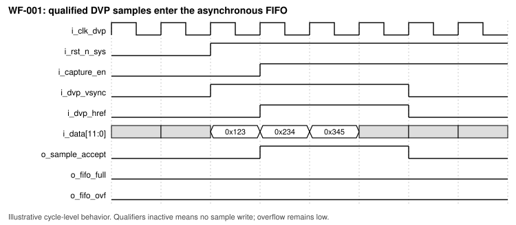

```wavedrom
{
  "signal": [
    {
      "name": "i_clk_dvp",
      "wave": "p......."
    },
    {
      "name": "i_rst_n_sys",
      "wave": "00111111"
    },
    {
      "name": "i_capture_en",
      "wave": "00011111"
    },
    {
      "name": "i_dvp_vsync",
      "wave": "00111100"
    },
    {
      "name": "i_dvp_href",
      "wave": "00011100"
    },
    {
      "name": "i_data[11:0]",
      "wave": "xx===xxx",
      "data": [
        "0x123",
        "0x234",
        "0x345"
      ]
    },
    {
      "name": "o_sample_accept",
      "wave": "00011100"
    },
    {
      "name": "o_fifo_full",
      "wave": "00000000"
    },
    {
      "name": "o_fifo_ovf",
      "wave": "00000000"
    }
  ],
  "head": {
    "text": "WF-001: qualified DVP samples enter the asynchronous FIFO"
  },
  "foot": {
    "text": "Illustrative cycle-level behavior. Qualifiers inactive means no sample write; overflow remains low."
  },
  "config": {
    "hscale": 3
  }
}
```

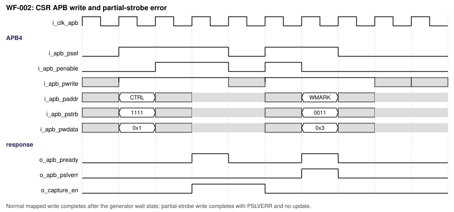

```wavedrom
{
  "signal": [
    {
      "name": "i_clk_apb",
      "wave": "p........."
    },
    [
      "APB4",
      {
        "name": "i_apb_psel",
        "wave": "0111011000"
      },
      {
        "name": "i_apb_penable",
        "wave": "0011010000"
      },
      {
        "name": "i_apb_pwrite",
        "wave": "x111x111xx"
      },
      {
        "name": "i_apb_paddr",
        "wave": "x=x..x=x..",
        "data": [
          "CTRL",
          "WMARK"
        ]
      },
      {
        "name": "i_apb_pstrb",
        "wave": "x=x..x=x..",
        "data": [
          "1111",
          "0011"
        ]
      },
      {
        "name": "i_apb_pwdata",
        "wave": "x=x..x=x..",
        "data": [
          "0x1",
          "0x3"
        ]
      }
    ],
    [
      "response",
      {
        "name": "o_apb_pready",
        "wave": "0001001000"
      },
      {
        "name": "o_apb_pslverr",
        "wave": "0000001000"
      },
      {
        "name": "o_capture_en",
        "wave": "0001100000"
      }
    ]
  ],
  "head": {
    "text": "WF-002: CSR APB write and partial-strobe error"
  },
  "foot": {
    "text": "Normal mapped write completes after the generator wait state; partial-strobe write completes with PSLVERR and no update."
  },
  "config": {
    "hscale": 3
  }
}
```

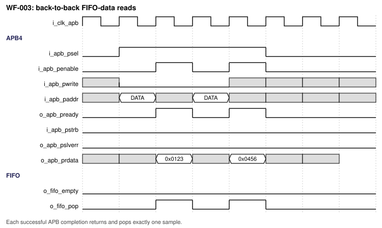

```wavedrom
{
  "signal": [
    {
      "name": "i_clk_apb",
      "wave": "p......."
    },
    [
      "APB4",
      {
        "name": "i_apb_psel",
        "wave": "01111000"
      },
      {
        "name": "i_apb_penable",
        "wave": "00101000"
      },
      {
        "name": "i_apb_pwrite",
        "wave": "x000xxxx"
      },
      {
        "name": "i_apb_paddr",
        "wave": "x=x=xxxx",
        "data": [
          "DATA",
          "DATA"
        ]
      },
      {
        "name": "o_apb_pready",
        "wave": "00101000"
      },
      {
        "name": "i_apb_pstrb",
        "wave": "00000000"
      },
      {
        "name": "o_apb_pslverr",
        "wave": "00000000"
      },
      {
        "name": "o_apb_prdata",
        "wave": "xx=x=xx",
        "data": [
          "0x0123",
          "0x0456"
        ]
      }
    ],
    [
      "FIFO",
      {
        "name": "o_fifo_empty",
        "wave": "00000000"
      },
      {
        "name": "o_fifo_pop",
        "wave": "00101000"
      }
    ]
  ],
  "head": {
    "text": "WF-003: back-to-back FIFO-data reads"
  },
  "foot": {
    "text": "Each successful APB completion returns and pops exactly one sample."
  },
  "config": {
    "hscale": 3
  }
}
```

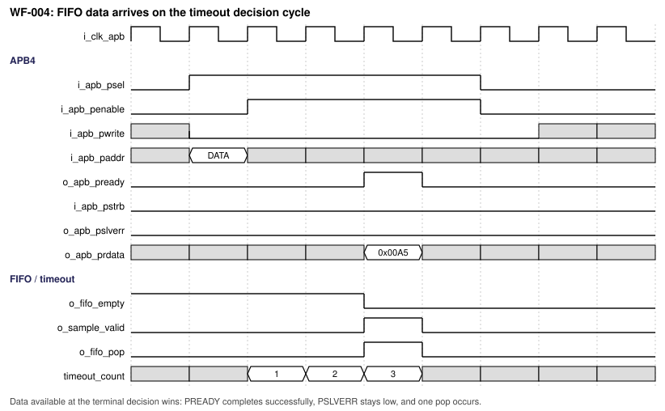

```wavedrom
{
  "signal": [
    {
      "name": "i_clk_apb",
      "wave": "p........"
    },
    [
      "APB4",
      {
        "name": "i_apb_psel",
        "wave": "011111000"
      },
      {
        "name": "i_apb_penable",
        "wave": "001111000"
      },
      {
        "name": "i_apb_pwrite",
        "wave": "x000000xx"
      },
      {
        "name": "i_apb_paddr",
        "wave": "x=xxxxxxx",
        "data": [
          "DATA"
        ]
      },
      {
        "name": "o_apb_pready",
        "wave": "000010000"
      },
      {
        "name": "i_apb_pstrb",
        "wave": "000000000"
      },
      {
        "name": "o_apb_pslverr",
        "wave": "000000000"
      },
      {
        "name": "o_apb_prdata",
        "wave": "xxxx=xxxx",
        "data": [
          "0x00A5"
        ]
      }
    ],
    [
      "FIFO / timeout",
      {
        "name": "o_fifo_empty",
        "wave": "111100000"
      },
      {
        "name": "o_sample_valid",
        "wave": "000010000"
      },
      {
        "name": "o_fifo_pop",
        "wave": "000010000"
      },
      {
        "name": "timeout_count",
        "wave": "xx===xxxx",
        "data": [
          "1",
          "2",
          "3"
        ]
      }
    ]
  ],
  "head": {
    "text": "WF-004: FIFO data arrives on the timeout decision cycle"
  },
  "foot": {
    "text": "Data available at the terminal decision wins: PREADY completes successfully, PSLVERR stays low, and one pop occurs."
  },
  "config": {
    "hscale": 3
  }
}
```

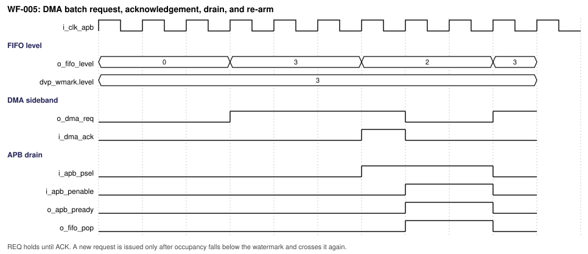

```wavedrom
{
  "signal": [
    {
      "name": "i_clk_apb",
      "wave": "p.........."
    },
    [
      "FIFO level",
      {
        "name": "o_fifo_level",
        "wave": "=..=..=..=",
        "data": [
          "0",
          "3",
          "2",
          "3"
        ]
      },
      {
        "name": "dvp_wmark.level",
        "wave": "=.........",
        "data": [
          "3"
        ]
      }
    ],
    [
      "DMA sideband",
      {
        "name": "o_dma_req",
        "wave": "0001111001"
      },
      {
        "name": "i_dma_ack",
        "wave": "0000001000"
      }
    ],
    [
      "APB drain",
      {
        "name": "i_apb_psel",
        "wave": "0000001110"
      },
      {
        "name": "i_apb_penable",
        "wave": "0000000110"
      },
      {
        "name": "o_apb_pready",
        "wave": "0000000110"
      },
      {
        "name": "o_fifo_pop",
        "wave": "0000000110"
      }
    ]
  ],
  "head": {
    "text": "WF-005: DMA batch request, acknowledgement, drain, and re-arm"
  },
  "foot": {
    "text": "REQ holds until ACK. A new request is issued only after occupancy falls below the watermark and crosses it again."
  },
  "config": {
    "hscale": 3
  }
}
```

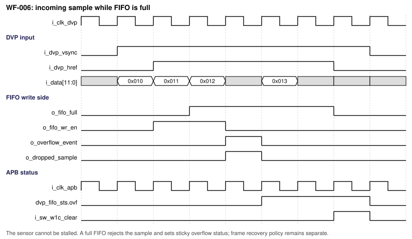

```wavedrom
{
  "signal": [
    {
      "name": "i_clk_dvp",
      "wave": "p........"
    },
    [
      "DVP input",
      {
        "name": "i_dvp_vsync",
        "wave": "011111110"
      },
      {
        "name": "i_dvp_href",
        "wave": "001111100"
      },
      {
        "name": "i_data[11:0]",
        "wave": "x===x=xxx",
        "data": [
          "0x010",
          "0x011",
          "0x012",
          "0x013"
        ]
      }
    ],
    [
      "FIFO write side",
      {
        "name": "o_fifo_full",
        "wave": "000111100"
      },
      {
        "name": "o_fifo_wr_en",
        "wave": "001100000"
      },
      {
        "name": "o_overflow_event",
        "wave": "000010000"
      },
      {
        "name": "o_dropped_sample",
        "wave": "000010000"
      }
    ],
    [
      "APB status",
      {
        "name": "i_clk_apb",
        "wave": "p........"
      },
      {
        "name": "dvp_fifo_sts.ovf",
        "wave": "000001110"
      },
      {
        "name": "i_sw_w1c_clear",
        "wave": "000000010"
      }
    ]
  ],
  "head": {
    "text": "WF-006: incoming sample while FIFO is full"
  },
  "foot": {
    "text": "The sensor cannot be stalled. A full FIFO rejects the sample and sets sticky overflow status; frame recovery policy remains separate."
  },
  "config": {
    "hscale": 3
  }
}
```

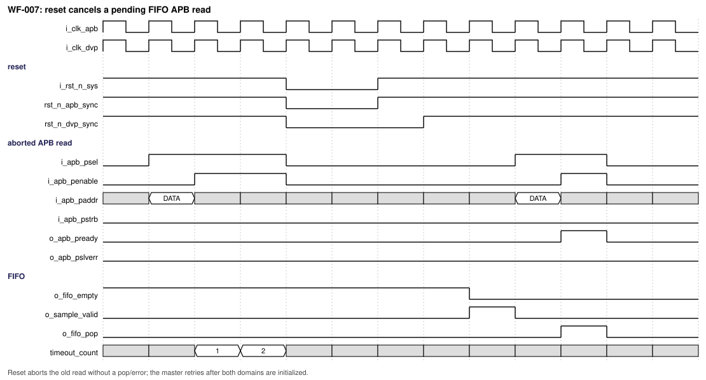

```wavedrom
{
  "signal": [
    {
      "name": "i_clk_apb",
      "wave": "p............"
    },
    {
      "name": "i_clk_dvp",
      "wave": "p............"
    },
    [
      "reset",
      {
        "name": "i_rst_n_sys",
        "wave": "1111001111111"
      },
      {
        "name": "rst_n_apb_sync",
        "wave": "1111001111111"
      },
      {
        "name": "rst_n_dvp_sync",
        "wave": "1111000111111"
      }
    ],
    [
      "aborted APB read",
      {
        "name": "i_apb_psel",
        "wave": "0111000001100"
      },
      {
        "name": "i_apb_penable",
        "wave": "0011000000100"
      },
      {
        "name": "i_apb_paddr",
        "wave": "x=xxxxxxx=xxx",
        "data": [
          "DATA",
          "DATA"
        ]
      },
      {
        "name": "i_apb_pstrb",
        "wave": "0000000000000"
      },
      {
        "name": "o_apb_pready",
        "wave": "0000000000100"
      },
      {
        "name": "o_apb_pslverr",
        "wave": "0000000000000"
      }
    ],
    [
      "FIFO",
      {
        "name": "o_fifo_empty",
        "wave": "1111111100000"
      },
      {
        "name": "o_sample_valid",
        "wave": "0000000010000"
      },
      {
        "name": "o_fifo_pop",
        "wave": "0000000000100"
      },
      {
        "name": "timeout_count",
        "wave": "xx==xxxxxxxxx",
        "data": [
          "1",
          "2"
        ]
      }
    ]
  ],
  "head": {
    "text": "WF-007: reset cancels a pending FIFO APB read"
  },
  "foot": {
    "text": "Reset aborts the old read without a pop/error; the master retries after both domains are initialized."
  },
  "config": {
    "hscale": 3
  }
}
```

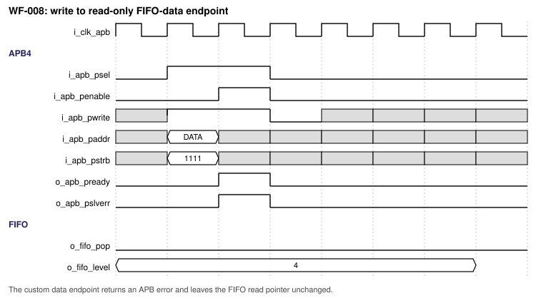

```wavedrom
{
  "signal": [
    {
      "name": "i_clk_apb",
      "wave": "p......."
    },
    [
      "APB4",
      {
        "name": "i_apb_psel",
        "wave": "01100000"
      },
      {
        "name": "i_apb_penable",
        "wave": "00100000"
      },
      {
        "name": "i_apb_pwrite",
        "wave": "x110xxxx"
      },
      {
        "name": "i_apb_paddr",
        "wave": "x=xxxxxx",
        "data": [
          "DATA"
        ]
      },
      {
        "name": "i_apb_pstrb",
        "wave": "x=xxxxxx",
        "data": [
          "1111"
        ]
      },
      {
        "name": "o_apb_pready",
        "wave": "00100000"
      },
      {
        "name": "o_apb_pslverr",
        "wave": "00100000"
      }
    ],
    [
      "FIFO",
      {
        "name": "o_fifo_pop",
        "wave": "00000000"
      },
      {
        "name": "o_fifo_level",
        "wave": "=......",
        "data": [
          "4"
        ]
      }
    ]
  ],
  "head": {
    "text": "WF-008: write to read-only FIFO-data endpoint"
  },
  "foot": {
    "text": "The custom data endpoint returns an APB error and leaves the FIFO read pointer unchanged."
  },
  "config": {
    "hscale": 3
  }
}
```

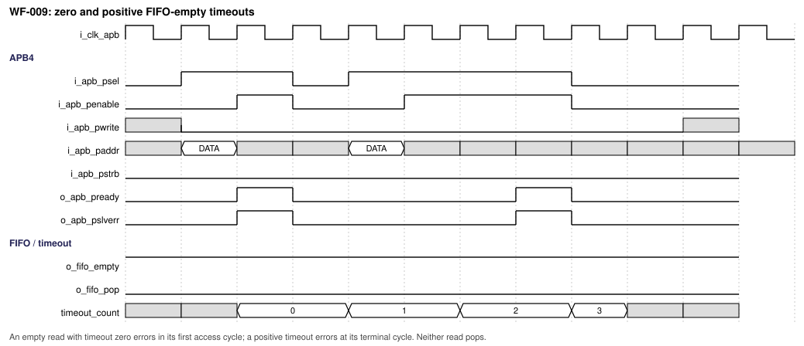

```wavedrom
{
  "signal": [
    {
      "name": "i_clk_apb",
      "wave": "p..........."
    },
    [
      "APB4",
      {
        "name": "i_apb_psel",
        "wave": "01101111000"
      },
      {
        "name": "i_apb_penable",
        "wave": "00100111000"
      },
      {
        "name": "i_apb_pwrite",
        "wave": "x000000000x"
      },
      {
        "name": "i_apb_paddr",
        "wave": "x=xx=xxxxxxx",
        "data": [
          "DATA",
          "DATA"
        ]
      },
      {
        "name": "i_apb_pstrb",
        "wave": "00000000000"
      },
      {
        "name": "o_apb_pready",
        "wave": "00100001000"
      },
      {
        "name": "o_apb_pslverr",
        "wave": "00100001000"
      }
    ],
    [
      "FIFO / timeout",
      {
        "name": "o_fifo_empty",
        "wave": "11111111111"
      },
      {
        "name": "o_fifo_pop",
        "wave": "00000000000"
      },
      {
        "name": "timeout_count",
        "wave": "xx=.=.=.=xx",
        "data": [
          "0",
          "1",
          "2",
          "3"
        ]
      }
    ]
  ],
  "head": {
    "text": "WF-009: zero and positive FIFO-empty timeouts"
  },
  "foot": {
    "text": "An empty read with timeout zero errors in its first access cycle; a positive timeout errors at its terminal cycle. Neither read pops."
  },
  "config": {
    "hscale": 3
  }
}
```

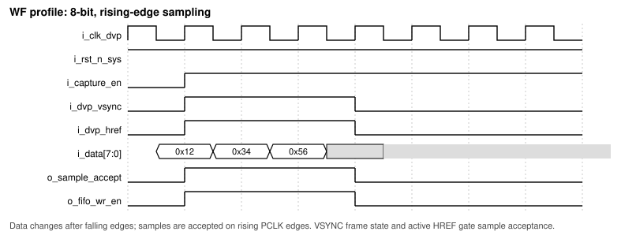

```wavedrom
{
  "signal": [
    {
      "name": "i_clk_dvp",
      "wave": "p......."
    },
    {
      "name": "i_rst_n_sys",
      "wave": "11111111"
    },
    {
      "name": "i_capture_en",
      "wave": "01111111"
    },
    {
      "name": "i_dvp_vsync",
      "wave": "01110000"
    },
    {
      "name": "i_dvp_href",
      "wave": "01110000"
    },
    {
      "name": "i_data[7:0]",
      "wave": "===x....",
      "data": [
        "0x12",
        "0x34",
        "0x56"
      ],
      "phase": 0.5
    },
    {
      "name": "o_sample_accept",
      "wave": "01110000"
    },
    {
      "name": "o_fifo_wr_en",
      "wave": "01110000"
    }
  ],
  "head": {
    "text": "WF profile: 8-bit, rising-edge sampling"
  },
  "foot": {
    "text": "Data changes after falling edges; samples are accepted on rising PCLK edges. VSYNC frame state and active HREF gate sample acceptance."
  },
  "config": {
    "hscale": 3
  }
}
```

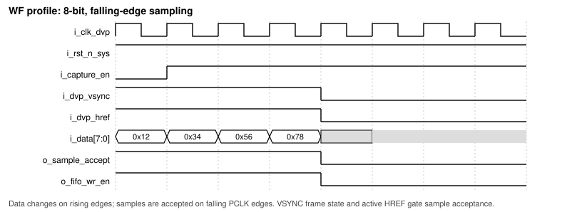

```wavedrom
{
  "signal": [
    {
      "name": "i_clk_dvp",
      "wave": "p......."
    },
    {
      "name": "i_rst_n_sys",
      "wave": "11111111"
    },
    {
      "name": "i_capture_en",
      "wave": "01111111"
    },
    {
      "name": "i_dvp_vsync",
      "wave": "11110000"
    },
    {
      "name": "i_dvp_href",
      "wave": "11110000"
    },
    {
      "name": "i_data[7:0]",
      "wave": "====x...",
      "data": [
        "0x12",
        "0x34",
        "0x56",
        "0x78"
      ],
      "phase": 0.0
    },
    {
      "name": "o_sample_accept",
      "wave": "11110000"
    },
    {
      "name": "o_fifo_wr_en",
      "wave": "11110000"
    }
  ],
  "head": {
    "text": "WF profile: 8-bit, falling-edge sampling"
  },
  "foot": {
    "text": "Data changes on rising edges; samples are accepted on falling PCLK edges. VSYNC frame state and active HREF gate sample acceptance."
  },
  "config": {
    "hscale": 3
  }
}
```

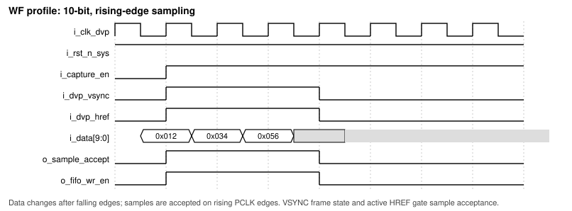

```wavedrom
{
  "signal": [
    {
      "name": "i_clk_dvp",
      "wave": "p......."
    },
    {
      "name": "i_rst_n_sys",
      "wave": "11111111"
    },
    {
      "name": "i_capture_en",
      "wave": "01111111"
    },
    {
      "name": "i_dvp_vsync",
      "wave": "01110000"
    },
    {
      "name": "i_dvp_href",
      "wave": "01110000"
    },
    {
      "name": "i_data[9:0]",
      "wave": "===x....",
      "data": [
        "0x012",
        "0x034",
        "0x056"
      ],
      "phase": 0.5
    },
    {
      "name": "o_sample_accept",
      "wave": "01110000"
    },
    {
      "name": "o_fifo_wr_en",
      "wave": "01110000"
    }
  ],
  "head": {
    "text": "WF profile: 10-bit, rising-edge sampling"
  },
  "foot": {
    "text": "Data changes after falling edges; samples are accepted on rising PCLK edges. VSYNC frame state and active HREF gate sample acceptance."
  },
  "config": {
    "hscale": 3
  }
}
```


```wavedrom
{
  "signal": [
    {
      "name": "i_clk_dvp",
      "wave": "p......."
    },
    {
      "name": "i_rst_n_sys",
      "wave": "11111111"
    },
    {
      "name": "i_capture_en",
      "wave": "01111111"
    },
    {
      "name": "i_dvp_vsync",
      "wave": "11110000"
    },
    {
      "name": "i_dvp_href",
      "wave": "11110000"
    },
    {
      "name": "i_data[9:0]",
      "wave": "====x...",
      "data": [
        "0x012",
        "0x034",
        "0x056",
        "0x078"
      ],
      "phase": 0.0
    },
    {
      "name": "o_sample_accept",
      "wave": "11110000"
    },
    {
      "name": "o_fifo_wr_en",
      "wave": "11110000"
    }
  ],
  "head": {
    "text": "WF profile: 10-bit, falling-edge sampling"
  },
  "foot": {
    "text": "Data changes on rising edges; samples are accepted on falling PCLK edges. VSYNC frame state and active HREF gate sample acceptance."
  },
  "config": {
    "hscale": 3
  }
}
```

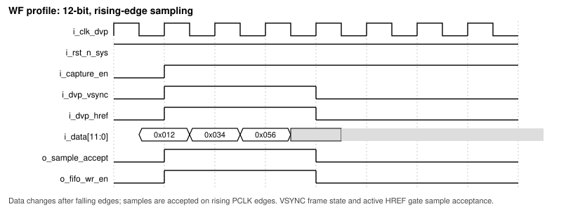

```wavedrom
{
  "signal": [
    {
      "name": "i_clk_dvp",
      "wave": "p......."
    },
    {
      "name": "i_rst_n_sys",
      "wave": "11111111"
    },
    {
      "name": "i_capture_en",
      "wave": "01111111"
    },
    {
      "name": "i_dvp_vsync",
      "wave": "01110000"
    },
    {
      "name": "i_dvp_href",
      "wave": "01110000"
    },
    {
      "name": "i_data[11:0]",
      "wave": "===x....",
      "data": [
        "0x012",
        "0x034",
        "0x056"
      ],
      "phase": 0.5
    },
    {
      "name": "o_sample_accept",
      "wave": "01110000"
    },
    {
      "name": "o_fifo_wr_en",
      "wave": "01110000"
    }
  ],
  "head": {
    "text": "WF profile: 12-bit, rising-edge sampling"
  },
  "foot": {
    "text": "Data changes after falling edges; samples are accepted on rising PCLK edges. VSYNC frame state and active HREF gate sample acceptance."
  },
  "config": {
    "hscale": 3
  }
}
```


```wavedrom
{
  "signal": [
    {
      "name": "i_clk_dvp",
      "wave": "p......."
    },
    {
      "name": "i_rst_n_sys",
      "wave": "11111111"
    },
    {
      "name": "i_capture_en",
      "wave": "01111111"
    },
    {
      "name": "i_dvp_vsync",
      "wave": "11110000"
    },
    {
      "name": "i_dvp_href",
      "wave": "11110000"
    },
    {
      "name": "i_data[11:0]",
      "wave": "====x...",
      "data": [
        "0x012",
        "0x034",
        "0x056",
        "0x078"
      ],
      "phase": 0.0
    },
    {
      "name": "o_sample_accept",
      "wave": "11110000"
    },
    {
      "name": "o_fifo_wr_en",
      "wave": "11110000"
    }
  ],
  "head": {
    "text": "WF profile: 12-bit, falling-edge sampling"
  },
  "foot": {
    "text": "Data changes on rising edges; samples are accepted on falling PCLK edges. VSYNC frame state and active HREF gate sample acceptance."
  },
  "config": {
    "hscale": 3
  }
}
```


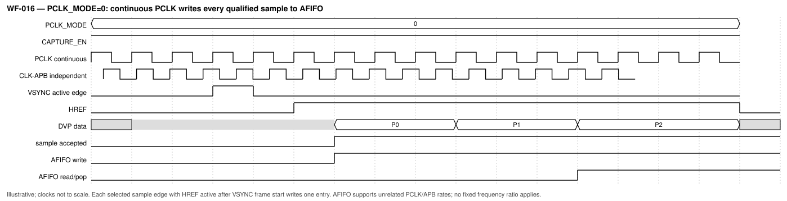

```wavedrom
{
  "signal": [
    {
      "name": "PCLK_MODE",
      "wave": "=...............",
      "data": [
        "0"
      ]
    },
    {
      "name": "CAPTURE_EN",
      "wave": "1111111111111111"
    },
    {
      "name": "PCLK continuous",
      "wave": "pppppppppppppppp",
      "period": 1.0
    },
    {
      "name": "CLK-APB independent",
      "wave": "pppppppppppppppp",
      "period": 0.82,
      "phase": 0.3
    },
    {
      "name": "VSYNC active edge",
      "wave": "0..10..........."
    },
    {
      "name": "HREF",
      "wave": "0....1..........0"
    },
    {
      "name": "DVP data",
      "wave": "x.....=..=..=...x",
      "data": [
        "P0",
        "P1",
        "P2"
      ]
    },
    {
      "name": "sample accepted",
      "wave": "0.....1..1..1...."
    },
    {
      "name": "AFIFO write",
      "wave": "0.....1..1..1...."
    },
    {
      "name": "AFIFO read/pop",
      "wave": "0...........1.1.."
    }
  ],
  "head": {
    "text": "WF-016 — PCLK_MODE=0: continuous PCLK writes every qualified sample to AFIFO"
  },
  "foot": {
    "text": "Illustrative; clocks not to scale. Each selected sample edge with HREF active after VSYNC frame start writes one entry. AFIFO supports unrelated PCLK/APB rates; no fixed frequency ratio applies."
  },
  "config": {
    "hscale": 2
  }
}
```

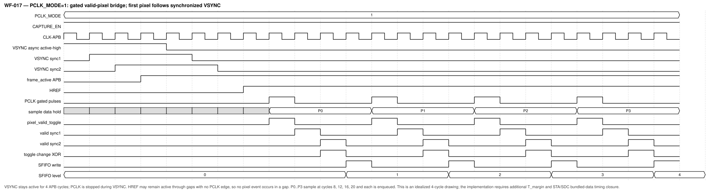

```wavedrom
{
  "signal": [
    {
      "name": "PCLK_MODE",
      "wave": "=.......................",
      "data": [
        "1"
      ]
    },
    {
      "name": "CAPTURE_EN",
      "wave": "111111111111111111111111"
    },
    {
      "name": "CLK-APB",
      "wave": "pppppppppppppppppppppppp"
    },
    {
      "name": "VSYNC async active-high",
      "wave": "111100000000000000000000"
    },
    {
      "name": "VSYNC sync1",
      "wave": "011110000000000000000000"
    },
    {
      "name": "VSYNC sync2",
      "wave": "001111000000000000000000"
    },
    {
      "name": "frame_active APB",
      "wave": "000111111111111111111111"
    },
    {
      "name": "HREF",
      "wave": "000000011111111111111111"
    },
    {
      "name": "PCLK gated pulses",
      "wave": "000000001000100010001000"
    },
    {
      "name": "sample data hold",
      "wave": "xxxxxxxx=...=...=...=...",
      "data": [
        "P0",
        "P1",
        "P2",
        "P3"
      ]
    },
    {
      "name": "pixel_valid_toggle",
      "wave": "000000001000100010001000"
    },
    {
      "name": "valid sync1",
      "wave": "000000000100010001000100"
    },
    {
      "name": "valid sync2",
      "wave": "000000000010001000100010"
    },
    {
      "name": "toggle change XOR",
      "wave": "000000000010001000100010"
    },
    {
      "name": "SFIFO write",
      "wave": "000000000001000100010001"
    },
    {
      "name": "SFIFO level",
      "wave": "=..........=...=...=...=.",
      "data": [
        "0",
        "1",
        "2",
        "3",
        "4"
      ]
    }
  ],
  "head": {
    "text": "WF-017 — PCLK_MODE=1: gated valid-pixel bridge; first pixel follows synchronized VSYNC"
  },
  "foot": {
    "text": "VSYNC stays active for 4 APB cycles; PCLK is stopped during VSYNC. HREF may remain active through gaps with no PCLK edge, so no pixel event occurs in a gap. P0..P3 sample at cycles 8, 12, 16, 20 and each is enqueued. This is an idealized 4-cycle drawing; the implementation requires additional T_margin and STA/SDC bundled-data timing closure."
  },
  "config": {
    "hscale": 3
  }
}
```

### 10.4 Arbitration, buffering, and throughput

One external APB interface permits one transfer at a time. The decoder selects CSR or FIFO_DATA and the currently selected FIFO. The sensor cannot be stalled. Continuous mode uses AFIFO for unrelated PCLK/APB rates; gated mode requires each accepted pixel edge to be separated by at least four APB cycles plus timing margin, while the SFIFO buffers DMA service variation. A minimum two-cycle APB read bounds ideal throughput to f_APB/2; contention and waits lower it. Required depth covers peak arrivals during maximum DMA service delay plus CDC/arbitration/recovery margin.

### 10.5 Memories and storage

| Memory ID | Storage | Width / depth | Port clocks | Read semantics | Implementation | Status |
|---|---|---|---|---|---|---|
| MEM-001 | Continuous-mode asynchronous Gray FIFO | PARA_DVP_DATA_W by PARA_FIFO_DEPTH | Write i_clk_dvp; read i_clk_apb | Show-ahead head valid when nonempty | DVP-local AFIFO top/read side; common Gray FIFO children | PARA_FIFO_DEPTH, power-of-two minimum 2, default 8 |
| MEM-002 | Gated-mode synchronous FIFO | PARA_DVP_DATA_W by PARA_FIFO_DEPTH | Write/read i_clk_apb | Show-ahead head valid when nonempty | Reuse `m_vlsit_sfifo_top`; local occupancy monitor | Same depth parameter and drop-new overflow policy |

### 10.6 CSR-selected PCLK modes and gated-pixel transfer contract

The `dvp_ctrl.pclk_mode` field is runtime CSR configuration, not a parameter. Reset value 0 selects continuous PCLK; value 1 selects gated-valid-pixel PCLK. A mode change is accepted only when `dvp_ctrl.capture_en` is 0, both mode FIFOs are empty, and the active source path has stopped accepting writes. The APB service masks only the mode bit when any condition is false, preserving other writable bits in the CSR word; the APB write still completes with OKAY. Firmware reads the field back to confirm the change. For a same-word write that sets `capture_en`, the mode bit is also masked so the new mode cannot become active in the same transfer.

| Mode | VSYNC handling | Pixel acceptance | FIFO path | Required condition |
|---|---|---|---|---|
| 0 — continuous PCLK | Detect the active VSYNC edge in the PCLK domain | At the configured rising/falling PCLK edge, accept one sample only when capture is enabled, frame has started, and HREF is at its configured active level | DVP-local AFIFO; asynchronous read in CLK-APB | PCLK is continuous in the selected sensor mode; depth is PARA_FIFO_DEPTH |
| 1 — gated valid-pixel PCLK | Synchronize VSYNC through two CLK-APB stages; edge-detect its active transition in CLK-APB and maintain frame-active state in CLK-APB | On each qualified selected PCLK sample edge, capture data into a source holding register and toggle pixel-valid once; CLK-APB synchronizes pixel-valid through two stages, detects either transition with XOR against the previous synchronized value, and writes the held sample. There is no APB-to-PCLK frame-start crossing. | Reused `m_vlsit_sfifo_top`, clocked by CLK-APB; DVP-local occupancy monitor | VSYNC active width >= 4 CLK-APB cycles; successive accepted pixel sample edges are >= 4 CLK-APB cycles apart, including timing margin |

The gated-mode data register is a bundled-data crossing: the pixel value remains stable from its PCLK sample edge until the APB FIFO write. The valid toggle changes once per accepted pixel, not on an unrelated PCLK transition. The APB edge detector must react to both rising and falling changes; selecting only one transition would discard every other pixel. When HREF is active but PCLK has no selected edge, no pixel event or FIFO write occurs. In gated mode the sensor shall produce no PCLK edge while VSYNC is active, and shall produce no edge in an HREF-high gap that contains no valid pixel. The APB-domain frame state removes the need to deliver a frame-start event into a clock domain that may be stopped; the four-cycle VSYNC pulse is fully synchronized before the first valid PCLK edge, so the first pixel is retained.

**Example D27 (gated first pixel):** with CLK-APB period 10 ns, VSYNC is active for APB cycles 0–3 while PCLK is stopped; the APB synchronizer observes the active level by cycle 2 and frame-active is set by cycle 3. HREF may rise at cycle 6, with the first valid PCLK sample P0 at cycle 8. The APB bridge then detects the toggle and writes P0 to SFIFO before the next pixel, provided the >=4-cycle spacing plus `T_margin` is met. This example illustrates latency only; STA/SDC must close bundled-data timing.

**Example D28 (safe mode change):** in continuous mode, software clears `CAPTURE_EN`, reads FIFO_DATA until the selected FIFO is empty, then writes `DVP_CTRL=0x00000002` to request gated mode. If the source stop acknowledgement or either FIFO-empty condition is not yet true, `PCLK_MODE` remains 0 and APB returns OKAY; software reads back `DVP_CTRL`, waits for the source/FIFO to settle, and retries. After readback shows mode 1, software enables capture in a separate write (`DVP_CTRL=0x00000003`).

For gated mode, define $T_{PIX,min}$ as the shortest interval between successive selected PCLK edges that carry valid pixels. The accepted integration constraint is:

$$T_{PIX,min} \ge 4T_{APB} + T_{setup/hold} + T_{uncertainty}$$

The nominal clock-rate form is $f_{APB} \ge 4f_{PIX,max}$, with the actual setup/hold, synchronizer, and clock-uncertainty margin checked in STA/SDC. This is a peak active-pixel rate constraint, not an average frame-rate constraint. If the constraint is violated, the APB toggle synchronizer can miss an event or sample a newer value from the holding register; the gated profile is then outside the no-pixel-loss contract. FIFO-full overflow remains a separate condition and drops the newest sample while preserving unread samples.

The gated-mode APB FIFO write path completes the 2-FF synchronization, both-edge detection, and synchronous FIFO write within three APB edges after a source sample in the worst phase relationship; the accepted four-cycle spacing leaves one APB-cycle margin, in addition to the STA/SDC data setup/hold margin. The waveform plan includes the VSYNC 2-FF and pixel-toggle 2-FF stages, the data-hold interval, both toggle polarities, and the four-cycle spacing.

The sample bus is zero-extended to APB: $P_{APB} = \operatorname{zero\_extend}_{32}(P_{DVP})$. FIFO_DATA reads use PARA_FIFO_DATA_ADDR (default 16'h0100), pop once only on successful APB completion, and return PSLVERR without pop for writes or misaligned accesses to the endpoint. An aligned address that is not a mapped CSR or FIFO_DATA endpoint follows the CSR generator default: read zero/write ignored with OKAY.

### 10.7 Accepted-frame counter

In continuous mode, `m_dvp_capture` emits one `o_cont_frame_start` pulse in CLK-DVP only when the selected VSYNC active edge is observed after local path readiness, capture-enable synchronization, and continuous-mode selection. `m_dvp_buffer` transfers the pulse to CLK-APB with `m_vlsit_event_sync`. In gated mode, the two-stage VSYNC synchronizer and edge detector in `m_dvp_gate_bridge` emit a one-cycle APB pulse only while capture is enabled and gated mode is selected. `m_dvp_apb_service` increments the 32-bit counter once per selected pulse. The counter wraps naturally and is cleared only by common reset; FIFO flush does not change it.

**Example D29:** starting with `dvp_frame_count.count = 6`, one accepted continuous VSYNC edge produces 7 after the event crosses into CLK-APB. A second active edge accepted in gated mode produces 8. An active edge while `capture_en=0` does not increment the count. If the count is `0xFFFFFFFF`, the next accepted event produces `0x00000000`.

### 10.8 Selected-FIFO software flush

Software clears `dvp_ctrl.capture_en`, waits until `dvp_fifo_sts.active` is zero, stops DMA FIFO_DATA reads, then writes one to `dvp_ctrl.fifo_flush`. A write that leaves capture enabled or sets capture enable in the same control write is ignored for the flush bit; APB still returns OKAY. While flush is pending, writes that would cancel flush or change PCLK mode are masked, and capture-enable writes that would start capture are held at their prior value.

The buffer waits until capture is disabled and the selected source is quiescent, then starts that FIFO's existing software-reset handshake. In gated mode, reset request and busy remain in CLK-APB. In continuous mode, the APB request crosses to the PCLK writer domain and busy returns through a synchronizer; keep `i_clk_dvp` running until the request clears. The sequencer holds reset request active until busy is observed high, releases the request, then waits for busy to return low. Hardware clears the CSR request only after completion.

While pending, the buffer suppresses FIFO read enables and presents empty=1, full=1, data=0, and occupancy=0 to APB service. Software must stop DMA reads before requesting flush; any FIFO_DATA read attempted while pending cannot pop a sample and remains subject to the configured empty-read timeout. Flush clears only the selected FIFO. It retains `dvp_frame_count.count` and sticky overflow.

**Example D30:** with capture disabled, gated source quiescent, and five samples buffered, software stops DMA and writes `dvp_ctrl.fifo_flush=1`. The controller blocks reads, executes the SFIFO reset handshake, reports zero occupancy while pending, and clears the request after busy returns low. A later FIFO_DATA read with timeout zero errors without popping; frame count and overflow retain their values.

## 11. Register and programming model

This IP has software-visible control/status CSRs plus a custom APB FIFO_DATA endpoint. The versioned v1.1 workbook in this directory is the authority for register names, fields, offsets, access types, and reset values. `dvp_ctrl.pclk_mode` occupies existing bit [1] at offset 0x04. FIFO_DATA behavior is specified in Section 10.6; the CSR map is not duplicated here.

### 11.1 CSR specification source

The CSR workbook is the single source for software-visible register names, fields, offsets, access types, and reset values. The custom FIFO_DATA endpoint is not a CSR and shares the external APB4 interface through a decoder/response mux.

| Item | Specification |
|---|---|
| CSR workbook | VLSIT_DVP_CONTROLLER_CSR.xlsx (this versioned spec directory) |
| JSON generation source | VLSIT_DVP_CONTROLLER_CSR.json (this versioned spec directory) |
| Workbook sheet | CSR |
| Workbook status | Updated v1.1; generated with APB-CSR-Generator v3.4 and validated 2026-11-22 |
| CSR generator reference | Canonical APB-CSR-Generator v3.4; installed 2026-11-22 |
| Generated module | m_vlsit_csr_dvp |
| Register prefix | dvp |
| IP version | 1.1 |
| Asynchronous | 0; the register clock is the APB clock |
| CSR module clocks | Tie i_clk_reg to i_clk_apb and i_rst_n_reg to the synchronized APB-domain reset |
| APB protection | i_protect_en is tied low; protection filtering is disabled |
| APB error checking | i_slverr_en is tied high and remains constant after reset |
| Workbook register set | dvp_version, dvp_ctrl, dvp_wmark, dvp_timeout, dvp_fifo_sts, dvp_fifo_level, dvp_frame_count |

The workbook contains all CSR offsets, fields, access types, reset values, and descriptions. The version register is first. FIFO_DATA is the custom byte address PARA_FIFO_DATA_ADDR, default 16'h0100; aligned unmapped reads return zero/OKAY and writes are ignored/OKAY per the selected CSR generator behavior.

Software selects PCLK_MODE while CAPTURE_EN is clear, configures watermark and timeout, then enables capture in a separate APB write. Timeout resets to the maximum count; software may program a shorter delay, including zero for immediate empty-read error. Read `dvp_frame_count.count` to observe accepted frames. To discard buffered data, disable capture, stop DMA reads, request FIFO flush, and poll until hardware clears the request. DMA drains one sample per successful FIFO_DATA read.

### 11.2 Software sequences

Sensor programming and board-level XCLK, reset, and power-down control are external to this IP. The system DMA owns transfer length and destination memory.

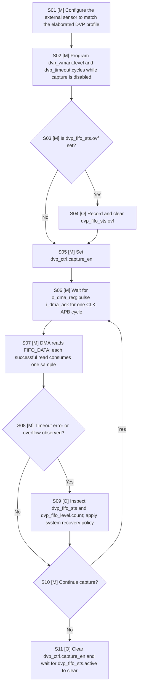

| No. | Step | Option (M/O) | Interface | CSR | Description |
|---|---|---|---|---|---|
| S01 | Configure the external sensor | M | External sensor-control path outside this IP | N/A: sensor configuration is external | Match data width, PCLK sampling edge, qualifier polarity and sync mode to the selected sensor mode. |
| S02 | Program DMA service and timeout | M | APB4 full-word writes | dvp_wmark.level and dvp_timeout.cycles | Write a nonzero watermark within PARA_FIFO_DEPTH, or zero to disable requests; program the empty-read timeout before enabling capture. |
| S03 | Check prior overflow | M | APB4 read | dvp_fifo_sts.ovf | Inspect sticky overflow from a previous capture before starting a new run. |
| S04 | Clear prior overflow | O; only if S03 reports overflow | APB4 full-word write | dvp_fifo_sts.ovf | Record the fault and write one to clear the W1C event before restarting. |
| S05 | Enable capture | M | APB4 full-word write | dvp_ctrl.capture_en | Enable qualified sample capture after profile and service controls are configured. |
| S06 | Accept a DMA batch request | M | Observe o_dma_req; pulse i_dma_ack for one CLK-APB cycle | N/A: sideband handshake | ACK acknowledges the batch request only; it does not pop a sample. |
| S07 | Drain samples | M | System DMA reads FIFO_DATA over APB4 | N/A: custom data endpoint | Each successful read returns and consumes one sample. On PSLVERR, stop the transfer and inspect status before retrying. |
| S08 | Inspect errors and occupancy | O; if a timeout error or overflow is reported | APB4 reads | dvp_fifo_sts and dvp_fifo_level.count | Determine whether FIFO is empty/full and whether overflow was recorded; apply system-level recovery. |
| S09 | Clear overflow after recording it | O; only if dvp_fifo_sts.ovf is set | APB4 full-word write | dvp_fifo_sts.ovf | W1C the sticky event only after software records or handles the dropped-sample condition. |
| S10 | Continue or stop | M after each batch | REQ/ACK and APB status | dvp_fifo_sts.active | Continue by waiting for the next request; otherwise proceed to stop. |
| S11 | Disable capture | O; when capture is no longer required | APB4 full-word write | dvp_ctrl.capture_en | Clear capture enable and wait for active to deassert. Capture disable stops new accepted samples after the applicable mode path observes disable; residual FIFO samples are retained for DMA drain. |
| S12 | Read accepted-frame count | O; for frame monitoring | APB4 read | dvp_frame_count.count | Read the modulo-2^32 count; FIFO flush does not reset it. |
| S13 | Flush selected FIFO | O; discard buffered samples | APB4 write/read; stop DMA reads first | dvp_ctrl.fifo_flush | Write one while capture is disabled, keep PCLK running in continuous mode, and poll until hardware clears the request. Do not re-enable capture or DMA reads while pending. |

### 11.3 CSR connection to the design

Use exact field names from the workbook. The following are generated CSR ports and internal design connections, not additional top-level ports.

| Workbook register.field | CSR port / direction | Design connection | Clock domain | Behavior |
|---|---|---|---|---|
| dvp_version.major | i_dvp_version_major, input | Constant major version value | CLK-APB | Read-only identification |
| dvp_version.minor | i_dvp_version_minor, input | Constant minor version value | CLK-APB | Read-only identification |
| dvp_ctrl.capture_en | o_dvp_ctrl_capture_en, output | Capture-enable request; synchronize into CLK-DVP | CLK-APB to CLK-DVP | Reset-disabled control; writes that start capture while FIFO flush is pending are masked |
| dvp_ctrl.fifo_flush | o_dvp_ctrl_fifo_flush, output | Flush request; cleared with i_hw_wdata_dvp_ctrl_fifo_flush=0 and i_hw_we_dvp_ctrl_fifo_flush after completion | CLK-APB; AFIFO request/busy cross to CLK-DVP | RWI pending indicator; flush starts only with capture disabled and selected source quiescent |
| dvp_wmark.level | o_dvp_wmark_level, output | DMA occupancy threshold comparator | CLK-APB | Zero disables requests; nonzero configuration is held stable during capture |
| dvp_timeout.cycles | o_dvp_timeout_cycles, output | Custom FIFO_DATA APB wait counter | CLK-APB | Applies to active FIFO_DATA reads only; the APB transfer is exclusive while waiting |
| dvp_fifo_sts.active | i_dvp_fifo_sts_active, input | Synchronized capture-active indication | CLK-APB | Deasserts after capture disable crosses into CLK-DVP |
| dvp_fifo_sts.empty | i_dvp_fifo_sts_empty, input | APB-side asynchronous FIFO empty flag | CLK-APB | Used by FIFO_DATA reads and DMA status checks |
| dvp_fifo_sts.full | i_dvp_fifo_sts_full, input | FIFO full indication synchronized from CLK-DVP | CLK-APB | May lag the current write-side condition by CDC latency |
| dvp_fifo_sts.ovf | o_dvp_fifo_sts_ovf, output | Sticky W1C status; hardware load uses i_hw_wdata_dvp_fifo_sts_ovf and i_hw_we_dvp_fifo_sts_ovf | CLK-APB | Synchronize the overflow event into CLK-APB and load one; hardware set wins over a same-cycle software clear |
| dvp_fifo_level.count | i_dvp_fifo_level_count, input | APB-side occupancy estimate from synchronized FIFO pointers | CLK-APB | Live estimate from zero through configured FIFO capacity; presented as zero while flush is pending |
| dvp_frame_count.count | i_dvp_frame_count_count, input | APB counter incremented by selected-mode frame-start pulse | CLK-APB | Modulo-2^32 count; common-reset only; retained across flush |

All inputs to the synchronous CSR sheet are synchronous to i_clk_apb. Cross-domain sensor signals are synchronized by the DVP controller before they reach the CSR ports. The CSR generator does not synchronize hardware status inputs.

### 11.4 APB access behavior

The APB transfer-phase and signal-stability requirements follow REF-001, AMBA APB IHI 0024D, Appendix A and Sections 3.1–3.4. The generated CSR behavior follows APB-CSR-Generator v3.4 for Asynchronous=0. The FIFO_DATA endpoint is custom logic and uses the same external APB interface.

| Case | Behavior |
|---|---|
| Normal mapped CSR read or write | With Asynchronous=0, the generated module uses one wait state, then completes when PREADY is high. |
| CSR partial-strobe write | With static i_slverr_en=1, complete with PSLVERR and make no register change. Software writes full words only. |
| CSR unaligned address | Complete with PSLVERR when i_slverr_en=1; no CSR changes. |
| CSR aligned unmapped address | Generator default: complete without error; reads return zero and writes are ignored. |
| CSR access protection | i_protect_en is tied low, so PPROT does not reject an access. |
| Reserved workbook fields | Read as zero and ignore writes. |
| W1C overflow event and clear in one cycle | Hardware load has priority; a new overflow event is retained. |
| FIFO_DATA read while nonempty | Return the FIFO head and assert PREADY on the first APB access cycle; pop exactly once on successful completion. |
| FIFO flush pending | Present empty=1 and suppress FIFO read/pop; software must stop DMA reads before requesting flush. |
| FIFO flush request while capture enabled | Mask the request bit; complete the CSR write with OKAY and make no FIFO change. |
| FIFO flush complete | Hardware clears the pending CSR bit after selected FIFO busy has asserted and deasserted; frame count and overflow are retained. |
| FIFO_DATA read while empty, timeout zero | Complete with PREADY and PSLVERR high in the first APB access cycle; do not pop. |
| FIFO_DATA read while empty, positive timeout | Hold PREADY low while waiting. If the FIFO remains empty through the configured number of APB access cycles, complete with PREADY and PSLVERR high only in the terminal cycle; do not pop. Data available on that terminal decision cycle wins and completes successfully with one pop. |
| FIFO_DATA write | Return an APB error and leave FIFO pointers/data unchanged. |
| Reset during a FIFO_DATA read | Cancel the pending transfer, keep pop and PSLVERR low, reset both FIFO domains; the APB master retries only after reset release and initialization. |
| FIFO_DATA/unmapped/misaligned decode | Aligned FIFO_DATA reads pop once only on success; endpoint writes and misaligned endpoint accesses return PSLVERR without pop; aligned unmapped reads return zero/OKAY and writes are ignored/OKAY. |

During a wait state, the APB Requester shall hold address and control signals stable and keep PSTRB low for reads, consistent with REF-001. PSLVERR is meaningful only on the final cycle where PSEL, PENABLE and PREADY are all high.

## 12. Error handling and recovery

| Error ID | Condition | Detection | External response | Recovery / software action | Open point |
|---|---|---|---|---|---|
| ERR-001 | Qualified sample arrives while selected FIFO is full | FIFO write-side full indication | Sensor cannot be stalled; newest sample is lost | Preserve unread entries; sticky W1C overflow; new event wins over simultaneous clear | DEC-010 |
| ERR-002 | FIFO-data APB read remains empty through the programmed timeout | Empty flag and APB-cycle counter | Complete with PREADY=1 and PSLVERR=1 in the final APB cycle | No FIFO pop; DMA/software observes the error and retries only after checking request/level status | DEC-013, DEC-017 |
| ERR-003 | APB write to read-only FIFO_DATA endpoint | Address decode and PWRITE | PREADY=1, PSLVERR=1 | No FIFO state change or pop | DEC-016 |
| ERR-004 | Misaligned FIFO_DATA or aligned unmapped APB address | Decoder | Misaligned endpoint returns PSLVERR; aligned unmapped read returns zero/OKAY and write is ignored/OKAY | No unintended FIFO pop or write | DEC-016 |
| ERR-005 | FIFO reset domains released inconsistently | Reset/CDC review | Block access until both sides initialize | Coordinated reset and controlled release | DEC-012 |
| ERR-006 | Unsupported parameter combination | Elaboration checks | Build reports configuration error | Correct compile-time profile | DEC-006 |
| ERR-007 | Flush request attempted while capture is enabled, or a read is attempted while flush is pending | APB control-bit mask and flush state | Invalid flush request is ignored with OKAY; pending flush blocks FIFO reads/pop and leaves them governed by the empty-read timeout | Disable capture, stop DMA reads, then issue flush; continuous PCLK must run to complete | DEC-032 |

A FIFO read must never pop while empty or before APB transfer completion. A FIFO write while full must not corrupt pointers or overwrite unread data. The selected FIFO drops the newest pixel, sets sticky W1C overflow with set-dominant priority, and resumes accepting samples after space is available. A new VSYNC active edge starts the next frame; capture disable preserves queued samples. Software may explicitly flush the selected FIFO after capture is disabled and DMA reads are stopped; this operation retains overflow and frame count.

## 13. Performance, power, and area

| Metric ID | Metric | Target / formula | Conditions | Verification / measurement | Status |
|---|---|---|---|---|---|
| PERF-001 | Sustained sample capture | Continuous mode: one sample per selected PCLK edge when frame/HREF qualify. Gated mode: one sample per valid pulse if pixel spacing is >=4 APB cycles plus STA margin. | Each sensor profile | Simulation and STA/SDC bundled-data review | Mode-specific contract |
| PERF-002 | Sustained APB drain | At most f_APB/2 samples/s for minimum two-cycle reads, reduced by contention/waits | Back-to-back APB reads | APB throughput simulation | APB frequency and contention pending |
| PERF-003 | Maximum supported service stall | FIFO depth covers peak valid-pixel rate x maximum DMA stall plus margin | Integrator-defined workload | Bounded-stall simulation and occupancy analysis | Size PARA_FIFO_DEPTH per formula below |
| PPA-001 | Maximum frequency | Sensor PCLK/APB limits from approved workload and timing | Named library/PVT | STA with approved SDC | Platform and limits pending |
| PPA-002 | Area | Meet selected SoC IP budget | Library and memory choice | Synthesis/physical area report | No target supplied |
| PPA-003 | Dynamic/leakage power | Measure at selected frame rate and switching activity | Named modes/corner | Power analysis | No target supplied |
| PERF-004 | APB FIFO read latency | Minimum two APB cycles when data is available, plus implemented waits | No interconnect wait | APB simulation | Defined by APB endpoint implementation |

FIFO storage depth is compile-time configurable through PARA_FIFO_DEPTH. Let $R_{PIX}$ be peak valid sample rate and $T_{STALL}$ the maximum DMA service stall. A conservative minimum is $D_{MIN}=\lceil R_{PIX}T_{STALL}\rceil+D_{MARGIN}$; round up to a power of two because both FIFOs require power-of-two depth. Example: 25 MHz x 10 us = 250 arrivals; add 16 entries margin = 266; round up to 512, so configure PARA_FIFO_DEPTH=512. This is an example only, not the user's workload. Continuous mode's AFIFO tolerates unrelated clock rates but not sustained input rate above long-term DMA drain. Gated mode additionally requires $T_{PIX,min}\ge4T_{APB}+T_{margin}$ regardless of average frame rate.

## 14. RTL implementation contract

### 14.1 Required coding baseline

RTL shall follow VLSIT RTL Design Rules v2 (REF-003), IEEE 1800-2017 synthesizable subset, and the selected naming convention. Parameters use parameter logic [31:0] parameters with the PARA_ prefix with the required three comments. Use separate clock/reset domains, explicit CDC structures and reset synchronizers. Do not add interfaces, macros, packages, initial blocks, delays, latches, multiple drivers, wildcard/positional connections, or unsupported constructs. Each RTL source shall use the required VLSIT header and identifiers shall meet the 30-character limit.

### 14.2 RTL hierarchy

| Module | Function | Parent / instance | Clock domain | Synthesis status |
|---|---|---|---|---|
| m_dvp_controller | Structural top with a capture block and an APB service subsystem | Top | CLK-APB and PCLK | Synthesizable |
| m_dvp_capture | Samples selected PCLK edges, applies HREF and produces continuous sample-write or gated held-data/toggle events | m_dvp_controller / u_dvp_capture | PCLK | Synthesizable |
| m_dvp_apb_service | APB control/data subsystem; contains the buffer, CSR, decoder, FIFO_DATA endpoint and DMA request modules | m_dvp_controller / u_dvp_apb_service | CLK-APB | Synthesizable subsystem |
| m_dvp_buffer | Selects mode-specific FIFO and occupancy; instantiates AFIFO, gated bridge and SFIFO | m_dvp_apb_service / u_dvp_buffer | CLK-APB and PCLK | Synthesizable subsystem |
| m_dvp_gate_bridge | Synchronizes gated VSYNC and pixel toggle; detects both toggle transitions and writes held samples | m_dvp_buffer / u_dvp_gate_bridge | CLK-APB (inputs cross from VSYNC/PCLK) | Synthesizable |
| m_dvp_afifo | Local AFIFO top with APB occupancy; reuses common Gray FIFO children and local read variant | m_dvp_buffer / u_dvp_afifo | PCLK and CLK-APB | New wrapper; common child modules reused |
| m_dvp_afifo_rd | Local read-side variant exposing APB-domain occupancy estimate | m_dvp_afifo / u_dvp_afifo_rd | CLK-APB | DVP-local variant of common AFIFO read side |
| m_vlsit_sfifo_top | Stores gated-mode pixels synchronously in APB domain | m_dvp_buffer / u_dvp_sfifo | CLK-APB | Existing common module reused |
| m_dvp_apb_decode | Selects CSR or FIFO_DATA and applies endpoint alignment/error behavior | m_dvp_apb_service / u_dvp_apb_decode | CLK-APB | Synthesizable |
| m_vlsit_csr_dvp | Generated control/status register block | m_dvp_apb_service / u_dvp_csr | CLK-APB | Generated from updated v1.0 workbook |
| m_dvp_apb_data | FIFO_DATA read endpoint with empty timeout, mode mux and exactly-once pop | m_dvp_apb_service / u_dvp_data | CLK-APB | Synthesizable |
| m_dvp_dma_req | Watermark-based batch REQ/ACK controller using selected FIFO occupancy | m_dvp_apb_service / u_dvp_dma_req | CLK-APB | Synthesizable |

Common modules to reuse without modification: `m_vlsit_rst_sync` (separate CLK-APB/PCLK release), `m_vlsit_tie` (fixed CSR tie-offs), `m_vlsit_event_sync` (continuous-mode overflow pulse to APB), `m_vlsit_sfifo_top` (gated-mode storage), and the common AFIFO synchronizer/memory/write-side children. The DVP-local AFIFO wrapper adds read-side occupancy export required by the CSR and DMA watermark.

This version records the approved hierarchy and common-module reuse used for RTL generation. Shared helper modules remain external dependencies and are not copied or modified by this IP.

#### 14.2.1 Implemented module port tables

The top-level parameter and port tables in Sections 6.2 and 8 are normative. The following internal interfaces describe the generated RTL. Width aliases: `W=PARA_DVP_DATA_W`, `DEPTH=PARA_FIFO_DEPTH`, `PTR_W=$clog2(DEPTH)+1`, and `OCC_W=$clog2(DEPTH+1)`. All resets are active-low.

| Module | Clock / reset | Inputs | Outputs | Notes |
|---|---|---|---|---|
| `m_dvp_controller` | `i_clk_apb`, `i_clk_dvp`; `i_rst_n_sys` | Complete top-level interface from Section 6.2 | APB response, DMA request, internal capture controls | Structural wrapper; parameters from Section 8 |
| `m_dvp_capture` | Continuous logic: `i_clk_dvp` / `i_rst_n_dvp`; gated launch state: selected PCLK edge / `i_rst_n_gated` (APB-local reset release) | `i_dvp_data[W-1:0]`, `i_dvp_vsync`, `i_dvp_href`, APB `i_capture_en`, `i_pclk_mode` | `o_afifo_wr_en`, `o_afifo_wr_data[W-1:0]`, `o_gated_data[W-1:0]`, `o_valid_toggle`, `o_cont_frame_active`, `o_capture_quiescent` | Synchronizes APB controls to continuous PCLK logic. Continuous-path readiness is internal. Gated launch data/toggle use APB-domain synchronized reset `i_rst_n_gated` so a stopped PCLK does not lose its first pixel to reset-release latency; the sensor VSYNC guard interval and reset-removal timing are integration requirements (DEC-029). |
| `m_dvp_apb_service` | `i_clk_apb` / `i_rst_n_apb`; nested FIFO writer uses `i_clk_dvp` / `i_rst_n_dvp` | APB4 pins, DMA ACK, raw VSYNC, continuous sample write/data/frame/quiescent status, gated data/toggle | APB response, `o_capture_en`, `o_pclk_mode`, `o_dma_req` | Computes the safe-mode condition from the buffer; masks only the mode bit on unsafe CSR writes and muxes CSR/FIFO_DATA responses. |
| `m_dvp_buffer` | PCLK and CLK-APB / local resets | Mode/control, raw VSYNC, continuous sample write/data/frame/quiescent status, gated data/toggle, APB read enable | Selected FIFO data, empty/full, occupancy, active, overflow events, `o_mode_change_safe` | Instantiates both mode FIFOs and the gated bridge; both-empty is internal and mode-safe waits for both FIFOs empty and the selected source quiescent. |
| `m_dvp_gate_bridge` | `i_clk_apb` / `i_rst_n_apb` | Raw VSYNC, PCLK-held data/toggle, capture enable, PCLK_MODE | APB frame-active, `o_sfifo_wr_en`, `o_sfifo_wr_data[W-1:0]`, path-quiescent | Two-stage VSYNC and toggle synchronizers; frame qualification remains in APB; edge-detects both toggle directions. Every qualified event is presented to the SFIFO, which drops new samples and pulses overflow when full. |
| `m_dvp_afifo` | Write `i_clk_dvp`, read `i_clk_apb` / corresponding local resets | Write enable/data, APB read enable, empty threshold | Read data, empty/full, overflow/underflow, occupancy estimate | Local top; common AFIFO write, memory and synchronizer children; local read-side variant below; software reset tied inactive. |
| `m_dvp_afifo_rd` | `i_clk_rd` / `i_rst_n_rd` | `i_rd_en`, `i_empty_thr[PTR_W-1:0]`, `i_wr_gray[PTR_W-1:0]`, `i_req_wr`, `i_mem_rd_data[W-1:0]` | `o_rd_data[W-1:0]`, empty/threshold/underflow, `o_rd_gray[PTR_W-1:0]`, `o_ack_rd`, memory address, `o_occupancy[OCC_W-1:0]` | DVP-local extension of the approved Gray-FIFO read side; occupancy is an estimate from synchronized write pointer minus read pointer. |
| `m_dvp_apb_decode` | `i_clk_apb` / `i_rst_n_apb` | APB request/address/direction/strobes | CSR select/request, FIFO_DATA select/request, endpoint error/decode | FIFO_DATA region is identified by address bits `[15:2]`; only the aligned parameter address is valid. Misaligned accesses to that word return PSLVERR. |
| `m_dvp_apb_data` | `i_clk_apb` / `i_rst_n_apb` | Decoded FIFO_DATA read, selected FIFO empty/data, timeout cycles | FIFO read-pop, APB ready/data/error | Pops exactly once on successful completion; empty timeout errors without pop. |
| `m_dvp_dma_req` | `i_clk_apb` / `i_rst_n_apb` | Selected occupancy, watermark, `i_dma_ack` | `o_dma_req` | Level request holds until ACK; re-arms only after occupancy is below threshold. |
| `m_vlsit_csr_dvp` | `i_clk_apb` / `i_rst_n_apb` | APB CSR request; FIFO/capture status; overflow hardware event | CSR response; capture/mode/watermark/timeout controls; overflow W1C | Generated from the validated workbook; the exact generated port list is frozen by `vlsit_csr_tool.py ports` and is not hand-edited. |

The generated CSR module exposes `i_dvp_version_major/minor`, `o_dvp_ctrl_capture_en`, `o_dvp_ctrl_pclk_mode`, `o_dvp_wmark_level`, `o_dvp_timeout_cycles`, status inputs for `dvp_fifo_sts`, W1C event ports, and `i_dvp_fifo_level_count`. Its APB interface includes `i_apb_paddr/pwdata/pwrite/penable/psel/pstrb/pprot`, `i_protect_en`, `i_slverr_en`, and `o_apb_pready/pslverr/prdata`. The capture/reset readiness signal must be synchronized into CLK-APB before it qualifies frame start or FIFO service.

### 14.3 Synthesis assumptions

| Item | Assumption / requirement |
|---|---|
| Top / source list | m_dvp_controller; source list includes DVP capture, APB service/buffer, gated bridge, AFIFO wrapper and common modules listed below |
| Frontend / options | IEEE 1800-2017 synthesizable subset; no vendor-specific constructs. SoC integration selects a compatible frontend and options. |
| Parameters | One elaborated profile per build; data width 8, 10 or 12; PARA_FIFO_DEPTH sets entries in both mode-specific FIFOs |
| Libraries / corners | Not supplied; PPA/timing sign-off unavailable |
| Memory flow | Continuous AFIFO uses PARA_AFIFO_MEM_USE_MACRO=0 by default; gated SFIFO reuses the common RTL array/memory implementation unless the approved common configuration selects a macro |
| Lint configuration | VLSIT RTL rule checker plus project lint setup, to be selected |
| Generated CSR | APB-CSR-Generator output only from approved workbook |

## 15. Verification specification

### 15.1 Scope and strategy

Use a sensor-side DVP driver, APB4 requester, DMA REQ/ACK driver and independent sample scoreboard. Exercise every supported data width, sampling edge and polarity. Continuous mode uses unrelated PCLK/APB periods and phases; gated mode exercises the approved four-cycle spacing and bundled-data hold condition. Verify generated CSRs separately from the custom FIFO_DATA endpoint. Numeric workload coverage is integration-selected.

### 15.2 Requirement-based test plan

| Test ID | Requirement | Scenario / expected result | Method | Configuration |
|---|---|---|---|---|
| TEST-001 | REQ-FUNC-001, REQ-FUNC-002 | Elaborate 8/10/12-bit widths and approved edge/polarity/modes | Elaboration and directed simulation | CFG-DVP8/10/12 |
| TEST-002 | REQ-FUNC-003 | Capture ordered samples over unrelated clocks and compare with scoreboard | Directed/constrained-random simulation | Approved profiles |
| TEST-003 | REQ-IF-001 | APB reads return ordered samples and pop exactly once | APB monitor and FIFO scoreboard | APB4 |
| TEST-004 | REQ-IF-002 | Empty endpoint waits for data; arrival before timeout completes one read and pops once | Directed wait-state simulation | APB4 |
| TEST-011 | REQ-IF-005 | Test timeout=0 (immediate first-access-cycle error if empty), positive timeout expiry after the programmed number of APB access cycles, data arrival before/on the terminal decision cycle (successful read wins), no FIFO pop on error, and PSLVERR only on the completing APB cycle | Directed APB timeout-boundary simulation with cycle-accurate counter checks | APB4 |
| TEST-005 | REQ-IF-004 | Watermark asserts REQ; ACK deasserts; drain below threshold rearms | Threshold-boundary simulation | APB4/DMA |
| TEST-006 | ERR-001 | Fill FIFO and exercise selected overflow policy/status/recovery | Bounded-stall simulation | Worst workload |
| TEST-007 | REQ-REG-001 | CSR reset, access, side effects and protection/error behavior | Workbook validation and APB regression | Approved workbook |
| TEST-008 | REQ-SCOPE-001 | No camera-control bus, separate HSYNC or embedded parser is required | Port/hierarchy review | All |
| TEST-009 | REQ-RESET-001 | Coordinated reset, stopped-clock and restart do not expose stale samples | CDC-aware simulation and RDC review | All |
| TEST-010 | PERF-001..004 | Measure capture rate, FIFO high-water mark and APB drain under bounded stalls | Simulation and rate analysis | Approved workload |
| TEST-012 | REQ-FUNC-005 | In continuous mode, wait for VSYNC frame start, sample both rising/falling-edge profiles when HREF is active, and verify ordered AFIFO writes across unrelated clocks | Directed simulation with sample scoreboard | PCLK_MODE=0, widths 8/10/12 |
| TEST-013 | REQ-FUNC-006, REQ-FUNC-007, REQ-PERF-001 | In gated mode, hold PCLK stopped during multi-cycle VSYNC, keep HREF high across gaps with no PCLK, then send pixels >=4 APB cycles apart; verify first pixel, both valid-toggle transitions, data hold through SFIFO write and APB FIFO ordering | Cycle-accurate directed simulation, assertions and STA/SDC constraint review | PCLK_MODE=1, widths 8/10/12, rising/falling sample edge |
| TEST-014 | REQ-FUNC-004 | Attempt a mode write while capture is enabled, in the same write that enables capture, while either FIFO is nonempty, and before continuous-source quiescence; each attempt preserves PCLK_MODE with APB OKAY. Drain the FIFO, wait for source quiescence, retry and verify readback changes. | Directed APB mode-guard sequence; cycle table D28 | Both mode transitions |
| TEST-015 | REQ-RESET-001, REQ-FUNC-007 | Release APB reset while gated PCLK is stopped; verify gated source data/toggle state initializes from APB-local reset, then pulse VSYNC for at least four APB cycles with no PCLK and verify the first valid pixel after the frame boundary is written once. Check reset recovery/removal at the first selected PCLK edge. | Directed CDC/reset simulation, assertions and STA/RDC review | PCLK_MODE=1, both sampling edges |
| TEST-016 | REQ-FUNC-009 | Count one accepted frame-start pulse in continuous mode and one in gated mode; suppress events while capture is disabled; verify modulo wrap and that FIFO flush retains the count | Directed APB/PCLK simulation | Both modes |
| TEST-017 | REQ-FUNC-010, REQ-REG-002, ERR-007 | Flush a nonempty FIFO in each mode; verify busy assert/deassert, hardware request clear, zero occupancy, no FIFO_DATA pop while pending, rejected request while capture is enabled, frame/overflow retention, and AFIFO completion with PCLK running | Directed APB/PCLK simulation with FIFO occupancy scoreboard | Both modes |

### 15.3 Assertions and coverage

| Property / coverage | Intent | Expected result | Method | Status |
|---|---|---|---|---|
| FIFO pop safety | Pop only on completed APB FIFO read and nonempty FIFO | One pop per completion; zero otherwise | SVA / simulation | Required |
| Sample ordering | No duplicate, reorder or invented samples absent approved overflow | Scoreboard equality | Simulation | Required |
| APB wait stability | Request address/control remains valid while PREADY is low; PSLVERR is meaningful only with PSEL, PENABLE, and PREADY high | APB4 compliance | Protocol assertions | Required |
| Timeout pop safety | Timeout error completion never pops FIFO; successful completion pops once | Count and response match outcome | SVA / simulation | Required |
| DMA handshake | REQ holds until ACK; re-request waits for re-arm | State transition contract | SVA / simulation | Required |
| Capture qualification | Writes match selected qualifier profile and sample edge | Profile-specific | Scoreboard / coverage | Required |
| Reset convergence | Empty FIFO, REQ low, capture disabled after coordinated reset | Both domains initialized | Assertions / RDC | Required |
| Functional coverage | All 8/10/12-bit widths, rising/falling sample edges, VSYNC/HREF polarities, both PCLK modes, empty wait, watermark boundaries, overflow, reset, and back-to-back reads | Approved bins hit | Coverage model | Sensor-specific timing bins are added when a camera mode is selected |

### 15.4 Formal, CDC, and RDC

| Analysis | Scope | Evidence / method | Status |
|---|---|---|---|
| Formal | FIFO push/pop safety, APB completion, request handshake, reset invariants | Assertions and assumptions from closed requirements | Property set pending |
| CDC | DVP/APB FIFO and every control/status crossing | Structural CDC report with synchronizer and constraint review | Required before sign-off |
| RDC | Independent reset assertion and local synchronous release | Reset-domain report plus reset simulation | Required before sign-off |

## 16. DFT and testability

| Topic | Requirement / assumption | Status |
|---|---|---|
| Scan architecture and eligibility | Follow SoC DFT methodology; no dedicated scan port selected | Integration TBD |
| Test clocks and reset | Use SoC test/reset architecture; preserve both clock domains | Integration TBD |
| Test-mode entry/exit | Disable capture and coherently initialize FIFO before functional mode | Proposed integration constraint |
| MBIST / memory test | If hard SRAM selected, use its qualified MBIST/test wrapper | Depends on macro |
| Test access / wrappers | No standalone test access port in scope | SoC integration |
| Clock gating | No clock-gating feature is specified for this IP | Not specified in the selected function; add only after an implementation decision |
| ATPG constraints | Define with selected library and macro | TBD |
| DFT deliverables | Include macro test requirements and integration notes | Required at SoC integration |

## 17. Physical design and timing integration

### 17.1 Timing constraints and budgets

Numeric timing constraints are not sign-off ready without sensor mode, clock ranges, library and SoC timing budget. Constrain both clocks, sensor input min/max timing, APB interface delays and the asynchronous relationship. Do not false-path the whole FIFO/data path; constrain only intended synchronizer crossings and retain CDC analysis.

#### 17.1.1 Clock and analysis scenarios

| Clock ID | Port / source | Type / master | Period / waveform | Latency / uncertainty | Mode | Constraint source |
|---|---|---|---|---|---|---|
| CLK-APB | i_clk_apb | Primary SoC clock | TBD from SoC | TBD | APB active | SoC SDC |
| CLK-DVP | i_clk_dvp | Sensor source-synchronous clock | Sensor period/duty TBD | Sensor/board uncertainty TBD | Approved camera mode | Sensor timing and SoC SDC |

#### 17.1.2 Interface timing budgets

| Interface / port group | Direction | Reference clock | External timing | IP budget | Mode / source |
|---|---|---|---|---|---|
| i_dvp_data, i_dvp_vsync, i_dvp_href | Input | i_clk_dvp / selected edge; gated-mode VSYNC also sampled in CLK-APB | Sensor setup, hold, clock-to-output and board delay TBD | Close with sensor profile and gated-mode pulse/phase requirement | Sensor datasheet and board constraints |
| APB4 inputs | Input | CLK-APB | SoC output delay/skew TBD | SoC budget | SoC SDC |
| APB4 outputs | Output | CLK-APB | SoC input delay/load TBD | SoC budget | SoC SDC |
| i_dma_ack / o_dma_req | Input/output | CLK-APB | ACK is sampled synchronously; REQ is level-held until ACK and occupancy re-arm condition | SoC timing budget | DMA interface contract |

#### 17.1.3 Timing exception inventory

| Exception | Type / path | Rationale | Status |
|---|---|---|---|
| EXC-001 | Asynchronous CLK-DVP to CLK-APB relationship | Independent clocks; crossing only through FIFO and approved synchronizers | Exact SDC endpoints/commands require SoC STA review |
| EXC-002 | Gray-pointer paths to first synchronizer stages | Preserve Gray-code CDC; constrain skew/max delay per STA methodology | Endpoints and values TBD |
| EXC-003 | Bundled gated-pixel payload from the PCLK holding register to the APB SFIFO data input | Do not false-path this bus; constrain maximum delay so the payload settles before the APB write edge, including clock phase, setup/hold and uncertainty. The value must fit within the guaranteed synchronizer/write latency under REQ-PERF-001. | Exact endpoint and delay values are SoC STA/SDC sign-off inputs |

This draft authorizes no broad false paths, multicycle paths, disabled arcs or case analysis. Every exception must identify exact endpoints and retain a CDC proof obligation.

### 17.2 Physical assumptions

| Topic | Requirement / assumption |
|---|---|
| Hard/memory macros | None selected; SRAM requires timing, power, physical and test views |
| Floorplan / pin placement | SoC owns placement; preserve synchronizer placement intent |
| Utilization / congestion | No target supplied |
| Power intent / clock trees | SoC-owned; preserve both clocks and local reset release |
| High-fanout controls | Buffer as needed; no numerical target supplied |
| ECO / spare cells | SoC flow |
| Extraction / corners | Technology and sign-off corners TBD |
| Delivery form | Soft RTL IP and integration collateral; hard layout outside scope |

## 18. Security, safety, and reliability

| Topic | Requirement / rationale | Verification / behavior |
|---|---|---|
| Security boundary | APB is the only control/data access path; threat model not supplied | SoC integration review |
| Access control / privilege | APB PPROT is present; privilege filtering depends on CSR generator configuration | APB security tests after decision |
| Secure clearing | Pixel zeroization not required; reset/power-loss contents must be invalidated before exposure | Reset and power-reentry tests |
| Information leakage | No cryptographic processing; camera pixels may be privacy-sensitive at SoC level | SoC access policy |
| ECC / parity | None selected for FIFO storage | Decide from reliability/safety target |
| Safety goal / integrity level | No classification supplied | TBD before safety product use |
| Diagnostics / recovery | Overflow and reset status should be software-visible; exact fields/recovery pending | Workbook and error-path verification |

## 19. Requirement-to-verification traceability

| Requirement ID | RTL module/location | Test/property | Verification method | Configuration |
|---|---|---|---|---|
| REQ-FUNC-001 | m_dvp_capture and parameter checks | TEST-001 | Elaboration and profile simulation | CFG-DVP8/10/12 |
| REQ-FUNC-002 | m_dvp_capture | TEST-001, TEST-002 | Edge/polarity/sync sweep | Approved profiles |
| REQ-FUNC-003 | m_dvp_capture, m_dvp_afifo, m_vlsit_sfifo_top | TEST-002, TEST-006 | Mode-specific scoreboard and bounded-stall test | Approved workload |
| REQ-PARAM-001 | m_dvp_controller / both mode FIFOs parameter mapping | TEST-001, TEST-006 | Elaboration and depth-boundary simulation | Power-of-two depth >=2 |
| REQ-IF-001 | m_dvp_controller, m_dvp_apb_data | TEST-003 | APB monitor and FIFO scoreboard | APB4 |
| REQ-IF-002 | m_dvp_apb_service FIFO-data endpoint | TEST-004 | Data-before-timeout wait simulation verifies PREADY and exactly one successful pop | APB4 |
| REQ-IF-005 | m_dvp_apb_data | TEST-011 | Timeout-boundary simulation checks final-cycle PSLVERR and zero pop on error | APB4 |
| REQ-IF-003 | m_dvp_controller ports | TEST-008 | Port/hierarchy inspection | All |
| REQ-IF-004 | m_dvp_dma_req | TEST-005 | Handshake and watermark-boundary simulation | APB4/DMA |
| REQ-REG-001 | m_vlsit_csr_dvp and CSR workbook | TEST-007 | Workbook validation and APB regression | Approved CSR |
| REQ-SCOPE-001 | m_dvp_controller hierarchy | TEST-008 | Architecture and port review | All |
| REQ-RESET-001 | Reset synchronizers, gated launch state and FIFO integration | TEST-009, TEST-015 | APB/PCLK reset release plus gated first-pixel check | All |
| REQ-FUNC-004 | `m_dvp_apb_service`, `m_dvp_buffer`, `m_vlsit_csr_dvp` | TEST-001, TEST-007, TEST-014 | Runtime mode selection; mode write accepted only with capture disabled, both FIFOs empty and source quiescent | APB4 |
| REQ-FUNC-005 | `m_dvp_capture`, `m_dvp_afifo` | TEST-012 | Continuous PCLK frame start, selected sample edge and ordered AFIFO writes | PCLK_MODE=0 |
| REQ-FUNC-006 | `m_dvp_capture`, `m_dvp_gate_bridge`, `m_vlsit_sfifo_top` | TEST-013 | APB VSYNC 2-FF, pixel toggle 2-FF, both-edge detect, capture/frame qualification and SFIFO write | PCLK_MODE=1 |
| REQ-FUNC-007 | `m_dvp_gate_bridge` | TEST-013 | VSYNC pulse capture and no-pixel-loss clock-spacing constraint | PCLK_MODE=1 |
| REQ-FUNC-008 | `m_dvp_apb_data` | TEST-003 | Zero-extension for 8/10/12-bit samples and one read/one pop | APB4 |
| REQ-IF-006 | `m_dvp_apb_decode`, `m_dvp_apb_data` | TEST-003, TEST-008 | FIFO_DATA decode/alignment, endpoint-write error, zero extension and exactly-once pop | APB4 |
| REQ-PERF-001 | Gated bridge and SFIFO write path | TEST-013 | Minimum four APB cycles per source pixel plus timing margin and bundled-data hold constraint | Gated mode |
| PERF-001..004 | Capture/FIFO/APB data path | TEST-010 | Compare measurements with workload | Approved workload |
| ERR-001..007 | Capture, decoder, endpoint, CSR and FIFO flush FSM | TEST-004, TEST-006, TEST-007, TEST-009, TEST-017 | Directed error/recovery tests | Approved error policy |
| REQ-FUNC-009 | `m_dvp_capture`, `m_dvp_gate_bridge`, `m_dvp_buffer`, `m_dvp_apb_service` | TEST-016 | Exactly one APB count increment per accepted frame start in each mode; disabled events ignored; modulo wrap | Both modes |
| REQ-FUNC-010 | `m_dvp_buffer`, `m_dvp_afifo`, `m_vlsit_sfifo_top`, `m_dvp_apb_service` | TEST-017 | Selected reset handshake, blocked read/pop, occupancy clear, CSR auto-clear and status retention | Both modes |
| REQ-REG-002 | CSR workbook and generated CSR; `m_dvp_apb_service` | TEST-011, TEST-016, TEST-017 | Workbook/generator checks and APB reset/read/write tests | CSR v1.1 |

## 20. Assumptions, dependencies, and decisions

Record assumptions, dependencies, and unresolved decisions below. Every TBD elsewhere in this draft maps to an item here with its impact on behavior, interface, timing, verification, or integration.


| ID | Type | Assumption / dependency / unresolved decision | Technical impact / version / configuration | Resolution / status |
|---|---|---|---|---|
| ASM-001 | Assumption | The controller should maximize compatibility across common parallel image-sensor interfaces, based on the user's earlier request about camera compatibility. | Drives profile breadth, input pin budget, configuration model, and verification matrix. | Confirmed as the design goal; concrete sensor profiles are limited by DEC-006. |
| ASM-002 | Assumption | Sensor PCLK and APB clock are asynchronous because their sources are independently owned by the camera sensor and SoC. | Continuous mode uses an asynchronous pixel FIFO; gated mode transfers a bundled-data sample with a synchronized toggle under the explicit timing contract in DEC-021. | Resolved by DEC-012, DEC-019 and DEC-021; both paths receive CDC/reset analysis. |
| DEC-001 | Decision | Support 8-, 10-, and 12-bit sample widths and compile-time sample-edge/active-level profile parameters. | One profile per build; defaults: 8-bit, rising PCLK edge, active-high VSYNC/HREF. | RESOLVED 2026-11-21/22. |
| DEC-002 | Decision | Use one APB4 interface for control/status and pixel-data reads. The external system DMA is the APB requester; each completed read from the pixel-data endpoint returns and consumes one DVP sample. | 32-bit data, 16-bit address, and 4 write strobes as required by the selected CSR profile; no separate pixel stream or integrated DMA engine. | RESOLVED by user 2026-11-21. |
| DEC-003 | Decision | This IP performs DVP capture only. Sensor register initialization and XCLK/reset/PWDN board controls are external. | Excludes SCCB/I2C sequencer and auxiliary camera-control ports. | RESOLVED by user 2026-11-21. |
| DEC-004 | Assumption | No numeric resolution/fps workload is fixed in RTL; integrator selects depth using peak sample rate and maximum DMA stall. | Section 13 includes a worked depth example; SoC supplies clock limits in STA/SDC. | RESOLVED as an integration parameter policy 2026-11-22. |
| DEC-005 | Decision | Use VSYNC/frame-start and level HREF; no independent HSYNC or embedded parser. | VSYNC active polarity is profile-selected; HREF is a level qualifier. | RESOLVED 2026-11-22. |
| DEC-006 | Dependency | Exact vendor datasheet revision and register-selected output mode remain sensor-integration evidence. | Confirm input setup/hold, output edge, polarity, electrical levels, VSYNC pulse width and active PCLK rate against each selected camera mode. | External sign-off dependency; not an RTL behavior gap. |
| DEC-007 | Decision | The custom APB FIFO_DATA endpoint completes a read when data is available or the programmed empty-read timeout expires; zero causes immediate error when empty; successful reads pop exactly one sample. | Separate custom endpoint shares the single APB4 interface with the generated CSR block. | User-confirmed 2026-11-21; timeout and reset-abort semantics are defined by DEC-013 and DEC-017. |
| DEC-008 | Decision | A nonzero watermark requests a DMA batch; zero disables requests. o_dma_req holds until one-cycle i_dma_ack in CLK-APB; after ACK it rearms only after occupancy falls below the threshold and later reaches it again. | DMA payload remains APB FIFO_DATA reads; ACK itself does not pop data. | User-confirmed 2026-11-21, including same-APB-clock REQ/ACK. |
| DEC-009 | Decision | The top-level DVP signal profile contains PCLK, parameter-width data, VSYNC and level HREF; no separate HSYNC or embedded-code pins are selected. VSYNC is a frame event and HREF qualifies each pixel sample. | A static set of input signals per wrapper; compile-time parameters select width, sample edge and active polarity. VSYNC pulse capture differs by PCLK mode as specified in DEC-020. | RESOLVED by user 2026-11-21/22. |
| DEC-010 | Decision | PARA_FIFO_DEPTH is a power of two, minimum 2, default 8, and applies to both the AFIFO and SFIFO paths. Full rejects the newest sample, preserves unread entries, and sets sticky W1C overflow; set wins over simultaneous clear. | No sensor backpressure; integration sizes depth from peak rate/stall formula. | RESOLVED 2026-11-22. |
| DEC-011 | Decision | CSR prefix dvp, IP version 1.1, capture enable, PCLK mode, FIFO flush, watermark, timeout, FIFO status/level/frame count, APB tie-offs, and generator-default error behavior are defined in the validated workbook. | Workbook is the sole source for field layout, offsets, access types, and reset values; FIFO_DATA is a separate custom endpoint. Watermark zero disables REQ; values greater than PARA_FIFO_DEPTH are unreachable and keep REQ low. | User approved the full CSR proposal and safe reset defaults on 2026-11-21; see workbook and JSON source. |
| DEC-012 | Decision | CLK-APB and PCLK are independent; no numeric maximum is fixed in RTL. SoC/sensor integration supplies clock periods and I/O delays in STA/SDC. | Gated mode additionally requires >=4 CLK-APB cycles per valid PCLK sample and a VSYNC active pulse >=4 CLK-APB cycles. | RESOLVED as integration timing contract 2026-11-22. |
| DEC-013 | Decision | Empty FIFO_DATA reads count APB access cycles; zero times out immediately in the first access cycle, while a positive threshold expires after that many empty access cycles. Data available on the terminal decision cycle wins; timeout completion asserts PREADY and PSLVERR without a pop. | Bounds APB blockage and preserves FIFO integrity; response is meaningful only on the APB completion cycle per REF-001 Section 3.4. | User-confirmed 2026-11-21; reset/abort behavior is DEC-017. |
| DEC-017 | Decision | The timeout CSR reset policy and zero-timeout behavior are recorded in the workbook; common reset during a pending FIFO_DATA APB read cancels the transfer with PREADY=0, PSLVERR=0 and no pop. The APB master retries with a fresh setup/access transfer after both FIFO domains initialize. | Prevents a false completion and stale FIFO access across reset. | User-confirmed reset policy and reset-abort behavior 2026-11-21; numeric reset value exists only in the CSR workbook. |
| DEC-014 | Decision | FIFO_DATA returns one unsigned sample zero-extended into bits [PARA_DVP_DATA_W-1:0] of the 32-bit APB word; upper bits are zero and no metadata is included. | Same format in continuous and gated mode. | RESOLVED 2026-11-21. |
| DEC-015 | Decision | The APB CSR generator shall implement control/status CSRs; a custom APB data endpoint shall implement wait-on-empty and read-pop semantics. The single external APB4 interface is decoded internally. | The APB data endpoint is a FIFO port, not a software-programmable CSR; the CSR workbook remains the sole source for actual CSRs. | Accepted by user with the wait-on-empty choice; custom endpoint behavior must be verified against REF-001. |
| DEC-016 | Decision | FIFO_DATA address is PARA_FIFO_DATA_ADDR, default 16'h0100. Aligned read pops once only on successful completion; endpoint write/misalignment returns PSLVERR without pop; aligned unmapped access follows CSR generator default. | Final address may be overridden at system integration. | RESOLVED 2026-11-21/22. |
| DEC-018 | Decision | Add `pclk_mode` at `dvp_ctrl[1]`: reset 0=continuous; 1=gated valid-pixel. Program only while capture disabled; writes while enabled or in the same APB write that sets capture enable are ignored with APB OKAY. | Mode is CSR-controlled, not a parameter; both modes use PARA_FIFO_DEPTH. | RESOLVED 2026-11-22. |
| DEC-019 | Decision | Continuous mode samples on the configured PCLK edge and writes the local AFIFO. Gated mode registers each sample in PCLK and transfers it via a toggling valid bit/2-FF/APB edge detector into `m_vlsit_sfifo_top`. | Gated toggle changes once per accepted pixel; APB detects both transition directions. | RESOLVED 2026-11-22. |
| DEC-020 | Decision | Continuous mode detects VSYNC in the PCLK domain. Gated mode synchronizes VSYNC through two APB-clock stages, detects the selected active edge, and keeps the gated-mode frame qualifier in CLK-APB. No APB-to-PCLK frame-start event is used. | Gated-mode active pulse width is at least four CLK-APB periods; PCLK is stopped during active VSYNC, so synchronization completes before the first pixel. | RESOLVED 2026-11-22; approved RTL plan. |
| DEC-021 | Decision | Gated mode requires at least four CLK-APB cycles between successive valid selected PCLK edges, plus setup/hold and uncertainty margin. | Bundled-data register must remain stable through the APB FIFO write; nominal f_APB >= 4*f_pixel,max. | RESOLVED 2026-11-22; waveform WF-017. |
| DEC-022 | Decision | Reuse local AFIFO top/read-side variants in DVP RTL to export APB-domain occupancy; reuse common AFIFO write/memory/synchronizer children. Reuse `m_vlsit_sfifo_top` for gated mode and count accepted APB writes/reads for exact occupancy. | No common AFIFO source modification; local AFIFO variant is specific to this IP. | RESOLVED 2026-11-21/22. |
| DEC-023 | Decision | Reuse `m_vlsit_rst_sync`, `m_vlsit_tie`, and `m_vlsit_event_sync`; the latter transfers the continuous-mode AFIFO overflow pulse PCLK->APB, where sticky status is set-dominant W1C. | Event coalescing is acceptable for a one-bit sticky flag. | RESOLVED 2026-11-21/22. |
| DEC-024 | Decision | Continuous mode and gated mode each have a dedicated waveform; WF-017 shows VSYNC APB 2-FF, pixel toggle both-edge detection, held data, SFIFO write, no PCLK during invalid gaps, and the 4-APB-cycle spacing. | Waveforms WF-016 and WF-017 are user-confirmed 2026-11-22. | RESOLVED. |
| DEC-025 | Decision | Stopping capture retains existing FIFO entries for DMA drain; full FIFO drops the newest sample and does not overwrite unread entries. | Applies to both FIFO modes. | RESOLVED 2026-11-21/22. |
| DEC-026 | Decision | Keep both waveform views: selected rising/falling PCLK sampling profiles and the gated-valid-pixel path through the APB-clocked SFIFO with at least four CLK-APB cycles between valid pixel edges. | Rising/falling profiles are shown by WF-010..WF-015; gated toggle/data-hold/SFIFO timing is shown by WF-017. | User confirmed both waveform additions 2026-11-22. |
| DEC-027 | Decision | Keep the gated VSYNC frame qualifier in CLK-APB after its 2-FF synchronization; do not cross a frame-start event into the gated PCLK domain. | This avoids waiting for a PCLK edge to arm gated capture and preserves the first pixel after VSYNC; D27 and WF-017 show the timing. | Designer approved the RTL plan 2026-11-22. |
| DEC-028 | Decision | Accept `pclk_mode` updates only with capture disabled, both FIFOs empty, and the current source quiescent; continuous mode waits for the registered AFIFO write to drain, and gated mode waits until no synchronized toggle event is pending. Otherwise preserve the mode bit and return APB OKAY. | Prevents unread samples from becoming inaccessible through the mode-selected FIFO mux; firmware confirms by readback. | Designer approved the RTL plan 2026-11-22; Example D28. |
| DEC-029 | Decision | Reset gated-mode held-data/toggle launch registers from the APB-local synchronized reset so stopped PCLK cannot delay initialization or discard the first valid pixel. Continuous-mode capture and AFIFO state retain PCLK-local synchronous reset release. Require the already-defined multi-cycle VSYNC guard before gated pixels and check reset removal at the first selected PCLK edge. | Preserves the first pixel while keeping VSYNC frame qualification in APB; the continuous source-quiescent handshake also drains its registered AFIFO write pulse before safe mode switching. See WF-017, WF-018 and TEST-015. This adds an APB-to-PCLK reset-release timing check to integration STA/RDC. | Implementation record derived from the designer-approved first-pixel and gated-PCLK requirements, 2026-11-22. |

| DEC-030 | Decision | Set `dvp_timeout.cycles` reset to the longest supported 32-bit APB-cycle timeout; software may program a smaller count or zero for immediate timeout. | Preserves empty-read safety while tolerating long DMA service gaps; the CSR workbook remains the field-value source. | User decision 2026-11-22. |
| DEC-031 | Decision | Add a modulo-2^32 read-only frame counter. Increment once per accepted active VSYNC edge in the selected mode; clear only on common reset and retain across FIFO flush. | Continuous frame events cross PCLK to APB through `m_vlsit_event_sync`; gated events are detected in APB. | User decision 2026-11-22. |
| DEC-032 | Decision | Add `dvp_ctrl.fifo_flush` as an RWI request/pending field. Reset only the selected FIFO after capture disable and source quiescence; busy must assert then deassert before hardware clears the request. Block FIFO reads/pop while pending and retain overflow/frame count. | Continuous-mode AFIFO flush needs both PCLK and APB running. Software stops DMA reads before request. No common FIFO source is modified. | User decision 2026-11-22. |

## 21. Glossary

| Term / acronym | Definition |
|---|---|
| APB | Advanced Peripheral Bus; the selected interface profile is APB4. |
| CDC | Clock-domain crossing. |
| CSR | Control and Status Register. |
| DMA | Direct Memory Access; the system-owned DMA requests service and reads samples through APB. |
| DVP | Digital Video Port; here, a sensor-specific source-synchronous parallel pixel-output interface. |
| FIFO | First In, First Out buffer. |
| HREF | Horizontal reference; a sensor-specific line/pixel-valid qualifier whose active level and semantics are defined by the selected sensor mode. |
| PCLK | Pixel clock supplied by the image sensor; its active sampling edge is selected at elaboration. |
| PREADY | APB Completer signal that extends a transfer when LOW and completes it when HIGH in the access phase. |
| REQ/ACK | Request/acknowledge sideband used for DMA batch notification; exact clocking/rearm behavior is specified in Section 10. |
| SoC | System on Chip. |
| VSYNC | Vertical synchronization/frame-valid qualifier; polarity and active-level meaning are sensor-mode-specific. |


## 22. References used to shape this template

These sources informed the document organization. Add exact licensed/project manuals to [Normative references](#21-normative-references); this template does not replace them.

1. Arm, *Introducing the Arm architecture*: distinguishes architecture specifications, product-specific Technical Reference Manuals (TRMs), and Configuration/Integration Manuals (CIMs), with CIMs aimed at SoC integration.  
   https://developer.arm.com/-/media/Arm%20Developer%20Community/PDF/Learn%20the%20Architecture/Introducing%20the%20Arm%20architecture.pdf
2. Arm, *CoreLink SIE-200 System IP for Embedded Technical Reference Manual*, DDI 0571: functional-description example includes function, port list, bus properties, and read/write timing.  
   https://developer.arm.com/documentation/ddi0571/latest/functional-description/ahb5-to-internal-sram-interface-module
3. Synopsys, *DesignWare DW_axi IP Directory*: lists Databook, Installation Guide, Release Notes, and User Guide as distinct documents.  
   https://www.synopsys.com/dw/ipdir.php?c=DW_axi
4. Synopsys, *Using DW_ahb_dmac in an AXI Subsystem*: references Databook functional-description and integration-considerations chapters; discusses configuration, interface propagation, subsystem connections, clock assumptions, performance/area trade-offs, and integration.  
   https://www.synopsys.com/dw/dwtb/ahb_dmac/ahb_dmac.html
5. Synopsys, *What Is Static Timing Analysis?*: overview of static timing analysis and definitions of false-path and multicycle-path concepts.  
   https://www.synopsys.com/glossary/what-is-static-timing-analysis.html


### DVP research sources (informative; profile authority remains sensor-specific)

The reviewed corpus did not identify a universal normative DVP timing specification. The documents below establish examples of sensor-specific parallel output behavior; they do not make every mode mandatory or prove compatibility with every camera. The exact datasheet revision and output mode used for each supported profile must be selected before sign-off. Local research index and page locators: [`../../research/research_report.md`](../../research/research_report.md), [`../../research/vlsit_source_manifest.csv`](../../research/vlsit_source_manifest.csv), and [`../../research/vlsit_reference_ip_log.md`](../../research/vlsit_reference_ip_log.md). Proprietary sensor datasheets remain local research copies and are not redistributed by this specification.

| Sensor/source | Exact document revision | Informative locator / use |
|---|---|---|
| [OmniVision OV7670/OV7171](https://www.olimex.com/Products/Components/Camera/CAMERA-OV7670/resources/OV7670.pdf) | Data Sheet, revision 1.01 | p. 5 pixel-clock/data timing; p. 12 PCLK behavior and polarity controls. |
| [OmniVision OV2640](https://www.sunnywale.com/uploadfile/2023/0603/OV2640_FullDS_V2.2_Awin.pdf) | Data Sheet, revision 2.2, February 2007 | pp. 13-14 pixel bus, HREF/VSYNC timing figures and tables. |
| [OmniVision OV3640](https://www.welectron.com/mediafiles/productimg/arducam/Image_Sensor/OV3640_DS.pdf) | Product Specification, revision 2.21, October 2008 | p. 40 DVP/HSYNC mode; p. 60 PCLK-to-HREF/data timing. |
| [OmniVision OV7725](https://cdn.sparkfun.com/datasheets/Sensors/LightImaging/OV7725.pdf) | Product Specification, revision 1.4, December 2007 | p. 15 PCLK mode/polarity and HREF/HSYNC configuration. |
| [OmniVision OV5640](https://cdn-learn.adafruit.com/assets/assets/000/118/994/original/OV5640_datasheet.pdf) | Product Specification, revision 2.03, May 2011 | p. 93 DVP timing figure/table; exact values depend on sensor register mode. Redistribution is prohibited by the source notice. |
| [onsemi MT9V034](https://www.onsemi.com/pdf/datasheet/mt9v034-d.pdf) | Datasheet, revision 9, July 2026 | p. 8 output timing; p. 29 line-valid formats. |
| [onsemi MT9V022](https://www.onsemi.com/pdf/datasheet/mt9v022-d.pdf) | Datasheet, revision 10, July 2026 | pp. 22-23 selectable LINE_VALID/FRAME_VALID formats. |
| [onsemi MT9V024](https://www.onsemi.com/pdf/datasheet/mt9v024-d.pdf) | Datasheet, revision 14, July 2026 | p. 7 pixel-valid timing and continuous PIXCLK behavior. |
| [onsemi MT9M034](https://www.onsemi.com/pdf/datasheet/mt9m034-d.pdf) | Datasheet, revision 11, May 2024 | pp. 29-30 12-bit pixel and frame/line timing. |
| [onsemi MT9P031](https://www.onsemi.com/pdf/datasheet/mt9p031-d.pdf) | Datasheet, revision 12, July 2025 | p. 12 pixel launch/capture edge guidance and timing. |
| [ArteryTek AN0087, AT32 DVP Application Note](https://www.arterytek.com/download/APNOTE/AN0087_AT32_MCU_DVP_Application_Note_ZH_V2.0.1.pdf) | v2.0.1, June 19, 2023 | pp. 10-11: vendor-specific selectable PCLK edge and hardware versus embedded-code sync modes. Informative capability example, not a universal DVP standard. |
| [Khan and Wahid, DVP-Based Bridge Architecture](https://doi.org/10.1155/2011/270908) | EURASIP Journal on Embedded Systems, 2011, DOI 10.1155/2011/270908 | Direct DVP bridge and pixel-buffering architecture; open-access research paper, not a normative protocol source. |
| [ZYNQ underwater stereo camera acquisition article](https://joi.usst.edu.cn/html/2024/3/20240310.htm) | Journal article, 2024 | OV5640, programmable sensor setup, AXI4-Stream/VDMA system example; informative application evidence, not a reference IP qualification. |


