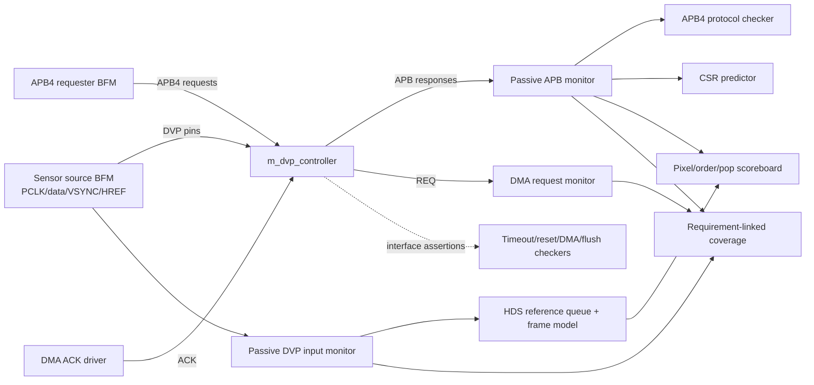

# DVP Controller Verification Architecture

## Terminology

Digital Video Port (DVP); Hardware Design Specification (HDS); Control and Status Register (CSR); Advanced Peripheral Bus (APB); Design Under Test (DUT); Register-Transfer Level (RTL); Bus Functional Model (BFM); Verification Intellectual Property (VIP); Clock Domain Crossing (CDC); asynchronous FIFO (AFIFO); synchronous FIFO (SFIFO); pixel clock (PCLK); vertical sync (VSYNC); horizontal reference (HREF); Mean Time Between Failures (MTBF). Identifiers and tool names retain their standard spellings.

## Gate status

- Verification level: block (`m_dvp_controller`).
- G0 (plan), G1 (this architecture) and G3 (checker qualification before stimulus) are approved by Nguyen Quan; G5 and G6 are pending. See [decisions_and_gates.md](decisions_and_gates.md).
- The architecture implements plain SystemVerilog (no UVM) on Verilator; sources are in `../env/`, test sources in `../tests/`, results in `../sim/final/`.

## DUT boundary and interface

The DUT is the active `m_dvp_controller` of this IP, compiled from `rtl/filelist.f` (it lists the IP sources and the shared `000_Common`, `001_AsyncGrayFIFO` and `002_SyncFIFO` modules it instantiates). The RTL is used in place: no copy of it is kept in `verification/`. The SHA-256 of every RTL, environment and test file used is recorded in `../sim/final/manifest.sha256`. The earlier Icarus testbench `tb_dvp_updates.sv` was removed in the consolidation because it did not prove pixel values or order through FIFO_DATA.

| Port group | DUT pins and directions | Verification role |
|---|---|---|
| Clocks/reset | `i_clk_apb`, `i_clk_dvp`, common active-low `i_rst_n_sys` | Testbench clock/reset controller; generate independent APB and DVP clocks and stop/restart DVP clock for legal gated cases. |
| DVP sensor | `i_clk_dvp` is the PCLK input; `i_dvp_data[PARA_DVP_DATA_W-1:0]`, `i_dvp_vsync`, `i_dvp_href` | Sensor source BFM drives data and qualifiers away from the selected sample edge; a passive input monitor derives expected samples from HDS parameters. |
| APB4 requester | Inputs: `i_paddr[15:0]`, `i_psel`, `i_penable`, `i_pwrite`, `i_pwdata[31:0]`, `i_pstrb[3:0]`, `i_pprot[2:0]`. Outputs: `o_pready`, `o_prdata[31:0]`, `o_pslverr`. | Local requester BFM plus passive protocol monitor; observe response only on APB completion. |
| DMA sideband | `i_dma_ack`, `o_dma_req` in the APB clock domain | ACK driver and passive REQ monitor; payload is consumed only through APB FIFO_DATA reads. |

The compile-time dimensions are data width 8/10/12, selected PCLK edge, VSYNC active level and HREF active level. Runtime `PCLK_MODE` selects continuous AFIFO or gated-valid-pixel SFIFO operation. `PARA_FIFO_DEPTH` is power-of-two, minimum 2, default 8. FIFO_DATA is parameterized, default `0x0100`.

## Clock, reset and timing architecture

| Domain | Clock source | Reset | Events observed |
|---|---|---|---|
| APB/service | `i_clk_apb` | `i_rst_n_sys` through APB-local async-assert/sync-release reset | CSR/APB completion, timeout, frame count, DMA ACK/REQ, gated-mode VSYNC/toggle synchronization, SFIFO operations. |
| Continuous capture / AFIFO write | `i_clk_dvp` / PCLK | `i_rst_n_sys` through DVP-local async-assert/sync-release reset | Compile-time selected PCLK sample edge and AFIFO write path. |
| Gated capture source | `i_clk_dvp` may stop between valid pixel pulses | Gated launch state uses APB-local reset per HDS | Pixel data is held while the valid toggle crosses; expected pixel spacing is at least four APB cycles plus HDS integration margin. |

Use unrelated clock periods and phase offsets as synthetic CDC stress points; they are not product clock limits. In gated mode, VSYNC active lasts at least four APB cycles and the frame-start state must be established before the first sampled pixel. Reset tests may hold PCLK stopped while APB releases. These simulations cannot establish metastability MTBF or board setup/hold.

## APB map and transaction placement

| Byte address | Register/endpoint | Access in environment |
|---:|---|---|
| `0x0000` | `dvp_version` | CSR read/reset model |
| `0x0004` | `dvp_ctrl` | Capture/mode/flush writes and guard checks |
| `0x0008` | `dvp_wmark` | Watermark/REQ tests |
| `0x000C` | `dvp_timeout` | Timeout reset/read/write and boundary tests |
| `0x0010` | `dvp_fifo_sts` | FIFO/overflow/flush status and W1C checks |
| `0x0014` | `dvp_fifo_level` | Occupancy and DMA request checks |
| `0x0018` | `dvp_frame_count` | Frame counter read, increment and wrap model |
| `0x0100` default | `FIFO_DATA` parameterized endpoint | One successful APB read returns one zero-extended pixel and pops exactly once; timeout/error reads do not pop. |

The CSR locations/field semantics come from CSR v1.1 (`spec/VLSIT_DVP_CONTROLLER_CSR.json`) and HDS v0.3. APB behavior is checked against the local licensed APB4 Issue D source against APB4 Issue D (Arm IHI 0024), clauses 3.1-3.4 and Appendix A, from the local licensed copy; the licensed source is not redistributed in this repository.

## Verification topology

| Component | Contract and interface | Independence / qualification |
|---|---|---|
| `dv_dvp_source` | Drives the public DVP pins with the selected profile, legal VSYNC/HREF periods, tagged pixels, stop/restart clock cases and bounded seed-driven traffic. | HDS-derived stimulus only; no writes to DUT internals. |
| `dv_apb_requester` | Issues 32-bit APB4 setup/access transfers; holds fields stable through wait states; drives PSTRB=0 for reads; can perform specified endpoint errors and reset cancellation. | Project-local BFM; no qualified APB master VIP was found. Qualify zero-wait, wait, error and reset behavior against the approved clause index before DUT tests. |
| `dv_dvp_input_monitor` | Samples the public DVP pins on the parameter-selected edge and records only frame/HREF-qualified events required by the HDS. | Does not inspect capture RTL state. |
| `dv_apb_monitor` | Passively records APB setup/access/wait/completion and response/error timing. | Clause-driven; remains enabled in every test. |
| `dv_dvp_model` | Maintains an expected frame state, ordered pixel queue and APB-visible 32-bit sample values from the HDS and observed input events. | Does not mirror RTL FIFO pointers, internal state machines or implementation expressions. |
| `dv_dvp_scoreboard` | Compares every successful FIFO_DATA response with the expected head, checks one pop per success, no pop on error/reset, ordering, zero-extension, overflow retention and flush behavior. | Uses observed public input/APB transactions only; drains expected and observed queues before pass. |
| `dv_dvp_csr_predictor` | Predicts reset/read/write/W1C, mode guard, timeout, FIFO level, DMA watermark and frame count from CSR JSON/HDS. | Workbook/spec-derived; not generated RTL readback logic. |
| `dv_dvp_checkers` | Checks APB stability/completion, timeout boundary, DMA ACK/re-arm, reset cancellation, flush gating and mode guard. | Known-answer and representative fault qualification required before G3. |
| `dv_dvp_coverage` | Counts profile, mode, qualifier, FIFO boundary, APB, timeout, reset, flush and DMA bins linked to vplan IDs. | Merged by baseline/config/test; no activity-only unlinked bins. |

A standalone SystemVerilog block harness is preferred for Icarus compatibility; Python standard-library scripts may generate deterministic test vectors and reports. UVM is not selected. No VIP is created or modified. All monitor/checker paths remain passive; no `force` is planned.

## Reference model and oracle boundary

The reference queue is derived from HDS v0.3/CSR v1.1, not from the RTL. It predicts selected-edge sampling and qualifier/frame acceptance, input pixel order, zero-extension, timeout result/no-pop, DMA notification state, frame count and selected-FIFO flush effects. It does not predict metastability, analog setup/hold, CDC MTBF or a system DMA schedule. AFIFO occupancy is allowed to lag writes by documented CDC latency; comparisons use accepted/observed APB transactions and HDS limits, not assumed zero-latency occupancy.

Before G3, qualify model/checker plumbing with independently calculated 8/10/12-bit known answers, empty timeout 0/positive, reset cancellation and queue order/pop counts. Inject representative checker faults (wrong data, reordered/dropped/duplicate sample, premature pop, timeout off-by-one) in a synthetic test source and show each is rejected. This is model/checker qualification, not DUT verification evidence.

## Tool and run architecture

- Existing project Makefile targets write fixed names under `verification/` and `sim/iverilog/`; they are not the v2 run adapter.
- One runner, `env/scripts/dvp_regress.py`, builds in a temporary directory and writes one flat, never-overwritten result set to `sim/<name>/`; its matrix follows `tests/regression/testlist.yaml`.
- Build the active RTL only; never build baseline RTL.
- Keep `VLSIT_SYNTHESIS` undefined for behavioral simulation wrappers unless a separately reviewed synthesis-only check needs it. Record all compile definitions/options explicitly.
- Decision Q-G1-1: the synchronizer latency models are enabled with fixed seeds (the case seed) in the CDC tests. They add deterministic, replayable digital latency only; they do not model analog metastability or prove MTBF. The plusargs of every case are in `sim/final/summary.json`.
- Formal tool versions/front-end are not qualified; formal evidence remains conditional until a known-answer/fault qualification proves the harness is meaningful.
- Resource budget `env/config/resource_budget.json` (reviewed); one job, no waveforms by default, measured RAM/disk in `sim/final/resource_usage.json`.

## Review record

G1 was approved by Nguyen Quan on 2026-11-24 as proposed (DUT boundary and ports, local scoped APB4 requester/monitor because no qualified VIP matches, independent HDS-derived oracle on the public pins, active RTL only, synchronizer latency model enabled with fixed seeds, formal kept planned but unqualified, isolated result sets, resource budget before simulation). See [decisions_and_gates.md](decisions_and_gates.md).
