# ChaCha Design Specification

> **Purpose:** Normative design contract for architecture, RTL, verification, DFT, and physical integration of this IP.
>
> Replace every angle-bracket placeholder. Mark inapplicable sections **N/A** with a reason. Do not silently omit a required decision. Use **TBD** only with its technical impact and the decision needed recorded in [Assumptions, dependencies, and decisions](#20-assumptions-dependencies-and-decisions).
>
> Requirement terms: **shall** = mandatory and testable; **should** = recommended; **may** = optional. Give every mandatory requirement a stable REQ-<AREA>-<NNN> identifier and a verification method.

## Document map

1. [Purpose, scope, and product context](#1-purpose-scope-and-product-context)
2. [Normative references and precedence](#2-normative-references-and-precedence)
3. [Requirements and traceability](#3-requirements-and-traceability)
4. [Features and configurations](#4-features-and-configurations)
5. [Architecture](#5-architecture)
6. [External interfaces and ports](#6-external-interfaces-and-ports)
7. [Clock, reset, and power](#7-clock-reset-and-power)
8. [Parameters and elaboration configurations](#8-parameters-and-elaboration-configurations)
9. [Data representation and arithmetic](#9-data-representation-and-arithmetic)
10. [Detailed functional behavior](#10-detailed-functional-behavior)
11. [Register and programming model (CSR from workbook)](#11-register-and-programming-model)
12. [Error handling and recovery](#12-error-handling-and-recovery)
13. [Performance, power, and area](#13-performance-power-and-area)
14. [RTL implementation contract](#14-rtl-implementation-contract)
15. [Verification specification](#15-verification-specification)
16. [DFT and testability](#16-dft-and-testability)
17. [Physical design and timing integration](#17-physical-design-and-timing-integration)
18. [Security, safety, and reliability](#18-security-safety-and-reliability)
19. [Requirement-to-verification traceability](#19-requirement-to-verification-traceability)
20. [Assumptions, dependencies, and decisions](#20-assumptions-dependencies-and-decisions)
21. [Glossary](#21-glossary)
22. [References used to shape this template](#22-references-used-to-shape-this-template)

## 1. Purpose, scope, and product context

### 1.1 Purpose and scope

This IP is a hardware accelerator for the authenticated encryption algorithm AEAD_CHACHA20_POLY1305 (Authenticated Encryption with Associated Data) defined in RFC 8439 section 2.8 (`reference/md_doc/vlsit_chacha_rfc8439.md`). It is intended for security-oriented microcontrollers and embedded data links, where software encryption of short frames and image blocks costs more latency and energy than a dedicated engine, and where throughput must scale up for higher-rate links without redesign. The IP is a passive slave in the system: it never initiates a bus transaction.

**Included:** the ChaCha20 block function and keystream encryption (RFC 8439 sections 2.3 and 2.4); the Poly1305 authenticator (section 2.5); the Poly1305 one-time key derivation from block counter zero (section 2.6); the AEAD construction in encrypt and decrypt directions (section 2.8); an Advanced Peripheral Bus 4 (APB4) configuration interface with a generated Control and Status Register (CSR) block; one AXI4 slave data interface; two Direct Memory Access (DMA) request/acknowledge channel pairs (write channel and read channel) for flow control with a system DMA controller; a key-store port that supplies the 256-bit key without exposing it to software; compile-time parameters that trade throughput against area and power (section 8).

**Excluded:** any bus-master or descriptor-fetching DMA engine (the system DMA controller owns data movement); key storage, key derivation and key lifecycle (owned by the key store); protocol handling above AEAD, such as TLS record or IPsec Encapsulating Security Payload (ESP) framing and nonce construction from protocol fields; other cryptographic algorithms in this release (the front end and core interface are specified so that further algorithms can be added later, see DEC-007); the 128-bit-key and 8- or 12-round ChaCha variants of the original algorithm (RFC 8439 section 2.3 notes that the original algorithm also specified them).

### 1.2 Deployment assumptions

| Item | Specification |
|---|---|
| Target SoC / product class | Security-oriented microcontroller or wireless SoC with a hardware secure engine, and embedded data-link endpoints (user answer 2026-11-23, assumption ASM-001); the research report `research/chacha20_poly1305_feature_research_report.md` (status INCOMPLETE) shows this class in sources D5-D7 |
| Technology / library assumptions | TBD-002: no technology, library or target frequency is fixed yet; throughput figures in this specification are architectural cycle counts, not measured results |
| Operating modes and workload | One active message at a time in the base configuration; short frames (a few tens of bytes) up to image blocks (about 1 KiB) per message (ASM-002); higher-throughput configurations selected by parameters (section 8) |
| Security / privilege context | The 256-bit key enters only through the key-store port and is never readable through APB or AXI4; the APB4 configuration interface and the AXI4 data window are accessed by one trusted host and one system DMA controller; the register block checks `PPROT[1]` and the data window checks `AxPROT[1]` against `i_protect_en` (ASM-011); the privilege scheme of the whole SoC is TBD-005 |
| External dependencies | APB4 master; AXI4 master (CPU or system DMA); system DMA controller with hardware request/acknowledge flow control (the handshake timing is DEC-019; the controller model is not named, DEP-001); key store (request and valid handshake with a slot index, DEC-020); clock and reset controller providing three clock inputs, an APB clock, an AXI clock and a core clock, whose pairwise synchronous or asynchronous relation is selected by parameters (DEC-004, DEC-011) |

### 1.3 Feature summary

| Feature ID | Feature | Required / optional | Configuration condition | Requirements |
|---|---|---|---|---|
| FEAT-001 | AEAD_CHACHA20_POLY1305 encryption and decryption with tag generation and tag check (RFC 8439 section 2.8) | Required | Always present | REQ-FUNC-001 to REQ-FUNC-006, REQ-FUNC-008, REQ-FUNC-009, REQ-PERF-001, REQ-PERF-002 |
| FEAT-002 | Key supplied from a key-store port, not readable by software | Required | Always present | REQ-FUNC-007, REQ-IF-012, REQ-ERR-003, REQ-SEC-003, REQ-SEC-004 |
| FEAT-003 | APB4 configuration interface with generated CSR | Required | Always present | REQ-IF-001, REQ-IF-009, REQ-REG-001 to REQ-REG-003 |
| FEAT-004 | AXI4 slave data interface with input window and output window | Required | Always present | REQ-IF-002 to REQ-IF-005, REQ-IF-010, REQ-IF-011, REQ-SEC-005, REQ-PERF-003 |
| FEAT-005 | Two DMA request/acknowledge channel pairs for the input and output windows | Optional | `PARA_DMA_EN` = 1; polling or interrupt use otherwise | REQ-IF-006 to REQ-IF-008 |
| FEAT-006 | Throughput versus area/power trade-off by compile-time parameters | Required | Always present; values by configuration (section 8) | REQ-PARAM-001 to REQ-PARAM-004, REQ-PERF-001, REQ-PERF-002 |
| FEAT-007 | Tag-failure behavior: release decrypted data immediately with an error flag, or hold it until the tag is verified | Optional | `PARA_HOLD_EN` selects one behavior at elaboration (DEC-005) | REQ-FUNC-010, REQ-SEC-004 |
| FEAT-008 | Three clock domains (APB, AXI, core) whose relation to the core clock, synchronous or asynchronous, is selected by parameters | Required | Always present; relation by `PARA_SYNC_AXI_CORE` and `PARA_SYNC_APB_CORE` (DEC-011) | REQ-CLK-001 to REQ-CLK-003, REQ-RESET-001, REQ-RESET-003 |
| FEAT-009 | Nonce management: nonce supplied by software, or managed by a hardware counter for encryption | Optional | `PARA_NONCE_HW` selects one behavior at elaboration (DEC-017) | REQ-FUNC-011, REQ-FUNC-012, REQ-ERR-002, REQ-SEC-001, REQ-SEC-006 |

### 1.4 Real-world applications of the features

Rows for FEAT-001 to FEAT-009 follow. The numeric values that carry an ASM identifier are assumptions of section 20, not facts given by a source.

| Feature ID | Real-world application (named system, example product) | What the application needs from the feature | Typical values | Consequence if missing or wrong | Requirements | Source |
|---|---|---|---|---|---|---|
| FEAT-001 | Frame protection in the Thread/Matter radio stack of a wireless SoC with a hardware secure engine (example product class: the EFR32MG21 family, research source D5) | Encrypt and authenticate each frame and each over-the-air image block faster and at lower energy than software or than a general secure-engine call | Frame 127 B and image blocks up to 1280 B, per-message time in the tens of microseconds, core clock 80 MHz (all ASM-002: example values chosen by the author and accepted by the user as "you decide" on 2026-11-23); reference point: stand-alone Poly1305 on 1 kB takes 212 µs in D5 (page 64) and 514 µs in D6 (page 93) | Frames miss radio timing slots or consume battery; an unauthenticated frame is accepted if the tag check is skipped | REQ-FUNC-001 to REQ-FUNC-006, REQ-FUNC-008, REQ-FUNC-009, REQ-PERF-001, REQ-PERF-002 | User answer 2026-11-23 (5A), ASM-002, research D5, D6 |
| FEAT-002 | Secure engine inside the same SoC class: the engine keeps the key away from the application core, as the Secure Vault description of D5-D7 shows | Key never visible to the host CPU | 256-bit key (RFC 8439 section 2.3) | A key read out of the host CPU memory defeats the secure-engine isolation | REQ-FUNC-007, REQ-IF-012, REQ-ERR-003, REQ-SEC-003, REQ-SEC-004 | User answer 2026-11-23 (6A), RFC 8439 section 2.3, research D5 |
| FEAT-003 | Configuration of the accelerator by the host CPU through the SoC peripheral bus | Program message length, nonce, mode, and read status and errors | 32-bit word access, one register block | Software cannot start, stop or diagnose the engine | REQ-IF-001, REQ-IF-009, REQ-REG-001 to REQ-REG-003 | User answer 2026-11-24 (APB configuration) |
| FEAT-004 | Embedded data-link endpoint that encrypts frames passing between the host and a link controller (for example a short-range serial or CAN-class link; user answer 2026-11-23: "embedded data links") | Move frame data in and out without holding the CPU | Frame size 8 B to 64 B and 1 to 5 Mbit/s are an assumption (ASM-003); no source in the research report covers this case | Data movement stalls the CPU or loses frames | REQ-IF-002 to REQ-IF-005, REQ-IF-010, REQ-IF-011, REQ-SEC-005, REQ-PERF-003 | User answer 2026-11-23, ASM-003 |
| FEAT-005 | System with a DMA controller that supports hardware request/acknowledge flow control | Move data between memory and the IP without polling and without deadlock when the output window fills | One request pair per direction, watermark set by software (DEC-013, DEC-019) | A single-threaded writer blocks the AXI4 write channel while the output window is full and never reads it | REQ-IF-006 to REQ-IF-008 | User answer 2026-11-24 (DMA channels) |
| FEAT-006 | One IP used in products with very different rates, from a low-power secure MCU to a high-rate gateway (user requirement 2026-11-24: high throughput, adjustable against resource and power) | Choose the throughput/area point at elaboration | From about 0.5 Gbit/s to tens of Gbit/s as architectural bounds of section 13 (to be confirmed by a model); the delivered default is CFG-BASE (DEC-018) | A fixed design either wastes area on the small product or cannot reach the rate of the fast product | REQ-PARAM-001 to REQ-PARAM-003, REQ-PERF-001, REQ-PERF-002 | User answer 2026-11-24, section 13 |
| FEAT-007 | Decryption in a security MCU where the host must not use unauthenticated plaintext | Choose between low latency and strict release | `PARA_HOLD_EN` = 0 or 1 | Unauthenticated data is used (release mode without discipline) or needs a message-sized buffer (hold mode) | REQ-FUNC-010, REQ-SEC-004 | User answer 2026-11-23 (11D), RFC 8439 section 2.8 |
| FEAT-008 | Secure MCU or SoC where the peripheral bus (APB), the system data bus (AXI) and the crypto core run at different frequencies, or are the same clock in a small product | Avoid crossing logic when the clocks are the same net, and keep the core at its own frequency when they differ | Core clock up to the target frequency (TBD-002); the bus clocks usually lower | A forced single clock raises power or limits the core; a forced crossing in a single-clock product wastes area and latency | REQ-CLK-001 to REQ-CLK-003, REQ-RESET-001, REQ-RESET-003 | User answers 2026-11-23 (10B) and 2026-11-24 (three configurable clock domains) |
| FEAT-009 | Embedded data-link endpoint (FEAT-004) that sends a long stream of frames under one key, and a receiver that gets the nonce from the sender | A 96-bit nonce that is never repeated for the same key; a counter is the method that RFC 8439 section 2.6 names as good, and random generation is forbidden there | 96-bit nonce (32-bit salt plus 64-bit counter in hardware mode); one invocation per frame | A repeated nonce under one key breaks the confidentiality and authentication of the affected messages | REQ-FUNC-011, REQ-FUNC-012, REQ-ERR-002, REQ-SEC-001, REQ-SEC-006 | User answers 2026-11-24 (15A, option C), RFC 8439 sections 2.6 and 2.8 |

## 2. Normative references and precedence

### 2.1 Normative references

Record exact title, revision, document ID, controlled location/URL, and applicable clauses. Do not cite an unspecified “latest” revision.

| Ref ID | Document and revision | Applicable clauses | Authority / notes |
|---|---|---|---|
| REF-001 | IETF RFC 8439, ChaCha20 and Poly1305 for IETF Protocols, June 2018 (`reference/md_doc/vlsit_chacha_rfc8439.md`) | Sections 2.1 to 2.8, 3 and 4 | Algorithm authority |
| REF-002 | The decisions and assumptions of section 20 (user answers of 2026-11-23 and 2026-11-24) and the research report `research/chacha20_poly1305_feature_research_report.md` (status INCOMPLETE) | DEC-001 to DEC-024 and the cited ASM and TBD items | Product behavior |
| REF-003 | VLSIT RTL Design Rules v2, VLSIT_RTL_Design_Rule.md (same folder as this template) | All applicable rules | Mandatory RTL coding, hierarchy, reset, CDC, and naming baseline |
| REF-004 | IEEE 1800-2017 SystemVerilog | Synthesizable subset | Subject to REF-003 and selected frontend support |
| REF-005 | VLSIT CSR Specification Template workbook, VLSIT_CSR_Specification_Template.xlsx (same folder as this template); the project copy is `VLSIT_CHACHA_CSR.xlsx` | Configuration and register definition sheets for this IP | Sole authority for the register interface, register map, fields, access types, and reset values (Section 11) |
| REF-006 | Arm IHI 0022H.c, AMBA AXI and ACE Protocol Specification, January 2021 (`reference/md_doc/vlsit_axi_amba_axi_ihi0022h_c.md`) | Part A (single interface requirements), Chapter A9 tables A9-2 and A9-4 | AXI4 protocol authority |
| REF-007 | Arm IHI 0024D, AMBA APB Protocol Specification (`reference/md_doc/vlsit_apb_amba_apb_ihi0024d.md`) | APB4 subordinate behavior | APB protocol authority |

### 2.2 Source-of-truth and conflict handling

1. The selected external protocol revision defines protocol behavior for the declared interface profile.
2. Approved product requirements and decisions define product-specific behavior.
3. This specification defines the IP contract and shall remain consistent with the selected protocol and the VLSIT RTL Design Rules v2.
4. REF-003 is the mandatory RTL coding, hierarchy, reset, CDC, and naming baseline. If a proposed requirement conflicts with it, revise the specification requirement or choose a compliant implementation; do not create a local RTL exception.
5. REF-005 is the only place where CSRs are specified. Do not declare registers, fields, offsets, access types, or reset values in this specification.
6. Record the exact protocol revision, role, and optional-signal configuration. Do not include protocol signals absent from the selected revision/profile.
7. Resolve conflicts through an explicit product decision; do not guess or weaken a requirement.

**Naming rule:** the default naming rule of `vlsit-rtl-generator`, section 2 of `VLSIT_RTL_Design_Rule.md` v2, path `reference/templates/VLSIT_RTL_Design_Rule.md` of the specification skill, version v2, chosen by the user on 2026-11-23 (rule R-026, DEC-001).

### 2.3 Compliance declaration

| Standard | Revision / profile | Role implemented | Options | Deviations |
|---|---|---|---|---|
| AMBA APB | APB4 profile, Arm IHI 0024D | Subordinate (the generated register block) | `PSTRB`, `PPROT[1]` and `PSLVERR` as in section 11.4 | None |
| AMBA AXI4 | Memory Subordinate profile of Arm IHI 0022H.c with the Required signals plus `WLAST`, `BRESP`, `RRESP`, `AWPROT` and `ARPROT` (ASM-007, ASM-011) | Subordinate | INCR bursts only; `AxSIZE` equal to the full data width; one outstanding write burst and one outstanding read burst (DEC-021) | FIXED, WRAP, narrow (`AxSIZE` below the data width), 4 KB-crossing bursts and write strobes that differ from the expected pattern are answered with SLVERR instead of being served (section 6.3) |
| AEAD_CHACHA20_POLY1305 | IETF RFC 8439 section 2.8, 256-bit key, 96-bit nonce | Encryption and decryption engine | Hold or release of unauthenticated plaintext; software or hardware nonce | Message and associated data are limited to 65535 bytes each (DEC-015); the RFC allows more |
| IEEE 1800-2017 SystemVerilog | Synthesizable subset under REF-003 | RTL language | None | None |

## 3. Requirements and traceability

Requirement identifiers are permanent. Each requirement states one behavior with its source, the configurations it applies to and its verification method; the areas used are FUNC, IF, CLK, RESET, REG, PARAM, ERR, PERF, SEC and DFT.

| ID | Requirement using shall/should/may | Source | Applies to | Verification method |
|---|---|---|---|---|
| REQ-FUNC-001 | The IP shall encrypt a message of 0 to 65535 data bytes with 0 to 65535 bytes of associated data using a 256-bit key and a 96-bit nonce, and shall output the ciphertext followed by a 16-byte tag exactly as AEAD_CHACHA20_POLY1305 of RFC 8439 section 2.8 | RFC 8439 §2.8, DEC-003, DEC-015 | All configurations | Simulation against RFC vectors and an independent model |
| REQ-FUNC-002 | The IP shall decrypt a message and shall compare the computed tag with the 16 bytes that follow the ciphertext; on a mismatch it shall set the `tag_err` event and shall not set the `done` event, and on a match it shall set `done` | RFC 8439 §2.8, DEC-003 | All configurations | Simulation with corrupted tag, ciphertext and associated data |
| REQ-FUNC-003 | The IP shall derive the Poly1305 one-time key from the ChaCha20 block function with block counter 0 and shall encrypt the message data starting with block counter 1 | RFC 8439 §2.6, §2.8 | All configurations | Simulation against RFC vectors |
| REQ-FUNC-004 | The ChaCha20 block function shall use 20 rounds, a 256-bit key, a 96-bit nonce and a 32-bit block counter, with the quarter round and state layout of the RFC | RFC 8439 §2.1 to §2.3 | All configurations | Simulation against RFC vectors |
| REQ-FUNC-005 | The IP shall compute Poly1305 over the associated data, padding to a multiple of 16 bytes with zero bytes, the ciphertext, padding to a multiple of 16 bytes, and the two 64-bit little-endian lengths in octets, using the clamped value r and the value s of the one-time key | RFC 8439 §2.5, §2.8 | All configurations | Simulation against RFC vectors |
| REQ-FUNC-006 | The IP shall treat the first `cha_len.aad_len` bytes of the input stream as associated data, the next `cha_len.msg_len` bytes as message data and, for a decryption, the next 16 bytes as the tag, and each of the three parts shall start on a new beat of the data window: a part of $n$ bytes occupies $\lceil n / (D/8) \rceil$ beats, the unused byte lanes of its last beat carry no data and their write strobes are 0; the IP shall perform the padding of REQ-FUNC-005 itself | DEC-015, DEC-022 | All configurations | Simulation with random lengths, TEST-028 |
| REQ-FUNC-007 | The IP shall take the 256-bit key only from the key-store port and shall provide no register or window from which software or the AXI4 interface can read the key or any part of the keystream state | DEC-006 | All configurations | Inspection, register read test |
| REQ-FUNC-008 | A write of one to `cha_ctrl.abort` while busy shall stop the message, empty the window FIFOs, clear busy and then clear the abort bit; no `done` or `tag_err` event shall be raised for the aborted message | DEC-008 | All configurations | Simulation |
| REQ-FUNC-009 | After a write of one to `cha_ctrl.start` with `cha_ctrl.en` set and the engine idle, the IP shall latch the message parameters, clear `cha_ctrl.start` and set `cha_sts.busy`; a start written while busy or with `cha_ctrl.en` clear shall be cleared by hardware without starting a message, so software confirms the acceptance by reading `cha_sts.busy` set | Section 11.2 | All configurations | Simulation |
| REQ-FUNC-010 | With `PARA_HOLD_EN` = 0 the IP shall release decrypted data to the output window as it is produced and report the tag result afterwards; with `PARA_HOLD_EN` = 1 it shall not release any decrypted data before the tag has been verified, and shall release none if the tag does not match | DEC-005, DEC-028 | By `PARA_HOLD_EN` | Simulation |
| REQ-FUNC-011 | With `PARA_NONCE_HW` = 0 the nonce shall come from `cha_nonce0` to `cha_nonce2` for every message | DEC-017 | `PARA_NONCE_HW` = 0 | Simulation |
| REQ-FUNC-012 | With `PARA_NONCE_HW` = 1 the encryption nonce shall be the 32-bit `cha_salt.salt` as the upper part and the 64-bit counter of `cha_ctr_lo` and `cha_ctr_hi` as the lower part, the counter shall increase by one after each encrypted message, and a decryption shall use the nonce words of `cha_nonce0` to `cha_nonce2` | DEC-017 | `PARA_NONCE_HW` = 1 | Simulation |
| REQ-FUNC-013 | An abort, a tag mismatch with `PARA_HOLD_EN` = 1 and the reset of the AXI domain shall empty both window buffers through the software reset of the library FIFOs: `i_rst_n_sw` is low for one write-clock cycle and the flush is complete when `o_sw_rst_busy` has risen and fallen; the sequencer leaves `ENUM_ST_ABORT` only when both flushes are complete | DEC-027, `001_AsyncGrayFIFO` section 10.7 | All configurations | Simulation (TEST-030) |
| REQ-FUNC-014 | For every `PARA_POLY_ARCH` the Poly1305 block shall compute $acc \leftarrow ((acc + n) \cdot r) \bmod (2^{130} - 5)$ for each 16-byte block $n$ with the added bit $2^{128}$, keep $acc$ below $2^{130} + 5$, and form the tag as $((acc \bmod p) + s) \bmod 2^{128}$; the three architectures shall give identical reduced values | RFC 8439 §2.5, DEC-025 | By `PARA_POLY_ARCH` | Simulation against the model (TEST-029) |
| REQ-IF-001 | The configuration interface shall be an APB4 slave generated from the workbook `VLSIT_CHACHA_CSR.xlsx`, with the access behavior of section 11.4 | DEC-007, section 11 | All configurations | Simulation, protocol checker |
| REQ-IF-002 | The AXI4 data window shall accept INCR bursts of 1 to $\min(256, 4096/(D/8))$ transfers inside one 4 KB region, ignore the address bits inside the window, send write data to the input FIFO and return read data from the output FIFO | DEC-014, Arm IHI 0022H.c §A3.4 | All configurations | Protocol checker, simulation |
| REQ-IF-003 | A FIXED or WRAP burst, or an INCR burst that crosses a 4 KB boundary, shall be answered with SLVERR (one `BRESP` for a write, every transfer for a read) and shall set the `axi_err` event | DEC-014, DEC-016 | All configurations | Protocol checker, simulation |
| REQ-IF-004 | A read of the output window that finds no data shall return SLVERR with zero read data for each transfer that cannot be served, shall complete the burst with the requested number of transfers and a correct RLAST, and shall set `axi_err` | DEC-016, Arm IHI 0022H.c "Read and write response structure" | All configurations | Protocol checker, simulation |
| REQ-IF-005 | A write burst that exceeds the room of the input FIFO or the programmed message length shall return a single SLVERR on `BRESP`, drop the excess beats and set `axi_err` | DEC-016 | All configurations | Protocol checker, simulation |
| REQ-IF-006 | Each DMA request/acknowledge pair shall follow the four-phase handshake and the numbered timing rules DMA-T1 to DMA-T7 of section 6.3: request raised, acknowledge raised, request released one cycle after the acknowledge is seen, acknowledge released after the last beat of the burst; a new request shall not be raised before the acknowledge has been low for one cycle; both signals are levels | DEC-010, DEC-019 | `PARA_DMA_EN` = 1 | Assertions SVA-001, simulation |
| REQ-IF-007 | The write request shall be raised only when the input FIFO has room for the requested number of beats and the read request only when that many beats can be read; the number is $\min(W, B_r)$ in tail mode 0 and one beat while $B_r < W$ in tail mode 1 | DEC-013, DEC-029 | `PARA_DMA_EN` = 1 | Assertions, simulation |
| REQ-IF-008 | Both request outputs shall be low when `PARA_DMA_EN` = 0 or `cha_ctrl.dma_en` = 0 | DEC-013 | All configurations | Assertions, simulation |
| REQ-IF-009 | The interrupt output shall be high while any bit of `cha_irq_sts` is set and low otherwise | DEC-007 | All configurations | Simulation |
| REQ-IF-010 | Under backpressure the IP shall not drop, duplicate or reorder a beat: a full input buffer shall lower the write-data ready, and the engine shall stall instead of overwriting a full output buffer or reading an empty input buffer | Section 10.4 | All configurations | Simulation with a scoreboard, assertions |
| REQ-IF-011 | The data window shall accept a burst only if `AxSIZE` equals the full data width, `AxBURST` is INCR, the burst has not crossed a 4 KB boundary and, for a write, the byte strobes of every beat equal the expected pattern of REQ-FUNC-006 (all ones, except the last beat of a part, whose valid low lanes are ones and the other lanes zero); otherwise the burst shall be answered with SLVERR (one `BRESP` for a write, every transfer for a read), the offending beat and the rest of the burst shall be dropped for a write, and `axi_err` shall be set. At most one write burst and one read burst shall be outstanding | DEC-021, Arm IHI 0022H.c section A3.4 | All configurations | Protocol checker, simulation |
| REQ-IF-012 | The key-store port shall follow the request and valid handshake of section 6.3: the IP raises `o_key_req` with `o_key_slot` equal to `cha_ctrl.key_slot`, holds both until `i_key_vld` or `i_key_err` is high, copies the key in the cycle where `o_key_req` and `i_key_vld` are both high, and releases the request in the next cycle | DEC-020 | All configurations | Assertions SVA-012, simulation |
| REQ-CLK-001 | The IP shall have the clock inputs `i_clk_apb`, `i_clk_axi` and `i_clk_core`; with `PARA_SYNC_AXI_CORE` = 1 or `PARA_SYNC_APB_CORE` = 1 the corresponding crossing logic shall be absent, and with 0 every crossing of section 7.2 shall use the stated structure | DEC-011 | All four combinations | CDC lint, simulation |
| REQ-CLK-002 | No signal shall cross between clock domains without the structure listed in section 7.2 | Section 7.2 | All configurations | CDC lint, inspection |
| REQ-CLK-003 | An event that originates in one clock domain and is needed as an event in another (the data-window error and the AXI-domain reset indication) shall cross through `m_vlsit_event_sync` or an equivalent request/acknowledge toggle structure that keeps the event pending until it is acknowledged, so that no event is lost for any clock ratio; two events that arrive while one is pending may merge into one | Section 7.2, review F-008 | `PARA_SYNC_AXI_CORE` = 0 | CDC lint, assertion SVA-011, TEST-015 |
| REQ-RESET-001 | Each domain shall have an active-low reset with asynchronous assertion and release synchronized to its clock; after reset both DMA request outputs and the key request shall be low, the AXI4 ready and valid outputs shall be low and the engine shall be idle | Section 7.3 | All configurations | Reset test, assertions |
| REQ-RESET-002 | After reset the key-dependent state and the registers of the engine shall be cleared and `cha_sts.ctr_vld` shall be 0 | Section 7.3, ASM-012 | All configurations | Reset test |
| REQ-RESET-003 | A reset asserted in one domain only shall follow the table of section 7.3: a reset of the core domain resets the engine, the registers and the window buffers; a reset of the AXI domain while a message is running shall abort the message as OP-003 does, flush both window buffers through the coordinated software reset of the library FIFOs, drop the DMA requests and set `axi_err` after release; a reset of the APB domain shall not change the message and shall drop only the APB access in flight | Section 7.3, ASM-012, DEC-033, review F-009 | All configurations | Reset test in each domain while idle and busy (TEST-016) |
| REQ-REG-001 | The register at offset 0x0 shall be `cha_version` with major 1 and minor 0 | Rule R-067, DEC-001 | All configurations | Register test |
| REQ-REG-002 | Every register shall follow the access type and the reset value of the workbook `VLSIT_CHACHA_CSR.xlsx` | Section 11.1 | All configurations | Register test |
| REQ-REG-003 | The registers `cha_irq_en`, `cha_irq_inj` and `cha_irq_sts` shall have the same fields at the same bits as `cha_irq_raw`; an injection rising edge shall raise the raw event | Rule R-040 | All configurations | Register test |
| REQ-PARAM-001 | The elaboration shall stop with an error for: `PARA_RND_CYC` = 2 with `PARA_QR_NUM` not 4, `PARA_AXI_DW` not a multiple of 32, a FIFO depth that is not a power of two, and `PARA_HOLD_EN` = 1 with an output capacity smaller than `PARA_MSG_MAX_B` | Section 8 | All configurations | Elaboration test |
| REQ-PARAM-002 | The configurations CFG-LP, CFG-BASE and CFG-HP shall elaborate and pass lint | Section 8 | CFG-LP, CFG-BASE, CFG-HP | Lint, elaboration |
| REQ-PARAM-003 | A watermark above the maximum of section 8 shall set `len_err` and the message shall not start | Section 8, DEC-013 | All configurations | Simulation |
| REQ-PARAM-004 | The parameters `PARA_PIPE_CHACHA`, `PARA_PIPE_POLY` and `PARA_PIPE_IO` shall default to 0 and each combination of their values with every configuration shall elaborate and pass lint; with all three at 0 the behavior and the cycle counts shall be those of the other requirements, and with any of them at 1 the output data and the tag of every message shall be those of RFC 8439, the interface and the registers shall not change, and only the cycle counts, the clock limit and the area may change | Section 8, DEC-036 | All configurations, all 8 combinations | Simulation against `verification/models/chacha20poly1305_ref.py`, lint, cycle measurement (TEST-034) |
| REQ-ERR-001 | A `cha_len.msg_len` above `PARA_MSG_MAX_B` shall set `len_err` and the message shall not start | DEC-015, section 8 | All configurations | Simulation |
| REQ-ERR-002 | An encryption started with `PARA_NONCE_HW` = 1 while `cha_sts.ctr_vld` is 0, or with a counter that would wrap, shall not start and shall set `ctr_err` | DEC-017, DEC-023, DEC-031 | `PARA_NONCE_HW` = 1 | Simulation |
| REQ-ERR-003 | A message whose key request is answered with `i_key_err` shall not run: the sequencer shall return to `ENUM_ST_IDLE` from `ENUM_ST_KEY`, clear busy and the window buffers, set `key_err` and raise neither `done` nor `tag_err`; a reset or an abort while the key request is pending shall release the request | DEC-020 | All configurations | Simulation with the key-store model (TEST-025) |
| REQ-PERF-001 | The number of core clock cycles from the accepted start to the `done` event of a message of at least one byte, with the whole input data already in the input buffer, room in the output buffer and a key store that answers the key request in 2 cycles, shall not exceed the value of the formula of section 13.2 by more than 10 percent, for CFG-LP, CFG-BASE and CFG-HP; the empty message is not covered (TBD-026 decision, DEC-035) | Section 13.2, DEC-018, DEC-035 | CFG-LP, CFG-BASE, CFG-HP | Cycle-accurate simulation against `verification/models/chacha_cycle_model.py` (TEST-019) |
| REQ-PERF-002 | The Poly1305 block of `m_chacha_poly` shall accept one 16-byte block at least every 22 cycles with `PARA_POLY_ARCH` = 0, every 5 cycles with 1 and every cycle with 2, so that it does not limit CFG-LP below 5.8, nor CFG-BASE and CFG-HP below their ChaCha20 bound (section 13.1) | Section 13.1, DEC-025, ASM-014, TBD-003 | By `PARA_POLY_ARCH` | Cycle-accurate simulation (TEST-019) |
| REQ-PERF-003 | The data window shall transfer one beat per interface clock cycle in each direction while the input buffer has room (write) or the output buffer holds data (read) and the master is ready | Section 10.4 | All configurations | Simulation (TEST-022) |
| REQ-SEC-001 | In the software-nonce build the nonce shall never be generated inside the IP, and in the hardware nonce build the counter value used for one encryption shall never be used again with the same salt until software loads a new start value | RFC 8439 §2.6, DEC-017, DEC-023 | By `PARA_NONCE_HW` | Simulation, assertion |
| REQ-SEC-002 | The 16-byte tag comparison of a decryption should take the same number of cycles whatever the position of the first differing byte | Author's proposal, TBD-005 | All configurations | Simulation, inspection |
| REQ-SEC-003 | The key-store data shall be sampled only in the cycle where `o_key_req` and `i_key_vld` are both high, and no copy of the key shall be visible at an output other than the cipher core | DEC-006, DEC-020 | All configurations | Inspection, SVA-009 |
| REQ-SEC-004 | The key register and the ChaCha20 and Poly1305 state shall be cleared at the end of every message, on an abort and on reset, and a rejected plaintext in hold mode shall be discarded | Section 10.1, section 18 | All configurations | Simulation, inspection |
| REQ-SEC-005 | With `i_protect_en` = 1 an AXI4 access to the data window whose `AxPROT[1]` is 1 (non-secure) shall be answered with SLVERR, shall transfer no data and shall set `axi_err`; with `i_protect_en` = 0 `AxPROT` is ignored | ASM-011, review F-021, TBD-005 | All configurations | Protocol checker, simulation (TEST-026) |
| REQ-SEC-006 | In the software-nonce build with `PARA_NONCE_CHK` = 1 an encryption whose nonce equals the nonce of the previous accepted encryption under the same `cha_ctrl.key_slot` shall not start and shall set `ctr_err`; the guard compares with the previous nonce only, and the uniqueness over all earlier nonces remains the duty of software | RFC 8439 §2.6, ASM-013, review F-022 | `PARA_NONCE_HW` = 0, `PARA_NONCE_CHK` = 1 | Simulation (TEST-008) |
| REQ-DFT-001 | While `i_dft_test_en` is 1 the reset of every flip-flop of the three domains shall be driven from `i_dft_rst_n` instead of the functional resets and their synchronizers, and the clock-gating module shall pass the core clock; while `i_dft_test_en` is 0 `i_dft_rst_n` shall have no effect | Rule RST-04, rule CLK-03, ASM-012, review F-020 | All configurations | Simulation of the reset wrapper (TEST-027), inspection |

## 4. Features and configurations

The configurations below are the delivered points of the parameter space of section 8; a product may choose other legal values. All three have the same ports.

| Configuration ID | Enabled features | Disabled features | Interfaces / widths | Intended use | Verification target |
|---|---|---|---|---|---|
| CFG-LP | FEAT-001 to FEAT-004, FEAT-006 to FEAT-008, one core with one quarter-round unit, serial Poly1305, clock gating | None removed by the configuration; hold mode, hardware nonce and DMA are separate parameters and keep their CFG-BASE values | APB4, AXI4 32 bits, DMA pins present | Small security MCU: lowest area and power, about 6.4 Gbit/s per GHz of core clock as an upper bound | Elaborate and lint; TEST-004 to TEST-006 and the register tests |
| CFG-BASE | All features; one core, four quarter-round units, one round per cycle, folded Poly1305, clock gating, DMA on, hold mode, software nonce with the nonce guard on, output window 2 KiB | None by default | APB4, AXI4 64 bits, DMA pins present | Delivered default: balanced security MCU or link endpoint, about 25.6 Gbit/s per GHz as an upper bound | Every test of section 15.2 |
| CFG-HP | All features; two cores, four quarter-round units, two rounds per cycle, fully parallel Poly1305, clock gating, DMA on | None by default | APB4, AXI4 128 bits, DMA pins present | Gateway-class throughput, about 102.4 Gbit/s per GHz as an upper bound | Elaborate and lint; TEST-006, TEST-019, TEST-022 |

Optional features:
- `PARA_DMA_EN`: when 0, the DMA ports exist but are tied low (request outputs) and ignored (acknowledge inputs); `cha_ctrl.dma_en` additionally enables the requests at run time when `PARA_DMA_EN` is 1.
- `PARA_HOLD_EN`: present as release (0) or hold (1) behavior; fixed at elaboration, not changeable at run time.
- `PARA_NONCE_HW`: software nonce (0) or hardware nonce counter (1) for encryption; the salt and counter registers exist in both builds and have no effect when it is 0.
- `PARA_NONCE_CHK`: with the software nonce, 1 refuses an encryption whose nonce equals the previous one under the same key slot (REQ-SEC-006); no effect when `PARA_NONCE_HW` = 1.
- `PARA_CG_EN`: when 0 the core datapath clock is not gated; the clock-gating module is still instantiated with its enable held on.
- The Poly1305 architecture, the core count and the clock relations are selected by parameters and change no port.

Illegal combinations (a condition on `PARA_RND_CYC` and `PARA_QR_NUM`, a data width that is not a multiple of 32, a FIFO depth that is not a power of two, and a hold buffer smaller than the longest message) stop elaboration with an error (REQ-PARAM-001); no illegal combination produces a different configuration silently. The integration response for the clock-relation parameters is section 8 and section 17.1.1.

## 5. Architecture

### 5.1 Overview and block responsibilities

The IP is a passive peripheral with three kinds of path (DEC-007). Software reaches it through the APB4 register block, which holds the message parameters, the nonce words and the event registers. Message data reaches it through the AXI4 data window, which feeds an input buffer and drains an output buffer, with an optional hardware request/acknowledge handshake that tells a system DMA controller when to move the next burst. A cipher engine in the core clock domain reads the input buffer, runs ChaCha20 and Poly1305 over the message, and writes the result and the tag to the output buffer. When a message starts the engine requests the 256-bit key from the key-store port with a slot index and never exposes it.

Fixed architectural choices (the throughput and area trade-offs are parameters, section 8):
- One message is processed at a time; there is no outstanding message queue and no context switching in this release.
- The message data passes through the engine once: the keystream is XORed with the data in the same pass that feeds Poly1305, so there is no second pass over memory.
- The tag travels through the data window: it is the last 16 bytes of the output of an encryption and of the input of a decryption (ASM-006, DEC-024).
- Each part of the input stream (associated data, message data and the tag of a decryption) and of the output stream (result and tag) starts on a new beat of the data window; the unused byte lanes of the last beat of a part carry no data (DEC-022, REQ-FUNC-006).
- The register block, the engine and the key port are in the core clock domain; the AXI4 window and the DMA handshake are in the AXI clock domain; only the APB port logic and the interrupt output are in the APB clock domain (section 7).
- The top module holds no logic; every function is in a child module (section 14.2).

| Block | Responsibility | Inputs / outputs | Clock/reset domain | State or storage |
|---|---|---|---|---|
| u_csr (`m_vlsit_csr_chacha`) | APB4 register decode, message parameters, nonce and counter fields, interrupt registers, capability constants (section 11) | APB4 slave in; configuration out and status in to `u_core`; raw events and masks to `u_int` | CLK-APB at the port, CLK-CORE for the registers | All register fields of the workbook |
| u_axi_win (`m_chacha_axi_win`) | AXI4 subordinate data window: INCR bursts, 4 KB limit, SLVERR responses, beat counting (section 6.3) | AXI4 subordinate; write path and read path to `u_win_buf`; error events to `u_core` | CLK-AXI | One outstanding write burst and one outstanding read burst (ASM-007), beat counters, error flags |
| u_win_buf (`m_chacha_win_buf`) | Input window FIFO and output window FIFO, synchronous or asynchronous by `PARA_SYNC_AXI_CORE`, hold of decrypted data when `PARA_HOLD_EN` = 1 | Write path and read path to `u_axi_win`; data streams to `u_core`; level flags to `u_dma_req` | CLK-AXI and CLK-CORE (CDC-003, CDC-004) | `PARA_FIFO_IN_DEPTH` and `PARA_FIFO_OUT_DEPTH` words of `PARA_AXI_DW` bits |
| u_dma_req (`m_chacha_dma_req`) | Write and read request logic with watermark and tail rule, four-phase handshake | Level flags from `u_win_buf`; message parameters from `u_core` (quasi-static, CDC-005); DMA request and acknowledge pins | CLK-AXI | Handshake state of each channel, remaining-beat counters, copy of the watermark and tail mode |
| u_core (`m_chacha_core`) | Key latching, message sequencer, ChaCha20 keystream, Poly1305, tag generation and check, nonce handling, events, clock gating (second level in section 14.2) | Data streams to and from `u_win_buf`; configuration and status with `u_csr`; key-store port; error events from `u_axi_win`; message parameters to `u_dma_req` | CLK-CORE | 256-bit key register, ChaCha20 state, Poly1305 accumulator and one-time key, tag register, message FSM state, hardware nonce counter in the register block |
| u_int (`m_chacha_int`) | Masked interrupt status and the interrupt output | Raw events and masks from `u_csr`, masked status back to `u_csr`; interrupt output pin | CLK-APB (inputs synchronized, CDC-007) | Synchronizer flops only |

### 5.2 Block diagram

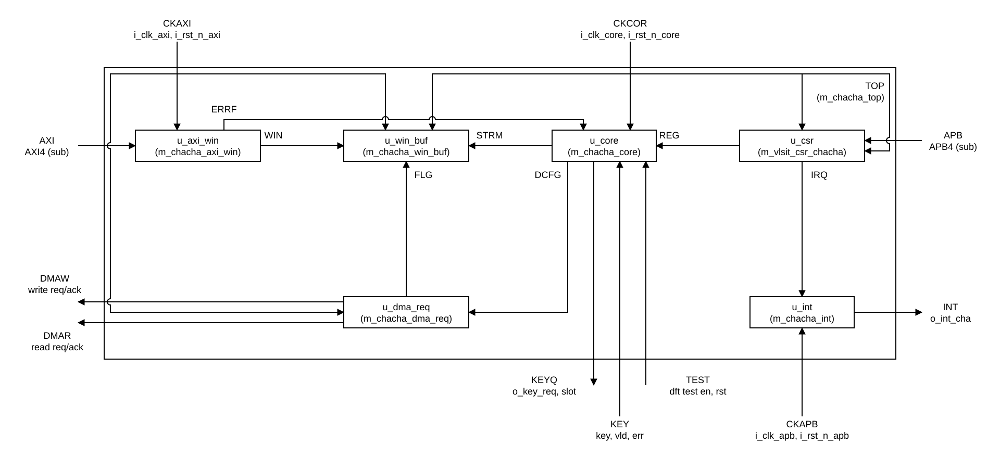

```json
{
  "page_name": "BLOCK_DIAGRAM",
  "out_name": "chacha_block_diagram.drawio",
  "table_suffix": "",
  "layout": {
    "gap_h": 120,
    "gap_v": 110,
    "margin": 60,
    "block_h": 60
  },
  "top": {
    "frame_label": [
      "TOP",
      "(m_chacha_top)"
    ],
    "block_label": [
      "TOP",
      "(m_chacha_top)"
    ],
    "block_row": [
      "TOP (m_chacha_top)",
      "ChaCha20-Poly1305 engine.",
      "Section 14.2"
    ]
  },
  "frame_row": [
    "TOP (m_chacha_top) frame",
    "Structural top of the ChaCha20-Poly1305 IP. It holds no logic of its own and instantiates the register block, the data window, the window storage, the DMA request logic, the cipher engine and the interrupt logic. The configuration interface is on the right, the data window is on the left, and the DMA channels, the key-store port, the test enable and the three clock and reset pairs are the other boundary interfaces.",
    "Section 14.2"
  ],
  "frame_interfaces": [
    "AXI",
    "APB",
    "INT",
    "DMAW",
    "DMAR",
    "KEYQ",
    "KEY",
    "TEST",
    "CKAXI",
    "CKCOR",
    "CKAPB"
  ],
  "blocks": [
    {
      "key": "axi",
      "label": [
        "u_axi_win",
        "(m_chacha_axi_win)"
      ],
      "width": 240,
      "row": 0,
      "col": 0,
      "row_name": "u_axi_win (m_chacha_axi_win)",
      "function": "Data window of the AXI4 subordinate interface. It accepts incrementing bursts into the input window and serves incrementing read bursts from the output window, ignores the address bits inside the window, and answers every unsupported burst, every overrun, every underrun and every non-secure access with the protection check on with a subordinate error while still completing the burst. It counts the beats against the programmed message length.",
      "source": "Section 6.3, DEC-014, DEC-016"
    },
    {
      "key": "buf",
      "label": [
        "u_win_buf",
        "(m_chacha_win_buf)"
      ],
      "width": 240,
      "row": 0,
      "col": 1,
      "row_name": "u_win_buf (m_chacha_win_buf)",
      "function": "Window storage. It holds the input window, which buffers the associated data, the message data and for a decryption the tag, and the output window, which buffers the ciphertext or plaintext and the tag, between the bus clock and the core clock. Each window becomes a synchronous buffer when its two clocks are the same net. It reports the free room of the input window and the data held in the output window for the DMA request logic, and in the hold setting keeps decrypted data back until the tag is verified.",
      "source": "Section 7.2, CDC-003, CDC-004, DEC-005"
    },
    {
      "key": "core",
      "label": [
        "u_core",
        "(m_chacha_core)"
      ],
      "width": 200,
      "row": 0,
      "col": 2,
      "row_name": "u_core (m_chacha_core)",
      "function": "Cipher engine. It requests the key from the key store, latches it, derives the one-time authentication key, generates the keystream, encrypts or decrypts the message data, authenticates the associated data and the ciphertext, builds and checks the tag, handles the nonce and the message sequence, and raises the completion and error events. Its datapath is gated while it is idle.",
      "source": "Section 5.3, 10"
    },
    {
      "key": "csr",
      "label": [
        "u_csr",
        "(m_vlsit_csr_chacha)"
      ],
      "width": 240,
      "row": 0,
      "col": 3,
      "row_name": "u_csr (m_vlsit_csr_chacha)",
      "function": "Register block generated from the register workbook. It decodes the peripheral bus accesses, holds the configuration fields, the nonce and counter fields, the interrupt registers and the capability constants, and crosses between the configuration clock and the core clock when they are different.",
      "source": "Section 11"
    },
    {
      "key": "dma",
      "label": [
        "u_dma_req",
        "(m_chacha_dma_req)"
      ],
      "width": 240,
      "row": 1,
      "col": 1,
      "row_name": "u_dma_req (m_chacha_dma_req)",
      "function": "System DMA request logic. It raises the write request when the input window can take the next burst and the read request when the output window holds the next burst, applies the watermark and the tail rule, and runs the four-phase handshake with the acknowledge inputs.",
      "source": "Section 6.3, DEC-010, DEC-013"
    },
    {
      "key": "int",
      "label": [
        "u_int",
        "(m_chacha_int)"
      ],
      "width": 200,
      "row": 1,
      "col": 3,
      "row_name": "u_int (m_chacha_int)",
      "function": "Interrupt logic. It combines the raw event bits and their enable mask into the masked status that the register block shows, and drives the interrupt output in the configuration clock domain.",
      "source": "Section 6.4"
    }
  ],
  "connectors": [
    {
      "id": "WIN",
      "src": "axi",
      "src_side": "R",
      "dst": "buf",
      "dst_side": "L"
    },
    {
      "id": "STRM",
      "src": "core",
      "src_side": "L",
      "dst": "buf",
      "dst_side": "R"
    },
    {
      "id": "FLG",
      "src": "dma",
      "src_side": "T",
      "dst": "buf",
      "dst_side": "B"
    },
    {
      "id": "DCFG",
      "src": "core",
      "src_side": "B",
      "dst": "dma",
      "dst_side": "R"
    },
    {
      "id": "ERRF",
      "src": "axi",
      "src_side": "T",
      "dst": "core",
      "dst_side": "T"
    },
    {
      "id": "REG",
      "src": "csr",
      "src_side": "L",
      "dst": "core",
      "dst_side": "R"
    },
    {
      "id": "IRQ",
      "src": "csr",
      "src_side": "B",
      "dst": "int",
      "dst_side": "T"
    }
  ],
  "externals": [
    {
      "id": "AXI",
      "block": "axi",
      "side": "L",
      "dir": "in",
      "pos": 0,
      "text": [
        "AXI",
        "AXI4 (sub)"
      ]
    },
    {
      "id": "APB",
      "block": "csr",
      "side": "R",
      "dir": "in",
      "pos": 0,
      "text": [
        "APB",
        "APB4 (sub)"
      ]
    },
    {
      "id": "INT",
      "block": "int",
      "side": "R",
      "dir": "out",
      "pos": 0,
      "text": [
        "INT",
        "o_int_cha"
      ]
    },
    {
      "id": "DMAW",
      "block": "dma",
      "side": "L",
      "dir": "out",
      "pos": -20,
      "text": [
        "DMAW",
        "write req/ack"
      ]
    },
    {
      "id": "DMAR",
      "block": "dma",
      "side": "L",
      "dir": "out",
      "pos": 20,
      "text": [
        "DMAR",
        "read req/ack"
      ]
    },
    {
      "id": "KEY",
      "block": "core",
      "side": "B",
      "dir": "in",
      "pos": -20,
      "text": [
        "KEY",
        "key, vld, err"
      ]
    },
    {
      "id": "TEST",
      "block": "core",
      "side": "B",
      "dir": "in",
      "pos": 70,
      "text": [
        "TEST",
        "dft test en, rst"
      ]
    },
    {
      "id": "CKAXI",
      "block": "axi",
      "side": "T",
      "dir": "in",
      "pos": -40,
      "text": [
        "CKAXI",
        "i_clk_axi, i_rst_n_axi"
      ]
    },
    {
      "id": "CKCOR",
      "block": "core",
      "side": "T",
      "dir": "in",
      "pos": 0,
      "text": [
        "CKCOR",
        "i_clk_core, i_rst_n_core"
      ]
    },
    {
      "id": "CKAPB",
      "block": "int",
      "side": "B",
      "dir": "in",
      "pos": 0,
      "text": [
        "CKAPB",
        "i_clk_apb, i_rst_n_apb"
      ]
    },
    {
      "id": "KEYQ",
      "block": "core",
      "side": "B",
      "dir": "out",
      "pos": -70,
      "text": [
        "KEYQ",
        "o_key_req, slot"
      ]
    }
  ],
  "nets": [
    {
      "entry": "CKAXI",
      "sinks": [
        {
          "id": "CA0",
          "block": "buf",
          "side": "T",
          "pos": -60
        },
        {
          "id": "CA1",
          "block": "dma",
          "side": "L",
          "pos": 0
        }
      ]
    },
    {
      "entry": "CKCOR",
      "sinks": [
        {
          "id": "CC0",
          "block": "buf",
          "side": "T",
          "pos": 60
        },
        {
          "id": "CC1",
          "block": "csr",
          "side": "T",
          "pos": -80
        }
      ]
    },
    {
      "entry": "CKAPB",
      "sinks": [
        {
          "id": "CP0",
          "block": "csr",
          "side": "R",
          "pos": 40
        }
      ]
    }
  ],
  "interfaces": [
    {
      "id": "AXI",
      "name": "AXI4 data window, subordinate side (CLK-AXI)",
      "category": "standard protocol (AXI4 memory subordinate profile)",
      "active": "external manager -> TOP",
      "signals": "external manager -> TOP: i_axi_awid, i_axi_awaddr, i_axi_awlen, i_axi_awsize, i_axi_awburst, i_axi_awprot, i_axi_awvalid, i_axi_wdata, i_axi_wstrb, i_axi_wlast, i_axi_wvalid, i_axi_bready, i_axi_arid, i_axi_araddr, i_axi_arlen, i_axi_arsize, i_axi_arburst, i_axi_arprot, i_axi_arvalid, i_axi_rready; TOP -> external manager: o_axi_awready, o_axi_wready, o_axi_bid, o_axi_bresp, o_axi_bvalid, o_axi_arready, o_axi_rid, o_axi_rdata, o_axi_rresp, o_axi_rlast, o_axi_rvalid"
    },
    {
      "id": "APB",
      "name": "APB4 configuration interface (CLK-APB)",
      "category": "standard protocol (APB4)",
      "active": "external manager -> TOP",
      "signals": "external manager -> TOP: i_apb_paddr, i_apb_pwdata, i_apb_pwrite, i_apb_penable, i_apb_psel, i_apb_pstrb, i_apb_pprot, i_protect_en, i_slverr_en; TOP -> external manager: o_apb_pready, o_apb_pslverr, o_apb_prdata"
    },
    {
      "id": "INT",
      "name": "Interrupt output (CLK-APB)",
      "category": "level",
      "active": "TOP -> external interrupt controller",
      "signals": "TOP -> external interrupt controller: o_int_cha"
    },
    {
      "id": "DMAW",
      "name": "DMA write request channel (CLK-AXI)",
      "category": "four-phase request/acknowledge",
      "active": "TOP -> external DMA controller",
      "signals": "TOP -> external DMA controller: o_dma_req_wr; external DMA controller -> TOP: i_dma_ack_wr"
    },
    {
      "id": "DMAR",
      "name": "DMA read request channel (CLK-AXI)",
      "category": "four-phase request/acknowledge",
      "active": "TOP -> external DMA controller",
      "signals": "TOP -> external DMA controller: o_dma_req_rd; external DMA controller -> TOP: i_dma_ack_rd"
    },
    {
      "id": "KEYQ",
      "name": "Key-store request (CLK-CORE)",
      "category": "level and data",
      "active": "TOP -> external key store",
      "signals": "TOP -> external key store: o_key_req, o_key_slot"
    },
    {
      "id": "KEY",
      "name": "Key-store answer (CLK-CORE)",
      "category": "level and data",
      "active": "external key store -> TOP",
      "signals": "external key store -> TOP: i_key_data, i_key_vld, i_key_err"
    },
    {
      "id": "TEST",
      "name": "Test enable and test reset",
      "category": "static",
      "active": "external DFT logic -> TOP",
      "signals": "external DFT logic -> TOP: i_dft_test_en, i_dft_rst_n"
    },
    {
      "id": "CKAXI",
      "name": "Clock and reset, AXI4 side",
      "category": "clock and reset",
      "active": "SoC clock and reset controller -> TOP",
      "signals": "SoC clock and reset controller -> TOP: i_clk_axi, i_rst_n_axi"
    },
    {
      "id": "CKCOR",
      "name": "Clock and reset, core side",
      "category": "clock and reset",
      "active": "SoC clock and reset controller -> TOP",
      "signals": "SoC clock and reset controller -> TOP: i_clk_core, i_rst_n_core"
    },
    {
      "id": "CKAPB",
      "name": "Clock and reset, APB side",
      "category": "clock and reset",
      "active": "SoC clock and reset controller -> TOP",
      "signals": "SoC clock and reset controller -> TOP: i_clk_apb, i_rst_n_apb"
    },
    {
      "id": "WIN",
      "name": "Input and output window data paths (CLK-AXI)",
      "category": "custom",
      "active": "u_axi_win -> u_win_buf",
      "signals": "u_axi_win -> u_win_buf: w_win_wr_data, w_win_wr_en, w_win_wr_last, w_win_rd_en; u_win_buf -> u_axi_win: w_win_wr_full, w_win_rd_data, w_win_rd_empty, w_win_rd_last"
    },
    {
      "id": "STRM",
      "name": "Data streams between the engine and the window storage (CLK-CORE)",
      "category": "custom",
      "active": "u_core -> u_win_buf",
      "signals": "u_core -> u_win_buf: w_in_rd_en, w_out_wr_data, w_out_wr_en, w_out_wr_last, w_out_hold; u_win_buf -> u_core: w_in_rd_data, w_in_rd_empty, w_out_wr_full"
    },
    {
      "id": "FLG",
      "name": "Window level flags for the DMA request logic (CLK-AXI)",
      "category": "custom",
      "active": "u_dma_req -> u_win_buf",
      "signals": "u_win_buf -> u_dma_req: w_in_room, w_out_avail"
    },
    {
      "id": "DCFG",
      "name": "Message parameters for the DMA request logic (quasi-static)",
      "category": "custom",
      "active": "u_core -> u_dma_req",
      "signals": "u_core -> u_dma_req: w_dma_wm_wr, w_dma_wm_rd, w_dma_tail_mode, w_dma_en, w_dma_beats_wr, w_dma_beats_rd, w_dma_msg_act"
    },
    {
      "id": "ERRF",
      "name": "Data window error events",
      "category": "custom",
      "active": "u_axi_win -> u_core",
      "signals": "u_axi_win -> u_core: w_axi_err_pulse"
    },
    {
      "id": "REG",
      "name": "Configuration and status between the register block and the engine",
      "category": "custom",
      "active": "u_csr -> u_core",
      "signals": "u_csr -> u_core: o_cha_ctrl_en, o_cha_ctrl_start, o_cha_ctrl_dir, o_cha_ctrl_abort, o_cha_ctrl_dma_en, o_cha_ctrl_tail_mode, o_cha_ctrl_key_slot, o_cha_len_aad_len, o_cha_len_msg_len, o_cha_wm_wm_wr, o_cha_wm_wm_rd, o_cha_nonce0_nonce_w, o_cha_nonce1_nonce_w, o_cha_nonce2_nonce_w, o_cha_salt_salt, o_cha_ctr_lo_ctr, o_cha_ctr_hi_ctr; u_core -> u_csr: i_cha_sts_busy, i_cha_sts_in_rdy, i_cha_sts_out_rdy, i_cha_sts_ctr_vld, i_hw_wdata_cha_ctrl_start, i_hw_we_cha_ctrl_start, i_hw_wdata_cha_ctrl_abort, i_hw_we_cha_ctrl_abort, i_hw_wdata_cha_ctr_lo_ctr, i_hw_we_cha_ctr_lo_ctr, i_hw_wdata_cha_ctr_hi_ctr, i_hw_we_cha_ctr_hi_ctr, i_hw_wdata_cha_irq_raw_done, i_hw_we_cha_irq_raw_done, i_hw_wdata_cha_irq_raw_tag_err, i_hw_we_cha_irq_raw_tag_err, i_hw_wdata_cha_irq_raw_len_err, i_hw_we_cha_irq_raw_len_err, i_hw_wdata_cha_irq_raw_axi_err, i_hw_we_cha_irq_raw_axi_err, i_hw_wdata_cha_irq_raw_ctr_err, i_hw_we_cha_irq_raw_ctr_err, i_hw_wdata_cha_irq_raw_key_err, i_hw_we_cha_irq_raw_key_err"
    },
    {
      "id": "IRQ",
      "name": "Raw events and masks to the interrupt logic, masked status back",
      "category": "custom",
      "active": "u_csr -> u_int",
      "signals": "u_csr -> u_int: o_cha_irq_raw_done, o_cha_irq_raw_tag_err, o_cha_irq_raw_len_err, o_cha_irq_raw_axi_err, o_cha_irq_raw_ctr_err, o_cha_irq_raw_key_err, o_cha_irq_en_done, o_cha_irq_en_tag_err, o_cha_irq_en_len_err, o_cha_irq_en_axi_err, o_cha_irq_en_ctr_err, o_cha_irq_en_key_err; u_int -> u_csr: i_cha_irq_sts_done, i_cha_irq_sts_tag_err, i_cha_irq_sts_len_err, i_cha_irq_sts_axi_err, i_cha_irq_sts_ctr_err, i_cha_irq_sts_key_err"
    }
  ],
  "legend_note": "The enclosing frame is the top module; blocks inside are its instances. Internal signal names beginning with w_ are provisional until section 14 is complete.",
  "library_sha256": "15DFB183E267D2A94F8CAB316E01EB3D2E9D2F9C006DC816790A394F4123506C"
}
```

*Figure 5-1. Block diagram of m_chacha_top. Source: `figures/chacha_block_diagram.drawio` (draw.io, VLSIT library, drawn by `vlsit_spec_diagram.py`).*

### 5.3 Transaction and dataflow

One message passes through these steps (the software view is section 11.2; the algorithm is RFC 8439 sections 2.3 to 2.8, `reference/md_doc/vlsit_chacha_rfc8439.md`):

1. **Acceptance.** Software programs the parameters and writes `cha_ctrl.start`. The register block raises the start request to the engine, which, if it is idle and enabled, latches the lengths, the direction and the nonce, sets busy and clears start. A start that cannot be accepted is cleared without effect (REQ-FUNC-009). The lengths and the watermark are copied to the DMA request logic (CDC-005).
2. **Key and one-time key.** The engine raises `o_key_req` with `o_key_slot` (the value of `cha_ctrl.key_slot`) and waits for the key store: with `i_key_vld` high it copies the key and releases the request, with `i_key_err` high it stops, sets `key_err` and returns to idle (REQ-ERR-003). It then runs the ChaCha20 block function with block counter 0; the first 256 bits of the output are the Poly1305 one-time key (RFC 8439 section 2.6). No message data is needed yet, so this step overlaps the first DMA request.
3. **Data in.** The data window writes beats into the input buffer. When the DMA handshake is enabled, the write request is raised whenever the input buffer can take the next burst (section 6.3). The engine reads the buffer in order: the first `cha_len.aad_len` bytes are associated data, the next `cha_len.msg_len` bytes are message data and, for a decryption, the next 16 bytes are the received tag (REQ-FUNC-006).
4. **Processing.** Associated data goes only to Poly1305, padded with zero bytes to a multiple of 16. For each 64-byte block of message data the engine generates keystream with the next block counter starting at 1, XORs it with the data, and sends the ciphertext (which is the output of an encryption and the input of a decryption) to Poly1305, padded to a multiple of 16. Several keystream blocks can be generated at once when `PARA_CORE_NUM` is above 1; Poly1305 consumes the ciphertext in order.
5. **Tag.** After the message data, Poly1305 absorbs the two 64-bit lengths and produces the 16-byte tag. An encryption appends the tag to the output. A decryption compares the computed tag with the received tag over all 16 bytes without an early exit (REQ-SEC-002) and sets `done` on a match or `tag_err` on a mismatch.
6. **Data out.** The engine writes the result into the output buffer. In release mode (`PARA_HOLD_EN` = 0) a decryption writes plaintext as it is produced; in hold mode the plaintext is kept in the buffer and becomes readable only after the tag matched, and is discarded after a mismatch (REQ-FUNC-010). The read request of the DMA handshake is raised when the next burst is readable.
7. **Completion and release.** Busy is cleared, the key register content is no longer needed and is cleared, the events are raised, and the engine is idle for the next message. An abort empties both buffers and returns to idle (REQ-FUNC-008).

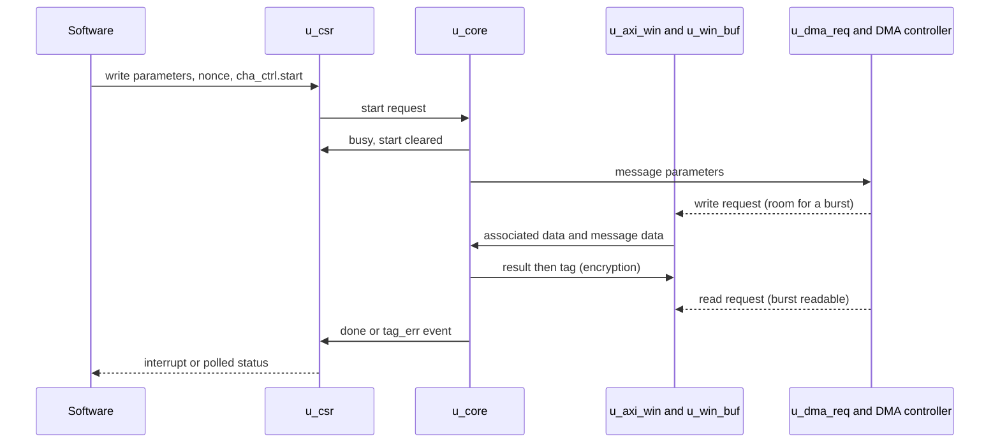

### 5.4 Invariants

- The engine processes at most one message at a time; no parameter register is read for a new message while busy is set.
- A nonce is used for one message only; in the hardware nonce build the counter value of one encryption is never used again with the same salt until software loads a new start value (REQ-SEC-001).
- Block counter 0 is used only for the one-time Poly1305 key and the data blocks start at counter 1 (REQ-FUNC-003).
- The key is never an output of the IP and is not readable through the APB or AXI4 interfaces (REQ-FUNC-007).
- The key is copied only in the cycle where `o_key_req` and `i_key_vld` are both high, and a message whose key request fails never runs (REQ-SEC-003, REQ-ERR-003).
- Each part of the stream starts on a new beat of the window (REQ-FUNC-006).
- In hold mode no decrypted byte is readable before the tag has matched (REQ-FUNC-010).
- A DMA request is raised only for a burst that the input buffer can take (write) or the output buffer holds (read), and a request is never raised before its acknowledge of the previous request has been released (REQ-IF-006, REQ-IF-007).
- Every window transfer that cannot be served is answered with SLVERR and the burst still completes with the requested number of transfers (REQ-IF-004).
- Every signal that crosses between clock domains passes through a structure listed in section 7.2 (REQ-CLK-002).
- The message data, the associated data and the tag keep the order in which they arrive through the window; there is no reordering inside the IP.

## 6. External interfaces and ports

### 6.1 Interface inventory

| Interface ID | Type and revision | Role | Direction at IP boundary | Clock domain | Required / optional | Configurations |
|---|---|---|---|---|---|---|
| IF-001 | APB4 slave (`reference/md_doc/vlsit_apb_amba_apb_ihi0024d.md`); registers generated by APB-CSR-Generator from the workbook | Configuration, control and status of the engine (FEAT-003) | Input requests, output responses | CLK-APB at the port; the register block clocks in CLK-CORE (DEC-004) | Required | All |
| IF-002 | AXI4 subordinate ("slave" in older Arm text), Arm IHI 0022H.c, Part A, profile DEC-021, ASM-007 and ASM-011 (`reference/md_doc/vlsit_axi_amba_axi_ihi0022h_c.md`) | Input window written by the master or the system DMA, output window read by it (FEAT-004) | Input requests, output responses | CLK-AXI | Required | All |
| IF-003 | Project-defined four-phase request/acknowledge handshake, write direction (DEC-010, DEC-013) | The IP asks the system DMA to write the next burst of message data into the input window | `o_dma_req_wr` output, `i_dma_ack_wr` input | CLK-AXI (ASM-004) | Optional | `PARA_DMA_EN` = 1 |
| IF-004 | Project-defined four-phase request/acknowledge handshake, read direction (DEC-010, DEC-013) | The IP asks the system DMA to read the next burst of finished data from the output window | `o_dma_req_rd` output, `i_dma_ack_rd` input | CLK-AXI (ASM-004) | Optional | `PARA_DMA_EN` = 1 |
| IF-005 | Key-store port: request and valid handshake with a slot index (DEC-020) | The IP requests the key of a slot; the key store answers with the 256-bit key and a valid indication, or with an error indication; the key is not readable by software (DEC-006) | `o_key_req`, `o_key_slot` output; `i_key_data`, `i_key_vld`, `i_key_err` input | CLK-CORE (ASM-004) | Required | All |
| IF-006 | Interrupt output, six events, list to be confirmed in TBD-014 | Reports completion, tag error and protocol errors to the host for polling-free operation | Output | CLK-APB (after synchronization) | Required | All |
| IF-007 | Clocks and resets | Three clocks and three resets (section 7) | Inputs | See section 7 | Required | All |

### 6.2 Complete port list

Top module `m_chacha_top` (section 14.2). The port list is static: parameters never add or remove a port (section 8). The AXI4 profile is the Memory Subordinate interface of Arm IHI 0022H.c (Tables A9-2 and A9-4, `reference/md_doc/vlsit_axi_amba_axi_ihi0022h_c.md`), with the signals that Table A9-2 and Table A9-4 mark Required, plus `WLAST`, `BRESP` and `RRESP`, which the tables mark Optional but this IP needs (`WLAST` to find the end of a write burst, `BRESP` and `RRESP` to return SLVERR, DEC-016), plus `AWPROT` and `ARPROT`, which the IP uses for the access check of REQ-SEC-005 (ASM-011). The optional signals `AWREGION`, `AWLOCK`, `AWCACHE`, `AWQOS` and their read-channel counterparts, and user signals, are not present; the same specification suggests that a component may include all signals for easier integration, so the integrator ties off nothing here but must not expect them (ASM-007). The widths use `PARA_AXI_IDW`, `PARA_AXI_AW` and `PARA_AXI_DW` of section 8. The key-store port is the request and valid handshake of section 6.3 (DEC-020). The test ports are `i_dft_test_en` and `i_dft_rst_n` (ASM-012, section 16); in functional operation the integrator ties `i_dft_test_en` low and `i_dft_rst_n` high.

| Port | Direction | Width | Meaning (function) | Clock domain | Signal type | Reset / idle value | Timing / sampling | Configurations |
|---|---|---:|---|---|---|---|---|---|
| i_clk_apb | Input | 1 | Clock of the APB4 interface | CLK-APB | clock | none (a clock has no reset value) | Rising edge | All |
| i_rst_n_apb | Input | 1 | Active-low reset of the APB4 side | CLK-APB | reset | Active low | Asynchronous assertion, release synchronized in the block | All |
| i_clk_axi | Input | 1 | Clock of the AXI4 interface and of the DMA handshake | CLK-AXI | clock | none (a clock has no reset value) | Rising edge | All |
| i_rst_n_axi | Input | 1 | Active-low reset of the AXI4 side | CLK-AXI | reset | Active low | Asynchronous assertion, release synchronized in the block | All |
| i_clk_core | Input | 1 | Clock of the engine, the register block and the key port | CLK-CORE | clock | none (a clock has no reset value) | Rising edge | All |
| i_rst_n_core | Input | 1 | Active-low reset of the core side | CLK-CORE | reset | Active low | Asynchronous assertion, release synchronized in the block | All |
| i_dft_test_en | Input | 1 | Test enable: forces the gated core clock on and selects `i_dft_rst_n` as the reset of every flip-flop (rule CLK-03, rule RST-04, REQ-DFT-001) | Asynchronous | static (constant during functional operation) | 0 | Not sampled by a flop; used at the clock-gating cell and at the reset wrappers | All |
| i_dft_rst_n | Input | 1 | Active-low test reset, used instead of the functional resets while `i_dft_test_en` is 1 (REQ-DFT-001) | Asynchronous | static (constant high during functional operation) | 1 | Not synchronized; no effect while `i_dft_test_en` is 0 | All |
| i_apb_paddr | Input | 16 | APB address of the register block | CLK-APB | data (valid while `i_apb_psel` is high) | none (qualified by its valid, or a static input) | Sampled in the setup and access phase | All |
| i_apb_pwdata | Input | 32 | APB write data | CLK-APB | data (valid in the access phase of a write) | none (qualified by its valid, or a static input) | Sampled when `i_apb_penable` is high | All |
| i_apb_pwrite | Input | 1 | APB write direction | CLK-APB | level | 0 | Valid with `i_apb_psel` | All |
| i_apb_penable | Input | 1 | APB access-phase indicator | CLK-APB | level | 0 | APB4 handshake | All |
| i_apb_psel | Input | 1 | APB select | CLK-APB | level | 0 | APB4 handshake | All |
| i_apb_pstrb | Input | 4 | APB byte strobes; software writes full words | CLK-APB | data (valid in the access phase of a write) | none (qualified by its valid, or a static input) | See section 11.4 | All |
| i_apb_pprot | Input | 3 | APB protection; only bit 1 is used when the protection check is on | CLK-APB | data (valid with `i_apb_psel`) | none (qualified by its valid, or a static input) | See section 11.4 | All |
| o_apb_pready | Output | 1 | APB ready | CLK-APB | level | 0 | APB4 handshake; waits depend on the clock relation (section 11.4) | All |
| o_apb_pslverr | Output | 1 | APB error response | CLK-APB | level | 0 | Valid with `o_apb_pready` | All |
| o_apb_prdata | Output | 32 | APB read data | CLK-APB | data (valid with `o_apb_pready` on a read) | 0 | APB4 handshake | All |
| i_protect_en | Input | 1 | 1 enables the non-secure access check of the register block | Asynchronous | static (constant after reset) | none (qualified by its valid, or a static input) | Not synchronized; shall not change after reset | All |
| i_slverr_en | Input | 1 | 1 enables the error checks of the register block | Asynchronous | static (constant after reset) | none (qualified by its valid, or a static input) | Not synchronized; shall not change after reset | All |
| i_axi_awid | Input | `PARA_AXI_IDW` | AXI4 write address identifier | CLK-AXI | data (valid with `i_axi_awvalid`) | none (qualified by its valid, or a static input) | AXI4 valid/ready | All |
| i_axi_awaddr | Input | `PARA_AXI_AW` | AXI4 write address; bits inside the window are ignored (DEC-014) | CLK-AXI | data (valid with `i_axi_awvalid`) | none (qualified by its valid, or a static input) | AXI4 valid/ready | All |
| i_axi_awlen | Input | 8 | AXI4 write burst length minus one | CLK-AXI | data (valid with `i_axi_awvalid`) | none (qualified by its valid, or a static input) | AXI4 valid/ready | All |
| i_axi_awsize | Input | 3 | AXI4 write transfer size code; shall equal the full data width (DEC-021) | CLK-AXI | data (valid with `i_axi_awvalid`) | none (qualified by its valid, or a static input) | AXI4 valid/ready | All |
| i_axi_awburst | Input | 2 | AXI4 write burst type; only INCR is supported | CLK-AXI | data (valid with `i_axi_awvalid`) | none (qualified by its valid, or a static input) | AXI4 valid/ready | All |
| i_axi_awprot | Input | 3 | AXI4 write protection type; bit 1 set means non-secure, checked against `i_protect_en` (REQ-SEC-005, ASM-011) | CLK-AXI | data (valid with `i_axi_awvalid`) | none (qualified by its valid, or a static input) | AXI4 valid/ready | All |
| i_axi_awvalid | Input | 1 | AXI4 write address valid | CLK-AXI | level | 0 | AXI4 valid/ready | All |
| o_axi_awready | Output | 1 | AXI4 write address ready | CLK-AXI | level | 0 | AXI4 valid/ready | All |
| i_axi_wdata | Input | `PARA_AXI_DW` | AXI4 write data, message input to the input window | CLK-AXI | data (valid with `i_axi_wvalid`) | none (qualified by its valid, or a static input) | AXI4 valid/ready | All |
| i_axi_wstrb | Input | `PARA_AXI_DW`/8 | AXI4 write byte strobes of the data beat | CLK-AXI | data (valid with `i_axi_wvalid`) | none (qualified by its valid, or a static input) | AXI4 valid/ready; expected pattern of REQ-IF-011 | All |
| i_axi_wlast | Input | 1 | AXI4 last beat of a write burst | CLK-AXI | data (valid with `i_axi_wvalid`) | none (qualified by its valid, or a static input) | AXI4 valid/ready | All |
| i_axi_wvalid | Input | 1 | AXI4 write data valid | CLK-AXI | level | 0 | AXI4 valid/ready | All |
| o_axi_wready | Output | 1 | AXI4 write data ready | CLK-AXI | level | 0 | AXI4 valid/ready | All |
| o_axi_bid | Output | `PARA_AXI_IDW` | AXI4 write response identifier, echo of the write address identifier | CLK-AXI | data (valid with `o_axi_bvalid`) | 0 | AXI4 valid/ready | All |
| o_axi_bresp | Output | 2 | AXI4 write response: OKAY or SLVERR (DEC-016) | CLK-AXI | data (valid with `o_axi_bvalid`) | 0 | AXI4 valid/ready | All |
| o_axi_bvalid | Output | 1 | AXI4 write response valid | CLK-AXI | level | 0 | AXI4 valid/ready | All |
| i_axi_bready | Input | 1 | AXI4 write response ready | CLK-AXI | level | 0 | AXI4 valid/ready | All |
| i_axi_arid | Input | `PARA_AXI_IDW` | AXI4 read address identifier | CLK-AXI | data (valid with `i_axi_arvalid`) | none (qualified by its valid, or a static input) | AXI4 valid/ready | All |
| i_axi_araddr | Input | `PARA_AXI_AW` | AXI4 read address; bits inside the window are ignored (DEC-014) | CLK-AXI | data (valid with `i_axi_arvalid`) | none (qualified by its valid, or a static input) | AXI4 valid/ready | All |
| i_axi_arlen | Input | 8 | AXI4 read burst length minus one | CLK-AXI | data (valid with `i_axi_arvalid`) | none (qualified by its valid, or a static input) | AXI4 valid/ready | All |
| i_axi_arsize | Input | 3 | AXI4 read transfer size code; shall equal the full data width (DEC-021) | CLK-AXI | data (valid with `i_axi_arvalid`) | none (qualified by its valid, or a static input) | AXI4 valid/ready | All |
| i_axi_arburst | Input | 2 | AXI4 read burst type; only INCR is supported | CLK-AXI | data (valid with `i_axi_arvalid`) | none (qualified by its valid, or a static input) | AXI4 valid/ready | All |
| i_axi_arprot | Input | 3 | AXI4 read protection type; bit 1 set means non-secure, checked against `i_protect_en` (REQ-SEC-005, ASM-011) | CLK-AXI | data (valid with `i_axi_arvalid`) | none (qualified by its valid, or a static input) | AXI4 valid/ready | All |
| i_axi_arvalid | Input | 1 | AXI4 read address valid | CLK-AXI | level | 0 | AXI4 valid/ready | All |
| o_axi_arready | Output | 1 | AXI4 read address ready | CLK-AXI | level | 0 | AXI4 valid/ready | All |
| o_axi_rid | Output | `PARA_AXI_IDW` | AXI4 read data identifier, echo of the read address identifier | CLK-AXI | data (valid with `o_axi_rvalid`) | 0 | AXI4 valid/ready | All |
| o_axi_rdata | Output | `PARA_AXI_DW` | AXI4 read data, result from the output window | CLK-AXI | data (valid with `o_axi_rvalid`) | 0 | AXI4 valid/ready | All |
| o_axi_rresp | Output | 2 | AXI4 read response per transfer: OKAY or SLVERR (DEC-016) | CLK-AXI | data (valid with `o_axi_rvalid`) | 0 | AXI4 valid/ready | All |
| o_axi_rlast | Output | 1 | AXI4 last transfer of a read burst | CLK-AXI | data (valid with `o_axi_rvalid`) | 0 | AXI4 valid/ready | All |
| o_axi_rvalid | Output | 1 | AXI4 read data valid | CLK-AXI | level | 0 | AXI4 valid/ready | All |
| i_axi_rready | Input | 1 | AXI4 read data ready | CLK-AXI | level | 0 | AXI4 valid/ready | All |
| o_dma_req_wr | Output | 1 | Write request: the engine needs input data (DEC-013) | CLK-AXI | level | 0 | Four-phase handshake with `i_dma_ack_wr` (DEC-010) | `PARA_DMA_EN` = 1; tied low otherwise |
| i_dma_ack_wr | Input | 1 | Acknowledge of the write request from the system DMA controller | CLK-AXI | level | 0 | Four-phase handshake | `PARA_DMA_EN` = 1; ignored otherwise |
| o_dma_req_rd | Output | 1 | Read request: finished data waits in the output window | CLK-AXI | level | 0 | Four-phase handshake with `i_dma_ack_rd` | `PARA_DMA_EN` = 1; tied low otherwise |
| i_dma_ack_rd | Input | 1 | Acknowledge of the read request from the system DMA controller | CLK-AXI | level | 0 | Four-phase handshake | `PARA_DMA_EN` = 1; ignored otherwise |
| i_key_data | Input | 256 | 256-bit key from the key store, valid while `i_key_vld` is high (DEC-020) | CLK-CORE (ASM-004) | data (valid with `i_key_vld`) | none (qualified by its valid, or a static input) | Copied in the cycle where `o_key_req` and `i_key_vld` are both high | All |
| i_key_vld | Input | 1 | The key store presents the key of the requested slot (DEC-020) | CLK-CORE (ASM-004) | level | 0 | Sampled while `o_key_req` is high; held by the key store until `o_key_req` falls | All |
| i_key_err | Input | 1 | The key store cannot supply the requested slot: no valid key, key revoked or access denied (DEC-020) | CLK-CORE (ASM-004) | level | 0 | Sampled while `o_key_req` is high; held by the key store until `o_key_req` falls | All |
| o_key_req | Output | 1 | Key request: the engine waits for the key of `o_key_slot` | CLK-CORE | level | 0 | Raised in `ENUM_ST_KEY`; released in the cycle after `i_key_vld` or `i_key_err` is seen, and at once by an abort or a reset | All |
| o_key_slot | Output | 4 | Key slot index: copy of `cha_ctrl.key_slot` latched at start | CLK-CORE | data (valid with `o_key_req`) | 0 | Stable while `o_key_req` is high | All |
| o_int_cha | Output | 1 | Interrupt: any enabled event of `cha_irq_sts` is pending (section 6.4) | CLK-APB | level | 0 | Synchronized into CLK-APB (CDC-007) | All |

### 6.3 Protocol behavior

**AXI4 interface (IF-002).** The AXI source is Arm IHI 0022H.c, chosen on 2026-11-24 as the official AXI4 source (DEC-012): Issues J and K of the specification removed the AXI3, AXI4 and AXI4-Lite content, so H.c is the latest issue that contains AXI4. Statements checked in the converted text so far:

- Burst length: AXI4 supports 1 to 256 transfers for the INCR burst type, and 1 to 16 transfers for all other burst types (Part A, section A3.4, "Burst length").
- FIXED burst: the address is the same for every transfer of the burst, and the specification names loading or emptying a FIFO as the use of this burst type (section A3.4, "Burst type", page A3-49).
- A burst must not cross a 4 KB address boundary (section A3.4).

Window burst type (DEC-014, user answer 2026-11-24): the data window accepts **INCR** bursts. The IP ignores the address bits inside the window region, so every beat of an INCR burst reaches the same input FIFO (write) or comes from the same output FIFO (read). The window region shall lie inside one 4 KB-aligned region, because a burst must not cross a 4 KB boundary. With a data width of $D$ bits, one beat is $D/8$ bytes, so the longest burst that the window accepts is $B_{max} = \min(256, 4096 / (D/8))$ beats: 256 beats for $D$ = 32, 64 or 128, and 128 beats for $D$ = 256. Responses (DEC-016, checked in "Read and write response structure", pages A3-59 and A3-60): a write transaction has a single response on `BRESP` for the whole burst, a read transaction can return a different `RRESP` for each transfer, and the Subordinate must perform the requested number of read transfers even when it reports an error. The same section lists FIFO or buffer overrun and underrun, and an unsupported transfer size, as examples of SLVERR use. OKAY is used for every served transfer.

Transfer rules of the window (DEC-021, REQ-IF-011, REQ-SEC-005). The first four rules are conditions for serving a burst; a burst that breaks one of them is answered with SLVERR, sets `axi_err` and transfers no data (a write burst is drained: its beats are accepted and dropped so that the manager is not blocked, and the single `BRESP` is SLVERR).

1. **Transfer size.** `AxSIZE` shall equal the full data width, $\log_2(D/8)$. Narrow transfers (Arm IHI 0022H.c "Narrow transfers", section A3.4) are not supported, which keeps the packing of REQ-FUNC-006 to whole beats.
2. **Burst type and length.** `AxBURST` shall be INCR and `AxLEN` + 1 shall not exceed $B_{max}$; FIXED, WRAP, a burst that crosses a 4 KB boundary and a burst longer than $B_{max}$ are unsupported.
3. **Write strobes.** The byte strobes of every write beat shall equal the pattern of REQ-FUNC-006: all ones, except the last beat of a part, in which the lanes that carry data are ones and the others zero (little-endian lane order, ASM-010). A beat with another pattern is dropped together with the rest of its burst. The expected pattern follows from `cha_len`; the IP therefore does not accept window data before it has started a message.
4. **Protection.** With `i_protect_en` = 1 an access whose `AxPROT[1]` is 1 is refused as above (REQ-SEC-005); with `i_protect_en` = 0 the protection type is ignored.
5. **Outstanding transactions.** At most one write burst and one read burst are outstanding: `o_axi_awready` is low from the accepted write address until the write response is accepted, and `o_axi_arready` is low from the accepted read address until `RLAST` is accepted. The write and read directions are independent. Arm IHI 0022H.c section A3.3 lets a Subordinate wait for `AWVALID` before asserting `WREADY`; this IP accepts write data only after its write address and only while the input buffer has room.
6. **Identifiers.** `o_axi_bid` and `o_axi_rid` echo the identifier of the accepted address. With one outstanding transaction per direction no response reordering exists, and the width `PARA_AXI_IDW` is an integration choice.
7. **Other signals.** `AxLOCK`, `AxCACHE`, `AxQOS`, `AxREGION` and user signals do not exist at the ports (section 6.2); exclusive access is not supported.

The IP uses SLVERR for: a read of the output window that finds it empty (underrun), a write that exceeds the input window room or the programmed message length (overrun), and a burst that breaks one of the rules 1 to 4.

**DMA request/acknowledge handshake (IF-003, IF-004).** This is a project-defined protocol (DEC-010, DEC-013, DEC-019); no external standard defines it. Each direction has one request output and one acknowledge input, both levels in CLK-AXI (rule R-025). The four phases are: (1) the IP raises the request while the condition of its direction holds; (2) the system DMA controller raises the acknowledge when it has accepted the request; (3) the IP releases the request after it has seen the acknowledge, and the controller moves the burst while the acknowledge is high; (4) the controller releases the acknowledge when the burst is finished. The cycle-level rules below are numbered for the integrator and for assertion SVA-001. A cycle is a rising edge of `i_clk_axi`; "seen" means sampled at that edge; $N$ is the number of beats of the burst.

| Rule | Statement |
|---|---|
| DMA-T1 | Request raise: the IP raises the request in a cycle where the condition of its direction holds, the acknowledge has been low for at least one cycle and the request has been low for at least one cycle. The burst size $N$ is fixed in that cycle: $\min(W, B_r)$ beats in tail mode 0, and one beat for the tail in tail mode 1 |
| DMA-T2 | Request hold: the request stays high until the acknowledge is seen high; it is withdrawn earlier only by an abort, a reset or the end of the message |
| DMA-T3 | Acknowledge raise: the controller raises the acknowledge at the earliest in the cycle after the request is high; the IP has no latest bound, because the latency belongs to the controller |
| DMA-T4 | Request release: the IP lowers the request in the cycle after it sees the acknowledge high, exactly one cycle later |
| DMA-T5 | Burst: while the acknowledge is high the controller moves exactly $N$ beats as one INCR burst of the data window; it keeps the acknowledge high until the last data beat of the burst has transferred (write: the beat with `WLAST`; read: the beat with `RLAST`) |
| DMA-T6 | Acknowledge release: the controller lowers the acknowledge at the earliest in the cycle after the last data beat and after it sees the request low; a burst of fewer than $N$ beats stalls the message (software aborts, OP-003), and a burst of more than $N$ beats is an overrun (SLVERR, `axi_err`) |
| DMA-T7 | Next request: the next request is raised at the earliest one cycle after the acknowledge is low (DMA-T1), so each handshake has the order request up, acknowledge up, request down, acknowledge down, and no two handshakes of one channel overlap |

The two channels are independent. The controller that the integrator uses shall be able to hold the acknowledge for the whole burst (DEP-001); the model of the controller used in verification follows these rules.

Meaning of the two directions (user answer 2026-11-24):

- The **write request** (`o_dma_req_wr`) means that ChaCha20-Poly1305 needs input data to run, that is, the input window FIFO has room for the next burst. The system DMA controller then reads memory and writes the burst into the input window.
- The **read request** (`o_dma_req_rd`) means that the engine has finished data (processed data or the tag) waiting in the output window FIFO. The system DMA controller then reads the burst from the output window and writes it to memory.

Burst size and tail (DEC-013, user answer 2026-11-24: "burst configurable"). The burst size is the watermark $W$ in beats, programmed in a CSR field up to $W_{max}$ (section 8). The last burst of a message can be shorter than $W$, and the way the IP handles it is also configurable by a CSR field, the tail mode (field names in the workbook, section 11):

- Tail mode 0, short burst (default): the IP requests a burst of $\min(W, B_r)$ beats, where $B_r$ is the number of beats still to be moved for the message, which the IP knows from the message length registers.
- Tail mode 1, single transfers: while $B_r < W$, the IP requests one beat at a time ($B_r$ requests of one beat each).

In both modes the write request is raised only when the input FIFO has room for the requested number of beats, and the read request is raised only when that many beats are available. Beats written beyond the programmed message length are an overrun (SLVERR on the burst and `axi_err`, DEC-016). A system DMA controller that cannot split the tail into a shorter burst shall use tail mode 1 or $W = 1$. This is the reading of "burst configurable" that the user accepted on 2026-11-24 with the proposal table of the review round (DEC-019).

| Case | Legal behavior | Illegal / unsupported case | IP response | Requirement IDs |
|---|---|---|---|---|
| Input burst while the write request is high | A burst of at most the requested beats is accepted into the input window | A burst longer than the room promised by the request, or more data than the programmed message lengths | One write response `BRESP` = SLVERR for the whole burst; the excess beats are dropped; an error flag is set (DEC-016) | REQ-IF-005, REQ-IF-007 |
| Output read while the read request is high | The requested beats are returned with RRESP = OKAY | A read of the output window while it is empty, or after the last byte of the message | Each transfer that cannot be served returns RRESP = SLVERR with zero read data; the burst still completes with the requested number of transfers and a correct RLAST; an error flag is set (DEC-016) | REQ-IF-004, REQ-IF-007 |
| Unsupported burst on the data window | INCR burst inside the window region with the full-width transfer size and the expected strobes | FIXED or WRAP burst, an INCR burst that crosses a 4 KB boundary or is longer than $B_{max}$, a narrow transfer, or a write strobe pattern that differs from the expected one | Write: BRESP = SLVERR for the burst and the beats are dropped; read: every transfer returns SLVERR (DEC-016, DEC-021); `axi_err` is set | REQ-IF-003, REQ-IF-011 |
| Non-secure access with `i_protect_en` = 1 | `AxPROT[1]` = 0 | `AxPROT[1]` = 1 | SLVERR, no data transferred, `axi_err` is set (ASM-011) | REQ-SEC-005 |
| Key store answers with `i_key_err` | `i_key_vld` high | `i_key_err` high while `o_key_req` is high | The message does not run; `key_err` is set and the sequencer returns to idle (DEC-020) | REQ-ERR-003 |
| Write request raised with `PARA_DMA_EN` = 0 | Not applicable: the request is tied inactive | None | None | REQ-IF-008 |

**Key-store port (IF-005, DEC-020).** The port is a request and valid handshake in CLK-CORE with the numbered rules below (REQ-IF-012).

| Rule | Statement |
|---|---|
| KEY-T1 | In `ENUM_ST_KEY` the IP raises `o_key_req` and drives `o_key_slot` with the slot latched from `cha_ctrl.key_slot`; both stay stable until the IP sees `i_key_vld` or `i_key_err` |
| KEY-T2 | The key store may answer in the cycle in which the request is first high or later; it raises `i_key_vld` with the key on `i_key_data`, or `i_key_err`, and holds the answer stable until `o_key_req` falls |
| KEY-T3 | The IP copies `i_key_data` into the key register at the edge where `o_key_req` and `i_key_vld` are both high, lowers `o_key_req` in the next cycle, and samples `i_key_data` in no other cycle |
| KEY-T4 | With `i_key_err` high the IP lowers `o_key_req` in the next cycle, sets `key_err` and returns to `ENUM_ST_IDLE`; if `i_key_vld` and `i_key_err` are both high in the same cycle the error wins and the key is not copied |
| KEY-T5 | An abort or a reset lowers `o_key_req` at once; the key register is cleared at the end of the message and on abort and reset (REQ-SEC-004) |

The IP has no timeout: a key store that never answers leaves the message busy, and software uses `cha_ctrl.abort` (OP-003). The slot number carries no meaning inside the IP; the key store decides which key belongs to it.

**Stream layout (DEC-022, REQ-FUNC-006).** Each part of the input stream (associated data, message data, and for a decryption the tag) starts on a new beat of the data window. With $W = D/8$ bytes per beat, a part of $n$ bytes takes $\lceil n / W \rceil$ beats; the low lanes that carry its last $n - (\lceil n / W \rceil - 1) W$ bytes have write strobe 1 and the other lanes of that beat have strobe 0, and every other beat has all strobes 1. The output stream has the same layout for the result and the tag; a read beat has no strobe, and the unused lanes of the last beat of a part read as zero. A part of length 0 takes no beat. The number of beats of a message is $\lceil a / W \rceil$ for the associated data, $\lceil m / W \rceil$ for the message data and $\lceil 16 / W \rceil$ for the tag (4, 2, 1 and 1 beats for 32, 64, 128 and 256 bits). Section 9 gives the worked example of RFC 8439 section 2.8.2.

### 6.4 Interrupts and events

The interrupt registers carry six events: `done`, `tag_err`, `len_err`, `axi_err`, `ctr_err` and `key_err` (the list is the author's proposal and TBD-014 asks the user to confirm it). `ctr_err` also reports a refused nonce (REQ-ERR-002, REQ-SEC-006) and `axi_err` also reports a reset of the AXI domain while a message ran (REQ-RESET-003).

| Signal/event | Polarity | Assert condition | Clear/deassert condition | Mask/priority | Crossing | Reset state |
|---|---|---|---|---|---|---|
| `o_int_cha` | Active high | Any bit of `cha_irq_sts` is set | The bit is cleared in `cha_irq_raw` or masked in `cha_irq_en` | Mask by `cha_irq_en`; no priority between events | CLK-CORE to CLK-APB (CDC-007) | Low |

### 6.5 Integration checklist

What the integrator provides and checks before the IP is used (review finding F-028). Every item names its source in this specification.

| No. | Item | What the integrator provides or checks | Source |
|---|---|---|---|
| 1 | Clocks | `i_clk_apb`, `i_clk_axi`, `i_clk_core`; for a synchronous pair the same clock net and the matching parameter (`PARA_SYNC_APB_CORE`, `PARA_SYNC_AXI_CORE`) set to 1; clocks with a fixed integer ratio are declared asynchronous | 7.1, 8 |
| 2 | Resets | Three active-low resets released in the order core, AXI, APB; a reset of the AXI domain alone lasts at least two periods of the slower of CLK-AXI and CLK-CORE; behavior of a single-domain reset as in 7.3 | 7.3, REQ-RESET-003 |
| 3 | Key store | A block in CLK-CORE that answers `o_key_req` for `o_key_slot` with `i_key_vld` and the key, or with `i_key_err`, and holds the answer until the request falls; the key-store owner confirms the protocol (DEP-002) | 6.3, DEC-020 |
| 4 | DMA controller | Hardware flow control that follows DMA-T1 to DMA-T7, holds the acknowledge for the whole burst, issues bursts of exactly the requested beats and can use tail mode 1 or a watermark of 1 when it cannot split a tail (DEP-001) | 6.3, DEC-019 |
| 5 | AXI4 manager | INCR bursts, full-width transfers, no 4 KB crossing, the write strobe pattern of REQ-IF-011, one outstanding write and one outstanding read burst, write data after the write address | 6.3, DEC-021 |
| 6 | Protection | `i_protect_en` and `i_slverr_en` tied to constants that do not change after reset; `AxPROT[1]` driven by the manager; an interconnect firewall is not required by this IP but is still the SoC choice (TBD-005) | 11.4, REQ-SEC-005, ASM-011 |
| 7 | Nonce discipline | Software supplies a unique nonce per key in the software-nonce build; the IP guard catches only a repeat of the previous nonce; in the hardware build software loads a start value that was never used with the same key and salt | 11.2, REQ-SEC-001, REQ-SEC-006, DEC-023 |
| 8 | Constraints | Set `CORE_PERIOD`, `AXI_PERIOD`, `APB_PERIOD` and the optional pin collections in `sdc/chacha_top.sdc`, then source it; add the library constraints of the FIFO and handshake blocks | 17.1, `sdc/chacha_top.sdc` |
| 9 | Library blocks | `001_AsyncGrayFIFO`, `002_SyncFIFO`, `010_Async4PhaseHandshake` or `011_Async2PhaseHandshake`, and `000_Common` cells (`m_vlsit_event_sync`, `m_vlsit_rst_sync`); the reuse was confirmed by the user on 2026-11-24 (DEP-003) | 7.2, 14.2 |
| 10 | DFT | `i_dft_test_en` tied low and `i_dft_rst_n` tied high in functional operation; scan insertion by the SoC flow on the netlist | 16, ASM-012 |
| 11 | Interrupt | `o_int_cha` is a level in CLK-APB that stays high until software clears the event or masks it | 6.4 |
| 12 | AXI window timing | The first window burst starts after `cha_sts.busy` reads 1 or after a DMA request rose; CLK-AXI is not slower than about one eighth of CLK-CORE (the message-active level has to be seen for two CLK-AXI periods) | 10.6, DEC-032, ASM-015 |

## 7. Clock, reset, and power

### 7.1 Clock domains

| Domain | Clock port | Edge | Frequency range | Source | Relationship to other clocks | Gating policy |
|---|---|---|---|---|---|---|
| CLK-APB | i_clk_apb | Rising | TBD-002 | SoC clock controller | Same net as CLK-CORE when `PARA_SYNC_APB_CORE` = 1, otherwise asynchronous | Not gated by this IP |
| CLK-AXI | i_clk_axi | Rising | TBD-002 | SoC clock controller | Same net as CLK-CORE when `PARA_SYNC_AXI_CORE` = 1, otherwise asynchronous | Not gated by this IP |
| CLK-CORE | i_clk_core | Rising | TBD-002 | SoC clock controller | Reference clock of the two relations | Core datapath gated while idle when `PARA_CG_EN` = 1; the register block and the key and window interfaces keep running |

The relation of each bus clock to the core clock is selected by `PARA_SYNC_AXI_CORE` and `PARA_SYNC_APB_CORE` (section 8, DEC-011): 1 means the same clock net (no crossing logic), 0 means asynchronous (every crossing synchronized). All four combinations of the two parameters are legal. The relation between the APB clock and the AXI clock is derived and informational (`LPARA_SYNC_APB_AXI` = 1 only when both parameters are 1). The default of both parameters is 0 (ASM-005). Clocks with a fixed integer ratio count as asynchronous (TBD-013).

Resolution of the APB-to-AXI relation (TBD-016, resolved with DEC-011): all configuration and status values pass through the register block, which is in CLK-CORE (DEC-004), and the data window crossing is between CLK-AXI and CLK-CORE. No signal crosses directly between CLK-APB and CLK-AXI, so a separate parameter for that pair would have no structural effect and would only allow three contradictory combinations. The specification therefore has two relation parameters, each against the core clock, and derives the APB-to-AXI relation. If a direct APB-to-AXI signal is added later, a third parameter can be reintroduced at that time.

### 7.2 CDC and RDC

Every crossing below is explicit; no unsynchronized crossing is implicit. "Same net" removes the structure of the row.

| Crossing ID | From → to | Signals | Structure | Reset handling | Constraints / verification |
|---|---|---|---|---|---|
| CDC-001 | CLK-APB → CLK-CORE | APB request and write data to the register block | The toggle request/acknowledge handshake with two-flop synchronizers built by the generated CSR block when its parameter `PARA_ASYNCHRONOUS` is 1; the parameter follows `PARA_SYNC_APB_CORE` (reference `reference/vlsit_csr_generator.md`); the library cell wrapper replaces the generator's placeholder synchronizer | The register block reset is released in the core domain; APB request in flight during reset is dropped (section 7.3) | CDC lint and a stress test with random ratio of the two clocks |
| CDC-002 | CLK-CORE → CLK-APB | Register read data, status | The same handshake of the generated CSR block | As CDC-001 | As CDC-001 |
| CDC-003 | CLK-AXI → CLK-CORE | Input window data and its write pointer | Asynchronous Gray-code FIFO of the library (`001_AsyncGrayFIFO`) when `PARA_SYNC_AXI_CORE` = 0; synchronous FIFO (`002_SyncFIFO`) when 1 | Both ports reset in their domains; pointers reset together through the coordinated software reset of the library FIFO (section 7.3) | Library FIFO verification, CDC lint of pointer synchronizers |
| CDC-004 | CLK-CORE → CLK-AXI | Output window data and its read pointer | As CDC-003 in the other direction | As CDC-003 | As CDC-003 |
| CDC-005 | CLK-CORE → CLK-AXI | The message parameters (lengths, direction, watermarks, tail mode, DMA enable, beat counts) and the message-active level | The level crosses through a two-flop synchronizer cell (`m_vlsit_afifo_cell_sync`) in `m_chacha_msg_cap`; the parameters are copied into CLK-AXI registers when the synchronized level rises, and are quasi-static: stable from the cycle in which the level rises until it falls (DEC-032; `m_vlsit_ahs2_top` was not used, see section 10.6) | Request outputs reset low | CDC lint; assertion SVA-001; TEST-033 |
| CDC-006 | CLK-AXI → CLK-CORE | Message length and burst accounting needed by the core; AXI-side error events (the sources of `axi_err`) | Quasi-static values: the handshake of `m_vlsit_ahs2_top` (`011_Async2PhaseHandshake`). Events: `m_vlsit_event_sync` of `000_Common`, a request/acknowledge toggle structure with one pending notification retained per event; further events that arrive while one is pending coalesce, so no event is lost for any clock ratio (REQ-CLK-003) | As CDC-003 | CDC lint; assertion SVA-011; TEST-015 with random clock ratios |
| CDC-007 | CLK-CORE → CLK-APB | Masked interrupt status that drives `o_int_cha` | A two-flop level synchronizer cell of `000_Common` after a registered source. No single-cycle pulse crosses on this path: the source is the sticky raw bits of the register block and their mask, which change only by an event or by a software write through the register block, so the level is held until software clears it or masks it (section 6.4) | Interrupt cleared by reset | CDC lint |
| CDC-008 | Key-store clock → CLK-CORE | `i_key_data`, `i_key_vld`, `i_key_err`, `o_key_req`, `o_key_slot` | Not a crossing while the key store runs in CLK-CORE (assumption ASM-004). If it runs in another clock the integrator adds a handshake synchronizer outside this IP; the answer is held until the request falls (KEY-T2), which makes a two-phase or four-phase handshake structure sufficient | Key register cleared by reset | Needs the key-store owner (DEP-002) |
| CDC-009 | CLK-AXI → CLK-CORE | Indication that the AXI domain is in reset | A level that is 0 while `i_rst_n_axi` is asserted and for two AXI cycles after its release (the output of the AXI reset synchronizer), passed through a two-flop level synchronizer; the core detects its falling edge and starts the abort of REQ-RESET-003. The reset shall be asserted for at least two periods of the slower of CLK-AXI and CLK-CORE (section 6.5, item 2) | The indication is the reset itself | CDC and RDC lint; TEST-016; SVA-010 |
| CDC-010 | CLK-CORE → CLK-AXI | The hold gate level and the flush request level of the input buffer | Each level through a two-flop synchronizer cell of `000_Common` (`m_vlsit_afifo_cell_sync`) after a registered source; the flush request is the request level of the four-phase handshake of `m_chacha_flush_hs` (DEC-027, DEC-028, DEC-033) | Gate low after reset | CDC lint; TEST-030 |
| CDC-011 | CLK-AXI → CLK-CORE | The flush done level of the input buffer | A two-flop synchronizer cell after a registered source (the done level of `m_chacha_flush_hs`) | As CDC-010 | CDC lint; TEST-030 |

Rows CDC-003 to CDC-006 disappear when `PARA_SYNC_AXI_CORE` = 1 except for the FIFO becoming synchronous, and CDC-009 becomes a direct connection; row CDC-001 and CDC-002 use the same net when `PARA_SYNC_APB_CORE` = 1; row CDC-007 becomes a direct connection when `PARA_SYNC_APB_CORE` = 1. Verification covers all four clock combinations (DEC-011).

### 7.3 Reset domains and sequencing

| Reset ID | Port | Polarity / assertion | Sync or async | Scope | Deassertion | Reset value |
|---|---|---|---|---|---|---|
| RST-APB | i_rst_n_apb | Active-low | Async assertion, release synchronized to CLK-APB | APB-side request logic | Released after CLK-APB is stable | Request idle, no response pending |
| RST-AXI | i_rst_n_axi | Active-low | Async assertion, release synchronized to CLK-AXI | AXI4 channels, DMA request outputs, AXI side of the window FIFOs | Released after CLK-AXI is stable | AXI4 ready outputs low, response valid low, both DMA requests low |
| RST-CORE | i_rst_n_core | Active-low | Async assertion, release synchronized to CLK-CORE | Register block, ChaCha20 and Poly1305 cores, core side of the window FIFOs, key register | Released after CLK-CORE is stable | Engine idle, key and state registers cleared, status flags cleared |

When two clocks are declared synchronous by the clock-relation parameters, the matching resets are treated as one reset domain by the integrator. The reset of the three domains shall be released in the order core, AXI, APB so that no request enters the engine before it is idle. Every reset input passes through `m_vlsit_rst_sync` of `000_Common` (asynchronous assertion, synchronous release) inside the reset wrapper `m_chacha_rst_ctrl` of section 14.2, which also holds the test override of REQ-DFT-001. Software reset, warm reset and retention are not defined in this release.

Reset asserted in one domain only (REQ-RESET-003, ASM-012, review finding F-009). The window buffers are library FIFOs; both of their sides are cleared together through the coordinated software-reset input `i_rst_n_sw` of the library FIFO (`001_AsyncGrayFIFO` specification section 10.7), which the reset wrapper drives when either side is reset.

| Reset asserted alone | Effect on the engine | Effect on the window buffers | Effect on the interfaces | Reported by |
|---|---|---|---|---|
| RST-CORE | Engine, registers and key register are reset; a running message is lost | Both buffers are emptied (reset of the core side and the coordinated software reset of the AXI side) | DMA requests and the key request are low; an APB access in flight is dropped by the register-block reset | The registers are reset, so no event survives |
| RST-AXI | A running message is aborted as OP-003 does (`ENUM_ST_ABORT`, key and state cleared, busy cleared); an idle engine is not affected | Both buffers are emptied through the coordinated software reset | AXI channels and DMA requests are low until the release; a half-finished DMA handshake is dropped and the controller restarts it | `axi_err` is set after the release of the reset (CDC-009) |
| RST-APB | Not affected | Not affected | The APB access in flight is dropped; the interrupt synchronizer is reset, so `o_int_cha` is low until its source is seen again | None; the register state is unchanged |

### 7.4 Power intent (if applicable)

N/A: no separate power domain, isolation, retention or power-good sequencing is defined; the IP is in the always-on domain of the SoC and no Unified Power Format (UPF) file is delivered. The only power feature is clock gating of the core datapath by `PARA_CG_EN` (section 8). Whether the target product needs a power domain for the engine is open under TBD-002.

## 8. Parameters and elaboration configurations

Every overridable parameter has a name, a purpose, a default, a legal range, its dependencies and its effect on ports, behavior, hierarchy, timing and verification coverage. The delivered default configuration is CFG-BASE. In the RTL each parameter is declared as a 32-bit `logic` parameter whose name starts with `PARA_`, with exactly the three comment lines of rule PAR-02 above it (description, values with the default, unit).

Parameters are named with the prefix `PARA_` and derived local parameters with the prefix `LPARA_`, in uppercase; each is a 32-bit `logic` vector, and derived local parameters are placed in the parameter port list after the overridable ones. The derived local parameters named so far are `LPARA_SYNC_APB_AXI` and the burst limit $B_{max}$ of section 8; the RTL does not declare them in the top because nothing in it uses them (rule R-072), and the modules that need $B_{max}$ derive it as `LPARA_BMAX`. The port list is static: a parameter value never creates or removes a port.

| Parameter | Purpose | Default | Legal values / range | Dependencies / invalid combinations | Effect |
|---|---|---|---|---|---|
| PARA_QR_NUM | Number of ChaCha quarter-round units that operate in parallel inside one core (RFC 8439 section 2.1 defines the quarter round, section 2.3 runs 20 rounds of four quarter rounds each) | 4 | 1, 2, 4 | The round executes in 4 / `PARA_QR_NUM` cycles; `PARA_RND_CYC` = 2 requires 4 | Core area and power scale with it; cycles per 64-byte block fall from 80 to 20 |
| PARA_RND_CYC | Rounds executed per clock cycle by one core | 1 | 1, 2 | 2 requires `PARA_QR_NUM` = 4 | Halves cycles per block (10); lengthens the combinational path, so the achievable clock frequency falls (TBD-002) |
| PARA_CORE_NUM | Number of identical ChaCha cores working on different block counters of one message (blocks are independent, the counter differs only in the block count input of section 2.3) | 1 | 1, 2, 4, 8 | The Poly1305 path must sustain the sum rate (`PARA_POLY_ARCH`) | Throughput scales almost linearly; area and power scale with the count |
| PARA_POLY_ARCH | Poly1305 multiplier-accumulator architecture: 0 serial 32-bit multiply-accumulate, 1 folded Karatsuba multiplier-accumulator, 2 fully parallel 130-bit by 128-bit multiplier | 1 | 0, 1, 2 | The Poly1305 rate must be at least the ChaCha20 rate of the selected configuration, otherwise the Poly1305 path limits throughput | Poly1305 accumulates one 16-byte block after another in order (RFC 8439 section 2.5), so this path is the serial bottleneck; the block intervals of section 13.1 apply (22, 5 and 1 cycles, REQ-PERF-002); whether architectures 1 and 2 reach them is TBD-003 |
| PARA_AXI_DW | Data width of the AXI4 slave interface in bits | 64 | 32, 64, 128, 256 | Must be a multiple of 32 and not narrower than the 32-bit core word | Peak interface rate per direction is `PARA_AXI_DW` / 8 bytes per cycle; width of both windows and FIFOs |
| PARA_AXI_AW | Address width of the AXI4 slave interface in bits | 12 | 12 to 32 | The window region lies inside one 4 KB region, so at least 12 bits are needed (DEC-014) | Decode width |
| PARA_AXI_IDW | Identifier width of the AXI4 slave interface in bits | 4 | 1 to 16 | None | Width of the ID registers and response path |
| PARA_FIFO_IN_DEPTH | Depth of the input window FIFO in words of `PARA_AXI_DW` bits | 16 | 4 to 4096, power of two | None | Absorbs bus bursts; area |
| PARA_FIFO_OUT_DEPTH | Depth of the output window FIFO in words of `PARA_AXI_DW` bits | 256 | 4 to 16384, power of two | With `PARA_HOLD_EN` = 1 the capacity in bytes shall be at least `PARA_MSG_MAX_B`, otherwise elaboration stops | Absorbs output bursts; in hold mode it is the message buffer; the default holds 2 KiB at 64 bits, and the delivered configurations keep 2 KiB (512 beats at 32 bits, 128 beats at 128 bits) |
| PARA_HOLD_EN | 0: decrypted data is released as produced and a tag-error flag follows; 1: decrypted data is held until the tag is verified (DEC-005) | 1 | 0, 1 | 1 requires the capacity above | Changes output behavior, the read-request rule of the DMA channel and the area |
| PARA_MSG_MAX_B | Longest message (message data, in bytes) that this build accepts | 1280 | 64 to 65535 | The architectural limit is 65535 bytes (16-bit length registers, DEC-015); with `PARA_HOLD_EN` = 1 the output capacity shall cover this value, so a small hold buffer needs a small value | A message longer than this value is refused with an error flag; sizes the hold buffer; the default 1280 is the largest message of ASM-002 and fits the 2 KiB output window of every delivered configuration |
| PARA_NONCE_HW | 0: the nonce is always supplied by software; 1: the IP manages the nonce for encryption with a hardware counter and software supplies the nonce only for decryption (DEC-017) | 0 | 0, 1 | None | 1 adds a 64-bit counter and a 32-bit salt register and the rules of DEC-023; ports are the same in both cases |
| PARA_NONCE_CHK | 1: in the software-nonce build an encryption whose nonce equals the nonce of the previous accepted encryption under the same `cha_ctrl.key_slot` is refused with `ctr_err`; 0: no guard (REQ-SEC-006, ASM-013) | 1 | 0, 1 | No effect when `PARA_NONCE_HW` = 1 | Adds a 96-bit register, a 4-bit register and a comparator; the ports are the same; the guard cannot detect a repeat of an older nonce |
| PARA_DMA_EN | 1: the DMA request/acknowledge channel pairs exist; 0: they are tied inactive and only polling or interrupts are used | 1 | 0, 1 | Port list is static; the DMA ports exist in both cases and are driven inactive when 0 | Removes the request logic only |
| PARA_CG_EN | 1: the core datapath clock is gated while no message is active | 1 | 0, 1 | Needs a clock-gating cell from the library (TBD-002) | Lowers dynamic power; adds a gating enable path |
| PARA_PIPE_CHACHA | 1: a register splits the ChaCha20 round loop into two stages of about equal depth (in the middle of a quarter round for `PARA_RND_CYC` = 1, between the two rounds for `PARA_RND_CYC` = 2), and two consecutive blocks are in flight at the same time in each core (module `m_chacha_block_p`, DEC-036) | 0 | 0, 1 | Any combination with the other parameters is legal | Cipher path 54 -> 30 levels (one round per cycle) and 100 -> 52 (two rounds per cycle); 1059 more flip-flops per core with four quarter-round units (yosys count of `m_chacha_cipher`: 1116 -> 2175); a block without a partner and the key block of a message cost up to one block time more (section 10.6) |
| PARA_PIPE_POLY | 1: a register splits the Poly1305 multiply-accumulate in two cycles, so the interval between two 16-byte blocks is one cycle longer (23, 6 and 2 cycles for `PARA_POLY_ARCH` = 0, 1 and 2). Architecture 0 registers the 32 by 32 product before the column sum; architecture 1 registers the operand sums of the middle product and splits the reduction in two cycles; architecture 2 forms four partial products of the sum with the four 32-bit slices of r in the first cycle and adds and folds them in the second (DEC-036) | 0 | 0, 1 | Any combination with the other parameters is legal | Poly1305 path 52 -> 45, 62 -> 46 and 90 -> 52 levels; 66, 385 and 631 more flip-flops; lowers the Poly1305 rate per clock, so it can become the throughput limit (section 13.3) |
| PARA_PIPE_IO | 1: the last-beat flag of a part (remaining bytes not above one beat) of the input stream adapter and of the AXI window logic is computed in the previous cycle and kept in a register; the cycle counts do not change (measured, DEC-036) | 0 | 0, 1 | Any combination with the other parameters is legal | Input stream adapter 40 -> 24 levels and AXI window logic 38 -> 25; one flip-flop each; no clock gain while the engine paths stay above 40 levels (section 13.3) |
| PARA_SYNC_AXI_CORE | 1: the AXI clock and the core clock are the same clock net; 0: asynchronous | 0 | 0, 1 | As above | 0 makes the input and output window FIFOs asynchronous Gray-code FIFOs (library `001_AsyncGrayFIFO`) and synchronizes the DMA flags; 1 uses synchronous FIFOs (`002_SyncFIFO`) |
| PARA_SYNC_APB_CORE | 1: the APB clock and the core clock are the same clock net; 0: asynchronous | 0 | 0, 1 | As above | Sets the `PARA_ASYNCHRONOUS` parameter of the generated CSR block to 0 when 1 and to 1 when 0 (the CSR register clock is the core clock) |

Clock relation rule. "Synchronous" means that the two clocks are the same net from the same source with one balanced tree; clocks with a fixed integer ratio are treated as asynchronous in this release (TBD-013). The two relation parameters (`PARA_SYNC_AXI_CORE`, `PARA_SYNC_APB_CORE`) give four combinations and all are legal: (1, 1) one clock domain; (1, 0) AXI and core together, APB separate; (0, 1) APB and core together, AXI separate; (0, 0) three separate domains. The derived local parameter `LPARA_SYNC_APB_AXI` equals `PARA_SYNC_AXI_CORE` AND `PARA_SYNC_APB_CORE`, is informational, and does not select any structure. The default (0, 0) is the most general and the safest, and it is also the largest in area and latency; it is an author's default (ASM-005).

Watermark limit. The burst length (watermark) that software programs for the DMA channels shall not exceed $W_{max} = \min(B_{max}, N_{in})$ for the write direction and $\min(B_{max}, N_{out})$ for the read direction, where $B_{max} = \min(256, 4096 / (D/8))$ with $D$ = `PARA_AXI_DW` in bits is the longest INCR burst that fits in a 4 KB region (section 6.3) and $N_{in}$, $N_{out}$ are `PARA_FIFO_IN_DEPTH` and `PARA_FIFO_OUT_DEPTH` in beats. The register field that holds the watermark shall be wide enough for $W_{max}$, and a programmed value above $W_{max}$ is rejected with `len_err` (REQ-PARAM-003).

The delivered defaults are those of CFG-BASE (DEC-018); the sizing values follow the application numbers of ASM-002 until the user gives real numbers. There is no parameter for context count: this release has one context (DEC-007).

Architectural estimate of the ChaCha20 core rate. Cycles per 64-byte block are $C = \lceil 20 / R \rceil \cdot (4 / Q)$ with $R$ = `PARA_RND_CYC` and $Q$ = `PARA_QR_NUM`, without pipeline fill, the final state addition and the data exclusive-OR, which add a small constant. The bytes per cycle of one core are $64 / C$, and the throughput in Gbit/s per GHz of core clock is $8 \cdot 64 \cdot N / C$ with $N$ = `PARA_CORE_NUM`. This is an upper bound for the ChaCha20 path only; Poly1305, interface width and message set-up lower it. It is an engineering estimate and not a measured value; section 13.1 adds the Poly1305 limit and section 13.2 the per-message formula.

| $Q$ | $R$ | Cycles per block | Bytes per cycle (one core) | Gbit/s per GHz (one core) |
|---:|---:|---:|---:|---:|
| 1 | 1 | 80 | 0.8 | 6.4 |
| 2 | 1 | 40 | 1.6 | 12.8 |
| 4 | 1 | 20 | 3.2 | 25.6 |
| 4 | 2 | 10 | 6.4 | 51.2 |

Every message adds one block for the Poly1305 one-time key (RFC 8439 section 2.6, counter zero) before the data blocks that start at counter one (section 2.8). For a 1 kB message the 16 data blocks plus the key block make 17 blocks, so the smallest configuration needs about 1360 cycles and the base configuration about 340 cycles for the ChaCha20 part. At 80 MHz these are about 17 µs and 4.3 µs; they exclude Poly1305 and set-up. The same message takes 212 µs for Poly1305 alone in the hardware of source D5.

| Configuration | Parameter overrides | Features/interfaces | Expected hierarchy | Elaboration/lint/synthesis target |
|---|---|---|---|---|
| CFG-LP (low power, small area) | `PARA_QR_NUM` = 1, `PARA_RND_CYC` = 1, `PARA_CORE_NUM` = 1, `PARA_POLY_ARCH` = 0, `PARA_AXI_DW` = 32, `PARA_FIFO_OUT_DEPTH` = 512, `PARA_CG_EN` = 1 | All interfaces present; about 6.4 Gbit/s per GHz of core clock as an upper bound of the ChaCha20 path, 5.8 sustained with the serial Poly1305 (section 13.1) | Front end, one core, serial Poly1305 | TBD-002 |
| CFG-BASE (delivered default) | `PARA_QR_NUM` = 4, `PARA_RND_CYC` = 1, `PARA_CORE_NUM` = 1, `PARA_POLY_ARCH` = 1, `PARA_AXI_DW` = 64, `PARA_FIFO_OUT_DEPTH` = 256 | All interfaces present; about 25.6 Gbit/s per GHz of core clock as an upper bound | Front end, one core, folded Poly1305 | TBD-002 |
| CFG-HP (high throughput) | `PARA_QR_NUM` = 4, `PARA_RND_CYC` = 2, `PARA_CORE_NUM` = 2, `PARA_POLY_ARCH` = 2, `PARA_AXI_DW` = 128, `PARA_FIFO_OUT_DEPTH` = 128 | All interfaces present; about 102.4 Gbit/s per GHz of its own core clock as an upper bound, and that clock is expected to be lower than the CFG-BASE clock (section 13.3); the interface at 128 bits carries 128 Gbit/s per GHz of interface clock per direction | Front end, two cores, parallel Poly1305 | TBD-002 |

Behavior for illegal configurations: an elaboration-time stop, made in the RTL by instantiating a module that does not exist (`m_chacha_illegal_para_rnd_needs_qr4`, `m_chacha_illegal_para_dw_not_x32`, `m_chacha_illegal_para_depth_pow2` or `m_chacha_illegal_para_hold_buf`) in a generate branch, because rule P14 forbids system tasks such as `$error` in design RTL, for every combination marked as requiring a condition above, for an `PARA_AXI_DW` that is not a multiple of 32, for a FIFO depth that is not a power of two, and for `PARA_HOLD_EN` = 1 with an output capacity smaller than the longest message. No illegal combination shall silently produce a different configuration.

## 9. Data representation and arithmetic

Representation rules of the algorithm come from RFC 8439 (`reference/md_doc/vlsit_chacha_rfc8439.md`); packed hardware data are unsigned four-state logic vectors, and no value in this IP has a signed meaning.

| Quantity | Width | Encoding / range | Extension / truncation | Overflow / invalid behavior |
|---|---:|---|---|---|
| Key | 256 bits | Eight 32-bit little-endian words (RFC 8439 section 2.3), word 0 first | None; the key-store port delivers the full width | A key error from the key store is `key_err` and the message does not run (DEC-020) |
| Nonce | 96 bits | Three 32-bit little-endian words; `cha_nonce0` is word 0, the least significant; `cha_nonce2` is word 2 | None | None; uniqueness is the caller's duty (REQ-SEC-001) |
| Hardware nonce | 96 bits | Word 2 is `cha_salt.salt`; words 1 and 0 are bits 63 to 32 and bits 31 to 0 of the 64-bit counter (ASM-010) | Counter counted up by one after each encryption | A wrap of the 64-bit counter or a counter not loaded is `ctr_err` and the message does not start |
| Block counter | 32 bits | Little-endian; 0 for the one-time key, 1 and up for message data (RFC 8439 sections 2.6 and 2.8) | None | A message of at most 65535 bytes needs at most 1024 data blocks, so the counter never reaches 2^32 |
| Lengths | 16 bits each | Unsigned byte counts, 0 to 65535 (DEC-015); inside Poly1305 each is a 64-bit little-endian integer (RFC 8439 section 2.8) | Zero-extended to 64 bits for Poly1305 | A message length above `PARA_MSG_MAX_B` is `len_err` |
| Window data stream | `PARA_AXI_DW` bits per beat | Byte i of the stream is in lane (i mod W) of beat floor(i / W), W = `PARA_AXI_DW` / 8; lane 0 is bits 7 to 0 (little-endian lane order, ASM-010); order: associated data, message data, tag | Each part starts on a new beat and the unused lanes of the last beat of a part carry no data (DEC-022) | Beats beyond the programmed lengths are an overrun (SLVERR) |
| ChaCha20 state | 512 bits | 16 words of 32 bits: four constants, eight key words, the counter, three nonce words; 20 rounds of column and diagonal quarter rounds (RFC 8439 sections 2.1 to 2.3) | Output block is the serialized little-endian state after adding the input state | None |
| Poly1305 accumulator | 130 bits (plus one carry bit in a hardware multiplier) | Value modulo $p = 2^{130} - 5$ (RFC 8439 section 2.5) | Each 16-byte block is read as a little-endian number with the bit 2^(8·n) added, n being the block length in bytes | The result is reduced modulo p after each multiply |
| Poly1305 key | 256 bits | r (128 bits, clamped: bytes 3, 7, 11, 15 below 16 and bytes 4, 8, 12 divisible by 4) and s (128 bits) | The tag is (accumulator + s) modulo 2^128, serialized little-endian | None |
| Tag | 128 bits | 16 bytes, byte 0 first in the stream | None | A mismatch is `tag_err` |
| Events | 6 bits | One bit per event: done, tag_err, len_err, axi_err, ctr_err, key_err (workbook order) | None | Reserved bits read 0 |
| AXI4 response | 2 bits | OKAY (0) or SLVERR (2) as encoded by Arm IHI 0022H.c table A3-5 | None | EXOKAY and DECERR are never produced |
| Watermark | 9 bits | 1 to 0x100 beats | None | Above the limit of section 8 it is `len_err` |

The output data when no beat is valid is a don't-care, because the valid signal qualifies it and no external contract reads it; a transfer answered with SLVERR carries zero read data. Reserved register bits read as 0 and ignore writes.

**Worked example (RFC 8439 section 2.8.2, review finding F-012).** The key bytes are `80 81 ... 9f`; the key store delivers eight little-endian words, word 0 = bytes 0 to 3 = `0x83828180`. The nonce bytes are `07 00 00 00 40 41 42 43 44 45 46 47`, so `cha_nonce0` = `0x00000007`, `cha_nonce1` = `0x43424140` and `cha_nonce2` = `0x47464544`. The associated data are the 12 bytes `50 51 52 53 c0 c1 c2 c3 c4 c5 c6 c7`, the message is the 114 bytes of "Ladies and Gentlemen of the class of '99: ...", so `cha_len.aad_len` = 12, `cha_len.msg_len` = 114 and the direction is encrypt. The values below were produced by `verification/models/chacha20poly1305_ref.py`, which reproduces the vector of the RFC (the ciphertext starts `d3 1a 8d 34` and ends `61 16`, the tag is `1a e1 0b 59 4f 09 e2 6a 7e 90 2e cb d0 60 06 91`). The layout is that of section 6.3 with the little-endian lane order of ASM-010.

| Data width | Associated data: beats, valid bytes of the last | Message: beats, valid bytes of the last | Output: result beats, then tag beats | First associated-data beat | First message beat | First result beat | First tag beat |
|---:|---|---|---|---|---|---|---|
| 32 | 3, 4 (strobe `0xf`) | 29, 2 (strobe `0x3`) | 29, then 4 | `0x53525150` | `0x6964614c` | `0x348d1ad3` | `0x590be11a` |
| 64 | 2, 4 (strobe `0x0f`) | 15, 2 (strobe `0x03`) | 15, then 2 | `0xc3c2c1c053525150` | `0x612073656964614c` | `0xdb608e64348d1ad3` | `0x6ae2094f590be11a` |
| 128 | 1, 12 (strobe `0x0fff`) | 8, 2 (strobe `0x0003`) | 8, then 1 | `0x00000000c7c6c5c4c3c2c1c053525150` | `0x6c746e654720646e612073656964614c` | `0xc27eef53bcaf867bdb608e64348d1ad3` | `0x910660d0cb2e907e6ae2094f590be11a` |

At 32 bits the last message beat is `0x00002e74` with strobe `0x3`, and the last result beat is `0x00001661`; the zero upper lanes are not data. A driver that wrote the message in the packed way (the message starting inside the last associated-data beat) would shift every later beat and produce a wrong tag, which is why the layout is a requirement (REQ-FUNC-006) and is tested with this vector at the three widths (TEST-028).

## 10. Detailed functional behavior

### 10.1 Modes and state transitions

<!-- FSM-DIAGRAM:msg -->
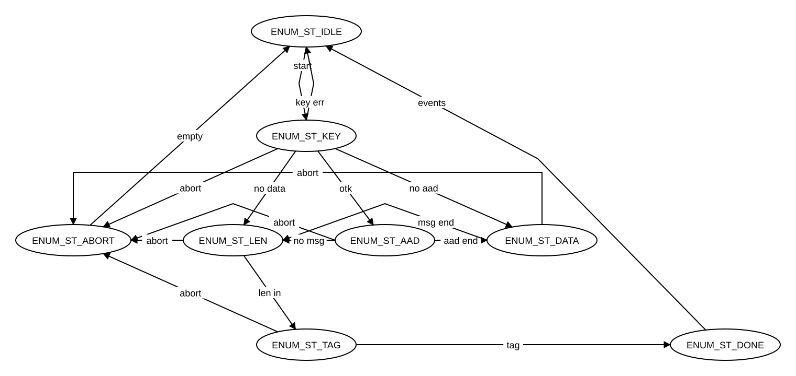

```json
{
  "page_name": "FSM_MSG",
  "out_name": "chacha_fsm_msg.drawio",
  "function": "msg",
  "initial": "ENUM_ST_IDLE",
  "state_pattern": "^ENUM_ST_[A-Z0-9_]+$",
  "states": [
    {
      "name": "ENUM_ST_IDLE"
    },
    {
      "name": "ENUM_ST_KEY"
    },
    {
      "name": "ENUM_ST_AAD"
    },
    {
      "name": "ENUM_ST_DATA"
    },
    {
      "name": "ENUM_ST_LEN"
    },
    {
      "name": "ENUM_ST_TAG"
    },
    {
      "name": "ENUM_ST_DONE"
    },
    {
      "name": "ENUM_ST_ABORT"
    }
  ],
  "transitions": [
    {
      "src": "ENUM_ST_IDLE",
      "dst": "ENUM_ST_KEY",
      "label": "start"
    },
    {
      "src": "ENUM_ST_KEY",
      "dst": "ENUM_ST_AAD",
      "label": "otk"
    },
    {
      "src": "ENUM_ST_AAD",
      "dst": "ENUM_ST_DATA",
      "label": "aad end"
    },
    {
      "src": "ENUM_ST_KEY",
      "dst": "ENUM_ST_DATA",
      "label": "no aad"
    },
    {
      "src": "ENUM_ST_KEY",
      "dst": "ENUM_ST_LEN",
      "label": "no data"
    },
    {
      "src": "ENUM_ST_DATA",
      "dst": "ENUM_ST_LEN",
      "label": "msg end"
    },
    {
      "src": "ENUM_ST_AAD",
      "dst": "ENUM_ST_LEN",
      "label": "no msg"
    },
    {
      "src": "ENUM_ST_LEN",
      "dst": "ENUM_ST_TAG",
      "label": "len in"
    },
    {
      "src": "ENUM_ST_TAG",
      "dst": "ENUM_ST_DONE",
      "label": "tag"
    },
    {
      "src": "ENUM_ST_DONE",
      "dst": "ENUM_ST_IDLE",
      "label": "events"
    },
    {
      "src": "ENUM_ST_KEY",
      "dst": "ENUM_ST_IDLE",
      "label": "key err"
    },
    {
      "src": "ENUM_ST_KEY",
      "dst": "ENUM_ST_ABORT",
      "label": "abort"
    },
    {
      "src": "ENUM_ST_AAD",
      "dst": "ENUM_ST_ABORT",
      "label": "abort"
    },
    {
      "src": "ENUM_ST_DATA",
      "dst": "ENUM_ST_ABORT",
      "label": "abort"
    },
    {
      "src": "ENUM_ST_LEN",
      "dst": "ENUM_ST_ABORT",
      "label": "abort"
    },
    {
      "src": "ENUM_ST_TAG",
      "dst": "ENUM_ST_ABORT",
      "label": "abort"
    },
    {
      "src": "ENUM_ST_ABORT",
      "dst": "ENUM_ST_IDLE",
      "label": "empty"
    }
  ],
  "layout": {
    "margin": 40
  }
}
```

*Figure 10-1. FSM state diagram of the message sequencer m_chacha_ctrl. Source: `figures/chacha_fsm_msg.drawio` (draw.io, VLSIT library, generated by `vlsit_fsm_diagram.py`).*
<!-- /FSM-DIAGRAM:msg -->


The IP has one finite state machine, the message sequencer of `m_chacha_ctrl` (FSM function name `msg`, state names `ENUM_ST_` followed by the state name). Its diagram is Figure 10-1 above. The sequencer starts at `ENUM_ST_IDLE` after reset. A zero length skips a state (DEC-037, ASM-017): the sequencer goes from `ENUM_ST_KEY` to `ENUM_ST_AAD`, `ENUM_ST_DATA` or `ENUM_ST_LEN`, whichever is the first that has data, and from `ENUM_ST_AAD` to `ENUM_ST_LEN` when the message length is zero, so a message with both lengths zero still passes the key, length and tag steps. A start that cannot be accepted (engine disabled, length or watermark above its limit, hardware nonce counter not loaded, or a repeated software nonce) leaves the sequencer in `ENUM_ST_IDLE`, clears the start bit and raises the matching error event (`len_err` or `ctr_err`). A key that the key store refuses is found later, in `ENUM_ST_KEY`: the sequencer returns to `ENUM_ST_IDLE` and raises `key_err` (DEC-020, REQ-ERR-003).

The table below has one row per state; the transitions are the labelled arrows of Figure 10-1, and the encoding-recovery statement follows the table.
| Mode/state | Entry condition | Behavior | Exit condition | Outputs / side effects |
|---|---|---|---|---|
| ENUM_ST_IDLE | Reset, end of `ENUM_ST_DONE`, end of `ENUM_ST_ABORT`, key error in `ENUM_ST_KEY` | Waits for a start request. Accepts it only when the engine is enabled, the lengths and watermarks are within their limits, for a hardware-nonce encryption the counter has been loaded, and for a software-nonce encryption with `PARA_NONCE_CHK` = 1 the nonce differs from the previous one of the key slot | Start request accepted | Busy is 0; start is cleared on acceptance or rejection; `len_err` or `ctr_err` is raised on rejection |
| ENUM_ST_KEY | Start accepted | Latches the nonce (or salt and counter), the lengths and the key slot; raises `o_key_req` with `o_key_slot` and waits for the key store (KEY-T1 to KEY-T5); with `i_key_vld` copies the key, lowers the request and generates keystream block 0, keeping its first 256 bits as the one-time Poly1305 key (RFC 8439 section 2.6); with `i_key_err` lowers the request, empties both window buffers and clears busy | One-time key ready (to `ENUM_ST_AAD`, or to `ENUM_ST_DATA` when the associated data length is 0, or to `ENUM_ST_LEN` when both lengths are 0), or key error to `ENUM_ST_IDLE` | Busy is 1; the core clock gate is enabled; `o_key_req` high while waiting; `key_err` on a key error, with no `done` or `tag_err` |
| ENUM_ST_AAD | One-time key ready and the associated data length not 0 | Takes `cha_len.aad_len` bytes from the input buffer and feeds them to Poly1305, then pads with zero bytes to a multiple of 16; not entered when the length is 0 | All associated data consumed and padded (to `ENUM_ST_DATA`, or to `ENUM_ST_LEN` when the message length is 0) | Reads of the input buffer |
| ENUM_ST_DATA | Associated data consumed, or one-time key ready with no associated data, and the message length not 0 | For `cha_len.msg_len` bytes, generates keystream blocks from counter 1, XORs them with the message data, writes the result to the output buffer (or holds it, `PARA_HOLD_EN`) and feeds the ciphertext to Poly1305, padded to a multiple of 16; not entered when the length is 0 | All message bytes processed | Reads of the input buffer, writes of the output buffer; stalls on an empty input buffer or a full output buffer |
| ENUM_ST_LEN | Message data processed, or no message data | Absorbs the associated data length and the message data length, each as a 64-bit little-endian integer in octets, into Poly1305 (RFC 8439 section 2.8) | Both lengths absorbed | None |
| ENUM_ST_TAG | Lengths absorbed | Finalizes the 16-byte tag. Encryption: writes the tag to the output buffer. Decryption: takes the next 16 bytes of the input buffer as the received tag and compares all 16 bytes without early exit | Tag written, or tag compared | Reads or writes of the buffers |
| ENUM_ST_DONE | Tag step finished | Raises `done` (encryption, or decryption with a matching tag) or `tag_err` (decryption with a mismatch); in hold mode releases or discards the held plaintext; clears the key register; increments the hardware nonce counter after an encryption; clears busy | Events raised | Events to the register block; busy cleared |
| ENUM_ST_ABORT | Abort request while busy, or the AXI-domain reset indication (CDC-009) | Stops the message, lowers `o_key_req`, empties both window buffers, clears the key register and the Poly1305 and ChaCha20 state, clears busy | Both buffers empty | Abort bit cleared; no `done` or `tag_err` event; `axi_err` after an AXI-domain reset |

Encoding recovery: the state signal is a 3-bit binary encoding in which all eight codes are defined, so there is no undefined code to recover from. A single-event upset that moves the sequencer to another defined state is not detected in this release; this specification makes no functional-safety claim (TBD-005, section 18). Transitions from any busy state to `ENUM_ST_ABORT` are taken only on the abort request or on the AXI-domain reset indication, and the only other exit from a busy state is the key error from `ENUM_ST_KEY` to `ENUM_ST_IDLE`.

### 10.2 Operations

Cycle counts below are architectural estimates of the ChaCha20 path (section 8 table, $C$ cycles per 64-byte block for one core); the Poly1305 path and the interface widths can lower the rate, section 13.2 gives the formula that includes them, and nothing here is measured.

| Operation ID | Inputs / preconditions | Processing semantics | Result / completion | Latency / ordering |
|---|---|---|---|---|
| OP-001 Encrypt a message | Engine enabled and idle; `cha_ctrl.dir` = 0x0; lengths and nonce (or counter) programmed; key slot programmed; associated data then message data written to the data window | Sequencer visits `ENUM_ST_KEY` to `ENUM_ST_DONE`; the ciphertext and the 16-byte tag are produced in this order | Ciphertext of `cha_len.msg_len` bytes followed by the tag in the output window; `done` event | One-time key block, then $\lceil \text{msg\_len} / 64 \rceil$ data blocks, about $(1 + \lceil \text{msg\_len} / 64 \rceil) \cdot C / N$ cycles for the ChaCha20 part with $N$ cores, plus Poly1305 and set-up (section 13.2); output in input order |
| OP-002 Decrypt a message | As OP-001 with `cha_ctrl.dir` = 0x1; the input stream is associated data, ciphertext, 16-byte tag; the nonce is the one received | Same sequence; Poly1305 runs over the ciphertext; the received tag is compared with the computed tag | Plaintext in the output window; `done` on a match, `tag_err` on a mismatch; no plaintext readable before the match when `PARA_HOLD_EN` = 1 | As OP-001; in hold mode the output becomes readable after `ENUM_ST_TAG` |
| OP-003 Abort a message | Busy; software writes `cha_ctrl.abort` = 0x1 | Sequencer moves to `ENUM_ST_ABORT`, empties both buffers and clears state | Engine idle; abort bit 0; no `done` or `tag_err` | A few cycles plus the time to empty the buffers; no data of the aborted message is read afterwards |
| OP-004 Window write burst | AXI4 write address with INCR burst of at most $\min(256, 4096/(D/8))$ transfers inside one 4 KB region; room in the input buffer | Each accepted beat goes to the input buffer; the beats are counted against the programmed lengths | One `BRESP` per burst: OKAY, or SLVERR for overrun, over-length, an unsupported burst, wrong strobes or a non-secure access (REQ-IF-011, REQ-SEC-005); `axi_err` on SLVERR | One beat per cycle when the buffer has room; backpressure through `WREADY` when it is full |
| OP-005 Window read burst | AXI4 read address with INCR burst as above | Each beat comes from the output buffer; a beat that cannot be served returns zero data and SLVERR | Requested number of transfers with a correct `RLAST`; `axi_err` if any transfer was SLVERR | One beat per cycle when data is available |
| OP-006 DMA request cycle | `PARA_DMA_EN` = 1 and `cha_ctrl.dma_en` = 1; watermarks programmed | Four-phase handshake per burst (section 6.3); the request covers $\min(W, B_r)$ beats in tail mode 0 and single beats for the tail in mode 1 | One burst moved per handshake | Request raised only when the buffer has room (write) or data (read); the next request waits for the acknowledge release |
| OP-007 Register access | APB4 access with full-word strobes | Read or write of a workbook register (section 11.4) | `PREADY`, with `PSLVERR` for the error cases of section 11.4 | One wait state with a common clock; the number depends on the clock ratio otherwise |
| OP-008 Interrupt service | An event bit set in `cha_irq_raw` and enabled in `cha_irq_en` | `cha_irq_sts` and `o_int_cha` follow the raw bit through the enable mask | Software reads `cha_irq_sts`, writes one to the raw bit to clear it | Synchronization delay of CDC-007; a new event in the cycle of a clear is kept |

### 10.3 Cycle-level behavior

**Waveform plan (rule R-024).** List the waveforms agreed with the user: every operation of 10.2, the success and error case of every interface, and the special cases. Draw each one and link its image; the source file stays beside it.

| Waveform ID | Function / operation | Scenario (success / error / corner) | Signals shown | Figure | Confirmed by user |
|---|---|---|---|---|---|
| WF-001 | OP-001 encrypt a message | success | start, state, busy, window write and read, done | `figures/wf_001_encrypt.svg` | 2026-11-24 |
| WF-002 | OP-002 decrypt a message | success | start, direction, state, window write and read, done | `figures/wf_002_decrypt.svg` | 2026-11-24 |
| WF-003 | OP-002 decrypt, wrong tag, release and hold mode | error | state, output ready, held plaintext, tag_err, done | `figures/wf_003_badtag.svg` | 2026-11-24 |
| WF-004 | OP-003 abort in the data state | corner | abort, state, busy, FIFO levels, events | `figures/wf_004_abort.svg` | 2026-11-24 |
| WF-005 | OP-004 window write burst | success and error (overrun) | AW, W, B channels, FIFO level, axi_err | `figures/wf_005_axiwrite.svg` | 2026-11-24 |
| WF-006 | OP-005 window read burst | success and error (empty output) | AR, R channels, FIFO level, axi_err | `figures/wf_006_axiread.svg` | 2026-11-24 |
| WF-007 | OP-006 DMA write channel, tail mode 0 | success with short last burst | req, ack, requested beats, remaining beats, W channel | `figures/wf_007_dmawr_tail0.svg` | 2026-11-24 |
| WF-008 | OP-006 DMA write channel, tail mode 1 | corner (single-beat tail) | req, ack, requested beats, remaining beats, W channel | `figures/wf_008_dmawr_tail1.svg` | 2026-11-24 |
| WF-009 | OP-006 DMA read channel | success | FIFO level, req, ack, R channel | `figures/wf_009_dmard.svg` | 2026-11-24 |
| WF-010 | OP-007 APB access, asynchronous clocks | corner (clock crossing) | APB4 signals, request and acknowledge toggles | `figures/wf_010_apb_async.svg` | 2026-11-24 |
| WF-011 | OP-008 interrupt event and clear | success | raw, enable, status, interrupt output, software clear | `figures/wf_011_interrupt.svg` | 2026-11-24 |
| WF-012 | Reset release in the core domain | corner (reset) | reset, synchronized reset, state, outputs | `figures/wf_012_reset.svg` | 2026-11-24 |
| WF-013 | OP-001 encrypt, the key store refuses the key | error | start, state, busy, o_key_req, o_key_slot, i_key_err, key_err event | `figures/wf_013_keyerr.svg` | 2026-11-24 (added for DEC-020, confirmed by the user) |
| WF-014 | Poly1305 architecture 1: two consecutive blocks | success | start, accept ready, state, partial products, accumulator | `figures/wf_014_poly_kar.svg` | 2026-11-24 (added for DEC-025, designer decision) |
| WF-015 | FIFO flush on abort (DEC-027) | corner | abort, state, flush request, `i_rst_n_sw`, `o_sw_rst_busy`, done | `figures/wf_015_flush.svg` | 2026-11-24 (added for DEC-027, designer decision) |
| WF-016 | Flush of the input buffer across the clock domains (DEC-033) | corner | request level, synchronized levels, start, `i_rst_n_sw`, busy, done level | `figures/wf_016_flush_hs.svg` | 2026-11-24 (added for DEC-033) |
| WF-017 | Message parameter capture in CLK-AXI (DEC-032) | success | message-active level, synchronized level, copy, start pulse | `figures/wf_017_msg_cap.svg` | 2026-11-24 (added for DEC-032) |
| WF-018 | Block pairs of `PARA_PIPE_CHACHA` = 1: a pair and a block without a partner (DEC-036) | success | load, state, phase, iterations left, delivery, queue, take | `figures/wf_018_block_pair.svg` | 2026-11-25 (added for DEC-036 and TBD-028, drawn from a simulation trace) |
| WF-019 | Ring frozen while the queue cannot take a pair (DEC-036) | corner | stall, delivery, queue, take | `figures/wf_019_pair_freeze.svg` | 2026-11-25 (added for DEC-036 and TBD-028, drawn from a simulation trace) |
| WF-020 | Block pair of `PARA_PIPE_CHACHA` = 1 on the CFG-BASE core: the key block and the first data block (DEC-036) | success | load, state, phase, iterations left, delivery, queue, take | `figures/wf_020_block_pair_base.svg` | 2026-11-25 (added for DEC-036 and TBD-028, drawn from a simulation trace) |

The waveforms above are specification sketches of the intended behavior. The cycle table below gives the event order of WF-001; the active edge is the rising edge of the clock shown and every value is sampled at that edge.

| Cycle / event | Input condition | State/action | Output condition |
|---|---|---|---|
| c1 | Software writes `cha_ctrl.start` = 1 (WF-001) | State is `ENUM_ST_IDLE`; start request seen | `o_cha_ctrl_start` high |
| c2 | Start accepted | State becomes `ENUM_ST_KEY`; busy set; hardware load of start; `o_key_req` raised with the slot | `i_hw_we_cha_ctrl_start` pulse, `i_cha_sts_busy` high, `o_key_req` high |
| c3 | First window beat on the interface; the key store answers with `i_key_vld` | Associated data beat enters the input buffer; start cleared; the key is copied at the end of the cycle (KEY-T3) | `o_cha_ctrl_start` low, `o_axi_wready` high, `i_key_vld` high |
| c4 to c5 | Message beats M0 and M1 | `o_key_req` is low from c4; input buffer fills while the one-time key block runs and is ready at the end of c4 | State becomes `ENUM_ST_AAD` at c5 |
| c6 to c8 | Message data in the buffer | `ENUM_ST_DATA`: keystream XOR, ciphertext to the output buffer and to Poly1305 | First ciphertext beat `C0` visible at c8 |
| c9 | All message bytes processed | `ENUM_ST_LEN`: the two lengths enter Poly1305 | Second ciphertext beat `C1` |
| c10 | Lengths absorbed | `ENUM_ST_TAG`: tag finalized | None |
| c11 | Tag ready | `ENUM_ST_DONE`: tag appended to the output, done event loaded | Tag beat on the read channel, `i_hw_we_cha_irq_raw_done` pulse |
| c12 | Events raised | State returns to `ENUM_ST_IDLE`; busy cleared | `o_cha_irq_raw_done` high, `i_cha_sts_busy` low |


**Waveforms.** Each figure is followed by the WaveJSON that describes its signals and edges (rules R-017 and R-073). The waveforms are specification sketches of the intended behavior; no RTL or simulation produced them, and their cycle counts are illustrative.

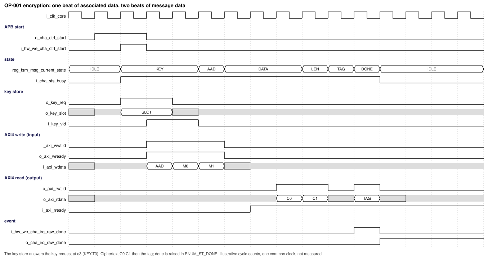

```wavedrom
{
 "signal": [
  {
   "name": "i_clk_core",
   "wave": "p..............."
  },
  [
   "APB start",
   {
    "name": "o_cha_ctrl_start",
    "wave": "01.0............"
   },
   {
    "name": "i_hw_we_cha_ctrl_start",
    "wave": "0.10............"
   }
  ],
  [
   "state",
   {
    "name": "reg_fsm_msg_current_state",
    "wave": "=.=..==..====...",
    "data": [
     "IDLE",
     "KEY",
     "AAD",
     "DATA",
     "LEN",
     "TAG",
     "DONE",
     "IDLE"
    ]
   },
   {
    "name": "i_cha_sts_busy",
    "wave": "0.1.........0..."
   }
  ],
  [
   "key store",
   {
    "name": "o_key_req",
    "wave": "0.1.0..........."
   },
   {
    "name": "o_key_slot",
    "wave": "x.=.x...........",
    "data": [
     "SLOT"
    ]
   },
   {
    "name": "i_key_vld",
    "wave": "0..1.0.........."
   }
  ],
  [
   "AXI4 write (input)",
   {
    "name": "i_axi_wvalid",
    "wave": "0..1..0........."
   },
   {
    "name": "o_axi_wready",
    "wave": "0..1..0........."
   },
   {
    "name": "i_axi_wdata",
    "wave": "x..===x.........",
    "data": [
     "AAD",
     "M0",
     "M1"
    ]
   }
  ],
  [
   "AXI4 read (output)",
   {
    "name": "o_axi_rvalid",
    "wave": "0.......1.010..."
   },
   {
    "name": "o_axi_rdata",
    "wave": "x.......==x=x...",
    "data": [
     "C0",
     "C1",
     "TAG"
    ]
   },
   {
    "name": "i_axi_rready",
    "wave": "0......1........"
   }
  ],
  [
   "event",
   {
    "name": "i_hw_we_cha_irq_raw_done",
    "wave": "0..........10..."
   },
   {
    "name": "o_cha_irq_raw_done",
    "wave": "0...........1..."
   }
  ]
 ],
 "head": {
  "text": "OP-001 encryption: one beat of associated data, two beats of message data"
 },
 "foot": {
  "text": "The key store answers the key request at c3 (KEY-T3). Ciphertext C0 C1 then the tag; done is raised in ENUM_ST_DONE. Illustrative cycle counts, one common clock, not measured"
 },
 "config": {
  "hscale": 2
 }
}
```

*Figure 10-2. WF-001: OP-001 encrypt a message (success). Source: `figures/wf_001_encrypt.json` (WaveJSON).*

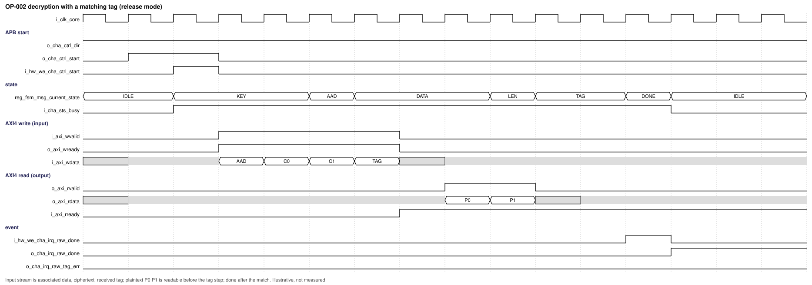

```wavedrom
{
 "signal": [
  {
   "name": "i_clk_core",
   "wave": "p..............."
  },
  [
   "APB start",
   {
    "name": "o_cha_ctrl_dir",
    "wave": "1..............."
   },
   {
    "name": "o_cha_ctrl_start",
    "wave": "01.0............"
   },
   {
    "name": "i_hw_we_cha_ctrl_start",
    "wave": "0.10............"
   }
  ],
  [
   "state",
   {
    "name": "reg_fsm_msg_current_state",
    "wave": "=.=..==..==.==..",
    "data": [
     "IDLE",
     "KEY",
     "AAD",
     "DATA",
     "LEN",
     "TAG",
     "DONE",
     "IDLE"
    ]
   },
   {
    "name": "i_cha_sts_busy",
    "wave": "0.1..........0.."
   }
  ],
  [
   "AXI4 write (input)",
   {
    "name": "i_axi_wvalid",
    "wave": "0..1...0........"
   },
   {
    "name": "o_axi_wready",
    "wave": "0..1...0........"
   },
   {
    "name": "i_axi_wdata",
    "wave": "x..====x........",
    "data": [
     "AAD",
     "C0",
     "C1",
     "TAG"
    ]
   }
  ],
  [
   "AXI4 read (output)",
   {
    "name": "o_axi_rvalid",
    "wave": "0.......1.0....."
   },
   {
    "name": "o_axi_rdata",
    "wave": "x.......==x.....",
    "data": [
     "P0",
     "P1"
    ]
   },
   {
    "name": "i_axi_rready",
    "wave": "0......1........"
   }
  ],
  [
   "event",
   {
    "name": "i_hw_we_cha_irq_raw_done",
    "wave": "0...........10.."
   },
   {
    "name": "o_cha_irq_raw_done",
    "wave": "0............1.."
   },
   {
    "name": "o_cha_irq_raw_tag_err",
    "wave": "0..............."
   }
  ]
 ],
 "head": {
  "text": "OP-002 decryption with a matching tag (release mode)"
 },
 "foot": {
  "text": "Input stream is associated data, ciphertext, received tag; plaintext P0 P1 is readable before the tag step; done after the match. Illustrative, not measured"
 },
 "config": {
  "hscale": 2
 }
}
```

*Figure 10-3. WF-002: OP-002 decrypt a message (success). Source: `figures/wf_002_decrypt.json` (WaveJSON).*

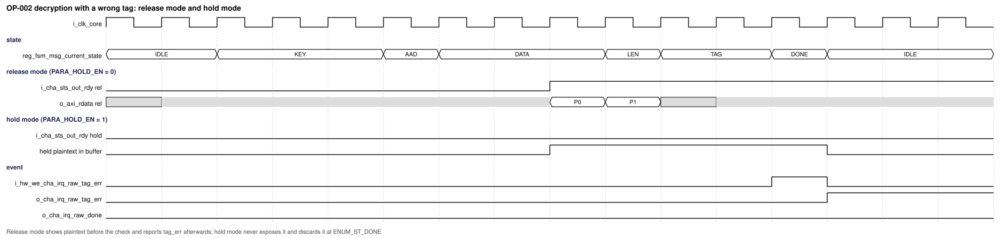

```wavedrom
{
 "signal": [
  {
   "name": "i_clk_core",
   "wave": "p..............."
  },
  [
   "state",
   {
    "name": "reg_fsm_msg_current_state",
    "wave": "=.=..==..==.==..",
    "data": [
     "IDLE",
     "KEY",
     "AAD",
     "DATA",
     "LEN",
     "TAG",
     "DONE",
     "IDLE"
    ]
   }
  ],
  [
   "release mode (PARA_HOLD_EN = 0)",
   {
    "name": "i_cha_sts_out_rdy rel",
    "wave": "0.......1......."
   },
   {
    "name": "o_axi_rdata rel",
    "wave": "x.......==x.....",
    "data": [
     "P0",
     "P1"
    ]
   }
  ],
  [
   "hold mode (PARA_HOLD_EN = 1)",
   {
    "name": "i_cha_sts_out_rdy hold",
    "wave": "0..............."
   },
   {
    "name": "held plaintext in buffer",
    "wave": "0.......1....0.."
   }
  ],
  [
   "event",
   {
    "name": "i_hw_we_cha_irq_raw_tag_err",
    "wave": "0...........10.."
   },
   {
    "name": "o_cha_irq_raw_tag_err",
    "wave": "0............1.."
   },
   {
    "name": "o_cha_irq_raw_done",
    "wave": "0..............."
   }
  ]
 ],
 "head": {
  "text": "OP-002 decryption with a wrong tag: release mode and hold mode"
 },
 "foot": {
  "text": "Release mode shows plaintext before the check and reports tag_err afterwards; hold mode never exposes it and discards it at ENUM_ST_DONE"
 },
 "config": {
  "hscale": 2
 }
}
```

*Figure 10-4. WF-003: OP-002 decrypt, wrong tag, release and hold mode (error). Source: `figures/wf_003_badtag.json` (WaveJSON).*

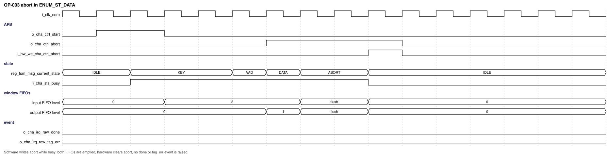

```wavedrom
{
 "signal": [
  {
   "name": "i_clk_core",
   "wave": "p..............."
  },
  [
   "APB",
   {
    "name": "o_cha_ctrl_start",
    "wave": "01.0............"
   },
   {
    "name": "o_cha_ctrl_abort",
    "wave": "0.....1...0....."
   },
   {
    "name": "i_hw_we_cha_ctrl_abort",
    "wave": "0........10....."
   }
  ],
  [
   "state",
   {
    "name": "reg_fsm_msg_current_state",
    "wave": "=.=..===.=......",
    "data": [
     "IDLE",
     "KEY",
     "AAD",
     "DATA",
     "ABORT",
     "IDLE"
    ]
   },
   {
    "name": "i_cha_sts_busy",
    "wave": "0.1......0......"
   }
  ],
  [
   "window FIFOs",
   {
    "name": "input FIFO level",
    "wave": "=..=...=.=......",
    "data": [
     "0",
     "3",
     "flush",
     "0"
    ]
   },
   {
    "name": "output FIFO level",
    "wave": "=.....==.=......",
    "data": [
     "0",
     "1",
     "flush",
     "0"
    ]
   }
  ],
  [
   "event",
   {
    "name": "o_cha_irq_raw_done",
    "wave": "0..............."
   },
   {
    "name": "o_cha_irq_raw_tag_err",
    "wave": "0..............."
   }
  ]
 ],
 "head": {
  "text": "OP-003 abort in ENUM_ST_DATA"
 },
 "foot": {
  "text": "Software writes abort while busy; both FIFOs are emptied, hardware clears abort, no done or tag_err event is raised"
 },
 "config": {
  "hscale": 2
 }
}
```

*Figure 10-5. WF-004: OP-003 abort in the data state (corner). Source: `figures/wf_004_abort.json` (WaveJSON).*

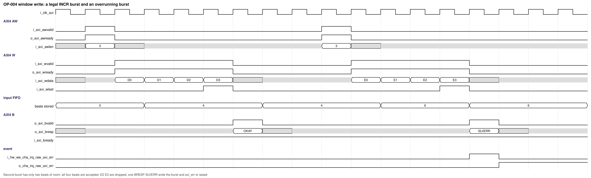

```wavedrom
{
 "signal": [
  {
   "name": "i_clk_axi",
   "wave": "p................."
  },
  [
   "AXI4 AW",
   {
    "name": "i_axi_awvalid",
    "wave": "010......10......."
   },
   {
    "name": "o_axi_awready",
    "wave": "010......10......."
   },
   {
    "name": "i_axi_awlen",
    "wave": "x=x......=x.......",
    "data": [
     "3",
     "3"
    ]
   }
  ],
  [
   "AXI4 W",
   {
    "name": "i_axi_wvalid",
    "wave": "0.1...0...1...0..."
   },
   {
    "name": "o_axi_wready",
    "wave": "0.1...0...1...0..."
   },
   {
    "name": "i_axi_wdata",
    "wave": "x.====x...====x...",
    "data": [
     "D0",
     "D1",
     "D2",
     "D3",
     "E0",
     "E1",
     "E2",
     "E3"
    ]
   },
   {
    "name": "i_axi_wlast",
    "wave": "0....10......10..."
   }
  ],
  [
   "input FIFO",
   {
    "name": "beats stored",
    "wave": "=..=...=...=..=...",
    "data": [
     "0",
     "4",
     "4",
     "6",
     "6"
    ]
   }
  ],
  [
   "AXI4 B",
   {
    "name": "o_axi_bvalid",
    "wave": "0.....10......10.."
   },
   {
    "name": "o_axi_bresp",
    "wave": "x.....=x......=x..",
    "data": [
     "OKAY",
     "SLVERR"
    ]
   },
   {
    "name": "i_axi_bready",
    "wave": "1................."
   }
  ],
  [
   "event",
   {
    "name": "i_hw_we_cha_irq_raw_axi_err",
    "wave": "0.............10.."
   },
   {
    "name": "o_cha_irq_raw_axi_err",
    "wave": "0..............1.."
   }
  ]
 ],
 "head": {
  "text": "OP-004 window write: a legal INCR burst and an overrunning burst"
 },
 "foot": {
  "text": "Second burst has only two beats of room: all four beats are accepted, E2 E3 are dropped, one BRESP SLVERR ends the burst and axi_err is raised"
 },
 "config": {
  "hscale": 2
 }
}
```

*Figure 10-6. WF-005: OP-004 window write burst (success and error (overrun)). Source: `figures/wf_005_axiwrite.json` (WaveJSON).*

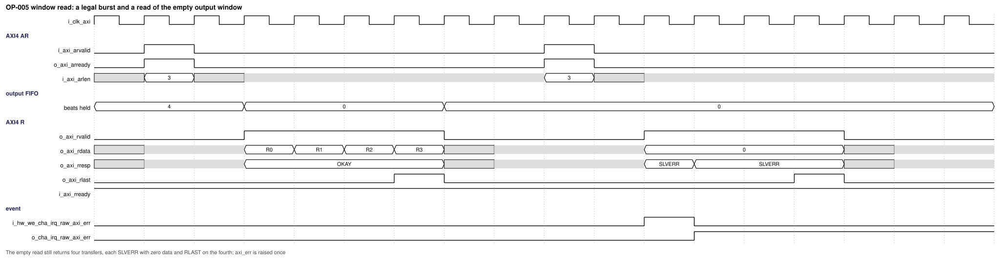

```wavedrom
{
 "signal": [
  {
   "name": "i_clk_axi",
   "wave": "p................."
  },
  [
   "AXI4 AR",
   {
    "name": "i_axi_arvalid",
    "wave": "010......10......."
   },
   {
    "name": "o_axi_arready",
    "wave": "010......10......."
   },
   {
    "name": "i_axi_arlen",
    "wave": "x=x......=x.......",
    "data": [
     "3",
     "3"
    ]
   }
  ],
  [
   "output FIFO",
   {
    "name": "beats held",
    "wave": "=..=...=..........",
    "data": [
     "4",
     "0",
     "0"
    ]
   }
  ],
  [
   "AXI4 R",
   {
    "name": "o_axi_rvalid",
    "wave": "0..1...0...1...0.."
   },
   {
    "name": "o_axi_rdata",
    "wave": "x..====x...=...x..",
    "data": [
     "R0",
     "R1",
     "R2",
     "R3",
     "0"
    ]
   },
   {
    "name": "o_axi_rresp",
    "wave": "x..=...x...==..x..",
    "data": [
     "OKAY",
     "SLVERR",
     "SLVERR"
    ]
   },
   {
    "name": "o_axi_rlast",
    "wave": "0.....10......10.."
   },
   {
    "name": "i_axi_rready",
    "wave": "1................."
   }
  ],
  [
   "event",
   {
    "name": "i_hw_we_cha_irq_raw_axi_err",
    "wave": "0..........10....."
   },
   {
    "name": "o_cha_irq_raw_axi_err",
    "wave": "0...........1....."
   }
  ]
 ],
 "head": {
  "text": "OP-005 window read: a legal burst and a read of the empty output window"
 },
 "foot": {
  "text": "The empty read still returns four transfers, each SLVERR with zero data and RLAST on the fourth; axi_err is raised once"
 },
 "config": {
  "hscale": 2
 }
}
```

*Figure 10-7. WF-006: OP-005 window read burst (success and error (empty output)). Source: `figures/wf_006_axiread.json` (WaveJSON).*

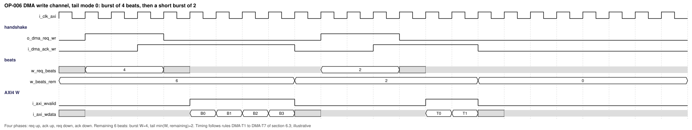

```wavedrom
{
 "signal": [
  {
   "name": "i_clk_axi",
   "wave": "p......................."
  },
  [
   "handshake",
   {
    "name": "o_dma_req_wr",
    "wave": "01..0.....1..0.........."
   },
   {
    "name": "i_dma_ack_wr",
    "wave": "0..1.....0..1...0......."
   }
  ],
  [
   "beats",
   {
    "name": "w_req_beats",
    "wave": "x=..x.....=..x..........",
    "data": [
     "4",
     "2"
    ]
   },
   {
    "name": "w_beats_rem",
    "wave": "=........=......=.......",
    "data": [
     "6",
     "2",
     "0"
    ]
   }
  ],
  [
   "AXI4 W",
   {
    "name": "i_axi_wvalid",
    "wave": "0....1...0....1.0......."
   },
   {
    "name": "i_axi_wdata",
    "wave": "x....====x....==x.......",
    "data": [
     "B0",
     "B1",
     "B2",
     "B3",
     "T0",
     "T1"
    ]
   }
  ]
 ],
 "head": {
  "text": "OP-006 DMA write channel, tail mode 0: burst of 4 beats, then a short burst of 2"
 },
 "foot": {
  "text": "Four phases: req up, ack up, req down, ack down. Remaining 6 beats: burst W=4, tail min(W, remaining)=2. Timing follows rules DMA-T1 to DMA-T7 of section 6.3; illustrative"
 },
 "config": {
  "hscale": 2
 }
}
```

*Figure 10-8. WF-007: OP-006 DMA write channel, tail mode 0 (success with short last burst). Source: `figures/wf_007_dmawr_tail0.json` (WaveJSON).*

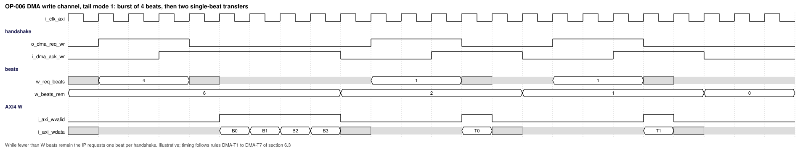

```wavedrom
{
 "signal": [
  {
   "name": "i_clk_axi",
   "wave": "p......................."
  },
  [
   "handshake",
   {
    "name": "o_dma_req_wr",
    "wave": "01..0.....1..0..1..0...."
   },
   {
    "name": "i_dma_ack_wr",
    "wave": "0..1.....0..1..0..1..0.."
   }
  ],
  [
   "beats",
   {
    "name": "w_req_beats",
    "wave": "x=..x.....=..x..=..x....",
    "data": [
     "4",
     "1",
     "1"
    ]
   },
   {
    "name": "w_beats_rem",
    "wave": "=........=.....=.....=..",
    "data": [
     "6",
     "2",
     "1",
     "0"
    ]
   }
  ],
  [
   "AXI4 W",
   {
    "name": "i_axi_wvalid",
    "wave": "0....1...0...10....10..."
   },
   {
    "name": "i_axi_wdata",
    "wave": "x....====x...=x....=x...",
    "data": [
     "B0",
     "B1",
     "B2",
     "B3",
     "T0",
     "T1"
    ]
   }
  ]
 ],
 "head": {
  "text": "OP-006 DMA write channel, tail mode 1: burst of 4 beats, then two single-beat transfers"
 },
 "foot": {
  "text": "While fewer than W beats remain the IP requests one beat per handshake. Illustrative; timing follows rules DMA-T1 to DMA-T7 of section 6.3"
 },
 "config": {
  "hscale": 2
 }
}
```

*Figure 10-9. WF-008: OP-006 DMA write channel, tail mode 1 (corner (single-beat tail)). Source: `figures/wf_008_dmawr_tail1.json` (WaveJSON).*

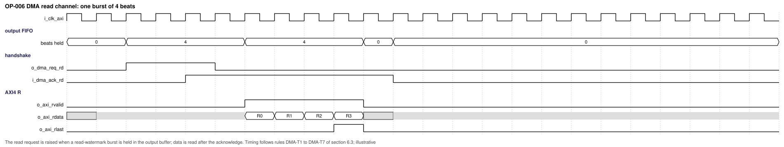

```wavedrom
{
 "signal": [
  {
   "name": "i_clk_axi",
   "wave": "p......................."
  },
  [
   "output FIFO",
   {
    "name": "beats held",
    "wave": "=.=...=...==............",
    "data": [
     "0",
     "4",
     "4",
     "0",
     "0"
    ]
   }
  ],
  [
   "handshake",
   {
    "name": "o_dma_req_rd",
    "wave": "0.1..0.................."
   },
   {
    "name": "i_dma_ack_rd",
    "wave": "0...1......0............"
   }
  ],
  [
   "AXI4 R",
   {
    "name": "o_axi_rvalid",
    "wave": "0.....1...0............."
   },
   {
    "name": "o_axi_rdata",
    "wave": "x.....====x.............",
    "data": [
     "R0",
     "R1",
     "R2",
     "R3"
    ]
   },
   {
    "name": "o_axi_rlast",
    "wave": "0........10............."
   }
  ]
 ],
 "head": {
  "text": "OP-006 DMA read channel: one burst of 4 beats"
 },
 "foot": {
  "text": "The read request is raised when a read-watermark burst is held in the output buffer; data is read after the acknowledge. Timing follows rules DMA-T1 to DMA-T7 of section 6.3; illustrative"
 },
 "config": {
  "hscale": 2
 }
}
```

*Figure 10-10. WF-009: OP-006 DMA read channel (success). Source: `figures/wf_009_dmard.json` (WaveJSON).*

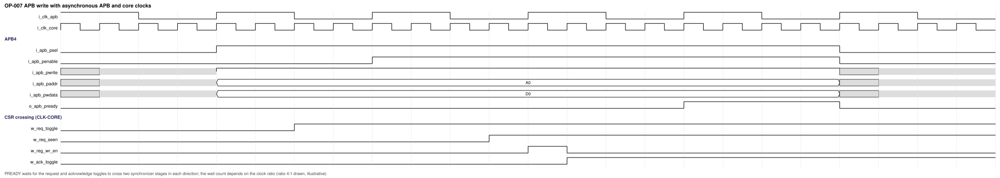

```wavedrom
{
 "signal": [
  {
   "name": "i_clk_apb",
   "wave": "1.0.1.0.1.0.1.0.1.0.1.0."
  },
  {
   "name": "i_clk_core",
   "wave": "p......................."
  },
  [
   "APB4",
   {
    "name": "i_apb_psel",
    "wave": "0...1...............0..."
   },
   {
    "name": "i_apb_penable",
    "wave": "0.......1...........0..."
   },
   {
    "name": "i_apb_pwrite",
    "wave": "x...1...............x..."
   },
   {
    "name": "i_apb_paddr",
    "wave": "x...=...............x...",
    "data": [
     "A0"
    ]
   },
   {
    "name": "i_apb_pwdata",
    "wave": "x...=...............x...",
    "data": [
     "D0"
    ]
   },
   {
    "name": "o_apb_pready",
    "wave": "0...............1...0..."
   }
  ],
  [
   "CSR crossing (CLK-CORE)",
   {
    "name": "w_req_toggle",
    "wave": "0.....1................."
   },
   {
    "name": "w_req_seen",
    "wave": "0..........1............"
   },
   {
    "name": "w_reg_wr_en",
    "wave": "0...........10.........."
   },
   {
    "name": "w_ack_toggle",
    "wave": "0............1.........."
   }
  ]
 ],
 "head": {
  "text": "OP-007 APB write with asynchronous APB and core clocks"
 },
 "foot": {
  "text": "PREADY waits for the request and acknowledge toggles to cross two synchronizer stages in each direction; the wait count depends on the clock ratio (ratio 4:1 drawn, illustrative)"
 },
 "config": {
  "hscale": 2
 }
}
```

*Figure 10-11. WF-010: OP-007 APB access, asynchronous clocks (corner (clock crossing)). Source: `figures/wf_010_apb_async.json` (WaveJSON).*

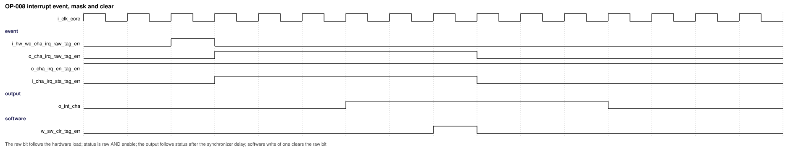

```wavedrom
{
 "signal": [
  {
   "name": "i_clk_core",
   "wave": "p..............."
  },
  [
   "event",
   {
    "name": "i_hw_we_cha_irq_raw_tag_err",
    "wave": "0.10............"
   },
   {
    "name": "o_cha_irq_raw_tag_err",
    "wave": "0..1.....0......"
   },
   {
    "name": "o_cha_irq_en_tag_err",
    "wave": "1..............."
   },
   {
    "name": "i_cha_irq_sts_tag_err",
    "wave": "0..1.....0......"
   }
  ],
  [
   "output",
   {
    "name": "o_int_cha",
    "wave": "0.....1.....0..."
   }
  ],
  [
   "software",
   {
    "name": "w_sw_clr_tag_err",
    "wave": "0.......10......"
   }
  ]
 ],
 "head": {
  "text": "OP-008 interrupt event, mask and clear"
 },
 "foot": {
  "text": "The raw bit follows the hardware load; status is raw AND enable; the output follows status after the synchronizer delay; software write of one clears the raw bit"
 },
 "config": {
  "hscale": 2
 }
}
```

*Figure 10-12. WF-011: OP-008 interrupt event and clear (success). Source: `figures/wf_011_interrupt.json` (WaveJSON).*

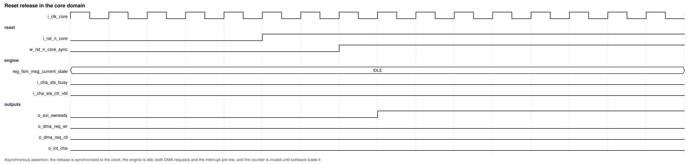

```wavedrom
{
 "signal": [
  {
   "name": "i_clk_core",
   "wave": "p..............."
  },
  [
   "reset",
   {
    "name": "i_rst_n_core",
    "wave": "0....1.........."
   },
   {
    "name": "w_rst_n_core_sync",
    "wave": "0......1........"
   }
  ],
  [
   "engine",
   {
    "name": "reg_fsm_msg_current_state",
    "wave": "=...............",
    "data": [
     "IDLE"
    ]
   },
   {
    "name": "i_cha_sts_busy",
    "wave": "0..............."
   },
   {
    "name": "i_cha_sts_ctr_vld",
    "wave": "0..............."
   }
  ],
  [
   "outputs",
   {
    "name": "o_axi_awready",
    "wave": "0.......1......."
   },
   {
    "name": "o_dma_req_wr",
    "wave": "0..............."
   },
   {
    "name": "o_dma_req_rd",
    "wave": "0..............."
   },
   {
    "name": "o_int_cha",
    "wave": "0..............."
   }
  ]
 ],
 "head": {
  "text": "Reset release in the core domain"
 },
 "foot": {
  "text": "Asynchronous assertion; the release is synchronized to the clock; the engine is idle, both DMA requests and the interrupt are low, and the counter is invalid until software loads it"
 },
 "config": {
  "hscale": 2
 }
}
```

*Figure 10-13. WF-012: Reset release in the core domain (corner (reset)). Source: `figures/wf_012_reset.json` (WaveJSON).*

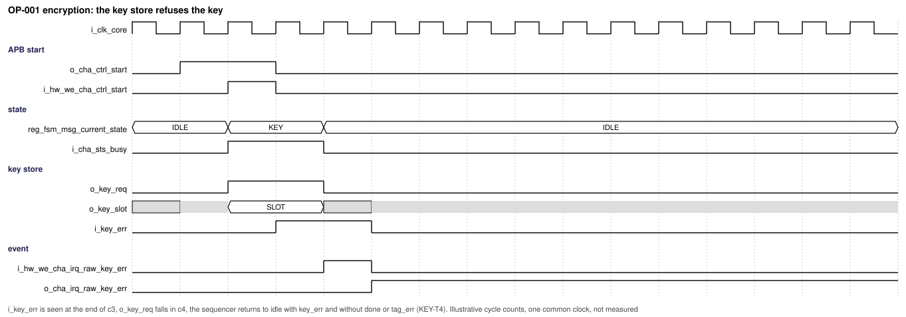

```wavedrom
{
 "signal": [
  {
   "name": "i_clk_core",
   "wave": "p..............."
  },
  [
   "APB start",
   {
    "name": "o_cha_ctrl_start",
    "wave": "01.0............"
   },
   {
    "name": "i_hw_we_cha_ctrl_start",
    "wave": "0.10............"
   }
  ],
  [
   "state",
   {
    "name": "reg_fsm_msg_current_state",
    "wave": "=.=.=...........",
    "data": [
     "IDLE",
     "KEY",
     "IDLE"
    ]
   },
   {
    "name": "i_cha_sts_busy",
    "wave": "0.1.0..........."
   }
  ],
  [
   "key store",
   {
    "name": "o_key_req",
    "wave": "0.1.0..........."
   },
   {
    "name": "o_key_slot",
    "wave": "x.=.x...........",
    "data": [
     "SLOT"
    ]
   },
   {
    "name": "i_key_err",
    "wave": "0..1.0.........."
   }
  ],
  [
   "event",
   {
    "name": "i_hw_we_cha_irq_raw_key_err",
    "wave": "0...10.........."
   },
   {
    "name": "o_cha_irq_raw_key_err",
    "wave": "0....1.........."
   }
  ]
 ],
 "head": {
  "text": "OP-001 encryption: the key store refuses the key"
 },
 "foot": {
  "text": "i_key_err is seen at the end of c3, o_key_req falls in c4, the sequencer returns to idle with key_err and without done or tag_err (KEY-T4). Illustrative cycle counts, one common clock, not measured"
 },
 "config": {
  "hscale": 2
 }
}
```

*Figure 10-14. WF-013: OP-001 encrypt, the key store refuses the key (error). Source: `figures/wf_013_keyerr.json` (WaveJSON).*

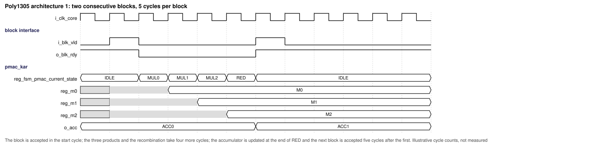

```wavedrom
{
 "signal": [
  {
   "name": "i_clk_core",
   "wave": "p..........."
  },
  [
   "block interface",
   {
    "name": "i_blk_vld",
    "wave": "010...10...."
   },
   {
    "name": "o_blk_rdy",
    "wave": "1.0...1....."
   }
  ],
  [
   "pmac_kar",
   {
    "name": "reg_fsm_pmac_current_state",
    "wave": "=.=====.....",
    "data": [
     "IDLE",
     "MUL0",
     "MUL1",
     "MUL2",
     "RED",
     "IDLE"
    ]
   },
   {
    "name": "reg_m0",
    "wave": "x..=........",
    "data": [
     "M0"
    ]
   },
   {
    "name": "reg_m1",
    "wave": "x...=.......",
    "data": [
     "M1"
    ]
   },
   {
    "name": "reg_m2",
    "wave": "x....=......",
    "data": [
     "M2"
    ]
   },
   {
    "name": "o_acc",
    "wave": "=.....=.....",
    "data": [
     "ACC0",
     "ACC1"
    ]
   }
  ]
 ],
 "head": {
  "text": "Poly1305 architecture 1: two consecutive blocks, 5 cycles per block"
 },
 "foot": {
  "text": "The block is accepted in the start cycle; the three products and the recombination take four more cycles; the accumulator is updated at the end of RED and the next block is accepted five cycles after the first. Illustrative cycle counts, not measured"
 },
 "config": {
  "hscale": 2
 }
}
```

*Figure 10-15. WF-014: Poly1305 architecture 1, two consecutive blocks (success). Source: `figures/wf_014_poly_kar.json` (WaveJSON).*

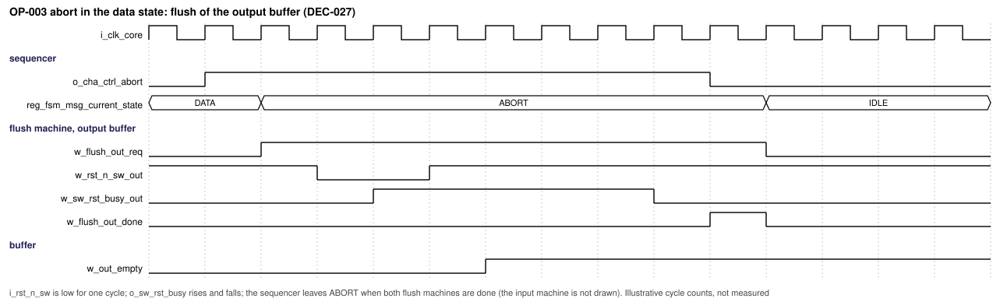

```wavedrom
{
 "signal": [
  {
   "name": "i_clk_core",
   "wave": "p.............."
  },
  [
   "sequencer",
   {
    "name": "o_cha_ctrl_abort",
    "wave": "01........0...."
   },
   {
    "name": "reg_fsm_msg_current_state",
    "wave": "=.=........=...",
    "data": [
     "DATA",
     "ABORT",
     "IDLE"
    ]
   }
  ],
  [
   "flush machine, output buffer",
   {
    "name": "w_flush_out_req",
    "wave": "0.1........0..."
   },
   {
    "name": "w_rst_n_sw_out",
    "wave": "1..0.1........."
   },
   {
    "name": "w_sw_rst_busy_out",
    "wave": "0...1....0....."
   },
   {
    "name": "w_flush_out_done",
    "wave": "0.........10..."
   }
  ],
  [
   "buffer",
   {
    "name": "w_out_empty",
    "wave": "0.....1........"
   }
  ]
 ],
 "head": {
  "text": "OP-003 abort in the data state: flush of the output buffer (DEC-027)"
 },
 "foot": {
  "text": "i_rst_n_sw is low for one cycle; o_sw_rst_busy rises and falls; the sequencer leaves ABORT when both flush machines are done (the input machine is not drawn). Illustrative cycle counts, not measured"
 },
 "config": {
  "hscale": 2
 }
}
```

*Figure 10-16. WF-015: FIFO flush on abort (corner). Source: `figures/wf_015_flush.json` (WaveJSON).*

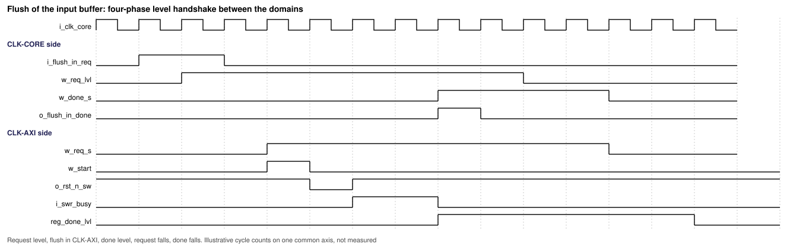

```wavedrom
{
 "signal": [
  {
   "name": "i_clk_core",
   "wave": "p.............."
  },
  [
   "CLK-CORE side",
   {
    "name": "i_flush_in_req",
    "wave": "01.0..........."
   },
   {
    "name": "w_req_lvl",
    "wave": "0.1.......0...."
   },
   {
    "name": "w_done_s",
    "wave": "0.......1...0.."
   },
   {
    "name": "o_flush_in_done",
    "wave": "0.......10....."
   }
  ],
  [
   "CLK-AXI side",
   {
    "name": "w_req_s",
    "wave": "0...1.......0.."
   },
   {
    "name": "w_start",
    "wave": "0...10.........."
   },
   {
    "name": "o_rst_n_sw",
    "wave": "1....01........."
   },
   {
    "name": "i_swr_busy",
    "wave": "0.....1.0......."
   },
   {
    "name": "reg_done_lvl",
    "wave": "0.......1.....0."
   }
  ]
 ],
 "head": {
  "text": "Flush of the input buffer: four-phase level handshake between the domains"
 },
 "foot": {
  "text": "Request level, flush in CLK-AXI, done level, request falls, done falls. Illustrative cycle counts on one common axis, not measured"
 },
 "config": {
  "hscale": 2
 }
}
```

*Figure 10-17. WF-016: flush handshake between the domains (corner). Source: `figures/wf_016_flush_hs.json` (WaveJSON).*

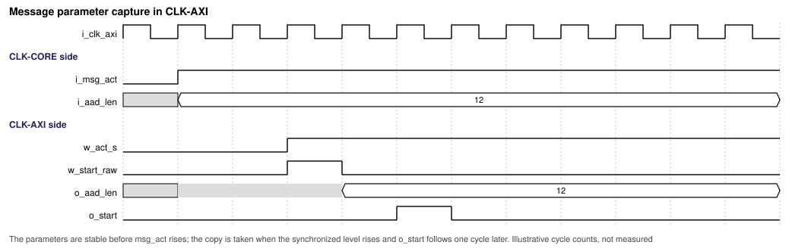

```wavedrom
{
 "signal": [
  {
   "name": "i_clk_axi",
   "wave": "p..........."
  },
  [
   "CLK-CORE side",
   {
    "name": "i_msg_act",
    "wave": "01.........."
   },
   {
    "name": "i_aad_len",
    "wave": "x=..........",
    "data": [
     "12"
    ]
   }
  ],
  [
   "CLK-AXI side",
   {
    "name": "w_act_s",
    "wave": "0..1........"
   },
   {
    "name": "w_start_raw",
    "wave": "0..10......."
   },
   {
    "name": "o_aad_len",
    "wave": "x...=.......",
    "data": [
     "12"
    ]
   },
   {
    "name": "o_start",
    "wave": "0....10....."
   }
  ]
 ],
 "head": {
  "text": "Message parameter capture in CLK-AXI"
 },
 "foot": {
  "text": "The parameters are stable before msg_act rises; the copy is taken when the synchronized level rises and o_start follows one cycle later. Illustrative cycle counts, not measured"
 },
 "config": {
  "hscale": 2
 }
}
```

*Figure 10-18. WF-017: message parameter capture in CLK-AXI (success). Source: `figures/wf_017_msg_cap.json` (WaveJSON).*

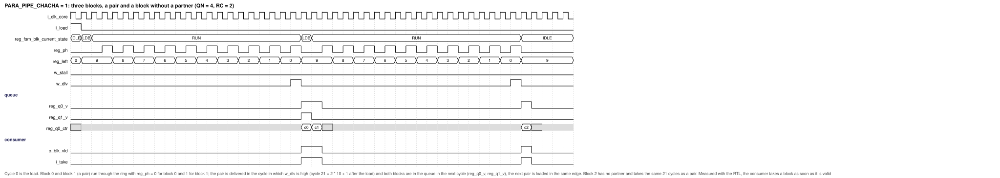

```wavedrom
{
 "signal": [
  {
   "name": "i_clk_core",
   "wave": "p..............................................."
  },
  {
   "name": "i_load",
   "wave": "10.............................................."
  },
  {
   "name": "reg_fsm_blk_current_state",
   "wave": "===...................==...................=....",
   "data": [
    "IDLE",
    "LDB",
    "RUN",
    "LDB",
    "RUN",
    "IDLE"
   ]
  },
  {
   "name": "reg_ph",
   "wave": "0..10101010101010101010.10101010101010101010...."
  },
  {
   "name": "reg_left",
   "wave": "==..=.=.=.=.=.=.=.=.=.=..=.=.=.=.=.=.=.=.=.=....",
   "data": [
    "0",
    "9",
    "8",
    "7",
    "6",
    "5",
    "4",
    "3",
    "2",
    "1",
    "0",
    "9",
    "8",
    "7",
    "6",
    "5",
    "4",
    "3",
    "2",
    "1",
    "0",
    "9"
   ]
  },
  {
   "name": "w_stall",
   "wave": "0..............................................."
  },
  {
   "name": "w_dlv",
   "wave": "0....................10...................10...."
  },
  [
   "queue",
   {
    "name": "reg_q0_v",
    "wave": "0.....................1.0..................10..."
   },
   {
    "name": "reg_q1_v",
    "wave": "0.....................10........................"
   },
   {
    "name": "reg_q0_ctr",
    "wave": "x.....................==x..................=x...",
    "data": [
     "c0",
     "c1",
     "c2"
    ]
   }
  ],
  [
   "consumer",
   {
    "name": "o_blk_vld",
    "wave": "0.....................1.0..................10..."
   },
   {
    "name": "i_take",
    "wave": "0.....................1.0..................10..."
   }
  ]
 ],
 "head": {
  "text": "PARA_PIPE_CHACHA = 1: three blocks, a pair and a block without a partner (QN = 4, RC = 2)"
 },
 "foot": {
  "text": "Cycle 0 is the load. Block 0 and block 1 (a pair) run through the ring with reg_ph = 0 for block 0 and 1 for block 1; the pair is delivered in the cycle in which w_dlv is high (cycle 21 = 2 * 10 + 1 after the load) and both blocks are in the queue in the next cycle (reg_q0_v, reg_q1_v), the next pair is loaded in the same edge. Block 2 has no partner and takes the same 21 cycles as a pair. Measured with the RTL, the consumer takes a block as soon as it is valid"
 },
 "config": {
  "hscale": 1
 }
}
```

*Figure 10-19. WF-018: block pairs of `PARA_PIPE_CHACHA` = 1 (success). Source: `figures/wf_018_block_pair.json` (WaveJSON), drawn from the trace of `m_chacha_block_p` with `PARA_QR_NUM` = 4 and `PARA_RND_CYC` = 2 (10 iterations per block), simulated with Icarus Verilog.*

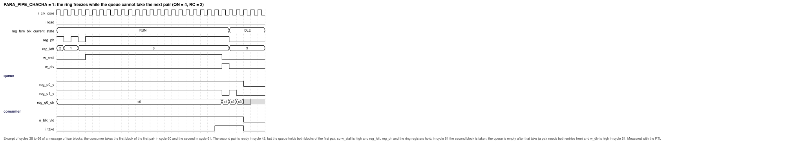

```wavedrom
{
 "signal": [
  {
   "name": "i_clk_core",
   "wave": "p............................"
  },
  {
   "name": "i_load",
   "wave": "0............................"
  },
  {
   "name": "reg_fsm_blk_current_state",
   "wave": "=.......................=....",
   "data": [
    "RUN",
    "IDLE"
   ]
  },
  {
   "name": "reg_ph",
   "wave": "10101...................0...."
  },
  {
   "name": "reg_left",
   "wave": "==.=....................=....",
   "data": [
    "2",
    "1",
    "0",
    "9"
   ]
  },
  {
   "name": "w_stall",
   "wave": "0...1..................0....."
  },
  {
   "name": "w_dlv",
   "wave": "0......................10...."
  },
  [
   "queue",
   {
    "name": "reg_q0_v",
    "wave": "1.........................0.."
   },
   {
    "name": "reg_q1_v",
    "wave": "1......................010..."
   },
   {
    "name": "reg_q0_ctr",
    "wave": "=......................===x..",
    "data": [
     "c0",
     "c1",
     "c2",
     "c3"
    ]
   }
  ],
  [
   "consumer",
   {
    "name": "o_blk_vld",
    "wave": "1.........................0.."
   },
   {
    "name": "i_take",
    "wave": "0.....................1...0.."
   }
  ]
 ],
 "head": {
  "text": "PARA_PIPE_CHACHA = 1: the ring freezes while the queue cannot take the next pair (QN = 4, RC = 2)"
 },
 "foot": {
  "text": "Excerpt of cycles 38 to 66 of a message of four blocks; the consumer takes the first block of the first pair in cycle 60 and the second in cycle 61. The second pair is ready in cycle 42, but the queue holds both blocks of the first pair, so w_stall is high and reg_left, reg_ph and the ring registers hold; in cycle 61 the second block is taken, the queue is empty after that take (a pair needs both entries free) and w_dlv is high in cycle 61. Measured with the RTL"
 },
 "config": {
  "hscale": 1
 }
}
```

*Figure 10-20. WF-019: ring frozen while the queue cannot take the next pair (corner). Source: `figures/wf_019_pair_freeze.json` (WaveJSON), drawn from the trace of `m_chacha_block_p` with `PARA_QR_NUM` = 4 and `PARA_RND_CYC` = 2, simulated with Icarus Verilog.*

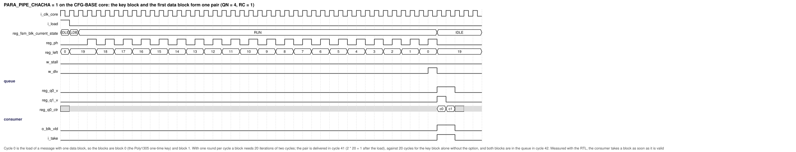

```wavedrom
{
 "signal": [
  {
   "name": "i_clk_core",
   "wave": "p.............................................."
  },
  {
   "name": "i_load",
   "wave": "10............................................."
  },
  {
   "name": "reg_fsm_blk_current_state",
   "wave": "===.......................................=....",
   "data": [
    "IDLE",
    "LDB",
    "RUN",
    "IDLE"
   ]
  },
  {
   "name": "reg_ph",
   "wave": "0..1010101010101010101010101010101010101010...."
  },
  {
   "name": "reg_left",
   "wave": "==..=.=.=.=.=.=.=.=.=.=.=.=.=.=.=.=.=.=.=.=....",
   "data": [
    "0",
    "19",
    "18",
    "17",
    "16",
    "15",
    "14",
    "13",
    "12",
    "11",
    "10",
    "9",
    "8",
    "7",
    "6",
    "5",
    "4",
    "3",
    "2",
    "1",
    "0",
    "19"
   ]
  },
  {
   "name": "w_stall",
   "wave": "0.............................................."
  },
  {
   "name": "w_dlv",
   "wave": "0........................................10...."
  },
  [
   "queue",
   {
    "name": "reg_q0_v",
    "wave": "0.........................................1.0.."
   },
   {
    "name": "reg_q1_v",
    "wave": "0.........................................10..."
   },
   {
    "name": "reg_q0_ctr",
    "wave": "x.........................................==x..",
    "data": [
     "c0",
     "c1"
    ]
   }
  ],
  [
   "consumer",
   {
    "name": "o_blk_vld",
    "wave": "0.........................................1.0.."
   },
   {
    "name": "i_take",
    "wave": "0.........................................1.0.."
   }
  ]
 ],
 "head": {
  "text": "PARA_PIPE_CHACHA = 1 on the CFG-BASE core: the key block and the first data block form one pair (QN = 4, RC = 1)"
 },
 "foot": {
  "text": "Cycle 0 is the load of a message with one data block, so the blocks are block 0 (the Poly1305 one-time key) and block 1. With one round per cycle a block needs 20 iterations of two cycles; the pair is delivered in cycle 41 (2 * 20 + 1 after the load), against 20 cycles for the key block alone without the option, and both blocks are in the queue in cycle 42. Measured with the RTL, the consumer takes a block as soon as it is valid"
 },
 "config": {
  "hscale": 1
 }
}
```

*Figure 10-21. WF-020: block pair of `PARA_PIPE_CHACHA` = 1 on the CFG-BASE core (success). Source: `figures/wf_020_block_pair_base.json` (WaveJSON), drawn from the trace of `m_chacha_block_p` with `PARA_QR_NUM` = 4 and `PARA_RND_CYC` = 1 (20 iterations per block), simulated with Icarus Verilog.*

### 10.4 Arbitration, buffering, and throughput

**Arbitration.** None is needed: one message is processed at a time, the AXI4 write channel feeds only the input buffer and the AXI4 read channel drains only the output buffer, and the two channels are independent. The APB4 interface and the data window do not compete for any resource except the event flags, which the register block resolves (hardware load wins over a software clear, section 11.3). There is no starvation case.

**Buffering and backpressure.** The input buffer holds `PARA_FIFO_IN_DEPTH` beats and the output buffer `PARA_FIFO_OUT_DEPTH` beats of `PARA_AXI_DW` bits. A full input buffer lowers the write-data ready; an empty input buffer stalls the engine; a full output buffer stalls the engine; an empty output buffer answers a read with SLVERR (DEC-016). Simultaneous push and pop of one buffer is allowed in every cycle.

**Deadlock rule.** A master that writes a whole message before it reads any result can lock the interface: the engine stalls on a full output buffer, the input buffer fills, and the write data is never accepted. In release mode the output depth in bytes shall therefore cover the result of the largest message that software writes in one piece, or the data shall be moved with the DMA handshake or with interleaved reads and writes; in hold mode `PARA_FIFO_OUT_DEPTH` already covers `PARA_MSG_MAX_B` (section 8). With the delivered defaults the output window holds 2 KiB, which covers the 1280-byte `PARA_MSG_MAX_B` plus the 16-byte tag, so a master that writes a whole message of up to that size before it reads any result does not lock the interface in release mode either.

**Ordering and latency.** Data leaves the output buffer in the order it entered the input buffer; the tag is last. The acceptance-to-result latency is the sum of the one-time key block, the data blocks, the length and tag steps and the buffer delays (OP-001); its architectural formula is in section 13.2, and no measured number exists.

**Initiation interval and throughput.** The initiation interval is one message: a new start is accepted only after `ENUM_ST_DONE`. The sustained rate of a long message is limited by the lowest of the ChaCha20 rate of the selected configuration (section 8 table), the Poly1305 rate (section 13.1) and `PARA_AXI_DW` / 8 bytes per interface clock cycle in each direction. A short message pays the one-time key block and the fixed steps on every message, so its effective rate is lower; section 13.2 quantifies this cost with the formula, and no source in the research report measures it.

### 10.5 Memories and storage

| Storage ID | Kind | Depth × width | Ports | Read latency | Write mask | Reset/init | ECC/parity | Implementation |
|---|---|---|---|---|---|---|---|---|
| MEM-001 | FIFO (input window) | `PARA_FIFO_IN_DEPTH` × `PARA_AXI_DW` | One write, one read, in different clocks when `PARA_SYNC_AXI_CORE` = 0 | 1 cycle of the read clock (show-ahead) | No byte mask in the FIFO; the strobes of the last beat of a part are checked before the write and the unused lanes carry no data (DEC-022) | Empty after reset | None in this release | Library FIFO (`m_vlsit_afifo_top` or `m_vlsit_sfifo_top`), array or macro by the library parameter |
| MEM-002 | FIFO (output window, hold buffer in hold mode) | `PARA_FIFO_OUT_DEPTH` × `PARA_AXI_DW` | One write, one read, in different clocks when `PARA_SYNC_AXI_CORE` = 0 | 1 cycle of the read clock | None | Empty after reset; flushed by abort | None in this release | As MEM-001 |
| MEM-003 | Registers (flops) | 256 bits (key) | Write from the key-store port, read by the cipher only | 0 | None | Cleared by reset, abort and the end of the message | None | Inferred flops |
| MEM-004 | Registers (flops) | 512 bits per core (ChaCha20 state) | Internal to `m_chacha_block` | 0 | None | Loaded from key, nonce and counter at each block | None | Inferred flops |
| MEM-005 | Registers (flops) | Poly1305 accumulator and one-time key (about 130 + 256 bits) and the 128-bit tag | Internal to `m_chacha_poly` | 0 | None | Loaded at `ENUM_ST_KEY`, cleared at the end of the message | None | Inferred flops |

Collisions: a simultaneous push and pop of a FIFO is allowed. Read of an empty FIFO and write of a full FIFO are prevented by the ready logic and never reach the storage. Initialization: every storage clears or empties at reset and at abort. There is no addressable memory, so there is no invalid-address case. No memory compiler is required unless the library FIFO is mapped to a macro; the wrapper is the library wrapper (`m_vlsit_afifo_ram_macro` or `m_vlsit_sfifo_ram_macro`). Parity or ECC on the storage is not defined in this release (section 18).

### 10.6 Datapath micro-architecture

The decisions of this section were taken while the RTL was written (DEC-025 to DEC-030). They fix how the behavior of sections 5.3 and 10.1 is built; they add no port and no register.

**Chunk interface (DEC-030).** The core moves data as chunks of 64 bytes (one ChaCha20 keystream block). `m_chacha_ingest` reads beats from the input buffer and assembles a chunk of at most $64 / W$ beats, with the unused byte lanes forced to zero by the byte count of the part. It presents the chunks in the order associated data, message data and (decryption) tag, each with its byte count (1 to 64), its kind and a last flag. `m_chacha_egress` writes a result chunk or the tag to the output buffer as $\lceil v / W \rceil$ beats for $v$ valid bytes, with zero in the unused lanes. A part of $n$ bytes gives $\lceil n / 64 \rceil$ chunks. Because each part starts on a new beat (DEC-022), chunks never mix two parts.

Example 1 (RFC 8439 section 2.8.2, 64-bit window, $W$ = 8). The associated data (12 bytes) is one chunk of 12 valid bytes in 2 beats. The message (114 bytes) is two chunks: 64 bytes in 8 beats and 50 bytes in 7 beats (the last beat has 2 valid bytes, strobe `0x03`), 15 beats in all as in section 9. The result is written back as 8 and 7 beats, and the tag (16 bytes) as 2 beats.

**Keystream cores (DEC-030).** `m_chacha_block` free-runs: after it is loaded with its first counter and its number of blocks, it produces a block every $C$ cycles into one output register and restarts at once on the next counter ($N$ steps further, $N$ = `PARA_CORE_NUM`); it waits only when the output register has not been taken. `m_chacha_cipher` takes the blocks of the $N$ cores in counter order. A column round is followed by a row rotation that turns the diagonals into columns, and the inverse rotation follows the diagonal round, so one set of quarter-round units serves both round types; with $Q$ < 4 the columns shift through the units, $Q$ at a time.

**Poly1305 architectures (DEC-025).** One 16-byte block is $n$ = the block as a little-endian number plus $2^{128}$ (the padded construction of RFC 8439 section 2.8 has only full blocks). Every architecture computes $acc \leftarrow ((acc + n) \cdot r) \bmod (2^{130} - 5)$ with $r$ the clamped value, in the same way: the product $P$ (below $2^{255}$) is folded as $P = H \cdot 2^{130} + L \rightarrow L + 5H$, and the result is folded once more; the accumulator stays below $2^{130} + 5$ (131 bits) and is reduced completely only when the tag is formed. The tag is $((acc \bmod p) + s) \bmod 2^{128}$.

| `PARA_POLY_ARCH` | Structure | Cycles per block ($P$) | Block timing |
|---|---|---:|---|
| 0 | Product scanning with one 32 by 32 multiplier: 20 limb products (5 limbs of $acc + n$ times 4 limbs of $r$) in 8 columns, then one fold cycle | 22 | start, 20 product cycles, fold |
| 1 | Karatsuba folded onto one 67 by 67 multiplier: $a = a_1 2^{66} + a_0$ and $r = r_1 2^{66} + r_0$ need three products $a_0 r_0$, $a_1 r_1$ and $(a_0 + a_1)(r_0 + r_1)$, one per cycle, and the middle term $(a_0 + a_1)(r_0 + r_1) - a_0 r_0 - a_1 r_1$ is formed in the last cycle | 5 | start, three multiply cycles, recombine and fold |
| 2 | One 131 by 128 multiplier and the two folds in a single cycle | 1 | start |

Example 2 (RFC 8439 section 2.8.2). The one-time key block is `7bac2b25 2db447af 09b67a55 a4e95584 0ae1d673 1075d9eb 2a937578 3ed553ff`, so $r$ = `0455e9a4057ab6080f47b42c052bac7b` after clamping and $s$ = `ff53d53e7875932aebd9751073d6e10a`. The first block is the associated data padded to 16 bytes, $n_0$ = `100000000c7c6c5c4c3c2c1c053525150` (the 129-bit value with the added bit), and with $acc$ = 0 the accumulator after it is $acc_1$ = `1bb22680babc3dcdc0a0c9a383695c4a3`. The second block is the first 16 bytes of the ciphertext, $n_1$ = `1c27eef53bcaf867bdb608e64348d1ad3`, and the accumulator after it is $acc_2$ = `2c28892718bbf4b439094be1a6c562472` (both values reduced modulo $2^{130} - 5$). The ten blocks of the message (1 associated data, 8 ciphertext, 1 lengths) end with the tag `1a e1 0b 59 4f 09 e2 6a 7e 90 2e cb d0 60 06 91`. The three architectures shall give the same reduced $acc_1$, $acc_2$ and the same tag; with architecture 1 the second block is accepted five cycles after the first (WF-014).

**FIFO flush (DEC-027).** An abort, a tag mismatch in hold mode and the reset of the AXI domain empty both window buffers through the software reset `i_rst_n_sw` of the library FIFO (`001_AsyncGrayFIFO` section 10.7), driven by a small flush machine on the write side of each FIFO (the input buffer is written in CLK-AXI and the output buffer in CLK-CORE). The machine lowers `i_rst_n_sw` for exactly one write-clock cycle, waits until `o_sw_rst_busy` has risen and then fallen, and reports done. A one-cycle low level is enough: the library write machine leaves its idle state on a sampled low level, and the rest of the handshake, including the wait for the read side, continues by itself after the level returns to 1. Writes are blocked and `o_full` is 1 while the reset runs, so the AXI write path stalls and the engine does not write. `ENUM_ST_ABORT` leaves for `ENUM_ST_IDLE` when both machines have reported done. Example 3: an abort written while the sequencer is in `ENUM_ST_DATA` with beats in both buffers: the output machine pulses `i_rst_n_sw` low in one cycle, `o_sw_rst_busy` is high for the following cycles and then low, and after both buffers have reported done both are empty and the sequencer is idle (WF-015).

**Hold gate (DEC-028).** With `PARA_HOLD_EN` = 1 a decryption writes its plaintext into the output buffer as usual, but the read side of the buffer shows no data to the AXI read path: the empty and threshold flags are forced to the empty state while a gate level is low. The gate is a level of the core domain, synchronized into CLK-AXI (CDC-010); it is low from the start of a decryption, rises when the tag has matched, and is cleared at the next start, an abort or a reset. After a mismatch the buffer is flushed (DEC-027), so the plaintext is never visible. For an encryption and with `PARA_HOLD_EN` = 0 the gate is high all the time. Example 4: a 114-byte decryption at 64 bits with a good tag: the 15 plaintext beats are in the output buffer before the end of `ENUM_ST_TAG`, the AXI read path sees an empty buffer, the gate rises in `ENUM_ST_DONE`, and the 15 beats become readable two to three AXI cycles later; with a wrong tag the buffer is flushed and `tag_err` is set.

**DMA thresholds (DEC-029).** The request conditions of section 6.3 use the threshold flags of the library FIFOs: the write request needs room for $N$ beats, that is `o_full_thr` low with the threshold register set to depth - $N$ + 1; the read request needs $N$ beats readable, that is `o_empty_thr` low with the threshold register set to $N$ - 1. The two threshold registers belong to CLK-AXI and change only together with the burst size of DMA-T1, so no signal crosses a clock; the library marks these inputs static, and this IP uses them as synchronous inputs of the same domain. Example 5: input buffer depth 16 and $N$ = 4: the threshold is 13, `o_full_thr` is low while at most 12 beats are held, and the write request may rise; with 13 beats held it stays low.

**Counter-valid rule (DEC-031).** The register block has no write indication for the nonce counter, so the engine cannot see a software write of the start value. `cha_sts.ctr_vld` is therefore set when `cha_ctr_lo` or `cha_ctr_hi` is non-zero (the hardware-nonce build only) and stays set until reset. A start value of 0 is not accepted as a loaded counter: software loads a non-zero 64-bit start value, for example a value that sets the highest bit (S04 of section 11.2). Example 6: after reset `ctr_vld` is 0 and an encryption is refused with `ctr_err`; software writes `cha_ctr_hi` = 0x00000001 and `cha_ctr_lo` = 0x00000000, `ctr_vld` reads 1 a few cycles later, and the encryption starts with the nonce `{cha_salt, 0x00000001, 0x00000000}`; at the end of the message the counter is loaded with 0x00000001_00000001.

**Message parameter capture in CLK-AXI (DEC-032).** The window logic and the DMA request logic need the message lengths, the direction, the watermarks, the tail mode, the DMA enable and the beat counts in CLK-AXI. The engine holds them stable from the cycle in which it raises the level `msg_act` (the start accepted), and `m_chacha_msg_cap` synchronizes `msg_act` into CLK-AXI with a two-flop cell, copies the parameters into registers of CLK-AXI when the synchronized level rises, and one cycle later gives a one-cycle start pulse together with the copies. The multi-bit copy is safe because the parameters do not change while `msg_act` is high and had been stable for at least the synchronizer latency before the copy. The handshake block `m_vlsit_ahs2_top` was not used: its source drops a launch request while an earlier one is outstanding and its destination has no valid indication, so an update could be lost or not be seen. Consequences, recorded in ASM-015: a window write burst that starts before the synchronized level has risen (two CLK-AXI cycles after the start was accepted plus the crossing) is refused with SLVERR, which agrees with the flow of section 11.2 (read `cha_sts.busy` set before the first window access, and the DMA requests rise only after the level), and the message-active level shall stay high for at least two periods of CLK-AXI, which holds when CLK-AXI is not slower than about one eighth of CLK-CORE. Example 7: with `PARA_SYNC_AXI_CORE` = 0 and equal clock periods, `msg_act` rises in cycle 0, the synchronized level is seen in cycle 2 or 3, the copies are loaded at the end of that cycle and `o_start` is high in the next cycle (WF-017); a write burst whose address handshake is before that cycle gets SLVERR with `axi_err`.

**Flush handshake across the clock domains (DEC-033).** The flush of the input buffer is requested in CLK-CORE and runs in CLK-AXI. A pulse and an acknowledge pulse over `m_vlsit_event_sync` were tried first and failed a test: when only the AXI domain was reset, the toggle structure produced a false done event in CLK-CORE, the sequencer left `ENUM_ST_ABORT` before the buffer was flushed and the next message read stale data. The handshake is therefore a four-phase level handshake (`m_chacha_flush_hs`): the core holds a request level until the done level of CLK-AXI is seen, drops it and waits for the done level to fall; the AXI side starts the flush machine when it sees the request level with its done level low, and raises the done level when the machine ends. After a reset of the AXI domain the request level is still high, so the flush runs again after the release. Example 8: an abort in `ENUM_ST_DATA` with beats in the input buffer: the request level rises in cycle 2, is seen in CLK-AXI two cycles later, the machine pulses `i_rst_n_sw` and ends, the done level rises, is seen in CLK-CORE, the request level falls and the sequencer leaves `ENUM_ST_ABORT` (WF-016).

**Registered crossing sources (DEC-034).** The rule check CLK-01 requires that the source of a synchronizer cell is a flop, not combinational logic, so that a glitch of the source cannot be sampled by the other clock. The RTL therefore registers, in the clock domain of the source, the message-active level (`m_chacha_ctrl`), the flush request level (`m_chacha_flush_hs`), the any-pending level of the interrupt (`m_chacha_int`), the two ready levels of the DMA request logic (`m_chacha_dma_req`), the AXI error event (`m_chacha_axi_win`) and the reset-alive level (`m_chacha_rst_ctrl`, taken from the synchronized reset). Each register adds one cycle in its own domain; the scratch simulations still pass in all tested configurations. The registers are on crossings and status paths, not in the ChaCha20 or Poly1305 datapath. The table of section 13.2 was measured again after this change.

**Pipeline options (DEC-036).** The longest paths of the RTL are the ChaCha20 round loop (54 levels with one round per cycle, 100 with two), the Poly1305 multiply-accumulate (52, 62 and 90 levels for the architectures 0, 1 and 2), and then the input stream adapter (40) and the AXI window logic (38) (section 13.3). Three parameters, each 0 or 1 and by default 0, place a register in these paths; each combination is legal and the ports and the registers do not change. `PARA_PIPE_CHACHA` replaces `m_chacha_block` by `m_chacha_block_p`: the round loop is a ring of two registers, R0 and R1, stage 1 turns R0 into R1 and stage 2 turns R1 into R0; with one round per cycle the cut is in the middle of the quarter round (`m_chacha_qrh1` and `m_chacha_qrh2`), with two rounds per cycle it is between the two rounds. Two blocks A and B (counters c and c + step) are in flight, B one cycle behind A, so an iteration of a block takes two cycles and a pair needs $2 \cdot ITER + 1$ cycles. The pair is delivered to a queue of two entries in the cycle in which A has finished and the next state of B is on the output of stage 2, and the next pair starts on the same edge; the ring freezes while the queue cannot take the pair. The block of counter 0 (the one-time key) and the first data block form the first pair, so Poly1305 starts after $2C + 1$ cycles instead of $C$; a block without a partner (an odd number of blocks, counting the key block) takes the time of a pair. `PARA_PIPE_POLY` makes the interval of the multiply-accumulate $P + 1$; the register of architecture 2 is placed in the multiplier (four partial products), because a cut between the multiplier and the two folds would leave 62 levels. `PARA_PIPE_IO` registers the last-beat flag of a part in `m_chacha_ingest` and `m_chacha_axi_win`, computed in the cycle before it is used from the length that is loaded or from the remaining bytes (the part ends after the next beat when the remaining bytes are not above two beats); behavior and cycle counts do not change. Example 9, measured on `m_chacha_core` of CFG-BASE with `PARA_PIPE_CHACHA` = 1: a message with 12 bytes of associated data and 114 bytes of message (the key block and two data blocks, three blocks) takes 117 cycles instead of 95, which is $C + 2$ more, because the third block has no partner; an empty message (the key block alone) takes 57 cycles instead of 36, which is $C + 1$ more. Example 10, measured with `PARA_PIPE_POLY` = 1 on CFG-BASE: 640 bytes of associated data and no message (40 Poly1305 blocks) take 277 cycles instead of 236, one cycle more per block. The waveforms of the block pairs are WF-018 (a pair and a block without a partner, two rounds per cycle), WF-019 (the ring frozen while the queue is full) and WF-020 (the key block and the first data block as one pair with one round per cycle, the CFG-BASE core).

**Hand-off to Poly1305 and the sequencer tail (DEC-037, ASM-017).** With CFG-HP the first RTL took 1.2 to 1.25 cycles per 16-byte block of associated data and 9 to 25 percent more cycles than the formula (TBD-027), because three steps of the hand-off cost a cycle that Poly1305 with one block per cycle cannot hide. First, the feeder register `reg_pf` of `m_chacha_ctrl` was free for the next chunk only one cycle after its last block was consumed; it is now free in the cycle in which the last block is consumed, so a chunk of four blocks takes four cycles and not five. Second, `m_chacha_ingest` did not read a beat while a finished chunk waited to move to the chunk register; it now reads the first beat of the next chunk in the cycle of the move. Third, the sequencer visited the associated-data state and the message-data state even when their length was 0, and `m_chacha_poly` formed the tag one cycle after the finalize request; empty states are now skipped and the tag is formed in the cycle of the request when the unit is idle. The first two changes shorten only CFG-HP, whose Poly1305 interval is one cycle (CFG-LP and CFG-BASE hide the gap while Poly1305 works); the third shortens every configuration by one cycle for the tag and by one cycle for each empty part. Example 11, measured on `m_chacha_core` of CFG-HP, 640 bytes of associated data and no message (40 blocks): 72 cycles before the change, 61 after, that is 1.0 cycle per block; a message of 1 byte: 25 cycles before, 22 after.

## 11. Register and programming model

This IP has software-visible registers; they are defined only in the workbook named in 11.1.

### 11.1 CSR specification source

The registers of this IP are defined only in the workbook of the table below, which is built from the VLSIT CSR Specification Template. This document does not restate the register map, fields, offsets, access types or reset values; it names registers and fields only as they are written in the workbook, so the two documents cannot diverge.

| Item | Specification |
|---|---|
| CSR workbook file | `VLSIT_CHACHA_CSR.xlsx` in this `spec` folder, written by `vlsit_csr_tool.py fill` from `VLSIT_CHACHA_CSR.json` (the register description source); it is a project copy of `VLSIT_CSR_Specification_Template.xlsx` |
| Sheet used for this IP | `ASYNC_CSR` (the `Asynchronous` cell is 1, so the generated module carries the asynchronous adapter) |
| Workbook revision / date | Draft 2, 2026-11-24 (`vlsit_csr_tool.py validate` result: PASS, 0 errors, 0 warnings, 16 registers, 61 fields) |
| CSR generator | APB-CSR-Generator (`https://github.com/nguyenquanicd/APB-CSR-Generator`); the version or commit is chosen when the RTL is generated (TBD-021). The workbook uses only the field types `rw`, `ro`, `rwi` and `w1c`, no `wo` field and no register-event sideband, so the port names do not depend on the generator version |
| CSR module name | `m_vlsit_csr_chacha` |
| Register prefix | `cha` (DEC-001) |
| IP version | 1.0, register `cha_version` at offset `0x0` (rule R-067); no version was given by the user, so the default applies |
| Asynchronous | 1 by default: the generator parameter `PARA_ASYNCHRONOUS` of the instance follows `PARA_SYNC_APB_CORE` (it is 1 when that parameter is 0 and 0 when it is 1), see section 8 |
| APB clock and register clock | `i_clk_apb` is driven by CLK-APB and `i_clk_reg` by CLK-CORE (DEC-004, section 7) |
| Source of `i_protect_en` and `i_slverr_en` | IP input ports tied by the integrator to constants that do not change after reset (generator rule); their value is a privilege decision (TBD-005) |

Workbook facts: the sheet `ASYNC_CSR` is used with module name `m_vlsit_csr_chacha`, protocol APB, data width 32, address width 16, write strobe 4 and `Asynchronous` 1 (cells fixed by the template); every register and field named in this document exists in that sheet; register behavior that the template cannot express would be recorded in section 20, and none is needed for this IP.

- The first workbook register is the 32-bit read-only `cha_version` at offset `0x0`, with `major` in `[31:16]` and `minor` in `[15:0]` (rule R-067).
- Names and descriptions follow the register conventions of the specification skill: every register is `cha_` plus its function with fewer than 30 characters and every field name has at most 20 characters; the register description is one line `Full name. Main meaning.`; the field description gives the explanation, `Usage:`, a `Values:` block of hexadecimal value lines, `Unit:` and `Limits:` with a blank line between the parts; a reserved field has a fixed description; the enable, injection and status interrupt registers carry the same fields as the raw interrupt register.
- The register RTL is built by APB-CSR-Generator from the workbook, never written by hand. Register and field names are lower-case identifiers, because they become port names (for example `o_cha_ctrl_en`, `i_cha_sts_busy`, `i_hw_wdata_cha_ctrl_start`, `i_hw_we_cha_ctrl_start`); the fields of a register cover bits 31..0 once, and a field named `reserved` is type `ro`.

### 11.2 Software sequences

The flow below is the normal sequence for one message. The shown operating path is a build with the software-supplied nonce (`PARA_NONCE_HW` = 0) and the data moved by software polling; the steps marked `O` apply only under the condition written on the arrow that selects them. Register and field names are those of the workbook. All register accesses are full-word APB4 accesses and software waits for `PREADY` (section 11.4).

The sequence assumes these rules, which the later sections of this specification make normative: the tag of the message is the last 16 bytes of the data stream, so an encryption returns the ciphertext followed by the tag, and a decryption expects the ciphertext followed by the tag (ASM-006, DEC-024); the engine counts the first `cha_len.aad_len` bytes of the input stream as associated data and the next `cha_len.msg_len` bytes as message data; each of the associated data, the message data and the tag starts on a new beat of the data window, and the IP pads the associated data and the message data for Poly1305 itself (DEC-022).

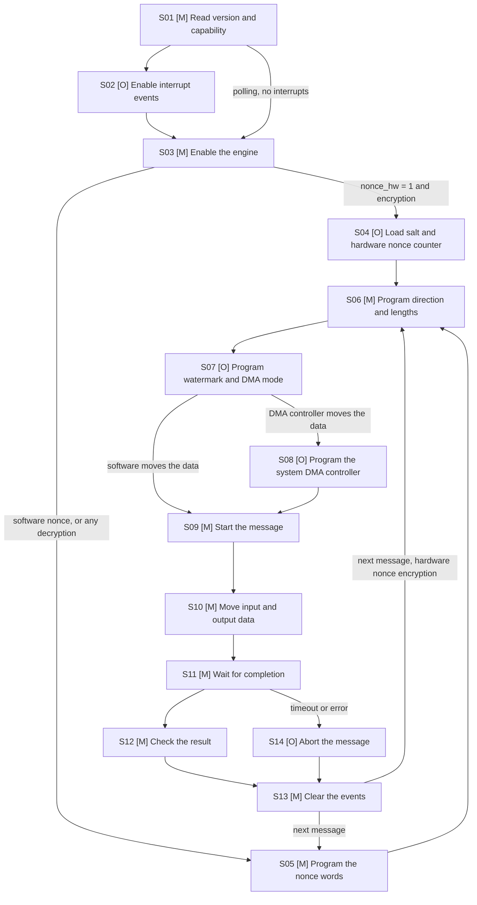

| No. | Step | Option (M/O) | Interface | CSR | Description |
|---|---|---|---|---|---|
| S01 | Read version and capability | M | APB4 read | Read `cha_version` (major, minor) and `cha_cap` (nonce_hw, hold_en, dma_en, dw_code, core_log) | Lets the driver check that the IP revision is supported and learn the build options (nonce mode, tag hold, DMA, data width, core count) before it uses any other register. |
| S02 | Enable interrupt events | O | APB4 write | Write `cha_irq_en` with the bits done, tag_err, len_err, axi_err, ctr_err and key_err set as wanted; selected when the driver uses interrupts instead of polling | Lets the raw events reach the interrupt output so completion and errors are signaled without polling. |
| S03 | Enable the engine | M | APB4 write | Write `cha_ctrl.en` = 0x1 | Allows the engine to accept a message and releases its core clock gating; no message is accepted while the engine is disabled. |
| S04 | Load salt and hardware nonce counter | O | APB4 write, then read | Write `cha_salt.salt`, `cha_ctr_lo.ctr` and `cha_ctr_hi.ctr` (the 64-bit start value shall be non-zero, DEC-031); read `cha_sts.ctr_vld` until it is 0x1; selected when `cha_cap.nonce_hw` is 0x1 and the message is an encryption, once after reset | In hardware nonce mode the nonce is salt plus counter. The counter is invalid after reset, so the start value is loaded once and checked before the first encryption (DEC-023). |
| S05 | Program the nonce words | M | APB4 write | Write `cha_nonce0.nonce_w`, `cha_nonce1.nonce_w` and `cha_nonce2.nonce_w` with the 96-bit nonce of the message | RFC 8439 sections 2.3 and 2.8 take a 96-bit nonce that is unique for each message under one key; the software-nonce build and every decryption receive it from software (a decryption uses the nonce received from the sender). |
| S06 | Program direction and lengths | M | APB4 write | Write `cha_ctrl.dir` (0x0 encrypt, 0x1 decrypt), `cha_ctrl.key_slot`, `cha_len.aad_len` and `cha_len.msg_len` | Tells the engine which operation to perform, which key slot to request from the key store, and how many bytes of associated data and message data to expect, so it can count the input stream and pad for Poly1305. |
| S07 | Program watermark and DMA mode | O | APB4 write | Write `cha_wm.wm_wr`, `cha_wm.wm_rd`, `cha_ctrl.tail_mode` and `cha_ctrl.dma_en` = 0x1; selected when a system DMA controller moves the data | Sets the burst length of each DMA request, the tail rule and enables the request outputs. |
| S08 | Program the system DMA controller | O | Register interface of the system DMA controller (not part of this IP) | N/A: the registers of the DMA controller are outside this IP; the data window is written and read through the AXI4 data window | A write channel reads memory and writes the data window, a read channel reads the data window and writes memory, with the request and acknowledge pins of this IP as flow control. |
| S09 | Start the message | M | APB4 write, then read | Write `cha_ctrl.start` = 0x1, poll `cha_ctrl.start` until it reads 0x0, then read `cha_sts.busy` = 0x1 | Starts one AEAD operation; hardware clears start when it has latched the parameters (or has dropped the request because the engine was disabled or busy), so software reads busy to confirm that the message was accepted; the registers of S05 to S07 are changed again only after completion. A key that the key store refuses ends the message with `key_err` and without `done`. |
| S10 | Move input and output data | M | AXI4 write burst to the data window for the input; AXI4 read burst from the data window for the output; the DMA request pins when S07 and S08 were done | Poll `cha_sts.in_rdy` before each write burst and `cha_sts.out_rdy` before each read burst when polling | Supplies the associated data, then the message data (and for a decryption the 16-byte tag) and drains the result (and for an encryption the 16-byte tag); the DMA requests make this automatic. |
| S11 | Wait for completion | M | APB4 read, or the interrupt output | Poll `cha_sts.busy` until it reads 0x0, or take the interrupt and read `cha_irq_sts.done` | Detects the end of the message; all result data and the tag are available after busy is clear. |
| S12 | Check the result | M | APB4 read | Read `cha_irq_raw` and check `tag_err`, `axi_err`, `len_err`, `ctr_err` and `key_err`; for a decryption discard the plaintext when `tag_err` is 0x1 | A tag error means the message is not authentic; the other events report a programming or data-window error. |
| S13 | Clear the events | M | APB4 write | Write 0x1 to each set bit of `cha_irq_raw` | Clears the sticky events before the next message so that an old event is not mistaken for a new one. |
| S14 | Abort the message | O | APB4 write, then read | Write `cha_ctrl.abort` = 0x1, poll until it reads 0x0; selected on a timeout or after an error in S11 | Stops a message that cannot complete, flushes the window FIFOs and returns the engine to idle without a tag check. |

Reconfiguration rule: the registers of S05 to S07 are changed only while `cha_sts.busy` reads 0x0. Safe disable: clear `cha_ctrl.en` only while idle.

Reference driver sketch (review finding F-019). The pseudocode is the intended use of the registers and the nonce policy; it is not delivered software.

```text
init():
    check read(cha_version) and read(cha_cap)
    write(cha_ctrl.en, 1);  write(cha_irq_en, 0x3f)                 # six events
encrypt(slot, aad, msg):
    nonce = next_nonce(slot)           # software-nonce build; skip in the hardware-nonce build
    write(cha_nonce0, cha_nonce1, cha_nonce2 = nonce words)
    write(cha_ctrl.key_slot, slot);  write(cha_ctrl.dir, 0)
    write(cha_len, (len(msg) << 16) | len(aad))
    write(cha_ctrl.start, 1);  wait until read(cha_ctrl.start) == 0
    accepted = read(cha_sts.busy) == 1 or read(cha_irq_raw) != 0    # a refused key can finish before busy is read
    send aad beats, then msg beats, each part on a new beat (REQ-FUNC-006)
    wait until read(cha_sts.busy) == 0, or take the interrupt
    ev = read(cha_irq_raw);  write(cha_irq_raw, ev)                 # clear the sticky events
    if ev has key_err, len_err, ctr_err or axi_err: handle the error (write cha_ctrl.abort if still busy)
    read the result beats and the tag beats from the window
next_nonce(slot):                      # RFC 8439 section 2.6: unique per key, never random
    n = persistent_counter[slot];  persistent_counter[slot] = n + 1;  return n as 96 bits
```

Nonce policy for the driver: keep one counter per key in non-volatile memory of the host and increment it for every message, so that a reset of the host does not repeat a nonce; do not derive a nonce from a random source. With `PARA_NONCE_CHK` = 1 the IP refuses only a repeat of the previous nonce of the key slot (REQ-SEC-006). In the hardware-nonce build the driver loads the salt and a start counter that was never used with the same key and salt, and loads a new start value whenever the key changes (DEC-023).

### 11.3 CSR connection to the design

The registers and fields below are named as in the workbook; no offset, width, type or reset value is repeated here.

| Workbook register.field | Direction at the CSR | Design signal | Clock domain of the signal | Behavior notes |
|---|---|---|---|---|
| cha_version.major, cha_version.minor | Status in | Constants of the IP revision | CLK-CORE | Tied to the version of the workbook (1.0) |
| cha_ctrl.en | Control out | Engine enable; also the enable of the core clock gating when `PARA_CG_EN` = 1 | CLK-CORE | Level; the engine accepts a start only while it is 1 |
| cha_ctrl.start | Control out, hardware load | Message start request to the control FSM; hardware loads 0 when the parameters are latched | CLK-CORE | Software write wins over a hardware load in the same cycle, so software writes start once and the IP never loads at that moment; a lost load is repeated because the bit stays 1 until it is accepted |
| cha_ctrl.dir | Control out | Selects the encrypt or the decrypt path | CLK-CORE | Latched at start |
| cha_ctrl.abort | Control out, hardware load | Abort request; hardware loads 0 when the engine is idle and the window FIFOs are empty | CLK-CORE | As start |
| cha_ctrl.dma_en | Control out | Enables the DMA request logic | CLK-CORE, then synchronized into CLK-AXI (CDC-005) | Level |
| cha_ctrl.tail_mode | Control out | Selects the DMA tail rule | CLK-CORE, then synchronized into CLK-AXI (CDC-005) | Quasi-static, latched at start |
| cha_ctrl.key_slot | Control out | Key slot index presented to the key store | CLK-CORE | Latched at start; drives `o_key_slot` while `o_key_req` is high |
| cha_len.aad_len, cha_len.msg_len | Control out | Associated data and message data byte counters | CLK-CORE | Latched at start; the AXI side counts beats with a copy delivered by CDC-006 |
| cha_wm.wm_wr, cha_wm.wm_rd | Control out | Write and read watermarks of the DMA request logic | CLK-CORE, then CLK-AXI (CDC-005) | Quasi-static, latched at start |
| cha_nonce0.nonce_w, cha_nonce1.nonce_w, cha_nonce2.nonce_w | Control out | Words of the 96-bit nonce input of the ChaCha20 block function | CLK-CORE | Latched at start |
| cha_salt.salt | Control out | Upper 32 bits of the hardware-managed nonce | CLK-CORE | Used only when `PARA_NONCE_HW` = 1 |
| cha_ctr_lo.ctr, cha_ctr_hi.ctr | Control out, hardware load | 64-bit nonce counter; hardware loads the incremented value after each encryption | CLK-CORE | Software loads a start value while idle; hardware load while busy cannot collide with a software write because software writes it only while idle |
| cha_sts.busy, cha_sts.in_rdy, cha_sts.out_rdy | Status in | Engine busy flag, input FIFO room flag and output FIFO availability flag | CLK-CORE for busy; in_rdy and out_rdy come from the window FIFOs through CDC-003 to CDC-005 | Live values, read when sampled by APB |
| cha_sts.ctr_vld | Status in | Hardware nonce counter valid flag | CLK-CORE | 0 when `PARA_NONCE_HW` = 0 |
| cha_irq_raw (done, tag_err, len_err, axi_err, ctr_err, key_err) | Hardware load | Event pulses of the engine: message done, tag mismatch, programming error, data window error, nonce counter error, key store error | CLK-CORE; the axi_err source is synchronized from CLK-AXI (CDC-006) | The source holds load value 1 and the load enable for the cycles of the event and keeps the enable low otherwise; a new event in the cycle of a software clear is kept |
| cha_irq_en, cha_irq_inj | Control out | Mask of the interrupt output; software injection of events | CLK-CORE | inj raises the raw event on the rising edge of the bit |
| cha_irq_sts | Status in | Masked pending events that drive the interrupt output | CLK-CORE | Combination of the raw bits and the mask, computed outside the CSR |
| cha_cap.nonce_hw, cha_cap.hold_en, cha_cap.dma_en, cha_cap.dw_code, cha_cap.core_log | Status in | Constants derived from the build parameters `PARA_NONCE_HW`, `PARA_HOLD_EN`, `PARA_DMA_EN`, `PARA_AXI_DW`, `PARA_CORE_NUM` | CLK-CORE | Static |

A signal from a clock domain other than the register clock is synchronized by the IP, not by the register block. In one cycle a software write to an `rwi` field wins over a hardware load of the same field, so the IP loads again after a lost load: the start and abort fields stay 1 until the engine accepts them, and the counter fields are written by software only while the engine is idle. A hardware load to a `w1c` field wins over a software clear, so a new event is kept.

### 11.4 APB access behavior of the CSR

The behavior below is that of the APB-CSR-Generator described in `reference/vlsit_csr_generator.md`. This IP has no `wo` field, so the read-as-zero behavior of `wo` does not apply, and no decision of section 20 changes the generator behavior.

| Case | Behavior |
|---|---|
| Normal read or write | With `PARA_ASYNCHRONOUS` = 0 (APB and core clocks are the same net) `PREADY` rises after one wait state. With 1 the wait states depend on the ratio of the two clocks, so this specification gives no fixed number and software waits for `PREADY`; a bound, if needed, is measured for the real clock pair (rule R-050) |
| Write with PSTRB not all ones | `PSLVERR` and no change when `i_slverr_en` = 1; a whole-word write when 0; software writes full words (decision TBD-005 for the setting of `i_slverr_en`) |
| Address not word aligned | `PSLVERR` when `i_slverr_en` = 1 |
| Aligned address that is not a register | OKAY; a read returns 0; a write is ignored (the generator behavior; no decision for an error response was requested) |
| Non-secure access (PPROT[1] = 1) | `PSLVERR` when `i_protect_en` = 1 and `i_slverr_en` = 1; the privilege requirement is TBD-005 |
| Reserved bits | Read as 0; writes ignored |
| Reset | Registers take the reset value of the workbook; asynchronous assertion by `i_rst_n_reg`, release synchronous to `i_clk_reg` (section 7.3) |
| Write to a read-only register or field | The write is ignored (type `ro`) |
| Register clock stopped | Not supported: the register clock CLK-CORE runs while the register block is accessed; the core datapath gating of `PARA_CG_EN` does not stop the register block (section 7.1) |

## 12. Error handling and recovery

Errors are reported by the six event bits of the interrupt registers and, for the register block, by `PSLVERR`; the events are sticky, cleared by software and cleared by reset. A hardware event in the cycle of a software clear is kept (section 11.3). Every event that is enabled drives `o_int_cha`.

| Error ID | Detection condition | Observable response/status | Interrupt | Clear/recovery | Reset behavior |
|---|---|---|---|---|---|
| ERR-001 | At start: `cha_len.msg_len` above `PARA_MSG_MAX_B`, or a watermark above its limit when `cha_ctrl.dma_en` is set | The message does not start, start is cleared, `len_err` is set | Enabled by `cha_irq_en.len_err` | Software corrects the value, clears the event and starts again | Event cleared |
| ERR-002 | Decryption: the computed tag differs from the received tag | `tag_err` is set and `done` is not; in hold mode the plaintext is discarded, in release mode software discards it | Enabled by `cha_irq_en.tag_err` | Software clears the event; the engine is already idle | Event cleared |
| ERR-003 | Window: a read finds no data, a write exceeds the room or the lengths, a burst breaks the transfer rules of section 6.3 (size, type, length, 4 KB, strobes), or a non-secure access arrives with `i_protect_en` = 1 | SLVERR on the transfer or burst (section 6.3) and `axi_err` | Enabled by `cha_irq_en.axi_err` | Software clears the event; the message continues unless software aborts | Event cleared |
| ERR-004 | Hardware nonce build: an encryption starts with the counter not loaded, or the counter would wrap; software nonce build with `PARA_NONCE_CHK` = 1: the nonce repeats the previous one of the key slot | The message does not start, start is cleared, `ctr_err` is set | Enabled by `cha_irq_en.ctr_err` | Software loads the counter, clears the event and starts again | Event cleared; the counter is invalid after reset |
| ERR-005 | The key store answers the key request with `i_key_err` | The message does not run: `ENUM_ST_KEY` returns to idle, busy is cleared, both buffers are emptied and `key_err` is set (REQ-ERR-003) | Enabled by `cha_irq_en.key_err` | Software checks the key slot or the key store, clears the event and starts again | Event cleared |
| ERR-006 | Register access that the register block rejects: partial strobe, address not word aligned, non-secure access with the check on | `PSLVERR`, no register change (section 11.4) | None | Software repeats a valid access | No state to reset |
| ERR-007 | Reset of the AXI domain alone while a message runs | The message is aborted as OP-003 does, both buffers are flushed, the DMA requests are low and `axi_err` is set after the release (REQ-RESET-003) | Enabled by `cha_irq_en.axi_err` | Software clears the event and starts the message again | The event is kept: the registers are in the core domain |

Other conditions: there is no timeout in hardware, so a message whose data never arrives stays busy and software uses `cha_ctrl.abort` (OP-003) as the recovery; a full buffer is backpressure, not an error (section 10.4); ECC and parity errors do not exist because no ECC or parity is provided (section 18); the only fatal condition is the loss of a clock or reset, which this IP does not detect. Retry, drop and drain: a rejected start is dropped, an aborted message is drained by emptying both buffers, and an error completion is the SLVERR response. Several events can be set at once; they are independent bits with no priority among them, and none is lost.

## 13. Performance, power, and area

This release fixes no hard timing, area or power limit: the target product, technology and frequency are not given (TBD-002, ASM-002). Every number below is an architectural estimate computed from this specification, a requirement on the micro-architecture, or a goal to be confirmed; nothing here is synthesized, and the only simulated numbers are the cycle counts compared with the formula in section 13.2. The formulas are implemented in `verification/models/chacha_cycle_model.py`, so every table of sections 13.1 and 13.2 can be regenerated. The performance requirements are REQ-PERF-001 to REQ-PERF-003; the constants that the estimates assume are in ASM-014.

**Configuration names used in this section.** Section 8 defines three named elaboration configurations of the IP; the sections after section 8 use them as `CFG-LP`, `CFG-BASE` and `CFG-HP`. `CFG` stands for configuration. They are parameter sets of the same RTL, not different designs:

| Name | Meaning | Intended use | `PARA_QR_NUM` | `PARA_RND_CYC` | `PARA_CORE_NUM` | `PARA_POLY_ARCH` | `PARA_AXI_DW` (bits) |
|---|---|---|---:|---:|---:|---:|---:|
| `CFG-LP` | LP = low power, small area: one ChaCha20 core with one quarter-round unit, one round per cycle, and the serial 32-bit Poly1305 multiplier | A secure MCU or a battery product where area and power matter more than rate | 1 | 1 | 1 | 0 | 32 |
| `CFG-BASE` | The delivered default: one core with four quarter-round units, one round per cycle, and the Poly1305 multiplier folded on one wide multiplier | General use, and the reference of the specification | 4 | 1 | 1 | 1 | 64 |
| `CFG-HP` | HP = high throughput: two cores with four quarter-round units each, two rounds per cycle, and the fully parallel one-cycle Poly1305 multiplier | A gateway or a high-rate link where rate matters more than area and clock frequency | 4 | 2 | 2 | 2 | 128 |

The meaning of the parameters is in the table of section 8: `PARA_QR_NUM` is the number of quarter-round units in one core, `PARA_RND_CYC` the rounds that one core executes per clock cycle, `PARA_CORE_NUM` the number of ChaCha20 cores, `PARA_POLY_ARCH` the Poly1305 architecture (0 serial 32 by 32 bit, 1 folded Karatsuba, 2 single-cycle 131 by 128 bit, as in DEC-025), and `PARA_AXI_DW` the data width of the AXI4 window. The output buffer depth is 512, 256 and 128 entries for `CFG-LP`, `CFG-BASE` and `CFG-HP` so that each holds the 2 KiB hold-mode window. Cycles per 64-byte block of one core are 80, 20 and 10, and the Poly1305 block interval is 22, 5 and 1 cycles (the table of section 13.1).

| Metric ID | Metric | Target / limit | Conditions | Measurement method | Hard / goal |
|---|---|---|---|---|---|
| PPA-001 | Maximum frequency of the core clock | No target (TBD-002); estimated logic depth and relative clock of section 13.3 | Named library, corner, voltage and configuration of the product; none chosen | STA with the named constraints (`sdc/`), not RTL synthesis alone | Goal, open |
| PPA-002 | Area | No target; state proxy of section 13.5 only. No area number shall be quoted outside this specification until a mapped result exists (review finding F-016) | Library and utilization not chosen | Mapped cell area and macro area reported separately | Goal, open |
| PPA-003 | Dynamic and leakage power | No target; the levers are `PARA_CG_EN` (core datapath gated while idle), the number of active quarter-round units and the number of cores | Activity, corner and voltage not chosen | Power analysis of a netlist with simulated or vector-less activity | Goal, open |
| PERF-001 | Sustained throughput of a long message | Bounds of section 13.1 per GHz of core clock: 5.8 (CFG-LP), 25.6 (CFG-BASE), 102.4 (CFG-HP) | One message at a time, input data and output room available | Cycle-accurate simulation against the model (TEST-019) | Hard: REQ-PERF-001, REQ-PERF-002 |
| PERF-002 | Start-to-done cycles of a message | Formula and values of section 13.2 | Key store answers in 2 cycles; input data in the buffer | Cycle-accurate simulation against the model (TEST-019) | Hard: REQ-PERF-001 |
| PERF-003 | Window transfer rate | One beat per interface clock cycle per direction | Buffer has room (write) or data (read) | Simulation (TEST-022) | Hard: REQ-PERF-003 |

### 13.1 Sustained throughput

$C = \lceil 20 / R \rceil \cdot (4 / Q)$ cycles per 64-byte block for one core with $R$ rounds per cycle and $Q$ quarter-round units (section 8); $N$ cores work on different blocks. The ChaCha20 bound is $8 \cdot 64 \cdot N / C$ Gbit/s per GHz. Poly1305 absorbs four 16-byte blocks for each 64-byte block, one after another (RFC 8439 section 2.5), so a Poly1305 block interval of $P$ cycles gives $4P$ cycles per 64 bytes. The sustained bound is $8 \cdot 64 / \max(C / N, 4P)$.

| Configuration | $C$ | $N$ | ChaCha20 bound (Gbit/s per GHz) | `PARA_POLY_ARCH` | $P$ used | $P$ that does not limit | Sustained bound (Gbit/s per GHz) | Interface rate (Gbit/s per GHz of interface clock, one direction) |
|---|---:|---:|---:|---:|---:|---:|---:|---:|
| CFG-LP | 80 | 1 | 6.4 | 0 | 22 | 20 or less | 5.82 | 32 |
| CFG-BASE | 20 | 1 | 25.6 | 1 | 5 | 5 or less | 25.6 | 64 |
| CFG-HP | 10 | 2 | 102.4 | 2 | 1 | 1 or less | 102.4 | 128 |

How the Poly1305 numbers arise. For `PARA_POLY_ARCH` = 0 the value 22 is derived from the structure: a 32-bit multiply-accumulate unit forms 5 limbs of the 130-bit accumulator times 4 limbs of $r$, which is 20 limb products, plus 2 cycles for the reduction modulo $2^{130} - 5$ and the addition of the block. That is 88 cycles per 64 bytes against 80 for ChaCha20, so the serial architecture limits CFG-LP to 5.82 Gbit/s per GHz instead of 6.4. For architectures 1 and 2 the values 5 and 1 are not results: they are the largest intervals that keep Poly1305 from limiting the configuration ($80 / 4 = 20$, $20 / 4 = 5$, $10 / (4 \cdot 2) = 1.25$, rounded down to 1), and REQ-PERF-002 turns them into a requirement on `m_chacha_poly`. Whether a folded Karatsuba multiplier-accumulator reaches 5 cycles, and whether a 130 by 128 bit multiplier can accept one block every cycle at a useful clock, is TBD-003. The interface rate is larger than the engine rate in every delivered configuration, so the engine, not the window, sets the sustained rate (REQ-PERF-003 keeps the window from being the limit).

### 13.2 Per-message cost and latency

The number of core cycles from the accepted start to the `done` event is modelled as

$T = T_{key} + \max(\lceil (1 + B) / N \rceil \cdot C + P \cdot (n_L + 1),\; C + P \cdot (n_A + n_M + 1)) + T_{tail}$

with $B = \lceil m / 64 \rceil$ data blocks of $m$ message bytes, one extra block for counter 0 (the one-time key), $n_A = \lceil a / 16 \rceil$ and $n_M = \lceil m / 16 \rceil$ Poly1305 blocks of the associated data and the message, one Poly1305 block for the two lengths, $n_L = \lceil (m - 64 (B - 1)) / 16 \rceil$ the Poly1305 blocks of the last chunk (0 for an empty message), $T_{key}$ = 2 cycles for the key request and answer and $T_{tail}$ = 6 cycles for the `ENUM_ST_LEN`, `ENUM_ST_TAG` and `ENUM_ST_DONE` steps and the registered crossings (ASM-014, DEC-035). The first term is the ChaCha20 path, and it includes the Poly1305 blocks of the last chunk and the length block, which can start only when the keystream block of that chunk exists; the second starts after the one-time key exists, because Poly1305 needs $r$ and $s$. The model assumes that the input data is already in the input buffer and that the output buffer has room. It excludes the bus transfer time, the DMA latency and the delay of asynchronous crossings (two to three cycles of pointer synchronization in each direction when `PARA_SYNC_AXI_CORE` = 0), which the integrator adds.

| Configuration | 16-byte message | 64-byte message | 127-byte frame with 12-byte header | 1280-byte block |
|---|---:|---:|---:|---:|
| CFG-LP (cycles) | 212 | 278 | 358 | 1870 |
| CFG-BASE (cycles) | 58 | 73 | 93 | 453 |
| CFG-HP (cycles) | 20 | 23 | 33 | 123 |
| CFG-LP at 80 MHz (µs) | 2.65 | 3.48 | 4.48 | 23.38 |
| CFG-BASE at 80 MHz (µs) | 0.73 | 0.91 | 1.16 | 5.66 |
| CFG-HP at 80 MHz (µs) | 0.25 | 0.29 | 0.41 | 1.54 |

The fixed cost of every message is the key request, the one-time key block and the tail: 88, 28 and 18 cycles for CFG-LP, CFG-BASE and CFG-HP, which is 32 to 90 percent of the cycles of a message of 16 or 64 bytes. For the application of ASM-002 (frames of 127 bytes, blocks of 1280 bytes, tens of microseconds, 80 MHz) CFG-BASE needs 1.16 µs and 5.66 µs and CFG-LP 4.48 µs and 23.38 µs, so both meet "tens of microseconds" in the core; the 80 MHz clock itself is an assumption (ASM-002). REQ-PERF-001 allows 10 percent above the formula, and TEST-019 compares the simulation with the script.

Measurement of the RTL against the formula (scratch simulation of `m_chacha_core`; the files `tb_perf.sv`, `gen_perf.py`, `runperf.sh` and `cmp_perf.py` in `verification/tests/smoke` repeat it, and `perf_results.txt` keeps the output). The conditions are those of REQ-PERF-001: the whole input is in the input-buffer model before the start request, the output buffer is never full, the key store raises `i_key_vld` 2 cycles after `o_key_req` is first high (test bench parameter `KD` = 2; with `KD` = 1 every value is one cycle smaller, checked for the 51 rows), the clocks are equal, each configuration runs with its own data width (CFG-LP 32 bits, CFG-BASE 64 bits, CFG-HP 128 bits), the direction is encryption and the hold mode is on. A cycle count is the number of clock cycles from the edge on which the start is accepted (the first cycle in which `o_sts_busy` is high) to the edge on which `o_ev_done` is set, so no cycle of the test bench is included. The output of every run was compared with the reference model and had no data error. The RTL is the one after DEC-037. Difference = (measured − formula) / formula.

| AAD (bytes) | Message (bytes) | CFG-LP formula | CFG-LP measured | CFG-LP diff. | CFG-BASE formula | CFG-BASE measured | CFG-BASE diff. | CFG-HP formula | CFG-HP measured | CFG-HP diff. |
|---:|---:|---:|---:|---:|---:|---:|---:|---:|---:|---:|
| 0 | 0 | 110 | 115 | +4.5 % | 33 | 36 | +9.1 % | 19 | 21 | +10.5 % |
| 1 | 0 | 132 | 137 | +3.8 % | 38 | 41 | +7.9 % | 20 | 22 | +10.0 % |
| 160 | 0 | 330 | 335 | +1.5 % | 83 | 86 | +3.6 % | 29 | 31 | +6.9 % |
| 320 | 0 | 550 | 555 | +0.9 % | 133 | 136 | +2.3 % | 39 | 41 | +5.1 % |
| 640 | 0 | 990 | 995 | +0.5 % | 233 | 236 | +1.3 % | 59 | 61 | +3.4 % |
| 0 | 1 | 212 | 216 | +1.9 % | 58 | 60 | +3.4 % | 20 | 22 | +10.0 % |
| 0 | 16 | 212 | 216 | +1.9 % | 58 | 60 | +3.4 % | 20 | 22 | +10.0 % |
| 16 | 16 | 212 | 216 | +1.9 % | 58 | 60 | +3.4 % | 21 | 23 | +9.5 % |
| 17 | 63 | 278 | 282 | +1.4 % | 73 | 75 | +2.7 % | 25 | 27 | +8.0 % |
| 0 | 64 | 278 | 282 | +1.4 % | 73 | 75 | +2.7 % | 23 | 25 | +8.7 % |
| 5 | 65 | 292 | 304 | +4.1 % | 78 | 80 | +2.6 % | 30 | 31 | +3.3 % |
| 12 | 114 | 358 | 370 | +3.4 % | 93 | 95 | +2.2 % | 33 | 34 | +3.0 % |
| 0 | 127 | 358 | 370 | +3.4 % | 93 | 95 | +2.2 % | 33 | 34 | +3.0 % |
| 12 | 127 | 358 | 370 | +3.4 % | 93 | 95 | +2.2 % | 33 | 34 | +3.0 % |
| 130 | 200 | 594 | 599 | +0.8 % | 143 | 146 | +2.1 % | 41 | 43 | +4.9 % |
| 0 | 640 | 998 | 1074 | +7.6 % | 253 | 255 | +0.8 % | 73 | 74 | +1.4 % |
| 12 | 1280 | 1892 | 1954 | +3.3 % | 453 | 455 | +0.4 % | 123 | 124 | +0.8 % |

Result per configuration, for messages of at least one byte (REQ-PERF-001 allows +10 percent):

- CFG-LP: at most +7.6 percent (0 bytes of associated data, 640 bytes of message); the empty message is +4.5 percent. Met.
- CFG-BASE: at most +3.4 percent (0, 1 byte); the empty message is +9.1 percent. Met.
- CFG-HP: at most +10.0 percent (messages of 1 and 16 bytes without associated data, and 1 byte of associated data with an empty message); the empty message is +10.5 percent. Met at the limit: a message of up to 16 bytes has no margin, because 2 cycles of the fixed steps of the sequencer are 10 percent of 20 cycles.

The formula was fitted to the CFG-BASE rows of a first measurement (the added Poly1305 time of the last chunk and the tail of 6 cycles), so the CFG-BASE column is not an independent check of it; the CFG-LP and CFG-HP columns are, and both agree. The first RTL met the formula only for CFG-LP and CFG-BASE: CFG-HP was 9 to 25 percent above it (TBD-027) and the cause was found in the hand-off to Poly1305 and in the sequencer tail, which DEC-037 changed (section 10.6); the change shortens CFG-LP and CFG-BASE by 1 to 3 cycles per message and CFG-HP by 1 to 11 cycles, and the formula and the tail of 6 cycles stay.

Pipeline options (DEC-036). The formula extends to the options without a new constant (`start_to_done` of the model has the arguments `pc` and `pp`): with `PARA_PIPE_CHACHA` = 1 the ChaCha20 term is $\lceil \lceil (1 + B) / N \rceil / 2 \rceil \cdot (2C + 1)$ and the Poly1305 term starts at $2C + 1$ instead of $C$; with `PARA_PIPE_POLY` = 1 the interval $P$ is $P + 1$; `PARA_PIPE_IO` changes no cycle count (measured equal for the 17 messages and three configurations); $T_{tail}$ stays 6. The largest difference between the measurement and this formula for messages of at least one byte (`verification/tests/smoke/runperf_all.sh`, `cmp_perf_pipe.py`, results in `perf_results_pipe.txt`):

| Configuration | No option | `PARA_PIPE_CHACHA` | `PARA_PIPE_POLY` | Both |
|---|---:|---:|---:|---:|
| CFG-LP | +7.6 % | +5.9 % | +8.1 % | +6.6 % |
| CFG-BASE | +3.4 % | +5.1 % | +8.0 % | +6.4 % |
| CFG-HP | +10.0 % | +11.8 % | +9.1 % | +6.1 % |

CFG-LP and CFG-BASE meet REQ-PERF-001 (10 percent) in all four combinations. CFG-HP meets it with no option and with `PARA_PIPE_POLY`; with `PARA_PIPE_CHACHA` alone the largest difference is +11.8 percent (0 bytes of associated data, 640 bytes of message: 85 cycles against 76), which is outside the requirement, because REQ-PERF-001 is stated for the three configurations without options; the extended formula is less exact there.

### 13.3 Critical path and frequency estimate

The logic depths below are the author's estimates in levels of two-input gates, with an uncertainty of about 30 percent, and they are inputs to TBD-002 and not results (ASM-014).

| Block | Estimated logic depth | Basis | Expected clock relative to CFG-BASE |
|---|---:|---|---|
| ChaCha20, one round per cycle (`PARA_RND_CYC` = 1) | about 32 | A quarter round has four 32-bit additions and four exclusive-ORs in series; one 32-bit adder is about 7 levels; the rotations are wiring | 1.0 (reference) |
| ChaCha20, two rounds per cycle (`PARA_RND_CYC` = 2) | about 64 | Two rounds chained (column round then diagonal round) | About 0.5 to 0.6 |
| Poly1305, serial 32-bit multiply-accumulate (`PARA_POLY_ARCH` = 0) | about 30 | One 32 by 32 multiplier plus the accumulate | At least 1.0; not the limit |
| Poly1305, folded multiplier-accumulator (`PARA_POLY_ARCH` = 1) | not estimated | Between architectures 0 and 2; its structure is open (TBD-003) | Open |
| Poly1305, parallel 130 by 128 multiplier (`PARA_POLY_ARCH` = 2) | about 45 to 60 | Partial-product compression, a 130-bit carry-propagate addition and the folding of the carry above $2^{130}$ by a multiplication by 5; the accumulator feedback $acc \leftarrow (acc + m) \cdot r$ is a loop, so one block per cycle needs the whole depth in one cycle | About 0.5 to 0.7 unless the loop is split, which needs the powers of $r$ and is not specified |

**Structural depth of the RTL (2026-11-24).** The estimates above were replaced for ranking by the depth of the RTL itself, counted by `syn/depth.sh` (yosys with the slang front end, Kogge-Stone adders, 2-input gates, no timing-driven restructuring, longest path between flip-flops and ports). They are levels of a unit-delay model, not nanoseconds (ASM-016), and they are 50 percent or more above the estimates above: a quarter round is 48 levels, not about 32.

| Part | Levels | Part | Levels |
|---|---:|---|---:|
| Half quarter round | 24 | Poly1305 architecture 0 | 52 |
| ChaCha20 core, 1 round per cycle | 54 | Poly1305 architecture 1 | 62 |
| ChaCha20 core, 2 rounds per cycle | 100 | Poly1305 architecture 2 | 90 |
| Input stream adapter | 40 | AXI window logic | 38 |
| Sequencer | 29 | Output stream adapter | 18 |

The limit is the cipher in CFG-LP (54) and CFG-HP (100) and Poly1305 in CFG-BASE (62); the other engine is only 10 to 15 percent behind in CFG-LP and CFG-BASE, so one pipeline option alone gains little. The depths with the pipeline options of DEC-036, measured the same way, and the flip-flops added (yosys count):

| Part | Levels without | Levels with | Flip-flops added | Option |
|---|---:|---:|---:|---|
| ChaCha20 core, 1 round per cycle | 54 | 30 | 1059 per core | `PARA_PIPE_CHACHA` |
| ChaCha20 core, 2 rounds per cycle | 100 | 52 | 1059 per core | `PARA_PIPE_CHACHA` |
| Poly1305 architecture 0 | 52 | 45 | 66 | `PARA_PIPE_POLY` |
| Poly1305 architecture 1 | 62 | 46 | 385 | `PARA_PIPE_POLY` |
| Poly1305 architecture 2 | 90 | 52 | 631 | `PARA_PIPE_POLY` |
| Input stream adapter | 40 | 24 | 1 | `PARA_PIPE_IO` |
| AXI window logic | 38 | 25 | 1 | `PARA_PIPE_IO` |

The estimate of the throughput per second relative to CFG-BASE without options (25.6 Gbit/s per GHz at 62 levels), as (rate per GHz) $\cdot$ (62 / critical depth) / 25.6, with the rate per GHz limited by Poly1305 when its interval is longer (ASM-016):

| Configuration | No option | `PARA_PIPE_CHACHA` | `PARA_PIPE_POLY` | Both |
|---|---:|---:|---:|---:|
| CFG-LP | 0.26 | 0.27 | 0.25 | 0.30 (depth 45, Poly1305) |
| CFG-BASE | 1.00 | 1.00 | 0.96 | 1.12 (depth 46, Poly1305) |
| CFG-HP | 2.48 | 2.76 | 1.55 | 2.98 (depth 52, cipher; Poly1305 limits the rate to 64 Gbit/s per GHz) |

So a single option helps only with `PARA_PIPE_CHACHA` (+4 percent for CFG-LP, none for CFG-BASE, +11 percent for CFG-HP), `PARA_PIPE_POLY` alone lowers all three configurations, and both together give +15, +12 and +20 percent for CFG-LP, CFG-BASE and CFG-HP. `PARA_PIPE_IO` changes none of the numbers: with both engine options the critical path is 45 to 52 levels, above the 40 and 38 of the unregistered input and window paths, so it only matters when the engine paths are cut below 40 levels. These are estimates from the unit-delay depth; the real gain needs static timing analysis with a library (TBD-002) and the area needs synthesis (TBD-028).

The figure of 102.4 Gbit/s per GHz of CFG-HP applies to its own clock. If CFG-HP closes at 0.5 to 0.6 of the CFG-BASE clock, its throughput at equal technology is about $102.4 \cdot 0.55 / 25.6 \approx 2.2$ times that of CFG-BASE, with a range of 2.0 to 2.4 times, not 4 times. A throughput quoted for CFG-HP outside this specification shall therefore name the clock at which it was obtained (review finding F-013). The choice of the clock-gating and crossing cells does not change these depths.

### 13.4 Published reference points

| Source | Statement of the source | Conditions given by the source | Use in this specification |
|---|---|---|---|
| D3 (research report) | A ChaCha20-Poly1305 core with throughput up to 50 Gbit/s | Vendor claim; technology, frequency and area not stated in the sampled text | No comparison until CFG-HP has a mapped frequency |
| D4 (research report) | 800 Gbit/s for an ASIC implementation | Vendor claim; conditions not stated | None; it is an order of magnitude above the delivered configurations |
| D5 (page 64) | Stand-alone Poly1305 over 1 kB takes 212 µs in the secure engine of a wireless SoC family | Measured by the vendor on a different workload (no encryption) and clock | Context for FEAT-001: CFG-BASE needs 5.38 µs for a full AEAD of 1280 bytes at the assumed 80 MHz, a different workload that is not like-for-like |
| D6 (page 93) | The same measure takes 514 µs | As D5 | As D5 |

The research bundle is incomplete (7 of 10 product families, 3 of 10 papers) and the Rambus CH-7xx automotive core could not be read, so this table is context, not a competitiveness claim. A like-for-like table of mapped area, frequency and cycles per message for the three configurations is added to this section after RTL exists (review findings F-029 and F-030).

### 13.5 State proxy

RTL-level state proxy (declared flip-flop bits before synthesis, without combinational logic, and not a mapped area): the key register holds 256 bits, each ChaCha20 core 512 bits, the Poly1305 path about 386 bits (the clamped value $r$ of 128 bits, the value $s$ of 128 bits and the 130-bit accumulator), the register block about 270 bits of fields plus its asynchronous adapter, and the sequencer, counters and nonce guard about 250 bits (about 150 for the sequencer and counters, an author's estimate, and 100 for the previous nonce and key slot of the guard). The window buffers add (`PARA_FIFO_IN_DEPTH` + `PARA_FIFO_OUT_DEPTH`) times `PARA_AXI_DW`, and they will probably map to memory macros.

| Configuration | Key | ChaCha20 cores | Poly1305 | Window buffers ((in + out depth) × width) | Register block | Sequencer, counters, guard | Total declared state, about |
|---|---:|---:|---:|---:|---:|---:|---:|
| CFG-LP (`PARA_AXI_DW` = 32, depths 16 and 512, one core) | 256 | 512 | 386 | 16896 | 270 | 250 | 18570 bits |
| CFG-BASE (`PARA_AXI_DW` = 64, depths 16 and 256, one core) | 256 | 512 | 386 | 17408 | 270 | 250 | 19082 bits |
| CFG-HP (`PARA_AXI_DW` = 128, depths 16 and 128, two cores) | 256 | 1024 | 386 | 18432 | 270 | 250 | 20618 bits |

The window buffers hold about 90 percent of the state of every configuration because the output window now holds 2 KiB (hold mode and the 1280-byte message, section 8). The combinational work grows with the parameters in a way that the flip-flop count does not show: one quarter round has four 32-bit adders, so `PARA_QR_NUM` = 1 uses about 4 adders, one core at one round per cycle about 16, and CFG-HP (two cores, two rounds per cycle, four quarter rounds per round) about 64; the fully parallel Poly1305 multiplier of `PARA_POLY_ARCH` = 2 (130 by 128 bits) is the largest single arithmetic block. These are structural counts, not gate counts.

Do not claim timing closure from RTL synthesis alone. The SDC is delivered as a draft skeleton in `sdc/chacha_top.sdc` and its values are parameters (section 17).

## 14. RTL implementation contract

### 14.1 Required coding baseline

The VLSIT RTL Design Rules v2 in VLSIT_RTL_Design_Rule.md (same folder as this template) is the mandatory RTL coding authority. Specifications and RTL deliverables shall comply with it; do not add project-local RTL exceptions.

At minimum: use one synthesizable module per .sv file with matching module/filename; keep each top a structural wrapper containing the interface, parameters, interconnect declarations, and named submodule instances only; use ANSI ports with input wire and output logic; end every active-low non-reset signal name in _n; use unsigned four-state logic vectors; and keep SVA/testbench/UVM code outside synthesis RTL. Use always_comb or continuous assignments for combinational logic, with defaults and explicit case defaults, and always_ff for state with one clock per process and separate next-state logic.

Declare overridable parameters as parameter logic [31:0] PARA_ plus an uppercase name, with exactly the three PAR-02 comment lines immediately above each declaration. Declare derived localparams as localparam logic [31:0] LPARA_ plus an uppercase name in the parameter port list immediately after parameters. Use dedicated reset-synchronizer and CDC modules; asynchronous reset assertion may be asynchronous but release shall be synchronous per receiving domain. Test reset override/mux logic belongs in a wrapper/reset controller, not a functional leaf. CDC source values are registered with no combinational logic before the first synchronizer stage or between stages.

Use statically bounded, zero-based generate loops and declare genvar in the generate-for header. Use named port and parameter connections. Prefer clock enables; any ICG must use an approved dedicated module with a scan test-enable. Do not use signed/two-state hardware types, packages/imports, interfaces, RTL macros, initial blocks, simulation delays, casex, plain always, latches, multiple drivers, positional/wildcard connections, or unsupported constructs. Each RTL file header shall contain Project, Author: the user name of the project (user), AI Flow, AI Flow Page, Date, and Description. Indent with spaces only, do not use the default_nettype directive (lint/elaboration checking finds undeclared identifiers), comment each logic section, and keep RTL comment lines at or below 100 characters. REF-003 is the detailed authority.
### 14.2 RTL hierarchy

Modules touched by the pipeline options of DEC-036: `m_chacha_block` and `m_chacha_cipher` (`PARA_PIPE_CHACHA`), `m_chacha_pmac_s32`, `m_chacha_pmac_kar`, `m_chacha_pmac_par` and `m_chacha_poly` (`PARA_PIPE_POLY`), `m_chacha_ingest` and `m_chacha_axi_win` (`PARA_PIPE_IO`); the sequencer `m_chacha_ctrl` is unchanged by the options (DEC-037 changed it separately), because the queue of `m_chacha_block_p` presents the blocks in counter order like `m_chacha_block`. Three modules are added: `m_chacha_qrh1` and `m_chacha_qrh2` (the two halves of a quarter round) and `m_chacha_block_p` (the ChaCha20 core with two blocks in flight); `m_chacha_cipher` selects `m_chacha_block_p` when `PARA_PIPE_CHACHA` = 1.

| Module | Responsibility | Parent / instance | Clock/reset domains | Interface |
|---|---|---|---|---|
| m_chacha_top | Structural top; instantiates the six blocks and the reset wrapper below and holds no logic | Top | CLK-APB, CLK-AXI, CLK-CORE | All ports of section 6.2 |
| m_vlsit_csr_chacha | Generated APB4 register block with its asynchronous adapter (rule R-036 module name, section 11) | m_chacha_top / u_csr | CLK-APB and CLK-CORE | APB4 slave; configuration out, status in |
| m_chacha_axi_win | AXI4 subordinate adapter for the data window; protocol checks, responses, beat counting and the AXI-side error events, which cross through `m_vlsit_event_sync` (CDC-006) | m_chacha_top / u_axi_win | CLK-AXI | AXI4 subordinate; write and read path to the window buffer |
| m_chacha_win_buf | Window storage: input FIFO and output FIFO with the hold function; instantiates the library FIFOs `m_vlsit_afifo_top` (001_AsyncGrayFIFO) when `PARA_SYNC_AXI_CORE` = 0 and `m_vlsit_sfifo_top` (002_SyncFIFO) when 1 (library reuse to be confirmed, DEP-003) | m_chacha_top / u_win_buf | CLK-AXI and CLK-CORE | FIFO read and write paths on both sides |
| m_chacha_flush | Flush machine for one library FIFO: one-cycle low level on `i_rst_n_sw`, waits for `o_sw_rst_busy` to rise and fall (DEC-027) | m_chacha_win_buf / u_flush_out, m_chacha_flush_hs / u_flush | CLK-AXI (input buffer), CLK-CORE (output buffer) | Request in, done out |
| m_chacha_flush_hs | Four-phase level handshake that carries the flush request of the input buffer from CLK-CORE to its flush machine in CLK-AXI (section 10.6, DEC-033) | m_chacha_win_buf / u_flush_in | CLK-CORE and CLK-AXI | Request pulse in, done pulse out |
| m_chacha_dma_req | DMA request and acknowledge handshake with the watermark and tail rule; uses the parameter copies of `m_chacha_msg_cap` | m_chacha_top / u_dma_req | CLK-AXI | Level flags in, request pins out |
| m_chacha_dma_ch | One DMA request channel: burst size, FIFO threshold register, request and acknowledge phases DMA-T1 to DMA-T7 (write channel and read channel are two instances) | m_chacha_dma_req / u_ch_wr, u_ch_rd | CLK-AXI | Start, flag, request out, acknowledge in |
| m_chacha_msg_cap | Synchronizes the message-active level and copies the message parameters into CLK-AXI (section 10.6, DEC-032) | m_chacha_top / u_msg_cap | CLK-AXI | Core parameters in, copies and start pulse out |
| m_chacha_core | Engine wrapper (second level below); owns the message state | m_chacha_top / u_core | CLK-CORE | Streams, configuration, status, key port, events |
| m_chacha_ctrl | Message sequencer: FSM of the message steps of section 5.3, buffer handshakes, padding, nonce selection and nonce guard, events; state owner of the message | m_chacha_core / u_ctrl | CLK-CORE | Control of the blocks below |
| m_chacha_ingest | Reads beats of the input buffer and assembles chunks of at most 64 bytes in the order associated data, message data, tag (section 10.6, DEC-030) | m_chacha_core / u_ingest | CLK-CORE | Beats in, chunks out |
| m_chacha_egress | Writes result chunks and the tag to the output buffer as beats (section 10.6, DEC-030) | m_chacha_core / u_egress | CLK-CORE | Chunks in, beats out |
| m_chacha_key | Key request and capture with the handshake KEY-T1 to KEY-T5, and zeroizing after the message | m_chacha_core / u_key | CLK-CORE | Key to the cipher only |
| m_chacha_cipher | Keystream generation: `PARA_CORE_NUM` blocks and the block counter allocation | m_chacha_core / u_cipher | CLK-CORE (gated) | Keystream blocks to the sequencer |
| m_chacha_block | One ChaCha20 core: state, rounds per cycle `PARA_RND_CYC`, quarter-round units `PARA_QR_NUM` (one instance per core, `u_block_0` up to `u_block_7` as `PARA_CORE_NUM` allows) | m_chacha_cipher / u_block_0 to u_block_7 | CLK-CORE (gated) | Keystream block |
| m_chacha_block_p | ChaCha20 core with the round loop cut in two stages and two blocks in flight, a queue of two blocks and the same ports as `m_chacha_block` (`PARA_PIPE_CHACHA` = 1, DEC-036) | m_chacha_cipher / u_block_0 to u_block_7 | CLK-CORE (gated) | Keystream block |
| m_chacha_qr | One quarter round (add, rotate, XOR) | m_chacha_block / u_qr_0 to u_qr_3 | CLK-CORE (gated) | Four words in, four words out |
| m_chacha_qrh1 | First half of a quarter round (steps 1 and 2); two rounds per cycle use `m_chacha_qr` between the stages instead | m_chacha_block_p / u_qr1 | CLK-CORE (gated) | Four words in, four words out |
| m_chacha_qrh2 | Second half of a quarter round (steps 3 and 4) | m_chacha_block_p / u_qr2 | CLK-CORE (gated) | Four words in, four words out |
| m_chacha_poly | Poly1305 multiplier-accumulator (architecture by `PARA_POLY_ARCH`), one-time key, tag | m_chacha_core / u_poly | CLK-CORE (gated) | Ciphertext words in, tag out |
| m_chacha_pmac_s32 | Poly1305 multiply-accumulate, architecture 0: product scanning with one 32 by 32 multiplier, 22 cycles per block (DEC-025) | m_chacha_poly / gen_arch.u_pmac | CLK-CORE (gated) | Block in, accumulator out |
| m_chacha_pmac_kar | Poly1305 multiply-accumulate, architecture 1: Karatsuba folded onto one 67 by 67 multiplier, 5 cycles per block (DEC-025) | m_chacha_poly / gen_arch.u_pmac | CLK-CORE (gated) | Block in, accumulator out |
| m_chacha_pmac_par | Poly1305 multiply-accumulate, architecture 2: one 131 by 128 multiplier, 1 cycle per block (DEC-025) | m_chacha_poly / gen_arch.u_pmac | CLK-CORE (gated) | Block in, accumulator out |
| m_chacha_clk_gate | Dedicated clock-gating module with a test-enable input (rule CLK-03) | m_chacha_core / u_clk_gate | CLK-CORE | Enable in, gated clock out |
| m_chacha_int | Masked interrupt status and interrupt output synchronizer | m_chacha_top / u_int | CLK-APB | Raw events and masks in, masked status and interrupt out |
| m_chacha_rst_ctrl | Reset wrapper: three `m_vlsit_rst_sync` synchronizers (`000_Common`), the test override of REQ-DFT-001, the AXI-domain reset indication of CDC-009 and the coordinated software reset of the window FIFOs (section 7.3) | m_chacha_top / u_rst | CLK-APB, CLK-AXI, CLK-CORE | Three resets in; synchronized resets and the reset indication out |

The state owners are `m_chacha_ctrl` (message state), `m_vlsit_csr_chacha` (registers), `m_chacha_axi_win` (window burst state), `m_chacha_dma_req` (handshake state) and `m_chacha_poly` (Poly1305 accumulator). The AXI4 protocol adapter is `m_chacha_axi_win`, the register decode is in the generated register block, and the arithmetic is in `m_chacha_qr` and `m_chacha_poly`. The first level of this table is the hierarchy of the block diagram of section 5.2; the modules from `m_chacha_ctrl` down are second-level modules that are not drawn there. The reset wrapper `m_chacha_rst_ctrl` is a seventh instance of the top that section 5.2 does not draw as a block: the reset inputs of the diagram enter it.

### 14.3 Synthesis assumptions

| Item | Value / source |
|---|---|
| Top / source file list | Top `m_chacha_top`; the only filelist is `rtl/filelist.f`; it lists the library cells, wrappers and FIFOs of the repository, the generated register block and the 24 modules of this IP, with `+define+VLSIT_SYNTHESIS` |
| Frontend version and options | Not chosen; Verilator from the project OSS CAD Suite is the lint frontend of this repository (TBD-002) |
| Parameters/configuration | CFG-BASE is the delivered default; CFG-LP and CFG-HP are elaborated as well (REQ-PARAM-002) |
| Libraries/corners | None chosen (TBD-002) |
| Memory flow | Library FIFO wrappers (`m_vlsit_afifo_ram_macro`, `m_vlsit_sfifo_ram_macro`); registers by default, a macro only when the integrator maps it |
| Lint rule configuration | The VLSIT RTL rule checker (`vlsit_rtl_check.py`) and Verilator lint with all warnings, on every configuration; no waiver is planned |

## 15. Verification specification

### 15.1 Scope and strategy

Applicable levels in this release:
- **Block simulation** of the top module with directed and random tests (section 15.2). The testbench, the system DMA model, the key-store model and the clocks live in `verification/env/`, the testcase sources in `verification/tests/`, and the independent reference model in `verification/models/`. The first model, `verification/models/chacha20poly1305_ref.py`, was written from the RFC 8439 text (ChaCha20, Poly1305, AEAD) and reproduces the RFC vectors of sections 2.3.2, 2.5.2, 2.6.2 and 2.8.2 (9 of 9 checks pass). It was written by the author of this specification, so an independent second model and an independent reviewer are still required before sign-off (review finding F-025). The formula model of section 13 is `verification/models/chacha_cycle_model.py`.
- **Protocol compliance** by an AXI4 checker for the data window and an APB4 checker for the register block; the DMA handshake is checked by assertions (section 15.3).
- **Integration** with a system DMA controller model that follows the rules DMA-T1 to DMA-T7 (DEC-010, DEC-019) and a key-store model that follows KEY-T1 to KEY-T5 and can answer with an error (DEC-020); integration with a real SoC is outside this release.
- **Formal** bounded proofs of the properties of section 15.4.
- **CDC and RDC** analysis and simulation of the crossings of section 7.2 and the resets of section 7.3.
- **Lint and synthesis checks** on every configuration of section 8 (REQ-PARAM-002), including the illegal-configuration errors.
- Emulation and post-silicon: not applicable to this release.

Reproducibility and seeds: every random test prints its seed; a failing seed is replayed exactly; every random test runs with at least five seeds per configuration and the seeds are recorded in the run log under `verification/sim/`. The simulation of the clock-domain crossings runs in both branches (synthesis branch and simulation branch with the metastability model) with at least three seeds and the logs record which branch ran.

Configurations: CFG-LP, CFG-BASE and CFG-HP; the four combinations of `PARA_SYNC_AXI_CORE` and `PARA_SYNC_APB_CORE`; `PARA_HOLD_EN` = 0 and 1; `PARA_NONCE_HW` = 0 and 1; `PARA_NONCE_CHK` = 0 and 1; `PARA_DMA_EN` = 0 and 1. The full cross product is not run: each parameter is varied around CFG-BASE, and every pair that the specification says interacts (hold mode with the output buffer depth, nonce mode with message start, DMA with tail mode) is run as a pair.

### 15.2 Requirement-based test plan

| Test ID | Requirements | Scenario / stimulus | Expected result | Test type | Configuration |
|---|---|---|---|---|---|
| TEST-001 | REQ-FUNC-004 | ChaCha20 block function with the key, nonce and counter of RFC 8439 section 2.3.2, and the quarter-round vectors of sections 2.1.1 and 2.2.1 | Output block equals the vector | Directed | CFG-BASE |
| TEST-002 | REQ-FUNC-005 | Poly1305 with the vector of RFC 8439 section 2.5.2 | Tag equals the vector | Directed | CFG-BASE |
| TEST-003 | REQ-FUNC-003 | One-time key generation vector of RFC 8439 section 2.6.2 | Key equals the vector | Directed | CFG-BASE |
| TEST-004 | REQ-FUNC-001, REQ-FUNC-005 | AEAD encryption vector of RFC 8439 section 2.8.2 through the APB and AXI4 interfaces | Ciphertext and tag equal the vector | Directed | CFG-BASE |
| TEST-005 | REQ-FUNC-002 | Decryption of the vector, then with one flipped bit in the tag, the ciphertext and the associated data | `done` for the good message, `tag_err` for each corrupted one | Directed | CFG-BASE |
| TEST-006 | REQ-FUNC-001, REQ-FUNC-002, REQ-FUNC-005, REQ-FUNC-006 | Random keys, nonces and lengths from 0 to 65535 bytes for both fields, compared with an independent model | Output and tag equal the model for every message | Random | CFG-LP, CFG-BASE, CFG-HP |
| TEST-007 | REQ-FUNC-010 | Decryption with a bad tag in both settings of `PARA_HOLD_EN` | Release mode: data appears before the tag error; hold mode: no data released | Directed | CFG-BASE with `PARA_HOLD_EN` = 0 and 1 |
| TEST-008 | REQ-FUNC-011, REQ-FUNC-012, REQ-SEC-001, REQ-SEC-006, REQ-ERR-002 | Software nonce build with and without the guard (a repeated nonce, and a repeated nonce under another key slot); hardware nonce build with counter not loaded, loaded, and near wrap; decryption with a received nonce | Nonce used and counter behavior as stated; `ctr_err` for the refused cases and not for a repeat under another slot | Directed, assertions | `PARA_NONCE_HW` = 0 and 1, `PARA_NONCE_CHK` = 0 and 1 |
| TEST-009 | REQ-FUNC-007, REQ-SEC-003 | Read every register and the data window looking for key material; inspect the key path | No key bits are readable | Directed, inspection | CFG-BASE |
| TEST-010 | REQ-FUNC-008, REQ-FUNC-009, REQ-SEC-004 | Start while busy, start while disabled, abort in the middle of a message, restart after abort | Start and abort behavior as stated, no event from an aborted message | Directed | CFG-BASE |
| TEST-011 | REQ-IF-001, REQ-REG-001, REQ-REG-002, REQ-REG-003 | APB access to every register: reset values, access types, reserved bits, unmapped address, partial strobe, interrupt registers | As the workbook and section 11.4 | Directed | CFG-BASE |
| TEST-012 | REQ-IF-002, REQ-IF-003, REQ-IF-004, REQ-IF-005, REQ-IF-011 | AXI4 protocol checker with INCR bursts of every legal length, FIXED, WRAP, 4 KB crossing, a narrow transfer, wrong write strobes, an empty read, an overrun and a second burst while one is outstanding | Responses and events as stated | Directed, protocol checker | CFG-BASE |
| TEST-013 | REQ-IF-006, REQ-IF-007, REQ-IF-008 | System DMA model that follows DMA-T1 to DMA-T7, with an acknowledge released one cycle and ten cycles after the last beat, both tail modes, watermarks 1 and maximum, DMA disabled | Handshake order, cycle timing and burst sizes as stated | Directed, assertions | CFG-BASE with `PARA_DMA_EN` = 1 and 0 |
| TEST-014 | REQ-IF-009 | Raise each event, mask and unmask it | Interrupt output follows `cha_irq_sts` | Directed | CFG-BASE |
| TEST-015 | REQ-CLK-001, REQ-CLK-002, REQ-CLK-003 | All four combinations of `PARA_SYNC_AXI_CORE` and `PARA_SYNC_APB_CORE` with random clock ratios, including back-to-back `axi_err` events; CDC lint | Correct results, no unsynchronized crossing and no lost event | Random, CDC lint | CFG-BASE, four clock combinations |
| TEST-016 | REQ-RESET-001, REQ-RESET-002, REQ-RESET-003, REQ-SEC-004 | Reset of each domain alone, and of all, while idle and while busy, checked against the table of section 7.3 | Outputs at reset values or the effect of the table; engine idle, counter invalid | Directed, assertions | CFG-BASE |
| TEST-017 | REQ-PARAM-001, REQ-PARAM-002 | Elaborate the three configurations and every illegal combination | Legal ones pass lint, illegal ones stop with the error | Elaboration | CFG-LP, CFG-BASE, CFG-HP |
| TEST-018 | REQ-PARAM-003, REQ-ERR-001 | Program a watermark above the maximum and a length above `PARA_MSG_MAX_B` | `len_err` set, message not started | Directed | CFG-BASE |
| TEST-019 | REQ-PERF-001, REQ-PERF-002 | Measure the start-to-done cycles of the messages of the table of section 13.2 and the Poly1305 block interval, and compare with `verification/models/chacha_cycle_model.py` | Cycles of a message of at least one byte within 10 percent of the formula for the three configurations (measured on 2026-11-24 with `verification/tests/smoke/runperf.sh`: CFG-LP, CFG-BASE and CFG-HP met, CFG-HP at the limit, DEC-037), repeated after every RTL change; Poly1305 interval at most 22, 5 and 1 cycles | Cycle-accurate simulation | CFG-LP, CFG-BASE, CFG-HP |
| TEST-020 | REQ-SEC-002 | Compare tags that differ at the first and at the last byte | Same number of cycles | Directed | CFG-BASE |
| TEST-021 | REQ-FUNC-001, REQ-FUNC-006 | Boundary lengths for both fields: 0, 1, 15, 16, 17, 63, 64, 65 and 65535 bytes, and both fields zero | Output and tag equal the model for every pair | Directed | CFG-BASE |
| TEST-022 | REQ-IF-010, REQ-PERF-003 | Backpressure on every side: a slow reader of the output window, a slow writer, a full input buffer and a full output buffer, in both hold settings | No beat lost, duplicated or reordered | Random with a scoreboard | CFG-BASE, CFG-HP |
| TEST-023 | REQ-REG-002, REQ-IF-009 | A hardware event in the same cycle as a software clear of the same bit, and a software write to an `rwi` field in the cycle of a hardware load | The new event is kept; the software write wins for `rwi` | Directed | CFG-BASE |
| TEST-024 | REQ-FUNC-009, REQ-ERR-003 | Two messages back to back with and without a gap, a start in the cycle after `ENUM_ST_DONE`, and a start whose key request is refused | Each message is independent; the refused message ends with `key_err` and the next message runs normally | Directed | CFG-BASE |
| TEST-025 | REQ-IF-012, REQ-ERR-003, REQ-SEC-003 | Key-store model that answers in 0, 2 and many cycles, answers with `i_key_err`, answers with both signals in one cycle, and is aborted or reset while the request is pending; the key register is observed | Handshake KEY-T1 to KEY-T5; `key_err` only on the error; the key register changes only at the transfer edge | Directed, assertions | CFG-BASE |
| TEST-026 | REQ-SEC-005 | Window reads and writes with `AxPROT[1]` = 0 and 1 and `i_protect_en` = 0 and 1 | SLVERR, no data and `axi_err` only when both are 1 | Directed | CFG-BASE |
| TEST-027 | REQ-DFT-001 | Reset wrapper with `i_dft_test_en` = 1: every domain follows `i_dft_rst_n`; with `i_dft_test_en` = 0 `i_dft_rst_n` has no effect; the gated clock runs in test mode | As stated | Directed at wrapper level | CFG-BASE |
| TEST-028 | REQ-FUNC-006, REQ-IF-011 | The vector of RFC 8439 section 2.8.2 through the window at 32, 64, 128 and 256 bits with the beat layout of the worked example of section 9; then a packed layout and wrong strobes | Result and tag equal the vector for the layout; the packed layout and wrong strobes are refused with SLVERR | Directed | CFG-LP, CFG-BASE, CFG-HP and `PARA_AXI_DW` = 256 |
| TEST-029 | REQ-FUNC-014, REQ-PERF-002 | The Poly1305 block alone, for each `PARA_POLY_ARCH`: the blocks of the vector of Example 2 of section 10.6 and random blocks with random $r$ | The reduced accumulator after every block equals the model; the tag equals `1ae10b59 4f09e26a 7e902ecb d0600691` for the vector; the block interval is 22, 5 and 1 cycles | Directed, random | `PARA_POLY_ARCH` = 0, 1 and 2 |
| TEST-030 | REQ-FUNC-013, REQ-RESET-003 | Abort in each busy state with beats in both buffers; a decryption with a wrong tag and `PARA_HOLD_EN` = 1; a reset of the AXI domain while busy | Both buffers empty with no stale beat, the sequencer idle, the flush timing of Example 3 of section 10.6 | Directed, assertions | CFG-BASE, both synchronous options |
| TEST-031 | REQ-IF-007, REQ-FUNC-010 | Threshold boundaries of Example 5 (depth - $N$ and depth - $N$ + 1 beats held, $N$ - 1 and $N$ beats readable) and the hold gate of Example 4 | The request rises exactly at the stated occupancy; no plaintext is visible before the gate rises | Directed | CFG-BASE with `PARA_DMA_EN` = 1 |
| TEST-032 | REQ-ERR-002, REQ-FUNC-012 | Example 6 of section 10.6: hardware-nonce build after reset (encryption refused with `ctr_err`), start value written, `ctr_vld` read, encryption, counter after the message | `ctr_err` first; `ctr_vld` set after the write; nonce `{salt, 1, 0}`; counter 0x00000001_00000001 after the message | Directed | `PARA_NONCE_HW` = 1 |
| TEST-033 | REQ-IF-006, REQ-IF-011, REQ-CLK-001 | Example 7 of section 10.6: a write burst before and after the synchronized message-active level, for equal and for unrelated clock periods and for the four clock combinations | The early burst gets SLVERR with `axi_err`, the later burst is served; the parameter copies equal the engine values at `o_start` | Directed, assertions | CFG-BASE, four clock combinations |
| TEST-034 | REQ-PARAM-004 | Run the RFC 8439 vectors and the random messages of lengths 0 to 1280 for the 8 combinations of `PARA_PIPE_CHACHA`, `PARA_PIPE_POLY` and `PARA_PIPE_IO` in CFG-LP, CFG-BASE and CFG-HP, measure the start-to-done cycles of the table of section 13.2 for each combination, and lint every combination | Output data and tag equal the reference model for every combination; all three parameters at 0 give the cycle counts of section 13.2; the cycle counts of the other combinations are recorded for the new constants of TBD-028 | Cycle-accurate simulation, lint | CFG-LP, CFG-BASE, CFG-HP |

Coverage of the checklist of this section: reset and release (TEST-016), minimum and maximum parameters (TEST-017, TEST-018, TEST-021), backpressure (TEST-022), simultaneous events (TEST-023), ordering (TEST-022), errors and invalid inputs (TEST-005, TEST-012, TEST-018, TEST-025, TEST-026, TEST-030), boundaries (TEST-021). Low-power transitions are limited to the clock gating of the core datapath: every test of CFG-BASE runs with `PARA_CG_EN` = 1 and TEST-010 repeats with `PARA_CG_EN` = 0.

### 15.3 Assertions and coverage

All assertions and coverage live in verification files (`verification/env/`), never in the synthesizable RTL. Every property is disabled while its domain reset is asserted. The X policy: after reset release no output port and no register output may be X; the payload of the window buffers, the keystream and the Poly1305 accumulator are not reset and are guarded by the valid and pointer flags that qualify them (a read of a buffer entry that was not written is never observable because the ready logic blocks it).

| Property / coverage ID | Intent | Requirements | Checker / source set | Acceptance criterion |
|---|---|---|---|---|
| SVA-001 | DMA handshake timing, per channel, as the properties DMA-T1 to DMA-T7 of section 6.3: no request unless the acknowledge has been low for one cycle; the request stays high until the acknowledge; the request falls exactly one cycle after the acknowledge is seen; the acknowledge falls no earlier than the cycle after the last data beat; no new request earlier than one cycle after the acknowledge falls | REQ-IF-006 | Verification, assertion in the DMA model and the top | No failure in any run; every property fires at least once per channel |
| SVA-002 | A write request is raised only if the input buffer has room for the requested beats, and a read request only if that many beats are readable | REQ-IF-007 | Verification, assertion | No failure; fires in both tail modes |
| SVA-003 | Both request outputs are low when `PARA_DMA_EN` = 0 or `cha_ctrl.dma_en` = 0 | REQ-IF-008 | Verification, assertion | No failure |
| SVA-004 | `done` and `tag_err` are never raised for the same message; neither is raised for an aborted message | REQ-FUNC-002, REQ-FUNC-008 | Verification, assertion | No failure |
| SVA-005 | With `PARA_HOLD_EN` = 1 no plaintext beat is readable before the tag comparison has finished with a match | REQ-FUNC-010 | Verification, assertion | No failure; fires on matching and on failing tags |
| SVA-006 | No window buffer overflows or underflows, and the beats leaving a buffer equal the beats that entered it in order | REQ-IF-010 | Verification, assertion and scoreboard | No failure under every backpressure case of TEST-022 |
| SVA-007 | AXI4 responses: one `BRESP` per write burst, `RRESP` per read transfer, the requested number of read transfers with `RLAST` on the last, SLVERR in the cases of section 6.3 | REQ-IF-003, REQ-IF-004, REQ-IF-005 | AXI4 protocol checker (Arm IHI 0022H.c rules) plus assertions | Checker reports no violation |
| SVA-008 | In the hardware-nonce build the counter value of one encryption never repeats with the same salt until software loads a new start value, and an encryption with the counter not loaded does not start | REQ-SEC-001, REQ-ERR-002 | Verification, assertion with a history scoreboard | No failure |
| SVA-009 | The key and any copy of it are not observable at any output port or register read data | REQ-FUNC-007, REQ-SEC-003 | Formal structural check and the inspection of TEST-009 | No path from the key register to an output other than the cipher core |
| SVA-010 | After each reset: engine idle, both DMA requests low, key request low, interrupt low, AXI4 ready and valid outputs low, counter invalid | REQ-RESET-001, REQ-RESET-002 | Verification, assertion | No failure |
| SVA-011 | No event is lost across a domain crossing: for every AXI-side error event a core-side event follows within a bounded number of cycles for every clock ratio, and two events merge only while one is pending | REQ-CLK-003 | Verification, assertion in the crossing testbench | No failure at the ratios of COV-005 |
| SVA-012 | Key handshake: `o_key_req` stays high with a stable `o_key_slot` until `i_key_vld` or `i_key_err`; the key register changes only at an edge with `o_key_req` and `i_key_vld` high; `o_key_req` falls the cycle after | REQ-IF-012, REQ-SEC-003 | Verification, assertion | No failure; fires on both answers |
| COV-001 | Message lengths: 0, 1, 15, 16, 17, 63, 64, 65, 65535 for each field and both fields zero | REQ-FUNC-001, REQ-FUNC-006 | Functional coverage | All bins hit in the regression |
| COV-002 | Tail mode crossed with watermark 1, middle value and maximum, and with a message length that is a multiple and not a multiple of the watermark | REQ-IF-007 | Functional coverage | All crosses hit |
| COV-003 | Every event cause: done, tag_err, len_err, axi_err, ctr_err, key_err, each raised and cleared, and an event in the cycle of a clear | REQ-REG-003, REQ-IF-009 | Functional coverage | All bins hit |
| COV-004 | Abort issued in each busy state of the sequencer | REQ-FUNC-008 | Functional coverage | All five busy states hit |
| COV-005 | The four clock combinations crossed with the clock ratio ranges (core faster, equal frequency different phase, core slower) | REQ-CLK-001 | Functional coverage | All crosses hit |
| COV-006 | Pairs of `PARA_HOLD_EN`, `PARA_NONCE_HW` and `PARA_DMA_EN` | REQ-FUNC-010, REQ-FUNC-011, REQ-FUNC-012 | Functional coverage | All pairs hit |
| COV-007 | AXI4 burst lengths 1, 2, 16, 17 and the maximum for each data width, aligned and at the 4 KB limit, FIXED, WRAP, and bursts that cross 4 KB | REQ-IF-002, REQ-IF-003 | Functional coverage and protocol checker | All bins hit |
| COV-008 | Backpressure: empty and full input buffer, empty and full output buffer, with and without DMA | REQ-IF-010 | Functional coverage | All bins hit |
| COV-009 | Key-store answers: in the first cycle of the request, later, with an error, with both answers in one cycle, and aborted while pending | REQ-IF-012, REQ-ERR-003 | Functional coverage | All bins hit |

### 15.4 Formal, CDC, and RDC

| Analysis | Scope | Assumptions / constraints | Evaluation method |
|---|---|---|---|
| Formal | FIFO pointer and flag invariants of the window buffers; safety of the DMA handshake (SVA-001 to SVA-003 and SVA-012); reachability of every sequencer state and the abort path from each busy state; the structural key-isolation check of SVA-009 | Bounded depth chosen per property; inputs constrained to legal APB4 and AXI4 behavior; clocks assumed related in the formal model, the crossings being covered by the CDC analysis | Bounded model checking in the open-source flow (SymbiYosys) or the project formal tool; the result states the proven bound and the assumptions, and a bounded proof is not reported as a full proof |
| CDC / RDC | The crossings CDC-001 to CDC-009 of section 7.2 and the three resets of section 7.3 | Clock groups declared asynchronous for each asynchronous pair and merged for each synchronous pair, for the four clock combinations; the library FIFOs and the register-block adapter are treated as approved crossing structures; the key store is assumed to be in CLK-CORE (ASM-004, CDC-008) | CDC and RDC lint with a commercial or open tool plus the two-branch simulation of section 15.1 with at least three seeds; no unwaived violation; each waiver names its crossing and reason |

## 16. DFT and testability

This IP has no scan, built-in self-test or test-access architecture of its own in this release; the project DFT flow inserts scan on the synthesized netlist. Unsupported test methods are listed as such.

| Topic | Requirement / decision |
|---|---|
| Scan architecture and scan eligibility | The SoC flow inserts scan chains on the synthesized netlist, at least one per clock domain; the scan data and scan-enable ports are added by the tool at the netlist and are not RTL ports (ASM-012). All flip-flops are standard library flops with no latch, so every flip-flop is eligible. The number and length of the chains are chosen by the SoC DFT owner (TBD-025) |
| Scan/test clocks, controls, reset behavior | `i_dft_test_en` selects test mode and `i_dft_rst_n` replaces every functional reset and its synchronizer in test mode (rule RST-04, REQ-DFT-001); the override is in the reset wrapper `m_chacha_rst_ctrl`, not in a functional leaf. In functional operation `i_dft_test_en` is tied low and `i_dft_rst_n` high |
| Test-mode entry/exit and safe state | Entry: the SoC raises `i_dft_test_en` with stable clocks; exit: it clears `i_dft_test_en` and then applies the functional resets. The safe state is the idle state of the message sequencer with empty buffers and cleared key. Priority: `i_dft_test_en` over the functional resets, and the functional resets over the functional controls |
| MBIST, memory repair, LBIST | Not applicable: no memory macro is required; if the library FIFO is mapped to a macro the macro owner supplies its self-test (TBD-002). No memory repair or logic self-test is provided |
| Test access, wrappers, test points | No test point and no wrapper in this release |
| Clock-gating test enable | `i_dft_test_en` forces the gated core clock on in scan mode through the clock-gating module (rule CLK-03) |
| ATPG constraints and exclusions | The static inputs `i_protect_en`, `i_slverr_en` and `i_dft_rst_n` are constant in functional mode and constrained by the DFT flow; no exclusion is known |
| DFT insertion architecture and generated test artifacts | Not defined (TBD-025); no scan definition or test pattern is generated by this specification |

Ports for test are `i_dft_test_en` and `i_dft_rst_n` (section 6.2). Test-mode priority: when `i_dft_test_en` is high the gated clock is enabled regardless of `cha_ctrl.en` and the message state, and the reset of every flip-flop follows `i_dft_rst_n`; the number of scan chains and their ports remain TBD-025. The clock-gating cell is the project-approved cell inside the dedicated module `m_chacha_clk_gate`.

## 17. Physical design and timing integration

### 17.1 Timing constraints and budgets

This section is the timing-constraint contract of the IP. The file `sdc/chacha_top.sdc` is delivered as a draft skeleton (review finding F-014): it creates the three clocks, the clock groups of the four clock combinations, the interface budgets of 17.1.2 and the exceptions of 17.1.3. The target frequency, the library and the corners are not chosen (ASM-002, TBD-002), so every numeric value is a Tcl variable that the integrator sets, and no value in the file is measured or agreed (TBD-023). The constraints owned by the IP are the exceptions of 17.1.3 and the clock-gating and crossing requirements; the clock definitions, the clock groups of the integrated design and the input and output delays are supplied by the SoC integrator against the budgets of 17.1.2. The STA tool and its version are not chosen; the commands below are generic SDC and shall be confirmed for the selected tool.

#### 17.1.1 Clock and analysis scenarios

All three clocks are primary clocks created on the top-level ports. Corners, setup and hold views and operating modes are not chosen (TBD-002). The case analysis for scan mode (`i_dft_test_en` high) belongs to the DFT flow and is not part of the functional constraints.

| Clock ID | Port / source object | Primary/generated and master | Period, waveform, phase / ratio | Latency / uncertainty / transition | Clock group / mode | Constraint source |
|---|---|---|---|---|---|---|
| CLK-APB | `i_clk_apb` | Primary, no master | `$APB_PERIOD` set by the integrator; 50 % duty assumed (ASM-008); the ratio to the other clocks is arbitrary when they are asynchronous | Set by the integrator | Same net as CLK-CORE when `PARA_SYNC_APB_CORE` = 1, otherwise its own asynchronous group | Integrator SDC; IP exceptions in `sdc/chacha_top.sdc` (TBD-023) |
| CLK-AXI | `i_clk_axi` | Primary, no master | `$AXI_PERIOD` set by the integrator; 50 % duty assumed | Set by the integrator | Same net as CLK-CORE when `PARA_SYNC_AXI_CORE` = 1, otherwise its own asynchronous group | As above |
| CLK-CORE | `i_clk_core` | Primary, no master; the gated clock of the datapath is a derived net through the clock-gating cell and needs no generated clock | `$CORE_PERIOD` set by the integrator; 50 % duty assumed; the maximum frequency is PPA-001 | Set by the integrator; the clock-gating enable is checked by the gating check of the cell (`PARA_CG_EN` = 1) | Reference clock of the two relations | As above |

Clock groups by configuration (section 8): with `PARA_SYNC_AXI_CORE` = 1 and `PARA_SYNC_APB_CORE` = 1 there is one clock and no group; with 1 and 0, CLK-AXI and CLK-CORE form one group and CLK-APB is asynchronous to it; with 0 and 1, CLK-APB and CLK-CORE form one group and CLK-AXI is asynchronous to it; with 0 and 0 the three clocks are mutually asynchronous. A synchronous pair is the same clock net, so no group is declared for it.

#### 17.1.2 Interface timing budgets

No external delay is known. The budget below is a starting proposal for the integrator, not a measured or agreed value (ASM-008): every synchronous input and output interface assumes an external delay of 60 % of the period of its clock, leaving 40 % of the period for the IP, and the integrator replaces it with the real budget of the SoC.

| Interface / port group | Direction | Reference clock | External min / max delay | Input transition / output load | IP timing budget | Mode / condition | Constraint source |
|---|---|---|---|---|---|---|---|
| APB4 input signals (`i_apb_*`) | Input | CLK-APB | Min 0, max 60 % of `$APB_PERIOD` (ASM-008) | Driver and load set by the integrator | 40 % of the period | All | Integrator SDC |
| APB4 output signals (`o_apb_*`) | Output | CLK-APB | Min 0, max 60 % of `$APB_PERIOD` (ASM-008) | Load set by the integrator | 40 % of the period | All | Integrator SDC |
| AXI4 inputs (`i_axi_*`) | Input | CLK-AXI | Min 0, max 60 % of `$AXI_PERIOD` (ASM-008) | As above | 40 % of the period | All | Integrator SDC |
| AXI4 outputs (`o_axi_*`) | Output | CLK-AXI | Min 0, max 60 % of `$AXI_PERIOD` (ASM-008) | As above | 40 % of the period | All | Integrator SDC |
| DMA acknowledge inputs (`i_dma_ack_*`) | Input | CLK-AXI | Min 0, max 60 % of `$AXI_PERIOD` (ASM-008) | As above | 40 % of the period | `PARA_DMA_EN` = 1 | Integrator SDC |
| DMA request outputs (`o_dma_req_*`) | Output | CLK-AXI | Min 0, max 60 % of `$AXI_PERIOD` (ASM-008) | As above | 40 % of the period | `PARA_DMA_EN` = 1 | Integrator SDC |
| Key-store inputs (`i_key_data`, `i_key_vld`, `i_key_err`) | Input | CLK-CORE (ASM-004) | Min 0, max 60 % of `$CORE_PERIOD` (ASM-008) | As above | 40 % of the period | All | Integrator SDC |
| Key-store outputs (`o_key_req`, `o_key_slot`) | Output | CLK-CORE (ASM-004) | Min 0, max 60 % of `$CORE_PERIOD` (ASM-008) | As above | 40 % of the period | All | Integrator SDC |
| Interrupt output (`o_int_cha`) | Output | CLK-APB | Min 0, max 60 % of `$APB_PERIOD` (ASM-008) | As above | 40 % of the period | All | Integrator SDC |
| Static inputs (`i_protect_en`, `i_slverr_en`, `i_dft_test_en`, `i_dft_rst_n`) | Input | None: constant after reset or constant in functional mode | No timing relationship | None | None | All | IP exception EXC-005 |

The asynchronous resets are asserted asynchronously and released through the reset synchronizer of each domain (section 7.3), so the reset inputs are constrained by recovery and removal against the clock of their domain by the integrator. Maximum transition, maximum capacitance, maximum fanout and the driving-cell assumption are given by the library and the integrator; the only fanout of note is the key register and the start and enable controls, which feed the whole datapath (17.2).

#### 17.1.3 Timing exception inventory

The exceptions that the IP itself requires are listed here. Every value that depends on a clock period is a parameter. Exceptions apply only to the pairs of clocks that are asynchronous in the chosen configuration (`PARA_SYNC_*` = 0); with a common clock net no exception is needed and none shall be applied. No false path is used to remove a synchronous path, no multicycle path is used, and no case analysis or disabled arc is used in functional mode.

| Exception ID | Type / SDC command | From | Through | To | Value and setup/hold/min/max meaning | Mode / condition | Technical rationale |
|---|---|---|---|---|---|---|---|
| EXC-001 | `set_clock_groups -asynchronous` | Clocks of the group of an asynchronous pair, per the configuration table of 17.1.1 | None | The other group | Removes the setup and hold relationship between the groups; the crossings are proved by CDC analysis | `PARA_SYNC_APB_CORE` = 0 for the APB and core pair, `PARA_SYNC_AXI_CORE` = 0 for the AXI and core pair | The clocks are unrelated; every crossing of section 7.2 uses an approved structure |
| EXC-002 | `set_max_delay -datapath_only` | The Gray-code write and read pointer registers of each window buffer | None | The first synchronizer flops of the other domain | The smaller of `$CORE_PERIOD` and `$AXI_PERIOD` times (1 - `$CDC_SKEW_SHARE`), with `$CDC_SKEW_SHARE` = 0.1 as a starting proposal (ASM-008); no hold exception | `PARA_SYNC_AXI_CORE` = 0 | Keeps the skew between the bits of a Gray pointer smaller than one period so a pointer is sampled with at most one bit changing; the library FIFO supplies its own constraints and these shall be used when they are stricter |
| EXC-003 | `set_max_delay -datapath_only` | The request and acknowledge toggle flops and the write and read data registers of the generated register block | None | The synchronizer flops and the destination data registers of the other domain | The smaller of the two clock periods times (1 - `$CDC_SKEW_SHARE`) for the toggles, and the data held stable until the acknowledge toggle is seen | `PARA_SYNC_APB_CORE` = 0 | The handshake of the generated module holds the data stable while a toggle crosses; the adapter model of the generator is a placeholder that the library cell wrapper replaces |
| EXC-004 | `set_max_delay -datapath_only` | The quasi-static message parameters of CDC-005 and CDC-006 in the source domain | None | Their capture registers in the destination domain | The smaller of the two clock periods times (1 - `$CDC_SKEW_SHARE`) | `PARA_SYNC_AXI_CORE` = 0 | The parameters change only while no burst is in progress and are captured with a handshake, so only the arrival time needs a bound |
| EXC-005 | `set_false_path` | The ports `i_protect_en`, `i_slverr_en`, `i_dft_test_en` and `i_dft_rst_n` | None | All registers and the clock-gating test pin they reach | No setup or hold check | All | The first two are constant after reset and the others are constant in functional mode; the test-mode timing is checked in the DFT flow |

The numeric rule of EXC-002 to EXC-004 is a proposal: the library blocks `m_vlsit_afifo_top`, `m_vlsit_event_sync` and `m_vlsit_ahs2_top` carry their own constraints, which take precedence when they are stricter, and the CDC tool checks the result (review finding F-015). The illustrative forms below show the generic SDC syntax with the parameter names of this section; the integrator or a later revision fills the parameter values.

~~~tcl
create_clock -name CLK_CORE -period $CORE_PERIOD [get_ports i_clk_core]
create_clock -name CLK_AXI  -period $AXI_PERIOD  [get_ports i_clk_axi]
create_clock -name CLK_APB  -period $APB_PERIOD  [get_ports i_clk_apb]
set_clock_groups -asynchronous -group [get_clocks CLK_APB] -group [get_clocks CLK_AXI] -group [get_clocks CLK_CORE]
set_false_path -from [get_ports {i_protect_en i_slverr_en i_dft_test_en i_dft_rst_n}]
~~~

### 17.2 Physical assumptions

This is a soft RTL deliverable; the entries below are implementation guidance and SoC requirements, not a hardened layout.

| Topic | Requirement / assumption |
|---|---|
| Hard/memory macros and views | None required. The window buffers may be mapped to memory macros through the library wrappers (`m_vlsit_afifo_ram_macro`, `m_vlsit_sfifo_ram_macro`) when the depth makes registers too large; no macro is chosen (TBD-002) |
| Floorplan, placement region, pin placement | No requirement. The AXI4 pins, the APB4 pins and the data path should be placed on the sides that face their masters; no region is mandated |
| Utilization/congestion target | None chosen. The wide parallel Poly1305 multiplier of `PARA_POLY_ARCH` = 2 is the congestion risk of CFG-HP |
| Power intent, clock/reset trees | No power domain (section 7.4). Three clock trees and three reset trees; the core datapath clock goes through one clock-gating cell with a test-enable input (rule CLK-03), and the gated tree is balanced with the ungated core clock |
| High-fanout controls, physical-only cells | The key register output, the engine enable and the start control feed the whole datapath and shall be buffered by the flow; no physical-only cell is required |
| ECO/spare cells | None required |
| Extraction and timing-analysis corners | Not chosen (TBD-002) |
| Delivery form: RTL/netlist/hardened layout | Synthesizable RTL with the draft constraint file `sdc/chacha_top.sdc` (its values are TBD-023); no netlist and no layout |

The SoC requirements are the clock and reset relations of section 8 and 17.1.1, the input and output delays of 17.1.2 and the key-store clock domain of ASM-004. The implementation guidance is the macro option, the pin placement and the buffering of the high-fanout controls.

## 18. Security, safety, and reliability

Each topic is marked Required, not applicable (with the reason in the row), or TBD with its decision in section 20. The security boundary below follows from the decisions of section 20; the threat model is the author's proposal and has not been reviewed by a security reviewer (ASM-009).

| Topic | Requirement / rationale | Verification method / expected behavior |
|---|---|---|
| Security boundary and threat assumptions | Required. Assets: the 256-bit key, the keystream and the one-time Poly1305 key, and the plaintext of a decryption until its tag has matched. Trusted: the key store, the host that programs the registers and the system DMA controller that moves the data. Threats addressed: software reading the key (the IP has no path that returns it, REQ-FUNC-007); use of unauthenticated plaintext (hold mode, REQ-FUNC-010); reuse of a nonce (REQ-SEC-001, REQ-SEC-006); a non-secure window access (REQ-SEC-005); early exit in the tag comparison (REQ-SEC-002). Threats not addressed in this release: power and electromagnetic analysis, fault injection and a malicious master on the buses (TBD-024) | TEST-005, TEST-007, TEST-008, TEST-009, TEST-020, TEST-026; SVA-005, SVA-008, SVA-009 |
| Access control / privilege | Required. The register block rejects a non-secure access with `i_protect_en` (section 11.4) and the data window rejects an access whose `AxPROT[1]` is 1 with the same input (REQ-SEC-005, ASM-011), so both ports follow one rule. An interconnect firewall is the choice of the SoC and is not required by this IP; the privilege scheme of the whole SoC, including the key store, is TBD-005 | TEST-011 for the register check, TEST-026 for the window |
| Nonce management | Required. Software-nonce build: the nonce comes from software, is never generated or randomized in the IP and, with `PARA_NONCE_CHK` = 1, a repeat of the previous nonce of the key slot is refused; hardware-nonce build: the counter is invalid after reset, only increases and is refused at wrap (DEC-023). Persistence across power cycles is the duty of the host: the counter is not non-volatile in this release | TEST-008; SVA-008 |
| Secure clearing / zeroization | Required. The key register and the ChaCha20 and Poly1305 state are cleared at the end of every message, on an abort and on reset (REQ-SEC-004); the window buffers are emptied on abort and on reset; in hold mode a rejected plaintext is discarded and never readable; no register keeps a copy of the key. The cleared buffer content is not overwritten with zeros, only invalidated; whether a physical overwrite of the buffer storage is required is part of TBD-024 | TEST-010, TEST-016; SVA-010 |
| Information leakage / side channels | The ChaCha20 core uses only addition, rotation and XOR, with no data-dependent table lookup, and its cycle count does not depend on the data (this is a property of the algorithm, stated by the sources P2 and P3 as resilience against timing attacks); the tag comparison takes the same number of cycles whatever the position of the first difference (REQ-SEC-002). Power and electromagnetic analysis are not countered in this release; source P3 presents a first-order masked variant with a stated area, power and performance overhead, which is a candidate for a later release (TBD-024). The register block's DPA statements in the sampled SoC data sheets name AES and ECC only, so no comparable protection is claimed here | TEST-020; the masking decision has no test yet |
| ECC/parity and fault detection | N/A: in this release no safety goal or fault model is given, so the window buffers, the key register and the state registers have no ECC or parity and no fault detector; the sequencer has all eight 3-bit codes defined and does not detect a single-event upset (section 10.1). A fault detector for fragmented blocks is described in source P2 and is not adopted here (TBD-024) | None |
| Safety goal / integrity level | N/A: no safety goal, Automotive Safety Integrity Level or other integrity level was given for this IP and the research sources D1 to D7 and P1 to P3 give none for ChaCha20-Poly1305; this specification makes no functional-safety claim | None |
| Diagnostics, fail-safe state, recovery | Required. Every error is reported by an event: `tag_err` for an authentication failure, `len_err` for a length or watermark programming error, `axi_err` for a data window error, `ctr_err` for a nonce counter or nonce repeat error, `key_err` for a refused key (DEC-020; the event list is confirmed in TBD-014). On any of them the engine returns to idle without further action; in release mode the host discards the plaintext after `tag_err`, in hold mode the IP never exposes it. The recovery path is `cha_ctrl.abort` followed by a new message; a reset returns every state to its reset value | TEST-005, TEST-010, TEST-012, TEST-016, TEST-018 |

## 19. Requirement-to-verification traceability

The RTL location is the module of section 14.2 that implements the requirement; the RTL exists (`rtl/`) and was checked by the rule checker, by lint and by scratch simulations only, so the column is the intended mapping and not a verified one.

| Requirement ID | RTL module/location | Test/property | Verification method / analysis | Configuration |
|---|---|---|---|---|
| REQ-FUNC-001 | `m_chacha_ctrl`, `m_chacha_cipher`, `m_chacha_poly` | TEST-004, TEST-006, TEST-021, TEST-028 | Simulation | CFG-BASE |
| REQ-FUNC-002 | `m_chacha_ctrl`, `m_chacha_poly` | TEST-005, TEST-006 | Simulation | CFG-BASE |
| REQ-FUNC-003 | `m_chacha_ctrl`, `m_chacha_cipher`, `m_chacha_poly` | TEST-003 | Simulation | CFG-BASE |
| REQ-FUNC-004 | `m_chacha_block`, `m_chacha_qr` | TEST-001 | Simulation | CFG-BASE |
| REQ-FUNC-005 | `m_chacha_poly`, `m_chacha_ctrl` (padding) | TEST-002, TEST-004, TEST-006 | Simulation | CFG-BASE |
| REQ-FUNC-006 | `m_chacha_ctrl`, `m_chacha_axi_win` | TEST-006, TEST-021, TEST-028 | Simulation | CFG-LP, CFG-BASE, CFG-HP |
| REQ-FUNC-007 | `m_chacha_key` | TEST-009 | Inspection, directed test | CFG-BASE |
| REQ-FUNC-008 | `m_chacha_ctrl` | TEST-010 | Simulation | CFG-BASE |
| REQ-FUNC-009 | `m_chacha_ctrl`, `m_vlsit_csr_chacha` | TEST-010, TEST-024 | Simulation | CFG-BASE |
| REQ-FUNC-010 | `m_chacha_win_buf`, `m_chacha_ctrl` | TEST-007; SVA-005 | Simulation, assertion | CFG-BASE |
| REQ-FUNC-011 | `m_chacha_ctrl` | TEST-008 | Simulation | CFG-BASE |
| REQ-FUNC-012 | `m_chacha_ctrl` | TEST-008, TEST-032 | Simulation | CFG-BASE with `PARA_NONCE_HW` = 1 |
| REQ-FUNC-013 | `m_chacha_win_buf` (`m_chacha_flush`), `m_chacha_ctrl` | TEST-030 | Simulation | CFG-BASE |
| REQ-FUNC-014 | `m_chacha_poly`, `m_chacha_pmac_s32`, `m_chacha_pmac_kar`, `m_chacha_pmac_par` | TEST-029 | Simulation | `PARA_POLY_ARCH` = 0, 1, 2 |
| REQ-IF-001 | Generated CSR module `m_vlsit_csr_chacha` | TEST-011 | Simulation, protocol checker | CFG-BASE |
| REQ-IF-002 | `m_chacha_axi_win` | TEST-012 | Protocol checker | CFG-BASE |
| REQ-IF-003 | `m_chacha_axi_win` | TEST-012 | Protocol checker | CFG-BASE |
| REQ-IF-004 | `m_chacha_axi_win` | TEST-012 | Protocol checker | CFG-BASE |
| REQ-IF-005 | `m_chacha_axi_win` | TEST-012 | Protocol checker | CFG-BASE |
| REQ-IF-006 | `m_chacha_dma_req` | TEST-013; SVA-001 | Assertions | CFG-BASE |
| REQ-IF-007 | `m_chacha_dma_req` | TEST-013; SVA-002 | Assertions | CFG-BASE |
| REQ-IF-008 | `m_chacha_dma_req` | TEST-013; SVA-003 | Assertions | CFG-BASE |
| REQ-IF-009 | `m_chacha_int`, `m_vlsit_csr_chacha` | TEST-014, TEST-023 | Simulation | CFG-BASE |
| REQ-IF-010 | `m_chacha_win_buf`, `m_chacha_axi_win` | TEST-022; SVA-006 | Simulation with a scoreboard, assertions | CFG-BASE, CFG-HP |
| REQ-IF-011 | `m_chacha_axi_win` | TEST-012, TEST-028, TEST-033; SVA-007 | Protocol checker, simulation | CFG-BASE |
| REQ-IF-012 | `m_chacha_key`, `m_chacha_ctrl` | TEST-025; SVA-012 | Assertions, simulation | CFG-BASE |
| REQ-CLK-001 | `m_chacha_top` (parameters), every crossing of section 7.2 | TEST-015, TEST-033 | CDC lint, simulation | CFG-BASE, four clock combinations |
| REQ-CLK-002 | Every crossing of section 7.2 | TEST-015 | CDC lint | CFG-BASE, four clock combinations |
| REQ-CLK-003 | `m_chacha_axi_win` (`m_vlsit_event_sync`), `m_chacha_rst_ctrl` | TEST-015; SVA-011 | CDC lint, assertion | CFG-BASE, `PARA_SYNC_AXI_CORE` = 0 |
| REQ-RESET-001 | `m_chacha_rst_ctrl` | TEST-016; SVA-010 | Reset test, assertions | CFG-BASE |
| REQ-RESET-002 | `m_chacha_rst_ctrl`, `m_chacha_core` | TEST-016 | Reset test | CFG-BASE |
| REQ-RESET-003 | `m_chacha_rst_ctrl`, `m_chacha_ctrl` | TEST-016 | Reset test | CFG-BASE |
| REQ-REG-001 | Generated CSR module `m_vlsit_csr_chacha` | TEST-011 | Register test | CFG-BASE |
| REQ-REG-002 | Generated CSR module `m_vlsit_csr_chacha` | TEST-011, TEST-023 | Register test | CFG-BASE |
| REQ-REG-003 | Generated CSR module `m_vlsit_csr_chacha` | TEST-011 | Register test | CFG-BASE |
| REQ-PARAM-001 | `m_chacha_top` (elaboration checks) | TEST-017 | Elaboration test | CFG-LP, CFG-BASE, CFG-HP |
| REQ-PARAM-002 | `m_chacha_top` | TEST-017 | Lint, elaboration | CFG-LP, CFG-BASE, CFG-HP |
| REQ-PARAM-003 | `m_chacha_ctrl` | TEST-018 | Simulation | CFG-BASE |
| REQ-PARAM-004 | `m_chacha_block`, `m_chacha_poly`, `m_chacha_ingest`, `m_chacha_axi_win`, `m_chacha_ctrl` | TEST-034 | Cycle-accurate simulation, lint | CFG-LP, CFG-BASE, CFG-HP |
| REQ-ERR-001 | `m_chacha_ctrl` | TEST-018 | Simulation | CFG-BASE |
| REQ-ERR-002 | `m_chacha_ctrl` | TEST-008, TEST-032 | Simulation | CFG-BASE with `PARA_NONCE_HW` = 1 |
| REQ-ERR-003 | `m_chacha_ctrl`, `m_chacha_key` | TEST-024, TEST-025 | Simulation | CFG-BASE |
| REQ-PERF-001 | `m_chacha_core` | TEST-019 | Cycle-accurate simulation | CFG-LP, CFG-BASE, CFG-HP |
| REQ-PERF-002 | `m_chacha_poly` | TEST-019 | Cycle-accurate simulation | CFG-LP, CFG-BASE, CFG-HP |
| REQ-PERF-003 | `m_chacha_axi_win`, `m_chacha_win_buf` | TEST-022 | Simulation | CFG-BASE, CFG-HP |
| REQ-SEC-001 | `m_chacha_ctrl` | TEST-008; SVA-008 | Simulation, assertion | CFG-BASE |
| REQ-SEC-002 | `m_chacha_ctrl`, `m_chacha_poly` | TEST-020 | Simulation, inspection | CFG-BASE |
| REQ-SEC-003 | `m_chacha_key` | TEST-009, TEST-025; SVA-009, SVA-012 | Inspection, assertion | CFG-BASE |
| REQ-SEC-004 | `m_chacha_key`, `m_chacha_core` | TEST-010, TEST-016 | Simulation, inspection | CFG-BASE |
| REQ-SEC-005 | `m_chacha_axi_win` | TEST-026 | Protocol checker, simulation | CFG-BASE |
| REQ-SEC-006 | `m_chacha_ctrl` | TEST-008 | Simulation | CFG-BASE with `PARA_NONCE_HW` = 0 |
| REQ-DFT-001 | `m_chacha_rst_ctrl`, `m_chacha_clk_gate` | TEST-027 | Simulation of the wrapper, inspection | CFG-BASE |

### 19.1 Feature to requirement check

Every feature of section 1.3 maps to requirements and to tests (review finding F-002). The requirements REQ-RESET-002, REQ-ERR-001, REQ-SEC-002 and REQ-DFT-001 belong to the IP as a whole and are not tied to one feature.

| Feature | Requirements | Tests |
|---|---|---|
| FEAT-001 | REQ-FUNC-001 to REQ-FUNC-006, REQ-FUNC-008, REQ-FUNC-009, REQ-FUNC-014, REQ-PERF-001, REQ-PERF-002 | TEST-001 to TEST-006, TEST-010, TEST-019, TEST-021, TEST-024, TEST-028, TEST-029 |
| FEAT-002 | REQ-FUNC-007, REQ-IF-012, REQ-ERR-003, REQ-SEC-003, REQ-SEC-004 | TEST-009, TEST-010, TEST-016, TEST-024, TEST-025 |
| FEAT-003 | REQ-IF-001, REQ-IF-009, REQ-REG-001 to REQ-REG-003 | TEST-011, TEST-014, TEST-023 |
| FEAT-004 | REQ-IF-002 to REQ-IF-005, REQ-IF-010, REQ-IF-011, REQ-SEC-005, REQ-PERF-003 | TEST-012, TEST-022, TEST-026, TEST-028 |
| FEAT-005 | REQ-IF-006 to REQ-IF-008 | TEST-013 |
| FEAT-006 | REQ-PARAM-001 to REQ-PARAM-004, REQ-PERF-001, REQ-PERF-002 | TEST-017, TEST-018, TEST-019, TEST-034 |
| FEAT-007 | REQ-FUNC-010, REQ-FUNC-013, REQ-SEC-004 | TEST-007, TEST-010, TEST-016, TEST-030, TEST-031 |
| FEAT-008 | REQ-CLK-001 to REQ-CLK-003, REQ-RESET-001, REQ-RESET-003 | TEST-015, TEST-016 |
| FEAT-009 | REQ-FUNC-011, REQ-FUNC-012, REQ-ERR-002, REQ-SEC-001, REQ-SEC-006 | TEST-008 |

## 20. Assumptions, dependencies, and decisions

Each item has an ID and states its effect on behavior, interface, timing, verification or integration. Assumptions are the author's choices or the user's "you decide" answers, dependencies are what the IP needs from other parts of the system, and decisions record what the user chose. The table is sorted by identifier (review finding F-027), and the last cell of every row carries the date on which the item entered this specification; the first draft spanned 2026-11-23 and 2026-11-24, so the date of an item of the first draft is approximate. The decisions DEC-018 to DEC-024 were proposed in a table and accepted by the user with the answer "OK to all of them" on 2026-11-24. DEC-025 to DEC-037 were decided by the designer, forced by the rule check or chosen by the user while the RTL was generated (answers of the same day).

| ID | Type | Assumption / dependency / unresolved decision | Technical impact / version / configuration | Resolution / status |
|---|---|---|---|---|
| ASM-001 | Assumption | Target class is a security-oriented microcontroller and embedded data links (user answer 2026-11-23, option 4E, option 5A) | Fixes the single-message, command-driven operating model of the base configuration | Recorded (entered 2026-11-23) |
| ASM-002 | Assumption | Application numbers: frames of 127 B, image blocks up to 1280 B, per-message time in the tens of microseconds, core clock 80 MHz. The user chose "you decide" (answer 9A, 2026-11-23); these are the author's example values | Sizes FIFOs, the maximum message length (TBD-006) and the default configuration (TBD-001) | Open until the user gives real numbers; CFG-BASE at 80 MHz is the delivered default meanwhile (DEC-018) (entered 2026-11-23) |
| ASM-003 | Assumption | Embedded data link: frames of 8 B to 64 B at 1 to 5 Mbit/s (author's example, no source in the research report) | Affects the short-message latency requirement | Open (entered 2026-11-23) |
| ASM-004 | Assumption | The DMA request/acknowledge handshake belongs to the AXI clock domain (the system DMA controller is an AXI master) and the key-store port belongs to the core clock domain (author's assumption, not confirmed by the user) | Fixes where the handshake and key are synchronized | Open (entered 2026-11-24) |
| ASM-005 | Assumption | The default clock-relation parameters are both asynchronous (0, 0), the most general configuration (author's choice, not given by the user) | Default area and latency are the largest | Open (entered 2026-11-24) |
| ASM-006 | Assumption | The 16-byte tag travels through the data window: an encryption returns the ciphertext followed by the tag and a decryption expects the ciphertext followed by the tag at the end of the input stream (author's choice, not given by the user; the alternative is tag registers in the CSR) | Software and DMA descriptors move two extra beats; no tag register exists in the workbook | Superseded by DEC-024: the tag stays in the data window (entered 2026-11-24) |
| ASM-007 | Assumption | The AXI4 profile of the data window is the Memory Subordinate interface of Arm IHI 0022H.c Tables A9-2 and A9-4 with the Required signals plus `WLAST`, `BRESP`, `RRESP`, `AWPROT` and `ARPROT`; the optional `AxREGION`, `AxLOCK`, `AxCACHE`, `AxQOS` and user signals are absent (author's proposal, not confirmed). One outstanding write burst and one outstanding read burst at a time (DEC-021) | Port list of section 6.2, deadlock and ordering analysis | Open; the transfer rules are DEC-021 and the protection check is ASM-011 (entered 2026-11-24) |
| ASM-008 | Assumption | Timing starting proposal: 50 % clock duty, an external input and output delay of 60 % of the period of each interface clock, leaving 40 % for the IP, and a skew budget of 10 % of the smaller period on the datapath-only bounds of the crossings (author's proposal; the integrator replaces it with the real budget) | Section 17.1 budgets | Open (entered 2026-11-24) |
| ASM-009 | Assumption | The threat model of section 18 (assets, trusted parties, threats addressed and not addressed) is the author's proposal and has not been reviewed by a security reviewer | Section 18 | Open (entered 2026-11-24) |
| ASM-010 | Assumption | Byte and word order: the window stream uses little-endian lane order (byte i of a beat is in bits 8i+7 to 8i), and in the hardware nonce build the salt is nonce word 2 while the 64-bit counter is words 1 and 0 (author's choices consistent with the little-endian wording of RFC 8439; not confirmed by the user) | Software byte order of window accesses, nonce layout | Open; the worked example of section 9 shows the layout for the RFC vector (entered 2026-11-24) |
| ASM-011 | Assumption | The data window checks `AxPROT[1]` against `i_protect_en` as the register block checks `PPROT[1]` (author's choice between this and an interconnect firewall, review finding F-021) | Ports `i_axi_awprot` and `i_axi_arprot`; REQ-SEC-005; TEST-026 | Confirmed by the user on 2026-11-24; the SoC privilege scheme stays TBD-005 (entered 2026-11-24) |
| ASM-012 | Assumption | Reset policy for a reset asserted in one domain only (section 7.3), the DFT reset override `i_dft_rst_n` with scan chains inserted by the SoC flow, and the minimum width of the AXI reset (author's choices, review findings F-009 and F-020) | REQ-RESET-003, REQ-DFT-001, the module `m_chacha_rst_ctrl` | Confirmed by the user on 2026-11-24; the SoC DFT owner still decides the scan chains (TBD-025) (entered 2026-11-24) |
| ASM-013 | Assumption | The nonce guard of the software-nonce build compares only with the previous nonce of the key slot and is on by default (author's choice, review finding F-022) | `PARA_NONCE_CHK`, REQ-SEC-006; about 100 more flip-flops | Confirmed by the user on 2026-11-24 (entered 2026-11-24) |
| ASM-014 | Assumption | Constants of the estimates of section 13: key handshake 2 cycles, sequencer tail 6 cycles (DEC-035), Poly1305 22 cycles per block for the serial architecture (derived) and 5 and 1 for architectures 1 and 2 (requirements), logic depths with an uncertainty of about 30 % (author's estimates) | Section 13 numbers, REQ-PERF-001 and REQ-PERF-002 | Confirmed by the user on 2026-11-24 as working constants; to be replaced by RTL and synthesis results (entered 2026-11-24) |
| ASM-015 | Assumption | A window write burst that starts before the message-active level has reached CLK-AXI is refused with SLVERR; software reads `cha_sts.busy` set (or waits for a DMA request) before the first window access, and CLK-AXI is not slower than about one eighth of CLK-CORE (author's assumption, consequence of DEC-032) | Section 6.5 item 12, TEST-033 | Open (entered 2026-11-24) |
| ASM-016 | Assumption | The depths of section 13.3 are levels of a unit-delay model of 2-input gates counted by `syn/depth.sh` (Kogge-Stone adders, no timing-driven restructuring); they rank paths and are not times, and the estimated gains of the pipeline options assume a balanced cut (author's assumption) | Section 13.3, DEC-036, TBD-028 | To be replaced by static timing analysis with a library (entered 2026-11-24) |
| ASM-017 | Assumption | Skipping an empty associated-data or message-data state and forming the tag in the cycle of the finalize request are the author's choice made to bring CFG-HP within the formula; they replace the earlier statement that a zero length does not skip a state, they shorten every message by one to three cycles, and they are not visible through the registers (author's assumption; the old behavior is restored by returning to the associated-data and message-data states and to the pending flag of `m_chacha_poly`) | Section 10.1, DEC-037, TEST-019 | Confirmed by the user on 2026-11-25 (answer "confirm" to the list of points of DEC-037) (entered 2026-11-24) |
| DEC-001 | Decision | Naming rule is section 2 of `VLSIT_RTL_Design_Rule.md` v2 of `vlsit-rtl-generator`; register prefix `cha`; specification file `VLSIT_CHACHA_HDS.md` (answers 1 and 12A, 2026-11-23) | Names in all sections follow the rule | Decided (entered 2026-11-23) |
| DEC-002 | Decision | The protocol source for the algorithm is RFC 8439, converted to `reference/md_doc/vlsit_chacha_rfc8439.md`, downloaded with the user's approval on 2026-11-23; redistribution status unknown, so the file stays out of version control | All algorithm statements cite this file | Decided (entered 2026-11-23) |
| DEC-003 | Decision | Scope is the full AEAD_CHACHA20_POLY1305 (encrypt, decrypt, tag generation, tag check), option 3A, 2026-11-23. Stand-alone ChaCha20 and stand-alone Poly1305 are not provided in this release | Fewer modes to verify | Decided (entered 2026-11-23) |
| DEC-004 | Decision | The CSR block lives in the core clock domain; its `PARA_ASYNCHRONOUS` parameter follows `PARA_SYNC_APB_CORE` (answer 10B, 2026-11-23, extended by DEC-011) | Clock-domain crossing for CSR, key and status | Decided (entered 2026-11-23) |
| DEC-005 | Decision | The tag-failure behavior is chosen by the elaboration parameter `PARA_HOLD_EN`: 0 releases decrypted data with an error flag, 1 holds the data until the tag is verified (answer 11D, 2026-11-23) | Output rule, DMA read request rule, buffer size | Decided (entered 2026-11-23) |
| DEC-006 | Decision | The key reaches the IP only through a key-store port and is not readable by software (answer 6A, 2026-11-23) | No key register; key-store port timing is TBD-009 | Decided (entered 2026-11-23) |
| DEC-007 | Decision | Interface structure: one APB4 slave for configuration, one AXI4 slave for data, DMA request/acknowledge channels for flow control with a system DMA controller, no bus master in the IP (user direction 2026-11-24, superseding earlier answers 7A and 14A of 2026-11-23). The data path is built so that additional algorithms can later be added behind one common front end, but this release contains only ChaCha20-Poly1305 | Interfaces of section 6 | Decided (entered 2026-11-24) |
| DEC-008 | Decision | The core datapath is parameterized for throughput versus area and power (section 8), replacing the fixed option 8B of 2026-11-23; 8B (one round per cycle, four quarter rounds) is the delivered default | Section 8 and section 13 | Decided (entered 2026-11-24) |
| DEC-009 | Decision | A user-stated requirement is high throughput; the user did not give a number | CFG-HP is a proposal, not a target | Open until the user gives a number (ASM-002); DEC-018 fixes the default meanwhile (entered 2026-11-24) |
| DEC-010 | Decision | The DMA flow control uses one request/acknowledge pair for the write direction (system DMA writes the input window) and one pair for the read direction (system DMA reads the output window); each pair uses a four-phase handshake (user answers 2026-11-24). The exact signal levels and sequence are specified in section 6.3 (request raised, acknowledge raised, request released, acknowledge released); `PARA_DMA_EN` = 0 ties the pairs inactive | Two request outputs and two acknowledge inputs in section 6.2; the handshake is a project-defined protocol, not an external standard | Decided; the signal timing is written in section 6.3 (DEC-019) (entered 2026-11-24) |
| DEC-011 | Decision | Three clock domains (APB, AXI, core); the relation of the AXI clock and of the APB clock to the core clock, synchronous or asynchronous, is selected by `PARA_SYNC_AXI_CORE` and `PARA_SYNC_APB_CORE`; the APB-to-AXI relation is derived (`LPARA_SYNC_APB_AXI`). The user first asked (2026-11-24) for a configurable relation of each of the three pairs; on the user's instruction "propose and resolve TBD-016" (2026-11-24) the third parameter was removed because no signal crosses between APB and AXI (section 7.1). A third parameter can return if a direct signal is added | Crossing cells, FIFO type and CSR clock mode depend on the parameters; verification covers all four combinations | Decided (entered 2026-11-24) |
| DEC-012 | Decision | The AXI protocol source is Arm IHI 0022H.c (January 2021), chosen on 2026-11-24 from the ten issues in the user's folder `C:\HQuan\007_Document\AXI` because it is the latest issue that still contains AXI4 and AXI4-Lite: the release notes of Issues J and K say AXI3, AXI4, AXI4-Lite, ACE and ACE5 content was removed. Converted to `reference/md_doc/vlsit_axi_amba_axi_ihi0022h_c.md` (redistribution forbidden, kept out of version control). The earlier conversion of Issue G was deleted. The older v1.0 (AXI3-era) file is not used for AXI4 rules | AXI4 rules cite the H.c file | Decided; conversion check in TBD-010 (entered 2026-11-24) |
| DEC-013 | Decision | DMA semantics (user answer 2026-11-24): the write request means the engine needs input data to run, the read request means finished data waits in the output window; the burst size is the watermark. Tail rule: the user chose "burst configurable" (2026-11-24); the author reads it as a CSR-selectable tail mode, short burst of $\min(W, B_r)$ beats (default) or single transfers (section 6.3) | Request condition logic, watermark and tail-mode CSR fields, quasi-static crossing CDC-005 | Semantics decided; the reading of "configurable" was accepted on 2026-11-24 (DEC-019) (entered 2026-11-24) |
| DEC-014 | Decision | The AXI4 data window accepts INCR bursts (user answer 2026-11-24, resolving TBD-012). The IP ignores the address bits inside the window region, the region lies inside one 4 KB-aligned region, the longest accepted burst is $\min(256, 4096 / (D/8))$ beats, and FIXED, WRAP and 4 KB-crossing bursts are unsupported (section 6.3) | Window map, watermark limit, error responses | Decided; the parts of the stream: DEC-022; the transfer rules and responses: DEC-021 (entered 2026-11-24) |
| DEC-015 | Decision | Message data and associated data (AAD) are each at most 65535 bytes: two 16-bit length registers in bytes, legal values 0 to 65535 (user answer 16A, 2026-11-24; "64 KiB" is read as the 16-bit maximum, 65535 bytes). The 32-bit block counter of RFC 8439 section 2.3 cannot overflow within one message of this length | Register widths, counters, `PARA_MSG_MAX_B` | Decided (entered 2026-11-24) |
| DEC-016 | Decision | A read of the empty output window returns SLVERR (user answer 2026-11-24), together with the other overrun, underrun and unsupported-burst cases of section 6.3; the IP sets an error flag in each case | Error mapping, error flag registers, AXI response logic | Decided; flag names in section 11 (entered 2026-11-24) |
| DEC-017 | Decision | Nonce management is selected at elaboration by `PARA_NONCE_HW`: 0 software-supplied nonce, 1 hardware-managed nonce counter for encryption (user answers 15A and "nonce by option C, selected by parameter", 2026-11-24). The two statements are read as "both modes exist and a compile-time parameter chooses one", the same pattern as DEC-005; the user is asked to confirm. In hardware mode the 96-bit nonce is a 32-bit salt plus a 64-bit counter, and decryption always uses the nonce received from the sender, supplied by software | Registers, counter logic, security guarantee (TBD-019) | Decided; reading to be confirmed (entered 2026-11-24) |
| DEC-018 | Decision | Throughput target and default configuration (TBD-001): the user gave no real numbers, so the delivered default stays CFG-BASE with the 80 MHz core clock of ASM-002 as the working assumption (answer "OK to all of them" to the proposal table of the review round, 2026-11-24) | Sizing of the FIFOs and `PARA_MSG_MAX_B`, and the pass criteria of section 13 | Decided; real numbers are still wanted (ASM-002) (entered 2026-11-24) |
| DEC-019 | Decision | DMA handshake timing (TBD-004): the acknowledge is held until the burst has transferred and is then released, the request rises again only after the acknowledge is low; rules DMA-T1 to DMA-T7 of section 6.3; "burst configurable" is the CSR-selectable tail mode of DEC-013 | Port timing, SVA-001 and the DMA model | Decided; the controller model is not named (DEP-001) (entered 2026-11-24) |
| DEC-020 | Decision | Key-store port (TBD-009, TBD-022): a request and valid handshake in CLK-CORE with a 4-bit slot index (`cha_ctrl.key_slot`, `o_key_slot`), a valid answer (`i_key_vld` with `i_key_data`) and an error answer (`i_key_err`); the sixth event `key_err` reports a refused key; a missing key is no longer rejected at start but ends in `ENUM_ST_KEY` | Ports `o_key_req`, `o_key_slot`, `i_key_err`; field `key_slot` and event `key_err` in the workbook; the FSM edge; ERR-005 | Decided; the key-store owner confirms (DEP-002) (entered 2026-11-24) |
| DEC-021 | Decision | AXI4 profile (TBD-015): `AxSIZE` equal to the data width, write strobes all ones except the last beat of a part, one outstanding transaction per direction; any other burst is answered with SLVERR | Section 6.3 rules 1 to 7, REQ-IF-011 | Decided (entered 2026-11-24) |
| DEC-022 | Decision | Stream layout (TBD-018): the associated data, the message data and the tag each start on a new beat; software or the DMA pads the last beat of a part and the write strobes mark its valid bytes | REQ-FUNC-006, section 9 worked example, TEST-028 | Decided (entered 2026-11-24) |
| DEC-023 | Decision | Hardware nonce counter rule (TBD-019): the counter is invalid after reset, only increases, and an encryption is refused at wrap; no non-volatile storage in this release | REQ-ERR-002, REQ-SEC-001, section 18 | Decided (entered 2026-11-24) |
| DEC-024 | Decision | Tag placement (TBD-020): the tag stays in the data window and no tag register is added | ASM-006 closed; the workbook is unchanged | Decided (entered 2026-11-24) |
| DEC-025 | Decision | Poly1305 architectures (designer answer during RTL generation): all three are implemented and architecture 1 is a real Karatsuba multiplier folded onto one 67 by 67 bit multiplier, three multiplications in three cycles, 5 cycles per block; architecture 0 is product scanning with a 32 by 32 multiplier (22 cycles); architecture 2 is one 131 by 128 multiplier (1 cycle). Closes the structural part of TBD-003 | Section 10.6, REQ-FUNC-014, REQ-PERF-002, TEST-029, WF-014; modules `m_chacha_pmac_s32`, `m_chacha_pmac_kar`, `m_chacha_pmac_par` | Decided; the frequency of architectures 1 and 2 stays TBD-003 (entered 2026-11-24) |
| DEC-026 | Decision | Reuse of library blocks (designer answers DEP-003 and the plan approval): `m_vlsit_afifo_top`, `m_vlsit_sfifo_top`, `m_vlsit_event_sync`, `m_vlsit_ahs2_top`, `m_vlsit_rst_sync`, `m_vlsit_afifo_cell_sync`, `m_vlsit_tie` and `VLSIT_CELL_ICG` are instantiated and not copied | Sections 7.2 and 14.2; `rtl/filelist.f` lists the library sources | Decided (entered 2026-11-24) |
| DEC-027 | Decision | FIFO flush: abort, tag mismatch in hold mode and a reset of the AXI domain empty both window buffers through `i_rst_n_sw` of the library FIFOs, with a one-cycle low pulse and a wait for `o_sw_rst_busy` to rise and fall (plan approval) | Section 10.6 Example 3, REQ-FUNC-013, TEST-030, WF-015, CDC-010, CDC-011; module `m_chacha_flush` | Decided (entered 2026-11-24) |
| DEC-028 | Decision | Hold mode is a gate on the read side of the output buffer: plaintext is written as produced but the AXI read path sees an empty buffer until the tag matched; a mismatch flushes the buffer (plan approval) | Section 10.6 Example 4, REQ-FUNC-010, TEST-031, CDC-010 | Decided (entered 2026-11-24) |
| DEC-029 | Decision | DMA request conditions use the threshold flags of the library FIFOs with threshold registers in CLK-AXI that change with the burst size; the library marks the thresholds static, and this IP uses them as synchronous inputs of one domain (plan approval) | Section 10.6 Example 5, REQ-IF-007, TEST-031 | Decided; deviation from the library note recorded (entered 2026-11-24) |
| DEC-030 | Decision | The datapath moves 64-byte chunks between `m_chacha_ingest`, the cipher and poly blocks and `m_chacha_egress`; the keystream cores free-run into one output register each (plan approval) | Section 10.6, section 14.2 | Decided (entered 2026-11-24) |
| DEC-031 | Decision | Counter-valid rule (RTL generation, plan approval of the same day): the register block has no write indication for the nonce counter, so `cha_sts.ctr_vld` is set when `cha_ctr_lo` or `cha_ctr_hi` is non-zero, and a start value of 0 is not accepted as loaded | Section 10.6 Example 6, S04, REQ-ERR-002, TEST-032 | Decided; changing it needs a write-event sideband in the workbook (entered 2026-11-24) |
| DEC-032 | Decision | Message parameters reach CLK-AXI by a synchronized level and quasi-static copies in `m_chacha_msg_cap`; `m_vlsit_ahs2_top` is not used because its source drops a launch while one is outstanding and its destination has no valid indication | CDC-005, section 10.6 Example 7, ASM-015, WF-017, TEST-033 | Decided by the designer at the plan approval; the deviation from the first reuse list (DEC-026) is recorded here (entered 2026-11-24) |
| DEC-033 | Decision | The flush of the input buffer crosses the clock domains as a four-phase level handshake (`m_chacha_flush_hs`), not as events, because an event structure produced a false done event after a reset of the AXI domain alone | CDC-010, CDC-011, section 10.6 Example 8, REQ-RESET-003, WF-016, TEST-030 | Decided; found by the scratch simulation of the AXI reset case (entered 2026-11-24) |
| DEC-034 | Decision | Every level that leaves a clock domain through a synchronizer cell comes from a flop of its own domain (rule CLK-01), so the message-active level, the flush request level, the any-pending interrupt level, the two DMA ready levels, the AXI error event and the reset-alive level are registered; each adds one cycle of latency on its path | CDC-005 to CDC-011, section 13.2 | Decided by the rule check (CLK-01); re-tested with the scratch simulations (entered 2026-11-24) |
| DEC-035 | Decision | The formula of section 13.2 is relaxed (user choice 2026-11-24, closes TBD-026): the ChaCha20 path adds the Poly1305 blocks of the last chunk and the length block, the tail is 6 cycles, and REQ-PERF-001 covers messages of at least one byte; the RTL pipeline is not shortened. The decision was taken when only CFG-BASE had been measured; the later measurement of CFG-HP was TBD-027, closed by DEC-037 | Section 13.2, REQ-PERF-001, ASM-014, TEST-019, `verification/models/chacha_cycle_model.py` | Decided by the user (entered 2026-11-24) |
| DEC-036 | Decision | Three optional pipeline parameters, each 0 or 1 and by default 0, one for the ChaCha20 round loop (two blocks in flight), one for the Poly1305 multiply-accumulate (two cycles, one more cycle per block) and one for the input stream adapter and the AXI window logic (look-ahead flags); one solution for all configurations, not one per configuration; Poly1305 architecture 2 is cut into two cycles, not into two parallel multipliers | Section 8, section 10.6 Examples 9 and 10, WF-018, WF-019, WF-020, section 13.2, section 13.3, REQ-PARAM-004, TEST-034, `review/pipeline_evaluation_2026-11-24.md` | Decided by the user (entered 2026-11-24); written in this specification and implemented in the RTL the same day; the RTL choices of the cut positions and the look-ahead flags approved by the user on 2026-11-25 |
| DEC-037 | Decision | The hand-off of the data to Poly1305 and the tail of the sequencer are shortened (user request 2026-11-24, closes TBD-027): the feeder register `reg_pf` is free for the next chunk in the cycle of the last block, `m_chacha_ingest` reads the first beat of the next chunk in the cycle of the move to the chunk register, empty associated-data and message-data states are skipped, and the tag is formed in the cycle of the finalize request when Poly1305 is idle | Section 10.1, section 10.6 Example 11, section 13.2, REQ-PERF-001, TEST-019, ASM-017, `m_chacha_ctrl`, `m_chacha_ingest`, `m_chacha_poly` | Decided by the user for the hand-off (requested 2026-11-24); skipping empty states and the immediate tag are the author's choice (ASM-017), confirmed by the user on 2026-11-25 |
| DEP-001 | Dependency | System DMA controller whose hardware flow control can follow the four-phase request/acknowledge handshake of DEC-010; the controller model is not named | DMA ports and handshake timing in section 6 | Open until the controller is named or the integrator accepts the rules DMA-T1 to DMA-T7 of section 6.3 (entered 2026-11-24) |
| DEP-002 | Dependency | Key store that implements the request and valid handshake of DEC-020 in CLK-CORE, with a 4-bit slot index | Key-store port timing in section 6 | Open until the key-store owner confirms the handshake (entered 2026-11-24) |
| DEP-003 | Dependency | Reuse of library blocks of this repository: `001_AsyncGrayFIFO` and `002_SyncFIFO` for the window buffers, `011_Async2PhaseHandshake` for the quasi-static values, `000_Common` for `m_vlsit_event_sync`, `m_vlsit_rst_sync` and the clock-gating and synchronizer cells | `PARA_CG_EN`, CSR crossing | Reuse confirmed by the user on 2026-11-24; the RTL skill maps the cells (entered 2026-11-24) |
| TBD-001 | TBD | Throughput target and delivered default configuration. Impact: sizes cores, Poly1305 architecture, interface width, area and power. Decision needed: target rate in Gbit/s and the core clock frequency of the default product; a cycle model must then confirm the bounds of section 8 | Section 8, 13 | Resolved 2026-11-24 by DEC-018 for the default; the real target rate and clock remain ASM-002 (entered 2026-11-23) |
| TBD-002 | TBD | Technology, library, target frequency, clock-gating cell and the frequency effect of `PARA_RND_CYC` = 2. Impact: timing closure and every elaboration/synthesis target. Decision needed: process node or FPGA target and frequency | Section 13, 17 | Open (entered 2026-11-23) |
| TBD-003 | TBD | Poly1305 architecture cycle counts and its default. Impact: Poly1305 is a serial accumulation and may limit throughput below the ChaCha20 bound. Partly resolved on 2026-11-24 (structure fixed by DEC-025): the default is architecture 1 (section 8) and the block intervals 22, 5 and 1 are requirements (REQ-PERF-002, section 13.1). Open: whether the folded multiplier reaches 5 cycles and the 130 by 128 bit multiplier one block per cycle at a useful clock | Section 8, 10, 13 | Partly resolved; the open part needs an RTL study (entered 2026-11-23) |
| TBD-004 | TBD | Remaining DMA flow-control details after DEC-010 and DEC-013: the user must confirm that "burst configurable" means a CSR-selectable tail mode (short burst of exact length or single transfers) as written in section 6.3, the exact timing of the four phases relative to the AXI4 data beats, the clock domain of the handshake (author's assumption ASM-004: the AXI clock), and whether the integrator's DMA controller can issue a shorter last burst. Impact: DMA port list, signal types, watermark register. Decision needed: confirmation and the DMA controller's capability | Section 6.2, 6.3 | Resolved 2026-11-24 by DEC-019; remaining: the controller model (DEP-001) and the clock domain of the handshake (ASM-004) (entered 2026-11-24) |
| TBD-005 | TBD | Privilege and access control. Partly resolved on 2026-11-24: the data window checks `AxPROT[1]` like the register block (ASM-011). Open: the privilege scheme of the whole SoC, including the key store and an interconnect firewall. Impact: security requirements and error responses. Decision needed: required protection level | Section 6, 18 | Open (entered 2026-11-23) |
| TBD-006 | TBD | Maximum message length and associated data length, and the empty-read behavior. Resolved on 2026-11-24: lengths by DEC-015, empty read returns SLVERR by DEC-016. Remaining window-map detail moved to TBD-018 | Section 6, 8, 10 | Resolved (entered 2026-11-24) |
| TBD-007 | TBD | Nonce handling. Resolved on 2026-11-24 by DEC-017. RFC 8439 section 2.6 requires the nonce to be unique per invocation with the same key and says it must not be randomly generated. Remaining detail moved to TBD-019 | Section 10, 11, 18 | Resolved (entered 2026-11-24) |
| TBD-008 | TBD | Resolved by DEC-011 for the AXI4 clock domain. Remaining: the DMA handshake clock domain and the key-store port clock domain (ASM-004 assumes the AXI clock for the DMA handshake and the core clock for the key-store port) | Section 7 | Open, assumption ASM-004 (entered 2026-11-24) |
| TBD-009 | TBD | Key-store port protocol: width, valid/ready or valid-only, slot selection, key revocation timing. Impact: ports and timing. Decision needed: key-store owner and its interface | Section 6, 18 | Resolved 2026-11-24 by DEC-020; the key-store owner confirms (DEP-002) (entered 2026-11-24) |
| TBD-010 | TBD | Conversion quality of `vlsit_axi_amba_axi_ihi0022h_c.md`: the converter reports 500 pages, 7 empty pages, and 53 pages whose word count differs from the PDF by more than 5 % (135223 words in the source against 136940 in the Markdown, about 1.3 %). The affected pages are probably tables and figures. Impact: a table or figure that the converter changed would give a wrong statement. Decision needed: before citing a table or figure of the AXI4 specification, compare that page with the PDF page; the statements used so far (burst length, FIXED burst, 4 KB boundary) are from running text | Section 6.3 | Open (entered 2026-11-24) |
| TBD-011 | TBD | Writing of the requirements (section 3), the port list (section 6), the behavior (section 10), the CSR workbook (section 11), the waveforms and the diagrams; the requirement identifiers of section 1.3 map to section 3 | The specification is checked by `vlsit_spec_tool.py check` | Resolved 2026-11-24: all sections, the CSR workbook, the diagrams and the waveforms are written and the specification checker passes (entered 2026-11-24) |
| TBD-012 | TBD | AXI4 window burst type: the specification text says INCR bursts may have 1 to 256 transfers, while FIXED and WRAP bursts remain at 1 to 16 transfers (`vlsit_axi_amba_axi_ihi0022h_c.md`, section A3.4 "Burst length"); the same section names the FIXED burst as the burst type for loading or emptying a FIFO. A FIXED-burst window limits the burst to 16 transfers; an INCR window in which the IP ignores the low address bits allows 256 transfers and more throughput, but a burst must not cross a 4 KB boundary, so the window would have to be laid out inside one 4 KB region. Impact: window map, burst-length limit, response to a bus-protocol violation. Resolved on 2026-11-24: INCR window (DEC-014) | Section 6.3, 10 | Resolved (entered 2026-11-24) |
| TBD-013 | TBD | Clocks with a fixed integer ratio (for example core clock twice the AXI clock): treated as asynchronous in this release (section 8), which costs latency and area. Impact: possible later parameter for a synchronous ratio. Decision needed: whether such a mode is needed | Section 7, 8 | Open (entered 2026-11-24) |
| TBD-014 | TBD | Interrupt event list: the workbook proposes six events (`done`, `tag_err`, `len_err`, `axi_err`, `ctr_err`, `key_err`; the author's proposal, written on 2026-11-24, with `key_err` added by DEC-020). Impact: section 6.4 and the interrupt registers of the workbook (rule R-040 requires the four interrupt registers to share the same fields). Decision needed: confirm or change the list | Section 6.4, 11 | Open, proposal in the workbook (entered 2026-11-24) |
| TBD-015 | TBD | AXI4 profile of the subordinate: ID width use, outstanding transactions, byte strobes, response codes, `AxPROT`, `AxCACHE`, `AxLOCK` and user signals the IP accepts or ignores. Impact: port list and error mapping. Decision needed: choose after reading Part A and Part B of the H.c text | Section 6.2, 6.3 | Resolved 2026-11-24 by DEC-021 and ASM-011 (entered 2026-11-24) |
| TBD-016 | TBD | Direct APB to AXI signals: none exist in the structure of section 7.2, so a parameter for the APB to AXI relation has no structural effect. Resolved on 2026-11-24 by removing that parameter and deriving the relation (DEC-011) | Section 7, 8 | Resolved (entered 2026-11-24) |
| TBD-017 | TBD | Reset sequencing across the three domains and the effect of a reset asserted in one domain only (message in progress, FIFO pointer reset, half-finished DMA handshake, APB request in flight). Impact: safe reset behavior and the testbench. Decision needed: the reset policy and whether a software reset exists | Section 7.3 | Resolved 2026-11-24 by the policy of section 7.3 (ASM-012); confirmed by the user with ASM-012 on 2026-11-24 (entered 2026-11-24) |
| TBD-018 | TBD | Boundary between associated data and message data inside the data window. The IP knows both lengths from the registers (DEC-015), so one window serves both and the IP counts the first AAD-length bytes as associated data. Open: whether each of the two parts starts on a new beat (software pads the last beat with byte strobes) or the parts are packed back to back; RFC 8439 section 2.8 pads each part to a multiple of 16 bytes for Poly1305 and the IP shall do that padding itself. Impact: byte-strobe handling, packing logic, software rule. Decision needed: start-on-new-beat or packed | Section 6.3, 10 | Resolved 2026-11-24 by DEC-022 (entered 2026-11-24) |
| TBD-019 | TBD | Hardware-managed nonce (`PARA_NONCE_HW` = 1): a counter that restarts at reset repeats nonces if the key is unchanged, which RFC 8439 section 2.6 forbids. Proposed rule, awaiting the user: after reset the counter is invalid, encryption is refused with an error flag until software loads a start value, and the counter value never decreases; whether the counter shall be non-volatile is open. Impact: registers, error flag, security guarantee. Decision needed: the rule and persistence | Section 10, 11, 18 | Resolved 2026-11-24 by DEC-023 (entered 2026-11-24) |
| TBD-020 | TBD | Tag placement: through the data window (current choice, ASM-006) or in CSR registers. Impact: workbook (four more registers), DMA descriptor length, polling flow of section 11.2. Decision needed: window or registers | Section 6.3, 10, 11 | Resolved 2026-11-24 by DEC-024 (entered 2026-11-24) |
| TBD-021 | TBD | APB-CSR-Generator version or commit for the RTL generation. Impact: none on port names for this workbook (no `wo` field, no event sideband); requirement of version 2.4 or later for the `ASYNC_CSR` flow of the skill. Decision needed: the version to use | Section 11.1 | Open (entered 2026-11-24) |
| TBD-022 | TBD | Behavior when a start is written while the key store reports no valid key (`i_key_vld` low). The sequencer of section 10.1 rejects the start, but no event or register field is defined for this case. Impact: event list (TBD-014), software error handling, REQ-FUNC-009. Decision needed: a dedicated event (for example `key_err`) or reuse of `ctr_err`, and whether the engine waits for the key instead | Section 10.1, 11 | Resolved 2026-11-24 by DEC-020 (event `key_err`) (entered 2026-11-24) |
| TBD-023 | TBD | The constraint file `sdc/chacha_top.sdc` is a draft skeleton and no STA tool is chosen. Impact: no timing sign-off is possible and the numeric values of section 17 stay parameters. Decision needed: target frequency, library and corners (TBD-002), then the values of the file | Section 17 | Partly resolved: the skeleton was delivered on 2026-11-24; the numeric values wait for TBD-002 (entered 2026-11-24) |
| TBD-024 | TBD | Protection against power and electromagnetic analysis, against fault injection and against a malicious bus master, and the physical overwrite of cleared storage. Source P3 shows a first-order masked variant, which would add area and throughput cost. Impact: area, power, throughput, verification (a leakage test). Decision needed: whether any of these protections is in scope and the target attacker | Section 18 | Open; the limit is accepted for this release by the waiver of review finding F-024 (owner: user) (entered 2026-11-24) |
| TBD-025 | TBD | DFT architecture: scan chains and scan ports, scan-mode input, reset override for test, test-mode entry and exit, and the priority of test mode against reset and functional controls. Impact: the port list (`i_dft_*` ports) and the reset-synchronizer wrapper. Decision needed: the SoC DFT methodology and the number of scan chains | Section 16, 6.2 | Partly resolved 2026-11-24: reset override port `i_dft_rst_n` and chain insertion by the SoC flow (ASM-012); open: the number of chains and the SoC DFT methodology (entered 2026-11-24) |
| TBD-026 | TBD | REQ-PERF-001 is not met for short messages by the first RTL: the measured start-to-done cycles of CFG-BASE are about 5 percent above the formula of section 13.2 for messages of 200 bytes and more, and 20 to 52 percent above for messages of up to 127 bytes (fixed pipeline steps: the last chunk waits for its keystream block, then its Poly1305 blocks, the length block, the tag and the done step run one after another). Impact: the requirement or the RTL. Decision needed: relax the formula (add the last-chunk Poly1305 time and 6 cycles of tail) or shorten the pipeline | Section 13.2, REQ-PERF-001, TEST-019 | Resolved 2026-11-24 by DEC-035: formula relaxed as proposed (entered 2026-11-24) |
| TBD-027 | TBD | CFG-HP did not meet REQ-PERF-001 with the formula of section 13.2: the measured start-to-done cycles were 9 to 25 percent above the formula for messages of up to 200 bytes, and the associated-data-only rows showed 1.2 to 1.25 cycles per Poly1305 block against 1 in the formula | Section 13.2, REQ-PERF-001, REQ-PERF-002, DEC-035, TEST-019 | Resolved 2026-11-24 by DEC-037: the cause was found and the RTL changed; CFG-HP is now within +10.0 percent (entered 2026-11-24) |
| TBD-028 | TBD | The pipeline options of DEC-036 are implemented and measured at core level; the waveforms of the block pairs are drawn (WF-018, WF-019, WF-020); the position of the cut inside the Poly1305 multiplier (architecture 0: product register; architecture 1: registered operand sums and split reduction; architecture 2: four partial products) and the look-ahead flags of `PARA_PIPE_IO` were approved by the user on 2026-11-25. Open are the area of the whole IP (only flip-flop counts of the modules exist), the clock gain (needs STA, TBD-002) and the DFT reset override (the metastability-model branch passed with all options on). Impact: area, clock, verification. Decision needed: none; the remaining items when the flow reaches synthesis and static timing analysis | Section 8, section 10.6, section 13.2, section 13.3, REQ-PARAM-004, ASM-016 | Open (entered 2026-11-24, updated 2026-11-25) |

## 21. Glossary

| Term / acronym | Definition |
|---|---|
| AAD | Additional authenticated data: bytes that are authenticated but not encrypted (RFC 8439 section 2.8) |
| AEAD | Authenticated Encryption with Associated Data; here AEAD_CHACHA20_POLY1305 |
| APB4 | Advanced Peripheral Bus revision 4 (AMBA), the register interface |
| ARX | Add, rotate, XOR: the operations of ChaCha20 |
| AXI4 | Advanced eXtensible Interface revision 4 (AMBA), the data window interface; Arm IHI 0022H.c |
| CDC | Clock-domain crossing |
| ChaCha20 | Stream cipher with 20 rounds, a 256-bit key, a 96-bit nonce and a 32-bit block counter (RFC 8439) |
| CSR | Control and status register |
| DMA | Direct memory access; here a system DMA controller with a request and acknowledge handshake |
| FIFO | First-in first-out buffer |
| FSM | Finite-state machine |
| Hold mode | `PARA_HOLD_EN` = 1: decrypted data is released only after the tag matched |
| ICG | Integrated clock-gating cell |
| INCR | Incrementing AXI4 burst type |
| Key slot | A 4-bit index that the IP sends to the key store with the key request; the key store decides which key belongs to it |
| Nonce | A number used once per message under one key |
| Nonce guard | The comparator of the software-nonce build (`PARA_NONCE_CHK`) that refuses a nonce equal to the previous one of the same key slot |
| One-time key | The 256-bit Poly1305 key produced by ChaCha20 block counter 0 for each message |
| Poly1305 | One-time message authenticator over the prime $2^{130} - 5$ (RFC 8439) |
| Quasi-static | A value that changes only while no burst or message is in progress |
| Release mode | `PARA_HOLD_EN` = 0: decrypted data is released as produced |
| SLVERR | AXI4 subordinate error response |
| Tag | The 16-byte authentication value |
| Tail mode | CSR choice of how the last, shorter DMA burst is requested: short burst or single transfers |
| Watermark | Number of beats that one DMA request asks for |
| Window | The address region of the AXI4 interface through which message data enters and leaves |

## 22. References used to shape this template

These are the documents that informed this specification. The first group is normative for the IP (section 2.1); the second group is the evidence of the research report.

1. IETF, RFC 8439, *ChaCha20 and Poly1305 for IETF Protocols*, June 2018 (obsoletes RFC 7539); converted copy `reference/md_doc/vlsit_chacha_rfc8439.md` of the specification skill; redistribution not reviewed.
2. Arm, *AMBA AXI and ACE Protocol Specification*, IHI 0022H.c (January 2021), user-supplied; converted copy `reference/md_doc/vlsit_axi_amba_axi_ihi0022h_c.md`; redistribution forbidden.
3. Arm, *AMBA APB Protocol Specification*, IHI 0024D, converted copy `reference/md_doc/vlsit_apb_amba_apb_ihi0024d.md`.
4. VLSIT RTL Design Rules v2 (`VLSIT_RTL_Design_Rule.md`) and the APB-CSR-Generator guide `reference/vlsit_csr_generator.md` of the specification skill.
5. Research report `research/chacha20_poly1305_feature_research_report.md` with its manifest `research/vlsit_source_manifest.csv`; the sources D1 to D7 (Secure-IC, Xiphera, Silicon Labs data sheets) and P1 to P3 (SOCC 2019, Cryptography 2022, Springer 2026) are listed there with their hashes. The report is `INCOMPLETE`: 7 of 10 product families and 3 of 10 papers.
6. Library blocks of this repository referenced by section 14.2: `001_AsyncGrayFIFO`, `002_SyncFIFO` and `000_Common` (reset synchronizer wrapper).
