# Digital Signature Design Specification

> **Purpose:** Normative design contract for architecture, RTL, verification, DFT, and physical integration of this IP.
>
> Replace every angle-bracket placeholder. Mark inapplicable sections **N/A** with a reason. Do not silently omit a required decision. Use **TBD** only with its technical impact and the decision needed recorded in [Assumptions, dependencies, and decisions](#20-assumptions-dependencies-and-decisions).
>
> Requirement terms: **shall** = mandatory and testable; **should** = recommended; **may** = optional. Give every mandatory requirement a stable REQ-<AREA>-<NNN> identifier and a verification method.

## Document map

1. [Purpose, scope, and product context](#1-purpose-scope-and-product-context)
2. [Normative references and precedence](#2-normative-references-and-precedence)
3. [Requirements and traceability](#3-requirements-and-traceability)
4. [Features and configurations](#4-features-and-configurations)
5. [Architecture](#5-architecture)
6. [External interfaces and ports](#6-external-interfaces-and-ports)
7. [Clock, reset, and power](#7-clock-reset-and-power)
8. [Parameters and elaboration configurations](#8-parameters-and-elaboration-configurations)
9. [Data representation and arithmetic](#9-data-representation-and-arithmetic)
10. [Detailed functional behavior](#10-detailed-functional-behavior)
11. [Register and programming model (CSR from workbook)](#11-register-and-programming-model)
12. [Error handling and recovery](#12-error-handling-and-recovery)
13. [Performance, power, and area](#13-performance-power-and-area)
14. [RTL implementation contract](#14-rtl-implementation-contract)
15. [Verification specification](#15-verification-specification)
16. [DFT and testability](#16-dft-and-testability)
17. [Physical design and timing integration](#17-physical-design-and-timing-integration)
18. [Security, safety, and reliability](#18-security-safety-and-reliability)
19. [Requirement-to-verification traceability](#19-requirement-to-verification-traceability)
20. [Assumptions, dependencies, and decisions](#20-assumptions-dependencies-and-decisions)
21. [Glossary](#21-glossary)
22. [References used to shape this template](#22-references-used-to-shape-this-template)

## 1. Purpose, scope, and product context

### 1.1 Purpose and scope

The Digital Signature IP (module prefix `m_vlsit_dsig_`, register prefix `dsig`) generates and verifies digital signatures in hardware for an embedded System-on-Chip (SoC). It serves two uses: authenticating firmware images at secure boot (verification, public key only) and signing messages on a device that holds a private key (key generation and signing). The algorithms are Edwards-curve signatures (Ed25519, Ed25519ctx, Ed25519ph, Ed448, Ed448ph), the Elliptic Curve Digital Signature Algorithm (ECDSA) on four curves, the post-quantum lattice signature ML-DSA, the stateless hash-based signature SLH-DSA, and the stateful hash-based signatures LMS/HSS and XMSS/XMSS^MT. Each algorithm is selected at elaboration by its own parameter and, when present, is enabled at run time by its own Control and Status Register (CSR) bit.

**Included:** the signature engines listed in section 1.3 with key generation, signing and verification as separately selectable operations; a shared hash engine reused from the SHA2/SHA3 IP (019_SHA2_SHA3_Hash) without its bus interfaces; an Advanced Peripheral Bus 4 (APB4) CSR interface; a message data path with two selectable forms (AMBA Advanced eXtensible Interface 4, AXI4, port and a CSR data window); a private-key interface and a write-only key register, both selectable; side-channel and fault countermeasures with parameter control; an operation counter and a lock log; one interrupt output.

**Excluded:** the hash engine of the SoC outside this IP; random number generation (the IP takes a true random number generator input and does not contain one, assumption ASM-004); key storage (One-Time-Programmable memory or a key store belongs to the SoC); certificate parsing and X.509 chain validation; firmware image formats; secure-boot policy; any software.

### 1.2 Deployment assumptions

| Item | Specification |
|---|---|
| Target SoC / product class | Embedded IoT or drone-controller SoC with a processor, a direct memory access (DMA) engine and an APB4 peripheral bus (user answer 2026-11-24, applications confirmed in answer 4A) |
| Technology / library assumptions | Synthesizable SystemVerilog under VLSIT RTL Design Rules v2; no technology-specific macro is assumed; memories are inferred behind the memory wrapper (ASM-007) |
| Operating modes and workload | Secure boot: one verification per boot of a firmware image of up to 1 MiB. Signing device: at least 100 signatures per second for messages of at most a few hundred bytes (ASM-002) |
| Security / privilege context | The private key is never readable through the CSR; protected and unprotected access are separated by the CSR protection input of the generated CSR module (details in section 11) |
| External dependencies | True random number generator input, hash engine shared with the SHA2/SHA3 IP (DEP-001), DMA or AXI4 fabric, private-key store (DEP-002), clock and reset controller |

### 1.3 Feature summary

| Feature ID | Feature | Required / optional | Configuration condition | Requirements |
|---|---|---|---|---|
| FEAT-001 | Ed25519 signature (pure mode) per RFC 8032 | Optional | `PARA_EN_ED25519 = 1` | REQ-FUNC-001 |
| FEAT-002 | Ed25519ctx and Ed25519ph (prehash) | Optional | `PARA_EN_ED25519CTX`, `PARA_EN_ED25519PH` (each needs `PARA_EN_ED25519 = 1`) | REQ-FUNC-002 |
| FEAT-003 | Ed448 and Ed448ph | Optional | `PARA_EN_ED448`, `PARA_EN_ED448PH` | REQ-FUNC-003 |
| FEAT-004 | ECDSA on NIST P-256 and P-384; nonce random, deterministic (RFC 6979) or selected by CSR | Optional | `PARA_EN_ECDSA_P256`, `PARA_EN_ECDSA_P384`, `PARA_ECDSA_NONCE` | REQ-FUNC-004 |
| FEAT-005 | ECDSA on NIST P-521 and secp256k1 | Optional | `PARA_EN_ECDSA_P521`, `PARA_EN_ECDSA_K256` | REQ-FUNC-005 |
| FEAT-006 | ML-DSA-44, ML-DSA-65, ML-DSA-87 with hedged, deterministic and pre-hash modes | Optional | `PARA_EN_MLDSA44`, `PARA_EN_MLDSA65`, `PARA_EN_MLDSA87` | REQ-FUNC-006 |
| FEAT-007 | SLH-DSA (FIPS 205), verification only in this version, parameter sets selectable by parameter and, when built, by a CSR field | Optional | `PARA_EN_SLHDSA`, `PARA_SLHDSA_SETS` | REQ-FUNC-007 |
| FEAT-008 | LMS/HSS and XMSS/XMSS^MT (NIST SP 800-208), verification only in this version, parameter sets selectable by parameter and, when built, by a CSR field | Optional | `PARA_EN_LMS`, `PARA_EN_XMSS`, `PARA_LMS_SETS`, `PARA_LMOTS_SETS`, `PARA_XMSS_SETS_LO`, `PARA_XMSS_SETS_HI` | REQ-FUNC-008 |
| FEAT-009 | Operation selection: key generation, signing and verification enabled independently per algorithm | Optional | `PARA_OP_KGEN`, `PARA_OP_SIGN`, `PARA_OP_VRFY` (bit masks indexed by algorithm, table in section 8) | REQ-FUNC-009 |
| FEAT-010 | Message modes: pure (message buffer in the IP) and prehash (digest in) | Optional | `PARA_EN_PURE`, `PARA_EN_PREHASH` | REQ-FUNC-010 |
| FEAT-011 | Shared hash engine reused from 019 (SHA-2, SHA-3, SHAKE) | Required | Present when any algorithm is enabled | REQ-FUNC-011 |
| FEAT-012 | Per-algorithm enable bit in the CSR (reset 0) with an optional lock | Required | Bit exists only for an algorithm built by its parameter | REQ-REG-001 |
| FEAT-013 | APB4 CSR interface with version register; optional asynchronous CSR clock | Required | `PARA_CSR_ASYNC` | REQ-IF-001 |
| FEAT-014 | Data path: AXI4 subordinate port (a DMA writes into the IP) with optional DMA request and acknowledge lines, and CSR data window, selectable | Optional | `PARA_EN_AXI`, `PARA_EN_DMA`, `PARA_EN_WIN`, `PARA_AXI_DW`, `PARA_BUF_BYTES` | REQ-IF-002 |
| FEAT-015 | Private key taken from an input port (key interface) or written through a write-only CSR register, each selectable | Optional | `PARA_EN_KEYIF`, `PARA_EN_KEYREG` | REQ-SEC-001 |
| FEAT-016 | Constant-time operation and input point validation | Required | Always present | REQ-SEC-002 |
| FEAT-017 | Verify-after-sign and fault flags | Optional | `PARA_EN_VAS` | REQ-SEC-003 |
| FEAT-018 | Side-channel (power-analysis) countermeasure for elliptic-curve scalar multiplication and, separately, for ML-DSA and hash-based signatures | Optional | `PARA_EN_DPA_EC`, `PARA_EN_DPA_PQ` | REQ-SEC-004 |
| FEAT-019 | Secret-state clearing on completion or error | Required | Always present | REQ-SEC-005 |
| FEAT-020 | Hybrid verification (Ed25519 with ML-DSA); acceptance policy selectable by CSR | Optional | `PARA_EN_HYBRID` | REQ-FUNC-012 |
| FEAT-021 | Operation counters and lock log | Optional | `PARA_EN_LOG` | REQ-SEC-006 |
| FEAT-022 | Interrupt output | Required | Always present | REQ-IF-003 |
| FEAT-023 | Random source: external true-random-number-generator input or internal random generator, selectable | Required | `PARA_RNG_SRC` | REQ-SEC-007 |

### 1.4 Real-world applications of the features

Applications come from the user answers of 2026-11-24 (answer 3C, applications of both groups; answer 4A, the proposed numeric needs confirmed). Numbers that apply to one algorithm only are recorded as assumptions in section 20.

| Feature ID | Real-world application (named system, example product) | What the application needs from the feature | Typical values | Consequence if missing or wrong | Requirements | Source |
|---|---|---|---|---|---|---|
| FEAT-001 | Boot ROM of an IoT wireless microcontroller that verifies a signed firmware image | Verification of one Ed25519 signature over a firmware digest | image up to 1 MiB, verify under 50 ms at 100 MHz, public key 32 bytes in One-Time-Programmable memory | A forged image runs, or a valid image is rejected and the device does not boot | REQ-FUNC-001 | user answer 4A 2026-11-24; ASM-002 |
| FEAT-002 | Drone flight controller that signs telemetry and command frames, with an application-specific context | Signatures that cannot be replayed between applications (ctx) and signing of a precomputed digest (ph) | context up to 255 bytes, digest 64 bytes | A signature for one application is accepted by another | REQ-FUNC-002 | ASM-002 |
| FEAT-003 | Secure element of an automotive ECU class that needs a higher security level | Ed448 signature at about 224-bit security | public key 57 bytes, signature 114 bytes | A weaker level is used where the policy needs a higher one | REQ-FUNC-003 | ASM-002 |
| FEAT-004 | Secure-boot root of trust that checks ECDSA-signed certificates and images | ECDSA P-256 and P-384 verification | signature 64 bytes (P-256) or 96 bytes (P-384), verify under 50 ms | Images signed by an existing P-256 build system are rejected | REQ-FUNC-004 | user answer 4A; ASM-002 |
| FEAT-005 | Signing device for a ledger or telemetry application using secp256k1; secure element with P-521 | ECDSA on secp256k1 and P-521 | signature 64 bytes (secp256k1) or 132 bytes (P-521), at least 100 signatures per second | Existing keys on these curves cannot be used | REQ-FUNC-005 | ASM-002 |
| FEAT-006 | Long-lived firmware signing for devices that must survive quantum computers | ML-DSA verification (boot) and signing (device) | signature 2420 to 4627 bytes, verify under 50 ms | A quantum-capable attacker forges classical signatures | REQ-FUNC-006 | user answer 3C; ASM-002 |
| FEAT-007 | Update server of a drone fleet using hash-based signatures with a conservative security assumption | SLH-DSA verification in the device, with the parameter set chosen by the build | signature 7856 to 49856 bytes depending on parameter set (FIPS 205) | Updates cannot be validated if lattice schemes are withdrawn | REQ-FUNC-007 | user answer 2B 2026-11-24; ASM-003 |
| FEAT-008 | Firmware signing for a device with decades of service life, where a factory signing station signs and the device only verifies | LMS/HSS and XMSS verification of firmware images, parameter sets chosen by the build | signature 1 to 6 kilobytes (to be confirmed from the SP 800-208 parameter sets); verify under 50 ms | A missing verifier blocks secure boot of a device that was provisioned with a hash-based public key | REQ-FUNC-008 | user answer 2B; ASM-003 |
| FEAT-009 | Secure-boot ROM that needs only verification | Smaller IP with key generation and signing absent | verify-only build has 0 private-key registers and a 32-byte public key (Ed25519) | Unused signing hardware and key interface stay in the chip | REQ-FUNC-009 | user answer 3C |
| FEAT-010 | Drone flight controller (pure mode, messages up to a few hundred bytes) and boot ROM (prehash of a 1 MiB image hashed by the SoC) | A message buffer for pure Ed25519, and a digest-only path for large images | buffer up to 1 KiB, digest 64 bytes | Large images cannot be verified, or small messages need a large buffer | REQ-FUNC-010 | user answer 3C |
| FEAT-011 | SoC that already has a SHA2/SHA3 IP | One hash engine shared by every algorithm | SHA-512, SHA3/SHAKE | Duplicate hash hardware raises area | REQ-FUNC-011 | user answer 1B 2026-11-24 |
| FEAT-012 | Boot ROM that must allow only one algorithm | Bits that stay off until software enables them, and a lock | reset value 0, lock until reset | A weak algorithm stays enabled after boot | REQ-REG-001 | user answer 2A |
| FEAT-013 | Any SoC with an APB4 bus; a design with a slower register clock | APB4 CSR with version register and optional asynchronous clock | APB 50 MHz with core 200 MHz in the asynchronous build | Software cannot configure the IP or read its version | REQ-IF-001 | user answer 2C |
| FEAT-014 | SoC DMA delivering a 1 MiB image (AXI4) and a small MCU without DMA (CSR window) | Message data in without processor copy, or word writes | 1 MiB image, AXI4 data width a parameter | Slow boot or unusable on a small MCU | REQ-IF-002 | user answer 3C; DEC-008 |
| FEAT-015 | Drone or secure element where the key must not be readable | Private key from a key store through an input port, or written through a write-only register | key 32 bytes (Ed25519), 57 bytes (Ed448), up to 66 bytes (P-521) | Key read through the bus | REQ-SEC-001 | user answer 4 2026-11-24 |
| FEAT-016 | Any signing device exposed to timing measurement | Operation time independent of secret values; reject invalid points | 0 cycles of spread between runs with different key values | Key recovery by timing | REQ-SEC-002 | research report (REF-016) section 5 |
| FEAT-017 | Drone flight controller or secure element where an attacker can induce a fault | Check a signature before releasing it | 1 extra verification per signature | A faulty signature leaks the key | REQ-SEC-003 | user answer 4A |
| FEAT-018 | Secure element or drone controller exposed to power-analysis measurement | Resistance to power-analysis attacks on the secret-key operations, with the elliptic-curve scope and the lattice/hash scope separately selectable | masking order 1 (1 random share) in the first version (ASM-008) | Key recovery by power analysis | REQ-SEC-004 | user answer 3 (E and F) 2026-11-24 |
| FEAT-019 | Flight controller of a delivery drone after a failed or interrupted signing | Secret intermediates erased after use or error | key registers of up to 66 bytes cleared within 100 clock cycles of completion or error (ASM-002) | Secrets stay in registers after an error | REQ-SEC-005 | user answer 4A |
| FEAT-020 | Secure boot during the quantum transition | Accept an image under a policy chosen by software: both an Ed25519 and an ML-DSA signature verify, or one of them | 2 signatures per image (Ed25519 64 bytes plus ML-DSA up to 4627 bytes) | One broken scheme is enough to forge an image when only one signature is checked | REQ-FUNC-012 | user answer 3B 2026-11-24 |
| FEAT-021 | Device that must keep an audit of signing and verification | Counters of operations and failures, with a locked log | 32-bit counters | A repeated or failing operation goes unnoticed | REQ-SEC-006 | user answer 3C (option C); ASM-002 |
| FEAT-022 | Nested vectored interrupt controller of a Cortex-M class IoT microcontroller that runs the secure-boot handler | One interrupt for completion, error and security events | 1 level output line | Software must poll | REQ-IF-003 | user answer 2C |
| FEAT-023 | SoC with a certified true random number generator (external input), and a small controller without one (internal generator) | Nonces, hedged signing and masking randomness from either source | 32 bytes of seed per signature (ECDSA nonce up to 66 bytes) | Nonce reuse or bias leaks the signing key | REQ-SEC-007 | user answer 4 2026-11-24; ASM-004 |

## 2. Normative references and precedence

### 2.1 Normative references

The converted text of every standard is in the `md_doc` library of the skill `vlsit-asic-ip-microspec` (`reference/md_doc/`); file and revision are in the table.

| Ref ID | Document and revision | Applicable clauses | Authority / notes |
|---|---|---|---|
| REF-001 | EdDSA: RFC 8032 (January 2017), file `vlsit_eddsa_rfc8032.md` | Section 5.1 (Ed25519ph, Ed25519ctx, Ed25519), section 5.2 (Ed448ph, Ed448) | Protocol authority for Ed25519 and Ed448 |
| REF-002 | FIPS 186-5 Digital Signature Standard (February 2023), file `vlsit_dss_fips186_5.md` | Section 6 (ECDSA), section 7 (EdDSA, HashEdDSA) | Protocol authority for ECDSA |
| REF-003 | VLSIT RTL Design Rules v2, `VLSIT_RTL_Design_Rule.md` | All applicable rules | Mandatory RTL coding, hierarchy, reset, CDC, and naming baseline |
| REF-004 | IEEE 1800-2017 SystemVerilog | Synthesizable subset | Subject to REF-003 and selected frontend support |
| REF-005 | VLSIT CSR Specification workbook `VLSIT_DIGITAL_SIGNATURE_CSR.xlsx` (to be created in this folder) | All registers | Sole authority for the register interface |
| REF-006 | FIPS 204 ML-DSA (13 August 2024), file `vlsit_mldsa_fips204.md` | Algorithms 1, 2 and 3 (key generation, signing, verification) and the HashML-DSA variants | Protocol authority for ML-DSA |
| REF-007 | FIPS 205 SLH-DSA (13 August 2024), file `vlsit_slhdsa_fips205.md` | Key generation, signing, verification | Protocol authority for SLH-DSA |
| REF-008 | NIST SP 800-208 (October 2020), file `vlsit_lms_xmss_sp800_208.md` | LMS, HSS, XMSS, XMSS^MT | Protocol authority for stateful hash-based signatures |
| REF-009 | FIPS 180-4 Secure Hash Standard (August 2015), file `vlsit_sha_fips180_4.md` | SHA-256, SHA-384, SHA-512 | Hash definition |
| REF-010 | FIPS 202 SHA-3 Standard (August 2015), file `vlsit_sha3_fips202.md` | SHA-3, SHAKE128, SHAKE256 | Hash definition |
| REF-011 | NIST SP 800-186 (February 2023), file `vlsit_ec_params_sp800_186.md` | Curve parameters of P-256, P-384, P-521, Edwards25519, Edwards448 | Curve authority |
| REF-012 | SEC 2 Version 2.0 (27 January 2010), file `vlsit_ec_params_sec2.md` | secp256k1 parameters | Curve authority for secp256k1 |
| REF-013 | RFC 6979 (August 2013), file `vlsit_ecdsa_rfc6979.md` | Deterministic nonce for ECDSA | Authority for the deterministic ECDSA option |
| REF-014 | AMBA APB Protocol Specification, Arm IHI 0024 Issue D, file `vlsit_apb_amba_apb_ihi0024d.md` | APB4 manager and completer behavior | CSR bus authority |
| REF-015 | AMBA AXI Protocol Specification, Arm IHI 0022 (file `vlsit_axi_amba_axi_ihi0022h_c.md`) | AXI4 profile for the data port | Data-port authority (subordinate role, DEC-008) |
| REF-016 | Research report `research/digital_signature_feature_research_report.md` (2026-11-24) | Sections 5, 9, 10, 12 | Product-corpus evidence; not a standard |

### 2.2 Source-of-truth and conflict handling

1. The selected external protocol revision defines protocol behavior for the declared interface profile.
2. Approved product requirements and decisions define product-specific behavior.
3. This specification defines the IP contract and shall remain consistent with the selected protocol and the VLSIT RTL Design Rules v2.
4. REF-003 is the mandatory RTL coding, hierarchy, reset, CDC, and naming baseline. If a proposed requirement conflicts with it, revise the specification requirement or choose a compliant implementation; do not create a local RTL exception.
5. REF-005 is the only place where CSRs are specified. Do not declare registers, fields, offsets, access types, or reset values in this specification.
6. Record the exact protocol revision, role, and optional-signal configuration. Do not include protocol signals absent from the selected revision/profile.
7. Resolve conflicts through an explicit product decision; do not guess or weaken a requirement.

**Naming rule:** the default naming rule of vlsit-rtl-generator (VLSIT_RTL_Design_Rule.md v2, section 2), path `C:\Users\PC\.claude\skills\vlsit-rtl-generator\reference\VLSIT_RTL_Design_Rule.md`, version v2 (rule R-026, user answer 1A of 2026-11-24).

### 2.3 Compliance declaration

| Standard | Revision / profile | Role implemented | Options | Deviations |
|---|---|---|---|---|
| EdDSA (RFC 8032) | Ed25519, Ed25519ctx, Ed25519ph, Ed448, Ed448ph | Signer and verifier | Pure and prehash modes by parameter | None |
| ECDSA (FIPS 186-5) | P-256, P-384, P-521, secp256k1 (SEC 2) | Signer and verifier | Hedged or deterministic nonce (RFC 6979) by parameter, ASM-005 | None |
| ML-DSA (FIPS 204) | ML-DSA-44, -65, -87 | Key generation, signer and verifier | Hedged, deterministic, pre-hash | None |
| SLH-DSA (FIPS 205) | Parameter sets selected by masks (DEC-012) | Verifier only (DEC-009) | | None |
| LMS/HSS and XMSS/XMSS^MT (SP 800-208) | Parameter sets selected by masks (DEC-012) | Verifier only (DEC-009) | | None |
| APB4 (Arm IHI 0024 D) | APB4 | Completer (CSR) | Optional asynchronous clock | Sparse writes with byte strobes are rejected (DEC-024); PSLVERR keeps its last value outside the last transfer cycle (allowed by section 3.4) |
| AXI4 (Arm IHI 0022) | AXI4 | Subordinate (DEC-008) | | None |

## 3. Requirements and traceability

Each requirement has one verification method. "Simulation" means a directed or random test against an independent reference model; "known-answer test" means the published vectors of the standard in REF-001 to REF-013; "formal" means an assertion proven for the configuration; "inspection" means a review of this specification or the RTL. Detailed procedures belong to section 15.

| ID | Requirement using shall/should/may | Source | Applies to | Verification method |
|---|---|---|---|---|
| REQ-FUNC-001 | When `PARA_EN_ED25519` is 1 the IP shall generate and verify Ed25519 signatures in the pure mode of RFC 8032 section 5.1, with a 32-byte public key and a 64-byte signature. | REF-001 5.1 | CFG with Ed25519 | Known-answer test |
| REQ-FUNC-002 | When built, the IP shall support Ed25519ctx and Ed25519ph of RFC 8032 section 5.1; a context longer than 255 bytes shall be rejected with an error. | REF-001 5.1 | `PARA_EN_ED25519CTX`, `PARA_EN_ED25519PH` | Known-answer test |
| REQ-FUNC-003 | When built, the IP shall support Ed448 and Ed448ph of RFC 8032 section 5.2, with a 57-byte public key and a 114-byte signature. | REF-001 5.2 | `PARA_EN_ED448`, `PARA_EN_ED448PH` | Known-answer test |
| REQ-FUNC-004 | When built, the IP shall generate and verify ECDSA signatures on NIST P-256 and P-384 as defined in FIPS 186-5 section 6, with the hash function selected by a CSR field. | REF-002 6.4, REF-011 | `PARA_EN_ECDSA_P256`, `PARA_EN_ECDSA_P384` | Known-answer test |
| REQ-FUNC-005 | When built, the IP shall generate and verify ECDSA signatures on NIST P-521 and on secp256k1 with the curve parameters of SP 800-186 and SEC 2. | REF-002 6.4, REF-011, REF-012 | `PARA_EN_ECDSA_P521`, `PARA_EN_ECDSA_K256` | Known-answer test |
| REQ-FUNC-006 | When built, the IP shall perform ML-DSA key generation, signing and verification of FIPS 204 for each enabled parameter set, in hedged, deterministic and pre-hash forms. | REF-006 Algorithms 1 to 3 | `PARA_EN_MLDSA44`, `PARA_EN_MLDSA65`, `PARA_EN_MLDSA87` | Known-answer test |
| REQ-FUNC-007 | When built, the IP shall verify SLH-DSA signatures of FIPS 205 for each parameter set enabled by `PARA_SLHDSA_SETS` and selected by the CSR. | REF-007 | `PARA_EN_SLHDSA` | Known-answer test |
| REQ-FUNC-008 | When built, the IP shall verify LMS/HSS and XMSS/XMSS^MT signatures of SP 800-208 for each parameter set enabled by `PARA_LMS_SETS` and `PARA_XMSS_SETS` and selected by the CSR; it shall not generate keys or signatures for these schemes. | REF-008 | `PARA_EN_LMS`, `PARA_EN_XMSS` | Known-answer test |
| REQ-FUNC-009 | The IP shall build the key-generation, signing and verification paths of each algorithm only when the matching bit of `PARA_OP_KGEN`, `PARA_OP_SIGN`, `PARA_OP_VRFY` is 1, and a command for an operation that is not built shall be rejected with an error. | User answer 3C | All | Simulation |
| REQ-FUNC-010 | The IP shall accept a message in pure form (stored in the IP buffer, hashed as the algorithm requires) when `PARA_EN_PURE` is 1 and in prehash form (digest supplied) when `PARA_EN_PREHASH` is 1; a message longer than the buffer in pure form shall be rejected with an error. | User answer 3C | Messages | Simulation |
| REQ-FUNC-011 | Every hash computation of the IP shall use the shared hash engine `m_vlsit_sha_eng`; no algorithm shall instantiate a private SHA-2 or SHA-3 core. | DEC-003 | All | Inspection |
| REQ-FUNC-012 | When `PARA_EN_HYBRID` is 1 the IP shall latch the result of the latest Ed25519 verification (`dsig_sts.edok`) and of the latest ML-DSA verification (`dsig_sts.mlok`), keep both until `dsig_cmd.clr` or reset, and set `dsig_sts.sigok` of every Ed25519 and ML-DSA verification from them according to the policy field `dsig_op.hybpol`: both valid, Ed25519 valid, or ML-DSA valid. | DEC-010, DEC-030 | `PARA_EN_HYBRID` | Simulation |
| REQ-REG-001 | Each algorithm that is built shall have an enable bit in the CSR with reset value 0; a command for an algorithm whose enable bit is 0 shall be rejected with an error flag and shall not start any engine. | DEC-002 | All | Simulation |
| REQ-REG-002 | When `PARA_EN_LOCK` is 1 the IP shall provide a lock bit that, once set, freezes the enable bits until the next reset of `i_rst_n_core`. | User answer 2A | `PARA_EN_LOCK` | Simulation |
| REQ-REG-003 | The register at offset 0x0 shall be the read-only version register with major version in bits 31:16 and minor version in bits 15:0, value 1.0 in this version. | R-067, DEC-001 | All | Register test |
| REQ-IF-001 | The CSR interface shall be APB4 as generated from the workbook, at the core clock when `PARA_CSR_ASYNC` is 0 and at an asynchronous clock when it is 1. | REF-014, DEC-004 | All | Protocol checker |
| REQ-IF-002 | The AXI4 data port shall be a subordinate that accepts INCR bursts of 1 to 256 transfers into the message buffer window; a burst with another type, a burst that does not fit the window, or a write while the buffer is busy shall receive the response SLVERR and no byte shall be written. | REF-015 burst length, DEC-008 | `PARA_EN_AXI` | Protocol checker |
| REQ-IF-003 | The IP shall drive one level interrupt `o_irq` that is the OR of the enabled completion, error and security events, and one level output `o_alarm` that is the security alarm. | User answer 2C | All | Simulation |
| REQ-IF-004 | The IP shall present on the DMA request and acknowledge lines a request that stays asserted until the acknowledge, when `PARA_EN_DMA` is 1. | ASM-009 | `PARA_EN_DMA` | Assertion |
| REQ-IF-005 | The IP shall provide the CSR data window when `PARA_EN_WIN` is 1, giving word access to the same buffer as the AXI4 port; at least one of `PARA_EN_AXI` and `PARA_EN_WIN` shall be 1. | DEC-005 | Data path | Simulation |
| REQ-CLK-001 | The IP shall operate the signature engines, the hash engine and the buffer in the clock domain CLK-CORE and the CSR in CLK-APB, with all crossings through the structures of section 7.2. | DEC-004 | All | CDC analysis |
| REQ-RESET-001 | After reset of `i_rst_n_core` the IP shall be idle, all enable bits shall be 0, and every secret register shall be cleared. | DEC-002 | All | Reset test |
| REQ-RESET-002 | A reset of `i_rst_n_core` during an operation shall clear all secret state and shall abandon the operation without producing a result. | REQ-SEC-005 | All | Simulation |
| REQ-PARAM-001 | The IP shall stop elaboration with an error for each illegal parameter combination of section 8. | Section 8 | All | Elaboration check |
| REQ-PARAM-002 | `PARA_MUL_W` shall accept 32, 64 and 128; the default shall be 64. | User answer 4A | All | Elaboration check |
| REQ-ERR-001 | The IP shall report in a status field the first error of an operation: disabled algorithm, unsupported operation, bad length, bad key, invalid point or signature format, buffer overflow, bus error, entropy timeout, self-check mismatch. | Section 12 | All | Simulation |
| REQ-ERR-002 | A verification that fails shall return an invalid result and shall not be reported as an error flag; an invalid input format shall be reported as an error. | REF-001 to REF-008 | All | Known-answer test |
| REQ-SEC-001 | The IP shall take the private key from the key input port when `PARA_EN_KEYIF` is 1 and from a write-only CSR register when `PARA_EN_KEYREG` is 1; the private key shall never be readable through any interface; at least one shall be 1 when any signing or key-generation operation is built. | User answer 4 | Signing | Simulation, formal |
| REQ-SEC-002 | The IP shall execute every operation that uses a secret value in a cycle count independent of the secret value, and shall reject invalid curve points. | REF-016 | All | Simulation, formal |
| REQ-SEC-003 | When `PARA_EN_VAS` is 1 the IP shall verify every signature that it generates before releasing it, and shall suppress the signature and set an error flag when the check fails. | User answer 4A | `PARA_EN_VAS` | Fault-injection simulation |
| REQ-SEC-004 | When `PARA_EN_DPA_EC` or `PARA_EN_DPA_PQ` is 1 the IP shall apply first-order masking or blinding to the secret-dependent operations of the elliptic-curve engine or of the lattice and hash-based engines respectively. | DEC-011, ASM-008 | `PARA_EN_DPA_EC`, `PARA_EN_DPA_PQ` | Leakage assessment, simulation |
| REQ-SEC-005 | The IP shall clear every secret register within 100 core clock cycles after an operation completes, fails or is aborted. | ASM-002 | All | Simulation |
| REQ-SEC-006 | When `PARA_EN_LOG` is 1 the IP shall count operations and failures in 32-bit counters, and a lock bit shall freeze the log until reset. | User answer 3C | `PARA_EN_LOG` | Simulation |
| REQ-SEC-007 | The IP shall obtain random bytes from the entropy input when `PARA_RNG_SRC` is 0 and from a hash-based deterministic random generator over the shared hash engine, seeded from the entropy input, when `PARA_RNG_SRC` is 1; an entropy timeout shall be reported as an error. | DEC-014 | All with randomness | Simulation |
| REQ-PERF-001 | With `PARA_MUL_W` 64 and a core clock of 100 MHz, a verification of an enabled algorithm shall complete within 50 ms for a firmware digest of at most 64 bytes. | ASM-001, ASM-002 | Boot verification | Performance simulation |
| REQ-PERF-002 | With `PARA_MUL_W` 64 and a core clock of 100 MHz, the signing path shall deliver at least 100 signatures per second for the elliptic-curve algorithms that are built; the ML-DSA signing rate is reported from measurement (DEC-048, about 7 to 25 signatures per second with the 32-bit lattice processor and its rejection loop). | ASM-001, ASM-002 | Signing | Performance simulation |
| REQ-PPA-001 | The area of each algorithm shall be reported by synthesis per configuration; no number is promised before section 13 is completed. | Section 13 | All | Synthesis report |
| REQ-RTL-001 | The RTL shall follow REF-003; one module per file; module prefix `m_vlsit_dsig_`. | REF-003 | All | Rule check |
| REQ-VER-001 | Each algorithm shall be verified against an independent reference model and the published vectors of its standard. | Section 15 | All | Regression |

## 4. Features and configurations

| Configuration ID | Enabled features | Disabled features | Interfaces / widths | Intended use | Verification target |
|---|---|---|---|---|---|
| CFG-BOOT | Verification of Ed25519 and ECDSA P-256 and ML-DSA-65; prehash; CSR window; no key | Signing, key generation, DPA, hybrid, internal random generator | APB4; `PARA_EN_WIN` only | Boot ROM of a small IoT microcontroller | Known-answer tests of verification, area report |
| CFG-SIGNER | Signing and verification of Ed25519, ECDSA P-256 and ML-DSA-65; pure and prehash; AXI4 and DMA; key interface; verify-after-sign; DPA for the elliptic curve | SLH-DSA, LMS, XMSS, Ed448, hybrid | APB4, AXI4 (`PARA_AXI_DW` 64) | Drone flight controller or secure element | Full operation tests, fault-injection tests |
| CFG-FULL | Every algorithm and option built, with the maximum parameter sets | None | APB4, AXI4 (`PARA_AXI_DW` 128), key interface and key register, DMA | Verification of the whole IP and of area upper bound | Full regression, CDC, timing |

For each optional feature the configuration states whether it is absent (the hardware is not built and its CSR bits read 0 and ignore writes) or present but disabled at run time by its CSR enable bit (reset 0). Illegal combinations are in section 8; the integration response is a stop of elaboration.

## 5. Architecture

### 5.1 Overview and block responsibilities

The IP is a control block, a shared hash engine and three signature engines around one message buffer. A command written in the CSR is checked against the algorithm enable bit and the built operations, then the control block loads the engine of the algorithm, which takes message, signature and public key from the buffer, the private key from the key block, random bytes from the random block, and uses the shared hash engine through an arbiter. Fixed trade-offs: one engine per algorithm family (elliptic-curve, lattice, hash-based), one hash engine for all, and one buffer for all data.

| Block | Responsibility | Inputs / outputs | Clock/reset domain | State or storage |
|---|---|---|---|---|
| m_vlsit_dsig_top | Top-level, parameter checks, instantiation | All ports | CLK-CORE, CLK-APB | None |
| m_vlsit_dsig_csr | APB4 CSR generated from the workbook, with asynchronous option | CSR ports, control and status to the control block | CLK-APB with crossing to CLK-CORE | CSR flip-flops |
| m_vlsit_dsig_ctl | Command decode, enable and lock check, sequencing, status, errors, interrupt, counters and log, hybrid policy, verify-after-sign | Commands, status, engine handshakes | CLK-CORE | State register, counters |
| m_vlsit_dsig_axi | AXI4 subordinate that writes and reads the message buffer window, DMA request and acknowledge | AXI4 ports, buffer port | CLK-CORE | Address and burst registers |
| m_vlsit_dsig_buf | Message, signature and public-key buffer of `PARA_BUF_BYTES`, with the CSR window path | AXI4 block, CSR window, engines | CLK-CORE | Memory |
| m_vlsit_dsig_key | Private-key intake from the port or the write-only register; clearing | Key port, CSR, engines | CLK-CORE | Key registers (cleared) |
| m_vlsit_dsig_ec | Elliptic-curve engine for Ed25519, Ed448 and ECDSA: field arithmetic of width `PARA_MUL_W`, sequencer, curve selection, scalar multiplication with optional blinding | Buffer, key, random, hash arbiter | CLK-CORE | Working registers, program memory |
| m_vlsit_dsig_lat | Lattice engine for ML-DSA: number-theoretic transform, polynomial arithmetic, samplers, hint and rounding, optional masking | Buffer, key, random, hash arbiter | CLK-CORE | Polynomial memory |
| m_vlsit_dsig_hbs | Verification engine for SLH-DSA, LMS/HSS and XMSS/XMSS^MT | Buffer, hash arbiter | CLK-CORE | Chain and tree state |
| m_vlsit_sha_eng | Shared block-level hash engine: wrapper in this IP around the SHA-2 and Keccak cores of 019 (DEC-020) | Hash stream sequencer | CLK-CORE | Hash state |
| m_vlsit_dsig_harb | Arbiter that gives the hash engine to one engine at a time | Engines, hash engine | CLK-CORE | Grant register |
| m_vlsit_dsig_rng | Random source: entropy port or hash-based generator | Entropy port, hash arbiter, engines | CLK-CORE | Generator state |

### 5.2 Block diagram

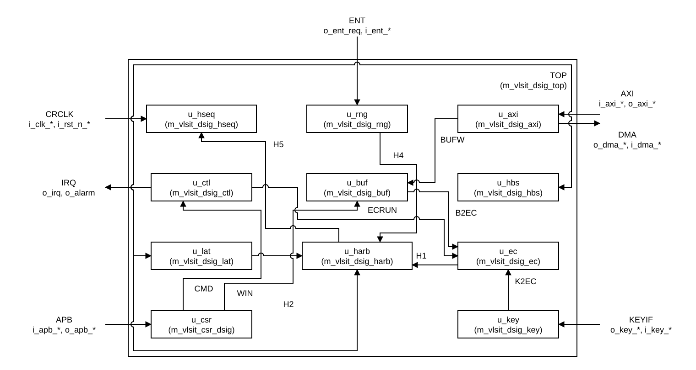

```json
{
  "page_name": "BLOCK_DIAGRAM",
  "out_name": "block_diagram.drawio",
  "table_suffix": "",
  "layout": {
    "gap_h": 100,
    "gap_v": 90,
    "margin": 40,
    "block_h": 60
  },
  "top": {
    "frame_label": [
      "TOP",
      "(m_vlsit_dsig_top)"
    ],
    "block_label": [
      "TOP",
      "(m_vlsit_dsig_top)"
    ],
    "block_row": [
      "TOP (m_vlsit_dsig_top)",
      "Structural top.",
      "Section 14.2"
    ]
  },
  "frame_row": [
    "TOP (m_vlsit_dsig_top) frame",
    "Structural top.",
    "Section 14.2"
  ],
  "frame_interfaces": [
    "APB",
    "AXI",
    "DMA",
    "KEYIF",
    "ENT",
    "IRQ",
    "CRCLK"
  ],
  "blocks": [
    {
      "key": "U_CSR",
      "label": [
        "u_csr",
        "(m_vlsit_csr_dsig)"
      ],
      "width": 220,
      "row": 3,
      "col": 0,
      "row_name": "u_csr (m_vlsit_csr_dsig)",
      "function": "APB4 CSR generated from the workbook",
      "source": "Section 14.2"
    },
    {
      "key": "U_CTL",
      "label": [
        "u_ctl",
        "(m_vlsit_dsig_ctl)"
      ],
      "width": 220,
      "row": 1,
      "col": 0,
      "row_name": "u_ctl (m_vlsit_dsig_ctl)",
      "function": "Control FSM, checks, status, counters and log, hybrid policy",
      "source": "Section 14.2"
    },
    {
      "key": "U_AXI",
      "label": [
        "u_axi",
        "(m_vlsit_dsig_axi)"
      ],
      "width": 220,
      "row": 0,
      "col": 2,
      "row_name": "u_axi (m_vlsit_dsig_axi)",
      "function": "AXI4 subordinate, DMA lines",
      "source": "Section 14.2"
    },
    {
      "key": "U_BUF",
      "label": [
        "u_buf",
        "(m_vlsit_dsig_buf)"
      ],
      "width": 220,
      "row": 1,
      "col": 1,
      "row_name": "u_buf (m_vlsit_dsig_buf)",
      "function": "Buffer memory and window path",
      "source": "Section 14.2"
    },
    {
      "key": "U_KEY",
      "label": [
        "u_key",
        "(m_vlsit_dsig_key)"
      ],
      "width": 220,
      "row": 3,
      "col": 2,
      "row_name": "u_key (m_vlsit_dsig_key)",
      "function": "Key intake and clearing",
      "source": "Section 14.2"
    },
    {
      "key": "U_EC",
      "label": [
        "u_ec",
        "(m_vlsit_dsig_ec)"
      ],
      "width": 220,
      "row": 2,
      "col": 2,
      "row_name": "u_ec (m_vlsit_dsig_ec)",
      "function": "Elliptic-curve engine",
      "source": "Section 14.2"
    },
    {
      "key": "U_LAT",
      "label": [
        "u_lat",
        "(m_vlsit_dsig_lat)"
      ],
      "width": 220,
      "row": 2,
      "col": 0,
      "row_name": "u_lat (m_vlsit_dsig_lat)",
      "function": "Lattice engine (ML-DSA)",
      "source": "Section 14.2"
    },
    {
      "key": "U_HBS",
      "label": [
        "u_hbs",
        "(m_vlsit_dsig_hbs)"
      ],
      "width": 220,
      "row": 1,
      "col": 2,
      "row_name": "u_hbs (m_vlsit_dsig_hbs)",
      "function": "Hash-based signature verifier",
      "source": "Section 14.2"
    },
    {
      "key": "U_RNG",
      "label": [
        "u_rng",
        "(m_vlsit_dsig_rng)"
      ],
      "width": 220,
      "row": 0,
      "col": 1,
      "row_name": "u_rng (m_vlsit_dsig_rng)",
      "function": "Random source and hash-based generator",
      "source": "Section 14.2"
    },
    {
      "key": "U_HARB",
      "label": [
        "u_harb",
        "(m_vlsit_dsig_harb)"
      ],
      "width": 240,
      "row": 2,
      "col": 1,
      "row_name": "u_harb (m_vlsit_dsig_harb)",
      "function": "Hash arbiter",
      "source": "Section 14.2"
    },
    {
      "key": "U_HSEQ",
      "label": [
        "u_hseq",
        "(m_vlsit_dsig_hseq)"
      ],
      "width": 240,
      "row": 0,
      "col": 0,
      "row_name": "u_hseq (m_vlsit_dsig_hseq)",
      "function": "Stream sequencer: padding, absorb, squeeze",
      "source": "Section 14.2"
    }
  ],
  "connectors": [
    {
      "id": "CMD",
      "src": "U_CSR",
      "src_side": "T",
      "dst": "U_CTL",
      "dst_side": "B"
    },
    {
      "id": "WIN",
      "src": "U_CSR",
      "src_side": "T",
      "dst": "U_BUF",
      "dst_side": "B"
    },
    {
      "id": "BUFW",
      "src": "U_AXI",
      "src_side": "L",
      "dst": "U_BUF",
      "dst_side": "R"
    },
    {
      "id": "ECRUN",
      "src": "U_CTL",
      "src_side": "R",
      "dst": "U_EC",
      "dst_side": "L"
    },
    {
      "id": "B2EC",
      "src": "U_BUF",
      "src_side": "R",
      "dst": "U_EC",
      "dst_side": "L"
    },
    {
      "id": "K2EC",
      "src": "U_KEY",
      "src_side": "T",
      "dst": "U_EC",
      "dst_side": "B"
    },
    {
      "id": "H1",
      "src": "U_EC",
      "src_side": "L",
      "dst": "U_HARB",
      "dst_side": "R"
    },
    {
      "id": "H4",
      "src": "U_RNG",
      "src_side": "B",
      "dst": "U_HARB",
      "dst_side": "T"
    },
    {
      "id": "H2",
      "src": "U_LAT",
      "src_side": "R",
      "dst": "U_HARB",
      "dst_side": "L"
    },
    {
      "id": "H5",
      "src": "U_HARB",
      "src_side": "T",
      "dst": "U_HSEQ",
      "dst_side": "B"
    }
  ],
  "externals": [
    {
      "id": "APB",
      "block": "U_CSR",
      "side": "L",
      "dir": "in",
      "pos": 0,
      "text": [
        "APB",
        "i_apb_*, o_apb_*"
      ]
    },
    {
      "id": "AXI",
      "block": "U_AXI",
      "side": "R",
      "dir": "in",
      "pos": 0,
      "text": [
        "AXI",
        "i_axi_*, o_axi_*"
      ]
    },
    {
      "id": "DMA",
      "block": "U_AXI",
      "side": "R",
      "dir": "out",
      "pos": 1,
      "text": [
        "DMA",
        "o_dma_*, i_dma_*"
      ]
    },
    {
      "id": "KEYIF",
      "block": "U_KEY",
      "side": "R",
      "dir": "in",
      "pos": 0,
      "text": [
        "KEYIF",
        "o_key_*, i_key_*"
      ]
    },
    {
      "id": "ENT",
      "block": "U_RNG",
      "side": "T",
      "dir": "in",
      "pos": 0,
      "text": [
        "ENT",
        "o_ent_req, i_ent_*"
      ]
    },
    {
      "id": "IRQ",
      "block": "U_CTL",
      "side": "L",
      "dir": "out",
      "pos": 0,
      "text": [
        "IRQ",
        "o_irq, o_alarm"
      ]
    },
    {
      "id": "CRCLK",
      "block": "U_HSEQ",
      "side": "L",
      "dir": "in",
      "pos": 0,
      "text": [
        "CRCLK",
        "i_clk_*, i_rst_n_*"
      ]
    }
  ],
  "nets": [
    {
      "entry": "CRCLK",
      "sinks": [
        {
          "id": "CK1",
          "block": "U_HARB",
          "side": "B",
          "pos": 0
        },
        {
          "id": "CK2",
          "block": "U_HBS",
          "side": "R",
          "pos": 0
        },
        {
          "id": "CK3",
          "block": "U_LAT",
          "side": "L",
          "pos": 0
        }
      ]
    }
  ],
  "interfaces": [
    {
      "id": "APB",
      "name": "APB4 CSR port",
      "category": "bus",
      "active": "external -> TOP",
      "signals": "external -> TOP: i_apb_psel, i_apb_penable, i_apb_pwrite, i_apb_paddr, i_apb_pwdata, i_apb_pstrb, i_apb_pprot; TOP -> external: o_apb_pready, o_apb_pslverr, o_apb_prdata"
    },
    {
      "id": "AXI",
      "name": "AXI4 subordinate data port",
      "category": "bus",
      "active": "external -> TOP",
      "signals": "external -> TOP: i_axi_awvalid, i_axi_awid, i_axi_awaddr, i_axi_awlen, i_axi_awsize, i_axi_awburst, i_axi_wvalid, i_axi_wdata, i_axi_wstrb, i_axi_wlast, i_axi_bready, i_axi_arvalid, i_axi_arid, i_axi_araddr, i_axi_arlen, i_axi_arsize, i_axi_arburst, i_axi_rready; TOP -> external: o_axi_awready, o_axi_wready, o_axi_bvalid, o_axi_bid, o_axi_bresp, o_axi_arready, o_axi_rvalid, o_axi_rid, o_axi_rdata, o_axi_rresp, o_axi_rlast"
    },
    {
      "id": "DMA",
      "name": "DMA request and acknowledge",
      "category": "handshake",
      "active": "TOP -> external",
      "signals": "TOP -> external: o_dma_in_req, o_dma_out_req; external -> TOP: i_dma_in_ack, i_dma_out_ack"
    },
    {
      "id": "KEYIF",
      "name": "Private-key input",
      "category": "handshake",
      "active": "TOP -> external",
      "signals": "TOP -> external: o_key_req, o_key_idx; external -> TOP: i_key_valid, i_key_data"
    },
    {
      "id": "ENT",
      "name": "Entropy input",
      "category": "handshake",
      "active": "TOP -> external",
      "signals": "TOP -> external: o_ent_req; external -> TOP: i_ent_valid, i_ent_data"
    },
    {
      "id": "IRQ",
      "name": "Interrupt and alarm",
      "category": "custom",
      "active": "TOP -> external",
      "signals": "TOP -> external: o_irq, o_alarm"
    },
    {
      "id": "CRCLK",
      "name": "Clock and reset",
      "category": "custom",
      "active": "SoC -> TOP",
      "signals": "i_clk_core, i_rst_n_core, i_clk_apb, i_rst_n_apb"
    },
    {
      "id": "CMD",
      "name": "Command and status",
      "category": "custom",
      "active": "u_csr -> u_ctl",
      "signals": "u_csr -> u_ctl: command and configuration fields; u_ctl -> u_csr: status, events"
    },
    {
      "id": "WIN",
      "name": "Data window",
      "category": "custom",
      "active": "u_csr -> u_buf",
      "signals": "u_csr -> u_buf: window read and write events; u_buf -> u_csr: read data"
    },
    {
      "id": "BUFW",
      "name": "Buffer access from AXI4",
      "category": "custom",
      "active": "u_axi -> u_buf",
      "signals": "u_axi <-> u_buf: address, data, strobes, response"
    },
    {
      "id": "ECRUN",
      "name": "Engine start and result",
      "category": "custom",
      "active": "u_ctl -> engines",
      "signals": "u_ctl -> u_ec, u_lat, u_hbs: start, parameters; engines -> u_ctl: done, status"
    },
    {
      "id": "B2EC",
      "name": "Buffer access of the engines",
      "category": "custom",
      "active": "u_ec <-> u_buf",
      "signals": "u_ec <-> u_buf: read address, read data, result write"
    },
    {
      "id": "K2EC",
      "name": "Key to engines",
      "category": "custom",
      "active": "u_key -> u_ec",
      "signals": "u_key -> u_ec, u_lat: key words"
    },
    {
      "id": "H1",
      "name": "Hash request from the elliptic-curve engine",
      "category": "custom",
      "active": "u_ec -> u_harb",
      "signals": "u_ec <-> u_harb: request, data, digest"
    },
    {
      "id": "H2",
      "name": "Hash request from the lattice engine",
      "category": "custom",
      "active": "u_lat -> u_harb",
      "signals": "u_lat <-> u_harb: request, data, squeeze"
    },
    {
      "id": "H4",
      "name": "Hash request from the random block",
      "category": "custom",
      "active": "u_rng -> u_harb",
      "signals": "u_rng <-> u_harb: request, data, digest"
    },
    {
      "id": "H5",
      "name": "Granted stream to the sequencer",
      "category": "custom",
      "active": "u_harb -> u_hseq",
      "signals": "u_harb <-> u_hseq: stream data, last, digest"
    }
  ],
  "legend_note": "The enclosing frame is the top module; blocks inside are its instances. For clarity the figure omits the key-word path of u_csr to u_key, the hash request path of u_hbs to u_harb (same as u_lat), and the key and random paths to u_lat and u_hbs (same as u_ec); the hash engine m_vlsit_sha_eng and the padder m_vlsit_sha_pad are inside u_hseq.",
  "library_sha256": "15DFB183E267D2A94F8CAB316E01EB3D2E9D2F9C006DC816790A394F4123506C"
}
```

*Figure 5-1. Block diagram of the top module. Source: `figures/block_diagram.drawio` (draw.io, VLSIT library, drawn by `vlsit_spec_diagram.py`).*

The figure omits the key-word path from `u_csr` to `u_key`, the hash request path from `u_hbs` to `u_harb` (the same as the one of `u_lat`), and the key and random-byte paths to `u_lat` and `u_hbs` (the same as those of `u_ec`), to keep it legible (DEC-022). Interfaces are listed in the interface table of the draw.io source.

### 5.3 Transaction and dataflow

1. Software (or the DMA through the AXI4 port) writes message, signature and public key into the buffer. In prehash form only the digest is written.
2. Software writes the algorithm, parameter-set, operation and mode fields, then the start command. The control block checks, in order: enable bit of the algorithm, operation built, lock state, data length, key availability.
3. The control block starts the engine. The engine reads the buffer, requests hash computations from the arbiter, requests random bytes when it needs them, and reads the private key from the key block.
4. For signing with verify-after-sign, the control block starts the verification path of the same algorithm on the result; a mismatch suppresses the signature.
5. The control block writes the result to the buffer, sets the done or error status, raises the interrupt, and starts the clearing of secret state.

### 5.4 Invariants

- At most one operation is active; a start command while busy is rejected.
- At most one engine owns the hash engine at a time.
- A private key exists in a register only between key intake and the clearing that follows completion, failure, abort or reset.
- No interface returns private key bytes.
- An algorithm whose enable bit is 0 never starts.

## 6. External interfaces and ports

### 6.1 Interface inventory

| Interface ID | Type and revision | Role | Direction at IP boundary | Clock domain | Required / optional | Configurations |
|---|---|---|---|---|---|---|
| IF-001 | AMBA APB4 | Completer (CSR) | Input requests, output responses | CLK-APB | Required | All |
| IF-002 | AMBA AXI4 | Subordinate, message buffer window | Input requests, output responses | CLK-CORE | Optional | `PARA_EN_AXI` |
| IF-003 | DMA request and acknowledge | Request source | Output request, input acknowledge | CLK-CORE | Optional | `PARA_EN_DMA` |
| IF-004 | Key input (custom, word-serial) | Key requester | Output request, input data | CLK-CORE | Optional | `PARA_EN_KEYIF` |
| IF-005 | Entropy input (custom) | Entropy requester | Output request, input data | CLK-CORE | Required | All with randomness |
| IF-006 | Interrupt and alarm | Source | Output | CLK-CORE | Required | All |

### 6.2 Complete port list

The AXI4 subordinate has write and read channels (ASM-009). Port names follow VLSIT RTL Design Rule v2 and the style of the SHA2/SHA3 IP (019). Widths marked with a parameter depend on that parameter.

| Port | Direction | Width | Meaning (function) | Clock domain | Signal type | Reset / idle value | Timing / sampling | Configurations |
|---|---|---:|---|---|---|---|---|---|
| i_clk_core | Input | 1 | Core clock of the engines, hash engine and buffer | CLK-CORE | clock | n/a clock | Rising edge | All |
| i_rst_n_core | Input | 1 | Core reset, active low | async | reset (asynchronous assertion, synchronized release) | Asserted at power-up | Level | All |
| i_clk_apb | Input | 1 | CSR clock; tied to the core clock when `PARA_CSR_ASYNC` is 0 | CLK-APB | clock | n/a clock | Rising edge | All |
| i_rst_n_apb | Input | 1 | CSR reset, active low | async | reset (asynchronous assertion, synchronized release) | Asserted at power-up | Level | All |
| i_apb_psel | Input | 1 | APB select | CLK-APB | level | 0 | Sampled at the setup phase | All |
| i_apb_penable | Input | 1 | APB enable | CLK-APB | level | 0 | Sampled at the access phase | All |
| i_apb_pwrite | Input | 1 | APB write direction | CLK-APB | level (valid with psel) | 0 | Sampled with psel | All |
| i_apb_paddr | Input | 16 | APB byte address | CLK-APB | data (valid with psel) | 0 | Sampled with psel | All |
| i_apb_pwdata | Input | 32 | APB write data | CLK-APB | data (valid with psel and pwrite) | 0 | Sampled with penable | All |
| i_apb_pstrb | Input | 4 | APB write strobes | CLK-APB | data (valid with psel and pwrite) | 0 | Sampled with penable | All |
| i_apb_pprot | Input | 3 | APB protection; only bit 1 is used | CLK-APB | data (valid with psel) | 0 | Sampled with psel | All |
| o_apb_pready | Output | 1 | APB ready | CLK-APB | level | 0 | Per generated CSR (section 11) | All |
| o_apb_pslverr | Output | 1 | APB slave error | CLK-APB | level | 0 | Per generated CSR (section 11) | All |
| o_apb_prdata | Output | 32 | APB read data | CLK-APB | data (valid with pready and read) | 0 | Per generated CSR | All |
| i_protect_en | Input | 1 | Enable the protection check on the CSR | async | static | Tied after reset | Constant after reset | All |
| i_slverr_en | Input | 1 | Enable the error response of the CSR | async | static | Tied after reset | Constant after reset | All |
| i_axi_awvalid | Input | 1 | AXI4 write address valid | CLK-CORE | level | 0 | Handshake with awready | `PARA_EN_AXI` |
| o_axi_awready | Output | 1 | AXI4 write address ready | CLK-CORE | level | 0 | Handshake with awvalid | `PARA_EN_AXI` |
| i_axi_awid | Input | `PARA_AXI_IDW` | AXI4 write id | CLK-CORE | data (valid with awvalid) | 0 | Sampled at handshake | `PARA_EN_AXI` |
| i_axi_awaddr | Input | `PARA_AXI_AW` | AXI4 write address | CLK-CORE | data (valid with awvalid) | 0 | Sampled at handshake | `PARA_EN_AXI` |
| i_axi_awlen | Input | 8 | AXI4 burst length minus one | CLK-CORE | data (valid with awvalid) | 0 | Sampled at handshake | `PARA_EN_AXI` |
| i_axi_awsize | Input | 3 | AXI4 transfer size | CLK-CORE | data (valid with awvalid) | 0 | Sampled at handshake | `PARA_EN_AXI` |
| i_axi_awburst | Input | 2 | AXI4 burst type | CLK-CORE | data (valid with awvalid) | 0 | Sampled at handshake | `PARA_EN_AXI` |
| i_axi_wvalid | Input | 1 | AXI4 write data valid | CLK-CORE | level | 0 | Handshake with wready | `PARA_EN_AXI` |
| o_axi_wready | Output | 1 | AXI4 write data ready | CLK-CORE | level | 0 | Handshake with wvalid | `PARA_EN_AXI` |
| i_axi_wdata | Input | `PARA_AXI_DW` | AXI4 write data | CLK-CORE | data (valid with wvalid) | 0 | Sampled at handshake | `PARA_EN_AXI` |
| i_axi_wstrb | Input | `PARA_AXI_DW` / 8 | AXI4 write strobes | CLK-CORE | data (valid with wvalid) | 0 | Sampled at handshake | `PARA_EN_AXI` |
| i_axi_wlast | Input | 1 | AXI4 last write transfer | CLK-CORE | level (valid with wvalid) | 0 | Sampled at handshake | `PARA_EN_AXI` |
| o_axi_bvalid | Output | 1 | AXI4 write response valid | CLK-CORE | level | 0 | Handshake with bready | `PARA_EN_AXI` |
| i_axi_bready | Input | 1 | AXI4 write response ready | CLK-CORE | level | 0 | Handshake with bvalid | `PARA_EN_AXI` |
| o_axi_bid | Output | `PARA_AXI_IDW` | AXI4 write response id | CLK-CORE | data (valid with bvalid) | 0 | Sampled at handshake | `PARA_EN_AXI` |
| o_axi_bresp | Output | 2 | AXI4 write response: OKAY or SLVERR | CLK-CORE | data (valid with bvalid) | 0 | Sampled at handshake | `PARA_EN_AXI` |
| i_axi_arvalid | Input | 1 | AXI4 read address valid | CLK-CORE | level | 0 | Handshake with arready | `PARA_EN_AXI` |
| o_axi_arready | Output | 1 | AXI4 read address ready | CLK-CORE | level | 0 | Handshake with arvalid | `PARA_EN_AXI` |
| i_axi_arid | Input | `PARA_AXI_IDW` | AXI4 read id | CLK-CORE | data (valid with arvalid) | 0 | Sampled at handshake | `PARA_EN_AXI` |
| i_axi_araddr | Input | `PARA_AXI_AW` | AXI4 read address | CLK-CORE | data (valid with arvalid) | 0 | Sampled at handshake | `PARA_EN_AXI` |
| i_axi_arlen | Input | 8 | AXI4 read burst length minus one | CLK-CORE | data (valid with arvalid) | 0 | Sampled at handshake | `PARA_EN_AXI` |
| i_axi_arsize | Input | 3 | AXI4 read transfer size | CLK-CORE | data (valid with arvalid) | 0 | Sampled at handshake | `PARA_EN_AXI` |
| i_axi_arburst | Input | 2 | AXI4 read burst type | CLK-CORE | data (valid with arvalid) | 0 | Sampled at handshake | `PARA_EN_AXI` |
| o_axi_rvalid | Output | 1 | AXI4 read data valid | CLK-CORE | level | 0 | Handshake with rready | `PARA_EN_AXI` |
| i_axi_rready | Input | 1 | AXI4 read data ready | CLK-CORE | level | 0 | Handshake with rvalid | `PARA_EN_AXI` |
| o_axi_rid | Output | `PARA_AXI_IDW` | AXI4 read data id | CLK-CORE | data (valid with rvalid) | 0 | Sampled at handshake | `PARA_EN_AXI` |
| o_axi_rdata | Output | `PARA_AXI_DW` | AXI4 read data | CLK-CORE | data (valid with rvalid) | 0 | Sampled at handshake | `PARA_EN_AXI` |
| o_axi_rresp | Output | 2 | AXI4 read response: OKAY or SLVERR | CLK-CORE | data (valid with rvalid) | 0 | Sampled at handshake | `PARA_EN_AXI` |
| o_axi_rlast | Output | 1 | AXI4 last read transfer | CLK-CORE | level (valid with rvalid) | 0 | Sampled at handshake | `PARA_EN_AXI` |
| o_dma_in_req | Output | 1 | Request to the DMA to write the next message data | CLK-CORE | level (stays until acknowledge) | 0 | Handshake with i_dma_in_ack | `PARA_EN_DMA` |
| i_dma_in_ack | Input | 1 | DMA acknowledges the input request | CLK-CORE | pulse (1 cycle) | 0 | Sampled each cycle | `PARA_EN_DMA` |
| o_dma_out_req | Output | 1 | Request to the DMA to read the result from the buffer | CLK-CORE | level (stays until acknowledge) | 0 | Handshake with i_dma_out_ack | `PARA_EN_DMA` |
| i_dma_out_ack | Input | 1 | DMA acknowledges the output request | CLK-CORE | pulse (1 cycle) | 0 | Sampled each cycle | `PARA_EN_DMA` |
| o_key_req | Output | 1 | The IP requests the next 32-bit word of the private key | CLK-CORE | level (stays until i_key_valid) | 0 | Handshake with i_key_valid | `PARA_EN_KEYIF` |
| o_key_idx | Output | 5 | Index of the requested key word | CLK-CORE | data (valid with o_key_req) | 0 | Sampled with o_key_req | `PARA_EN_KEYIF` |
| i_key_valid | Input | 1 | The key word on i_key_data is valid | CLK-CORE | pulse (1 cycle) | 0 | Sampled each cycle with o_key_req | `PARA_EN_KEYIF` |
| i_key_data | Input | 32 | Private-key word supplied by the key store | CLK-CORE | data (valid with i_key_valid) | 0 | Sampled with i_key_valid | `PARA_EN_KEYIF` |
| o_ent_req | Output | 1 | The IP requests entropy words | CLK-CORE | level | 0 | Handshake with i_ent_valid | All with randomness |
| i_ent_valid | Input | 1 | Entropy word valid | CLK-CORE | level | 0 | Sampled each cycle | All with randomness |
| i_ent_data | Input | 32 | Entropy word (random bytes or generator seed) | CLK-CORE | data (valid with i_ent_valid) | 0 | Sampled with i_ent_valid | All with randomness |
| o_irq | Output | 1 | Interrupt: done, error or security event, masked | CLK-CORE | level | 0 | Level until cleared by software | All |
| o_alarm | Output | 1 | Security alarm: fault flag, lock violation, self-check mismatch | CLK-CORE | level | 0 | Level until cleared | All |

### 6.3 Protocol behavior

APB4 behavior of the CSR is that of the generated module and is stated in section 11. AXI4 facts used here come from `vlsit_axi_amba_axi_ihi0022h_c.md` section "Burst length": AXI4 allows INCR bursts of 1 to 256 transfers; wrapping bursts need 2, 4, 8 or 16 transfers.

| Case | Legal behavior | Illegal / unsupported case | IP response | Requirement IDs |
|---|---|---|---|---|
| AXI4 write to the buffer window | INCR burst of 1 to 256 transfers inside the window while the buffer is idle | FIXED or WRAP burst, burst past the window end, write while busy | SLVERR on the write response, no byte written | REQ-IF-002 |
| AXI4 read of the buffer window | INCR burst inside the window after done | Read while busy, burst past the window end | SLVERR on the read response with zero data | REQ-IF-002 |
| AXI4 outstanding transactions | One write burst and one read burst at a time | A second address before the first burst completes | The ready of the address channel stays 0 until the burst completes | REQ-IF-002 |
| Key input | The IP requests each word once; the key store answers with one pulse | No answer within the entropy and key timeout | Error flag and key clearing | REQ-SEC-001 |
| Entropy input | Word valid for one cycle when requested | No word within the timeout | Error flag | REQ-SEC-007 |

### 6.4 Interrupts and events

| Signal/event | Polarity | Assert condition | Clear/deassert condition | Mask/priority | Crossing | Reset state |
|---|---|---|---|---|---|---|
| o_irq done | Active high level | Operation completed | Software clears the done event in the CSR | Maskable by the interrupt enable | CLK-CORE to CLK-APB through the CSR | 0 |
| o_irq error | Active high level | Error flag set (REQ-ERR-001) | Software clears the error event | Maskable | CLK-CORE to CLK-APB | 0 |
| o_alarm | Active high level | Fault flag, lock violation, self-check mismatch | Software clears the alarm | Not maskable | CLK-CORE to CLK-APB | 0 |

## 7. Clock, reset, and power

### 7.1 Clock domains

| Domain | Clock port | Edge | Frequency range | Source | Relationship to other clocks | Gating policy |
|---|---|---|---|---|---|---|
| CLK-CORE | i_clk_core | Rising | 100 MHz nominal for the boot sizing, target up to 200 MHz (ASM-009) | SoC clock controller | Asynchronous to CLK-APB when `PARA_CSR_ASYNC` is 1, the same clock when 0 | None inside the IP; the SoC may gate the clock while idle |
| CLK-APB | i_clk_apb | Rising | up to 50 MHz in the asynchronous build (ASM-009) | SoC clock controller | As above | None inside the IP |

### 7.2 CDC and RDC

| Crossing ID | From to | Signals | Structure | Reset handling | Constraints / verification |
|---|---|---|---|---|---|
| CDC-001 | CLK-APB to CLK-CORE | Command and configuration fields from the CSR | Structure of the generated CSR module when `PARA_CSR_ASYNC` is 1 (bundled data with handshake) | Both resets deasserted before use | Static timing exceptions and CDC tool run in section 17 |
| CDC-002 | CLK-CORE to CLK-APB | Status, events, counters | Structure of the generated CSR module when `PARA_CSR_ASYNC` is 1 | Same | Same |

No other crossing exists: every other block is in CLK-CORE.

### 7.3 Reset domains and sequencing

| Reset ID | Port | Polarity / assertion | Sync or async | Scope | Deassertion | Reset value |
|---|---|---|---|---|---|---|
| RST-CORE | i_rst_n_core | Active-low | Async assertion, synchronized release | Engines, hash engine, buffer control, key block, control block | Synchronized to CLK-CORE | Idle, enable bits 0, secrets cleared |
| RST-APB | i_rst_n_apb | Active-low | Async assertion, synchronized release | CSR | Synchronized to CLK-APB | CSR reset values |

A reset of RST-CORE during an operation abandons the operation and clears the secret state (REQ-RESET-002); the CSR status is reset by RST-APB. When the clocks are the same (`PARA_CSR_ASYNC` is 0) the integrator shall assert both resets together. A software reset command is defined in the CSR workbook (section 11). Warm, partial and retention reset are not supported: state retention is excluded to avoid a retained secret.

### 7.4 Power intent (if applicable)

**N/A:** this version defines no power domain, isolation or retention behavior of its own, because the SoC defines the power domains and the secret registers are cleared on reset. The user has not been asked about power intent; it is recorded as ASM-011.

## 8. Parameters and elaboration configurations

Parameters use `parameter logic [31:0] PARA_NAME`; each has the three comment lines Parameter Description, Parameter values and Parameter unit of rule REF-003. Derived values use `LPARA_NAME`.

| Parameter | Purpose | Default | Legal values / range | Dependencies / invalid combinations | Effect |
|---|---|---|---|---|---|
| PARA_EN_ED25519 | Build Ed25519 | 0 | 0 or 1 | None | Ed25519 hardware, CSR enable bit |
| PARA_EN_ED25519CTX | Build Ed25519ctx | 0 | 0 or 1 | Needs `PARA_EN_ED25519` = 1 | Context handling |
| PARA_EN_ED25519PH | Build Ed25519ph | 0 | 0 or 1 | Needs `PARA_EN_ED25519` = 1 | Prehash form |
| PARA_EN_ED448 | Build Ed448 | 0 | 0 or 1 | None | Ed448 hardware, CSR enable bit |
| PARA_EN_ED448PH | Build Ed448ph | 0 | 0 or 1 | Needs `PARA_EN_ED448` = 1 | Prehash form |
| PARA_EN_ECDSA_P256 | Build ECDSA P-256 | 0 | 0 or 1 | None | Curve P-256 |
| PARA_EN_ECDSA_P384 | Build ECDSA P-384 | 0 | 0 or 1 | None | Curve P-384 |
| PARA_EN_ECDSA_P521 | Build ECDSA P-521 | 0 | 0 or 1 | None | Curve P-521 |
| PARA_EN_ECDSA_K256 | Build ECDSA secp256k1 | 0 | 0 or 1 | None | Curve secp256k1 |
| PARA_EN_MLDSA44 | Build ML-DSA-44 | 0 | 0 or 1 | None | Parameter set |
| PARA_EN_MLDSA65 | Build ML-DSA-65 | 0 | 0 or 1 | None | Parameter set |
| PARA_EN_MLDSA87 | Build ML-DSA-87 | 0 | 0 or 1 | None | Parameter set |
| PARA_EN_SLHDSA | Build SLH-DSA verification | 0 | 0 or 1 | Needs a nonzero `PARA_SLHDSA_SETS` | Hash-based engine for SLH-DSA |
| PARA_SLHDSA_SETS | Mask of SLH-DSA parameter sets built | 0 | 12-bit mask, one bit per set of FIPS 205 | Nonzero when `PARA_EN_SLHDSA` is 1 | Sets selectable by the CSR field |
| PARA_EN_LMS | Build LMS/HSS verification | 0 | 0 or 1 | Needs a nonzero `PARA_LMS_SETS` | Hash-based engine for LMS |
| PARA_LMS_SETS | Mask of LMS tree types built | 0 | 20-bit mask, one bit per type of section 10.2.2 | Nonzero when `PARA_EN_LMS` is 1 | Types selectable by the CSR field |
| PARA_LMOTS_SETS | Mask of LM-OTS types built | 0 | 16-bit mask, one bit per type of section 10.2.2 | Nonzero when `PARA_EN_LMS` is 1 | Types selectable by the CSR field |
| PARA_EN_XMSS | Build XMSS/XMSS^MT verification | 0 | 0 or 1 | Needs a nonzero `PARA_XMSS_SETS` | Hash-based engine for XMSS |
| PARA_XMSS_SETS_LO | Mask of XMSS and XMSS^MT sets 0 to 31 built | 0 | 32-bit mask, bit n for set n of section 10.2.3 | `PARA_XMSS_SETS_LO` or `PARA_XMSS_SETS_HI` nonzero when `PARA_EN_XMSS` is 1 | Sets selectable by the CSR field |
| PARA_XMSS_SETS_HI | Mask of XMSS and XMSS^MT sets 32 to 43 built | 0 | 12-bit mask, bit n for set 32 plus n | As above | As above |
| PARA_OP_KGEN | Algorithms with key generation built | 0 | Bit mask indexed by algorithm (index table in section 10) | Only algorithms that are built; not for SLH-DSA, LMS, XMSS | Key-generation path |
| PARA_OP_SIGN | Algorithms with signing built | 0 | Bit mask indexed by algorithm | Only algorithms that are built; not for SLH-DSA, LMS, XMSS | Signing path |
| PARA_OP_VRFY | Algorithms with verification built | 0 | Bit mask indexed by algorithm | Only algorithms that are built | Verification path |
| PARA_EN_PURE | Pure message form | 1 | 0 or 1 | At least one of `PARA_EN_PURE`, `PARA_EN_PREHASH` shall be 1 | Message buffer use |
| PARA_EN_PREHASH | Prehash message form | 1 | 0 or 1 | Same | Digest input |
| PARA_BUF_BYTES | Size of the message buffer | 1024 | 64 to 65536 bytes | Large enough for the largest signature and public key of a built algorithm (section 9) | Memory size |
| PARA_EN_AXI | Build the AXI4 subordinate port | 0 | 0 or 1 | At least one of `PARA_EN_AXI`, `PARA_EN_WIN` shall be 1 | AXI4 ports present |
| PARA_AXI_DW | AXI4 data width | 64 | 32, 64 or 128 | Needs `PARA_EN_AXI` = 1 | Data path width |
| PARA_AXI_AW | AXI4 address width | 16 | 12 to 32 | Needs `PARA_EN_AXI` = 1 | Address width |
| PARA_AXI_IDW | AXI4 id width | 4 | 1 to 16 | Needs `PARA_EN_AXI` = 1 | Id width |
| PARA_EN_DMA | Build the DMA request and acknowledge lines | 0 | 0 or 1 | Needs `PARA_EN_AXI` = 1 | DMA ports present |
| PARA_EN_WIN | Build the CSR data window | 1 | 0 or 1 | At least one of `PARA_EN_AXI`, `PARA_EN_WIN` shall be 1 | Window registers |
| PARA_EN_KEYIF | Build the key input port | 0 | 0 or 1 | At least one of `PARA_EN_KEYIF`, `PARA_EN_KEYREG` shall be 1 when any signing or key-generation operation is built | Key ports present |
| PARA_EN_KEYREG | Build the write-only key register | 0 | 0 or 1 | Same | Key CSR registers |
| PARA_RNG_SRC | Random source | 0 | 0 external entropy input used directly, 1 hash-based generator seeded by the entropy input | 1 needs the SHA-512 core in the hash engine | Random block |
| PARA_ECDSA_NONCE | ECDSA nonce mode | 0 | 0 random, 1 deterministic (RFC 6979), 2 selected by CSR | Needs an ECDSA curve built | Nonce generation |
| PARA_EN_VAS | Verify-after-sign | 0 | 0 or 1 | Needs a built signing path and its verification path | Extra verification |
| PARA_EN_DPA_EC | Masking of elliptic-curve operations | 0 | 0 or 1 | Needs an elliptic-curve algorithm built and a random source | Masking hardware |
| PARA_EN_DPA_PQ | Masking of the linear secret products of ML-DSA signing (DEC-049) | 0 | 0 or 1 | Needs an ML-DSA set built | Signing time (mask generation per product) |
| PARA_EN_HYBRID | Hybrid verification | 0 | 0 or 1 | Needs Ed25519 verification and one ML-DSA set with verification | Policy field |
| PARA_EN_LOG | Counters and lock log | 0 | 0 or 1 | None | Counter registers |
| PARA_EN_LOCK | Lock of the enable bits | 0 | 0 or 1 | None | Lock bit |
| PARA_CSR_ASYNC | CSR clock asynchronous to the core clock | 0 | 0 or 1 | None | Crossing logic inside the CSR |
| PARA_MUL_W | Digit width of the field multiplier | 64 | 32, 64 or 128 | None | Area and time of elliptic-curve and lattice arithmetic |
| PARA_S256_UNR | Rounds per cycle of the SHA-256 core | 1 | Divisors of 64 | Same as 019 | Hash speed |
| PARA_S512_UNR | Rounds per cycle of the SHA-512 core | 1 | Divisors of 80 | Same as 019 | Hash speed |
| PARA_KEC_UNR | Rounds per cycle of the Keccak core | 1 | Divisors of 24 | Same as 019 | Hash speed |

| Configuration | Parameter overrides | Features/interfaces | Expected hierarchy | Elaboration/lint/synthesis target |
|---|---|---|---|---|
| CFG-BOOT | `PARA_EN_ED25519` 1, `PARA_EN_ECDSA_P256` 1, `PARA_EN_MLDSA65` 1, `PARA_OP_VRFY` for those, `PARA_EN_PREHASH` 1, `PARA_EN_WIN` 1, all other options 0 | Verification only, CSR window, APB4 | Top, CSR, control, buffer, elliptic-curve engine, lattice engine, hash engine, arbiter | Lint clean, synthesis for area |
| CFG-SIGNER | CFG-BOOT plus `PARA_OP_SIGN`, `PARA_EN_PURE` 1, `PARA_EN_AXI` 1, `PARA_EN_DMA` 1, `PARA_EN_KEYIF` 1, `PARA_EN_VAS` 1, `PARA_EN_DPA_EC` 1 | Signing, AXI4, key interface | CFG-BOOT plus AXI, key, random blocks | Lint, CDC, synthesis |
| CFG-FULL | Every algorithm and every option set to 1 or to the full mask | All | All blocks | Lint, CDC, synthesis for the area bound |

An illegal combination (every row of the "Dependencies" column) stops elaboration with an error message that names the parameter (REQ-PARAM-001). No port width changes with a runtime value; a port exists only when its parameter builds it.

## 9. Data representation and arithmetic

All hardware data are unsigned four-state logic vectors per REF-003. Where a standard assigns a signed or modular meaning, the mathematical behavior is given here and the RTL compares and extends explicitly at bit level.

**Byte order and packing.** The buffer holds a byte string. Byte 0 of the buffer is bits 7:0 of the first 32-bit word, byte 1 is bits 15:8, and so on (little-endian words). An AXI4 write places byte i of a transfer on lane i of `i_axi_wdata` (AXI4 byte lanes, `vlsit_axi_amba_axi_ihi0022h_c.md`). Each item is the byte string defined by its standard:

- Ed25519 and Ed448: public key, signature and private key as in RFC 8032 (little-endian integer encodings, section 5.1 and 5.2).
- ECDSA: the signature is the raw concatenation of r and s, each a big-endian integer of the length of the group order (design choice ASM-012, because FIPS 186-5 does not fix a wire format); the public key is the uncompressed point X || Y, each coordinate big-endian of the field length.
- ML-DSA, SLH-DSA, LMS/HSS, XMSS/XMSS^MT: the encodings of FIPS 204, FIPS 205 and SP 800-208.

| Quantity | Width | Encoding / range | Extension / truncation | Overflow / invalid behavior |
|---|---:|---|---|---|
| Ed25519 field element | 255 bits | Integer modulo 2^255 - 19 (REF-001, REF-011) | Stored in a datapath of `PARA_MUL_W`-bit digits; partial results reduced after each multiplication | Public-key or signature encodings outside the field range are rejected as invalid format |
| Ed25519 scalar | 253 bits | Integer modulo the group order L | Hash outputs of 64 bytes are reduced modulo L | Signature scalar S not below L is rejected (REF-001) |
| Ed448 field element and scalar | 448 and 446 bits | Integer modulo 2^448 - 2^224 - 1; scalar modulo the group order (REF-001) | Hash outputs of 114 bytes reduced modulo the group order | Same as Ed25519 |
| ECDSA field and order | 256, 384, 521 bits | NIST P-256, P-384, P-521 and secp256k1 parameters of REF-011 and REF-012 | Hash output truncated or left-padded to the order length as in REF-002 section 6.4 | A public point not on the curve, r or s outside 1 to n-1: invalid |
| ML-DSA coefficient | 23 bits | Integer modulo q = 8380417, polynomial of 256 coefficients (REF-006) | Centered representatives only inside the rounding and hint functions | A signature or key of the wrong length: invalid format |
| Hash digest or XOF output | 32, 48, 64 bytes; any length for SHAKE | As REF-009 and REF-010 | Prehash digests must match the selected hash length | Wrong digest length: bad-length error |
| Message length | 32 bits | Unsigned bytes, 0 to 0xFFFFFFFF | None | Longer than the buffer in pure form: buffer-overflow error |
| Context length | 8 bits | Unsigned bytes, 0 to 255 | None | A longer value: bad-length error (REQ-FUNC-002) |
| Buffer offset | 17 bits | Unsigned bytes | Word aligned for window accesses | Region not inside the buffer: buffer-overflow error |
| Algorithm, operation, form, hash and policy codes | 2 to 4 bits | As the CSR workbook | Reserved codes are never decoded | A reserved or not built code: unsupported-operation error |
| Private key word | 32 bits | One word of the key byte string, word 0 first | Unused words ignored | A key of the wrong length: bad-key error |

Modular arithmetic: multiplication results are reduced fully before use as an operand; subtraction adds the modulus when the result would be negative; division is replaced by an inversion computed with a fixed sequence of operations (so that the time is independent of the value, REQ-SEC-002); there is no division by zero because an inversion of zero returns zero and the format checks reject the inputs that would need it. There is no saturation or rounding except where FIPS 204 defines it for the ML-DSA hint functions.

## 10. Detailed functional behavior

### 10.1 Modes and state transitions

<!-- FSM-DIAGRAM:dsig_ctl -->
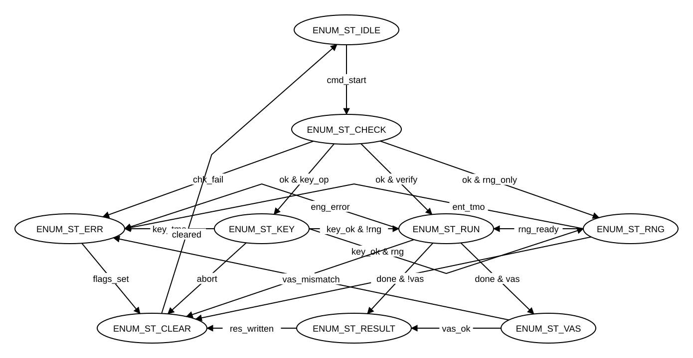

```json
{
  "page_name": "FSM_DSIG_CTL",
  "out_name": "dsig_ctl_fsm.drawio",
  "function": "dsig_ctl",
  "initial": "ENUM_ST_IDLE",
  "state_pattern": "^ENUM_ST_[A-Z0-9_]+$",
  "states": [
    {
      "name": "ENUM_ST_IDLE"
    },
    {
      "name": "ENUM_ST_CHECK"
    },
    {
      "name": "ENUM_ST_KEY"
    },
    {
      "name": "ENUM_ST_RNG"
    },
    {
      "name": "ENUM_ST_RUN"
    },
    {
      "name": "ENUM_ST_VAS"
    },
    {
      "name": "ENUM_ST_RESULT"
    },
    {
      "name": "ENUM_ST_CLEAR"
    },
    {
      "name": "ENUM_ST_ERR"
    }
  ],
  "transitions": [
    {
      "src": "ENUM_ST_IDLE",
      "dst": "ENUM_ST_CHECK",
      "label": "cmd_start"
    },
    {
      "src": "ENUM_ST_CHECK",
      "dst": "ENUM_ST_ERR",
      "label": "chk_fail"
    },
    {
      "src": "ENUM_ST_CHECK",
      "dst": "ENUM_ST_KEY",
      "label": "ok & key_op"
    },
    {
      "src": "ENUM_ST_CHECK",
      "dst": "ENUM_ST_RNG",
      "label": "ok & rng_only"
    },
    {
      "src": "ENUM_ST_CHECK",
      "dst": "ENUM_ST_RUN",
      "label": "ok & verify"
    },
    {
      "src": "ENUM_ST_KEY",
      "dst": "ENUM_ST_RNG",
      "label": "key_ok & rng"
    },
    {
      "src": "ENUM_ST_KEY",
      "dst": "ENUM_ST_RUN",
      "label": "key_ok & !rng"
    },
    {
      "src": "ENUM_ST_KEY",
      "dst": "ENUM_ST_ERR",
      "label": "key_tmo"
    },
    {
      "src": "ENUM_ST_KEY",
      "dst": "ENUM_ST_CLEAR",
      "label": "abort"
    },
    {
      "src": "ENUM_ST_RNG",
      "dst": "ENUM_ST_RUN",
      "label": "rng_ready"
    },
    {
      "src": "ENUM_ST_RNG",
      "dst": "ENUM_ST_ERR",
      "label": "ent_tmo"
    },
    {
      "src": "ENUM_ST_RNG",
      "dst": "ENUM_ST_CLEAR",
      "label": "abort"
    },
    {
      "src": "ENUM_ST_RUN",
      "dst": "ENUM_ST_VAS",
      "label": "done & vas"
    },
    {
      "src": "ENUM_ST_RUN",
      "dst": "ENUM_ST_RESULT",
      "label": "done & !vas"
    },
    {
      "src": "ENUM_ST_RUN",
      "dst": "ENUM_ST_ERR",
      "label": "eng_error"
    },
    {
      "src": "ENUM_ST_RUN",
      "dst": "ENUM_ST_CLEAR",
      "label": "abort"
    },
    {
      "src": "ENUM_ST_VAS",
      "dst": "ENUM_ST_RESULT",
      "label": "vas_ok"
    },
    {
      "src": "ENUM_ST_VAS",
      "dst": "ENUM_ST_ERR",
      "label": "vas_mismatch"
    },
    {
      "src": "ENUM_ST_RESULT",
      "dst": "ENUM_ST_CLEAR",
      "label": "res_written"
    },
    {
      "src": "ENUM_ST_ERR",
      "dst": "ENUM_ST_CLEAR",
      "label": "flags_set"
    },
    {
      "src": "ENUM_ST_CLEAR",
      "dst": "ENUM_ST_IDLE",
      "label": "cleared"
    }
  ]
}
```

*Figure 10-1. FSM state diagram of `dsig_ctl`. Source: `figures/dsig_ctl_fsm.drawio` (draw.io, VLSIT library, generated by `vlsit_fsm_diagram.py`).*
<!-- /FSM-DIAGRAM:dsig_ctl -->

The control block is the only finite-state machine that this specification fixes; the engines have private sequencers whose states are an implementation choice and are constrained only by the operations of section 10.2. The state diagram of the control block is the figure at the top of this section (draw.io source and JSON in `figures/`); the table below is the source of truth for it. Transition labels in the figure are short names of the conditions of the table: `chk_fail` is a failing check of ENUM_ST_CHECK, `ok & key_op` is a passed check for signing or key generation, `ok & rng_only` needs random bytes but no key, `ok & verify` is a passed check for verification, `key_ok`, `rng_ready`, `done`, `vas_ok`, `res_written`, `flags_set`, `cleared` are the completion conditions of the states, and `abort` is the abort command.

State names follow the naming rule of section 2.2 (`ENUM_ST_` prefix for enumeration members).

| Mode/state | Entry condition | Behavior | Exit condition | Outputs / side effects |
|---|---|---|---|---|
| ENUM_ST_IDLE | Reset, completion of ENUM_ST_CLEAR, abort | No operation active; the buffer is writable | `dsig_cmd.start` taken | `dsig_sts.busy` is 0 |
| ENUM_ST_CHECK | Start command taken | Checks in order: IP enabled, algorithm built, effective enable bit, operation built, lock rules, lengths, hash pairing, region inside buffer | All checks pass, or the first failing check | Sets the matching error flag on failure |
| ENUM_ST_KEY | Checks passed and the operation is signing or key generation | Takes the private key words from the key input port (`o_key_req`) or from the key registers; waits at most the key timeout | Key complete, or key timeout | `dsig_err.keytmo` on timeout |
| ENUM_ST_RNG | The operation needs random bytes | Requests bytes from the random block; waits at most the entropy timeout | Bytes available, or entropy timeout | `dsig_err.enttmo` on timeout |
| ENUM_ST_RUN | Key and random bytes ready (or not needed) | The selected engine runs the algorithm and uses the hash engine through the arbiter | Engine done, engine error, abort | `dsig_sts.busy` is 1 |
| ENUM_ST_VAS | Signing finished and `PARA_EN_VAS` is 1 | The verification path of the same algorithm checks the new signature | Check done | Mismatch sets `dsig_err.vasmis` and `dsig_alarm.fault` and suppresses the signature |
| ENUM_ST_RESULT | Engine or check finished without error | Writes the result into the buffer at `dsig_off_res.off`, sets the result flags, raises the done event | Result written | `dsig_sts.resvld`, `dsig_sts.sigok`, `dsig_irq_raw.done` |
| ENUM_ST_CLEAR | After ENUM_ST_RESULT, after an error, after abort, or after `dsig_cmd.clr` | Clears the key words, the working registers and the random state within 100 core clock cycles | Cleared | Key and working registers are zero |
| ENUM_ST_ERR | A check, key, random or engine error | Holds the error flags and goes to ENUM_ST_CLEAR | Flags set | `dsig_irq_raw.err` set |

Encoding recovery: the state register is a binary-encoded enumeration; an unused encoding goes to ENUM_ST_CLEAR in the next cycle, sets the error flag `dsig_alarm.fault`, and then ENUM_ST_IDLE.

### 10.2 Operations

The operations apply to each algorithm that is built and enabled. Algorithm rules come from the standards named in section 2.1; the IP shall follow them and this section states only the IP choices.

| Operation ID | Inputs / preconditions | Processing semantics | Result / completion | Latency / ordering |
|---|---|---|---|---|
| OP-001 Buffer load | The buffer is idle; data from the AXI4 port or the window | The AXI4 subordinate or the window registers write bytes into the buffer | The buffer holds the item; AXI4 response OKAY, or SLVERR when illegal (REQ-IF-002) | One transfer beat per core clock when ready; ordered by address |
| OP-002 Key generation | Algorithm and key generation enabled; random bytes; key store seed | Generates a key pair as defined by the standard of the algorithm (Ed25519, Ed448, ECDSA, ML-DSA); the public key is written at the result offset | Public key in the buffer; done event | Time depends on the algorithm and `PARA_MUL_W` (section 13) |
| OP-003 Sign | Algorithm and signing enabled; private key; message or digest; random bytes when the algorithm is hedged or ECDSA nonce is random | Signing as in REF-001 (deterministic), REF-002 (ECDSA with random or RFC 6979 nonce), REF-006 (ML-DSA hedged or deterministic) | Signature in the buffer at the result offset, then optional verify-after-sign | REQ-PERF-002 |
| OP-004 Verify | Algorithm and verification enabled; public key, signature, message or digest in the buffer | Verification as in REF-001, REF-002, REF-006, REF-007, REF-008; an invalid signature gives `dsig_sts.sigok` = 0 without an error flag | `dsig_sts.sigok`; done event | REQ-PERF-001 |
| OP-005 Hybrid verify | `PARA_EN_HYBRID`; two ordinary verifications (OP-004) of the same message, one Ed25519 and one ML-DSA, started one after the other after a `dsig_cmd.clr`; the signatures and public keys are in the buffer one set at a time | After each verification the control block latches the result in `dsig_sts.edok` (Ed25519) or `dsig_sts.mlok` (ML-DSA) and sets `dsig_sts.sigok` from the policy `dsig_op.hybpol` (numbered example 2) | `dsig_sts.sigok`, `dsig_sts.edok`, `dsig_sts.mlok` | Sum of the two verifications; software starts them in order |
| OP-006 Secret clearing | End of any operation, error, abort, reset | Zeroes key words and working registers | Registers zero | Within 100 core clock cycles |
| OP-007 Random request | An operation needs random bytes | The random block returns bytes from the entropy input or from the hash-based generator | Bytes delivered or timeout error | See REF-016 for the assumption; generator behavior is that of SP 800-90A Rev. 1 |
| OP-008 Hash request | An engine needs a digest, XOF output or hash-based tree step | The arbiter grants the hash engine; the stream sequencer pads, absorbs and squeezes through `m_vlsit_sha_eng` | Digest bytes returned | Granted one engine at a time |

Algorithm rules fixed by the IP:

- **Ed25519 and Ed448 (OP-002 to OP-004).** Pure, context and prehash variants as RFC 8032 section 5.1 and 5.2; the key generation derives the key from a 32-byte (Ed25519) or 57-byte (Ed448) private key; a context of more than 255 bytes is rejected.
- **ECDSA.** Signing and verification as FIPS 186-5 section 6.4; the hash is chosen by `dsig_op.hash`; the nonce is random, deterministic as RFC 6979, or selected by `dsig_op.nonce` when `PARA_ECDSA_NONCE` is 2; the pairing of curve and hash is checked and an insufficient pairing gives the bad-length error.
- **ML-DSA.** Key generation, signing and verification of FIPS 204 Algorithms 1 to 3 and the pre-hash forms; signing takes a 32-byte seed as the private key and expands it inside the IP (ASM-010).
- **SLH-DSA, LMS/HSS, XMSS/XMSS^MT.** Verification only (DEC-009). The IP checks the type code in the signature against the type selected in `dsig_set` and returns invalid when they differ.
- **Hybrid (DEC-030).** There is no separate hybrid algorithm code. Software clears the latched results with `dsig_cmd.clr`, runs an Ed25519 verification and an ML-DSA verification (in either order), and reads `dsig_sts.sigok`. When `PARA_EN_HYBRID` is 1, `dsig_sts.sigok` of every Ed25519 and ML-DSA verification follows the policy `dsig_op.hybpol` (both valid, Ed25519 valid, ML-DSA valid), so a plain Ed25519 verification uses the policy 0x1 and a plain ML-DSA verification the policy 0x2; the verifications of the other algorithms always return their own result. Numbered example 2 (policy 0x0, both valid): (1) `dsig_cmd.clr`: `edok` 0, `mlok` 0; (2) Ed25519 verification, valid: `edok` 1, `mlok` 0, `sigok` 0 (the ML-DSA part has not run); (3) ML-DSA verification, valid: `mlok` 1, `sigok` 1; (4) repeat the ML-DSA verification with a corrupted signature: `mlok` 0, `sigok` 0; (5) change the policy to 0x1 and verify Ed25519 again, valid: `sigok` 1.

Control block rules (DEC-031 to DEC-035):

- **Random bytes (DEC-031).** The control block starts the random block (state ENUM_ST_RNG) for a signing or key-generation operation when at least one of these holds: the algorithm is ECDSA and the nonce is random (`PARA_ECDSA_NONCE` 0, or 2 with `dsig_op.nonce` 0); the algorithm is ML-DSA, the operation is signing and `dsig_op.hedged` is 1; the algorithm is an elliptic-curve algorithm and `PARA_EN_DPA_EC` is 1; the algorithm is ML-DSA and `PARA_EN_DPA_PQ` is 1. A verification needs random bytes only when masking of its engine is on.
- **Curve and hash pairing (DEC-032).** The digest length selected by `dsig_op.hash` (SHA-256 and SHA3-256: 256 bits; SHA-384 and SHA3-384: 384; SHA-512 and SHA3-512: 512) shall be at least 256 bits for ECDSA P-256 and secp256k1, 384 bits for P-384 and 512 bits for P-521; otherwise the check of ENUM_ST_CHECK sets `dsig_err.badlen`. Example: P-384 with SHA-256 is rejected, P-256 with SHA-512 is accepted.
- **Log counters (DEC-033).** With `PARA_EN_LOG`, `dsig_cnt_ops` counts the start commands that pass ENUM_ST_CHECK and `dsig_cnt_fail` counts the operations that end in ENUM_ST_ERR and the verifications whose result is invalid; both saturate at 0xFFFFFFFF and stop counting after the log lock.
- **Lock detection (DEC-034).** At the lock request the control block holds the effective enables; after that `dsig_alg_act` shows the held value, and a difference between `dsig_alg_en` and the held value sets `dsig_err.lockv` and `dsig_alarm.lockv` once for each change.
- **State encoding (DEC-035).** The state register of the control block is a binary-encoded 4-bit enumeration of the nine states; an unused encoding goes to ENUM_ST_CLEAR and sets `dsig_alarm.fault` (section 10.1).

#### 10.2.1 SLH-DSA parameter sets (`PARA_SLHDSA_SETS`, `dsig_set.slh`)

The 12 sets of FIPS 205 Table 2. Set number n is bit n of the mask and the code n of the CSR field. Public key and signature sizes are in bytes.

| Set number | Parameter set | Public key | Signature |
|---:|---|---:|---:|
| 0 | SLH-DSA-SHA2-128s | 32 | 7856 |
| 1 | SLH-DSA-SHA2-128f | 32 | 17088 |
| 2 | SLH-DSA-SHA2-192s | 48 | 16224 |
| 3 | SLH-DSA-SHA2-192f | 48 | 35664 |
| 4 | SLH-DSA-SHA2-256s | 64 | 29792 |
| 5 | SLH-DSA-SHA2-256f | 64 | 49856 |
| 6 | SLH-DSA-SHAKE-128s | 32 | 7856 |
| 7 | SLH-DSA-SHAKE-128f | 32 | 17088 |
| 8 | SLH-DSA-SHAKE-192s | 48 | 16224 |
| 9 | SLH-DSA-SHAKE-192f | 48 | 35664 |
| 10 | SLH-DSA-SHAKE-256s | 64 | 29792 |
| 11 | SLH-DSA-SHAKE-256f | 64 | 49856 |

#### 10.2.2 LMS and LM-OTS types (`PARA_LMS_SETS`, `PARA_LMOTS_SETS`, `dsig_set.lmstype`, `dsig_set.lmots`)

SP 800-208 section 4 defines LMS and LM-OTS types for SHA-256, SHA-256/192, SHAKE256/256 and SHAKE256/192. The numeric identifiers carried in a signature are assigned for SHA-256 with 32-byte output (LMS H5 to H25 are 0x00000005 to 0x00000009); the standard marks the other identifiers "TBD" because they had not yet been assigned (TBD-009), so the IP takes the expected identifiers from build parameters that the integrator updates when they are assigned. HSS uses `dsig_set.hsslvl` levels, 1 to 8.

| LMS type number | Hash family | Tree height |
|---:|---|---|
| 0 | SHA-256, 32-byte output (LMS_SHA256_M32) | H5 |
| 1 | SHA-256, 32-byte output (LMS_SHA256_M32) | H10 |
| 2 | SHA-256, 32-byte output (LMS_SHA256_M32) | H15 |
| 3 | SHA-256, 32-byte output (LMS_SHA256_M32) | H20 |
| 4 | SHA-256, 32-byte output (LMS_SHA256_M32) | H25 |
| 5 | SHA-256/192, 24-byte output (LMS_SHA256_M24) | H5 |
| 6 | SHA-256/192, 24-byte output (LMS_SHA256_M24) | H10 |
| 7 | SHA-256/192, 24-byte output (LMS_SHA256_M24) | H15 |
| 8 | SHA-256/192, 24-byte output (LMS_SHA256_M24) | H20 |
| 9 | SHA-256/192, 24-byte output (LMS_SHA256_M24) | H25 |
| 10 | SHAKE256/256 (LMS_SHAKE_M32) | H5 |
| 11 | SHAKE256/256 (LMS_SHAKE_M32) | H10 |
| 12 | SHAKE256/256 (LMS_SHAKE_M32) | H15 |
| 13 | SHAKE256/256 (LMS_SHAKE_M32) | H20 |
| 14 | SHAKE256/256 (LMS_SHAKE_M32) | H25 |
| 15 | SHAKE256/192 (LMS_SHAKE_M24) | H5 |
| 16 | SHAKE256/192 (LMS_SHAKE_M24) | H10 |
| 17 | SHAKE256/192 (LMS_SHAKE_M24) | H15 |
| 18 | SHAKE256/192 (LMS_SHAKE_M24) | H20 |
| 19 | SHAKE256/192 (LMS_SHAKE_M24) | H25 |

| LM-OTS type number | Hash family | Winternitz parameter |
|---:|---|---|
| 0 | SHA-256, 32-byte (LMOTS_SHA256_N32) | W1 |
| 1 | SHA-256, 32-byte (LMOTS_SHA256_N32) | W2 |
| 2 | SHA-256, 32-byte (LMOTS_SHA256_N32) | W4 |
| 3 | SHA-256, 32-byte (LMOTS_SHA256_N32) | W8 |
| 4 | SHA-256/192, 24-byte (LMOTS_SHA256_N24) | W1 |
| 5 | SHA-256/192, 24-byte (LMOTS_SHA256_N24) | W2 |
| 6 | SHA-256/192, 24-byte (LMOTS_SHA256_N24) | W4 |
| 7 | SHA-256/192, 24-byte (LMOTS_SHA256_N24) | W8 |
| 8 | SHAKE256/256 (LMOTS_SHAKE_N32) | W1 |
| 9 | SHAKE256/256 (LMOTS_SHAKE_N32) | W2 |
| 10 | SHAKE256/256 (LMOTS_SHAKE_N32) | W4 |
| 11 | SHAKE256/256 (LMOTS_SHAKE_N32) | W8 |
| 12 | SHAKE256/192 (LMOTS_SHAKE_N24) | W1 |
| 13 | SHAKE256/192 (LMOTS_SHAKE_N24) | W2 |
| 14 | SHAKE256/192 (LMOTS_SHAKE_N24) | W4 |
| 15 | SHAKE256/192 (LMOTS_SHAKE_N24) | W8 |

#### 10.2.3 XMSS and XMSS^MT sets (`PARA_XMSS_SETS_LO`, `PARA_XMSS_SETS_HI`, `dsig_set.xmss`)

SP 800-208 section 5 defines XMSS and XMSS^MT sets for SHA-256 and SHAKE256 with 256-bit and 192-bit outputs. Set number n is bit n of `PARA_XMSS_SETS_LO` for n up to 31 and bit n minus 32 of `PARA_XMSS_SETS_HI` above (`dsig_cap_xmss` bits 31:0 and `dsig_cap_xmssh` bits 11:0) and the code n of `dsig_set.xmss`.

| Set number | Parameter set |
|---:|---|
| 0 | XMSS-SHA2_10_256 |
| 1 | XMSS-SHA2_10_192 |
| 2 | XMSS-SHA2_16_256 |
| 3 | XMSS-SHA2_16_192 |
| 4 | XMSS-SHA2_20_256 |
| 5 | XMSS-SHA2_20_192 |
| 6 | XMSS-SHAKE256_10_256 |
| 7 | XMSS-SHAKE256_10_192 |
| 8 | XMSS-SHAKE256_16_256 |
| 9 | XMSS-SHAKE256_16_192 |
| 10 | XMSS-SHAKE256_20_256 |
| 11 | XMSS-SHAKE256_20_192 |
| 12 | XMSSMT-SHA2_20/2_256 |
| 13 | XMSSMT-SHA2_20/2_192 |
| 14 | XMSSMT-SHA2_20/4_256 |
| 15 | XMSSMT-SHA2_20/4_192 |
| 16 | XMSSMT-SHA2_40/2_256 |
| 17 | XMSSMT-SHA2_40/2_192 |
| 18 | XMSSMT-SHA2_40/4_256 |
| 19 | XMSSMT-SHA2_40/4_192 |
| 20 | XMSSMT-SHA2_40/8_256 |
| 21 | XMSSMT-SHA2_40/8_192 |
| 22 | XMSSMT-SHA2_60/3_256 |
| 23 | XMSSMT-SHA2_60/3_192 |
| 24 | XMSSMT-SHA2_60/6_256 |
| 25 | XMSSMT-SHA2_60/6_192 |
| 26 | XMSSMT-SHA2_60/12_256 |
| 27 | XMSSMT-SHA2_60/12_192 |
| 28 | XMSSMT-SHAKE256_20/2_256 |
| 29 | XMSSMT-SHAKE256_20/2_192 |
| 30 | XMSSMT-SHAKE256_20/4_256 |
| 31 | XMSSMT-SHAKE256_20/4_192 |
| 32 | XMSSMT-SHAKE256_40/2_256 |
| 33 | XMSSMT-SHAKE256_40/2_192 |
| 34 | XMSSMT-SHAKE256_40/4_256 |
| 35 | XMSSMT-SHAKE256_40/4_192 |
| 36 | XMSSMT-SHAKE256_40/8_256 |
| 37 | XMSSMT-SHAKE256_40/8_192 |
| 38 | XMSSMT-SHAKE256_60/3_256 |
| 39 | XMSSMT-SHAKE256_60/3_192 |
| 40 | XMSSMT-SHAKE256_60/6_256 |
| 41 | XMSSMT-SHAKE256_60/6_192 |
| 42 | XMSSMT-SHAKE256_60/12_256 |
| 43 | XMSSMT-SHAKE256_60/12_192 |

### 10.3 Cycle-level behavior

**Waveform plan (rule R-024).** The plan below was proposed by the assistant and confirmed by the user on 2026-11-24 (answer: follow the proposed order, plan A; WF-015 to WF-018 added at the request of the user on the same day); every waveform is drawn from WaveJSON sources in `figures/`.

| Waveform ID | Function / operation | Scenario (success / error / corner) | Signals shown | Figure | Confirmed by user |
|---|---|---|---|---|---|
| WF-001 | OP-001 AXI4 write burst into the buffer | Success | `i_axi_aw*`, `i_axi_w*`, `o_axi_b*` | 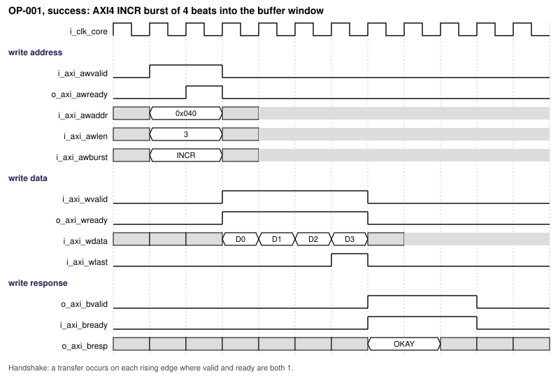 (source `figures/wf_001_axi_write_burst.json`) | 2026-11-24 |
| WF-002 | OP-001 AXI4 write that does not fit the window | Error: SLVERR | AXI4 write channels, `dsig_err.bufovf` | 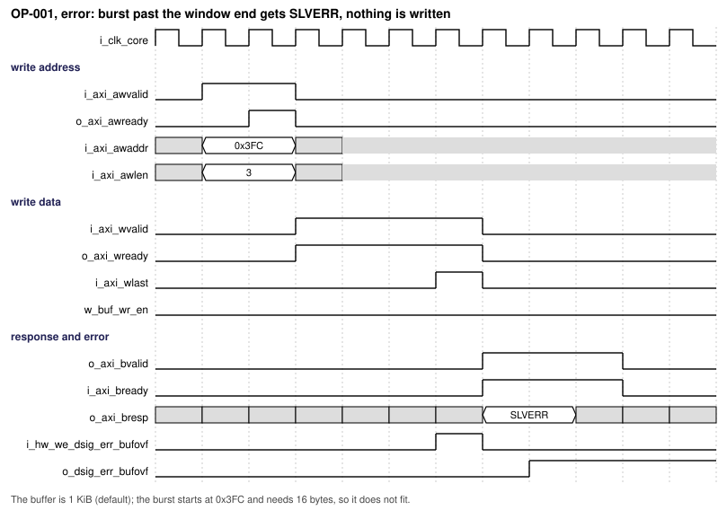 (source `figures/wf_002_axi_write_overflow.json`) | 2026-11-24 |
| WF-003 | OP-004 Verify, start to done | Success | `dsig_cmd.start`, `dsig_sts.busy`, `o_irq`, `dsig_sts.sigok` | 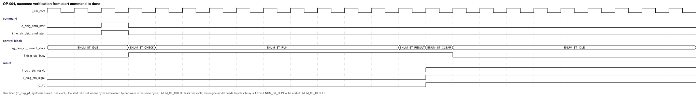 (source `figures/wf_003_verify_start_done.json`) | 2026-11-24 |
| WF-004 | OP-003 Sign with key input port | Success | `o_key_req`, `o_key_idx`, `i_key_valid`, `i_key_data`, done | 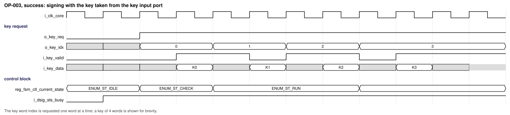 (source `figures/wf_004_sign_key_input.json`) | 2026-11-24 |
| WF-005 | Start while disabled algorithm | Error: algorithm disabled | `dsig_cmd.start`, `dsig_err.algdis`, `o_irq` | 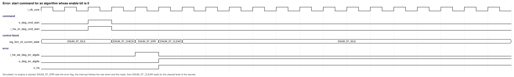 (source `figures/wf_005_start_disabled.json`) | 2026-11-24 |
| WF-006 | Entropy timeout | Error | `o_ent_req`, `i_ent_valid`, `dsig_err.enttmo` | 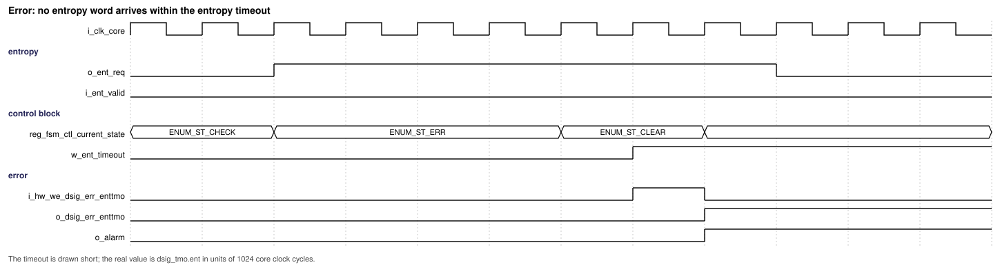 (source `figures/wf_006_entropy_timeout.json`) | 2026-11-24 |
| WF-007 | Abort during an operation | Corner: clearing | `dsig_cmd.abort`, key clear, `dsig_sts.busy` | 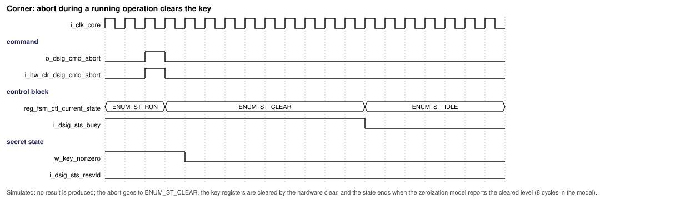 (source `figures/wf_007_abort.json`) | 2026-11-24 |
| WF-008 | Window write and read with auto-increment | Success | `o_reg_wr_en`, `dsig_win_addr`, `o_reg_rd_en` | 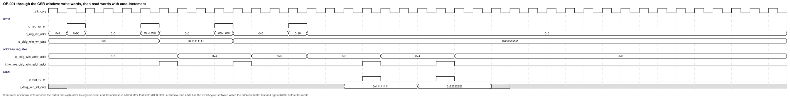 (source `figures/wf_008_window_access.json`) | 2026-11-24 |
| WF-009 | Verify-after-sign mismatch | Error: fault | `dsig_err.vasmis`, `dsig_alarm.fault`, `o_alarm` | 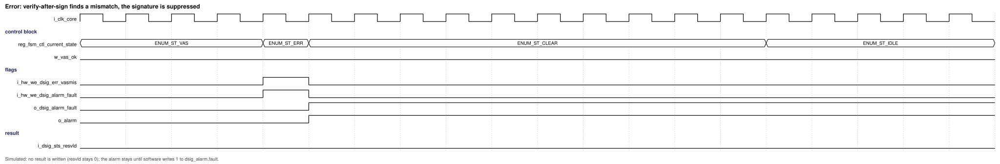 (source `figures/wf_009_vas_mismatch.json`) | 2026-11-24 |
| WF-010 | OP-002 Key generation | Success | `dsig_cmd.start`, `o_key_req`, `o_ent_req`, `dsig_sts.resvld` | 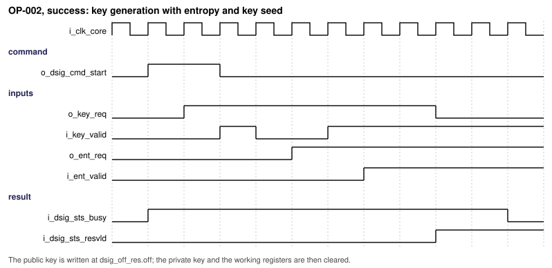 (source `figures/wf_010_keygen.json`) | 2026-11-24 |
| WF-011 | OP-005 Hybrid verify | Success and one signature invalid | `dsig_sts.edok`, `dsig_sts.mlok`, `dsig_sts.sigok` | 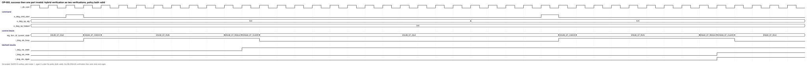 (source `figures/wf_011_hybrid_verify.json`) | 2026-11-24 |
| WF-012 | OP-006 Secret clearing | Corner: after completion | ENUM_ST_CLEAR, key registers, `dsig_sts.busy` | 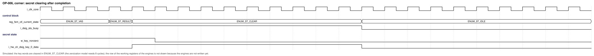 (source `figures/wf_012_secret_clearing.json`) | 2026-11-24 |
| WF-013 | OP-007 Random request | Success, internal generator | `o_ent_req`, `i_ent_valid`, `dsig_rng.ready` | 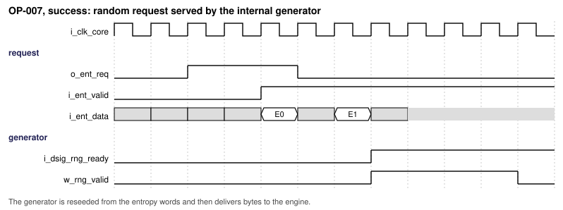 (source `figures/wf_013_random_request.json`) | 2026-11-24 |
| WF-014 | OP-008 Hash request | Success: arbiter grant and SHAKE squeeze | hash request, grant, stream, done | 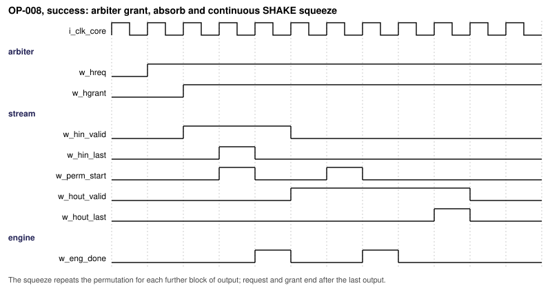 (source `figures/wf_014_hash_request.json`) | 2026-11-24 |
| WF-015 | APB4 CSR write then read | Success | `i_apb_psel`, `i_apb_penable`, `o_apb_pready`, `o_apb_prdata` | 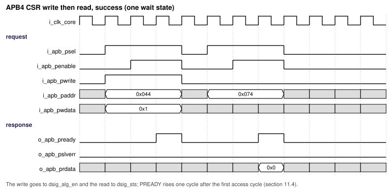 (source `figures/wf_015_apb_write_read.json`) | 2026-11-24 |
| WF-016 | APB4 non-secure access | Error: PSLVERR, no change | `i_apb_pprot`, `i_protect_en`, `o_apb_pslverr` | 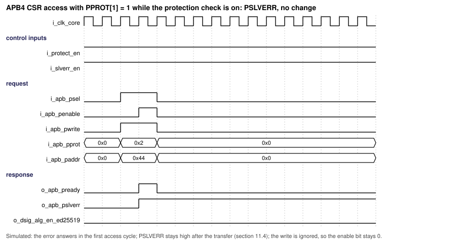 (source `figures/wf_016_apb_nonsecure_error.json`) | 2026-11-24 |
| WF-017 | OP-001 DMA request and acknowledge | Success | `o_dma_in_req`, `i_dma_in_ack`, `o_dma_out_req` | 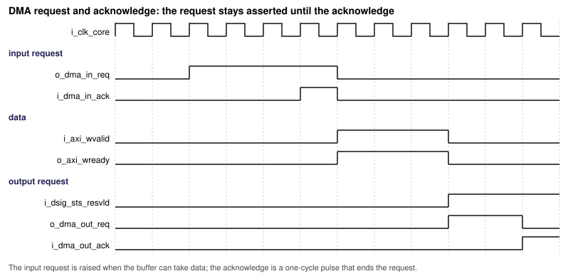 (source `figures/wf_017_dma_request_ack.json`) | 2026-11-24 |
| WF-018 | Key input timeout | Error | `o_key_req`, `dsig_err.keytmo`, `o_irq` | 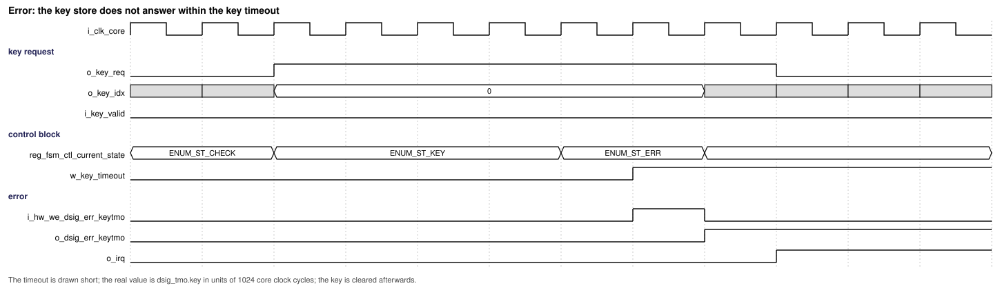 (source `figures/wf_018_key_timeout.json`) | 2026-11-24 |

#### 10.3.1 Waveform sources and descriptions

Each waveform of the plan is shown once more here with its WaveJSON description (rule R-073); the block is the content of the adjacent `.json` source.

**WF-001** (OP-001, success: AXI4 INCR burst of 4 beats into the buffer window)


```wavedrom
{
 "signal": [
  {
   "name": "i_clk_core",
   "wave": "p..........."
  },
  [
   "write address",
   {
    "name": "i_axi_awvalid",
    "wave": "01.0........"
   },
   {
    "name": "o_axi_awready",
    "wave": "0.10........"
   },
   {
    "name": "i_axi_awaddr",
    "wave": "x=.x........",
    "data": [
     "0x040"
    ]
   },
   {
    "name": "i_axi_awlen",
    "wave": "x=.x........",
    "data": [
     "3"
    ]
   },
   {
    "name": "i_axi_awburst",
    "wave": "x=.x........",
    "data": [
     "INCR"
    ]
   }
  ],
  [
   "write data",
   {
    "name": "i_axi_wvalid",
    "wave": "0001...0...."
   },
   {
    "name": "o_axi_wready",
    "wave": "0001...0...."
   },
   {
    "name": "i_axi_wdata",
    "wave": "xxx====x....",
    "data": [
     "D0",
     "D1",
     "D2",
     "D3"
    ]
   },
   {
    "name": "i_axi_wlast",
    "wave": "00000010...."
   }
  ],
  [
   "write response",
   {
    "name": "o_axi_bvalid",
    "wave": "000000011.0."
   },
   {
    "name": "i_axi_bready",
    "wave": "00000001..0."
   },
   {
    "name": "o_axi_bresp",
    "wave": "xxxxxxx=.xxx",
    "data": [
     "OKAY"
    ]
   }
  ]
 ],
 "head": {
  "text": "OP-001, success: AXI4 INCR burst of 4 beats into the buffer window"
 },
 "foot": {
  "text": "Handshake: a transfer occurs on each rising edge where valid and ready are both 1."
 },
 "config": {
  "hscale": 1
 }
}
```

**WF-002** (OP-001, error: burst past the window end gets SLVERR, nothing is written)


```wavedrom
{
 "signal": [
  {
   "name": "i_clk_core",
   "wave": "p..........."
  },
  [
   "write address",
   {
    "name": "i_axi_awvalid",
    "wave": "01.0........"
   },
   {
    "name": "o_axi_awready",
    "wave": "0.10........"
   },
   {
    "name": "i_axi_awaddr",
    "wave": "x=.x........",
    "data": [
     "0x3FC"
    ]
   },
   {
    "name": "i_axi_awlen",
    "wave": "x=.x........",
    "data": [
     "3"
    ]
   }
  ],
  [
   "write data",
   {
    "name": "i_axi_wvalid",
    "wave": "0001...0...."
   },
   {
    "name": "o_axi_wready",
    "wave": "0001...0...."
   },
   {
    "name": "i_axi_wlast",
    "wave": "00000010...."
   },
   {
    "name": "w_buf_wr_en",
    "wave": "000000000000"
   }
  ],
  [
   "response and error",
   {
    "name": "o_axi_bvalid",
    "wave": "000000011.0."
   },
   {
    "name": "i_axi_bready",
    "wave": "00000001..0."
   },
   {
    "name": "o_axi_bresp",
    "wave": "xxxxxxx=.xxx",
    "data": [
     "SLVERR"
    ]
   },
   {
    "name": "i_hw_we_dsig_err_bufovf",
    "wave": "000000100..."
   },
   {
    "name": "o_dsig_err_bufovf",
    "wave": "0000000.1..."
   }
  ]
 ],
 "head": {
  "text": "OP-001, error: burst past the window end gets SLVERR, nothing is written"
 },
 "foot": {
  "text": "The buffer is 1 KiB (default); the burst starts at 0x3FC and needs 16 bytes, so it does not fit."
 },
 "config": {
  "hscale": 1
 }
}
```

**WF-003** (OP-004, success: verification from start command to done)


```wavedrom
{
 "signal": [
  {
   "name": "i_clk_core",
   "wave": "p......................."
  },
  [
   "command",
   {
    "name": "o_dsig_cmd_start",
    "wave": "0.10...................."
   },
   {
    "name": "i_hw_clr_dsig_cmd_start",
    "wave": "0.10...................."
   }
  ],
  [
   "control block",
   {
    "name": "reg_fsm_ctl_current_state",
    "wave": "=..==........===........",
    "data": [
     "ENUM_ST_IDLE",
     "ENUM_ST_CHECK",
     "ENUM_ST_RUN",
     "ENUM_ST_RESULT",
     "ENUM_ST_CLEAR",
     "ENUM_ST_IDLE"
    ]
   },
   {
    "name": "i_dsig_sts_busy",
    "wave": "0..1...........0........"
   }
  ],
  [
   "result",
   {
    "name": "i_dsig_sts_resvld",
    "wave": "0.............1........."
   },
   {
    "name": "i_dsig_sts_sigok",
    "wave": "0.............1........."
   },
   {
    "name": "o_irq",
    "wave": "0.............1........."
   }
  ]
 ],
 "head": {
  "text": "OP-004, success: verification from start command to done"
 },
 "foot": {
  "text": "Simulated (tb_dsig_p1, synthesis branch, one clock): the start bit is set for one cycle and cleared by hardware in the same cycle; ENUM_ST_CHECK lasts one cycle; the engine model needs 6 cycles; busy is 1 from ENUM_ST_RUN to the end of ENUM_ST_RESULT."
 },
 "config": {
  "hscale": 3
 }
}
```

**WF-004** (OP-003, success: signing with the key taken from the key input port)


```wavedrom
{
 "signal": [
  {
   "name": "i_clk_core",
   "wave": "p..........."
  },
  [
   "key request",
   {
    "name": "o_key_req",
    "wave": "001.1.1.1..."
   },
   {
    "name": "o_key_idx",
    "wave": "xx=.=.=.=...",
    "data": [
     "0",
     "1",
     "2",
     "3"
    ]
   },
   {
    "name": "i_key_valid",
    "wave": "0001.01.01.."
   },
   {
    "name": "i_key_data",
    "wave": "xxx=x=x=x=x.",
    "data": [
     "K0",
     "K1",
     "K2",
     "K3"
    ]
   }
  ],
  [
   "control block",
   {
    "name": "reg_fsm_ctl_current_state",
    "wave": "=.=.=...=...",
    "data": [
     "ENUM_ST_IDLE",
     "ENUM_ST_CHECK",
     "ENUM_ST_RUN"
    ]
   },
   {
    "name": "i_dsig_sts_busy",
    "wave": "01111111111."
   }
  ]
 ],
 "head": {
  "text": "OP-003, success: signing with the key taken from the key input port"
 },
 "foot": {
  "text": "The key word index is requested one word at a time; a key of 4 words is shown for brevity."
 },
 "config": {
  "hscale": 2
 }
}
```

**WF-005** (Error: start command for an algorithm whose enable bit is 0)


```wavedrom
{
 "signal": [
  {
   "name": "i_clk_core",
   "wave": "p..................."
  },
  [
   "command",
   {
    "name": "o_dsig_cmd_start",
    "wave": "0.10................"
   },
   {
    "name": "i_hw_clr_dsig_cmd_start",
    "wave": "0.10................"
   }
  ],
  [
   "control block",
   {
    "name": "reg_fsm_ctl_current_state",
    "wave": "=..====.............",
    "data": [
     "ENUM_ST_IDLE",
     "ENUM_ST_CHECK",
     "ENUM_ST_ERR",
     "ENUM_ST_CLEAR",
     "ENUM_ST_IDLE"
    ]
   }
  ],
  [
   "error",
   {
    "name": "i_hw_we_dsig_err_algdis",
    "wave": "0...10.............."
   },
   {
    "name": "o_dsig_err_algdis",
    "wave": "0....1.............."
   },
   {
    "name": "o_irq",
    "wave": "0....1.............."
   }
  ]
 ],
 "head": {
  "text": "Error: start command for an algorithm whose enable bit is 0"
 },
 "foot": {
  "text": "Simulated: no engine is started; ENUM_ST_ERR sets the error flag, the interrupt follows the raw event and the mask, then ENUM_ST_CLEAR waits for the cleared level of the secrets."
 },
 "config": {
  "hscale": 3
 }
}
```

**WF-006** (Error: no entropy word arrives within the entropy timeout)


```wavedrom
{
 "signal": [
  {
   "name": "i_clk_core",
   "wave": "p..........."
  },
  [
   "entropy",
   {
    "name": "o_ent_req",
    "wave": "0011111110.."
   },
   {
    "name": "i_ent_valid",
    "wave": "000000000..."
   }
  ],
  [
   "control block",
   {
    "name": "reg_fsm_ctl_current_state",
    "wave": "=.=...=.=...",
    "data": [
     "ENUM_ST_CHECK",
     "ENUM_ST_ERR",
     "ENUM_ST_CLEAR"
    ]
   },
   {
    "name": "w_ent_timeout",
    "wave": "00000001...."
   }
  ],
  [
   "error",
   {
    "name": "i_hw_we_dsig_err_enttmo",
    "wave": "000000010..."
   },
   {
    "name": "o_dsig_err_enttmo",
    "wave": "0000000.11.."
   },
   {
    "name": "o_alarm",
    "wave": "0000000.11.."
   }
  ]
 ],
 "head": {
  "text": "Error: no entropy word arrives within the entropy timeout"
 },
 "foot": {
  "text": "The timeout is drawn short; the real value is dsig_tmo.ent in units of 1024 core clock cycles."
 },
 "config": {
  "hscale": 2
 }
}
```

**WF-007** (Corner: abort during a running operation clears the key)


```wavedrom
{
 "signal": [
  {
   "name": "i_clk_core",
   "wave": "p..................."
  },
  [
   "command",
   {
    "name": "o_dsig_cmd_abort",
    "wave": "0.10................"
   },
   {
    "name": "i_hw_clr_dsig_cmd_abort",
    "wave": "0.10................"
   }
  ],
  [
   "control block",
   {
    "name": "reg_fsm_ctl_current_state",
    "wave": "=..=.........=......",
    "data": [
     "ENUM_ST_RUN",
     "ENUM_ST_CLEAR",
     "ENUM_ST_IDLE"
    ]
   },
   {
    "name": "i_dsig_sts_busy",
    "wave": "1............0......"
   }
  ],
  [
   "secret state",
   {
    "name": "w_key_nonzero",
    "wave": "1...0..............."
   },
   {
    "name": "i_dsig_sts_resvld",
    "wave": "0..................."
   }
  ]
 ],
 "head": {
  "text": "Corner: abort during a running operation clears the key"
 },
 "foot": {
  "text": "Simulated: no result is produced; the abort goes to ENUM_ST_CLEAR, the key registers are cleared by the hardware clear, and the state ends when the zeroization model reports the cleared level (8 cycles in the model)."
 },
 "config": {
  "hscale": 1
 }
}
```

**WF-008** (OP-001 through the CSR window: write words, then read words with auto-increment)


```wavedrom
{
 "signal": [
  {
   "name": "i_clk_core",
   "wave": "p......................................."
  },
  [
   "write",
   {
    "name": "o_reg_wr_en",
    "wave": "010..10..10..10........................."
   },
   {
    "name": "o_reg_wr_addr",
    "wave": "===..==..==..==.........................",
    "data": [
     "0x0",
     "0x90",
     "0x0",
     "WIN_WR",
     "0x0",
     "WIN_WR",
     "0x0",
     "0x90",
     "0x0"
    ]
   },
   {
    "name": "o_dsig_win_wr_data",
    "wave": "=.....=...=.............................",
    "data": [
     "0x0",
     "0x11111111",
     "0x22222222"
    ]
   }
  ],
  [
   "address register",
   {
    "name": "o_dsig_win_addr_addr",
    "wave": "=......=...=..=...=...=.................",
    "data": [
     "0x0",
     "0x4",
     "0x8",
     "0x0",
     "0x4",
     "0x8"
    ]
   },
   {
    "name": "i_hw_we_dsig_win_addr_addr",
    "wave": "0.....10..10.....10..10................."
   }
  ],
  [
   "read",
   {
    "name": "o_reg_rd_en",
    "wave": "0................10..10................."
   },
   {
    "name": "i_dsig_win_rd_data",
    "wave": "x...............=...=...x...............",
    "data": [
     "0x11111111",
     "0x22222222"
    ]
   }
  ]
 ],
 "head": {
  "text": "OP-001 through the CSR window: write words, then read words with auto-increment"
 },
 "foot": {
  "text": "Simulated: a window write reaches the buffer one cycle after its register event and the address is added after that write (DEC-039); a window read adds 4 in the event cycle; software writes the address 0x000 first and again 0x000 before the reads."
 },
 "config": {
  "hscale": 2
 }
}
```

**WF-009** (Error: verify-after-sign finds a mismatch, the signature is suppressed)


```wavedrom
{
 "signal": [
  {
   "name": "i_clk_core",
   "wave": "p..................."
  },
  [
   "control block",
   {
    "name": "reg_fsm_ctl_current_state",
    "wave": "=...==.........=....",
    "data": [
     "ENUM_ST_VAS",
     "ENUM_ST_ERR",
     "ENUM_ST_CLEAR",
     "ENUM_ST_IDLE"
    ]
   },
   {
    "name": "w_vas_ok",
    "wave": "0..................."
   }
  ],
  [
   "flags",
   {
    "name": "i_hw_we_dsig_err_vasmis",
    "wave": "0...10.............."
   },
   {
    "name": "i_hw_we_dsig_alarm_fault",
    "wave": "0...10.............."
   },
   {
    "name": "o_dsig_alarm_fault",
    "wave": "0....1.............."
   },
   {
    "name": "o_alarm",
    "wave": "0....1.............."
   }
  ],
  [
   "result",
   {
    "name": "i_dsig_sts_resvld",
    "wave": "0..................."
   }
  ]
 ],
 "head": {
  "text": "Error: verify-after-sign finds a mismatch, the signature is suppressed"
 },
 "foot": {
  "text": "Simulated: no result is written (resvld stays 0); the alarm stays until software writes 1 to dsig_alarm.fault."
 },
 "config": {
  "hscale": 3
 }
}
```

**WF-010** (OP-002, success: key generation with entropy and key seed)


```wavedrom
{
 "signal": [
  {
   "name": "i_clk_core",
   "wave": "p..........."
  },
  [
   "command",
   {
    "name": "o_dsig_cmd_start",
    "wave": "0110........"
   }
  ],
  [
   "inputs",
   {
    "name": "o_key_req",
    "wave": "0011.1.1.0.."
   },
   {
    "name": "i_key_valid",
    "wave": "00010.1.1..."
   },
   {
    "name": "o_ent_req",
    "wave": "0000011111.."
   },
   {
    "name": "i_ent_valid",
    "wave": "000000.1.1.."
   }
  ],
  [
   "result",
   {
    "name": "i_dsig_sts_busy",
    "wave": "011111111110"
   },
   {
    "name": "i_dsig_sts_resvld",
    "wave": "000000000111"
   }
  ]
 ],
 "head": {
  "text": "OP-002, success: key generation with entropy and key seed"
 },
 "foot": {
  "text": "The public key is written at dsig_off_res.off; the private key and the working registers are then cleared."
 },
 "config": {
  "hscale": 1
 }
}
```

**WF-011** (OP-005, success then one part invalid: hybrid verification as two verifications, policy both valid)


```wavedrom
{
 "signal": [
  {
   "name": "i_clk_core",
   "wave": "p..........................................."
  },
  [
   "command",
   {
    "name": "o_dsig_cmd_start",
    "wave": "0.10.........................10............."
   },
   {
    "name": "o_dsig_op_alg",
    "wave": "=........................=..................",
    "data": [
     "0x0",
     "0xA"
    ]
   },
   {
    "name": "o_dsig_op_hybpol",
    "wave": "=...........................................",
    "data": [
     "0x0"
    ]
   }
  ],
  [
   "control block",
   {
    "name": "reg_fsm_ctl_current_state",
    "wave": "=..==......===................==......===...",
    "data": [
     "ENUM_ST_IDLE",
     "ENUM_ST_CHECK",
     "ENUM_ST_RUN",
     "ENUM_ST_RESULT",
     "ENUM_ST_CLEAR",
     "ENUM_ST_IDLE",
     "ENUM_ST_CHECK",
     "ENUM_ST_RUN",
     "ENUM_ST_RESULT",
     "ENUM_ST_CLEAR",
     "ENUM_ST_IDLE"
    ]
   },
   {
    "name": "i_dsig_sts_busy",
    "wave": "0..1.........0................1.........0..."
   }
  ],
  [
   "latched results",
   {
    "name": "i_dsig_sts_edok",
    "wave": "0...........1..............................."
   },
   {
    "name": "i_dsig_sts_mlok",
    "wave": "0......................................1...."
   },
   {
    "name": "i_dsig_sts_sigok",
    "wave": "0......................................1...."
   }
  ]
 ],
 "head": {
  "text": "OP-005, success then one part invalid: hybrid verification as two verifications, policy both valid"
 },
 "foot": {
  "text": "Simulated: Ed25519 verifies valid (edok 1, sigok 0 under the policy both valid); the ML-DSA-65 verification then sets mlok and sigok."
 },
 "config": {
  "hscale": 3
 }
}
```

**WF-012** (OP-006, corner: secret clearing after completion)


```wavedrom
{
 "signal": [
  {
   "name": "i_clk_core",
   "wave": "p......................."
  },
  [
   "control block",
   {
    "name": "reg_fsm_ctl_current_state",
    "wave": "=..==.........=.........",
    "data": [
     "ENUM_ST_VAS",
     "ENUM_ST_RESULT",
     "ENUM_ST_CLEAR",
     "ENUM_ST_IDLE"
    ]
   },
   {
    "name": "i_dsig_sts_busy",
    "wave": "1.............0........."
   }
  ],
  [
   "secret state",
   {
    "name": "w_key_nonzero",
    "wave": "1....0.................."
   },
   {
    "name": "i_hw_clr_dsig_key_0_data",
    "wave": "0...1.........0........."
   }
  ]
 ],
 "head": {
  "text": "OP-006, corner: secret clearing after completion"
 },
 "foot": {
  "text": "Simulated: the key words are cleared in ENUM_ST_CLEAR (the zeroization model needs 8 cycles); the row of the working registers of the engines is not drawn because the engines are not written yet."
 },
 "config": {
  "hscale": 3
 }
}
```

**WF-013** (OP-007, success: random request served by the internal generator)


```wavedrom
{
 "signal": [
  {
   "name": "i_clk_core",
   "wave": "p..........."
  },
  [
   "request",
   {
    "name": "o_ent_req",
    "wave": "0011.0......"
   },
   {
    "name": "i_ent_valid",
    "wave": "00001.1....."
   },
   {
    "name": "i_ent_data",
    "wave": "xxxx=x=x....",
    "data": [
     "E0",
     "E1"
    ]
   }
  ],
  [
   "generator",
   {
    "name": "i_dsig_rng_ready",
    "wave": "000000.1111."
   },
   {
    "name": "w_rng_valid",
    "wave": "000000011..0"
   }
  ]
 ],
 "head": {
  "text": "OP-007, success: random request served by the internal generator"
 },
 "foot": {
  "text": "The generator is reseeded from the entropy words and then delivers bytes to the engine."
 },
 "config": {
  "hscale": 1
 }
}
```

**WF-014** (OP-008, success: arbiter grant, absorb and continuous SHAKE squeeze)


```wavedrom
{
 "signal": [
  {
   "name": "i_clk_core",
   "wave": "p..........."
  },
  [
   "arbiter",
   {
    "name": "w_hreq",
    "wave": "0111111....."
   },
   {
    "name": "w_hgrant",
    "wave": "00111111...."
   }
  ],
  [
   "stream",
   {
    "name": "w_hin_valid",
    "wave": "0011.0......"
   },
   {
    "name": "w_hin_last",
    "wave": "00010......."
   },
   {
    "name": "w_perm_start",
    "wave": "000100100..."
   },
   {
    "name": "w_hout_valid",
    "wave": "0000011.1.0."
   },
   {
    "name": "w_hout_last",
    "wave": "00000000010."
   }
  ],
  [
   "engine",
   {
    "name": "w_eng_done",
    "wave": "0000100100.."
   }
  ]
 ],
 "head": {
  "text": "OP-008, success: arbiter grant, absorb and continuous SHAKE squeeze"
 },
 "foot": {
  "text": "The squeeze repeats the permutation for each further block of output; request and grant end after the last output."
 },
 "config": {
  "hscale": 1
 }
}
```

**WF-015** (APB4 CSR write then read, success (one wait state))


```wavedrom
{
 "signal": [
  {
   "name": "i_clk_core",
   "wave": "p..........."
  },
  [
   "request",
   {
    "name": "i_apb_psel",
    "wave": "011101110000"
   },
   {
    "name": "i_apb_penable",
    "wave": "001100110000"
   },
   {
    "name": "i_apb_pwrite",
    "wave": "011100000000"
   },
   {
    "name": "i_apb_paddr",
    "wave": "x=..x=..xxxx",
    "data": [
     "0x044",
     "0x074"
    ]
   },
   {
    "name": "i_apb_pwdata",
    "wave": "x=..xxxxxxxx",
    "data": [
     "0x1"
    ]
   }
  ],
  [
   "response",
   {
    "name": "o_apb_pready",
    "wave": "000100010000"
   },
   {
    "name": "o_apb_pslverr",
    "wave": "000000000000"
   },
   {
    "name": "o_apb_prdata",
    "wave": "xxxxxxx=xxxx",
    "data": [
     "0x0"
    ]
   }
  ]
 ],
 "head": {
  "text": "APB4 CSR write then read, success (one wait state)"
 },
 "foot": {
  "text": "The write goes to dsig_alg_en and the read to dsig_sts; PREADY rises one cycle after the first access cycle (section 11.4)."
 },
 "config": {
  "hscale": 1
 }
}
```

**WF-016** (APB4 CSR access with PPROT[1] = 1 while the protection check is on: PSLVERR, no change)


```wavedrom
{
 "signal": [
  {
   "name": "i_clk_core",
   "wave": "p..............."
  },
  [
   "control inputs",
   {
    "name": "i_protect_en",
    "wave": "1..............."
   },
   {
    "name": "i_slverr_en",
    "wave": "1..............."
   }
  ],
  [
   "request",
   {
    "name": "i_apb_psel",
    "wave": "0.1.0..........."
   },
   {
    "name": "i_apb_penable",
    "wave": "0..10..........."
   },
   {
    "name": "i_apb_pwrite",
    "wave": "0.1.0..........."
   },
   {
    "name": "i_apb_pprot",
    "wave": "=.=.=...........",
    "data": [
     "0x0",
     "0x2",
     "0x0"
    ]
   },
   {
    "name": "i_apb_paddr",
    "wave": "=.=.=...........",
    "data": [
     "0x0",
     "0x44",
     "0x0"
    ]
   }
  ],
  [
   "response",
   {
    "name": "o_apb_pready",
    "wave": "0..10..........."
   },
   {
    "name": "o_apb_pslverr",
    "wave": "0..1............"
   },
   {
    "name": "o_dsig_alg_en_ed25519",
    "wave": "0..............."
   }
  ]
 ],
 "head": {
  "text": "APB4 CSR access with PPROT[1] = 1 while the protection check is on: PSLVERR, no change"
 },
 "foot": {
  "text": "Simulated: the error answers in the first access cycle; PSLVERR stays high after the transfer (section 11.4); the write is ignored, so the enable bit stays 0."
 },
 "config": {
  "hscale": 1
 }
}
```

**WF-017** (DMA request and acknowledge: the request stays asserted until the acknowledge)


```wavedrom
{
 "signal": [
  {
   "name": "i_clk_core",
   "wave": "p..........."
  },
  [
   "input request",
   {
    "name": "o_dma_in_req",
    "wave": "001111000000"
   },
   {
    "name": "i_dma_in_ack",
    "wave": "000001000000"
   }
  ],
  [
   "data",
   {
    "name": "i_axi_wvalid",
    "wave": "000000111000"
   },
   {
    "name": "o_axi_wready",
    "wave": "000000111000"
   }
  ],
  [
   "output request",
   {
    "name": "i_dsig_sts_resvld",
    "wave": "000000000111"
   },
   {
    "name": "o_dma_out_req",
    "wave": "000000000110"
   },
   {
    "name": "i_dma_out_ack",
    "wave": "000000000001"
   }
  ]
 ],
 "head": {
  "text": "DMA request and acknowledge: the request stays asserted until the acknowledge"
 },
 "foot": {
  "text": "The input request is raised when the buffer can take data; the acknowledge is a one-cycle pulse that ends the request."
 },
 "config": {
  "hscale": 1
 }
}
```

**WF-018** (Error: the key store does not answer within the key timeout)


```wavedrom
{
 "signal": [
  {
   "name": "i_clk_core",
   "wave": "p..........."
  },
  [
   "key request",
   {
    "name": "o_key_req",
    "wave": "0011111110.."
   },
   {
    "name": "o_key_idx",
    "wave": "xx=.....xxxx",
    "data": [
     "0"
    ]
   },
   {
    "name": "i_key_valid",
    "wave": "000000000000"
   }
  ],
  [
   "control block",
   {
    "name": "reg_fsm_ctl_current_state",
    "wave": "=.=...=.=...",
    "data": [
     "ENUM_ST_CHECK",
     "ENUM_ST_KEY",
     "ENUM_ST_ERR"
    ]
   },
   {
    "name": "w_key_timeout",
    "wave": "00000001...."
   }
  ],
  [
   "error",
   {
    "name": "i_hw_we_dsig_err_keytmo",
    "wave": "000000010..."
   },
   {
    "name": "o_dsig_err_keytmo",
    "wave": "0000000.11.."
   },
   {
    "name": "o_irq",
    "wave": "0000000..11."
   }
  ]
 ],
 "head": {
  "text": "Error: the key store does not answer within the key timeout"
 },
 "foot": {
  "text": "The timeout is drawn short; the real value is dsig_tmo.key in units of 1024 core clock cycles; the key is cleared afterwards."
 },
 "config": {
  "hscale": 2
 }
}
```

Timing of the control handshake (active edge: rising edge of `i_clk_core`; the control block samples CSR outputs and engine flags at that edge):

| Cycle / event | Input condition | State/action | Output condition |
|---|---|---|---|
| t0 | `dsig_cmd.start` written | The CSR holds the start bit | `o_dsig_cmd_start` high |
| t1 | Start seen by the control block | ENUM_ST_IDLE to ENUM_ST_CHECK; the clear input of the `wo` start bit is raised | `dsig_sts.busy` rises |
| t2 to tn | Checks pass | ENUM_ST_CHECK to ENUM_ST_KEY or ENUM_ST_RNG or ENUM_ST_RUN | Engine started |
| tn+m | Engine done | ENUM_ST_RUN to ENUM_ST_RESULT (or ENUM_ST_VAS) | Result written |
| tn+m+1 | Result written | ENUM_ST_RESULT to ENUM_ST_CLEAR | `dsig_irq_raw.done` set, `o_irq` per mask |
| tn+m+2 up to 100 cycles | Clearing | ENUM_ST_CLEAR to ENUM_ST_IDLE | `dsig_sts.busy` falls |

The figures WF-003, 005, 007, 008, 009, 011, 012 and 016 are the waveforms of the simulation of the phase 1 RTL (one character per core clock cycle). In WF-003 the start bit is high for one cycle and is cleared by hardware in that cycle, ENUM_ST_CHECK lasts one cycle and `dsig_sts.busy` rises with it, ENUM_ST_RESULT lasts one cycle, and the result flags and `o_irq` rise as ENUM_ST_CLEAR starts. The cycle counts of the engine, key, random and zeroization blocks in these figures are those of the testbench models.

### 10.4 Arbitration, buffering, and throughput

- **Hash engine.** One engine at a time; the arbiter serves the requester that holds a grant until its stream is complete, and the next request is served in fixed priority order: random block, then lattice engine, then hash-based engine, then elliptic-curve engine. A requester that holds a grant is never preempted, so no hash stream is interleaved; because at most one operation is active (section 5.4), the arbiter only serializes the random block against the active engine. Starvation is not possible for the same reason.
- **Buffer.** One buffer with one writer at a time: the AXI4 port or the window, never while the control block is not idle (a write while busy gets SLVERR on the AXI4 port and the buffer-busy error through the window).
- **Backpressure.** The AXI4 write channel deasserts `o_axi_wready` when the buffer cannot accept; the DMA request stays asserted until the acknowledge.
- **Outstanding.** One AXI4 burst in each direction.
- **Throughput.** Defined per algorithm in section 13 once synthesis exists; the hard requirements are REQ-PERF-001 and REQ-PERF-002.

### 10.5 Memories and storage

Sizes marked "section 13" are fixed after the first synthesis (TBD-011); the structure is fixed here.

| Storage ID | Kind | Depth × width | Ports | Read latency | Write mask | Reset/init | ECC/parity | Implementation |
|---|---|---|---|---|---|---|---|---|
| MEM-001 | Message, signature and public-key buffer | `PARA_BUF_BYTES` / (`PARA_AXI_DW` / 8) × `PARA_AXI_DW` | One write port, one read port | 1 cycle | Byte strobes | Not reset; the content is invalid until written | Optional parity by `PARA_FAULT_PAR` is not in this version | Inferred memory in the memory wrapper |
| MEM-002 | Elliptic-curve working registers | 16 to 32 × 521 bits (section 13) | Two read, one write | 1 cycle | None | Cleared by ENUM_ST_CLEAR | None | Registers or inferred memory |
| MEM-003 | Polynomial memory for ML-DSA | Section 13 × 23 bits | Two read, two write | 1 cycle | None | Cleared by ENUM_ST_CLEAR | None | Inferred memory |
| MEM-004 | Hash-engine state | 1600 bits | Internal | 0 cycles | None | Cleared by `i_clr` | Parity by the engine parameter | Registers inside `m_vlsit_sha_eng` |

Read during write of the same buffer word returns the old value (read-first).

**Buffer implementation and behavior (DEC-027).** MEM-001 is built from `PARA_AXI_DW` / 8 byte lanes, each an instance of the library RAM wrapper `m_vlsit_sfifo_mem` of 8 bits by `PARA_BUF_BYTES` / (`PARA_AXI_DW` / 8) words, so each byte lane has its own write enable: a write to a word changes only the lanes whose strobe bit is 1. Byte 0 of the buffer is lane 0 of word 0. A window write of 32 bits changes the four lanes of the 32-bit group selected by bits `LPARA_LANE_B`-1:2 of the window address. The window address register is a byte address; after every accepted window access (a write or a read inside the buffer while the IP is idle) the hardware adds 4 (loaded through the hardware-load port of `dsig_win_addr.addr`); a rejected access does not move the address. While an operation runs (`dsig_sts.busy` is 1) the buffer accepts only engine accesses: an AXI4 write is rejected (SLVERR), a window write is ignored and sets `dsig_err.busycmd`, and the window read data are 0. A window access at or above `PARA_BUF_BYTES` sets `dsig_err.bufovf`, writes nothing and returns 0. A window write reaches the buffer one cycle after its register event (the data register of the CSR loads at the end of the event cycle), and the address is added after that write (DEC-039).

Numbered example 1 (`PARA_AXI_DW` = 64, `PARA_BUF_BYTES` = 1024, so 128 words, idle IP): (1) an AXI4 write of word 3 with `wdata` = 0x1122334455667788 and `wstrb` = 0x0F stores 0x88, 0x77, 0x66, 0x55 in bytes 24 to 27 and leaves bytes 28 to 31 unchanged; (2) a window write of 0xAABBCCDD at window address 0x1C stores 0xDD, 0xCC, 0xBB, 0xAA in bytes 28 to 31; (3) after setting the window address to 0x18, a window read returns 0x55667788 and the address becomes 0x1C; (4) the next window read returns 0xAABBCCDD and the address becomes 0x20; (5) setting the window address to 0x400 and reading returns 0x00000000 and sets `dsig_err.bufovf`. An access outside the buffer is rejected (SLVERR on AXI4, error flag through the window). The memory wrapper is the place where a memory compiler macro replaces the inferred memory.

## 11. Register and programming model

### 11.1 CSR specification source

The CSR specification of this IP is defined only in the VLSIT CSR workbook (REF-005). This document does not declare or restate the register interface, register map, register fields, offsets, access types, or reset values. The workbook is the single source of truth, so the two documents cannot diverge.

| Item | Specification |
|---|---|
| CSR workbook file | `spec/VLSIT_DIGITAL_SIGNATURE_CSR.xlsx`, built from `spec/csr/dsig_regs.json` by `spec/csr/gen_dsig_csr_json.py` |
| Sheet used for this IP | `ASYNC_CSR` (DEC-025): the generated module has both clock architectures and the top sets `PARA_ASYNCHRONOUS` to `PARA_CSR_ASYNC` |
| Workbook revision / date | 2026-11-24, first version |
| CSR generator | APB-CSR-Generator version 3.6, commit 7d2949b (generated 2026-11-24); `wo` hardware clear needs 3.2 or newer and register-event sideband needs 3.0 or newer |
| CSR module name | `m_vlsit_csr_dsig` |
| Register prefix | `dsig` |
| IP version | 1.0, register `dsig_version` at offset 0x0 |
| Asynchronous | 1 in the workbook (default of `PARA_ASYNCHRONOUS`); the top sets `PARA_ASYNCHRONOUS` by name to `PARA_CSR_ASYNC` (default 0, one clock); the generated adapter `m_vlsit_csr_sync` forwards to the library cell wrapper `m_vlsit_afifo_cell_sync` (rule R-080) |
| APB clock and register clock | `i_clk_apb` drives the APB side; `i_clk_core` drives `i_clk_reg` when `PARA_CSR_ASYNC` is 1, and `i_clk_reg` is tied to `i_clk_apb` when it is 0 |
| Source of `i_protect_en` and `i_slverr_en` | IP input ports, static after reset (section 6.2) |

The register map has 41 registers: `dsig_version`; capability registers `dsig_cap_alg`, `dsig_cap_kgen`, `dsig_cap_sign`, `dsig_cap_vrfy`, `dsig_cap_slh`, `dsig_cap_lms`, `dsig_cap_lmots`, `dsig_cap_xmss`, `dsig_cap_xmssh`, `dsig_cap_feat`, `dsig_cap_buf`; control `dsig_ctrl`, `dsig_alg_en`, `dsig_alg_act`, `dsig_lock`, `dsig_op`, `dsig_set`, `dsig_len_msg`, `dsig_len_ctx`, `dsig_off_msg`, `dsig_off_sig`, `dsig_off_pk`, `dsig_off_res`, `dsig_cmd`, `dsig_tmo`; status `dsig_sts`, `dsig_err`, `dsig_alarm`, `dsig_rng`; interrupts `dsig_irq_raw`, `dsig_irq_en`, `dsig_irq_inj`, `dsig_irq_sts`; data window `dsig_win_addr`, `dsig_win_wr`, `dsig_win_rd`; log `dsig_cnt_ops`, `dsig_cnt_fail`, `dsig_log_lock`; and the repeated write-only key register `dsig_key` (17 words, FIXED repeat). Register offsets and fields are only in the workbook.

Workbook requirements:

- The register-map sheet contains `Table - Configuration` and `Table - Register Definition`; protocol APB, data width 32, address width 16 and write strobe 4 are fixed by the template.
- The workbook carries the configuration row Register Event Sideband = 1, written by `vlsit_csr_tool.py fill` from the JSON key `event_sideband` (DEC-036). Bit types used: `rw`, `ro`, `rwi`, `w1c`, `wo`. The register-clock domain of the signals in 11.3 is CLK-CORE: `i_clk_reg` is the core clock when `PARA_CSR_ASYNC` is 1 and the APB clock when it is 0 (in that case the integrator ties both clocks together). `wo` is used for the commands (start, abort, clear, lock request, reseed, log lock request) and for the private key words.
- Every software-visible register is in the workbook; names follow the register conventions of the specification skill.
- The register RTL is built by APB-CSR-Generator from the workbook.
- Behaviors that the generator cannot express are recorded as decisions in section 20 (DEC-016 and DEC-017).

### 11.2 Software sequences

Register and field names are those of the workbook. The flowchart covers initialization (S01 to S08) and one operation (S10 to S19).

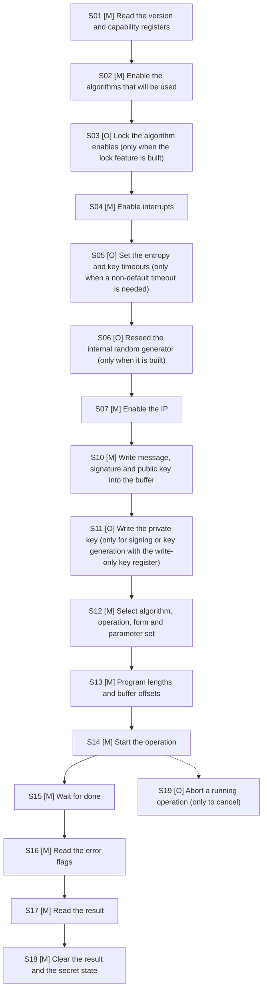

| No. | Step | Option (M/O) | Interface | CSR | Description |
|---|---|---|---|---|---|
| S01 | Read the version and capability registers | M | APB4 read | `dsig_version` read; `dsig_cap_alg`, `dsig_cap_kgen`, `dsig_cap_sign`, `dsig_cap_vrfy`, `dsig_cap_slh`, `dsig_cap_lms`, `dsig_cap_lmots`, `dsig_cap_xmss`, `dsig_cap_xmssh`, `dsig_cap_feat`, `dsig_cap_buf` read | Learn the build so that the driver uses only what exists. |
| S02 | Enable the algorithms that will be used | M | APB4 write | `dsig_alg_en` write 1 in the bit of each algorithm; read `dsig_alg_act` to confirm | The reset value is 0, so no algorithm runs until software enables it. |
| S03 | Lock the algorithm enables | O (lock feature built) | APB4 write and poll | `dsig_lock.req` write 1; poll `dsig_lock.locked` until 1 | After the lock a weak algorithm cannot be enabled by later software; only a reset removes the lock. |
| S04 | Enable interrupts | M | APB4 write | `dsig_irq_en.done`, `dsig_irq_en.err`, `dsig_irq_en.sec` write 1 | Allows `o_irq` to wake the handler; polling is the alternative. |
| S05 | Set the entropy and key timeouts | O (non-default timeout) | APB4 write | `dsig_tmo.ent`, `dsig_tmo.key` write | Bounds the wait for the entropy source and the key store. |
| S06 | Reseed the internal random generator | O (internal generator built) | APB4 write | `dsig_rng.reseed` write 1; poll `dsig_rng.ready` | Gives the generator fresh entropy before signing. |
| S07 | Enable the IP | M | APB4 write | `dsig_ctrl.en` write 1 | Allows start commands to be accepted. |
| S10 | Write message, signature and public key into the buffer | M | AXI4 write burst (and DMA request or acknowledge) or APB4 window | When the window is used: `dsig_win_addr.addr` write, then `dsig_win_wr.data` write per word | The data must be in the buffer before the start command. |
| S11 | Write the private key | O (key register built, signing or key generation) | APB4 write | `dsig_key_0.data` to `dsig_key_16.data` write | The key never returns on any interface and is cleared after the operation. With the key input port the IP requests the key itself. |
| S12 | Select algorithm, operation, form and parameter set | M | APB4 write | `dsig_op.alg`, `dsig_op.op`, `dsig_op.form`, `dsig_op.hedged`, `dsig_op.nonce`, `dsig_op.hash`, `dsig_op.hybpol`; `dsig_set.slh`, `dsig_set.lmstype`, `dsig_set.lmots`, `dsig_set.hsslvl`, `dsig_set.xmss` | Chooses what the start command runs; unused fields keep their reset values. For a hybrid verification run S12 to S17 twice after one clear (Ed25519, then ML-DSA) with the same `dsig_op.hybpol`; `dsig_sts.sigok` is final after both runs. |
| S13 | Program lengths and buffer offsets | M | APB4 write | `dsig_len_msg.len`, `dsig_len_ctx.len`, `dsig_off_msg.off`, `dsig_off_sig.off`, `dsig_off_pk.off`, `dsig_off_res.off` write | Tells the IP where each item lies in the buffer. |
| S14 | Start the operation | M | APB4 write | `dsig_cmd.start` write 1 | A start while busy, while disabled or for a disabled algorithm sets an error. |
| S15 | Wait for done | M | APB4 poll or interrupt | Poll `dsig_sts.busy` until 0, or wait for `dsig_irq_sts.done` | The operation takes a time that depends on the algorithm and `PARA_MUL_W`. |
| S16 | Read the error flags | M | APB4 read and write | `dsig_err` read; write 1 to the set bits to clear; `dsig_alarm` read | An invalid signature is not an error; it is reported in `dsig_sts.sigok`. |
| S17 | Read the result | M | APB4 read or AXI4 read burst | `dsig_sts.resvld`, `dsig_sts.sigok`, `dsig_sts.edok`, `dsig_sts.mlok` read; result bytes read through `dsig_win_addr.addr` and `dsig_win_rd.data` or the AXI4 port at `dsig_off_res.off` | Signing and key generation return bytes in the buffer; verification returns a flag. |
| S18 | Clear the result and the secret state | M | APB4 write | `dsig_cmd.clr` write 1; write 1 to `dsig_irq_raw` bits | Clears the result flags, `dsig_err`, the done and error events and the secret registers (DEC-043); the alarm flags and the security event stay until software writes 1; the IP also clears secrets by itself. |
| S19 | Abort a running operation | O (cancel) | APB4 write | `dsig_cmd.abort` write 1 | Stops the operation without a result and clears secrets. |

### 11.3 CSR connection to the design

| Workbook register.field | Direction at the CSR | Design signal | Clock domain of the signal | Behavior notes |
|---|---|---|---|---|
| `dsig_version.major`, `dsig_version.minor` | status in | Constants of the IP version | CLK-APB | Tied to the version constants. |
| `dsig_cap_alg.*`, `dsig_cap_kgen.*`, `dsig_cap_sign.*`, `dsig_cap_vrfy.*`, `dsig_cap_slh.sets`, `dsig_cap_lms.lms`, `dsig_cap_lmots.lmots`, `dsig_cap_xmss.sets`, `dsig_cap_xmssh.sets`, `dsig_cap_feat.*`, `dsig_cap_buf.*` | status in | Constants derived from the parameters of section 8 | CLK-APB | Constant after reset; no crossing needed. |
| `dsig_ctrl.en` | control out | IP enable in the control block | CLK-CORE | Crosses to CLK-CORE inside the CSR module when `PARA_CSR_ASYNC` is 1. |
| `dsig_alg_en.*` | control out | Algorithm enable inputs of the control block | CLK-CORE | Ignored by the control block while locked. |
| `dsig_alg_act.*` | status in | Effective algorithm enables held by the control block | CLK-CORE | Synchronized by the IP when `PARA_CSR_ASYNC` is 1. |
| `dsig_lock.req`, `dsig_log_lock.req` | control out, hardware clear | Lock request to the control block; hardware clears with the `wo` clear input after latching | CLK-CORE | A set-only lock is realized by a latch in the control block (DEC-016). |
| `dsig_lock.locked`, `dsig_log_lock.locked` | status in | Lock latches | CLK-CORE | Cleared only by reset. |
| `dsig_op.*`, `dsig_set.*`, `dsig_len_msg.len`, `dsig_len_ctx.len`, `dsig_off_*.off` | control out | Operation parameters of the control block | CLK-CORE | Sampled by the control block when `dsig_cmd.start` is taken; changing them while busy has no effect on the running operation. |
| `dsig_cmd.start`, `dsig_cmd.abort`, `dsig_cmd.clr` | control out, hardware clear | Command pulses of the control block | CLK-CORE | The control block clears the bit with the `wo` clear input when it takes the command; a command written while the previous is pending is lost (software waits for the clear by polling `dsig_sts.busy`). |
| `dsig_sts.*` | status in | Status of the control block | CLK-CORE | Synchronized by the IP when `PARA_CSR_ASYNC` is 1. |
| `dsig_err.*`, `dsig_alarm.*`, `dsig_irq_raw.*` | hardware load, software clear | Error, alarm and event sources | CLK-CORE | A hardware set wins over a same-cycle software clear, so a new event is kept. |
| `dsig_irq_en.*`, `dsig_irq_inj.*` | control out | Interrupt mask and injection in the interrupt logic | CLK-CORE | Injection raises the raw event on the rising edge of the bit. |
| `dsig_irq_sts.*` | status in | Masked events | CLK-CORE | Drives `o_irq` as their OR. |
| `dsig_win_addr.addr` | hardware load | Window address register | CLK-CORE | The hardware adds 4 after each window access using the register-event sideband; a software write wins over a hardware load in the same cycle, so software shall not write the address while a window access is in flight. |
| `dsig_win_wr.data` | control out | Buffer write data | CLK-CORE | The write event of the register-event sideband (`o_reg_wr_en`, `o_reg_wr_addr`) strobes the buffer write one cycle later, because the data register loads at the end of the event cycle (DEC-039). |
| `dsig_win_rd.data` | status in | Buffer read data | CLK-CORE | The read event (`o_reg_rd_en`, `o_reg_rd_addr`) advances the window address. |
| `dsig_cnt_ops.cnt`, `dsig_cnt_fail.cnt` | status in | Counters of the log block | CLK-CORE | Frozen after the log lock. |
| `dsig_rng.reseed` | control out, hardware clear | Reseed command of the random block | CLK-CORE | Cleared by hardware when taken. |
| `dsig_rng.ready`, `dsig_rng.due` | status in | Random block status | CLK-CORE | Read-only. |
| `dsig_tmo.ent`, `dsig_tmo.key` | control out | Timeouts of the random block and the key block | CLK-CORE | Used in units of 1024 core clock cycles. |
| `dsig_key_0.data` to `dsig_key_16.data` | control out, hardware clear | Key words of the key block | CLK-CORE | The key block clears the words with the `wo` clear input after completion, error, abort or reset. |

### 11.4 APB access behavior of the CSR

The behavior is that of APB-CSR-Generator as measured by the generator reference of the skill (`vlsit_csr_generator.md`), checked against the APB4 specification (REF-014, file `vlsit_apb_amba_apb_ihi0024d.md`): write strobes are section 3.2, the error response is section 3.4, and the protection unit support is section 3.5.

| Case | Behavior |
|---|---|
| Normal read or write | With `PARA_CSR_ASYNC` 0, PREADY rises one cycle after the first access cycle (1 wait state). With `PARA_CSR_ASYNC` 1 the wait states depend on the clock ratio; software waits for PREADY and no fixed count is promised. |
| Write with PSTRB not all ones | PSLVERR and no change when `i_slverr_en` is 1; whole-word write when 0. APB4 allows sparse writes with byte strobes (REF-014 section 3.2); this CSR does not support them, so software uses whole-word writes (DEC-024). |
| Address not word aligned | PSLVERR when `i_slverr_en` is 1. |
| PSLVERR timing | PSLVERR is valid only in the last cycle of a transfer, when PSEL, PENABLE and PREADY are all high (REF-014 section 3.4); the generated `o_apb_pslverr` is a flip-flop that keeps its last value outside a transfer while `i_slverr_en` is 1, which the standard allows because it only recommends a low value outside the last cycle. |
| Read that receives an error | A failing read returns the last read data, not zero; the standard does not require zero data on a read error (REF-014 section 3.4). |
| Aligned address that is not a register | OKAY; a read returns 0; a write is ignored. |
| Non-secure access (PPROT[1] = 1) | PPROT[1] high marks a non-secure access (REF-014 section 3.5); PSLVERR when `i_protect_en` is 1 and `i_slverr_en` is 1; the private key registers should only be accessible to secure software, so the SoC should tie `i_protect_en` to 1. |
| Reserved bits | Read as 0; write ignored. |
| Read of a `wo` field | Returns 0 (private key words, commands, lock requests). |
| Reset | Registers take the reset value of the workbook; asynchronous assertion, release synchronous to the register clock. |

## 12. Error handling and recovery

Errors are the sticky flags of `dsig_err` and the alarm flags of `dsig_alarm`. Several errors can be set in one operation; the checks of ENUM_ST_CHECK are evaluated in the order of section 10.1 and the first failure stops the operation, so one start command sets at most one flag from ENUM_ST_CHECK. An invalid signature is not an error.

| Error ID | Detection condition | Observable response/status | Interrupt | Clear/recovery | Reset behavior |
|---|---|---|---|---|---|
| ERR-001 | Start command while the IP is disabled (first check of ENUM_ST_CHECK, DEC-042), or for an algorithm that is not built or whose effective enable bit is 0 | `dsig_err.algdis`; operation not started | `dsig_irq_raw.err` | Write 1 to the flag | Cleared |
| ERR-002 | Operation, mode, form, hash pairing code or parameter set that is not built or reserved, or an algorithm code that is reserved (not one of the defined algorithm codes) | `dsig_err.opuns` | `dsig_irq_raw.err` | Write 1 to the flag | Cleared |
| ERR-003 | Message, context or hash length not allowed, or HSS level count outside 1 to 8 | `dsig_err.badlen` | `dsig_irq_raw.err` | Write 1 to the flag | Cleared |
| ERR-004 | Private key missing or malformed (for example an all-zero Ed25519 seed handled as defined, or a key outside the range of the group order for ECDSA) | `dsig_err.badkey`; key cleared | `dsig_irq_raw.err` | Write 1 to the flag | Cleared |
| ERR-005 | Public key, point or signature encoding fails the format or on-curve check | `dsig_err.badpt` | `dsig_irq_raw.err` | Write 1 to the flag | Cleared |
| ERR-006 | A region does not fit the buffer, or a window address is past the buffer end | `dsig_err.bufovf` | `dsig_irq_raw.err` | Write 1 to the flag | Cleared |
| ERR-007 | AXI4 write or read answered SLVERR | `dsig_err.buserr` | `dsig_irq_raw.err` | Write 1 to the flag | Cleared |
| ERR-008 | Entropy word not delivered within `dsig_tmo.ent` | `dsig_err.enttmo`; `dsig_alarm.rngfail`; operation stopped, secrets cleared | `dsig_irq_raw.err` and `dsig_irq_raw.sec` | Write 1 to the flags; reseed | Cleared |
| ERR-009 | Key word not delivered within `dsig_tmo.key` | `dsig_err.keytmo`; operation stopped | `dsig_irq_raw.err` | Write 1 to the flag | Cleared |
| ERR-010 | Verify-after-sign mismatch | `dsig_err.vasmis`, `dsig_alarm.fault`, `o_alarm`; the signature is suppressed | `dsig_irq_raw.err` and `dsig_irq_raw.sec` | Write 1 to the flags | Cleared |
| ERR-011 | The value of `dsig_alg_en` differs from the value held at lock time while the lock is set (a write to `dsig_alg_en` after the lock) | `dsig_err.lockv`, `dsig_alarm.lockv`; the held value stays in `dsig_alg_act` | `dsig_irq_raw.sec` | Write 1 to the flags | Cleared |
| ERR-012 | Start command or a window write while an operation runs | `dsig_err.busycmd`; the running operation is not affected, the window write is ignored | `dsig_irq_raw.err` | Write 1 to the flag | Cleared |

Recovery: after any error the control block clears secrets (ENUM_ST_ERR to ENUM_ST_CLEAR) and returns to ENUM_ST_IDLE; software clears the flags and may start a new operation. An abort or a reset of `i_rst_n_core` during an operation clears secrets and produces no result. A fatal condition (a corrupted state encoding) is reported as `dsig_alarm.fault`. Status precedence for simultaneous events: reset over abort over error over done.

## 13. Performance, power, and area

Hard requirements are REQ-PERF-001 and REQ-PERF-002. No area, frequency or power number exists yet: the IP has no RTL, so every PPA number below is "to be measured" and is tracked as TBD-012. The latency figures cannot be derived before the datapath microarchitecture is fixed.

| Metric ID | Metric | Target / limit | Conditions | Measurement method | Hard / goal |
|---|---|---|---|---|---|
| PPA-001 | Maximum core frequency | 100 MHz nominal, goal 200 MHz | CFG-SIGNER, technology not selected | STA with the SDC of section 17 | Goal, TBD-012 |
| PPA-002 | Area per algorithm and per configuration | To be measured | CFG-BOOT, CFG-SIGNER, CFG-FULL | Synthesis cell area | TBD-012 |
| PPA-003 | Dynamic and leakage power | To be measured | Activity from simulation | Power tool | TBD-012 |
| PERF-001 | Verification time of one signature | Under 50 ms | `PARA_MUL_W` 64, core clock 100 MHz, digest of at most 64 bytes | Cycle count from simulation | Hard (REQ-PERF-001) |
| PERF-002 | Signatures per second | At least 100 for the elliptic-curve algorithms; ML-DSA reported (DEC-048) | `PARA_MUL_W` 64, core clock 100 MHz | Cycle count from simulation | Hard for EC (REQ-PERF-002) |
| PERF-003 | Secret clearing time | At most 100 core clock cycles | All configurations | Simulation | Hard (REQ-SEC-005) |

The research report (REF-016) gives the order of magnitude of published hardware: for example 6,200 signatures per second for a high-performance Ed25519 design on a Zynq-7020 (P2) and 327 signatures and 189 verifications per second for Ed448 on Artix-7 (P3). These numbers are context, not requirements of this IP. Timing closure is not claimed from RTL synthesis alone; the SDC contract is in section 17.

## 14. RTL implementation contract

### 14.1 Required coding baseline

The VLSIT RTL Design Rules v2 in VLSIT_RTL_Design_Rule.md (same folder as this template) is the mandatory RTL coding authority. Specifications and RTL deliverables shall comply with it; do not add project-local RTL exceptions.

At minimum: use one synthesizable module per .sv file with matching module/filename; keep each top a structural wrapper containing the interface, parameters, interconnect declarations, and named submodule instances only; use ANSI ports with input wire and output logic; end every active-low non-reset signal name in _n; use unsigned four-state logic vectors; and keep SVA/testbench/UVM code outside synthesis RTL. Use always_comb or continuous assignments for combinational logic, with defaults and explicit case defaults, and always_ff for state with one clock per process and separate next-state logic.

Declare overridable parameters as parameter logic [31:0] PARA_NAME (name in upper case), with exactly the three PAR-02 comment lines immediately above each declaration. Declare derived localparams as localparam logic [31:0] LPARA_NAME (name in upper case) in the parameter port list immediately after parameters. Use dedicated reset-synchronizer and CDC modules; asynchronous reset assertion may be asynchronous but release shall be synchronous per receiving domain. Test reset override/mux logic belongs in a wrapper/reset controller, not a functional leaf. CDC source values are registered with no combinational logic before the first synchronizer stage or between stages.

Use statically bounded, zero-based generate loops and declare genvar in the generate-for header. Use named port and parameter connections. Prefer clock enables; any ICG must use an approved dedicated module with a scan test-enable. Do not use signed/two-state hardware types, packages/imports, interfaces, RTL macros, initial blocks, simulation delays, casex, plain always, latches, multiple drivers, positional/wildcard connections, or unsupported constructs. Each RTL file header shall contain Project, Author: the user name (user), AI Flow, AI Flow Page, Date, and Description. Indent with spaces only, do not use the default_nettype directive (lint/elaboration checking finds undeclared identifiers), comment each logic section, and keep RTL comment lines at or below 100 characters. REF-003 is the detailed authority.
### 14.2 RTL hierarchy

| Module | Responsibility | Parent / instance | Clock/reset domains | Interface |
|---|---|---|---|---|
| m_vlsit_dsig_top | Structural top: ports, parameters, interconnect, named instances; parameter checks | System | CLK-CORE, CLK-APB | All ports of section 6.2 |
| m_vlsit_csr_dsig | APB4 CSR generated from the workbook | m_vlsit_dsig_top / u_csr | CLK-APB, CLK-CORE | APB4, control and status signals |
| m_vlsit_dsig_ctl | Control FSM, checks, status, counters and log, hybrid policy | m_vlsit_dsig_top / u_ctl | CLK-CORE | CSR signals, engine handshakes |
| m_vlsit_dsig_axi | AXI4 subordinate, DMA lines | m_vlsit_dsig_top / u_axi | CLK-CORE | AXI4, buffer port |
| m_vlsit_dsig_buf | Buffer memory and window path | m_vlsit_dsig_top / u_buf | CLK-CORE | Buffer port |
| m_vlsit_dsig_key | Key intake and clearing | m_vlsit_dsig_top / u_key | CLK-CORE | Key port, key registers |
| m_vlsit_dsig_ec | Elliptic-curve engine | m_vlsit_dsig_top / u_ec | CLK-CORE | Buffer, key, random, hash |
| m_vlsit_dsig_lat | Lattice engine (ML-DSA) | m_vlsit_dsig_top / u_lat | CLK-CORE | Buffer, key, random, hash |
| m_vlsit_dsig_hbs | Hash-based signature verifier | m_vlsit_dsig_top / u_hbs | CLK-CORE | Buffer, hash |
| m_vlsit_dsig_rng | Random source and hash-based generator | m_vlsit_dsig_top / u_rng | CLK-CORE | Entropy port, hash |
| m_vlsit_dsig_harb | Hash arbiter | m_vlsit_dsig_top / u_harb | CLK-CORE | Requesters, hash stream |
| m_vlsit_dsig_hseq | Stream sequencer: padding, absorb, squeeze | m_vlsit_dsig_top / u_hseq | CLK-CORE | Hash stream, `m_vlsit_sha_eng` |
| m_vlsit_sha_eng | Block-level wrapper of this IP that instantiates the 019 cores `m_vlsit_sha_core256`, `m_vlsit_sha_core512` and `m_vlsit_sha_keccak` | m_vlsit_dsig_hseq / u_eng | CLK-CORE | Block and state, result |
| m_vlsit_sha_pad | Padder from 019 | m_vlsit_dsig_hseq / u_pad | CLK-CORE | Block in, padded block out |

The top is the structural wrapper; the control block owns the state; the protocol adapters are `m_vlsit_dsig_axi` and `m_vlsit_csr_dsig`; the arithmetic is in the engines; the register logic is in the generated CSR module.

### 14.2.1 Implementation record of the first RTL phase

The first RTL phase delivered the generated CSR, the control block and the buffer (DEC-029). The files are in `rtl/` and `rtl/filelist.f` lists them with the library cells they need; the other modules of the table above are recorded in section 14.2.2.

| Module | File | Parameters of the module | Notes |
|---|---|---|---|
| m_vlsit_csr_dsig, m_vlsit_csr_sync | `rtl/csr/` | `PARA_ASYNCHRONOUS` | Generated by APB-CSR-Generator 3.6 from the workbook (not edited by hand). The generated module has one unused-signal lint warning: bits 2 and 0 of `i_apb_pprot`. |
| m_vlsit_dsig_buf | `rtl/m_vlsit_dsig_buf.sv` | `PARA_BUF_BYTES`, `PARA_AXI_DW`, `PARA_BUF_USE_MACRO`, `PARA_WIN_WR_OFF`, `PARA_WIN_RD_OFF` | Byte lanes of `m_vlsit_sfifo_mem`; behavior in section 10.5. |
| m_vlsit_dsig_ctl | `rtl/m_vlsit_dsig_ctl.sv` | Capability masks `PARA_CAP_ALG`, `PARA_CAP_KGEN`, `PARA_CAP_SIGN`, `PARA_CAP_VRFY`; feature enables `PARA_EN_PURE`, `PARA_EN_PREHASH`, `PARA_EN_LOCK`, `PARA_EN_LOG`, `PARA_EN_VAS`, `PARA_EN_HYBRID`, `PARA_EN_DPA_EC`, `PARA_EN_DPA_PQ`; `PARA_ECDSA_NONCE`; `PARA_BUF_BYTES`; set masks | Three-process Mealy FSM of section 10.1 (state register, next-state process, output process), check logic, run snapshot, lock, result and log processes. |

Internal interfaces of `m_vlsit_dsig_ctl` (all CLK-CORE, active-high levels unless noted):

| Group | Signals | Direction | Meaning |
|---|---|---|---|
| Start and snapshot | `i_cmd_start`, `o_run_*` | CSR to control, control to engines | The CSR start pulse; the snapshot of the operation fields taken when the check passes, held until the operation ends. |
| Engine start | `o_eng_start[2:0]` | Control to engines | One pulse for the engine group of the snapshot algorithm (elliptic curve, lattice, hash-based). |
| Engine feedback | done, valid, error and error-flag inputs | Engines to control | End of the operation, the verification result, and the error class of a failing engine. |
| Key, random, verify-after-sign | request and done pairs | Control to key, random and engine blocks | One handshake per state ENUM_ST_KEY, ENUM_ST_RNG and ENUM_ST_VAS. |
| Zeroization | `o_zero`, `i_zero_done` | Control to key and buffer | Level request in ENUM_ST_CLEAR; the state ends when the done level is seen. |
| Error and alarm | `o_err_set[11:0]`, `o_alarm_set[2:0]`, `o_flags_clr` | Control to CSR | One-cycle set pulses of the sticky flags of `dsig_err` and `dsig_alarm`; `o_flags_clr` is a one-cycle pulse for a clear command in ENUM_ST_IDLE (DEC-043): the CSR loads 0 into `dsig_err`, `dsig_irq_raw.done` and `dsig_irq_raw.err` unless a set arrives in the same cycle. |

### 14.2.2 Implementation record of the engines, the hash stack, the key, random and AXI4 blocks and the top

The second RTL phase delivered the remaining modules of section 14.2. Every file is in `rtl/`; `rtl/filelist.f` lists them with the library cells and the cores of 019. All of them pass the rule check of the RTL generator skill (0 errors) and Verilator lint (0 errors, width warnings of the generated ROM constants only).

| Module | File | Parameters of the module | Notes |
|---|---|---|---|
| m_vlsit_sha_eng | `rtl/m_vlsit_sha_eng.sv` | `PARA_EN_S256`, `PARA_EN_S512`, `PARA_EN_KECCAK`, `PARA_S256_UNR`, `PARA_S512_UNR`, `PARA_KEC_UNR` | Block-level wrapper of the 019 cores (DEC-020); the digest is taken from the core of the selected family only. |
| m_vlsit_dsig_hseq | `rtl/m_vlsit_dsig_hseq.sv` | as above | Stream sequencer: pads with the padder of 019, absorbs, squeezes; byte-granular input words (1 to 8 bytes), output length up to 65535 bytes. |
| m_vlsit_dsig_harb | `rtl/m_vlsit_dsig_harb.sv` | `PARA_NREQ` | Fixed-priority arbiter, the owner keeps the grant while its request stays high. In the top: requester 0 elliptic curve, 1 lattice, 2 hash-based. |
| m_vlsit_dsig_hfeed | `rtl/m_vlsit_dsig_hfeed.sv` | `PARA_HEAD_BYTES`, `PARA_DIG_BYTES`, `PARA_TA_W`, `PARA_MID_BYTES` | One hash of head, first tail, mid segment (bytes held in a register) and second tail; the tails are read from any byte address of a 64-bit-word source. |
| m_vlsit_dsig_key | `rtl/m_vlsit_dsig_key.sv` | `PARA_EN_KEYIF`, `PARA_EN_KEYREG`, `PARA_KEY_SRC` | Key intake from the port or the CSR registers, timeout, clearing (ASM-017). |
| m_vlsit_dsig_rng | `rtl/m_vlsit_dsig_rng.sv` | `PARA_RNG_SRC`, `PARA_RESEED_INT` | 96-byte pool per operation: from the entropy port (`PARA_RNG_SRC` 0) or from the Hash_DRBG (1), which it seeds with 96 entropy bytes when it is not instantiated, when `dsig_rng.reseed` was written or when the reseed counter exceeds `PARA_RESEED_INT`; timeout, clearing (ASM-018). |
| m_vlsit_dsig_drbg | `rtl/m_vlsit_dsig_drbg.sv` | `PARA_RESEED_INT` | Hash_DRBG of SP 800-90A Rev. 1 with SHA-512 (seedlen 888): instantiate (entropy_input 64 bytes, nonce 32 bytes), reseed, generate of 96 bytes; no personalization string, no additional input; requester 3 of the hash arbiter (DEC-014). |
| m_vlsit_dsig_axi | `rtl/m_vlsit_dsig_axi.sv` | `PARA_BUF_BYTES`, `PARA_AXI_DW`, `PARA_AXI_IDW`, `PARA_AXI_AW` | AXI4 subordinate and DMA handshake (ASM-019). |
| m_vlsit_dsig_mmul | `rtl/m_vlsit_dsig_mmul.sv` | `PARA_MUL_W` | Digit-serial Montgomery multiplier (CIOS, one digit per cycle, nd + 1 cycles, constant time): a b 2^(-w nd) mod m; MUL = MontMul(MontMul(a, b), R^2 mod m). The two w x 576 products are combinational; timing at 100 MHz is not claimed (section 17). |
| m_vlsit_dsig_ec, m_vlsit_dsig_brd, m_vlsit_dsig_bwr, m_vlsit_dsig_ec_rom | `rtl/m_vlsit_dsig_ec*.sv`, `rtl/m_vlsit_dsig_brd.sv`, `rtl/m_vlsit_dsig_bwr.sv` | `PARA_WA`, `PARA_EN_DPA`, `PARA_MUL_W` | Elliptic-curve processor: 32 registers of 576 bits, modular multiply through m_vlsit_dsig_mmul for the odd moduli (bit-serial for n - 1 and 2^575), bit-serial reduce, scalar-multiply loop, byte reader and writer of the buffer; the ROM is generated from `verification/models/ec/ec_progs.py` (40 programs, 5983 instructions; each ECDSA signing program exists once more per SHA-2 hash for the RFC 6979 nonce, selected by the entry table). Ed25519, Ed25519ctx, Ed25519ph, Ed448 (with context), Ed448ph, ECDSA P-256, P-384, P-521, secp256k1: key generation, signing (ECDSA with a random nonce or the deterministic nonce of RFC 6979), verification, verify-after-sign. Ed25519ctx and Ed25519ph share curve number 6 (Ed25519 with the dom2 prefix); Ed448ph shares the Ed448 programs and differs by the flag read with `LDV`. |
| m_vlsit_dsig_lat, m_vlsit_dsig_lat_rom | `rtl/m_vlsit_dsig_lat*.sv` | `PARA_WA`, `PARA_WORDS` | ML-DSA-44, 65, 87 (FIPS 204, pure form and pre-hash form HashML-DSA) on a 32-bit processor with a word RAM of 32768 words; the ROM is generated from `verification/models/lat/lat_prog*.py` (1274 instructions). |
| m_vlsit_dsig_hbs, m_vlsit_dsig_hbs_rom | `rtl/m_vlsit_dsig_hbs*.sv` | `PARA_WA`, `PARA_EN_SLHDSA`, `PARA_EN_LMS`, `PARA_EN_XMSS`, `PARA_RAM_BYTES` | Hash-tree processor: SLH-DSA (12 sets, pure form and pre-hash form HashSLH-DSA), LMS/HSS (20 types, 16 LM-OTS types), XMSS and XMSS^MT (44 sets), verification only; the ROM is generated from `verification/models/hbs/hbs_prog_*.py` (922 instructions). |
| m_vlsit_dsig_top | `rtl/m_vlsit_dsig_top.sv` | all of section 8 (`PARA_ECDSA_NONCE` 0, 1 or 2) | Structural top; the capability words of the CSR follow from the parameters. |

Deviations and limits of this revision (each is a decision or an assumption of section 20):

- ASM-017: key generation takes the 32-byte seed or the private scalar from the key store, as signing does.
- ASM-018: the entropy input is a full-entropy source (no health test of the source is built in the IP). With `PARA_RNG_SRC` 1 the Hash_DRBG takes entropy_input and nonce from the 96 entropy bytes, keeps its working state between operations (reset clears it; `dsig_cmd.clr` clears only the pool), and the reseed interval is `PARA_RESEED_INT` generate requests (default 1024, SP 800-90A allows 2^48); `dsig_rng.ready` is 1 once instantiated, `dsig_rng.due` when a reseed is pending or due. Before the first use the random block runs the known-answer health test of SP 800-90A section 11.3 (instantiate, generate, reseed, generate with fixed entropy against a stored answer); a failure keeps the block in an error state until reset (every request ends with `dsig_err.enttmo` and `dsig_alarm.rngfail`, `dsig_rng.ready` 0). The health test on demand (11.3.2 to 11.3.4, "should") is not built.
- ASM-026: `PARA_EN_DPA_EC` 1 blinds every scalar multiplication by a secret scalar (key generation, signing, verify-after-sign of EdDSA and ECDSA): k' = k + r n with a 48-bit r from bytes 88 to 93 of the random pool (Coron's first countermeasure); the result is unchanged and the scalar loop runs n_bits + 49 bits. It does not mask the other secret-dependent arithmetic (for example s = k^-1 (e + r d) of ECDSA or S = r + k s of EdDSA).
- ASM-019: the DMA request and acknowledge lines follow the description of `m_vlsit_dsig_axi.sv`.
- ASM-020: the context string of Ed*, ML-DSA and SLH-DSA is stored in the buffer right after the message (`dsig_off_msg` + `dsig_len_msg`), and `dsig_len_ctx` gives its length; the message hash of the engines absorbs the context before the message.
- ASM-023: Ed25519ph and Ed448ph take the digest PH(M) (SHA-512, or SHAKE256 with 64 bytes of output) as the message; software computes it and writes the 64 bytes to the buffer. Only the prehash form exists for these two algorithms; the pure form gives `dsig_err.opuns`, and a digest length other than 64 gives `dsig_err.badlen`. `dsig_len_ctx` is 8 bits wide, so a context longer than 255 bytes cannot be programmed (REQ-FUNC-002 and TEST-002 are met by the field width, not by an error).
- ASM-021: the LMS public key and signature in the buffer are always in the HSS form (`u32 L` before the LMS public key, `u32 Nspk` before the signature); all levels use the LMS and LM-OTS types selected in `dsig_set`.
- ASM-022: the numeric type codes of LMS, LM-OTS (families other than SHA-256 with 32-byte output) and the layout of the XMSS addresses are those of RFC 8554 and RFC 8391 as the author knows them; SP 800-208 gives the hash constructions, the padding and the XMSS identifiers of its tables, and the RFCs themselves are not among the converted standards (TBD-009).
- ASM-024: the deterministic ECDSA nonce of RFC 6979 is built for the SHA-2 hashes (dsig_op.hash 0 to 2) with HMAC over the same hash; a deterministic nonce with a SHA3 hash gives `dsig_err.opuns`. The HMAC_DRBG loop of RFC 6979 section 3.2 step h retries until k lies in [1, q-1], so its time depends on the key and the message only through that (rare) retry.
- ASM-025: the pre-hash forms HashML-DSA and HashSLH-DSA take the digest PH(M) from software (`dsig_len_msg` equal to the digest length of `dsig_op.hash`, else `dsig_err.badlen`) and build M' = 0x01 || len(ctx) || ctx || OID || PH(M). FIPS 204 gives the DER encodings of the OIDs of SHA-256, SHA-512 and SHAKE128; SHA-384 and SHA3-256/384/512 use the same NIST arc 2.16.840.1.101.3.4.2 with the last arc 2, 8, 9 and 10. SHAKE128/256 as PH are not selectable (`dsig_op.hash` has no code for them). LMS and XMSS have no pre-hash form in their standards: in the pre-hash form the digest in the buffer is verified as the message, without domain separation.
- `PARA_EN_DPA_PQ` (DEC-049): after the key expansion of a signing, the secret polynomials s1, s2, t0 (NTT domain) are stored as shares s + M (M uniform modulo q from a mask seed of 32 random bytes of the pool and the index of the polynomial); every product of the rejection loop is c (s + M) - c M with M generated again. Not masked: the key expansion itself (sampling, NTT, t = A s1 + s2, Power2Round), the key generation operation, and the non-linear steps of signing (decomposition, norm checks, hint). The hash-based engine verifies public data only, so the parameter needs ML-DSA (elaboration error otherwise). `PARA_MUL_W` is the digit width of the Montgomery multiplier of the elliptic-curve engine (odd moduli p and n); the reductions modulo the even values n - 1 and 2^575 (nonce reduction, blinding) and the lattice engine keep their own arithmetic.
- The ports of an absent interface (AXI4, DMA, key port) are always present and inactive; the buffer word of the engines is 64 bits, so `PARA_AXI_DW` is 64.
- OP-006 (clearing within 100 core clocks) holds for the elliptic-curve engine and the key and random blocks. The lattice engine clears its word RAM one word per cycle (32769 cycles) and the control block waits for it; the hash-based engine holds only public data in its RAM and clears its registers in one cycle.
- Scalar multiplication is double-and-add-always (REQ-SEC-002): ADD runs for every scalar bit and the accumulator before ADD is put back when the bit is 0, so the cycle count does not depend on the secret scalar (measured: equal cycles for d = 1, n - 1 and random keys and nonces on every curve, `tb_ec` set `ct`).
- A parameter combination of section 8 that is illegal stops elaboration: the top instantiates a module that does not exist and whose name starts with `m_vlsit_dsig_top_error_` and ends with the reason (the rule set does not allow system tasks in the RTL). Every constraint column of the parameter table is checked except the unroll factors of the 019 hash cores (checked by those cores) and the buffer size for LMS and XMSS, whose signature size depends on the run-time HSS level count (checked at run time by `dsig_err.bufovf`); `verification/env/misc/run_params.py` elaborates 22 illegal and 7 legal combinations.

### 14.3 Synthesis assumptions

| Item | Value / source |
|---|---|
| Top / source file list | `m_vlsit_dsig_top`; `rtl/filelist.f` lists every active source of this IP, `m_vlsit_sha_eng.sv`, and by relative path the cores and the padder of 019 (`../../019_SHA2_SHA3_Hash/rtl/m_vlsit_sha_core256.sv` and so on) |
| Frontend version and options | Not selected; linting is run with Verilator through the RTL generator skill |
| Parameters/configuration | CFG-BOOT, CFG-SIGNER, CFG-FULL of section 8 |
| Libraries/corners | Not selected (TBD-012) |
| Memory flow | Inferred memories behind the wrapper (ASM-007) |
| Lint rule configuration | Rules of REF-003 and the lint set of the RTL generator skill |

## 15. Verification specification

### 15.1 Scope and strategy

Levels: block simulation of each engine against an independent reference model (a model written without reading the RTL), known-answer tests with the published vectors of the standards, protocol compliance of APB4 and AXI4, integration simulation of the top, assertions, formal checks of the invariants of section 5.4, CDC and RDC analysis, lint and synthesis checks. Configurations CFG-BOOT, CFG-SIGNER and CFG-FULL are all simulated; every algorithm is also simulated alone. Random tests use recorded seeds so that a failure can be reproduced. The verification generator skill `vlsit-verification-generator` plans the environment after this specification is approved.

### 15.2 Requirement-based test plan

| Test ID | Requirements | Scenario / stimulus | Expected result | Test type | Configuration |
|---|---|---|---|---|---|
| TEST-001 | REQ-FUNC-001 | Ed25519 key generation, sign and verify with the vectors of RFC 8032 section 7.1 | Signatures and keys equal the vectors | Known-answer | CFG-SIGNER |
| TEST-002 | REQ-FUNC-002 | Ed25519ctx and Ed25519ph vectors; the pure form and a 63-byte digest of Ed25519ph | Equal to the vectors; the pure form gives `opuns`, the short digest `badlen`; a 256-byte context cannot be programmed because `dsig_len_ctx.len` has 8 bits (ASM-023) | Known-answer, directed | CFG-FULL |
| TEST-003 | REQ-FUNC-003 | Ed448 and Ed448ph vectors | Equal to the vectors | Known-answer | CFG-FULL |
| TEST-004 | REQ-FUNC-004 | ECDSA P-256 and P-384 with all six hash selections, random and deterministic nonce | Signatures verify with an independent model; deterministic nonce equals RFC 6979 vectors | Known-answer, random | CFG-FULL |
| TEST-005 | REQ-FUNC-005 | ECDSA P-521 and secp256k1 | Signatures verify with the independent model | Known-answer, random | CFG-FULL |
| TEST-006 | REQ-FUNC-006 | ML-DSA-44, 65, 87 key generation, sign (hedged, deterministic, pre-hash) and verify with the NIST vectors | Equal to the vectors | Known-answer | CFG-FULL |
| TEST-007 | REQ-FUNC-007 | SLH-DSA verification for each set built; a signature with one flipped bit | Valid signature accepted; flipped signature rejected | Known-answer, random | CFG-FULL |
| TEST-008 | REQ-FUNC-008 | LMS/HSS (1 to 8 levels) and XMSS/XMSS^MT verification for each set built | Valid accepted; flipped rejected; identifier mismatch rejected | Known-answer | CFG-FULL |
| TEST-009 | REQ-FUNC-009 | Command for an operation that is not built | `dsig_err.opuns`; no engine starts | Directed | CFG-BOOT |
| TEST-010 | REQ-FUNC-010 | Pure message longer than the buffer; prehash with a wrong digest length | Buffer-overflow and bad-length errors | Directed | CFG-SIGNER |
| TEST-011 | REQ-FUNC-011 | Inspect the netlist for private SHA-2 or SHA-3 cores | None found | Inspection | CFG-FULL |
| TEST-012 | REQ-FUNC-012 | Numbered example 2 of section 10.2 with every policy and every combination of valid and invalid Ed25519 and ML-DSA signatures | After each step `edok`, `mlok` and `sigok` equal the values of the example and of the policy table (policy 0x0: sigok = edok AND mlok; 0x1: sigok = edok; 0x2: sigok = mlok) | Directed, exhaustive | CFG-FULL |
| TEST-013 | REQ-REG-001 | Start with the enable bit 0, then 1 | Error then success | Directed | All |
| TEST-014 | REQ-REG-002 | Set the lock, write `dsig_alg_en` | Write has no effect on `dsig_alg_act`; alarm set; only reset removes the lock | Directed | `PARA_EN_LOCK` |
| TEST-015 | REQ-REG-003 | Read `dsig_version` | 0x00010000 | Register test | All |
| TEST-016 | REQ-IF-001 | APB4 accesses of every case of section 11.4 | Responses as the table | Protocol checker | All |
| TEST-017 | REQ-IF-002 | AXI4 INCR, FIXED, WRAP, overflow and write-while-busy bursts | OKAY for the legal burst, SLVERR for the others, no byte written on SLVERR | Protocol checker, directed | `PARA_EN_AXI` |
| TEST-018 | REQ-IF-003 | Every event with enable, injection and clear | `o_irq` and `o_alarm` follow section 6.4 | Directed | All |
| TEST-019 | REQ-IF-004 | DMA request held until acknowledge | Request stays asserted | Assertion | `PARA_EN_DMA` |
| TEST-020 | REQ-IF-005 | Window write and read with auto-increment | Words land in order; AXI4 and window see the same buffer | Directed | `PARA_EN_WIN` |
| TEST-033 | REQ-IF-002, REQ-IF-005 | Numbered example 1 of section 10.5 (strobe 0x0F write of word 3, window write at 0x1C, reads at 0x18 and 0x1C, read at 0x400) | Bytes 24 to 31 are 88 77 66 55 DD CC BB AA; reads return 0x55667788 and 0xAABBCCDD; the read at 0x400 returns 0 and sets `dsig_err.bufovf` | Directed | CFG-SIGNER |
| TEST-021 | REQ-CLK-001, REQ-RESET-001, REQ-RESET-002 | Asynchronous CSR build; reset during an operation | Correct crossing; secrets cleared; no result | CDC analysis, simulation | `PARA_CSR_ASYNC` |
| TEST-022 | REQ-PARAM-001, REQ-PARAM-002 | Each illegal parameter combination of section 8 | Elaboration stops with a message | Elaboration check | All |
| TEST-023 | REQ-ERR-001, REQ-ERR-002 | Each error of section 12 and an invalid signature | Flags as the table; invalid signature without error | Directed | All |
| TEST-024 | REQ-SEC-001 | Read every register and port for key bytes; key through the port and through the register | The key is never returned | Directed, formal | CFG-SIGNER |
| TEST-025 | REQ-SEC-002 | Cycle count of each operation for different key values | Equal cycle counts | Simulation, formal | CFG-SIGNER |
| TEST-026 | REQ-SEC-003 | Inject faults into the engine result | Signature suppressed; alarm set | Fault-injection simulation | `PARA_EN_VAS` |
| TEST-027 | REQ-SEC-004 | Leakage assessment of masked operations | No leakage above the threshold chosen in section 18 | Leakage assessment | `PARA_EN_DPA_EC`, `PARA_EN_DPA_PQ` |
| TEST-028 | REQ-SEC-005 | Clearing time after completion, error, abort | At most 100 cycles; registers zero | Simulation | All |
| TEST-029 | REQ-SEC-006 | Counters and log lock | Counts follow operations; frozen after lock | Directed | `PARA_EN_LOG` |
| TEST-030 | REQ-SEC-007 | Random source with external and internal generator; entropy timeout | Bytes delivered; timeout reported | Directed | All with randomness |
| TEST-031 | REQ-PERF-001, REQ-PERF-002 | Cycle counts at core clock 100 MHz and `PARA_MUL_W` 64 | Within 50 ms and at least 100 signatures per second | Performance simulation | CFG-SIGNER |
| TEST-032 | REQ-PPA-001, REQ-RTL-001, REQ-VER-001 | Synthesis report, rule check, regression summary | Reports exist; rule check passes | Report review | All |

### 15.3 Assertions and coverage

SVA and verification-only logic stay outside the synthesized RTL.

| Property / coverage ID | Intent | Requirements | Checker / source set | Acceptance criterion |
|---|---|---|---|---|
| SVA-001 | At most one operation active | Section 5.4 | Verification | Never two starts accepted while busy |
| SVA-002 | At most one hash-engine owner | Section 5.4 | Verification | Grants are one-hot |
| SVA-003 | A private key never leaves | REQ-SEC-001 | Verification, formal | No read data or port bit depends on key registers |
| SVA-004 | Algorithm with enable 0 never starts | REQ-REG-001 | Verification | No engine start while the effective enable is 0 |
| SVA-005 | Secrets cleared | REQ-SEC-005 | Verification | Key and working registers are zero within 100 cycles after idle entry |
| SVA-006 | AXI4 rules | REQ-IF-002 | Protocol checker | No violation of AXI4 stability and handshake rules |
| SVA-007 | DMA request stable | REQ-IF-004 | Verification | Request does not drop before the acknowledge |
| COV-001 | Every algorithm, operation and parameter set | REQ-FUNC-001 to 012 | Verification | Each built combination exercised |
| COV-002 | Every error flag | REQ-ERR-001 | Verification | Each flag set and cleared |
| COV-003 | Every hybrid policy against valid and invalid signature pairs | REQ-FUNC-012 | Verification | All combinations covered |

### 15.4 Formal, CDC, and RDC

| Analysis | Scope | Assumptions / constraints | Evaluation method |
|---|---|---|---|
| Formal | SVA-001 to SVA-005 on the control block and the key block | Bounded engines abstracted as black boxes with legal handshakes | Formal tool run per configuration |
| CDC / RDC | CDC-001 and CDC-002 of section 7.2; reset domains RST-CORE and RST-APB | `PARA_CSR_ASYNC` is 1 | CDC and RDC tool reports reviewed with the SDC of section 17 |

### 15.5 Verification record of phase 1 (CSR, control block, buffer)

The testbench is in `verification/{tests,models,env}/dsig_p1/` (`verification/docs/README.md` gives the commands and the result tables): one integrated bench with behavioral models of the blocks not written yet, 19 test groups (the focused group of each function, then the integrated flows and a constrained-random test checked by a reference model written from this specification), 29 APB4 assertions (IHI 0024D) and 38 assertions on the control block, the buffer and their interfaces, and the waveform evidence of section 10.3 in `verification/sim/waveforms_sim/` (MATCH, DIFFERENT and NOT-SIMULATED are listed in `waveform_compare.md`). `verification/docs/TEST_REVIEW.md` records what the tests do not prove (review of 2026-11-24). The open items found by the testbench are TBD-015 and TBD-016; TBD-013 and TBD-014 were decided as DEC-042 and DEC-043.

### 15.6 Verification record of the second RTL phase (hash stack, engines, key, random, AXI4, top)

Commands, references and limits: `verification/docs/ENGINES.md`. One script runs every test on the current RTL and writes the logs at fixed places: `python verification/env/misc/regress_all.py`. The requirement coverage matrix `verification/docs/COVERAGE_MATRIX.md` is generated from those logs by `coverage_matrix.py`: a row is PASS only when every listed log exists and prints its pass line with the exact number of vectors or checks. Last full run (2026-11-26, Verilator 5, Icarus for phase 1): 29 of 32 rows PASS; the 3 other rows have no simulation by nature (REQ-FUNC-011 by inspection, REQ-PERF in `verification/docs/PERF.md`, PPA, CDC, RDC, SDC, formal and coverage not run).

| Block | Tests (vectors or checks) | Expected values from |
|---|---|---|
| Phase 1: CSR, control block, buffer | 19 test groups, about 22,700 to 24,700 checks per build, 29 APB4 and 38 block assertions, 5 builds (synthesis branch, metastability model with 3 seeds, one-clock build) | reference model of the check written from section 10.1 and 12, including ASM-020, 023, 024, 025 and DEC-032 |
| Hash sequencer, feeder | `tb_hseq` 493, `tb_hfeed` 500 | Python hashlib |
| Montgomery multiplier | `tb_mmul` 132 per digit width (32, 64, 128): result and nd + 1 cycles | Python integers |
| Elliptic-curve engine | Ed25519 33, Ed448 49, Ed variants 68, P-256 32, P-384 16 + 32, P-521 12 + 32, secp256k1 11, RFC 6979 nonce 26, constant time 30 (equal cycle count per curve and operation for keys and nonces 1, n - 1, random); blinded build 6 sets | RFC 8032 7.1 to 7.5, RFC 6979 A.2.5 to A.2.7, textbook group law |
| Lattice engine | ML-DSA 25, HashML-DSA 16 | OpenSSL 3.6 (pure, hedged, message-encoding 0 for the pre-hash form) |
| Hash-based engine | SLH-DSA 56, HashSLH-DSA 12, LMS/HSS 50, XMSS 32 | OpenSSL 3.6 for SLH-DSA; LMS and XMSS against signers written for the test (not independent, ASM-022) |
| Key, random, Hash_DRBG | `tb_key_rng` 210, `tb_rng_drbg` 36 and its health-test failure mode 6 | directed checks; SP 800-90A model written from the text |
| AXI4 block | `tb_axi` checks | shadow memory from the IHI 0022 rules |
| Parameters | `run_params.py` 22 illegal (each stops with its own error module) and 7 legal combinations | section 8 |
| Top | `tb_top_ec` quick 10, Ed variants 60 of 68, RFC 6979 26 and 20 Ed vectors with Hash_DRBG and blinding (monitors: blinded scalar multiplications, one seed); `tb_top_pq` ML-DSA 25, HashML-DSA 16, hash-based 19, HashSLH-DSA 12; `tb_top_err` 24 checks (asynchronous CSR); `tb_top_sys` 55 checks (hybrid with real engines, interrupt, DMA lines, window, counters, reset during signing) | the vectors above and sections 6.4, 10.1, 10.5, 12, DEC-030, ASM-019 |

Strength of the new checkers: `verification/env/misc/run_mutants.py` puts 8 known defects back into copies of the RTL (secret-dependent scalar multiplication, Ed25519ph pure form, deterministic nonce with SHA3, DRBG reseed counter, hybrid latch, DMA acknowledge, blinding never taken, curve and hash pairing on key generation); each must make its test fail (result in `verification/sim/mutants.txt`).

Performance (REQ-PERF, measured cycles in `verification/docs/PERF.md`): every elliptic-curve verification and signature meets its limit with the Montgomery multiplier (PARA_MUL_W 64); ML-DSA verification meets 50 ms; ML-DSA signing does not meet 100 signatures per second (40 to 142 ms at 100 MHz with the rejection loop): the lattice engine has no hardware NTT accelerator.

Not covered: code and functional coverage, formal, CDC, RDC, SDC and synthesis; LMS and XMSS against an independent implementation (RFC 8554 and RFC 8391 test vectors are not available offline); XMSS sets with h = 16 or 20 and the 40/2, 40/4, 60/3, 60/6 sets (same program as the sets run; the Python signer is too slow to make vectors); the retry branch of the RFC 6979 nonce on the RTL (Python model only, 48 cases); `PARA_EN_DPA_PQ` (not built). The tests found these defects, all fixed: scalar multiplication time depended on the secret scalar (double-and-add, REQ-SEC-002); the curve and hash pairing and the prehash length check rejected key generation; the byte reader returned unaligned strings; the engine missed a verify-after-sign start in the cycle of its end pulse; a rule-set refactoring removed the return value of the initial-value function of the sequencer. Test-bench defects found and fixed: one AXI4 burst for results longer than 256 words, an off-by-one entropy source, a wrong reseed plan, the cycle count of the lattice signing (it printed the verify-after-sign time).

## 16. DFT and testability

The SoC owns the DFT methodology; this IP states what it needs. The user was not asked about DFT; these are recorded as assumption ASM-014.

| Topic | Requirement / decision |
|---|---|
| Scan architecture and scan eligibility | Every flip-flop of the IP is scannable; no latch-based or negative-edge logic is used except where the synchronizer cells require it |
| Scan/test clocks, controls, reset behavior | Scan uses `i_clk_core` and `i_clk_apb`; the SoC drives them from the test clock in scan mode; reset behavior is unchanged |
| Test-mode entry/exit and safe state | On entry to scan mode the secret registers shall be cleared and the IP shall be in ENUM_ST_IDLE, so no key shifts out; the test-mode input is a port of the SoC DFT wrapper (not in section 6.2, ASM-014) |
| MBIST, memory repair, LBIST | The memory wrapper provides the interface for memory built-in self-test of MEM-001 to MEM-003; the BIST controller belongs to the SoC; no repair, no logic BIST |
| Test access, wrappers, test points | No test points added by the IP |
| Clock-gating test enable | The IP has no internal clock gating (section 7.1) |
| ATPG constraints and exclusions | The CDC structures are covered by the SoC constraints; the secret registers are included in scan because of the clearing requirement; no exclusion |
| DFT insertion architecture and generated test artifacts | Inserted by the SoC flow; the IP delivers no scan chain |

Test-mode priority: reset over scan over functional control. Scan shift shall not make any private key bit observable at an output (requirement tested with the clearing sequence).

## 17. Physical design and timing integration

### 17.1 Timing constraints and budgets

The IP owns the constraints of its clocks, its clock groups and the exceptions of section 17.1.3. The SoC integrator owns the clock sources, the input and output delays of the ports and the load and driver assumptions. The SDC file of this IP is written after the RTL exists; until then this section is the contract.

#### 17.1.1 Clock and analysis scenarios

| Clock ID | Port / source object | Primary/generated and master | Period, waveform, phase / ratio | Latency / uncertainty / transition | Clock group / mode | Constraint source |
|---|---|---|---|---|---|---|
| CLK-CORE | i_clk_core | Primary | 10 ns (100 MHz nominal); goal 5 ns (ASM-009); 50 percent duty cycle | To be given by the integrator | Asynchronous to CLK-APB when `PARA_CSR_ASYNC` is 1 | `sdc/` of this IP, to be written |
| CLK-APB | i_clk_apb | Primary | 20 ns (50 MHz) in the asynchronous build; the same clock as CLK-CORE when `PARA_CSR_ASYNC` is 0 | To be given by the integrator | As above | `sdc/` of this IP, to be written |

#### 17.1.2 Interface timing budgets

| Interface / port group | Direction | Reference clock | External min / max delay | Input transition / output load | IP timing budget | Mode / condition | Constraint source |
|---|---|---|---|---|---|---|---|
| APB4 ports | Input and output | CLK-APB | At most 50 percent of the period (ASM-013) | Set by the integrator | The remaining 50 percent | Both builds | `sdc/` |
| AXI4, DMA, key and entropy ports | Input and output | CLK-CORE | At most 50 percent of the period (ASM-013) | Set by the integrator | The remaining 50 percent | `PARA_EN_AXI`, `PARA_EN_DMA`, `PARA_EN_KEYIF` | `sdc/` |
| Interrupt and alarm | Output | CLK-CORE | At most 50 percent of the period (ASM-013) | Set by the integrator | The remaining 50 percent | All | `sdc/` |

Maximum transition, capacitance and fanout limits come from the technology library of the SoC.

#### 17.1.3 Timing exception inventory

| Exception ID | Type / SDC command | From | Through | To | Value and setup/hold/min/max meaning | Mode / condition | Technical rationale |
|---|---|---|---|---|---|---|---|
| EXC-001 | set_max_delay -datapath_only (both directions) | CLK-CORE | None | CLK-APB | One period of the faster clock, no clock skew; used instead of set_clock_groups -asynchronous, which would make the paths false and override EXC-002 (a false path wins over set_max_delay) | `PARA_CSR_ASYNC` is 1 | The two clocks have no phase relation; the bundled data of the CSR handshake must still be bounded |
| EXC-002 | set_max_delay (datapath) | Launch flip-flops of the CSR toggle handshake | None | First synchronizer flip-flops | At most one period of the faster clock, no clock-skew term | `PARA_CSR_ASYNC` is 1 | Keeps the bundled data stable at the time the toggle is seen |

No false path or multicycle path is used (the resets are timed for recovery and removal against their own clock); the engines are single-clock logic and are timed as such. The constraint file is `sdc/m_vlsit_dsig_top.sdc` (variable `DSIG_CSR_ASYNC` selects the build); `verification/env/misc/check_sdc.py` checks that all 58 ports are constrained and that every pattern matches a port; no timing tool was run (no library, no STA tool in the environment). Illustrative SDC forms with the values of 17.1.1:

~~~tcl
create_clock -name CLK_CORE -period 10.0 [get_ports i_clk_core]
create_clock -name CLK_APB  -period 20.0 [get_ports i_clk_apb]
set_max_delay -datapath_only 10.0 -from [get_clocks CLK_APB]  -to [get_clocks CLK_CORE]
set_max_delay -datapath_only 10.0 -from [get_clocks CLK_CORE] -to [get_clocks CLK_APB]
~~~

### 17.2 Physical assumptions

| Topic | Requirement / assumption |
|---|---|
| Hard/memory macros and views | The memory wrapper may hold macros; none is assumed |
| Floorplan, placement region, pin placement | Not specified; the key block and key registers should be placed together |
| Utilization/congestion target | Not specified (TBD-012) |
| Power intent, clock/reset trees | None of its own (ASM-011); the SoC provides the trees |
| High-fanout controls, physical-only cells | The algorithm enable and clear signals have a large fanout; buffering is left to the flow |
| ECO/spare cells | Not specified |
| Extraction and timing-analysis corners | Not selected |
| Delivery form: RTL/netlist/hardened layout | Soft RTL |

For soft RTL the table states SoC requirements only where the IP depends on them.

## 18. Security, safety, and reliability

| Topic | Requirement / rationale | Verification method / expected behavior |
|---|---|---|
| Security boundary and threat assumptions | Required. The boundary is the IP. Assets: the private key and the secret intermediates. Threats considered: bus reads of the key, timing, power analysis, fault injection, entropy failure, misuse of a weak algorithm. Not covered: physical probing and laser fault injection beyond the checks below, and attacks on the SoC key store | Review; TEST-024 to TEST-027 |
| Access control / privilege | Required. `i_protect_en` makes the CSR reject non-secure access; key registers are `wo`; the SoC should set `i_protect_en` to 1. The algorithm enable lock freezes the algorithm set | TEST-014, TEST-016 |
| Secure clearing / zeroization | Required (REQ-SEC-005). Key words, working registers and random state are cleared within 100 core clock cycles after completion, error, abort and on reset | TEST-028, SVA-005 |
| Information leakage / side channels | Required for timing: the operation time is independent of secret values (REQ-SEC-002). Optional first-order masking or blinding of the elliptic-curve engine (`PARA_EN_DPA_EC`) and of the lattice and hash-based engines (`PARA_EN_DPA_PQ`), order 1 (ASM-008). The research report shows that published first-order masked lattice designs have been attacked, so first-order masking is not a claim of resistance | TEST-025, TEST-027 |
| ECC/parity and fault detection | Optional. Verify-after-sign (REQ-SEC-003); the parity and duplicate options of the hash engine (019) are available through `PARA_FAULT_PAR` and `PARA_FAULT_DUP` of `m_vlsit_sha_eng`; no buffer ECC in this version. The fault attacks on lattice signatures of P9 to P11 of the research report apply to ML-DSA signing; verify-after-sign alone does not cover all fault models | TEST-026, SVA-005 |
| Safety goal / integrity level | N/A: the user stated no safety goal and none of the researched sources documents a safety level for a signature block (research report, finding 6); no ISO 26262 claim is made | Not applicable |
| Diagnostics, fail-safe state, recovery | Required. The IP clears secrets and returns to ENUM_ST_IDLE after an error; `o_alarm` signals fault, lock violation and random-source failure; software can reseed the random source and clear alarms | TEST-023, TEST-026, TEST-030 |
| Random source quality | Required. Nonces and masks use the entropy input directly or the hash-based generator of SP 800-90A Rev. 1 seeded from it; the entropy input shall come from a certified source (assumption of the SoC) | TEST-030 |

## 19. Requirement-to-verification traceability

| Requirement ID | RTL module/location | Test/property | Verification method / analysis | Configuration |
|---|---|---|---|---|
| REQ-FUNC-001 | m_vlsit_dsig_ec | TEST-001 | Simulation or analysis as in section 3 | See section 3 column "Applies to" |
| REQ-FUNC-002 | m_vlsit_dsig_ec | TEST-002 | Simulation or analysis as in section 3 | See section 3 column "Applies to" |
| REQ-FUNC-003 | m_vlsit_dsig_ec | TEST-003 | Simulation or analysis as in section 3 | See section 3 column "Applies to" |
| REQ-FUNC-004 | m_vlsit_dsig_ec | TEST-004 | Simulation or analysis as in section 3 | See section 3 column "Applies to" |
| REQ-FUNC-005 | m_vlsit_dsig_ec | TEST-005 | Simulation or analysis as in section 3 | See section 3 column "Applies to" |
| REQ-FUNC-006 | m_vlsit_dsig_lat | TEST-006 | Simulation or analysis as in section 3 | See section 3 column "Applies to" |
| REQ-FUNC-007 | m_vlsit_dsig_hbs | TEST-007 | Simulation or analysis as in section 3 | See section 3 column "Applies to" |
| REQ-FUNC-008 | m_vlsit_dsig_hbs | TEST-008 | Simulation or analysis as in section 3 | See section 3 column "Applies to" |
| REQ-FUNC-009 | m_vlsit_dsig_ctl | TEST-009 | Simulation or analysis as in section 3 | See section 3 column "Applies to" |
| REQ-FUNC-010 | m_vlsit_dsig_ctl, m_vlsit_dsig_buf | TEST-010 | Simulation or analysis as in section 3 | See section 3 column "Applies to" |
| REQ-FUNC-011 | m_vlsit_dsig_hseq, m_vlsit_dsig_harb | TEST-011 | Simulation or analysis as in section 3 | See section 3 column "Applies to" |
| REQ-FUNC-012 | m_vlsit_dsig_ctl | TEST-012 | Simulation or analysis as in section 3 | See section 3 column "Applies to" |
| REQ-REG-001 | m_vlsit_dsig_ctl, m_vlsit_csr_dsig | TEST-013 | Simulation or analysis as in section 3 | See section 3 column "Applies to" |
| REQ-REG-002 | m_vlsit_dsig_ctl | TEST-014 | Simulation or analysis as in section 3 | See section 3 column "Applies to" |
| REQ-REG-003 | m_vlsit_csr_dsig | TEST-015 | Simulation or analysis as in section 3 | See section 3 column "Applies to" |
| REQ-IF-001 | m_vlsit_csr_dsig | TEST-016 | Simulation or analysis as in section 3 | See section 3 column "Applies to" |
| REQ-IF-002 | m_vlsit_dsig_axi, m_vlsit_dsig_buf | TEST-017, TEST-033, SVA-006 | Simulation or analysis as in section 3 | See section 3 column "Applies to" |
| REQ-IF-003 | m_vlsit_dsig_ctl | TEST-018 | Simulation or analysis as in section 3 | See section 3 column "Applies to" |
| REQ-IF-004 | m_vlsit_dsig_axi | TEST-019, SVA-007 | Simulation or analysis as in section 3 | See section 3 column "Applies to" |
| REQ-IF-005 | m_vlsit_dsig_buf | TEST-020, TEST-033 | Simulation or analysis as in section 3 | See section 3 column "Applies to" |
| REQ-CLK-001 | m_vlsit_csr_dsig | TEST-021 | Simulation or analysis as in section 3 | See section 3 column "Applies to" |
| REQ-RESET-001 | m_vlsit_dsig_top | TEST-021 | Simulation or analysis as in section 3 | See section 3 column "Applies to" |
| REQ-RESET-002 | m_vlsit_dsig_ctl, m_vlsit_dsig_key | TEST-021 | Simulation or analysis as in section 3 | See section 3 column "Applies to" |
| REQ-PARAM-001 | m_vlsit_dsig_top | TEST-022 | Simulation or analysis as in section 3 | See section 3 column "Applies to" |
| REQ-PARAM-002 | m_vlsit_dsig_top | TEST-022 | Simulation or analysis as in section 3 | See section 3 column "Applies to" |
| REQ-ERR-001 | m_vlsit_dsig_ctl | TEST-023 | Simulation or analysis as in section 3 | See section 3 column "Applies to" |
| REQ-ERR-002 | m_vlsit_dsig_ctl | TEST-023 | Simulation or analysis as in section 3 | See section 3 column "Applies to" |
| REQ-SEC-001 | m_vlsit_dsig_key | TEST-024, SVA-003 | Simulation or analysis as in section 3 | See section 3 column "Applies to" |
| REQ-SEC-002 | m_vlsit_dsig_ec, m_vlsit_dsig_lat | TEST-025 | Simulation or analysis as in section 3 | See section 3 column "Applies to" |
| REQ-SEC-003 | m_vlsit_dsig_ctl | TEST-026 | Simulation or analysis as in section 3 | See section 3 column "Applies to" |
| REQ-SEC-004 | m_vlsit_dsig_ec, m_vlsit_dsig_lat, m_vlsit_dsig_hbs | TEST-027 | Simulation or analysis as in section 3 | See section 3 column "Applies to" |
| REQ-SEC-005 | m_vlsit_dsig_key, m_vlsit_dsig_ctl | TEST-028, SVA-005 | Simulation or analysis as in section 3 | See section 3 column "Applies to" |
| REQ-SEC-006 | m_vlsit_dsig_ctl | TEST-029 | Simulation or analysis as in section 3 | See section 3 column "Applies to" |
| REQ-SEC-007 | m_vlsit_dsig_rng | TEST-030 | Simulation or analysis as in section 3 | See section 3 column "Applies to" |
| REQ-PERF-001 | Engines | TEST-031 | Simulation or analysis as in section 3 | See section 3 column "Applies to" |
| REQ-PERF-002 | Engines | TEST-031 | Simulation or analysis as in section 3 | See section 3 column "Applies to" |
| REQ-PPA-001 | All | TEST-032 | Simulation or analysis as in section 3 | See section 3 column "Applies to" |
| REQ-RTL-001 | All | TEST-032 | Simulation or analysis as in section 3 | See section 3 column "Applies to" |
| REQ-VER-001 | All | TEST-032 | Simulation or analysis as in section 3 | See section 3 column "Applies to" |

## 20. Assumptions, dependencies, and decisions

Record technical assumptions, external dependencies, and unresolved decisions here. Each item has an ID and states its effect on behavior, interface, timing, verification, or integration.

| ID | Type | Assumption / dependency / unresolved decision | Technical impact / version / configuration | Resolution / status |
|---|---|---|---|---|
| DEC-001 | Decision | Register prefix `dsig`, module prefix `m_vlsit_dsig_`, version register 1.0 (major 1, minor 0) | Names in sections 6, 8, 11 | Confirmed by user, answer 1A 2026-11-24 |
| DEC-002 | Decision | One parameter per algorithm and per operation selects the hardware; one CSR enable bit per built algorithm, reset value 0, a command to a disabled algorithm is rejected with an error | Sections 8, 10, 11, 12 | Confirmed by user, answers 1 and 2A |
| DEC-003 | Decision | The IP reuses the compression cores of 019_SHA2_SHA3_Hash (`m_vlsit_sha_core256`, `m_vlsit_sha_core512`, `m_vlsit_sha_keccak`) and its padder `m_vlsit_sha_pad` through a bus-free block-level engine `m_vlsit_sha_eng`; the engine is shared by every algorithm; see DEC-020 for where the engine is built | Dependency DEP-001; 019 changes needed | Confirmed by user, answer 1B 2026-11-24; change proposal for 019 still to be written |
| DEC-004 | Decision | APB4 CSR at the core clock by default; `PARA_CSR_ASYNC` selects an asynchronous register clock | Sections 7, 11 | Confirmed by user, answer 2C |
| DEC-005 | Decision | Message data enters through an AXI4 port or a CSR data window, both selectable by parameter | Section 6 | Confirmed by user, answer 3C; role of the AXI4 port is TBD-001 |
| DEC-006 | Decision | Security options: constant-time operation, point validation, verify-after-sign, power-analysis countermeasure, secret clearing, fault flags, each with a parameter | Section 18 | Confirmed by user, answer 4C |
| DEC-007 | Decision | Extra features: verify-after-sign, hybrid verification and operation counters with a lock log, each with a parameter | Sections 5, 10, 18 | Confirmed by user, answer 3C of the second round |
| ASM-001 | Assumption | The application and numeric needs of section 1.4 for secure boot and signing devices were proposed by the assistant and confirmed by the user | Sizing and test cases | Confirmed, answer 4A |
| ASM-002 | Assumption | Per-algorithm numeric needs (verify time, signature rate, buffer size) are extrapolated from the confirmed two applications; the user gave no algorithm-specific number | Performance requirements in section 13 | Open: user may replace with product numbers |
| ASM-003 | Assumption | No hardware source for SLH-DSA, LMS/HSS or XMSS exists in the research corpus (research report section 12); area, latency and parameter sets are unknown | Feasibility and area of FEAT-007 and FEAT-008 | Open; parameter-set scope is DEC-012 |
| ASM-004 | Assumption | The random source is either an external true-random-number-generator input or an internal random generator, selected by `PARA_RNG_SRC` (user answer 4A or B by parameter); the type of the internal generator is open | Port list in section 6, REQ-SEC-007 | Resolved by user answer 4; the internal generator type is DEC-014 |
| ASM-005 | Assumption | ECDSA nonce can be random or deterministic (RFC 6979), `PARA_ECDSA_NONCE` selects random, deterministic or CSR-selectable | Section 10, side-channel analysis | Follows user answer 4A |
| ASM-006 | Assumption | The private key comes from an input port or from a write-only CSR register, selected by parameter | Section 6, REQ-SEC-001 | Resolved by user answer 4 of 2026-11-24 (input or write-only CSR, selectable by parameter) |
| ASM-007 | Assumption | Memory (message buffer, polynomial and table storage) is inferred by a memory wrapper; no technology macro | Sections 13 and 14 | Open |
| DEP-001 | Dependency | The 019_SHA2_SHA3_Hash cores `m_vlsit_sha_core256`, `m_vlsit_sha_core512`, `m_vlsit_sha_keccak` (and `m_vlsit_sha_keccak_dom` for masking when it is ready) and the padder `m_vlsit_sha_pad`, used unchanged; the 019 README says its functional, lint, CDC and synthesis status was not re-certified, and its own flow was found broken on 2026-11-24 (review/019_sha_eng_change_proposal.md section 8) | Cores must be verified before this IP | Open |
| DEC-020 | Decision | `m_vlsit_sha_eng` is built inside this IP as a thin block-level wrapper around the 019 cores; 019 is not modified now; the refactor that moves the wrapper into 019 stays an optional later step | Section 14.2 hierarchy, filelist | Chosen by user 2026-11-24 (option C, order as proposed); the proposal in review/ is kept |
| DEP-002 | Dependency | Private-key store (OTP or key-store block) of the SoC, with the interface of option `PARA_EN_KEYIF` (details in section 6) | Secret key never on the CSR | Open |
| DEC-008 | Decision | The AXI4 data port is a subordinate; a DMA or processor writes the message into it | Port list, address map, buffer ownership in section 6 | Resolved, user answer 1B 2026-11-24 (was TBD-001); data width, window size and buffer size are TBD-006 |
| DEC-009 | Decision | SLH-DSA, LMS/HSS and XMSS/XMSS^MT are verification only in this version, with parameter sets selected by parameter masks | Sections 8, 10, 13 | Confirmed by user, answer 2B 2026-11-24 |
| DEC-012 | Decision | The parameter masks may select every parameter set of FIPS 205 and SP 800-208; each set that is built has a selection value in a CSR field; the exact list is written in section 10 | Sections 8, 10, 13 | Resolved, user answer 1A of 2026-11-24 (was TBD-002); area and hash cores follow from the masks |
| DEC-010 | Decision | Hybrid verification acceptance policy is selectable by a CSR field (both signatures required, or each alone) | CSR bits, error cases in section 10 | Resolved, user answer 3B 2026-11-24 (was TBD-003) |
| DEC-011 | Decision | Power-analysis countermeasure has two parameters: `PARA_EN_DPA_EC` for elliptic-curve scalar multiplication and `PARA_EN_DPA_PQ` for ML-DSA and hash-based signature operations | Section 18, area | Resolved, user answer 3 (E and F selectable) 2026-11-24 (was TBD-004) |
| ASM-008 | Assumption | The masking order of the first version is 1 (one random share); the user did not give an order | Area, randomness need, verification | Open |
| DEC-014 | Decision | The internal random generator is a hash-based deterministic random bit generator on the shared hash engine, seeded from the entropy input | Sections 5, 6, 18 | Resolved, user answer 3A of 2026-11-24 (was TBD-005) |
| DEC-016 | Decision | A set-only lock (the lock of the algorithm enables and the lock of the counters) is realized by a `wo` request bit that hardware clears after latching and a `ro` lock state bit; the CSR generator has no set-only field type | Section 11, REQ-REG-002 | Recorded under rule R-049; confirmed by user 2026-11-24 |
| DEC-017 | Decision | The data window uses three registers (`dsig_win_addr`, `dsig_win_wr`, `dsig_win_rd`) and the register-event sideband of the generator (generator 3.0 or newer); the key words are a FIXED repeated register of 17 `wo` words | Section 11 | Follows user answers 1A and 2A of 2026-11-24 |
| DEC-018 | Decision | The CSR plan of section 11 (41 registers) and six hash selections for ECDSA and prehash (SHA-256, SHA-384, SHA-512, SHA3-256, SHA3-384, SHA3-512) with a check of the curve and hash pairing | Section 11, section 10 | Confirmed by user, answers 1A and 3A of 2026-11-24 |
| DEC-019 | Decision | NIST SP 800-90A Rev. 1 (June 2015) is the authority of the hash-based random generator and is now in md_doc (`vlsit_drbg_sp800_90ar1.md`) | Section 10, REQ-SEC-007 | Approved and downloaded 2026-11-24 (was TBD-008) |
| DEC-013 | Decision | AXI4 subordinate with parameter data width 32, 64 or 128, INCR bursts only, a window that is the message buffer (default 1 KiB), SLVERR on overflow or a write while busy | Section 6, REQ-IF-002 | Resolved, user answer 2A of 2026-11-24 (was TBD-006) |
| DEC-015 | Decision | The field multiplier digit width is the parameter `PARA_MUL_W`, legal values 32, 64, 128, default 64 | Sections 8, 13 | Resolved, user answer 4A of 2026-11-24 |
| ASM-009 | Assumption | The AXI4 subordinate has write and read channels, DMA request and acknowledge lines are optional (`PARA_EN_DMA`), clocks are 100 MHz nominal and up to 200 MHz core and up to 50 MHz APB; the user did not state these | Sections 6 and 7 | Open |
| ASM-010 | Assumption | ML-DSA signing takes a 32-byte seed as the private key and expands it inside the IP; a 2560 to 4896 byte expanded private key is not accepted; the user did not state this | Sections 6 and 10, REQ-SEC-001 | Open |
| ASM-011 | Assumption | The IP has no power-domain, isolation or retention behavior of its own; the user was not asked about power intent | Section 7.4 | Open |
| ASM-012 | Assumption | The ECDSA signature in the buffer is the raw concatenation of r and s, each big-endian of the length of the group order, and the public key is the uncompressed point (X, Y); FIPS 186-5 fixes no wire format | Sections 9, 10; software interoperability | Open: user may require DER |
| ASM-013 | Assumption | Port input and output delays are at most 50 percent of the clock period | Section 17 | Open |
| ASM-014 | Assumption | DFT needs are as stated in section 16; the user was not asked | Section 16 | Open |
| ASM-015 | Assumption | An engine that reports an error without any error-class flag is recorded as `dsig_err.badpt`, so that an operation never ends in ENUM_ST_ERR without a flag | Section 12, `m_vlsit_dsig_ctl` | Open |
| ASM-017 | Assumption | Key generation takes the 32-byte seed (Ed25519, ML-DSA) or the private scalar and the other private bytes from the key store, as signing does, and derives the public key; the generation of the secret itself is not a task of the IP | Section 10.2, `m_vlsit_dsig_key` | Open |
| ASM-026 | Assumption | `PARA_EN_DPA_EC` is scalar blinding with a 48-bit random r on every secret scalar multiplication; the modular arithmetic after the scalar multiplication is not masked | Section 14.2.2, `m_vlsit_dsig_ec` | Confirmed by user 2026-11-26, now DEC-047 |
| ASM-018 | Assumption | The entropy input delivers full-entropy words; the Hash_DRBG of DEC-014 (`PARA_RNG_SRC` 1) keeps its state between operations, reseeds after `PARA_RESEED_INT` requests or on `dsig_rng.reseed`; the known-answer health test runs before the first use (no test on demand) and its failure is reported as an entropy error | Section 10.2, `m_vlsit_dsig_rng` | Open |
| ASM-019 | Assumption | The DMA handshake: the input request rises when the IP is enabled, idle and has no result and stays until acknowledged; the output request rises with a valid result; an acknowledge blocks the request until the next operation starts or the result is cleared | Section 6.3, `m_vlsit_dsig_axi` | Open |
| ASM-024 | Assumption | Deterministic ECDSA nonce (RFC 6979) for SHA-2 hashes only; SHA3 with the deterministic nonce is `opuns`; the retry loop of step h is data dependent | Section 14.2.2, `m_vlsit_dsig_ec`, `m_vlsit_dsig_ctl` | Confirmed by user 2026-11-26, now DEC-045 |
| ASM-025 | Assumption | HashML-DSA and HashSLH-DSA take PH(M) from software; OIDs of SHA-384 and SHA3 from the NIST arc (not listed in FIPS 204); LMS and XMSS verify the digest as the message in the pre-hash form | Section 14.2.2, engines | Confirmed by user 2026-11-26, now DEC-046 |
| ASM-023 | Assumption | Ed25519ph and Ed448ph take the 64-byte digest PH(M) computed by software, in the prehash form only; the pure form is `opuns`; the context length field is 8 bits wide, so a context above 255 bytes cannot be programmed | Sections 9, 12 and 14.2.2, `m_vlsit_dsig_ctl` | Confirmed by user 2026-11-26, now DEC-044 |
| ASM-020 | Assumption | The context string of the context forms is stored in the buffer right after the message; `dsig_len_ctx` gives its length and the engines absorb it before the message | Sections 9 and 10.2, engines | Open |
| ASM-021 | Assumption | The LMS public key and signature in the buffer are always in the HSS form (L before the key, Nspk before the signature, L = 1 for LMS); every level uses the types of `dsig_set` | Section 10.2.2, `m_vlsit_dsig_hbs` | Open |
| ASM-022 | Assumption | The numeric type codes of LMS and LM-OTS other than SHA-256 with 32-byte output (SP 800-208 marks them TBD) and the address layout of XMSS follow RFC 8554 and RFC 8391 as the author knows them; the RFCs are not among the converted standards, so the LMS and XMSS paths are checked only against a signer written for the test | Sections 10.2.2 and 10.2.3, `m_vlsit_dsig_hbs` | Partly closed 2026-11-26: RFC 8554 and RFC 8391 obtained (md_doc); the RTL accepts RFC 8554 test case 1 (HSS L = 2, LMS_SHA256_M32_H5, LMOTS_SHA256_N32_W8) and rejects its corrupted forms; the XMSS model matches RFC 8391 section 2.5 and 5.1 (19 checks; RFC 8391 has no test vectors); RFC 8554 test case 2 uses different types per level, which ASM-021 does not support |
| TBD-009 | Unresolved decision | SP 800-208 lists the numeric identifiers of LMS and LM-OTS types as "TBD" for every type except SHA-256 with 32-byte output; the IP needs them to check the type code in a signature. Impact: type check for the other families | Section 10.2.2, `PARA_LMS_SETS` | Identifiers to be given by the integrator through parameters until the standard assigns them |
| DEC-021 | Decision | The waveform plan WF-001 to WF-014 of section 10.3 is the proposed list (plan A) | Section 10.3 | Confirmed by user 2026-11-24 (was TBD-010) |
| TBD-011 | Unresolved decision | Memory sizes of MEM-002 and MEM-003 (elliptic-curve working registers, ML-DSA polynomial memory) depend on the microarchitecture and are fixed after the first synthesis | Section 10.5, section 13 | To be fixed in RTL planning |
| TBD-012 | Unresolved decision | Frequency, area and power numbers and the technology library are not yet selected; the research corpus gives no comparable number for this feature mix | Section 13, section 17 | To be measured after RTL and synthesis |
| TBD-015 | Unresolved decision | Prehash form of Ed25519, Ed25519ctx, Ed448, SLH-DSA, LMS and XMSS and the digest length of Ed25519ph and Ed448ph: the RTL accepts the form without a length check for the first group and requires 64 bytes for Ed25519ph and Ed448ph (the hash code is ignored; the pure form of these two is rejected, ASM-023). The specification states only the generic rule that a prehash digest matches the selected hash | Section 9 data table, ERR-003 | Open; the testbench does not check these cases |
| TBD-016 | Unresolved decision | Which verifications latch `edok`: the RTL uses Ed25519 only (not Ed25519ctx or Ed25519ph) and every ML-DSA set for `mlok` (DEC-030 says every Ed25519 and ML-DSA verification) | Section 10.2, DEC-030 | Open; the top testbench runs Ed25519ctx and Ed25519ph verification, which do not latch `edok` |
| DEC-022 | Decision | The block diagram of section 5.2 omits two connections for clarity (the key-word path of u_csr to u_key, and the hash request path of u_hbs to u_harb, which follows that of u_lat), and the key and random paths to u_lat and u_hbs follow those of u_ec; the build of the diagram is clean (0 findings) | Section 5.2 | Chosen by user 2026-11-24 (option A) |
| DEC-023 | Decision | No search of public reference IP (GitHub, Gitee) is done for this IP; no public IP is used as a design reference | Rules R-010 and R-011 not applicable | Chosen by user 2026-11-24 |
| DEC-024 | Decision | The CSR supports whole-word accesses only: a write with any PSTRB bit low is rejected (PSLVERR when `i_slverr_en` is 1) or written as a whole word (when 0); software uses 32-bit writes; no register of this IP needs byte access | Section 11.4, driver | Recorded under rule R-049; confirmed by user 2026-11-24 |
| DEC-025 | Decision | The CSR is generated from the `ASYNC_CSR` sheet (generator 3.6) with `Asynchronous` default 1; the top sets `PARA_ASYNCHRONOUS` from `PARA_CSR_ASYNC` (default 0); the adapter `m_vlsit_csr_sync` forwards to `m_vlsit_afifo_cell_sync` | Sections 7.2, 11.1 | Confirmed by the designer 2026-11-24 (RTL run, question 3 answer A); REQ-IF-001, REQ-CLK-001 |
| DEC-026 | Decision | The XMSS set mask is two 32-bit parameters `PARA_XMSS_SETS_LO` and `PARA_XMSS_SETS_HI` because rule file PAR-01 fixes parameters at 32 bits | Sections 8, 10.2.3 | Confirmed by the designer 2026-11-24; REQ-FUNC-008 |
| DEC-027 | Decision | The buffer is made of byte lanes of the library RAM wrapper `m_vlsit_sfifo_mem` (one wrapper per lane); the reset synchronizer `m_vlsit_rst_sync` is reused in the top for each reset domain; the CSR adapter reuses `m_vlsit_afifo_cell_sync`; the behavior is in section 10.5 with numbered example 1 | Sections 10.5, 14.2 | Confirmed by the designer 2026-11-24 (question 2 answer A); REQ-IF-002, REQ-IF-005 |
| DEC-028 | Decision | RTL file header: Project "VLSIT Common RTL library", Author "Nguyen Quan and Claude Sonnet 5.5 (user)" | All RTL headers | Confirmed by the designer 2026-11-24 (question 1 answer A) |
| DEC-029 | Decision | The BLOCK gaps G-001 (LMS identifiers), G-002 (memory sizes of the engines) and G-007 (library and corners) do not apply to the first RTL phase (CSR, control block, buffer) and stay TBD-009, TBD-011 and TBD-012 | Sections 10.2.2, 10.5, 14.3 | Confirmed by the designer 2026-11-24 (question 4 answer A) |
| DEC-030 | Decision | Hybrid verification is two ordinary verifications (Ed25519 and ML-DSA) after one clear; the control block latches `edok` and `mlok` and sets `sigok` from the policy `dsig_op.hybpol`; no hybrid algorithm code, no extra CSR field | Sections 10.2, 11.2, REQ-FUNC-012 | Confirmed by the designer 2026-11-24 (question 2 answer B); TEST-012 |
| DEC-031 | Decision | The control block starts the random block for ECDSA with random nonce, hedged ML-DSA signing, and masked engines (rule in section 10.2) | Section 10.2, ENUM_ST_RNG | Confirmed by the designer 2026-11-24 (question 3 answer A) |
| DEC-032 | Decision | The digest length must be at least 256 bits for P-256 and secp256k1, 384 for P-384 and 512 for P-521, else `badlen` | Section 10.2, ERR-003 | Confirmed by the designer 2026-11-24 (question 3 answer A) |
| DEC-033 | Decision | `dsig_cnt_ops` counts accepted start commands, `dsig_cnt_fail` counts failed operations and invalid verifications; saturating, frozen by the log lock | Section 10.2, REQ-SEC-006 | Confirmed by the designer 2026-11-24 (question 3 answer A) |
| DEC-034 | Decision | After the lock, a difference between `dsig_alg_en` and the held value sets `lockv` and the alarm once for each change; `dsig_alg_act` keeps the held value | Section 12, ERR-011, REQ-REG-002 | Confirmed by the designer 2026-11-24 (question 3 answer A) |
| DEC-035 | Decision | The control state register is a binary-encoded 4-bit enumeration; an unused encoding goes to ENUM_ST_CLEAR and sets `dsig_alarm.fault` | Section 10.1 | Confirmed by the designer 2026-11-24 (question 3 answer A) |
| DEC-036 | Decision | `vlsit_csr_tool.py fill` writes the configuration row Register Event Sideband from the JSON key `event_sideband` (both copies of the skill script were patched; the 26 existing tests of the script pass); the CSR was regenerated | Section 11.1, window registers | Confirmed by the designer 2026-11-24 (question 1 answer A) |
| DEC-037 | Decision | The error state is named ENUM_ST_ERR (not ENUM_ST_ERROR) in the RTL, the state table, the diagrams and the waveforms, to follow the naming rule check NAM-08 | Sections 10.1, 10.3 | Applied in the RTL phase; no behavior change |
| DEC-038 | Decision | The check priority of ENUM_ST_CHECK is algorithm disabled, then operation or code unsupported, then bad length, then buffer overflow; one start command sets at most one flag | Sections 10.1, 12 | Matches the order of section 10.1; TEST-023 |
| DEC-039 | Decision | The buffer performs a window write one cycle after the register event of the CSR, and the window address is added after that write: the generated CSR raises the event in the cycle in which the data register loads, so the data register still holds the old value in the event cycle | Sections 10.5, 11.3 | Found by TEST-033 (numbered example 1) on the first RTL; fixed in `m_vlsit_dsig_buf.sv` |
| DEC-040 | Decision | The prehash digest length rule (section 9) also applies to ML-DSA: `dsig_len_msg` must equal the digest length of `dsig_op.hash` | Section 9, ERR-003 | Found by TEST-010; fixed in `m_vlsit_dsig_ctl.sv` |
| DEC-041 | Decision | A `dsig_cmd.clr` in ENUM_ST_IDLE enters ENUM_ST_CLEAR so that the key words are cleared (section 10.1 lists the clear command as an entry of ENUM_ST_CLEAR) | Section 10.1, OP-006 | Found by TEST-028; fixed in `m_vlsit_dsig_ctl.sv` |
| DEC-042 | Decision | A start command while `dsig_ctrl.en` is 0 is taken into ENUM_ST_CHECK and fails its first check (`dsig_err.algdis`), then goes through ENUM_ST_ERR and ENUM_ST_CLEAR like any failing check: the secrets are cleared and `dsig_cnt_fail` counts it | Sections 10.1, 12, ERR-001 | Confirmed by the designer 2026-11-24 (option A); TEST-013 |
| DEC-044 | Decision | Ed25519ph and Ed448ph take the 64-byte digest PH(M) computed by software, in the prehash form only; the pure form is `opuns`; the context length field is 8 bits wide, so a context above 255 bytes cannot be programmed | Sections 9, 12 and 14.2.2, `m_vlsit_dsig_ctl` | Confirmed by user 2026-11-26 (was ASM-023) |
| DEC-045 | Decision | Deterministic ECDSA nonce (RFC 6979) for SHA-2 hashes only; SHA3 with the deterministic nonce is `opuns`; the retry loop of step h is data dependent | Section 14.2.2, `m_vlsit_dsig_ec`, `m_vlsit_dsig_ctl` | Confirmed by user 2026-11-26 (was ASM-024) |
| DEC-046 | Decision | HashML-DSA and HashSLH-DSA take PH(M) from software; OIDs of SHA-384 and SHA3 from the NIST arc (not listed in FIPS 204); LMS and XMSS verify the digest as the message in the pre-hash form | Section 14.2.2, engines | Confirmed by user 2026-11-26 (was ASM-025) |
| DEC-047 | Decision | `PARA_EN_DPA_EC` is scalar blinding with a 48-bit random r on every secret scalar multiplication; the modular arithmetic after the scalar multiplication is not masked | Section 14.2.2, `m_vlsit_dsig_ec` | Confirmed by user 2026-11-26 (was ASM-026) |
| DEC-048 | Decision | REQ-PERF-002 (100 signatures per second) applies to the elliptic-curve algorithms only; ML-DSA signing is reported from the measured cycle counts (`verification/docs/PERF.md`); no NTT accelerator in this revision | Section 2 and 13 | Confirmed by user 2026-11-26 |
| DEC-049 | Decision | `PARA_EN_DPA_PQ` masks the linear secret operations of ML-DSA signing with two additive shares modulo q (s1, s2, t0 split, products with c computed per share, recombined when z and the hint inputs are formed); the non-linear steps (decomposition, norm checks, hint) are not masked | Section 18, `m_vlsit_dsig_lat` | Confirmed by user 2026-11-26 |
| DEC-043 | Decision | `dsig_cmd.clr` taken in ENUM_ST_IDLE also clears `dsig_err`, `dsig_irq_raw.done` and `dsig_irq_raw.err` through the hardware load of the CSR (output `o_flags_clr` of the control block; a set of the same cycle wins); the alarm flags and `dsig_irq_raw.sec` stay until software clears them | Sections 11.2 S18, 11.3, 14.2.1 | Confirmed by the designer 2026-11-24 (option A); TEST-013, TEST-026 |

## 21. Glossary

| Term / acronym | Definition |
|---|---|
| APB4 | AMBA Advanced Peripheral Bus, revision 4; the CSR bus |
| AXI4 | AMBA Advanced eXtensible Interface 4; the data port |
| CSR | Control and Status Register |
| DMA | Direct Memory Access |
| ECDSA | Elliptic Curve Digital Signature Algorithm (FIPS 186-5) |
| EdDSA, Ed25519, Ed448 | Edwards-curve Digital Signature Algorithm and its parameter sets (RFC 8032) |
| FSM | Finite-State Machine |
| HSS | Hierarchical Signature System, the multi-level form of LMS |
| LMS, LM-OTS | Leighton-Micali Signature; its one-time signature (SP 800-208) |
| ML-DSA | Module-Lattice-Based Digital Signature Algorithm (FIPS 204) |
| NTT | Number-theoretic transform |
| SHAKE | Extendable-output functions SHAKE128 and SHAKE256 (FIPS 202) |
| SLH-DSA | Stateless Hash-Based Digital Signature Algorithm (FIPS 205) |
| TRNG | True Random Number Generator |
| XMSS, XMSS^MT | eXtended Merkle Signature Scheme and its multi-tree form (SP 800-208) |
| Hash_DRBG | Deterministic random bit generator built on a hash function (SP 800-90A Rev. 1) |
| Verify-after-sign | Verification of a freshly generated signature before it is released, to detect faults |

## 22. References used to shape this template

These sources informed the document organization. The exact standards of this IP are in [Normative references](#2-normative-references-and-precedence); this list does not replace them.

1. Arm, Introducing the Arm architecture: distinguishes architecture specifications, product-specific Technical Reference Manuals, and Configuration and Integration Manuals. https://developer.arm.com/-/media/Arm%20Developer%20Community/PDF/Learn%20the%20Architecture/Introducing%20the%20Arm%20architecture.pdf
2. Arm, CoreLink SIE-200 System IP for Embedded Technical Reference Manual, DDI 0571: functional-description example. https://developer.arm.com/documentation/ddi0571/latest/functional-description/ahb5-to-internal-sram-interface-module
3. Synopsys, DesignWare DW_axi IP Directory: Databook, Installation Guide, Release Notes and User Guide as distinct documents. https://www.synopsys.com/dw/ipdir.php?c=DW_axi
4. Synopsys, Using DW_ahb_dmac in an AXI Subsystem: integration considerations and subsystem connections. https://www.synopsys.com/dw/dwtb/ahb_dmac/ahb_dmac.html
